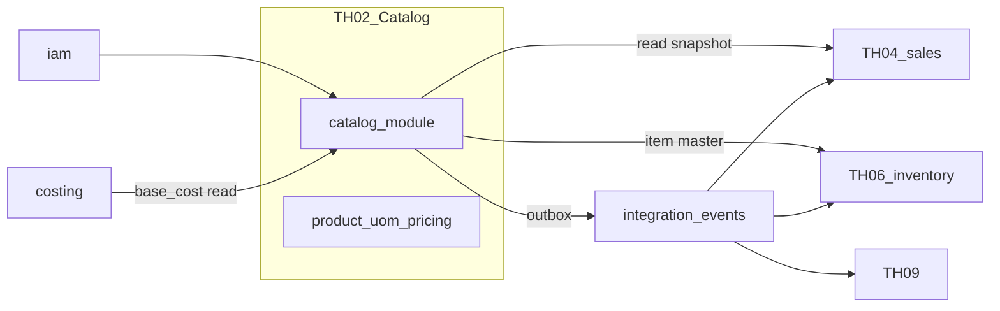

# TH-02 — Module map

## Bảng module

| Module | Vai trò | Owner / Supporting | Package | Trạng thái |
| ------ | ------- | ------------------ | ------- | ---------- |
| catalog | Product master, UOM, pricing, tồn cơ bản | **Owner** | `modules/catalog/` | planned (skeleton) |
| inventory | Stock item linkage; tồn chi tiết tách khỏi tồn cơ bản | Supporting | `modules/inventory/` | planned |
| costing | Giá vốn cơ sở định giá (read reference) | Supporting | `modules/costing/` | planned |
| iam | Auth, tenant, RBAC (`catalog.*`) | Supporting | `modules/iam/` | in_progress |

## Sơ đồ phụ thuộc



## Public contracts — integration events (publish)

Package: `modules/catalog/integration_events/`

Xem [01-domain-model.md](01-domain-model.md) cho danh sách event types.

## Snapshot DTOs (cho module khác)

| DTO | Consumer |
| --- | -------- |
| `ProductSnapshot` | sales (dòng đơn, barcode lookup) |
| `ProductPriceSnapshot` | sales (giá niêm yết/sàn theo UOM) |

## Permissions

Constants: `CatalogPermissions` trong `modules/catalog/domain/` — dùng trong `@RequiresPermission` trên commands/queries; codegen emit `catalog_access_metadata.g.dart`.

| Permission code | Gherkin label (ví dụ) | Epic/US |
| --------------- | --------------------- | ------- |
| `catalog.product.view` | Xem danh sách sản phẩm | Epic-01/US-02 |
| `catalog.product.create` | Ghi nhận sản phẩm mới | Epic-01/US-01 |
| `catalog.product.update` | Chỉnh sửa hồ sơ / ảnh / tồn | Epic-01/US-03 |
| `catalog.product.view_detail` | Xem chi tiết sản phẩm | Epic-01/US-02 |
| `catalog.product.manage_status` | Ngừng KD / kinh doanh lại | Epic-01/US-04 |
| `catalog.product.delete` | Xóa sản phẩm đủ điều kiện | Epic-01/US-04 |
| `catalog.product.manage_units` | Quản lý đơn vị đo lường | Epic-01/US-05 |
| `catalog.pricing.manage` | Thiết lập giá cấp cửa hàng / SP | Epic-02/US-01, US-02 |

## Ranh giới

- Catalog **không** tạo đơn bán, phiếu nhập, phiếu điều chỉnh tồn kho chi tiết, hóa đơn
- Tồn cơ bản lúc tạo/chỉnh từ hồ sơ SP ≠ nghiệp vụ kho TH-06
- Giá vốn hiện hành / cơ sở định giá: catalog **chỉ đọc** từ costing (TH-06) — không mutate
- Barcode lookup tại POS: consumer TH-04 qua snapshot/query contract

## Messaging

Schema `catalog`: outbox/inbox/internal_commands — [messaging_schema.md](../../../operations/messaging_schema.md).

## Presentation layout

Dual path — pages trong ERP shell, dialog/widget tái dùng trong module presentation:

```text
apps/erp/lib/features/catalog/presentation/
  pages/          — route screens (thin composition, ≤ 500 dòng)
  widgets/        — widget chỉ dùng trong feature catalog (ERP shell)
  bloc/           — feature state (optional)

modules/catalog/presentation/
  lib/src/widgets/ — DeactivateProductDialog, ChangeBaseUnitDialog, ...
```

**Import rule:** `apps/erp` → `vet45_catalog_presentation`; module presentation **không** import `apps/erp`.

Skill: [.cursor/skills/presentation-layer/SKILL.md](../../../../.cursor/skills/presentation-layer/SKILL.md)

## Downstream consumers

| Theme | Dùng dữ liệu TH-02 cho |
| ----- | ----------------------- |
| TH-04 Bán hàng | Snapshot SP/giá trên dòng đơn, barcode lookup |
| TH-06 Kho & giá vốn | Item linkage; giá vốn feed vào tính giá |
| TH-07 Hóa đơn | Mô tả hàng trên hóa đơn |
| TH-09 Dashboard | KPI doanh thu theo SP |

Cross-theme: [TH-04 module map](../TH-04-sales-orders/02-module-map.md) · [TH-06 module map](../TH-06-inventory-and-costing/02-module-map.md)
