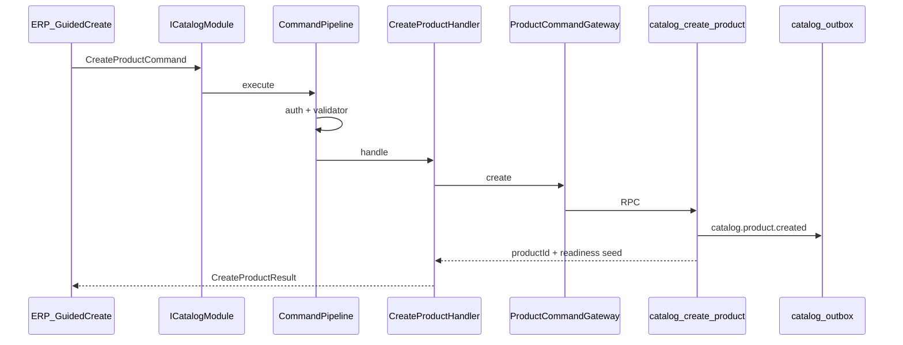
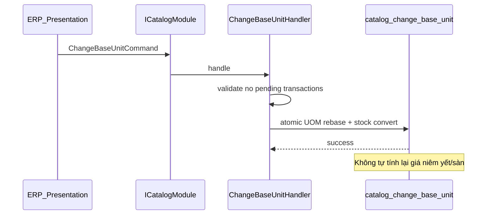

# TH-02 — Architecture & flows (v3)

Tuân theo [05-layered-module-structure.md](../../../architecture/05-layered-module-structure.md) và [02-architecture-style.md](../../../architecture/02-architecture-style.md) (CQRS, RPC-first).

Yêu cầu xuyên suốt (tenant, readiness, snapshot, soft delete): [OVERVIEWS.md](../OVERVIEWS.md).

User flows chi tiết: [APPENDICES.md](../APPENDICES.md) (Phụ lục B).

Draft SQL/RPC: `supabase/migrations/_drafts/` — không tạo file timestamp trong `supabase/migrations/` (AGENTS.md).

## Luồng guided create (EPIC-02/US-01)



Sau create: readiness **summary/blocker** + gợi ý bước tiếp (EPIC-02/US-03) → Product Control Center (EPIC-01/US-02). Checklist đầy đủ trên PCC = EPIC-01/US-02/FR-04 (**pending**).

## Luồng tra cứu + readiness (EPIC-01/US-01)

```text
UI → ICatalogModule.executeQueryAsync(SearchProductsQuery | ScanBarcodeQuery)
  → QueryBus → Handler
  → ICatalogReadGateway → catalog.v_product_list (kèm readiness chip)
  → ProductSearchResultDto
```

## Product Control Center (EPIC-01/US-02)

```text
UI → GetProductControlCenterQuery
  → aggregate read model:
      profile, units, stock source, base price source, price bands,
      customFieldGroupCards[] (active groups theo sort_order),
      readinessSummary (early),
      checklist[] (FR-04 pending — chưa implement UI đầy đủ),
      contextual actions[], change history preview
```

Không dùng một nút "Sửa" chung — actions theo permission + status + readiness.

## Card nhóm thông tin (EPIC-01/US-02/FR-03, EPIC-03)

```text
Read model: active CustomFieldGroups (sort_order)
  → mỗi group = card (name, icon, fields theo field.sort_order, values, requiredMissing)
  → vị trí UI: sau Khung giá bán, trước Ghi chú
  → guided create + PCC dùng cùng contract cards
```

## Dup-check SKU / barcode (EPIC-02/US-01 FR-02)

```text
1. Optional pre-check: catalog.check_duplicate_product_code (read, tenant-scoped)
2. UI hiển thị lỗi trùng tại field
3. CreateProductCommand / UpdateProductProfileCommand
4. RPC validate tenant-scoped unique index (defense in depth)
```

## Chỉnh tồn cơ bản (EPIC-05/US-02)

```text
UI → AdjustBasicStockCommand
  → Handler tính delta = newQty - currentQty
  → Gateway → catalog.adjust_basic_stock RPC
  → INSERT product_stock_movements + UPDATE product_stock (same txn)
  → Không tạo phiếu nhập / công nợ (out of scope TH-06)
```

Stock profile (EPIC-05/US-01) xác định basic vs advanced trước khi cho chỉnh tồn.

## Đổi đơn vị cơ sở (EPIC-04/US-03) — out_of_scope

**Không implement.** Sơ đồ tham khảo khi product mở lại US:



## Định giá & khung giá bán (EPIC-06)

```text
Giá cơ sở định giá:
  Foundation: Manual base price (SetManualBasePriceCommand)
  Growth (pending module): read từ costing gateway — không mutate

Store Price Rule (EPIC-06/US-02):
  gợi ý list/floor = basePrice × (1 + ratio) — preview UI có thể không persist

Product Unit Price Band (EPIC-06/US-03):
  Giá niêm yết + Giá sàn theo đơn vị bán; Giá sàn ≤ Giá niêm yết

Snapshot cho Sales/Promotions (EPIC-06/US-04): ProductPriceBandSnapshot
```

## Điểm commit (RPC draft)

| Bước | RPC |
| ---- | --- |
| Tạo SP | `catalog.create_product` |
| Cập nhật hồ sơ | `catalog.update_product_profile` |
| Cập nhật ảnh | `catalog.update_product_images` |
| Chỉnh tồn cơ bản | `catalog.adjust_basic_stock` |
| Ngừng KD / KD lại | `catalog.deactivate_product` / `catalog.reactivate_product` |
| Xóa mềm / khôi phục | `catalog.delete_product` / `catalog.restore_product` |
| UOM mutations | `catalog.add_product_unit` / `catalog.deactivate_product_unit` / … |
| Đổi base unit | `catalog.change_base_unit` (**out_of_scope**) |
| Store price rule | `catalog.set_store_price_rule` |
| Price band | `catalog.set_product_unit_price_band` |
| Tra cứu | `catalog.search_products` / `catalog.get_product_control_center` |
| Dup check | `catalog.check_duplicate_product_code` |
| Init template nhóm/trường | `catalog.initialize_custom_field_template` |
| Upsert nhóm / trường | `catalog.upsert_custom_field_group` / `catalog.upsert_custom_field` |
| Reorder | `catalog.reorder_custom_field_groups` / `catalog.reorder_custom_fields` |
| Field attributes | `catalog.configure_custom_field_attributes` |
| Values trên SP | `catalog.upsert_product_custom_field_values` |

## Read vs write

| | Cơ chế |
| - | ------ |
| Writes | Command → Gateway → RPC (+ outbox same txn) |
| Reads | Query → Read gateway → `catalog.v_*` views |
| Giá vốn (display, Growth) | Query → costing read port / joined view — không mutate |
| Advanced stock (Growth) | Query → inventory read port — không mutate |

## Liên kết

- [07-integration-and-messaging.md](../../../architecture/07-integration-and-messaging.md)
- [09-application-commands.md](../../../architecture/09-application-commands.md)
- [07-api-contracts.md](07-api-contracts.md)
