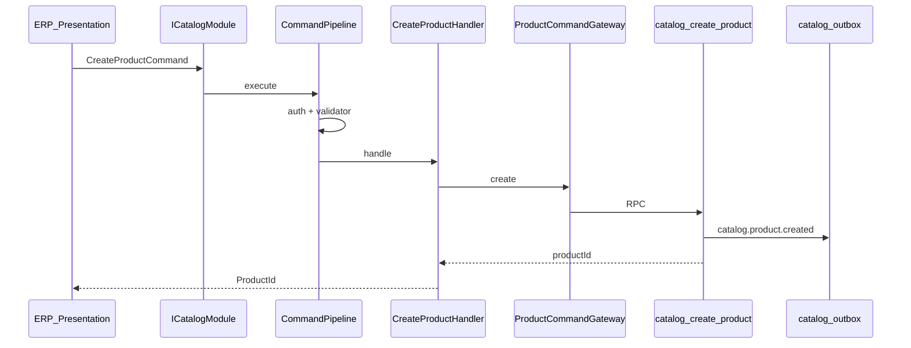
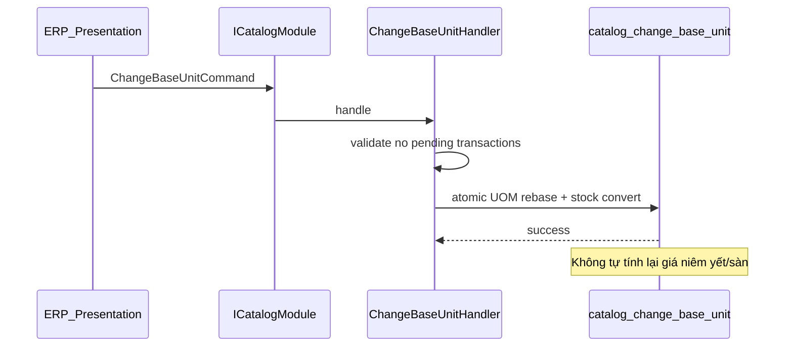

# TH-02 — Architecture & flows

Tuân theo [05-layered-module-structure.md](../../../architecture/05-layered-module-structure.md) và [02-architecture-style.md](../../../architecture/02-architecture-style.md) (CQRS, RPC-first).

## Luồng ghi nhận sản phẩm (Epic-01/US-01)



Ảnh upload và tồn khởi tạo nằm trong cùng transaction RPC — không tạo dữ liệu rời rạc (FR US-01/FR-02 EC-06, FR-03 EC-05).

## Luồng tra cứu (Epic-01/US-02)

```text
UI → ICatalogModule.executeQueryAsync(SearchProductsQuery | GetProductDetailQuery)
  → QueryBus → Handler
  → ICatalogReadGateway → catalog.v_* views
  → DTO (kèm giá computed, tồn, UOM summary)
```

## Dup-check SKU / barcode (Epic-01/US-01 FR-01)

```text
1. Optional pre-check: catalog.check_duplicate (read, tenant-scoped)
2. UI hiển thị lỗi trùng tại field
3. CreateProductCommand / UpdateProductProfileCommand
4. RPC validate tenant-scoped unique index (defense in depth)
```

## Chỉnh tồn cơ bản (Epic-01/US-03 FR-03)

```text
UI → AdjustBasicStockCommand
  → Handler tính delta = newQty - currentQty
  → Gateway → catalog.adjust_basic_stock RPC
  → INSERT product_stock_movements + UPDATE product_stock (same txn)
  → Không tạo phiếu nhập / công nợ (out of scope TH-06)
```

## Đổi đơn vị cơ sở (Epic-01/US-05 FR-05)



## Tính giá (Epic-02)

```text
Giá vốn cơ sở định giá (read từ costing gateway / DTO)
  → STORE mode: list = baseCost × (1 + store.listRatio)
                 floor = baseCost × (1 + store.floorRatio)
  → PRODUCT mode: dùng product_prices (base unit)
  → UOM khác: auto = baseUnitPrice × conversionRateToBase
              hoặc manual override nếu use_auto_price = false
```

Preview giá mẫu trên màn hình store pricing **không** persist — chỉ UI (Epic-02/US-01 BR-06).

## Điểm commit

| Bước | RPC |
| ---- | --- |
| Tạo SP | `catalog.create_product` |
| Cập nhật hồ sơ | `catalog.update_product_profile` |
| Cập nhật ảnh | `catalog.update_product_images` |
| Chỉnh tồn cơ bản | `catalog.adjust_basic_stock` |
| Ngừng KD / KD lại | `catalog.deactivate_product` / `catalog.reactivate_product` |
| Xóa mềm | `catalog.delete_product` |
| UOM mutations | `catalog.add_product_unit` / `catalog.deactivate_product_unit` / ... |
| Đổi base unit | `catalog.change_base_unit` |
| Giá cấp cửa hàng | `catalog.set_store_pricing` / `catalog.unset_store_pricing` |
| Giá cấp SP | `catalog.set_product_price_mode` / `catalog.set_product_price` / `catalog.set_product_unit_price` |
| Tra cứu | `catalog.search_products` / `catalog.get_product_detail` |
| Dup check | `catalog.check_duplicate` |

## Read vs write

| | Cơ chế |
| - | ------ |
| Writes | Command → Gateway → RPC (+ outbox same txn) |
| Reads | Query → Read gateway → `catalog.v_*` views |
| Giá vốn (display) | Query → costing read port / joined view — không mutate |
| Price history | Query → `catalog.v_product_price_history` |

## Liên kết

- [07-integration-and-messaging.md](../../../architecture/07-integration-and-messaging.md)
- [09-application-commands.md](../../../architecture/09-application-commands.md)
