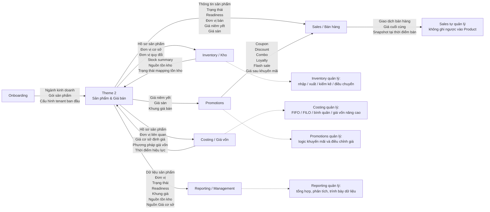

# Theme 2: Sản phẩm \& Giá bán \- v3

# A\.  TỔNG QUAN

## Giới thiệu

**Theme 2: Sản phẩm \& Giá bán** giúp người dùng quản lý dữ liệu nền liên quan đến sản phẩm trong Mosaic Retail, bao gồm hồ sơ sản phẩm, thông tin nhận diện, ảnh sản phẩm, đơn vị đo lường, tồn kho cơ bản, Giá cơ sở định giá, Giá niêm yết, Giá sàn, trạng thái kinh doanh, thông tin bổ sung và lịch sử thay đổi quan trọng\.

Theme này là một mắt xích nền trong chuỗi vận hành của Mosaic Retail\. Dữ liệu sản phẩm không đứng độc lập, mà được sử dụng lại bởi nhiều nghiệp vụ phía sau như bán hàng, nhập hàng, tồn kho, giá vốn, hóa đơn, ghi sổ, báo cáo và quản trị hiệu quả theo sản phẩm\.

Mosaic Retail trước mắt tập trung vào bán lẻ ngành thú y, nhưng sản phẩm được thiết kế theo hướng **retail\-first, industry\-extensible**\. Điều này có nghĩa là hệ thống cần phục vụ tốt ngành thú y ở giai đoạn đầu, nhưng không được khóa cứng dữ liệu sản phẩm vào các trường chuyên biệt như thành phần, chỉ định, chống chỉ định, cách dùng hoặc thời gian ngưng sử dụng\. Những thông tin này cần được chuyển sang mô hình **nhóm \& trường thông tin bổ sung** để sau này có thể mở rộng sang ngành khác\. Trong Guided creation, mỗi group active trở thành **card riêng có đánh số tự động**, nằm sau **Khung giá bán** và trước **Ghi chú**\.

## Phạm vi của Theme

### Trong phạm vi

|Nhóm|Nội dung|
|---|---|
|Hồ sơ sản phẩm|Tên sản phẩm, tên thương mại, SKU, barcode, ảnh, mô tả, ghi chú|
|Đơn vị đo lường|Đơn vị cơ sở, đơn vị quy đổi, tỷ lệ quy đổi, trạng thái đơn vị|
|Tồn kho|Tồn kho cơ bản trong Foundation, stock summary khi dùng tồn kho nâng cao|
|Giá cơ sở định giá|Nhập thủ công trong Foundation, hoặc đọc từ module Giá vốn ở gói nâng cao|
|Khung giá bán|Giá niêm yết, Giá sàn, quy tắc tính giá, giá theo đơn vị|
|Thông tin bổ sung|Custom field groups, custom fields, custom field values theo sản phẩm|
|Vòng đời sản phẩm|Đang kinh doanh, ngừng kinh doanh, đã xóa|
|Readiness|Trạng thái sản phẩm đã đủ sẵn sàng để nhập, bán, quản trị chưa|
|Truy vết|Lịch sử thay đổi quan trọng về hồ sơ, đơn vị, tồn kho, giá, trạng thái|

### Ngoài phạm vi

|Ngoài phạm vi|Module / Theme xử lý|
|---|---|
|Tạo đơn bán hàng, checkout, thanh toán|Sales / Order\-to\-cash|
|Tạo phiếu nhập hàng, nhà cung cấp, công nợ nhập hàng|Purchase / Inbound|
|Quản lý kho nâng cao, nhập/xuất/điều chỉnh/kiểm kê|Inventory / Kho|
|Tồn kho theo warehouse hoặc chi nhánh|Inventory / Kho|
|Tính giá vốn theo FIFO, FILO, bình quân cuối kỳ, bình quân linh hoạt|Costing / Giá vốn|
|Tính giá bán cuối cùng sau khuyến mãi|Promotions / Sales|
|Coupon, discount, loyalty, flash sale, combo|Promotions|
|Phê duyệt bán dưới Giá sàn|Sales control / Approval|
|Import/export hàng loạt|Data onboarding / Import\-export|

## Triết lý và nguyên tắc thiết kế

Theme 2 được thiết kế theo triết lý: **sản phẩm không chỉ là một bản ghi dữ liệu, mà là một đối tượng vận hành cần được đưa vào trạng thái sẵn sàng sử dụng trong hệ thống**\.


Vì vậy, trọng tâm của Theme không phải là “tạo/sửa/xóa sản phẩm”, mà là giúp người dùng trả lời rõ các câu hỏi:

- Sản phẩm này là gì?

- Sản phẩm đã tồn tại trong hệ thống chưa?

- Sản phẩm có đủ dữ liệu để nhập hàng, bán hàng và quản trị chưa?

- Sản phẩm đang thiếu dữ liệu gì?

- Dữ liệu nào được nhập trực tiếp trong Product, dữ liệu nào đến từ module khác?

- Người dùng nên làm hành động gì tiếp theo?

### Các khái niệm thiết kế chủ đạo

|Khái niệm|Diễn giải|Hệ quả thiết kế|
|---|---|---|
|**Product Readiness**|Sản phẩm không chỉ “đã được tạo”, mà cần đủ dữ liệu để vận hành an toàn\.|Mỗi sản phẩm cần có readiness status, checklist và blocker rõ ràng\.|
|**Guided Product Creation**|Tạo sản phẩm là một hành trình có hướng dẫn, không phải một form lớn chứa tất cả field\.|Flow tạo mới đi từ dữ liệu tối thiểu đến các bước hoàn thiện như đơn vị, tồn kho, giá và thông tin bổ sung\.|
|**Product Control Center**|Màn chi tiết sản phẩm là trung tâm điều phối dữ liệu và hành động của sản phẩm\.|Không dùng một nút “Sửa” chung; thay vào đó có các hành động theo ngữ cảnh\.|
|**Progressive Completion**|Người dùng có thể tạo sản phẩm tối thiểu trước, rồi hoàn thiện dần\.|Dữ liệu chưa có được ghi nhận thành readiness blocker thay vì ép nhập toàn bộ ngay từ đầu\.|
|**Contextual Action**|Hành động hiển thị phụ thuộc vào quyền, trạng thái kinh doanh, readiness và mode của tenant\.|UI chỉ hiển thị hoặc ưu tiên hành động phù hợp với tình trạng hiện tại của sản phẩm\.|
|**Source\-aware Product Data**|Một số dữ liệu được nhập trực tiếp trong Product, một số dữ liệu được đọc từ module chuyên trách\.|Product cần phân biệt rõ Basic stock vs Advanced stock, Manual base price vs Costing\-module base price\.|
|**Extensible Product Model**|Product cần đủ lean cho Foundation nhưng vẫn mở rộng được sang ngành khác và gói cao hơn\.|Thông tin bổ sung dùng custom fields; tồn kho, giá vốn, khuyến mãi được tách ranh giới rõ\.|

### Nguyên tắc thiết kế chính

|Nguyên tắc|Diễn giải|
|---|---|
|Sản phẩm phải có hành trình hoàn thiện|Không ép người dùng nhập mọi thứ trong một form lớn; hệ thống cần cho phép tạo tối thiểu rồi dẫn dắt hoàn thiện\.|
|Đơn vị cơ sở đi trước tồn kho và giá|Tồn kho, Giá cơ sở định giá và khung giá bán chỉ có ý nghĩa khi biết đang diễn giải theo đơn vị nào\.|
|Tồn kho được chuẩn hóa theo đơn vị cơ sở|Trong Basic stock, tồn kho được ghi nhận theo đơn vị cơ sở; các đơn vị khác chỉ là cách quy đổi\.|
|Giá cơ sở định giá là input của khung giá bán|Theme 2 không tính giá vốn nâng cao; hệ thống dùng Giá cơ sở định giá làm mốc để thiết lập Giá niêm yết và Giá sàn\.|
|Giá bán được quản trị bằng khung giá|Theme 2 quản lý Giá niêm yết và Giá sàn, không quản lý giá cuối cùng sau khuyến mãi\.|
|Thông tin bổ sung phải cấu hình được|Không hard\-code thông tin thú y vào Product; các thông tin như thành phần, chỉ định, chống chỉ định, cách dùng được quản lý bằng custom fields\.|
|Dữ liệu hiện hành không được phá vỡ dữ liệu lịch sử|Thay đổi tên, đơn vị, giá, tồn kho hoặc trạng thái hiện hành không được làm sai giao dịch, chứng từ hoặc báo cáo đã phát sinh\.|

### Ranh giới thiết kế quan trọng

|Phạm vi|Thuộc Theme 2|Không thuộc Theme 2|
|---|---|---|
|Sản phẩm|Hồ sơ sản phẩm, ảnh, trạng thái, readiness|Giao dịch bán hàng hoặc nhập hàng|
|Đơn vị|Đơn vị cơ sở, đơn vị quy đổi, vai trò đơn vị|Snapshot đơn vị trên từng giao dịch|
|Tồn kho|Basic stock hoặc đọc stock summary từ module Kho|Phiếu nhập, phiếu xuất, kiểm kê, điều chuyển kho nâng cao|
|Giá cơ sở định giá|Nhập thủ công hoặc đọc từ module Giá vốn|Tính giá vốn FIFO, FILO, bình quân|
|Khung giá bán|Giá niêm yết, Giá sàn theo đơn vị bán<br>|Coupon, discount, loyalty, giá cuối cùng sau khuyến mãi|
|Thông tin bổ sung|Custom field groups, custom fields, custom field values|Logic chuyên môn sâu của từng ngành nếu nằm ngoài dữ liệu sản phẩm|
|Lịch sử|Product Change History cho thay đổi quan trọng|Audit log kỹ thuật cấp thấp nếu không cần hiển thị nghiệp vụ|

### Nguyên tắc UX

- Mỗi màn hình phải giúp người dùng biết sản phẩm đang ở trạng thái nào\.

- Mỗi blocker phải chỉ rõ dữ liệu nào đang thiếu\.

- Mỗi blocker quan trọng nên có hành động tiếp theo nếu người dùng có quyền\.

- Các hành động nguy hiểm như ngừng kinh doanh, xóa hoặc đổi đơn vị cơ sở phải có xác nhận rõ ràng\.

- UI không nên dùng trạng thái kỹ thuật như `ACTIVE`, `INACTIVE`, `READY_TO_SELL` cho người dùng cuối\.

- Màn chi tiết sản phẩm không nên chỉ là màn “xem/sửa”, mà là nơi điều phối toàn bộ dữ liệu và hành động liên quan đến sản phẩm\.

    

Tóm lại, Theme 2 được thiết kế để đảm bảo:

> Một sản phẩm không chỉ được tạo trong hệ thống,  
> 
> mà phải từng bước trở thành một sản phẩm sẵn sàng để vận hành\.
> 
> 

## Hành trình người dùng

Tên hành trình đề xuất:

**Hành trình đưa sản phẩm vào trạng thái sẵn sàng vận hành**

Hành trình này mô tả cách người dùng biến một sản phẩm ngoài đời thành một sản phẩm có thể được hệ thống sử dụng trong bán hàng, nhập hàng, tồn kho, giá bán, hóa đơn, ghi sổ và báo cáo\.

|**Chặng**|**Tên chặng**|**Mục tiêu**|**Kết quả**|
|---|---|---|---|
|P1<br>|Phát hiện nhu cầu sản phẩm|Người dùng cần đưa một sản phẩm thực tế vào hệ thống|Có ý định tạo hoặc kiểm tra sản phẩm|
|P2|Kiểm tra sản phẩm đã tồn tại chưa|Tránh tạo trùng sản phẩm|Tìm thấy sản phẩm cũ hoặc bắt đầu tạo mới|
|P3|Tạo hồ sơ sản phẩm tối thiểu|Ghi nhận thông tin nhận diện cơ bản|Có hồ sơ sản phẩm ban đầu|
|P4|Thiết lập đơn vị cơ sở<br>|Xác định đơn vị gốc để quản lý tồn kho và quy đổi|Có đơn vị cơ sở hợp lệ|
|P5|Thiết lập tồn kho hoặc nguồn tồn kho|Biết sản phẩm đang có bao nhiêu hàng hoặc lấy tồn từ đâu|Có tồn kho cơ bản hoặc stock source|
|P6|Thiết lập Giá cơ sở định giá hoặc nguồn giá cơ sở|Có mốc chi phí dùng để tính khung giá bán|Có manual base price hoặc base price source|
|P7|Thiết lập Giá niêm yết và Giá sàn|Tạo khung giá bán chuẩn|Có price band hợp lệ|
|P8|Bổ sung đơn vị quy đổi|Cho phép bán/nhập/xem theo nhiều đơn vị|Có các đơn vị quy đổi hợp lệ nếu cần|
|P9|Bổ sung thông tin bổ sung|Ghi nhận dữ liệu chuyên biệt theo ngành|Có custom field values nếu cần|
|P10|Kiểm tra readiness|Biết sản phẩm đã sẵn sàng vận hành chưa|Có readiness status/checklist|
|P11|Sử dụng trong vận hành|Sản phẩm được dùng bởi các module khác|Dữ liệu sản phẩm đi vào bán hàng, nhập hàng, kho, báo cáo|
|P12|Bảo trì vòng đời|Cập nhật khi thực tế thay đổi|Sản phẩm được sửa, ngừng, kinh doanh lại hoặc xóa nếu đủ điều kiện|

## Mô hình readiness của sản phẩm

**Readiness** là trạng thái giúp người dùng biết một sản phẩm đã đủ dữ liệu để được sử dụng trong vận hành hay chưa\.

Readiness không thay thế trạng thái kinh doanh\. Một sản phẩm có thể đang `ACTIVE`, nhưng vẫn chưa sẵn sàng bán vì thiếu Giá niêm yết hoặc Giá sàn\. Ngược lại, một sản phẩm có thể có đủ hồ sơ, đơn vị, tồn kho và giá, nhưng đang `INACTIVE`, nên không được sử dụng trong giao dịch mới\.

Các nhóm readiness:

|**Nhóm readiness**|**Câu hỏi cần trả lời**|
|---|---|
|Hồ sơ|Sản phẩm đã có thông tin nhận diện tối thiểu chưa?|
|Đơn vị|Sản phẩm đã có đơn vị cơ sở hợp lệ chưa?|
|Tồn kho|Sản phẩm đã có tồn kho cơ bản hoặc nguồn tồn kho hợp lệ chưa?|
|Giá cơ sở định giá|Sản phẩm đã có Giá cơ sở định giá hoặc nguồn giá cơ sở chưa?|
|Khung giá bán|Sản phẩm đã có Giá niêm yết và Giá sàn hợp lệ chưa?|
|Thông tin bổ sung|Đối với nhóm và trường thông tin bổ sung, các field được đánh dấu required là dữ liệu bắt buộc\. Khi người dùng tạo hoặc sửa sản phẩm, hệ thống không cho lưu nếu các field required trong nhóm đang hoạt động chưa được điền hợp lệ\.<br>Các field không required có thể bỏ trống và không ảnh hưởng readiness\.|
|Vòng đời|Sản phẩm có được phép dùng trong giao dịch mới không?|

Các trạng thái readiness đề xuất:

|**Trạng thái**|**Ý nghĩa**|
|---|---|
|Chưa hoàn thiện|Sản phẩm đã được tạo nhưng còn thiếu dữ liệu quan trọng|
|Thiếu hồ sơ bắt buộc|Thiếu thông tin nhận diện tối thiểu|
|Thiếu đơn vị cơ sở|Chưa có đơn vị cơ sở hợp lệ|
|Thiếu thiết lập tồn kho|Chưa có tồn kho cơ bản hoặc stock source hợp lệ|
|Thiếu Giá cơ sở định giá|Chưa có manual base price hoặc base price từ module Giá vốn|
|Thiếu khung giá bán|Chưa có Giá niêm yết hoặc Giá sàn hợp lệ|
|Sẵn sàng nhập hàng|Có đủ hồ sơ và đơn vị để dùng trong nhập hàng|
|Sẵn sàng bán hàng|Có đủ hồ sơ, trạng thái hợp lệ, đơn vị bán và khung giá bán|
|Ngừng kinh doanh|Sản phẩm được giữ lại nhưng không dùng trong giao dịch mới|
|Đã xóa|Sản phẩm đã bị xóa mềm và không dùng trong vận hành mới|

Readiness nên được hiển thị ở ít nhất ba vị trí:

|**Vị trí**|**Cách hiển thị**|
|---|---|
|Danh sách sản phẩm|Chip ngắn như “Sẵn sàng bán”, “Thiếu giá”, “Ngừng KD”|
|Chi tiết sản phẩm|Checklist đầy đủ theo từng nhóm dữ liệu|
|Sau khi tạo sản phẩm|Gợi ý bước tiếp theo để hoàn thiện sản phẩm|

Ví dụ checklist sau khi tạo sản phẩm:

✓ Hồ sơ cơ bản

✓ Đơn vị cơ sở

○ Tồn kho

○ Giá cơ sở định giá

○ Khung giá bán

○ Đơn vị quy đổi

○ Thông tin bổ sung

## Các khái niệm cốt lõi

|**Khái niệm**|**Vai trò trong Theme 2**|
|---|---|
|**Hồ sơ sản phẩm**|Lớp nhận diện sản phẩm trong hệ thống, gồm tên sản phẩm, tên thương mại, SKU, barcode, ảnh, mô tả và ghi chú\.|
|**Đơn vị đo lường**|Xác định cách diễn giải số lượng, tồn kho, quy đổi và giá\. Mỗi sản phẩm cần có một đơn vị cơ sở tại một thời điểm\.|
|**Tồn kho / nguồn tồn kho**|Cho biết sản phẩm có dữ liệu tồn kho cơ bản hoặc nguồn tồn kho nâng cao hợp lệ hay chưa\.|
|**Giá cơ sở định giá**|Mốc chi phí dùng để thiết lập hoặc kiểm tra Giá niêm yết, Giá sàn và khung giá bán\.|
|**Khung giá bán**|Gồm Giá niêm yết và Giá sàn theo đơn vị bán\. Theme 2 quản lý khung giá bán, không tính giá bán cuối cùng sau khuyến mãi\.|
|**Nhóm \& trường thông tin bổ sung**|Tenant có thể cấu hình nhiều nhóm thông tin bổ sung cho sản phẩm\. Mỗi nhóm gồm nhiều trường thông tin\. Mỗi nhóm có tên, icon, thứ tự hiển thị và trạng thái\. Các nhóm đang hoạt động được hiển thị như các card riêng trong flow tạo sản phẩm và Product Control Center\.|
|**Vòng đời, lịch sử và snapshot**|Kiểm soát việc sản phẩm đang kinh doanh, ngừng kinh doanh, đã xóa mềm; đồng thời bảo toàn thay đổi quan trọng và dữ liệu đã phát sinh\.|

Tóm lại, các khái niệm trên là lớp ngôn ngữ chung để đọc các Epic/FR phía sau\. Mục này chỉ nhằm thống nhất cách hiểu, không cố gắng mô tả toàn bộ quan hệ xử lý của Theme 2\.

## Hành vi theo gói và chế độ vận hành

Mục này mô tả cách Theme 2 thay đổi hành vi theo từng gói sản phẩm và từng chế độ vận hành\.

Trong Theme 2, cần phân biệt rõ:

|**Lớp**|**Ý nghĩa**|
|---|---|
|**Gói sản phẩm**|Quyết định tenant được sử dụng nhóm năng lực nào\.|
|**Chế độ vận hành**|Quyết định dữ liệu được nhập trực tiếp trong Product hay đọc từ module chuyên trách\.|
|**Quy tắc chuyển đổi**|Quy định cách chuyển từ mô hình đơn giản sang mô hình nâng cao mà không phá vỡ dữ liệu cũ\.|

Nguyên tắc chung:

- Gói thấp cần đơn giản, dùng được ngay\.

- Gói cao có thể kết nối module chuyên trách\.

- Product không được tự xử lý nghiệp vụ chuyên sâu của module khác\.

- Khi chuyển từ chế độ đơn giản sang nâng cao, dữ liệu cũ phải được bảo toàn\.

### Hành vi theo gói sản phẩm

|**Gói**|**Hành vi trong Theme 2**|
|---|---|
|**Foundation**|Quản lý hồ sơ sản phẩm, nhiều ảnh sản phẩm, đơn vị đo lường, tồn kho cơ bản nhập trực tiếp, Giá cơ sở định giá nhập thủ công, Giá niêm yết, Giá sàn và readiness cơ bản\.|
|**Compliance**|Sử dụng dữ liệu sản phẩm để phục vụ hóa đơn, ghi sổ, truy vết và kiểm soát dữ liệu nền phục vụ tuân thủ\.|
|**Management**|Bổ sung góc nhìn readiness, lịch sử thay đổi, quản trị khung giá và dữ liệu nền cho phân tích hiệu quả theo sản phẩm\.|
|**Growth**|Cho phép kết nối module nâng cao như Kho, Giá vốn và Promotions; Product đọc dữ liệu từ module chuyên trách thay vì tự xử lý\.|

### Hành vi tồn kho theo chế độ

|**Chế độ**|**Gói áp dụng**|**Hành vi**|
|---|---|---|
|**Basic stock**|Foundation|Người dùng nhập và chỉnh tồn kho cơ bản trực tiếp trong Product\.|
|**Advanced stock**|Growth trở lên|Product không cho chỉnh tồn trực tiếp; tồn kho được đọc từ module Kho\.|

### Hành vi Giá cơ sở định giá theo chế độ

|**Chế độ**|**Gói áp dụng**|**Hành vi**|
|---|---|---|
|**Manual base price**|Foundation|Người dùng nhập Giá cơ sở định giá trực tiếp trong Product\.|
|**Costing\-module base price**|Growth trở lên|Product đọc Giá cơ sở định giá từ module Giá vốn\.|

### Quy tắc chuyển đổi sang chế độ nâng cao

|**Trường hợp**|**Hành vi**|
|---|---|
|**Chuyển Basic stock sang Advanced stock**|Khóa chỉnh tồn trực tiếp trong Product, bảo toàn dữ liệu tồn kho cơ bản cũ, đọc stock summary từ module Kho\.|
|**Chuyển Manual base price sang Costing\-module base price**|Khóa chỉnh manual base price nếu chính sách yêu cầu, hiển thị Giá cơ sở định giá từ module Giá vốn, bảo toàn lịch sử giá cơ sở thủ công\.|
|**Module tích hợp chưa khả dụng**|Hiển thị trạng thái chưa có nguồn dữ liệu, không hiển thị dữ liệu không chắc chắn\.|

## Ranh giới tích hợp và trách nhiệm module

Mục này mô tả cách Theme 2 tương tác với các module khác trong Mosaic Retail\.

Nguyên tắc chính:

- Theme 2 là nguồn quản lý dữ liệu nền của sản phẩm và khung giá bán\.

- Theme 2 không xử lý nghiệp vụ chuyên sâu thuộc module khác\.

- Khi cần dữ liệu từ module khác, Theme 2 chỉ đọc dữ liệu hoặc read model do module chuyên trách cung cấp\.

- Khi module khác cần dùng dữ liệu sản phẩm, Theme 2 cung cấp dữ liệu hiện hành phù hợp\.

- Giao dịch lịch sử cần dùng snapshot do module giao dịch ghi nhận, không phụ thuộc vào dữ liệu Product hiện hành\.




|**Module**|**Theme 2 đọc gì từ module này**|**Theme 2 cung cấp gì cho module này**|**Ranh giới trách nhiệm**|
|---|---|---|---|
|**Onboarding**|Ngành kinh doanh, gói sản phẩm, cấu hình ban đầu của tenant\.|Không đáng kể\.|Onboarding xác định ngữ cảnh ban đầu; Theme 2 dùng ngữ cảnh đó để khởi tạo cấu hình sản phẩm phù hợp\.|
|**Inventory / Kho**|Stock summary, nguồn tồn kho, trạng thái mapping tồn kho nếu tenant dùng Advanced stock\.|Hồ sơ sản phẩm, đơn vị cơ sở, đơn vị quy đổi nếu cần cho module Kho\.|Inventory quản lý tồn kho nâng cao; Theme 2 không tạo phiếu nhập, phiếu xuất, kiểm kê hoặc điều chuyển kho\.|
|**Costing / Giá vốn**|Giá cơ sở định giá, phương pháp tính giá vốn, thời điểm hiệu lực nếu tenant dùng Costing\-module base price\.|Hồ sơ sản phẩm và đơn vị liên quan nếu module Giá vốn cần tham chiếu\.|Costing tính giá vốn; Theme 2 không tự tính FIFO, FILO, bình quân hoặc các phương pháp giá vốn nâng cao\.|
|**Sales / Bán hàng**|Không đọc dữ liệu giao dịch bán hàng để tính giá trong Theme 2\.|Thông tin sản phẩm, trạng thái, readiness, đơn vị bán, Giá niêm yết và Giá sàn\.|Sales ghi nhận giá cuối cùng trên giao dịch và snapshot dữ liệu cần thiết tại thời điểm bán\.|
|**Promotions**|Không đọc khuyến mãi để thay đổi khung giá bán của Product\.|Giá niêm yết làm giá trước khuyến mãi, Giá sàn làm ngưỡng kiểm soát\.|Promotions xử lý coupon, discount, combo, loyalty, flash sale và các logic điều chỉnh giá\.|
|**Reporting / Management**|Không xử lý báo cáo trong Theme 2\.|Dữ liệu sản phẩm, đơn vị, trạng thái, readiness, khung giá, nguồn tồn kho và nguồn Giá cơ sở định giá\.|Reporting tổng hợp, phân tích và trình bày dữ liệu; Theme 2 chỉ cung cấp dữ liệu nền\.|


Ranh giới quan trọng:

|**Nội dung**|**Module chịu trách nhiệm chính**|
|---|---|
|Hồ sơ sản phẩm, ảnh, đơn vị, custom fields, readiness|Theme 2|
|Tồn kho cơ bản trong Foundation|Theme 2|
|Tồn kho nâng cao, tồn kho theo kho, kiểm kê, điều chuyển|Inventory / Kho|
|Giá cơ sở định giá thủ công|Theme 2|
|Giá vốn nâng cao|Costing / Giá vốn|
|Giá niêm yết, Giá sàn, khung giá bán|Theme 2|
|Giá cuối cùng sau khuyến mãi|Promotions / Sales|
|Giao dịch bán hàng và snapshot trên đơn hàng|Sales|
|Báo cáo quản trị theo sản phẩm|Reporting / Management|

Tóm lại:

> Theme 2 thiết lập dữ liệu nền về sản phẩm và khung giá bán\.  
> 
> Các module chuyên trách sử dụng dữ liệu này để thực hiện nghiệp vụ sâu hơn, nhưng không ghi đè trách nhiệm lõi của Theme 2\.
> 
> 

## Mô hình entity tóm tắt

Mục này mô tả ở mức tóm tắt các nhóm entity chính của Theme 2\.

Theme 2 lấy **Product** làm entity trung tâm\. Tuy nhiên, Product không nên chứa toàn bộ dữ liệu liên quan đến sản phẩm trong một bảng lớn\. Các nhóm dữ liệu có vòng đời riêng như ảnh, đơn vị, tồn kho, Giá cơ sở định giá, khung giá bán, custom fields, readiness và lịch sử thay đổi cần được tách thành entity riêng\.


Cách tổ chức này giúp:

- Giữ Product đủ gọn để quản lý thông tin nhận diện chính\.

- Cho phép từng nhóm dữ liệu có vòng đời, quyền, validation và lịch sử riêng\.

- Tránh hard\-code dữ liệu ngành vào Product\.

- Hỗ trợ mở rộng từ Foundation sang các gói nâng cao mà không phá dữ liệu cũ\.

- Bảo toàn dữ liệu lịch sử khi dữ liệu hiện hành thay đổi\.

    

Chi tiết entity, field chính và quan hệ đầy đủ được mô tả tại **Phụ lục E — Entity relationship diagram**\.

```Plain Text
Product
├─ Product Image
├─ Product Unit
│  └─ Product Unit Price Band
├─ Product Stock Profile
├─ Product Base Price Profile
├─ Product Custom Field Value
├─ Product Readiness
└─ Product Change History

Custom Field Group
└─ Custom Field
   └─ Product Custom Field Value

Store Price Rule
└─ Product Unit Price Band
```


|**Nhóm entity**|**Vai trò chính**|
|---|---|
|**Product**|Lưu thông tin nhận diện và trạng thái chính của sản phẩm như tên, tên thương mại, SKU, barcode, mô tả, ghi chú, trạng thái kinh doanh và trạng thái xóa mềm\.|
|**Product Image**|Lưu nhiều ảnh của sản phẩm, ảnh đại diện, thứ tự hiển thị và trạng thái ảnh\.|
|**Product Unit**|Lưu đơn vị cơ sở, đơn vị quy đổi, tỷ lệ quy đổi, vai trò đơn vị và trạng thái đơn vị\.|
|**Product Stock Profile**|Lưu cấu hình tồn kho của sản phẩm, bao gồm Basic stock hoặc Advanced stock, tồn kho cơ bản hoặc nguồn tồn kho nâng cao\.|
|**Product Base Price Profile**|Lưu cấu hình Giá cơ sở định giá của sản phẩm, bao gồm Manual base price hoặc nguồn giá cơ sở từ module Giá vốn\.|
|**Store Price Rule**|Lưu quy tắc định giá cấp cửa hàng hoặc tenant, dùng để gợi ý hoặc hỗ trợ thiết lập Giá niêm yết và Giá sàn\.|
|**Product Unit Price Band**|Lưu khung giá bán theo sản phẩm, đơn vị bán và cửa hàng nếu có, gồm Giá niêm yết và Giá sàn\.|
|**Custom Field Group**|Nhóm các nhóm \& trường thông tin bổ sung hoặc theo nhu cầu cấu hình của tenant\.|
|**Custom Field**|Định nghĩa field mở rộng như tên field, kiểu dữ liệu, required, searchable, filterable, display on list và trạng thái field\.|
|**Product Custom Field Value**|Lưu giá trị custom field theo từng sản phẩm\.|
|**Product Readiness**|Lưu hoặc phản ánh trạng thái sẵn sàng vận hành của sản phẩm và các blocker chính\.|
|**Product Change History**|Lưu lịch sử thay đổi quan trọng của sản phẩm để phục vụ truy vết và kiểm soát\.|


Nguyên tắc entity chính:

|**Nguyên tắc**|**Diễn giải**|
|---|---|
|**Product là trung tâm**|Product giữ thông tin nhận diện và trạng thái chính của sản phẩm\.|
|**Dữ liệu có vòng đời riêng được tách riêng**|Ảnh, đơn vị, tồn kho, giá, custom fields, readiness và lịch sử không nên nhồi trực tiếp vào Product\.|
|**Readiness là dữ liệu tổng hợp**<br>|Product Readiness phản ánh trạng thái sẵn sàng vận hành, có thể được tính động hoặc lưu cache tùy thiết kế kỹ thuật\.|
|**Custom fields dùng mô hình mở rộng**|Custom Field Group và Custom Field giúp mở rộng theo ngành mà không hard\-code vào Product\.|
|**Khung giá gắn với đơn vị bán**|Product Unit Price Band gắn với Product Unit để hỗ trợ Giá niêm yết và Giá sàn theo từng đơn vị bán\.|
|**Lịch sử được tách khỏi dữ liệu hiện hành**|Product Change History phục vụ truy vết, không thay thế dữ liệu hiện hành\.|
|**Entity chi tiết nằm ở phụ lục**|Phần chính chỉ nêu mô hình entity tóm tắt; field\-level và quan hệ chi tiết nằm ở Phụ lục E\.|

## Yêu cầu xuyên suốt của Theme 2

Mục này mô tả các yêu cầu áp dụng cho toàn bộ Theme 2, bất kể người dùng đang tạo sản phẩm, xem danh sách, quản lý đơn vị, chỉnh tồn kho, thiết lập giá, bổ sung thông tin bổ sung hay thay đổi trạng thái sản phẩm\.

Các yêu cầu này không thuộc riêng một Epic hoặc FR cụ thể\. Chúng là luật nền mà mọi Epic/FR trong Theme 2 phải tuân thủ\.

|**Nhóm**|**Yêu cầu**|
|---|---|
|**Tenant isolation**|Dữ liệu sản phẩm, ảnh, đơn vị, tồn kho, Giá cơ sở định giá, khung giá bán, custom fields, readiness và lịch sử thay đổi phải được giới hạn trong tenant hiện tại\.|
|**Phân quyền**|Mỗi hành động như xem, tạo, sửa, chỉnh giá, chỉnh tồn kho, quản lý đơn vị, ngừng kinh doanh, xóa, khôi phục và xem lịch sử phải kiểm tra quyền phù hợp\.|
|**Readiness**|Mọi thay đổi dữ liệu liên quan đến hồ sơ, đơn vị, tồn kho, Giá cơ sở định giá, khung giá bán, custom fields và vòng đời phải cập nhật readiness hoặc blocker tương ứng\.|
|**Lịch sử thay đổi**|Các thay đổi quan trọng về hồ sơ, ảnh, đơn vị, tồn kho, Giá cơ sở định giá, khung giá bán, custom fields, trạng thái và xóa mềm cần được ghi nhận để truy vết\.|
|**Snapshot**|Giao dịch lịch sử không được bị thay đổi khi dữ liệu sản phẩm hiện hành thay đổi\. Module giao dịch chịu trách nhiệm lưu snapshot tại thời điểm phát sinh giao dịch\.|
|**Soft delete**|Xóa sản phẩm ở UI người dùng là xóa mềm\. Dữ liệu lịch sử, giao dịch và báo cáo liên quan phải được bảo toàn\.|
|**Tích hợp module**|Product chỉ quản lý dữ liệu thuộc Theme 2\. Tồn kho nâng cao, giá vốn, khuyến mãi và giá giao dịch thuộc module chuyên trách\.|

Nguyên tắc áp dụng:

|**Nguyên tắc**|**Diễn giải**|
|---|---|
|**Dữ liệu hiện hành phục vụ vận hành hiện tại**|Product lưu trạng thái và dữ liệu mới nhất để sử dụng cho giao dịch mới\.|
|**Dữ liệu snapshot phục vụ lịch sử**|Các giao dịch đã phát sinh phải dựa trên snapshot tại thời điểm giao dịch, không phụ thuộc vào dữ liệu Product hiện hành\.|
|**Readiness phục vụ điều hướng và kiểm soát**|Readiness giúp người dùng biết sản phẩm còn thiếu gì và nên xử lý bước nào tiếp theo\.|
|**Module chuyên trách chịu trách nhiệm nghiệp vụ chuyên sâu**|Theme 2 không tự xử lý tồn kho nâng cao, giá vốn nâng cao, khuyến mãi hoặc giá cuối cùng trên giao dịch\.|
|**Quyền quyết định hành động khả dụng**|UI chỉ hiển thị hoặc cho phép hành động phù hợp với quyền, trạng thái sản phẩm và chế độ vận hành của tenant\.|
|**Thay đổi hiện hành không phá dữ liệu quá khứ**|Các thay đổi về tên, đơn vị, giá, tồn kho, custom fields hoặc trạng thái không được làm sai giao dịch, chứng từ hoặc báo cáo đã phát sinh\.|

## Ma trận validation chính

Mục này mô tả các validation chính áp dụng cho dữ liệu trong Theme 2\.

Ma trận này không thay thế Business rules trong từng FR\. Mục tiêu của nó là giúp team có một cái nhìn tổng hợp về các lỗi dữ liệu quan trọng, mức xử lý lỗi và ảnh hưởng đến readiness hoặc hành động của người dùng\.

### Mức xử lý validation

|**Mức xử lý**|**Ý nghĩa**|
|---|---|
|**Chặn lưu**|Dữ liệu không hợp lệ nên hệ thống không cho lưu\.|
|**Readiness blocker**|Dữ liệu có thể lưu, nhưng sản phẩm chưa được coi là sẵn sàng vận hành\.|
|**Cảnh báo**|Dữ liệu có rủi ro nhưng chưa nhất thiết chặn lưu\.|
|**Chặn hành động**|Dữ liệu hiện tại không cho phép thực hiện một hành động cụ thể\.|
|**Ẩn/khóa UI**|Field hoặc hành động không khả dụng do thiếu điều kiện, thiếu quyền hoặc sai mode vận hành\.|

### Ma trận validation

|**Nhóm dữ liệu**|**Validation chính**|**Mức xử lý**|**Kết quả khi lỗi**|
|---|---|---|---|
|**Tên sản phẩm**|Không được bỏ trống\.|Chặn lưu|Không cho tạo hoặc lưu hồ sơ sản phẩm\.|
|**SKU**|Không trùng trong cùng tenant nếu có nhập\.|Chặn lưu|Báo lỗi SKU đã được sử dụng\.|
|**Barcode**|Không trùng trong cùng tenant nếu có nhập\.|Chặn lưu|Báo lỗi barcode đã được sử dụng\.|
|**Ảnh sản phẩm**|Định dạng và dung lượng phải hợp lệ\.|Chặn lưu ảnh / không chặn sản phẩm|Không lưu ảnh lỗi; vẫn có thể lưu sản phẩm nếu dữ liệu khác hợp lệ\.|
|**Đơn vị cơ sở**|Mỗi sản phẩm có tối đa một đơn vị cơ sở hợp lệ\.|Readiness blocker / chặn dữ liệu phụ thuộc|Ghi blocker “Thiếu đơn vị cơ sở”; không cho nhập tồn kho, đơn vị quy đổi hoặc giá phụ thuộc nếu chưa có đơn vị\.|
|**Đơn vị quy đổi**|Tỷ lệ quy đổi \> 0; không trùng đơn vị đang hoạt động trong cùng sản phẩm\.|Chặn lưu|Không cho lưu đơn vị quy đổi\.|
|**Tồn kho cơ bản**|Cần có đơn vị cơ sở; không âm theo chính sách mặc định\.|Chặn lưu / cảnh báo theo chính sách|Không cho lưu tồn kho hoặc hiển thị cảnh báo nếu chính sách tenant cho phép tồn âm\.|
|**Giá cơ sở định giá**|Không âm; cần có đơn vị áp dụng hoặc nguồn giá hợp lệ\.|Readiness blocker / chặn lưu nếu nhập sai|Ghi blocker “Thiếu Giá cơ sở định giá” hoặc báo lỗi tại field giá\.|
|**Khung giá bán**|Giá sàn không được lớn hơn Giá niêm yết\.|Chặn lưu|Không cho lưu price band\.|
|**Custom fields**|Đúng kiểu dữ liệu, đúng option, đủ field bắt buộc nếu có\.|Chặn lưu / readiness blocker|Báo lỗi field hoặc ghi blocker “Thiếu thông tin bổ sung bắt buộc”\.|
|**Trạng thái sản phẩm**|Ngừng kinh doanh, kinh doanh lại, xóa mềm hoặc khôi phục cần quyền và điều kiện phù hợp\.|Chặn hành động|Không cho thực hiện nếu thiếu quyền hoặc không đủ điều kiện\.|
|**Mode tích hợp**|Không cho chỉnh dữ liệu trực tiếp nếu dữ liệu thuộc module chuyên trách\.|Ẩn/khóa UI / chặn hành động|Khóa chỉnh tồn kho trong Advanced stock; khóa chỉnh Giá cơ sở trong Costing\-module base price nếu chính sách yêu cầu\.|

### Nguyên tắc áp dụng validation

|**Nguyên tắc**|**Diễn giải**|
|---|---|
|**Validation phải theo tenant**<br>|SKU, barcode, custom fields, đơn vị và dữ liệu sản phẩm chỉ được kiểm tra trong phạm vi tenant hiện tại\.|
|**Validation phải theo mode vận hành**|Basic stock khác Advanced stock; Manual base price khác Costing\-module base price\.|
|**Validation phải theo quyền**|Người dùng không có quyền thì không được thực hiện hành động, kể cả khi dữ liệu hợp lệ\.|
|**Validation phải cập nhật readiness**|Các lỗi ảnh hưởng readiness cần tạo, cập nhật hoặc xóa blocker tương ứng\.|
|**Validation không được phá dữ liệu lịch sử**|Dữ liệu hiện hành sai hoặc thay đổi không được làm sai giao dịch, snapshot hoặc báo cáo đã phát sinh\.|
|**Validation UI phải dễ hiểu**|Lỗi cần hiển thị bằng ngôn ngữ nghiệp vụ, không dùng mã kỹ thuật nếu không cần thiết\.|

## Yêu cầu phi chức năng

Mục này mô tả các yêu cầu phi chức năng áp dụng cho Theme 2\.


Các yêu cầu này không mô tả trực tiếp người dùng làm gì, nhưng quyết định chất lượng vận hành của hệ thống: dữ liệu có đáng tin không, màn hình có đủ nhanh không, quyền có được kiểm soát không, lịch sử có truy vết được không, và hệ thống có mở rộng được sang ngành/gói cao hơn không\.

|**Nhóm**|**Yêu cầu**|
|---|---|
|**Toàn vẹn dữ liệu**<br>|SKU, barcode, đơn vị, tồn kho, Giá cơ sở định giá, khung giá bán và custom fields phải được validate trước khi lưu\. Dữ liệu không hợp lệ không được làm sai readiness, giao dịch hoặc báo cáo\.|
|**Hiệu năng**|Danh sách sản phẩm, tìm kiếm, lọc, quét barcode và readiness summary phải đủ nhanh cho trải nghiệm mobile\-first\.|
|**Bảo mật \& phân quyền**|Dữ liệu giá, tồn kho, lịch sử thay đổi, sản phẩm đã xóa và các hành động nhạy cảm chỉ hiển thị hoặc thực hiện theo quyền phù hợp\.|
|**Truy vết**|Các thay đổi quan trọng cần ghi nhận người thực hiện, thời điểm, loại thay đổi và giá trị trước/sau nếu khả dụng\.|
|**Mở rộng ngành**|Custom fields phải đủ linh hoạt để thêm ngành mới mà không sửa cấu trúc Product lõi\.|
|**Mở rộng gói**|Foundation phải dùng được độc lập; Growth có thể kết nối module Kho, Giá vốn và Promotions mà không phá dữ liệu cũ\.|
|**Khả dụng khi tích hợp lỗi**|Nếu module Kho, Giá vốn hoặc module tích hợp khác chưa trả dữ liệu, Product phải hiển thị trạng thái chưa khả dụng, không hiển thị dữ liệu không chắc chắn\.|

### Nguyên tắc hiệu năng

|**Khu vực**|**Yêu cầu**|
|---|---|
|**Danh sách sản phẩm**|Phải tải nhanh trên mobile, hỗ trợ phân trang, lazy loading hoặc cơ chế tương đương\.|
|**Tìm kiếm**|Tìm theo tên, SKU, barcode cần phản hồi nhanh; exact match theo SKU/barcode nên được ưu tiên\.|
|**Lọc sản phẩm**|Bộ lọc theo trạng thái, readiness và custom fields không được làm danh sách bị chậm rõ rệt\.|
|**Readiness summary**|Không nên tính toán nặng lặp lại trên UI nếu có thể dùng read model hoặc cache hợp lý\.|
|**Ảnh sản phẩm**|Ảnh cần được tối ưu để không làm chậm danh sách và màn chi tiết\.|

### Nguyên tắc bảo mật và quyền

|**Khu vực**|**Yêu cầu**|
|---|---|
|**Tenant isolation**|Mọi truy vấn và thao tác phải giới hạn trong tenant hiện tại\.|
|**Dữ liệu giá**|Giá cơ sở định giá, Giá sàn và lịch sử giá chỉ hiển thị cho người dùng có quyền phù hợp\.|
|**Dữ liệu tồn kho**|Số lượng tồn kho và lịch sử điều chỉnh tồn kho chỉ hiển thị theo quyền\.|
|**Lịch sử thay đổi**|Không tiết lộ lịch sử sản phẩm cho người dùng không có quyền truy vết\.|
|**Sản phẩm đã xóa**|Sản phẩm xóa mềm chỉ hiển thị cho người dùng có quyền xem dữ liệu đã xóa hoặc dữ liệu lịch sử\.|
|**Hành động nguy hiểm**|Ngừng kinh doanh, kinh doanh lại, xóa mềm, khôi phục và đổi đơn vị cơ sở cần quyền và xác nhận rõ ràng\.|

### Nguyên tắc khả dụng khi tích hợp lỗi

|Tình huống|Hành vi mong muốn|
|---|---|
|**Module Kho chưa trả stock summary**<br>|Hiển thị trạng thái chưa có dữ liệu tồn kho; không hiển thị số tồn kho không chắc chắn\.|
|**Module Giá vốn chưa trả Giá cơ sở định giá**|Hiển thị trạng thái chưa có nguồn Giá cơ sở; không tự tính thay module Giá vốn\.|
|**Promotions chưa khả dụng**|Product vẫn hiển thị khung giá bán hiện hành; không tính giá cuối cùng sau khuyến mãi\.|
|**Reporting chưa đồng bộ**|Product vẫn lưu dữ liệu hiện hành; báo cáo xử lý đồng bộ theo trách nhiệm của Reporting\.|
|**Read model bị stale**|UI cần thể hiện trạng thái đang cập nhật hoặc yêu cầu tải lại nếu dữ liệu có rủi ro sai\.|

### Nguyên tắc mở rộng

|**Hướng mở rộng**|**Yêu cầu**|
|---|---|
|**Mở rộng ngành**|Không thêm field ngành cố định vào Product nếu có thể xử lý bằng custom fields\.|
|**Mở rộng gói**|Các mode như Basic stock, Advanced stock, Manual base price, Costing\-module base price phải cùng tồn tại được theo cấu hình tenant\.|
|**Mở rộng module**|Theme 2 chỉ đọc hoặc cung cấp dữ liệu qua ranh giới rõ ràng; không phụ thuộc trực tiếp vào logic nội bộ của module khác\.|
|**Mở rộng dữ liệu giá**|Product Unit Price Band cần hỗ trợ giá theo đơn vị bán và có khả năng mở rộng theo cửa hàng nếu cần\.|
|**Mở rộng lịch sử**|Product Change History cần đủ linh hoạt để ghi nhận các loại thay đổi mới mà không phá dữ liệu cũ\.|

# B\. EPICS

## Epic 2\.1 — Tra cứu và điều hướng readiness sản phẩm


Epic này giúp người dùng tìm đúng sản phẩm, hiểu nhanh trạng thái vận hành của sản phẩm và mở đúng hành động tiếp theo\. Trọng tâm của Epic không chỉ là “xem danh sách sản phẩm”, mà là giúp người dùng trả lời nhanh các câu hỏi: sản phẩm này có tồn tại chưa, có còn kinh doanh không, có đủ dữ liệu để bán/nhập chưa, đang thiếu gì và cần xử lý ở đâu\.


Vai trò người dùng chính gồm chủ cửa hàng, nhân viên bán hàng, kế toán và quản lý kho nếu có\. Chủ cửa hàng cần nắm trạng thái tổng thể của danh mục sản phẩm\. Nhân viên bán hàng cần tìm nhanh sản phẩm đang được phép bán\. Kế toán cần kiểm tra dữ liệu nền phục vụ giá, hóa đơn, ghi sổ và báo cáo\. Quản lý kho cần đối chiếu trạng thái sản phẩm với tồn kho hoặc nguồn tồn kho\.


Epic này là điểm vào chính của Theme 2\. Từ danh sách sản phẩm, người dùng có thể đi vào chi tiết sản phẩm, tạo sản phẩm mới, hoàn thiện readiness, quản lý ảnh, quản lý đơn vị, tồn kho, Giá cơ sở định giá, khung giá bán hoặc trạng thái kinh doanh\.


---


### US 2\.1\.1 — Tra cứu và điều hướng danh mục sản phẩm

Là người dùng có quyền truy cập danh mục sản phẩm, tôi muốn tìm kiếm, lọc và nhận biết nhanh trạng thái của sản phẩm, để có thể mở đúng sản phẩm hoặc thực hiện đúng hành động tiếp theo\.

#### FR\-01\. Tìm kiếm, lọc và quét barcode

Hệ thống cho phép người dùng tìm sản phẩm theo các thông tin nhận diện phổ biến như tên sản phẩm, tên thương mại, SKU và barcode\. Nếu thiết bị hỗ trợ, người dùng có thể quét barcode để tìm sản phẩm nhanh hơn\.


**Business rules**

- BR\-01\. Chỉ tìm kiếm sản phẩm trong phạm vi tenant hiện tại\.

- BR\-02\. Người dùng chỉ thấy sản phẩm nếu có quyền xem danh mục sản phẩm\.

- BR\-03\. Tìm kiếm hỗ trợ tối thiểu theo tên sản phẩm, tên thương mại, SKU và barcode\.

- BR\-04\. SKU và barcode cần được ưu tiên so khớp chính xác\.

- BR\-05\. Sản phẩm đã xóa mềm không hiển thị mặc định\.

- BR\-06\. Kết quả tìm kiếm phải thể hiện được trạng thái kinh doanh và readiness chính của sản phẩm\.

    

**Edge cases**

- EC\-01\. Không tìm thấy sản phẩm nào\.

- EC\-02\. Tìm thấy nhiều sản phẩm có tên gần giống nhau\.

- EC\-03\. Barcode quét được nhưng không tồn tại trong tenant\.

- EC\-04\. Barcode/SKU thuộc sản phẩm đã ngừng kinh doanh\.

- EC\-05\. Barcode/SKU thuộc sản phẩm đã xóa mềm\.

    

**UI contract**


- UI\-01\. Màn danh sách có ô tìm kiếm nổi bật ở phía trên\.

- UI\-02\. Ô tìm kiếm cho phép nhập tên, SKU hoặc barcode\.

- UI\-03\. Nếu thiết bị hỗ trợ, có nút quét barcode cạnh ô tìm kiếm\.

- UI\-04\. Bộ lọc tối thiểu gồm trạng thái kinh doanh và readiness\.

- UI\-05\. Khi không có kết quả, hệ thống hiển thị empty state và gợi ý tạo sản phẩm mới nếu người dùng có quyền\.

    

**Scenarios**

```Gherkin
Scenario: Tìm sản phẩm theo tên trong tenant hiện tại
  Given người dùng có quyền xem danh mục sản phẩm
  And tenant hiện tại có sản phẩm "Amoxicillin 100ml"
  When người dùng tìm kiếm với từ khóa "Amoxicillin"
  Then hệ thống hiển thị sản phẩm "Amoxicillin 100ml"
  And hệ thống không hiển thị sản phẩm thuộc tenant khác

Scenario: Quét barcode của sản phẩm đang kinh doanh
  Given người dùng có quyền xem danh mục sản phẩm
  And tenant hiện tại có sản phẩm "Thuốc A" với barcode "893000001"
  And sản phẩm đang ở trạng thái "Đang kinh doanh"
  When người dùng quét barcode "893000001"
  Then hệ thống hiển thị đúng sản phẩm "Thuốc A"
  And hệ thống hiển thị trạng thái kinh doanh và readiness của sản phẩm

Scenario: Không tìm thấy sản phẩm theo SKU
  Given người dùng có quyền xem danh mục sản phẩm
  And tenant hiện tại chưa có sản phẩm nào với SKU "SKU-999"
  When người dùng tìm kiếm SKU "SKU-999"
  Then hệ thống hiển thị trạng thái không có kết quả
  And hệ thống gợi ý tạo sản phẩm mới nếu người dùng có quyền tạo sản phẩm
```


#### FR\-02\. Hiển thị danh sách sản phẩm với thông tin tóm tắt

Hệ thống hiển thị danh sách sản phẩm theo dạng phù hợp mobile\-first, giúp người dùng nhận diện nhanh từng sản phẩm mà không cần mở chi tiết\.

**Business rules**

- BR\-01\. Mỗi sản phẩm phải hiển thị thông tin nhận diện tối thiểu\.

- BR\-02\. Ảnh đại diện lấy từ Product Image được đánh dấu là ảnh chính\.

- BR\-03\. Nếu sản phẩm chưa có ảnh, hệ thống hiển thị placeholder\.

- BR\-04\. Tồn kho hiển thị theo stock mode hiện hành của tenant\.

- BR\-05\. Giá hiển thị theo khung giá bán hiện hành của đơn vị bán chính hoặc đơn vị cơ sở\.

- BR\-06\. Nếu thiếu dữ liệu quan trọng, hệ thống hiển thị readiness blocker thay vì để trống khó hiểu\.

    

**Edge cases**

- EC\-01\. Sản phẩm chưa có ảnh đại diện\.

- EC\-02\. Sản phẩm chưa có SKU hoặc barcode\.

- EC\-03\. Sản phẩm chưa có đơn vị cơ sở\.

- EC\-04\. Sản phẩm chưa có khung giá bán\.

- EC\-05\. Tenant dùng Advanced stock nhưng module Kho chưa trả về stock summary\.

    

**UI contract**

- UI\-01\. Mỗi sản phẩm hiển thị dưới dạng card hoặc row dễ đọc trên mobile\.

- UI\-02\. Thông tin tối thiểu gồm ảnh đại diện, tên sản phẩm, SKU/barcode nếu có,** trạng thái kinh doanh** và readiness\.

- UI\-03\. Nếu có dữ liệu giá, hiển thị Giá niêm yết chính\.

- UI\-04\. Nếu thiếu giá, hiển thị chip hoặc nhãn “Thiếu giá”\.

- UI\-05\. Người dùng có thể chạm vào sản phẩm để mở màn chi tiết\.

    

**Scenarios**

```Gherkin
Scenario: Hiển thị sản phẩm có đủ dữ liệu tóm tắt
  Given tenant hiện tại có sản phẩm "Thuốc A"
  And sản phẩm có ảnh đại diện, SKU, đơn vị cơ sở, tồn kho và Giá niêm yết
  When người dùng mở danh sách sản phẩm
  Then hệ thống hiển thị sản phẩm "Thuốc A"
  And hệ thống hiển thị ảnh đại diện, SKU, tồn kho, Giá niêm yết, trạng thái kinh doanh và readiness

Scenario: Hiển thị sản phẩm chưa có ảnh
  Given tenant hiện tại có sản phẩm "Thuốc B"
  And sản phẩm chưa có ảnh đại diện
  When người dùng mở danh sách sản phẩm
  Then hệ thống hiển thị placeholder ảnh cho sản phẩm "Thuốc B"
  And layout danh sách không bị vỡ

Scenario: Hiển thị sản phẩm thiếu khung giá bán
  Given tenant hiện tại có sản phẩm "Thuốc C"
  And sản phẩm chưa có Giá niêm yết hoặc Giá sàn
  When người dùng mở danh sách sản phẩm
  Then hệ thống hiển thị readiness blocker "Thiếu giá"
  And hệ thống không chỉ hiển thị giá rỗng gây khó hiểu
```


#### FR\-03\. Hiển thị trạng thái kinh doanh và readiness

Hệ thống cần phân biệt rõ trạng thái kinh doanh và readiness của sản phẩm, để người dùng không nhầm giữa “đang kinh doanh” và “đã sẵn sàng bán”\.


**Business rules**

- BR\-01\. Trạng thái kinh doanh phản ánh vòng đời sản phẩm: đang kinh doanh, ngừng kinh doanh hoặc đã xóa\.

- BR\-02\. Readiness phản ánh mức độ đủ dữ liệu để sản phẩm được dùng trong vận hành\.

- BR\-03\. Một sản phẩm đang kinh doanh vẫn có thể chưa sẵn sàng bán\.

- BR\-04\. Một sản phẩm đủ dữ liệu nhưng ngừng kinh doanh thì không được dùng trong giao dịch mới\.

- BR\-05\. Nếu có nhiều readiness blocker, hệ thống ưu tiên hiển thị blocker quan trọng nhất\.

- BR\-06\. Readiness phải được cập nhật sau khi dữ liệu liên quan thay đổi\.

    

**Edge cases**

- EC\-01\. Sản phẩm đang kinh doanh nhưng thiếu đơn vị cơ sở\.

- EC\-02\. Sản phẩm đang kinh doanh nhưng thiếu khung giá bán\.

- EC\-03\. Sản phẩm đủ dữ liệu nhưng đang ngừng kinh doanh\.

- EC\-04\. Sản phẩm đã xóa mềm nhưng vẫn còn dữ liệu lịch sử\.

- EC\-05\. Readiness chưa tính được do thiếu dữ liệu từ module tích hợp\.

    

**UI contract**

- UI\-01\. Trạng thái kinh doanh và readiness hiển thị bằng hai nhãn riêng\.

- UI\-02\. Trạng thái kinh doanh dùng nhãn ngắn như “Đang KD”, “Ngừng KD”, “Đã xóa”\.

- UI\-03\. Readiness dùng nhãn hành động như “Sẵn sàng bán”, “Thiếu đơn vị”, “Thiếu giá”\.

- UI\-04\. Khi người dùng chạm vào readiness, hệ thống điều hướng đến checklist hoặc phần cần hoàn thiện\.

- UI\-05\. Không dùng trạng thái kỹ thuật khó hiểu như `ACTIVE`, `INACTIVE`, `READY_TO_SELL` trên UI người dùng cuối\.

    

**Scenarios**

```Gherkin
Scenario: Sản phẩm đang kinh doanh và sẵn sàng bán
  Given sản phẩm "Thuốc A" đang ở trạng thái kinh doanh
  And sản phẩm có đủ hồ sơ, đơn vị, tồn kho hoặc nguồn tồn kho, Giá cơ sở định giá và khung giá bán
  When người dùng xem sản phẩm trong danh sách
  Then hệ thống hiển thị trạng thái "Đang KD"
  And hệ thống hiển thị readiness "Sẵn sàng bán"

Scenario: Sản phẩm đang kinh doanh nhưng thiếu giá
  Given sản phẩm "Thuốc B" đang ở trạng thái kinh doanh
  And sản phẩm chưa có Giá niêm yết hoặc Giá sàn
  When người dùng xem sản phẩm trong danh sách
  Then hệ thống hiển thị trạng thái "Đang KD"
  And hệ thống hiển thị readiness "Thiếu giá"

Scenario: Sản phẩm ngừng kinh doanh nhưng đủ dữ liệu
  Given sản phẩm "Thuốc C" có đủ dữ liệu vận hành
  And sản phẩm đang ở trạng thái ngừng kinh doanh
  When người dùng xem sản phẩm trong danh sách
  Then hệ thống hiển thị trạng thái "Ngừng KD"
  And hệ thống không hiển thị sản phẩm như một sản phẩm được phép dùng trong giao dịch mới
```


#### FR\-04\. Điều hướng đến chi tiết hoặc hành động tiếp theo

Từ danh sách sản phẩm, người dùng có thể mở màn chi tiết sản phẩm hoặc thực hiện một số hành động nhanh tùy quyền, trạng thái và readiness của sản phẩm\.


**Business rules**

- BR\-01\. Chạm vào sản phẩm sẽ mở màn chi tiết sản phẩm\.

- BR\-02\. Hành động nhanh chỉ hiển thị nếu người dùng có quyền tương ứng\.

- BR\-03\. Hành động nhanh phải phù hợp với trạng thái sản phẩm và readiness hiện tại\.

- BR\-04\. Các hành động nguy hiểm như xóa hoặc ngừng kinh doanh phải có bước xác nhận\.

- BR\-05\. Nếu tenant dùng Advanced stock, hành động quản lý tồn kho phải điều hướng sang module Kho\.

- BR\-06\. Nếu tenant dùng Costing\-module base price, hành động Giá cơ sở phải hiển thị dữ liệu read\-only hoặc điều hướng phù hợp\.

    

**Edge cases**

- EC\-01\. Người dùng không có quyền chỉnh sản phẩm\.

- EC\-02\. Sản phẩm đã ngừng kinh doanh\.

- EC\-03\. Sản phẩm đã xóa mềm\.

- EC\-04\. Sản phẩm thiếu readiness blocker nhưng người dùng không có quyền xử lý blocker đó\.

- EC\-05\. Module đích như Kho hoặc Giá vốn chưa khả dụng\.

    

**UI contract**

- UI\-01\. Card/row sản phẩm có vùng chạm rõ ràng để mở chi tiết\.

- UI\-02\. Hành động nhanh không làm rối danh sách; có thể đặt trong menu phụ\.

- UI\-03\. Hành động ưu tiên nên dựa trên readiness blocker hiện tại\.

- UI\-04\. Nếu người dùng không có quyền, hành động không hiển thị hoặc hiển thị disabled kèm lý do\.

- UI\-05\. Hành động nguy hiểm phải có confirm dialog\.

    

**Scenarios**

```Gherkin
Scenario: Mở Product control center từ danh sách sản phẩm
  Given người dùng có quyền xem sản phẩm
  And danh sách sản phẩm đang hiển thị sản phẩm "Thuốc A"
  When người dùng chạm vào sản phẩm "Thuốc A"
  Then hệ thống mở màn chi tiết sản phẩm
  And màn chi tiết hoạt động như Product control center

Scenario: Điều hướng đến màn thiết lập giá từ readiness blocker
  Given sản phẩm "Thuốc B" đang thiếu khung giá bán
  And người dùng có quyền quản lý giá sản phẩm
  When người dùng chọn hành động "Thiết lập giá" từ danh sách
  Then hệ thống mở màn quản lý khung giá của sản phẩm "Thuốc B"

Scenario: Không hiển thị hành động khi người dùng không có quyền
  Given sản phẩm "Thuốc C" đang thiếu khung giá bán
  And người dùng không có quyền quản lý giá sản phẩm
  When người dùng xem menu hành động của sản phẩm
  Then hệ thống không hiển thị hành động "Thiết lập giá"
  And hệ thống không cho người dùng mở màn quản lý khung giá từ danh sách
```


### US 2\.1\.2 — Xem chi tiết sản phẩm như một trung tâm điều phối

Là người dùng có quyền xem sản phẩm, tôi muốn mở chi tiết sản phẩm để xem toàn bộ dữ liệu quan trọng và các hành động theo ngữ cảnh, để biết sản phẩm đang ở trạng thái nào và cần xử lý gì tiếp theo\.

#### FR\-01\. Hiển thị hồ sơ tổng quan

Hệ thống hiển thị phần tổng quan sản phẩm ở đầu màn chi tiết, giúp người dùng nhận diện sản phẩm ngay lập tức\.


**Business rules**

- BR\-01\. Chỉ người dùng có quyền xem sản phẩm mới được mở chi tiết sản phẩm\.

- BR\-02\. Hồ sơ tổng quan phải hiển thị thông tin nhận diện chính của sản phẩm\.

- BR\-03\. Nếu sản phẩm có nhiều ảnh, ảnh đại diện phải được hiển thị trước\.

- BR\-04\. Trạng thái kinh doanh phải luôn hiển thị trên màn chi tiết\.

- BR\-05\. Sản phẩm đã xóa mềm chỉ được hiển thị nếu người dùng có quyền xem dữ liệu lịch sử hoặc dữ liệu đã xóa\.

- BR\-06\. Hồ sơ tổng quan không được thay thế cho các section vận hành như đơn vị, tồn kho, giá và readiness\.

    

**Edge cases**

- EC\-01\. Sản phẩm chưa có ảnh\.

- EC\-02\. Sản phẩm có nhiều ảnh nhưng chưa có ảnh nào được đánh dấu đại diện\.

- EC\-03\. Sản phẩm thiếu SKU hoặc barcode\.

- EC\-04\. Sản phẩm đã ngừng kinh doanh\.

- EC\-05\. Sản phẩm đã xóa mềm nhưng cần xem lại vì liên quan dữ liệu lịch sử\.

    

**UI contract**

- UI\-01\. Phần tổng quan nằm ở đầu màn chi tiết\.

- UI\-02\. Hiển thị tên sản phẩm, tên thương mại nếu có, SKU, barcode và trạng thái kinh doanh\.

- UI\-03\. Hiển thị ảnh đại diện và cho phép mở gallery ảnh\.

- UI\-04\. Nếu thiếu ảnh, hiển thị placeholder rõ ràng\.

- UI\-05\. Các hành động chỉnh sửa hồ sơ và quản lý ảnh được tách riêng\.

    

**Scenarios**

```Gherkin
Scenario: Xem chi tiết sản phẩm có đủ hồ sơ tổng quan
  Given người dùng có quyền xem sản phẩm
  And sản phẩm "Thuốc A" có tên, SKU, barcode và ảnh đại diện
  When người dùng mở chi tiết sản phẩm "Thuốc A"
  Then hệ thống hiển thị phần hồ sơ tổng quan ở đầu màn hình
  And hệ thống hiển thị tên, SKU, barcode, ảnh đại diện và trạng thái kinh doanh

Scenario: Xem chi tiết sản phẩm chưa có ảnh
  Given sản phẩm "Thuốc B" chưa có ảnh sản phẩm
  And người dùng có quyền xem sản phẩm
  When người dùng mở chi tiết sản phẩm "Thuốc B"
  Then hệ thống hiển thị placeholder ảnh
  And hệ thống không làm vỡ layout màn chi tiết
```


#### FR\-02\. Hiển thị đơn vị, tồn kho, Giá cơ sở định giá và khung giá bán

Màn chi tiết sản phẩm phải hiển thị rõ các dữ liệu vận hành cốt lõi: đơn vị đo lường, tồn kho, Giá cơ sở định giá, Giá niêm yết và Giá sàn\.


**Business rules**

- BR\-01\. Đơn vị cơ sở là dữ liệu nền để diễn giải tồn kho và giá\.

- BR\-02\. Tồn kho hiển thị theo stock mode hiện hành của tenant\.

- BR\-03\. Giá cơ sở định giá hiển thị theo base price mode hiện hành của tenant\.

- BR\-04\. Giá niêm yết và Giá sàn hiển thị theo đơn vị bán tương ứng\.

- BR\-05\. Nếu dữ liệu thuộc module khác quản lý, Theme 2 chỉ hiển thị hoặc điều hướng, không tự chỉnh sửa\.

- BR\-06\. Giá bán cuối cùng sau khuyến mãi không hiển thị như dữ liệu thuộc Theme 2\.

    

**Edge cases**

- EC\-01\. Sản phẩm chưa có đơn vị cơ sở\.

- EC\-02\. Tenant dùng Basic stock nhưng sản phẩm chưa có tồn kho cơ bản\.

- EC\-03\. Tenant dùng Advanced stock nhưng module Kho chưa trả stock summary\.

- EC\-04\. Tenant dùng Manual base price nhưng sản phẩm chưa có Giá cơ sở định giá\.

- EC\-05\. Tenant dùng Costing\-module base price nhưng module Giá vốn chưa trả dữ liệu\.

    

**UI contract**

- UI\-01\. Dữ liệu vận hành được chia thành các card hoặc section rõ ràng\.

- UI\-02\. Card đơn vị hiển thị đơn vị cơ sở và các đơn vị quy đổi nếu có\.

- UI\-03\. Card tồn kho hiển thị theo Basic stock hoặc Advanced stock\.

- UI\-04\. Card Giá cơ sở định giá hiển thị giá, nguồn giá và trạng thái nếu thiếu dữ liệu\.

- UI\-05\. Card khung giá bán hiển thị Giá niêm yết và Giá sàn theo đơn vị bán\.

    

**Scenarios**

```Gherkin
Scenario: Hiển thị dữ liệu vận hành trong Foundation
  Given tenant đang dùng Basic stock mode
  And tenant đang dùng Manual base price mode
  And sản phẩm "Thuốc A" có đơn vị cơ sở, tồn kho cơ bản, Giá cơ sở định giá và khung giá bán
  When người dùng mở chi tiết sản phẩm
  Then hệ thống hiển thị đơn vị cơ sở
  And hệ thống hiển thị tồn kho cơ bản
  And hệ thống hiển thị Giá cơ sở định giá thủ công
  And hệ thống hiển thị Giá niêm yết và Giá sàn

Scenario: Hiển thị dữ liệu vận hành khi dùng module nâng cao
  Given tenant đang dùng Advanced stock mode
  And tenant đang dùng Costing-module base price mode
  When người dùng mở chi tiết sản phẩm
  Then hệ thống hiển thị tồn kho từ stock summary của module Kho
  And hệ thống hiển thị Giá cơ sở định giá từ module Giá vốn
  And hệ thống không cho chỉnh trực tiếp tồn kho hoặc Giá cơ sở định giá trong Product

Scenario: Thiếu dữ liệu vận hành cốt lõi
  Given sản phẩm "Thuốc B" chưa có Giá cơ sở định giá
  When người dùng mở chi tiết sản phẩm
  Then hệ thống hiển thị trạng thái thiếu Giá cơ sở định giá
  And hệ thống hiển thị hành động tiếp theo nếu người dùng có quyền xử lý
```


#### FR\-03\. Hiển thị nhóm thông tin bổ sung như các card riêng

Hệ thống hiển thị mỗi Nhóm thông tin đang hoạt động như một card riêng trong Product Control Center\.

Tiêu đề card là tên nhóm\. Icon của card lấy từ icon được cấu hình trong **Thiết lập \> Sản phẩm \> Nhóm \& trường thông tin**\.

Các card nhóm thông tin xuất hiện sau **Khung giá bán** và trước **Ghi chú**\.

**Business rules**

- BR\-01\. Mỗi Nhóm thông tin đang hoạt động được hiển thị thành một card riêng trong Product Control Center\.

- BR\-02\. Tiêu đề card sử dụng tên nhóm thông tin hiện hành\.

- BR\-03\. Icon card sử dụng icon đã cấu hình cho nhóm\.

- BR\-04\. Thứ tự card nhóm thông tin tuân theo `group.sort_order`\.

- BR\-05\. Các card nhóm thông tin xuất hiện sau Khung giá bán và trước Ghi chú\.

- BR\-06\. Nhóm tạm tắt không hiển thị như card hiện hành, nhưng dữ liệu cũ vẫn phải được bảo toàn\.


**Edge cases**

- EC\-01\. Tenant chưa có custom field group nào\.

- EC\-02\. Group có field nhưng sản phẩm chưa có giá trị\.

- EC\-03\. Field bắt buộc bị bỏ trống\.

- EC\-04\. Field đã bị vô hiệu hóa nhưng sản phẩm có dữ liệu cũ\.

- EC\-05\. Custom fields quá nhiều làm màn chi tiết dài\.

    

**UI contract**

- UI\-01\. Product Control Center không hiển thị một card chung “Thông tin bổ sung”\.

- UI\-02\. Mỗi nhóm thông tin hiển thị thành một card ngang hàng với Hồ sơ sản phẩm, Ảnh sản phẩm, Đơn vị đo lường, Tồn kho, Giá cơ sở và Khung giá bán\.

- UI\-03\. Icon card lấy từ cấu hình nhóm\.

- UI\-04\. Nếu nhóm có field required thiếu dữ liệu, card cần hiển thị trạng thái lỗi hoặc thiếu dữ liệu\.

- UI\-05\. Khi người dùng mở card nhóm, hệ thống hiển thị các field trong nhóm theo `field.sort_order`\.

    

**Scenarios**

```Gherkin
Scenario: Hiển thị custom fields ngành thú y
  Given tenant được cấu hình ngành thú y
  And tenant có custom field group "Thông tin thuốc"
  And sản phẩm "Thuốc A" có giá trị cho các custom fields trong group này
  When người dùng mở chi tiết sản phẩm
  Then hệ thống hiển thị group "Thông tin thuốc"
  And hệ thống hiển thị các custom field values của sản phẩm

Scenario: Thiếu custom field bắt buộc
  Given tenant có custom field "Thời gian ngưng sử dụng" được đánh dấu bắt buộc
  And sản phẩm "Thuốc B" chưa có giá trị cho field này
  When người dùng mở chi tiết sản phẩm
  Then hệ thống hiển thị field còn thiếu
  And readiness của sản phẩm ghi nhận blocker tương ứng nếu field này ảnh hưởng readiness

Scenario: Custom field đã bị vô hiệu hóa
  Given custom field "Chống chỉ định cũ" đã bị vô hiệu hóa
  And sản phẩm "Thuốc C" vẫn có dữ liệu cũ cho field này
  When người dùng mở chi tiết sản phẩm
  Then hệ thống không cho nhập mới vào field này
  And hệ thống vẫn bảo toàn dữ liệu cũ để truy vết nếu cần
```


---


#### \(pending\) FR\-04\. Hiển thị readiness checklist

Hệ thống hiển thị readiness checklist để người dùng biết sản phẩm còn thiếu gì trước khi được coi là sẵn sàng vận hành\.


**Business rules**

- BR\-01\. Readiness checklist được tính từ dữ liệu hiện hành của sản phẩm\.

- BR\-02\. Checklist tối thiểu gồm hồ sơ, ảnh, đơn vị, tồn kho, Giá cơ sở định giá, khung giá bán, custom fields và vòng đời\.

- BR\-03\. Mỗi blocker cần có hành động tiếp theo nếu người dùng có quyền xử lý\.

- BR\-04\. Readiness không thay thế trạng thái kinh doanh\.

- BR\-05\. Readiness phải cập nhật sau khi dữ liệu liên quan thay đổi\.

- BR\-06\. Dữ liệu do module khác cung cấp cần được phân biệt với dữ liệu nhập trực tiếp trong Product\.

    

**Edge cases**

- EC\-01\. Sản phẩm thiếu nhiều blocker cùng lúc\.

- EC\-02\. Người dùng không có quyền xử lý blocker\.

- EC\-03\. Module Kho hoặc Giá vốn chưa trả dữ liệu\.

- EC\-04\. Sản phẩm đủ dữ liệu nhưng đang ngừng kinh doanh\.

- EC\-05\. Sản phẩm đã xóa mềm\.

    

**UI contract**

- UI\-01\. Checklist hiển thị rõ nhóm dữ liệu đã đủ và còn thiếu\.

- UI\-02\. Mỗi blocker nên có mô tả ngắn, dễ hiểu\.

- UI\-03\. Mỗi blocker có hành động tiếp theo nếu khả dụng\.

- UI\-04\. Checklist có thể hiển thị dạng card riêng trong Product control center\.

- UI\-05\. Sau khi xử lý blocker, checklist phải phản ánh trạng thái mới nhất\.

    

**Scenarios**

```Gherkin
Scenario: Hiển thị checklist cho sản phẩm thiếu giá
  Given sản phẩm "Thuốc A" có đủ hồ sơ và đơn vị cơ sở
  And sản phẩm chưa có Giá niêm yết hoặc Giá sàn
  When người dùng mở readiness checklist
  Then hệ thống hiển thị nhóm "Khung giá bán" ở trạng thái chưa hoàn thiện
  And hệ thống gợi ý hành động "Thiết lập giá" nếu người dùng có quyền

Scenario: Checklist cập nhật sau khi hoàn thiện blocker
  Given sản phẩm "Thuốc B" đang có blocker "Thiếu đơn vị cơ sở"
  And người dùng có quyền quản lý đơn vị
  When người dùng thiết lập đơn vị cơ sở hợp lệ cho sản phẩm
  Then hệ thống xóa blocker "Thiếu đơn vị cơ sở"
  And readiness checklist hiển thị trạng thái mới nhất

Scenario: Sản phẩm đủ dữ liệu nhưng ngừng kinh doanh
  Given sản phẩm "Thuốc C" có đủ dữ liệu để bán
  And sản phẩm đang ngừng kinh doanh
  When người dùng mở readiness checklist
  Then hệ thống hiển thị dữ liệu vận hành đã đủ
  And hệ thống vẫn hiển thị trạng thái vòng đời là "Ngừng kinh doanh"
```


#### FR\-05\. Hiển thị hành động theo ngữ cảnh

Màn chi tiết sản phẩm là trung tâm điều phối, nên các hành động phải rõ nghĩa và theo ngữ cảnh, thay vì chỉ có một nút chung là “Chỉnh sửa”\.


**Business rules**

- BR\-01\. Hành động hiển thị phụ thuộc vào quyền người dùng\.

- BR\-02\. Hành động hiển thị phụ thuộc vào trạng thái kinh doanh của sản phẩm\.

- BR\-03\. Hành động hiển thị phụ thuộc vào readiness blocker hiện tại\.

- BR\-04\. Hành động về tồn kho phụ thuộc vào stock mode của tenant\.

- BR\-05\. Hành động về Giá cơ sở định giá phụ thuộc vào base price mode của tenant\.

- BR\-06\. Hành động nguy hiểm như ngừng kinh doanh, kinh doanh lại hoặc xóa phải có xác nhận\.

    

**Edge cases**

- EC\-01\. Người dùng chỉ có quyền xem, không có quyền sửa\.

- EC\-02\. Sản phẩm đang ngừng kinh doanh\.

- EC\-03\. Sản phẩm đã xóa mềm\.

- EC\-04\. Tenant dùng Advanced stock nên không cho chỉnh tồn kho trực tiếp\.

- EC\-05\. Tenant dùng Costing\-module base price nên không cho chỉnh Giá cơ sở thủ công\.

    

**UI contract**

- UI\-01\. Không dùng một nút “Sửa” chung cho mọi thao tác\.

- UI\-02\. Các hành động chính gồm sửa thông tin, quản lý ảnh, quản lý đơn vị, quản lý tồn kho, quản lý Giá cơ sở, quản lý khung giá và quản lý trạng thái\.

- UI\-03\. Hành động ưu tiên nên nổi bật dựa trên blocker hiện tại\.

- UI\-04\. Hành động không khả dụng cần bị ẩn hoặc disabled kèm lý do\.

- UI\-05\. Hành động nguy hiểm phải có confirm dialog\.

    

**Scenarios**

```Gherkin
Scenario: Hiển thị hành động thiết lập giá khi sản phẩm thiếu giá
  Given sản phẩm "Thuốc A" đang thiếu khung giá bán
  And người dùng có quyền quản lý giá
  When người dùng mở Product control center
  Then hệ thống hiển thị hành động "Thiết lập giá"
  And hành động này điều hướng đến màn quản lý khung giá của sản phẩm

Scenario: Không cho chỉnh tồn kho trực tiếp khi dùng Advanced stock
  Given tenant đang dùng Advanced stock mode
  And người dùng mở Product control center của sản phẩm "Thuốc B"
  When hệ thống hiển thị nhóm hành động tồn kho
  Then hệ thống không hiển thị hành động chỉnh tồn kho trực tiếp trong Product
  And hệ thống hiển thị hành động điều hướng sang module Kho nếu khả dụng

Scenario: Người dùng chỉ có quyền xem sản phẩm
  Given người dùng chỉ có quyền xem sản phẩm
  When người dùng mở Product control center
  Then hệ thống hiển thị dữ liệu sản phẩm
  And hệ thống không hiển thị các hành động chỉnh sửa
```


#### FR\-06\. Hiển thị lịch sử thay đổi quan trọng

Hệ thống cho phép người dùng xem lịch sử thay đổi quan trọng của sản phẩm để phục vụ truy vết và kiểm soát\.


**Business rules**

- BR\-01\. Lịch sử thay đổi chỉ hiển thị cho người dùng có quyền phù hợp\.

- BR\-02\. Các thay đổi quan trọng về hồ sơ, ảnh, đơn vị, tồn kho, Giá cơ sở, khung giá, custom fields và trạng thái cần được ghi nhận\.

- BR\-03\. Mỗi bản ghi lịch sử cần có người thực hiện, thời điểm và loại thay đổi\.

- BR\-04\. Với thay đổi quan trọng về tồn kho và giá, cần ghi nhận giá trị trước và sau nếu khả dụng\.

- BR\-05\. Lịch sử thay đổi không được bị xóa khi sản phẩm bị ngừng kinh doanh\.

- BR\-06\. Sản phẩm đã xóa mềm vẫn cần bảo toàn lịch sử để phục vụ truy vết\.

    

**Edge cases**

- EC\-01\. Sản phẩm chưa từng có thay đổi nào sau khi tạo\.

- EC\-02\. Người dùng không có quyền xem lịch sử\.

- EC\-03\. Dữ liệu cũ bị thiếu do migration từ hệ thống trước\.

- EC\-04\. Thay đổi đến từ module tích hợp bên ngoài\.

- EC\-05\. Lịch sử quá dài cần phân trang hoặc lazy loading\.

    

**UI contract**

- UI\-01\. Lịch sử thay đổi nằm trong section hoặc tab riêng\.

- UI\-02\. Mỗi dòng lịch sử hiển thị thời điểm, người thực hiện, loại thay đổi và nội dung tóm tắt\.

- UI\-03\. Với thay đổi có giá trị trước/sau, người dùng có thể xem chi tiết nếu cần\.

- ~~UI\-04\. Nếu không có lịch sử, hiển thị empty state\.~~

- UI\-05\. Nếu người dùng không có quyền, không hiển thị section lịch sử hoặc hiển thị thông báo không có quyền\.

    

**Scenarios**

```Gherkin
Scenario: Xem lịch sử thay đổi giá
  Given sản phẩm "Thuốc A" đã từng được thay đổi Giá niêm yết
  And người dùng có quyền xem lịch sử sản phẩm
  When người dùng mở section lịch sử thay đổi
  Then hệ thống hiển thị bản ghi thay đổi Giá niêm yết
  And bản ghi có người thực hiện, thời điểm, giá trị trước và giá trị sau nếu khả dụng

Scenario: Người dùng không có quyền xem lịch sử
  Given sản phẩm "Thuốc B" có lịch sử thay đổi
  And người dùng không có quyền xem lịch sử sản phẩm
  When người dùng mở Product control center
  Then hệ thống không hiển thị section lịch sử thay đổi
  And hệ thống không hiển thị chi tiết các thay đổi đã phát sinh

Scenario: Sản phẩm đã xóa mềm vẫn bảo toàn lịch sử
  Given sản phẩm "Thuốc C" đã bị xóa mềm
  And sản phẩm có lịch sử thay đổi trước khi xóa
  And người dùng có quyền xem dữ liệu lịch sử
  When người dùng mở chi tiết sản phẩm đã xóa mềm
  Then hệ thống hiển thị lịch sử thay đổi của sản phẩm
  And hệ thống không cho sử dụng sản phẩm trong giao dịch mới
```

## Epic 2\.2 — Tạo sản phẩm theo hành trình có hướng dẫn

Epic này giúp người dùng tạo sản phẩm mới theo một flow có hướng dẫn, thay vì phải xử lý tất cả field trong một form lớn\. Mục tiêu là cho phép tạo hồ sơ sản phẩm tối thiểu trước, sau đó dẫn người dùng hoàn thiện các dữ liệu vận hành như ảnh, đơn vị cơ sở, tồn kho, Giá cơ sở định giá, khung giá bán và thông tin bổ sung\.

Vai trò người dùng chính gồm chủ cửa hàng và nhân viên được phân quyền tạo sản phẩm\. Người dùng không cần hiểu đầy đủ toàn bộ mô hình dữ liệu ngay từ đầu; hệ thống phải dẫn dắt họ theo đúng thứ tự nghiệp vụ\.

Flow tạo sản phẩm cần ưu tiên mobile\-first và không làm người dùng bị quá tải\. Hệ thống nên cho phép tạo nhanh sản phẩm tối thiểu, nhưng sau đó phải cho biết sản phẩm còn thiếu gì để sẵn sàng nhập hàng, bán hàng hoặc quản trị\.


### US 2\.2\.1 — Ghi nhận sản phẩm mới theo flow tạo tối thiểu

Là người dùng có quyền tạo sản phẩm, tôi muốn ghi nhận thông tin tối thiểu của sản phẩm trước, để có thể tạo hồ sơ sản phẩm nhanh mà không bị rối bởi quá nhiều dữ liệu vận hành ngay từ đầu\.


#### FR\-01\. Ghi nhận thông tin nhận diện và ảnh sản phẩm

Hệ thống cho phép người dùng nhập thông tin nhận diện tối thiểu khi tạo sản phẩm mới, bao gồm tên sản phẩm và các thông tin nhận diện bổ sung như tên thương mại, SKU, barcode, mô tả, ghi chú và ảnh sản phẩm\.


**Business rules**

- BR\-01\. Tên sản phẩm là thông tin bắt buộc để tạo sản phẩm\.

- BR\-02\. Tên thương mại, SKU, barcode, mô tả và ghi chú là thông tin không bắt buộc ở bước tạo tối thiểu\.

- BR\-03\. Người dùng có thể thêm nhiều ảnh sản phẩm\.

- BR\-04\. Nếu có nhiều ảnh, hệ thống phải xác định được ảnh đại diện\.

- BR\-05\. Nếu người dùng không chọn ảnh đại diện, hệ thống có thể dùng ảnh đầu tiên làm ảnh đại diện\.

- BR\-06\. Ảnh sản phẩm không bắt buộc để tạo sản phẩm, nhưng có thể được dùng trong readiness như dữ liệu khuyến nghị\.

    

**Edge cases**

- EC\-01\. Người dùng tạo sản phẩm không có ảnh\.

- EC\-02\. Người dùng thêm nhiều ảnh nhưng không chọn ảnh đại diện\.

- EC\-03\. Ảnh upload lỗi hoặc định dạng không hợp lệ\.

- EC\-04\. Tên sản phẩm bị bỏ trống\.

- EC\-05\. Tên sản phẩm quá dài so với giới hạn hệ thống\.

    

**UI contract**

- UI\-01\. Form tạo sản phẩm hiển thị tên sản phẩm là field bắt buộc\.

- UI\-02\. Các field bổ sung như tên thương mại, SKU, barcode, mô tả, ghi chú không được làm flow bị nặng\.

- UI\-03\. Khu vực ảnh cho phép thêm nhiều ảnh\.

- UI\-04\. Người dùng có thể nhận biết ảnh nào là ảnh đại diện\.

- UI\-05\. Nếu chưa có ảnh, hệ thống hiển thị trạng thái “Chưa có ảnh” nhưng không chặn tạo sản phẩm\.

    

**Scenarios**

```Gherkin
Scenario: Tạo sản phẩm với thông tin nhận diện tối thiểu
  Given người dùng có quyền tạo sản phẩm
  When người dùng nhập tên sản phẩm "Amoxicillin 100ml"
  And người dùng lưu sản phẩm
  Then hệ thống tạo sản phẩm mới
  And sản phẩm có tên "Amoxicillin 100ml"
  And sản phẩm được đưa vào bước kiểm tra readiness

Scenario: Tạo sản phẩm với nhiều ảnh
  Given người dùng có quyền tạo sản phẩm
  When người dùng nhập tên sản phẩm "Thuốc A"
  And người dùng upload 3 ảnh sản phẩm
  And người dùng chọn ảnh thứ 2 làm ảnh đại diện
  Then hệ thống tạo sản phẩm mới
  And hệ thống lưu cả 3 ảnh sản phẩm
  And ảnh thứ 2 được đánh dấu là ảnh đại diện

Scenario: Không cho tạo sản phẩm khi thiếu tên sản phẩm
  Given người dùng có quyền tạo sản phẩm
  When người dùng bỏ trống tên sản phẩm
  And người dùng lưu sản phẩm
  Then hệ thống không tạo sản phẩm mới
  And hệ thống hiển thị lỗi tại field tên sản phẩm
```


#### FR\-02\. Kiểm soát trùng SKU/barcode trong tenant

Hệ thống kiểm tra SKU và barcode trong phạm vi tenant hiện tại để hạn chế tạo trùng sản phẩm hoặc gây nhầm lẫn khi bán hàng, nhập hàng và quét mã\.


**Business rules**

- BR\-01\. SKU có thể bỏ trống khi tạo sản phẩm\.

- BR\-02\. Barcode có thể bỏ trống khi tạo sản phẩm\.

- BR\-03\. Nếu SKU được nhập, SKU không được trùng với sản phẩm khác trong cùng tenant\.

- BR\-04\. Nếu barcode được nhập, barcode không được trùng với sản phẩm khác trong cùng tenant\.

- BR\-05\. Sản phẩm đã xóa mềm vẫn cần được cân nhắc khi kiểm tra trùng SKU/barcode\.

- BR\-06\. Trùng SKU/barcode ở tenant khác không ảnh hưởng đến tenant hiện tại\.

    

**Edge cases**

- EC\-01\. SKU trùng với sản phẩm đang kinh doanh\.

- EC\-02\. Barcode trùng với sản phẩm ngừng kinh doanh\.

- EC\-03\. SKU/barcode trùng với sản phẩm đã xóa mềm\.

- EC\-04\. Hai người dùng cùng lúc tạo sản phẩm với cùng SKU\.

- EC\-05\. SKU hoặc barcode có khoảng trắng thừa ở đầu/cuối\.

    

**UI contract**

- UI\-01\. Field SKU và barcode hiển thị trạng thái lỗi ngay khi phát hiện trùng\.

- UI\-02\. Thông báo lỗi cần cho biết mã nào bị trùng\.

- UI\-03\. Nếu có thể, hệ thống hiển thị sản phẩm đang sử dụng SKU/barcode đó\.

- UI\-04\. Người dùng có thể mở sản phẩm đang bị trùng để kiểm tra\.

- UI\-05\. Hệ thống không cho lưu sản phẩm mới nếu SKU/barcode bị trùng\.

    

**Scenarios**

```Gherkin
Scenario: Không cho tạo sản phẩm khi SKU bị trùng trong tenant
  Given tenant hiện tại đã có sản phẩm "Thuốc A" với SKU "SKU-001"
  And người dùng có quyền tạo sản phẩm
  When người dùng tạo sản phẩm mới với SKU "SKU-001"
  Then hệ thống không cho lưu sản phẩm mới
  And hệ thống hiển thị thông báo SKU đã được sử dụng
  And hệ thống gợi ý mở sản phẩm đang dùng SKU này

Scenario: Cho phép tạo sản phẩm khi SKU trùng ở tenant khác
  Given tenant khác đã có sản phẩm với SKU "SKU-002"
  And tenant hiện tại chưa có sản phẩm nào với SKU "SKU-002"
  When người dùng tạo sản phẩm mới với SKU "SKU-002"
  Then hệ thống cho phép lưu sản phẩm mới trong tenant hiện tại

Scenario: Không cho tạo trùng khi hai người dùng lưu cùng SKU
  Given tenant hiện tại chưa có sản phẩm nào với SKU "SKU-003"
  And người dùng A và người dùng B cùng tạo sản phẩm với SKU "SKU-003"
  When người dùng A lưu sản phẩm thành công
  And người dùng B lưu sản phẩm sau đó
  Then hệ thống không cho người dùng B lưu sản phẩm
  And hệ thống hiển thị thông báo SKU đã được sử dụng
```


#### FR\-03\. Thiết lập đơn vị cơ sở

Hệ thống yêu cầu sản phẩm có đơn vị cơ sở để diễn giải tồn kho, quy đổi và giá\. Đơn vị cơ sở là một trong những dữ liệu nền quan trọng nhất của sản phẩm\.


**Business rules**

- BR\-01\. Mỗi sản phẩm cần có một đơn vị cơ sở tại một thời điểm\.

- BR\-02\. Đơn vị cơ sở là đơn vị gốc để diễn giải tồn kho trong Basic stock mode\.

- BR\-03\. Đơn vị cơ sở là đơn vị tham chiếu để thiết lập đơn vị quy đổi\.

- BR\-04\. Giá cơ sở định giá và khung giá bán cần gắn với đơn vị phù hợp\.

- BR\-05\. Nếu chưa có đơn vị cơ sở, sản phẩm chưa được coi là sẵn sàng nhập hàng hoặc bán hàng\.

- BR\-06\. Đơn vị cơ sở có thể được thiết lập ngay khi tạo sản phẩm hoặc trong bước hoàn thiện readiness sau khi tạo\.

    

**Edge cases**

- EC\-01\. Người dùng bỏ qua đơn vị cơ sở khi tạo sản phẩm\.

- EC\-02\. Người dùng nhập tên đơn vị mới chưa có trong hệ thống\.

- EC\-03\. Người dùng chọn sai đơn vị cơ sở và cần đổi sau\.

- EC\-04\. Đơn vị cơ sở bị trùng tên với đơn vị đã có\.

- ~~EC\-05\. Đơn vị cơ sở không phù hợp với dữ liệu tồn kho hoặc giá đã nhập\.~~

    

**UI contract**

- UI\-01\. Flow tạo sản phẩm cần giải thích ngắn gọn ý nghĩa của đơn vị cơ sở\.

- UI\-02\. Field đơn vị cơ sở nên có lựa chọn từ danh sách đơn vị phổ biến\.

- UI\-03\. Người dùng có thể thêm nhanh đơn vị mới nếu có quyền\.

- UI\-04\. Nếu bỏ qua đơn vị cơ sở, hệ thống phải ghi nhận readiness blocker\.

- UI\-05\. Hệ thống không nên yêu cầu người dùng nhập đơn vị quy đổi trước khi có đơn vị cơ sở\.

    

**Scenarios**

```Gherkin
Scenario: Thiết lập đơn vị cơ sở khi tạo sản phẩm
  Given người dùng có quyền tạo sản phẩm
  When người dùng nhập tên sản phẩm "Thuốc A"
  And người dùng chọn đơn vị cơ sở là "Lọ"
  And người dùng lưu sản phẩm
  Then hệ thống tạo sản phẩm mới
  And sản phẩm có đơn vị cơ sở là "Lọ"
  And readiness không còn blocker "Thiếu đơn vị cơ sở"

Scenario: Tạo sản phẩm nhưng bỏ qua đơn vị cơ sở
  Given người dùng có quyền tạo sản phẩm
  When người dùng nhập tên sản phẩm "Thuốc B"
  And người dùng chưa chọn đơn vị cơ sở
  And người dùng lưu sản phẩm theo flow cho phép tạo tối thiểu
  Then hệ thống tạo sản phẩm mới
  And readiness ghi nhận blocker "Thiếu đơn vị cơ sở"

Scenario: Thêm nhanh đơn vị mới khi tạo sản phẩm
  Given người dùng có quyền tạo sản phẩm
  And người dùng có quyền tạo đơn vị đo lường
  When người dùng nhập đơn vị cơ sở mới là "Vỉ"
  And người dùng lưu sản phẩm
  Then hệ thống tạo đơn vị "Vỉ" nếu hợp lệ
  And sản phẩm được gắn đơn vị cơ sở là "Vỉ"
```

#### FR\-04\. Tạo sản phẩm ở trạng thái khởi tạo hợp lệ

Sau khi người dùng nhập đủ dữ liệu tối thiểu, hệ thống tạo sản phẩm ở trạng thái hợp lệ và tính readiness ban đầu cho sản phẩm\.


**Business rules**

- BR\-01\. Sản phẩm mới được tạo trong phạm vi tenant hiện tại\.

- BR\-02\. Trạng thái kinh doanh mặc định của sản phẩm mới là “Đang kinh doanh”, trừ khi chính sách tenant quy định khác\.

- BR\-03\. “Đang kinh doanh” không đồng nghĩa với “Sẵn sàng bán”\.

- BR\-04\. Readiness ban đầu phải được tính dựa trên dữ liệu đã có tại thời điểm tạo\.

- BR\-05\. Sản phẩm sau khi tạo phải có thể mở ở Product control center\.

- BR\-06\. Hệ thống phải ghi nhận lịch sử tạo sản phẩm\.

    

**Edge cases**

- EC\-01\. Sản phẩm được tạo nhưng thiếu nhiều dữ liệu readiness\.

- EC\-02\. Người dùng mất kết nối trong lúc lưu sản phẩm\.

- EC\-03\. Lưu sản phẩm thất bại do lỗi kiểm tra trùng SKU/barcode\.

- EC\-04\. Lưu sản phẩm thất bại do lỗi upload ảnh\.

- EC\-05\. Người dùng không còn quyền tạo sản phẩm tại thời điểm lưu\.

    

**UI contract**

- UI\-01\. Sau khi lưu thành công, hệ thống hiển thị thông báo tạo sản phẩm thành công\.

- UI\-02\. Hệ thống không nên chỉ quay về danh sách mà không có hướng dẫn tiếp theo\.

- UI\-03\. Hệ thống nên điều hướng sang Product control center hoặc màn kết quả có checklist\.

- UI\-04\. Nếu lưu thất bại, hệ thống giữ lại dữ liệu người dùng đã nhập nếu có thể\.

- UI\-05\. Readiness ban đầu cần được hiển thị ngay sau khi tạo\.

    

**Scenarios**

```Gherkin
Scenario: Tạo sản phẩm hợp lệ và điều hướng sang Product control center
  Given người dùng có quyền tạo sản phẩm
  When người dùng nhập dữ liệu tối thiểu hợp lệ
  And người dùng lưu sản phẩm
  Then hệ thống tạo sản phẩm mới trong tenant hiện tại
  And hệ thống ghi nhận lịch sử tạo sản phẩm
  And hệ thống điều hướng người dùng sang Product control center

Scenario: Sản phẩm mới đang kinh doanh nhưng chưa sẵn sàng bán
  Given người dùng tạo sản phẩm mới với tên và đơn vị cơ sở
  And người dùng chưa thiết lập khung giá bán
  When sản phẩm được tạo thành công
  Then trạng thái kinh doanh của sản phẩm là "Đang KD"
  And readiness của sản phẩm là "Thiếu giá"

Scenario: Lưu sản phẩm thất bại do dữ liệu không hợp lệ
  Given người dùng đang tạo sản phẩm mới
  And SKU người dùng nhập đã bị trùng trong tenant
  When người dùng lưu sản phẩm
  Then hệ thống không tạo sản phẩm mới
  And hệ thống hiển thị lỗi tại field SKU
  And hệ thống giữ lại các dữ liệu hợp lệ người dùng đã nhập
```


### US 2\.2\.2 — Thiết lập dữ liệu vận hành ban đầu khi tạo sản phẩm

Là người dùng đang tạo sản phẩm, tôi muốn có thể thiết lập các dữ liệu vận hành ban đầu như tồn kho, Giá cơ sở định giá và khung giá bán theo đúng thứ tự, để sản phẩm có thể sớm được đưa vào vận hành mà không bị nhầm lẫn giữa đơn vị, tồn kho và giá\.


#### FR\-01\. Ghi nhận tồn kho ban đầu trong Basic stock mode

Nếu tenant đang dùng Basic stock mode, hệ thống cho phép người dùng nhập tồn kho ban đầu trực tiếp trong flow tạo sản phẩm hoặc sau khi tạo sản phẩm\.


**Business rules**

- BR\-01\. Chỉ cho nhập tồn kho ban đầu trực tiếp nếu tenant dùng Basic stock mode\.

- BR\-02\. Tồn kho ban đầu phải được diễn giải theo đơn vị cơ sở\.

- BR\-03\. Nếu chưa có đơn vị cơ sở, hệ thống không cho nhập tồn kho ban đầu\.

- BR\-04\. Tồn kho ban đầu trong Theme 2 không tạo phiếu nhập hàng hoặc chứng từ kho\.

- BR\-05\. Nếu người dùng bỏ qua tồn kho ban đầu, hệ thống ghi nhận readiness theo chính sách đã chốt\.

- BR\-06\. Khi tenant dùng Advanced stock mode, Product không cho chỉnh tồn kho trực tiếp\.

    

**Edge cases**

- EC\-01\. Người dùng nhập tồn kho trước khi chọn đơn vị cơ sở\.

- EC\-02\. Người dùng nhập tồn kho âm\.

- EC\-03\. Người dùng nhập tồn kho có số lẻ với đơn vị không cho phép số lẻ\.

- EC\-04\. Tenant đang dùng Advanced stock mode\.

- EC\-05\. Người dùng không có quyền chỉnh tồn kho\.

    

**UI contract**

- UI\-01\. Field tồn kho ban đầu chỉ hiển thị hoặc khả dụng trong Basic stock mode\.

- UI\-02\. Field tồn kho phải hiển thị kèm đơn vị cơ sở\.

- UI\-03\. Nếu chưa có đơn vị cơ sở, field tồn kho bị khóa hoặc không hiển thị\.

- ~~UI\-04\. Hệ thống cần giải thích tồn kho này là tồn kho cơ bản, không phải phiếu nhập hàng\.~~

- UI\-05\. Nếu tenant dùng Advanced stock mode, hệ thống hiển thị hướng dẫn xử lý tồn kho trong module Kho\.

    

**Scenarios**

```Gherkin
Scenario: Nhập tồn kho ban đầu trong Basic stock mode
  Given tenant đang dùng Basic stock mode
  And sản phẩm mới có đơn vị cơ sở là "Lọ"
  When người dùng nhập tồn kho ban đầu là 10
  And người dùng lưu sản phẩm
  Then hệ thống ghi nhận tồn kho cơ bản là 10 Lọ
  And hệ thống không tạo phiếu nhập hàng

Scenario: Không cho nhập tồn kho khi chưa có đơn vị cơ sở
  Given tenant đang dùng Basic stock mode
  And sản phẩm mới chưa có đơn vị cơ sở
  When người dùng đến bước nhập tồn kho ban đầu
  Then hệ thống không cho nhập tồn kho
  And hệ thống yêu cầu thiết lập đơn vị cơ sở trước

Scenario: Không cho chỉnh tồn kho trực tiếp trong Advanced stock mode
  Given tenant đang dùng Advanced stock mode
  When người dùng tạo sản phẩm mới
  Then hệ thống không hiển thị field nhập tồn kho ban đầu trực tiếp trong Product
  And hệ thống hiển thị hướng dẫn rằng tồn kho được quản lý trong module Kho
```


#### FR\-02\. Ghi nhận Giá cơ sở định giá thủ công trong Manual base price mode

Nếu tenant đang dùng Manual base price mode, hệ thống cho phép người dùng nhập Giá cơ sở định giá trực tiếp trong Product\.


**Business rules**

- BR\-01\. Chỉ cho nhập Giá cơ sở định giá thủ công nếu tenant dùng Manual base price mode\.

- BR\-02\. Giá cơ sở định giá là mốc chi phí dùng để tính hoặc kiểm tra khung giá bán\.

- BR\-03\. Giá cơ sở định giá cần gắn với đơn vị phù hợp, mặc định là đơn vị cơ sở\.

- BR\-04\. Giá cơ sở định giá không được là số âm\.

- BR\-05\. Nếu chưa có Giá cơ sở định giá, hệ thống vẫn có thể cho tạo sản phẩm nhưng phải ghi nhận readiness blocker\.

- BR\-06\. Khi tenant dùng Costing\-module base price mode, Product không cho nhập Giá cơ sở định giá thủ công\.

    

**Edge cases**

- EC\-01\. Người dùng nhập Giá cơ sở định giá bằng 0\.

- EC\-02\. Người dùng nhập Giá cơ sở định giá âm\.

- EC\-03\. Người dùng nhập Giá cơ sở định giá trước khi có đơn vị cơ sở\.

- EC\-04\. Tenant dùng Costing\-module base price mode\.

- EC\-05\. Người dùng không có quyền quản lý giá\.

    

**UI contract**

- UI\-01\. Field Giá cơ sở định giá hiển thị kèm đơn vị áp dụng\.

- UI\-02\. Hệ thống giải thích ngắn gọn đây là mốc chi phí để thiết lập giá bán\.

- UI\-03\. Nếu tenant dùng Costing\-module base price mode, field này hiển thị read\-only hoặc không hiển thị trong flow tạo\.

- UI\-04\. Nếu bỏ qua Giá cơ sở định giá, hệ thống hiển thị blocker sau khi tạo sản phẩm\.

- UI\-05\. Lỗi nhập giá phải hiển thị ngay tại field\.

    

**Scenarios**

```Gherkin
Scenario: Nhập Giá cơ sở định giá thủ công khi tạo sản phẩm
  Given tenant đang dùng Manual base price mode
  And sản phẩm mới có đơn vị cơ sở là "Lọ"
  When người dùng nhập Giá cơ sở định giá là 80000
  And người dùng lưu sản phẩm
  Then hệ thống ghi nhận Giá cơ sở định giá là 80000 đồng mỗi Lọ
  And readiness không còn blocker "Thiếu Giá cơ sở định giá"

Scenario: Bỏ qua Giá cơ sở định giá khi tạo sản phẩm
  Given tenant đang dùng Manual base price mode
  And sản phẩm mới có đơn vị cơ sở
  When người dùng không nhập Giá cơ sở định giá
  And người dùng lưu sản phẩm
  Then hệ thống vẫn tạo sản phẩm nếu các dữ liệu tối thiểu hợp lệ
  And readiness ghi nhận blocker "Thiếu Giá cơ sở định giá"

Scenario: Không cho nhập Giá cơ sở thủ công khi dùng module Giá vốn
  Given tenant đang dùng Costing-module base price mode
  When người dùng tạo sản phẩm mới
  Then hệ thống không cho nhập Giá cơ sở định giá thủ công trong Product
  And hệ thống hiển thị trạng thái Giá cơ sở sẽ được lấy từ module Giá vốn
```


#### FR\-03\. Chọn cách thiết lập khung giá bán ban đầu

Sau khi có đơn vị phù hợp và có hoặc chưa có Giá cơ sở định giá, hệ thống cho phép người dùng thiết lập khung giá bán ban đầu hoặc chọn thiết lập sau\.


**Business rules**

- BR\-01\. Khung giá bán gồm Giá niêm yết và Giá sàn\.

- BR\-02\. Giá niêm yết là giá trước khuyến mãi\.

- BR\-03\. Giá sàn là ngưỡng kiểm soát để bảo vệ lợi nhuận\.

- BR\-04\. Giá sàn không được lớn hơn Giá niêm yết\.

- BR\-05\. Khung giá bán gắn với đơn vị bán tương ứng\.

- BR\-06\. Giá bán cuối cùng sau khuyến mãi không thuộc Theme 2\.

    

**Edge cases**

- EC\-01\. Người dùng nhập Giá sàn lớn hơn Giá niêm yết\.

- EC\-02\. Người dùng nhập Giá niêm yết thấp hơn Giá cơ sở định giá\.

- EC\-03\. Người dùng chưa có Giá cơ sở định giá nhưng vẫn muốn nhập khung giá bán\.

- EC\-04\. Người dùng chọn dùng quy tắc giá cấp cửa hàng nhưng tenant chưa có quy tắc\.

- EC\-05\. Người dùng chọn thiết lập sau\.

    

**UI contract**

- UI\-01\. Hệ thống hiển thị rõ hai field Giá niêm yết và Giá sàn\.

- UI\-02\. Hệ thống hiển thị đơn vị áp dụng của khung giá\.

- UI\-03\. Hệ thống cảnh báo nếu giá bán thấp hơn Giá cơ sở định giá\.

- UI\-04\. Hệ thống không cho lưu nếu Giá sàn lớn hơn Giá niêm yết\.

- UI\-05\. Người dùng có thể chọn thiết lập giá sau và nhận readiness blocker\.

    

**Scenarios**


```Gherkin
Scenario: Nhập Giá niêm yết và Giá sàn hợp lệ
  Given sản phẩm mới có đơn vị cơ sở là "Lọ"
  And sản phẩm có Giá cơ sở định giá là 80000
  When người dùng nhập Giá niêm yết là 120000
  And người dùng nhập Giá sàn là 95000
  And người dùng lưu sản phẩm
  Then hệ thống lưu khung giá bán cho đơn vị "Lọ"
  And readiness không còn blocker "Thiếu khung giá bán"

Scenario: Không cho lưu khi Giá sàn lớn hơn Giá niêm yết
  Given người dùng đang thiết lập khung giá bán
  When người dùng nhập Giá niêm yết là 100000
  And người dùng nhập Giá sàn là 110000
  And người dùng lưu sản phẩm
  Then hệ thống không cho lưu khung giá bán
  And hệ thống hiển thị lỗi Giá sàn không được lớn hơn Giá niêm yết

Scenario: Thiết lập giá sau
  Given người dùng đang tạo sản phẩm mới
  When người dùng chọn thiết lập khung giá bán sau
  And người dùng lưu sản phẩm
  Then hệ thống tạo sản phẩm nếu dữ liệu tối thiểu hợp lệ
  And readiness ghi nhận blocker "Thiếu khung giá bán"
```


#### FR\-04\. Cho phép bỏ qua bước chưa bắt buộc và gắn readiness blocker

Flow tạo sản phẩm không nên ép người dùng hoàn thành mọi dữ liệu ngay lập tức, trừ các dữ liệu tối thiểu bắt buộc\. Các phần chưa hoàn thiện cần được ghi nhận thành readiness blocker để người dùng xử lý sau\.


**Business rules**

- BR\-01\. Người dùng có thể bỏ qua dữ liệu không bắt buộc ở thời điểm tạo sản phẩm\.

- BR\-02\. Dữ liệu bị bỏ qua phải được phản ánh trong readiness\.

- BR\-03\. Dữ liệu tối thiểu bắt buộc không được bỏ qua\.

- BR\-04\. Readiness blocker phải đủ rõ để người dùng biết cần làm gì tiếp theo\.

- BR\-05\. Hệ thống không được đánh dấu sản phẩm là sẵn sàng bán nếu còn thiếu dữ liệu bắt buộc cho bán hàng\.

- BR\-06\. Hành động xử lý blocker phải tôn trọng quyền người dùng\.

    

**Edge cases**

- EC\-01\. Người dùng bỏ qua nhiều bước cùng lúc\.

- EC\-02\. Người dùng bỏ qua dữ liệu mà tenant cấu hình là bắt buộc\.

- EC\-03\. Người dùng không có quyền xử lý blocker sau khi tạo\.

- EC\-04\. Blocker phụ thuộc vào dữ liệu từ module khác\.

- EC\-05\. Sản phẩm được tạo nhanh nhưng chưa đủ điều kiện dùng trong giao dịch mới\.

    

**UI contract**

- UI\-01\. Các bước có thể bỏ qua phải có hành động “Thiết lập sau” hoặc tương đương\.

- UI\-02\. Hệ thống phải phân biệt field bắt buộc và field có thể bổ sung sau\.

- UI\-03\. Sau khi bỏ qua, hệ thống hiển thị checklist còn thiếu\.

- UI\-04\. Blocker cần có nhãn ngắn và hành động gợi ý\.

- UI\-05\. Không dùng thông báo chung chung như “Chưa hoàn thiện” nếu có thể chỉ rõ blocker\.

    

**Scenarios**

```Gherkin
Scenario: Bỏ qua nhiều bước không bắt buộc khi tạo sản phẩm
  Given người dùng có quyền tạo sản phẩm
  When người dùng nhập tên sản phẩm
  And người dùng bỏ qua ảnh, tồn kho, Giá cơ sở định giá và khung giá bán
  And người dùng lưu sản phẩm
  Then hệ thống tạo sản phẩm nếu dữ liệu tối thiểu hợp lệ
  And readiness ghi nhận các blocker tương ứng

Scenario: Không cho bỏ qua dữ liệu bắt buộc
  Given tenant yêu cầu đơn vị cơ sở là bắt buộc khi tạo sản phẩm
  When người dùng chưa chọn đơn vị cơ sở
  And người dùng lưu sản phẩm
  Then hệ thống không cho tạo sản phẩm
  And hệ thống hiển thị lỗi yêu cầu chọn đơn vị cơ sở

Scenario: Người dùng không có quyền xử lý blocker
  Given sản phẩm mới có blocker "Thiếu khung giá bán"
  And người dùng không có quyền quản lý giá
  When hệ thống hiển thị readiness checklist
  Then hệ thống hiển thị blocker "Thiếu khung giá bán"
  And hệ thống không hiển thị hành động thiết lập giá như một hành động khả dụng
```


### US 2\.2\.3 — Hoàn tất tạo sản phẩm và dẫn người dùng sang bước tiếp theo

Là người dùng vừa tạo sản phẩm, tôi muốn được hệ thống cho biết sản phẩm đã hoàn thiện đến đâu và nên làm gì tiếp theo, để không phải tự đoán dữ liệu nào còn thiếu\.


#### FR\-01\. Tạo readiness checklist sau khi tạo sản phẩm

Sau khi sản phẩm được tạo, hệ thống tạo hoặc cập nhật readiness checklist cho sản phẩm dựa trên dữ liệu hiện có\.


**Business rules**

- BR\-01\. Readiness checklist phải được tạo hoặc cập nhật ngay sau khi sản phẩm được tạo\.

- BR\-02\. Checklist tối thiểu gồm hồ sơ, ảnh, đơn vị, tồn kho, Giá cơ sở định giá, khung giá bán, custom fields và trạng thái kinh doanh\.

- BR\-03\. Checklist phải phân biệt dữ liệu bắt buộc, dữ liệu khuyến nghị và dữ liệu do module khác cung cấp\.

- BR\-04\. Sản phẩm không được đánh dấu sẵn sàng bán nếu thiếu dữ liệu bắt buộc cho bán hàng\.

- BR\-05\. Checklist cần phản ánh đúng stock mode và base price mode của tenant\.

- BR\-06\. Checklist phải cập nhật lại khi dữ liệu sản phẩm thay đổi\.

    

**Edge cases**

- EC\-01\. Sản phẩm được tạo với dữ liệu tối thiểu\.

- EC\-02\. Sản phẩm được tạo đủ dữ liệu để bán\.

- EC\-03\. Tenant dùng Advanced stock mode nhưng chưa có stock summary\.

- EC\-04\. Tenant dùng Costing\-module base price mode nhưng chưa có Giá cơ sở từ module Giá vốn\.

- EC\-05\. Custom field bắt buộc chưa được nhập\.

    

**UI contract**

- UI\-01\. Checklist hiển thị ngay sau khi tạo hoặc trong Product control center\.

- UI\-02\. Checklist dùng trạng thái dễ hiểu như đủ, thiếu, không áp dụng hoặc chờ dữ liệu\.

- UI\-03\. Mỗi blocker có mô tả ngắn\.

- UI\-04\. Mỗi blocker có hành động gợi ý nếu người dùng có quyền\.

- UI\-05\. Checklist không nên hiển thị quá kỹ thuật\.

    

**Scenarios**

```Gherkin
Scenario: Tạo checklist cho sản phẩm mới thiếu nhiều dữ liệu
  Given người dùng tạo sản phẩm mới chỉ với tên sản phẩm
  When sản phẩm được tạo thành công
  Then hệ thống tạo readiness checklist
  And checklist hiển thị các blocker còn thiếu như đơn vị, tồn kho, Giá cơ sở định giá và khung giá bán

Scenario: Tạo checklist cho sản phẩm đã đủ dữ liệu để bán
  Given người dùng tạo sản phẩm mới với hồ sơ, đơn vị cơ sở, tồn kho, Giá cơ sở định giá và khung giá bán hợp lệ
  When sản phẩm được tạo thành công
  Then hệ thống tạo readiness checklist
  And checklist hiển thị sản phẩm ở trạng thái sẵn sàng bán

Scenario: Checklist phản ánh mode của tenant
  Given tenant đang dùng Advanced stock mode
  And sản phẩm mới chưa có stock summary từ module Kho
  When sản phẩm được tạo thành công
  Then readiness checklist hiển thị trạng thái chờ dữ liệu tồn kho từ module Kho
  And hệ thống không yêu cầu nhập tồn kho trực tiếp trong Product
```


#### FR\-02\. Điều hướng sang Product control center

Sau khi tạo sản phẩm thành công, hệ thống điều hướng người dùng sang Product control center hoặc màn kết quả có hành động tiếp theo rõ ràng\.


**Business rules**

- BR\-01\. Sau khi tạo sản phẩm thành công, người dùng phải có đường đi rõ ràng đến chi tiết sản phẩm\.

- BR\-02\. Product control center là nơi hiển thị dữ liệu tổng quan, readiness và các hành động tiếp theo\.

- BR\-03\. Không nên chỉ quay về danh sách sản phẩm mà không hiển thị hướng dẫn tiếp theo\.

- \(pending\) BR\-04\. Nếu người dùng chọn tạo tiếp sản phẩm khác, hệ thống cần cho phép đi nhanh về flow tạo mới\.

- BR\-05\. Điều hướng sau khi tạo phải tôn trọng quyền người dùng\.

- BR\-06\. Nếu tạo sản phẩm thất bại, không điều hướng sang Product control center\.

    

**Edge cases**

- EC\-01\. Sản phẩm tạo thành công nhưng còn thiếu nhiều blocker\.

- EC\-02\. Sản phẩm tạo thành công và đã sẵn sàng bán\.

- EC\-03\. Người dùng muốn tạo tiếp sản phẩm khác\.

- EC\-04\. Người dùng không có quyền xem chi tiết sau khi tạo do thay đổi quyền bất thường\.

- EC\-05\. Lỗi mạng sau khi sản phẩm đã được tạo\.

    

**UI contract**

- UI\-01\. Sau khi tạo thành công, hệ thống hiển thị thông báo thành công\.

- UI\-02\. Hệ thống điều hướng mặc định sang Product control center hoặc màn kết quả có checklist\.

- ~~UI\-03\. Màn kết quả có hành động như xem sản phẩm, hoàn thiện dữ liệu, tạo sản phẩm tiếp\.~~

- UI\-04\. Nếu còn blocker, blocker quan trọng nhất cần được hiển thị nổi bật\.

- UI\-05\. Người dùng không phải tự tìm lại sản phẩm vừa tạo trong danh sách\.

    

**Scenarios**

```Gherkin
Scenario: Điều hướng sang Product control center sau khi tạo sản phẩm
  Given người dùng tạo sản phẩm mới thành công
  When hệ thống hoàn tất lưu sản phẩm
  Then hệ thống điều hướng người dùng sang Product control center
  And hệ thống hiển thị readiness checklist của sản phẩm vừa tạo

(Pending) Scenario: Tạo sản phẩm thành công và tạo tiếp sản phẩm khác
  Given người dùng vừa tạo sản phẩm "Thuốc A" thành công
  When người dùng chọn hành động "Tạo sản phẩm khác"
  Then hệ thống mở flow tạo sản phẩm mới
  And sản phẩm "Thuốc A" vẫn được lưu hợp lệ

Scenario: Không điều hướng khi tạo sản phẩm thất bại
  Given người dùng đang tạo sản phẩm mới
  And dữ liệu sản phẩm không hợp lệ
  When người dùng lưu sản phẩm
  Then hệ thống không tạo sản phẩm mới
  And hệ thống không điều hướng sang Product control center
  And hệ thống hiển thị lỗi cần xử lý
```


#### FR\-03\. Gợi ý hành động tiếp theo

Hệ thống gợi ý hành động tiếp theo dựa trên readiness blocker hiện tại, để người dùng biết nên hoàn thiện dữ liệu nào trước\.


**Business rules**

- BR\-01\. Hành động gợi ý phải dựa trên readiness blocker hiện tại\.

- BR\-02\. Nếu có nhiều blocker, hệ thống ưu tiên blocker quan trọng nhất\.

- BR\-03\. Hành động gợi ý phải phù hợp với quyền của người dùng\.

- BR\-04\. Hành động gợi ý phải phù hợp với stock mode và base price mode của tenant\.

- BR\-05\. Không gợi ý hành động không khả dụng\.

- BR\-06\. Khi sản phẩm đã sẵn sàng bán, hệ thống gợi ý hành động vận hành hoặc tạo sản phẩm tiếp theo\.

    

**Edge cases**

- EC\-01\. Sản phẩm thiếu nhiều blocker\.

- EC\-02\. Người dùng không có quyền xử lý blocker quan trọng nhất\.

- EC\-03\. Blocker thuộc module khác như Kho hoặc Giá vốn\.

- EC\-04\. Sản phẩm đủ dữ liệu nhưng đang ngừng kinh doanh\.

- EC\-05\. Không có hành động tiếp theo khả dụng cho người dùng hiện tại\.

    

**UI contract**

- UI\-01\. Hành động tiếp theo hiển thị rõ ràng trong màn kết quả hoặc Product control center\.

- UI\-02\. Hành động ưu tiên nên nổi bật hơn các hành động phụ\.

- UI\-03\. Nếu người dùng không có quyền, hệ thống không hiển thị hành động như một nút khả dụng\.

- UI\-04\. Nếu blocker thuộc module khác, hệ thống hiển thị điều hướng sang module đó nếu khả dụng\.

- UI\-05\. Nội dung gợi ý phải dùng ngôn ngữ nghiệp vụ, không dùng mã kỹ thuật\.

    

**Scenarios**

```Gherkin
Scenario: Gợi ý thiết lập đơn vị cơ sở khi thiếu đơn vị
  Given sản phẩm mới đang thiếu đơn vị cơ sở
  And người dùng có quyền quản lý đơn vị
  When người dùng xem màn kết quả sau khi tạo sản phẩm
  Then hệ thống hiển thị hành động gợi ý "Thiết lập đơn vị cơ sở"

Scenario: Gợi ý thiết lập giá khi thiếu khung giá bán
  Given sản phẩm mới đã có đơn vị cơ sở và Giá cơ sở định giá
  And sản phẩm chưa có Giá niêm yết hoặc Giá sàn
  And người dùng có quyền quản lý giá
  When người dùng xem Product control center
  Then hệ thống hiển thị hành động gợi ý "Thiết lập giá"

Scenario: Không gợi ý hành động người dùng không có quyền thực hiện
  Given sản phẩm mới đang thiếu khung giá bán
  And người dùng không có quyền quản lý giá
  When người dùng xem Product control center
  Then hệ thống hiển thị blocker "Thiếu khung giá bán"
  And hệ thống không hiển thị nút "Thiết lập giá" như hành động khả dụng
```


#### FR\-04\. Cập nhật readiness sau từng hành động hoàn thiện

Sau mỗi hành động hoàn thiện dữ liệu, hệ thống cập nhật readiness của sản phẩm để người dùng luôn nhìn thấy trạng thái mới nhất\.


**Business rules**

- BR\-01\. Readiness phải được cập nhật sau khi dữ liệu liên quan thay đổi\.

- BR\-02\. Khi một blocker đã được xử lý, blocker đó không còn hiển thị\.

- BR\-03\. Nếu hành động hoàn thiện tạo ra lỗi mới, readiness phải phản ánh lỗi mới\.

- BR\-04\. Readiness có thể được tính động hoặc lưu cache, tùy thiết kế kỹ thuật\.

- BR\-05\. Người dùng phải thấy trạng thái mới nhất sau khi hoàn tất hành động\.

- BR\-06\. Cập nhật readiness không được làm thay đổi snapshot của giao dịch đã phát sinh\.

    

**Edge cases**

- EC\-01\. Người dùng hoàn thiện một blocker nhưng sản phẩm vẫn còn blocker khác\.

- EC\-02\. Hai người dùng cùng lúc cập nhật dữ liệu liên quan readiness\.

- EC\-03\. Module tích hợp cập nhật dữ liệu chậm\.

- EC\-04\. Cập nhật dữ liệu thất bại\.

- EC\-05\. Readiness cache chưa cập nhật kịp\.

    

**UI contract**

- UI\-01\. Sau khi lưu dữ liệu hoàn thiện, checklist phải refresh hoặc phản ánh trạng thái mới\.

- UI\-02\. Nếu vẫn còn blocker, hệ thống hiển thị blocker tiếp theo\.

- UI\-03\. Nếu sản phẩm đã sẵn sàng bán, hệ thống hiển thị trạng thái “Sẵn sàng bán”\.

- UI\-04\. Nếu cập nhật thất bại, hệ thống hiển thị lỗi rõ ràng\.

- UI\-05\. Không để người dùng phải tự tải lại màn hình để thấy readiness mới\.

    

**Scenarios**

```Gherkin
Scenario: Cập nhật readiness sau khi thiết lập đơn vị cơ sở
  Given sản phẩm "Thuốc A" đang có blocker "Thiếu đơn vị cơ sở"
  And người dùng có quyền quản lý đơn vị
  When người dùng thiết lập đơn vị cơ sở hợp lệ là "Lọ"
  Then hệ thống xóa blocker "Thiếu đơn vị cơ sở"
  And readiness checklist hiển thị trạng thái mới nhất

Scenario: Cập nhật readiness sau khi thiết lập khung giá bán
  Given sản phẩm "Thuốc B" đang có blocker "Thiếu khung giá bán"
  And người dùng có quyền quản lý giá
  When người dùng nhập Giá niêm yết và Giá sàn hợp lệ
  Then hệ thống xóa blocker "Thiếu khung giá bán"
  And nếu không còn blocker bắt buộc, hệ thống hiển thị readiness "Sẵn sàng bán"

Scenario: Vẫn hiển thị blocker còn lại sau khi xử lý một blocker
  Given sản phẩm "Thuốc C" đang thiếu đơn vị cơ sở và thiếu khung giá bán
  When người dùng thiết lập đơn vị cơ sở hợp lệ
  Then hệ thống xóa blocker "Thiếu đơn vị cơ sở"
  And hệ thống vẫn hiển thị blocker "Thiếu khung giá bán"
```

## Epic 2\.3 — Thông tin bổ sung của sản phẩm

Epic này cho phép tenant cấu hình, ghi nhận, hiển thị, tìm kiếm và lọc **thông tin bổ sung của sản phẩm** thông qua mô hình **Nhóm thông tin** và **Trường thông tin**\.

Trong Theme 2, các thông tin bổ sung không được hard\-code vào Product\. Hệ thống cần cho phép tenant tự cấu hình nhóm, trường, thuộc tính và thứ tự hiển thị để phù hợp với cách vận hành thực tế\.

Ngành kinh doanh chỉ đóng vai trò là **template khởi tạo ban đầu** nếu có\. Sau khi khởi tạo, tenant có thể điều chỉnh nhóm, trường, thứ tự hiển thị và thuộc tính của từng trường\.


**Mục tiêu**

|**Mục tiêu**|**Diễn giải**|
|---|---|
|**Linh hoạt dữ liệu sản phẩm**|Cho phép tenant bổ sung thông tin sản phẩm mà không thay đổi Product lõi\.|
|**Tổ chức thông tin rõ ràng**|Gom các trường liên quan vào nhóm để dễ nhập, xem và quản lý\.|
|**Kiểm soát readiness**|Field bắt buộc có thể tham gia readiness của sản phẩm\.|
|**Hỗ trợ tìm kiếm và lọc**|Một số field có thể được cấu hình để tìm kiếm hoặc lọc sản phẩm\.|
|**Kiểm soát hiển thị**|Một số field có thể hiển thị trên danh sách sản phẩm\.|
|**Bảo toàn dữ liệu cũ**|Thay đổi cấu hình nhóm hoặc field không được làm mất dữ liệu đã nhập\.|


**Phạm vi**

|**Trong phạm vi**|**Ngoài phạm vi**|
|---|---|
|Khởi tạo nhóm và trường từ template nếu có\.|Field công thức\.|
|Tạo, sửa, tạm tắt nhóm thông tin\.|Field phụ thuộc điều kiện\.|
|Tạo, sửa, tạm tắt trường thông tin\.|Permission riêng cho từng field\.|
|Cấu hình thuộc tính field\.|Workflow phê duyệt thay đổi field\.|
|Sắp xếp thứ tự nhóm và field\.|Import/export cấu hình field\.|
|Nhập giá trị field theo sản phẩm\.|Versioning phức tạp của field\.|
|Tìm kiếm, lọc và hiển thị field được cấu hình\.|Báo cáo phân tích chuyên sâu theo field\.|

**Khái niệm chính**

|**Khái niệm**|**Diễn giải**|
|---|---|
|**Nhóm thông tin**<br>|Nhóm các trường thông tin bổ sung có liên quan với nhau\.|
|**Trường thông tin**|Một field cấu hình được, dùng để bổ sung dữ liệu cho sản phẩm\.|
|**Giá trị trường thông tin**|Dữ liệu cụ thể của một field trên một sản phẩm\.|
|**Template khởi tạo**|Bộ nhóm và field gợi ý theo ngành hoặc mô hình kinh doanh\.|
|**Thứ tự hiển thị**|Thứ tự nhóm và field do admin tenant cấu hình\.|
|**Thuộc tính field**|Các cờ như required, searchable, filterable, display on list\.|

### US 2\.3\.1 — Cấu hình nhóm và trường thông tin sản phẩm

Là admin tenant, tôi muốn cấu hình các nhóm và trường thông tin bổ sung cho sản phẩm, để hệ thống phù hợp với cách vận hành thực tế của cửa hàng\.

#### FR\-01\. Khởi tạo nhóm và trường thông tin mặc định từ template nếu có

Hệ thống cho phép khởi tạo sẵn một số nhóm và trường thông tin dựa trên template tenant đã chọn\.


**Business rules**

- BR\-01\. Template chỉ là dữ liệu khởi tạo, không khóa cấu hình của tenant\.

- BR\-02\. Mỗi nhóm và field khởi tạo phải thuộc tenant hiện tại\.

- BR\-03\. Tenant có thể sửa, tạm tắt hoặc sắp xếp lại nhóm và field sau khi khởi tạo\.

- BR\-04\. Nếu không có template phù hợp, tenant vẫn có thể tự tạo nhóm và field từ đầu\.

- BR\-05\. Khởi tạo lại template không được tự động ghi đè cấu hình tenant đã chỉnh sửa\.

    

**Edge cases**


- EC\-01\. Tenant chưa chọn ngành hoặc chưa có template\.

- EC\-02\. Template có field trùng tên với field tenant đã tạo\.

- EC\-03\. Template được cập nhật sau khi tenant đã khởi tạo dữ liệu\.

- EC\-04\. Admin khởi tạo template nhiều lần\.

- EC\-05\. Template chứa field type không còn được hỗ trợ\.

    

**UI contract**


- UI\-01\. Màn cấu hình hiển thị các nhóm đã được khởi tạo nếu có\.

- UI\-02\. Nếu chưa có nhóm nào, hiển thị empty state và CTA tạo nhóm\.

- UI\-03\. Nếu có template gợi ý, hiển thị CTA “Dùng mẫu gợi ý”\.

- UI\-04\. UI phải nói rõ template chỉ là dữ liệu khởi tạo\.

- UI\-05\. Không dùng từ “theo ngành” làm tên chính của màn hình\.

    

**Scenarios**


```Gherkin
Scenario: Khởi tạo nhóm và trường từ template có sẵn
  Given tenant đã chọn template khởi tạo sản phẩm
  And admin có quyền cấu hình sản phẩm
  When admin chọn "Dùng mẫu gợi ý"
  Then hệ thống tạo các nhóm thông tin mặc định
  And hệ thống tạo các trường thông tin mặc định trong từng nhóm
  And các nhóm và trường được gắn với tenant hiện tại
```


```Gherkin
Scenario: Không có template phù hợp
  Given tenant chưa có template khởi tạo phù hợp
  When admin mở màn "Nhóm & trường thông tin"
  Then hệ thống hiển thị empty state
  And hệ thống hiển thị CTA "Thêm nhóm thông tin"
```


```Gherkin
Scenario: Khởi tạo lại template khi đã có cấu hình
  Given tenant đã có nhóm và trường thông tin
  When admin chọn khởi tạo template lần nữa
  Then hệ thống hiển thị cảnh báo trùng lặp
  And hệ thống không tự động ghi đè cấu hình hiện có
```


#### FR\-02\. Tạo, sửa và tạm tắt nhóm thông tin

Hệ thống cho phép admin tenant tạo, sửa và tạm tắt nhóm thông tin sản phẩm\.


**Business rules**

- BR\-01\. Mỗi nhóm thông tin thuộc một tenant\.

- BR\-02\. Tên nhóm không được bỏ trống\.

- BR\-03\. Nhóm có thể chứa nhiều trường thông tin\.

- BR\-04\. Tạm tắt nhóm không làm mất dữ liệu field đã nhập trên sản phẩm\.

- BR\-05\. Nhóm đang tạm tắt không hiển thị trong flow tạo hoặc sửa sản phẩm mới\.

- BR\-06\. Nhóm có thể được kích hoạt lại nếu admin có quyền phù hợp\.

- BR\-07\. Mỗi nhóm thông tin có thể được cấu hình một icon\.

- BR\-08\. Icon của nhóm được dùng để hiển thị card nhóm trong Product Control Center\.

- BR\-09\. Icon của nhóm được chọn từ bộ unicode icons do hệ thống cung cấp\.

- BR\-10\. Nếu nhóm chưa chọn icon, hệ thống dùng icon mặc định\.


**Edge cases**


- EC\-01\. Admin tạo nhóm trùng tên với nhóm đang hoạt động\.

- EC\-02\. Admin tạm tắt nhóm đang có field required\.

- EC\-03\. Admin tạm tắt nhóm đang có dữ liệu trên nhiều sản phẩm\.

- EC\-04\. Người dùng không có quyền mở màn cấu hình nhóm\.

- EC\-05\. Hai admin cùng sửa tên nhóm\.

    

**UI contract**

- UI\-01\. Danh sách nhóm hiển thị tên nhóm, số field, số field bắt buộc và trạng thái\.

- UI\-02\. Nhóm tạm tắt cần có trạng thái rõ ràng\.

- UI\-03\. Khi tạm tắt nhóm, UI hiển thị cảnh báo không làm mất dữ liệu cũ\.

- UI\-04\. Nhóm đang hoạt động có CTA xem/sửa\.

- UI\-05\. Empty state có CTA “Thêm nhóm thông tin”\.

- UI\-06\. Form tạo nhóm hiển thị field Icon trước field Tên nhóm\.

- UI\-07\. Field Icon cho phép người dùng chọn từ bộ unicode icons có sẵn\.

- UI\-08\. Danh sách nhóm hiển thị icon của từng nhóm nếu có\.

- UI\-09\. Product Control Center dùng icon nhóm đã cấu hình để hiển thị card tương ứng\.


**Scenarios**

```Gherkin
Scenario: Tạo nhóm thông tin mới
  Given admin có quyền cấu hình nhóm thông tin
  When admin nhập tên nhóm "Thông tin thuốc"
  And admin lưu nhóm
  Then hệ thống tạo nhóm thông tin mới
  And nhóm thuộc tenant hiện tại
  And nhóm hiển thị trong danh sách nhóm
  
 Scenario: Tạo nhóm thông tin có icon
  Given admin đang ở màn tạo nhóm thông tin
  When admin chọn icon "💊"
  And admin nhập tên nhóm "Thông tin thuốc"
  And admin chọn "Lưu"
  Then hệ thống tạo nhóm thông tin mới
  And nhóm lưu icon đã chọn
  And Product Control Center sử dụng icon này cho card "Thông tin thuốc"
  
Scenario: Không cho lưu nhóm khi thiếu tên
  Given admin đang tạo nhóm thông tin mới
  When admin để trống tên nhóm
  And admin chọn "Lưu"
  Then hệ thống không lưu nhóm
  And hệ thống hiển thị lỗi tại field tên nhóm
  
 Scenario: Tạm tắt nhóm đang có dữ liệu
  Given nhóm "Thông tin thuốc" đang có dữ liệu trên nhiều sản phẩm
  When admin chọn tạm tắt nhóm
  Then hệ thống hiển thị cảnh báo dữ liệu cũ sẽ được giữ lại
  When admin xác nhận
  Then nhóm chuyển sang trạng thái tạm tắt
  And dữ liệu đã nhập trên sản phẩm không bị xóa
```


#### FR\-03\. Sắp xếp thứ tự nhóm thông tin

Hệ thống cho phép admin tenant sắp xếp thứ tự các nhóm thông tin\.


**Business rules**

- BR\-01\. Mỗi nhóm có một `sort_order` trong phạm vi tenant\.

- BR\-02\. Thứ tự nhóm được áp dụng khi tạo, xem và sửa sản phẩm\.

- BR\-03\. Product Control Center hiển thị các card nhóm thông tin theo `group.sort_order`\.

- BR\-04\. Guided creation hiển thị các card nhóm thông tin theo `group.sort_order`\.

- BR\-05\. Các card nhóm thông tin luôn nằm sau Khung giá bán và trước Ghi chú\.

- 

    

**Edge cases**

- EC\-01\. Admin sắp xếp nhóm khi có nhóm đang tạm tắt\.

- EC\-02\. Hai admin cùng thay đổi thứ tự nhóm\.

- EC\-03\. Một nhóm bị tạm tắt trong lúc đang sắp xếp\.

- EC\-04\. Thứ tự nhóm bị trùng do lỗi đồng bộ\.

- EC\-05\. Người dùng thoát màn khi chưa lưu thứ tự mới\.

    

**UI contract**


- UI\-01\. Màn danh sách nhóm hiển thị theo `sort_order`\.

- UI\-02\. UI cho phép kéo thả hoặc dùng chế độ “Sắp xếp”\.

- UI\-03\. Sau khi lưu, thứ tự mới phản ánh ngay trên màn cấu hình\.

- UI\-04\. UI cần có trạng thái đang lưu khi cập nhật thứ tự\.

- UI\-05\. Nếu lưu lỗi, UI giữ lại thứ tự trước khi thay đổi\.

- UI\-06\. Sau khi admin đổi thứ tự nhóm, thứ tự card nhóm trong Product Control Center và Guided creation phải cập nhật tương ứng\.


**Scenarios**

```Gherkin
Scenario: Sắp xếp lại thứ tự nhóm
  Given admin đang ở màn sắp xếp nhóm thông tin
  And có các nhóm "Thông tin thuốc", "Quy cách & bảo quản", "Thông tin tuân thủ"
  When admin kéo nhóm "Thông tin tuân thủ" lên vị trí đầu tiên
  And admin chọn "Lưu"
  Then hệ thống cập nhật sort_order của các nhóm
  And danh sách nhóm hiển thị theo thứ tự mới
 
Scenario: Thứ tự nhóm được áp dụng trong Product Control Center
  Given admin đã lưu thứ tự nhóm mới
  When người dùng mở Product Control Center của một sản phẩm
  Then các nhóm thông tin bổ sung hiển thị theo thứ tự đã cấu hình
  
Scenario: Thoát khi chưa lưu thứ tự nhóm
  Given admin đã thay đổi thứ tự nhóm trên UI
  But admin chưa chọn "Lưu"
  When admin thoát khỏi màn sắp xếp
  Then hệ thống không áp dụng thứ tự mới
  And thứ tự nhóm vẫn giữ như trước đó
```


#### FR\-04\. Tạo, sửa và tạm tắt trường thông tin

Hệ thống cho phép admin tenant tạo, sửa và tạm tắt các trường thông tin trong từng nhóm\.


**Business rules**

- BR\-01\. Mỗi trường thông tin thuộc một nhóm thông tin\.

- BR\-02\. Tên trường không được bỏ trống\.

- BR\-03\. Field type tối thiểu gồm text, number, date, boolean và single select\.

- BR\-04\. Field single select phải có danh sách option hợp lệ\.

- BR\-05\. Tạm tắt field không làm mất dữ liệu đã nhập trên sản phẩm\.

- BR\-06\. Field đang tạm tắt không hiển thị trong flow tạo hoặc sửa sản phẩm mới\.

    

**Edge cases**


- EC\-01\. Admin tạo field trùng tên trong cùng nhóm\.

- EC\-02\. Admin tạo single select nhưng chưa có option\.

- EC\-03\. Admin tạm tắt field đang có dữ liệu\.

- EC\-04\. Admin tạm tắt field đang được dùng để lọc\.

- EC\-05\. Người dùng không có quyền nhưng mở được màn cấu hình field\.

    

**UI contract**


- UI\-01\. Màn nhóm hiển thị danh sách field theo thứ tự đã cấu hình\.

- UI\-02\. Mỗi field hiển thị label, field type và các chip thuộc tính quan trọng\.

- UI\-03\. Field tạm tắt cần có trạng thái rõ ràng\.

- UI\-04\. Form tạo field hiển thị field type bằng ngôn ngữ dễ hiểu\.

- UI\-05\. Với single select, UI cho phép thêm, sửa, tạm tắt option\.

    

**Scenarios**


```Gherkin
Scenario: Tạo field dạng text
  Given admin đang ở nhóm "Thông tin thuốc"
  When admin tạo trường "Thành phần"
  And admin chọn kiểu dữ liệu "Text"
  And admin chọn "Lưu"
  Then hệ thống tạo trường thông tin mới trong nhóm
  And trường hiển thị trong danh sách field của nhóm
```


```Gherkin
Scenario: Tạo field single select có option
  Given admin đang tạo trường thông tin mới
  When admin chọn kiểu dữ liệu "Single select"
  And admin thêm các option "Dung dịch", "Viên nén", "Bột", "Tiêm"
  And admin chọn "Lưu"
  Then hệ thống tạo field single select
  And các option được lưu theo field đó
```


```Gherkin
Scenario: Không cho lưu single select khi chưa có option
  Given admin đang tạo field single select
  And field chưa có option nào
  When admin chọn "Lưu"
  Then hệ thống không lưu field
  And hệ thống hiển thị lỗi yêu cầu thêm ít nhất một option
```


```Gherkin
Scenario: Tạm tắt field đang có dữ liệu
  Given field "Chống chỉ định" đã có dữ liệu trên sản phẩm
  When admin chọn tạm tắt field
  Then hệ thống hiển thị cảnh báo dữ liệu cũ sẽ được giữ lại
  When admin xác nhận
  Then field chuyển sang trạng thái tạm tắt
  And dữ liệu cũ không bị xóa
```


#### FR\-05\. Cấu hình thuộc tính trường thông tin

Hệ thống cho phép admin tenant cấu hình các thuộc tính quan trọng của trường thông tin\.


**Business rules**

- BR\-01\. Admin tenant có quyền phù hợp mới được cấu hình field\.

- BR\-02\. Field có thể được đánh dấu required, searchable, filterable hoặc display on list\.

- BR\-03\. Field required tham gia validation khi tạo hoặc sửa sản phẩm\.

- BR\-04\. Nếu field required trong nhóm đang hoạt động chưa được điền hợp lệ, hệ thống không cho lưu sản phẩm\.

- BR\-05\. Field required có thể tham gia readiness để hiển thị trạng thái thiếu thông tin trên Product Control Center\.

- BR\-06\. Field display on list có thể hiển thị trên product card/list theo thứ tự cấu hình\.

    

**Edge cases**

- EC\-01\. Admin bật required cho field đang thiếu dữ liệu trên nhiều sản phẩm\.

- EC\-02\. Admin bật filterable cho field dạng text tự do\.

- EC\-03\. Admin bật display on list cho quá nhiều field\.

- EC\-04\. Admin đổi field type sau khi field đã có dữ liệu\.

- EC\-05\. Admin tắt required cho field đang tạo readiness blocker\.

    

**UI contract**

- UI\-01\. Các thuộc tính required, searchable, filterable và display on list hiển thị bằng toggle hoặc lựa chọn rõ ràng\.

- UI\-02\. Khi bật required, UI cảnh báo sản phẩm hiện tại có thể phát sinh blocker\.

- UI\-03\. Khi bật filterable cho text tự do, UI cảnh báo có thể tạo quá nhiều giá trị lọc\.

- UI\-04\. Khi bật display on list, UI nhắc rằng danh sách sản phẩm chỉ hiển thị giới hạn field\.

- UI\-05\. Nếu đổi field type có rủi ro, UI cần cảnh báo hoặc chặn đổi\.

    

**Scenarios**


```Gherkin
Scenario: Bật required cho field
  Given admin đang cấu hình field "Thành phần"
  When admin bật thuộc tính "Bắt buộc"
  Then hệ thống hiển thị cảnh báo sản phẩm hiện tại có thể phát sinh blocker
  When admin xác nhận và lưu
  Then field được đánh dấu required
  And field có thể tham gia readiness của sản phẩm
```


```Gherkin
Scenario: Bật display on list cho field
  Given admin đang cấu hình field "Dạng dùng"
  When admin bật "Hiển thị trên danh sách sản phẩm"
  And admin lưu cấu hình
  Then field được đánh dấu display on list
  And Product list có thể hiển thị field này theo thứ tự cấu hình
```


```Gherkin
Scenario: Bật filterable cho field text tự do
  Given admin đang cấu hình field dạng text
  When admin bật "Cho phép lọc"
  Then hệ thống hiển thị cảnh báo field text có thể tạo quá nhiều giá trị lọc
```


```Gherkin
Scenario: Chặn đổi field type khi field đã có dữ liệu
  Given field "Thành phần" đã có dữ liệu trên sản phẩm
  When admin cố đổi kiểu dữ liệu của field
  Then hệ thống chặn đổi kiểu dữ liệu
  And hệ thống gợi ý tạo field mới nếu cần
```


#### FR\-06\. Sắp xếp thứ tự trường trong nhóm


Hệ thống cho phép admin tenant sắp xếp thứ tự các trường thông tin trong từng nhóm\.


**Business rules**


- BR\-01\. Mỗi field có `sort_order` trong phạm vi nhóm\.

- BR\-02\. Thứ tự field được áp dụng trong flow tạo, xem và sửa sản phẩm\.

- BR\-03\. Product Control Center hiển thị field theo thứ tự đã cấu hình trong từng nhóm\.

- BR\-04\. Product list ưu tiên field display on list theo thứ tự nhóm rồi đến thứ tự field\.

- BR\-05\. Filter panel hiển thị field filterable theo thứ tự nhóm rồi đến thứ tự field\.

    

**Edge cases**


- EC\-01\. Admin sắp xếp field khi có field đang tạm tắt\.

- EC\-02\. Hai admin cùng thay đổi thứ tự field trong một nhóm\.

- EC\-03\. Field bị chuyển nhóm trong khi đang sắp xếp\.

- EC\-04\. Field bị tạm tắt trong lúc đang sắp xếp\.

- EC\-05\. Người dùng thoát màn khi chưa lưu thứ tự mới\.

    

**UI contract**


- UI\-01\. Danh sách field trong nhóm hiển thị theo `sort_order`\.

- UI\-02\. UI cho phép kéo thả hoặc dùng chế độ “Sắp xếp”\.

- UI\-03\. Sau khi lưu, thứ tự mới phản ánh ngay trong màn sản phẩm\.

- UI\-04\. UI cần có trạng thái đang lưu khi cập nhật thứ tự\.

- UI\-05\. Nếu lưu lỗi, UI giữ lại thứ tự trước khi thay đổi\.

    

**Scenarios**


```Gherkin
Scenario: Sắp xếp lại field trong nhóm
  Given admin đang ở màn sắp xếp field của nhóm "Thông tin thuốc"
  And nhóm có các field "Thành phần", "Chỉ định", "Cách dùng"
  When admin kéo field "Cách dùng" lên trên field "Chỉ định"
  And admin chọn "Lưu"
  Then hệ thống cập nhật sort_order của các field trong nhóm
  And danh sách field hiển thị theo thứ tự mới
```


```Gherkin
Scenario: Thứ tự field được áp dụng trong Product Control Center
  Given admin đã lưu thứ tự field mới
  When người dùng mở Product Control Center của một sản phẩm
  Then các field trong nhóm hiển thị theo thứ tự đã cấu hình
```


```Gherkin
Scenario: Product list ưu tiên field theo thứ tự cấu hình
  Given có nhiều field được bật display on list
  When người dùng mở danh sách sản phẩm
  Then hệ thống hiển thị các field theo thứ tự nhóm rồi đến thứ tự field
  And UI chỉ hiển thị số lượng field phù hợp với layout mobile
```


### US 2\.3\.2 — Ghi nhận thông tin bổ sung theo từng sản phẩm

Là người dùng có quyền quản lý sản phẩm, tôi muốn nhập và cập nhật thông tin bổ sung theo từng sản phẩm, để sản phẩm có đủ dữ liệu phục vụ vận hành\.

#### FR\-01\. Hiển thị mỗi nhóm thông tin như một card riêng trong flow tạo, xem và sửa sản phẩm

Hệ thống hiển thị mỗi Nhóm thông tin đang hoạt động như một card riêng trong Guided creation, Product Control Center và màn sửa sản phẩm\.

**Business rules**

- BR\-01\. Chỉ nhóm đang hoạt động mới hiển thị như card hiện hành\.

- BR\-02\. Mỗi nhóm thông tin đang hoạt động tương ứng với một card riêng\.

- BR\-03\. Tiêu đề card là tên nhóm thông tin\.

- BR\-04\. Trong Product Control Center, icon card lấy từ icon đã cấu hình của nhóm\.

- BR\-05\. Trong Guided creation, card nhóm được đánh số thứ tự tự động tương tự card hệ thống khác\.

- BR\-06\. Các card nhóm hiển thị theo `group.sort_order`\.

- BR\-07\. Các card nhóm xuất hiện sau Khung giá bán và trước Ghi chú\.


**Edge cases**

- EC\-01\. Sản phẩm có dữ liệu ở field đã tạm tắt\.

- EC\-02\. Nhóm đang hoạt động nhưng không còn field đang hoạt động\.

- EC\-03\. Field required mới được bật sau khi sản phẩm đã tạo\.

- EC\-04\. Product detail mở trong lúc admin thay đổi cấu hình field\.

- EC\-05\. Người dùng không có quyền xem một số thông tin nhạy cảm nếu sau này có phân quyền mở rộng\.

    

**UI contract**

- UI\-01\. Không gom nhiều nhóm thông tin vào một card chung\.

- UI\-02\. Mỗi nhóm thông tin hiển thị như một card độc lập\.

- UI\-03\. Card nhóm có title là tên nhóm\.

- UI\-04\. Product Control Center hiển thị icon theo cấu hình nhóm\.

- UI\-05\. Guided creation hiển thị số thứ tự tự động cho card nhóm\.

- UI\-06\. Field trong card hiển thị theo `field.sort_order`\.


**Scenarios**

```Gherkin
Scenario: Hiển thị nhóm và field trong flow tạo sản phẩm
  Given admin đã cấu hình nhóm "Thông tin thuốc"
  And nhóm có các field đang hoạt động
  When người dùng mở flow tạo sản phẩm
  Then hệ thống hiển thị nhóm "Thông tin thuốc"
  And các field trong nhóm hiển thị theo thứ tự đã cấu hình
```


```Gherkin
Scenario: Hiển thị nhóm và field trong Product Control Center
  Given sản phẩm có dữ liệu thông tin bổ sung
  When người dùng mở Product Control Center
  Then hệ thống hiển thị các nhóm thông tin theo thứ tự cấu hình
  And trong mỗi nhóm, field hiển thị theo thứ tự cấu hình
```


```Gherkin
Scenario: Field tạm tắt không hiển thị để sửa dữ liệu mới
  Given field "Chống chỉ định" đã bị tạm tắt
  When người dùng mở màn sửa sản phẩm
  Then hệ thống không hiển thị field này để nhập dữ liệu mới
  But dữ liệu cũ vẫn được bảo toàn
```


#### FR\-02\. Nhập và lưu giá trị trường thông tin


Hệ thống cho phép người dùng nhập và lưu giá trị trường thông tin cho từng sản phẩm\.


**Business rules**


- BR\-01\. Giá trị field được lưu theo product và field\.

- BR\-02\. Giá trị phải đúng kiểu dữ liệu của field\.

- BR\-03\. Field single select chỉ nhận option hợp lệ\.

- BR\-04\. Field number chỉ nhận giá trị số hợp lệ\.

- BR\-05\. Field date chỉ nhận ngày hợp lệ\.

- BR\-06\. Người dùng phải có quyền sửa sản phẩm mới được cập nhật giá trị field\.

    

**Edge cases**


- EC\-01\. Người dùng nhập sai kiểu dữ liệu\.

- EC\-02\. Option của single select bị tạm tắt sau khi sản phẩm đã chọn\.

- EC\-03\. Người dùng lưu sản phẩm trong lúc field bị admin thay đổi\.

- EC\-04\. Người dùng xóa giá trị của field required\.

- EC\-05\. Kết nối lỗi khi lưu giá trị field\.

    

**UI contract**


- UI\-01\. Input hiển thị phù hợp với field type\.

- UI\-02\. Field single select hiển thị danh sách option đang hoạt động\.

- UI\-03\. Field required hiển thị dấu hiệu bắt buộc\.

- UI\-04\. Lỗi validation hiển thị ngay tại field tương ứng\.

- UI\-05\. Sau khi lưu thành công, UI cập nhật readiness nếu có liên quan\.

    

**Scenarios**


```Gherkin
Scenario: Nhập giá trị field text
  Given người dùng đang sửa thông tin bổ sung của sản phẩm
  And field "Thành phần" là field text
  When người dùng nhập "Vitamin A, D, E"
  And người dùng chọn "Lưu"
  Then hệ thống lưu giá trị cho field "Thành phần"
  And giá trị hiển thị trong Product Control Center
```


```Gherkin
Scenario: Chọn giá trị single select
  Given field "Dạng dùng" là single select
  And option "Dung dịch" đang hoạt động
  When người dùng chọn "Dung dịch"
  And người dùng lưu sản phẩm
  Then hệ thống lưu option đã chọn cho sản phẩm
```


```Gherkin
Scenario: Nhập sai kiểu dữ liệu
  Given field "Ngày hết hạn" là field date
  When người dùng nhập giá trị không phải ngày hợp lệ
  And người dùng chọn "Lưu"
  Then hệ thống không lưu giá trị
  And hệ thống hiển thị lỗi tại field "Ngày hết hạn"
```


#### FR\-03\. Validate field bắt buộc khi lưu sản phẩm

Hệ thống dùng các field required để xác định blocker readiness liên quan đến thông tin bổ sung của sản phẩm\.

**Business rules**

- BR\-01\. Field required trong nhóm đang hoạt động bắt buộc phải được điền khi lưu sản phẩm\.

- BR\-02\. Nếu field required chưa được điền hợp lệ, hệ thống không cho lưu sản phẩm\.

- BR\-03\. Lỗi required phải gắn với đúng card nhóm và đúng field\.

- BR\-04\. Field required trong nhóm tạm tắt không chặn lưu sản phẩm mới\.

- BR\-05\. Field required có thể được dùng để hiển thị trạng thái thiếu dữ liệu trên card nhóm\.


**Edge cases**

- EC\-01\. Admin bật required cho field mới khi nhiều sản phẩm chưa có dữ liệu\.

- EC\-02\. Người dùng xóa dữ liệu của field required\.

- EC\-03\. Field required thuộc nhóm bị tạm tắt\.

- EC\-04\. Product đang được chỉnh trong lúc admin đổi required\.

- EC\-05\. Readiness cache chưa cập nhật kịp sau khi lưu field\.

    

**UI contract**

- UI\-01\. Khi field required thiếu dữ liệu, card nhóm cần hiển thị trạng thái lỗi\.

- UI\-02\. Khi mở card nhóm, field required thiếu dữ liệu cần hiển thị lỗi tại field tương ứng\.

- UI\-03\. Hệ thống không cho lưu sản phẩm nếu còn lỗi required\.

- UI\-04\. Thông báo lỗi dùng ngôn ngữ nghiệp vụ, ví dụ “Vui lòng nhập Thành phần”\.

- UI\-05\. Không dùng lỗi kỹ thuật như `missing_custom_field_value`\.


**Scenarios**

```Gherkin
Scenario: Sản phẩm thiếu field required
  Given field "Thành phần" đang hoạt động
  And field "Thành phần" được đánh dấu required
  And sản phẩm chưa có giá trị cho field này
  When hệ thống tính readiness của sản phẩm
  Then sản phẩm có blocker "Thiếu thông tin bắt buộc"
 Scenario: Bổ sung đủ field required
  Given sản phẩm có blocker "Thiếu thông tin bắt buộc"
  And blocker do thiếu field "Thành phần"
  When người dùng nhập giá trị cho field "Thành phần"
  And người dùng lưu sản phẩm
  Then hệ thống xóa blocker tương ứng
 
Scenario: Admin tắt required cho field
  Given field "Thành phần" đang required
  And một số sản phẩm đang thiếu field này
  When admin tắt required cho field
  Then hệ thống không dùng field này để tính readiness nữa
  And blocker tương ứng không còn áp dụng
  
Scenario: Không cho lưu sản phẩm khi thiếu field required
  Given nhóm "Thông tin thuốc" đang hoạt động
  And field "Thành phần" được đánh dấu required
  And người dùng đang tạo sản phẩm mới
  When người dùng bỏ trống field "Thành phần"
  And người dùng chọn "Lưu sản phẩm"
  Then hệ thống không lưu sản phẩm
  And hệ thống hiển thị lỗi trong card "Thông tin thuốc"
  And hệ thống hiển thị lỗi tại field "Thành phần"  
```


#### FR\-04\. Bảo toàn dữ liệu khi cấu hình nhóm hoặc field thay đổi

Hệ thống phải bảo toàn giá trị field đã nhập khi admin thay đổi cấu hình nhóm hoặc field\.


**Business rules**

- BR\-01\. Tạm tắt nhóm không xóa giá trị field đã nhập\.

- BR\-02\. Tạm tắt field không xóa giá trị field đã nhập\.

- BR\-03\. Tạm tắt option single select không xóa lựa chọn đã được lưu trên sản phẩm cũ\.

- BR\-04\. Đổi tên nhóm hoặc field không làm mất dữ liệu\.

- BR\-05\. Đổi field type sau khi đã có dữ liệu cần bị chặn hoặc cảnh báo mạnh\.

- BR\-06\. Dữ liệu cũ cần có thể truy vết nếu liên quan đến giao dịch hoặc báo cáo\.

    

**Edge cases**

- EC\-01\. Field đã có dữ liệu nhưng admin muốn đổi type\.

- EC\-02\. Option single select đang được dùng nhưng admin muốn xóa\.

- EC\-03\. Nhóm bị tạm tắt nhưng sản phẩm cũ vẫn có dữ liệu\.

- EC\-04\. Field bị chuyển sang nhóm khác sau khi đã có dữ liệu\.

- EC\-05\. Tên field đổi nhưng báo cáo cũ vẫn cần đọc được dữ liệu\.

    

**UI contract**

- UI\-01\. Khi thay đổi có rủi ro, UI hiển thị cảnh báo trước khi lưu\.

- UI\-02\. Nếu field đã có dữ liệu, UI nên chặn đổi type hoặc yêu cầu tạo field mới\.

- UI\-03\. Với option đã được dùng, UI ưu tiên tạm tắt thay vì xóa\.

- UI\-04\. UI cần nói rõ dữ liệu cũ không bị xóa khi tạm tắt\.

- UI\-05\. Nếu có impact, UI nên hiển thị số sản phẩm bị ảnh hưởng nếu hệ thống tính được\.

    

**Scenarios**


```Gherkin
Scenario: Tạm tắt field nhưng giữ dữ liệu cũ
  Given field "Chống chỉ định" đã có dữ liệu trên sản phẩm
  When admin tạm tắt field này
  Then hệ thống không xóa dữ liệu đã nhập
  And field không hiển thị trong flow nhập dữ liệu mới
```


```Gherkin
Scenario: Đổi tên field
  Given field "Cách dùng" đã có dữ liệu trên sản phẩm
  When admin đổi tên field thành "Hướng dẫn sử dụng"
  Then hệ thống cập nhật tên field
  And dữ liệu đã nhập vẫn được giữ nguyên
```


```Gherkin
Scenario: Chặn đổi type khi field đã có dữ liệu
  Given field "Thành phần" đã có dữ liệu
  When admin cố đổi kiểu dữ liệu từ Text sang Number
  Then hệ thống chặn thay đổi
  And hệ thống giải thích rằng đổi kiểu dữ liệu có thể làm mất tương thích dữ liệu cũ
```


### US 2\.3\.3 — Tìm kiếm, lọc và hiển thị thông tin bổ sung


Là người dùng vận hành, tôi muốn tìm kiếm, lọc và nhìn nhanh một số thông tin bổ sung của sản phẩm, để tra cứu sản phẩm nhanh hơn và đúng hơn\.


#### FR\-01\. Hiển thị field được bật display on list trên danh sách sản phẩm


Hệ thống hiển thị một số field bổ sung trên danh sách sản phẩm nếu field được bật display on list\.


**Business rules**


- BR\-01\. Chỉ field đang hoạt động và bật display on list mới được xét hiển thị\.

- BR\-02\. Product list hiển thị field theo thứ tự nhóm rồi đến thứ tự field\.

- BR\-03\. UI có thể giới hạn số field hiển thị để giữ layout mobile gọn\.

- BR\-04\. Nếu có quá nhiều field display on list, hệ thống ưu tiên theo sort\_order\.

- BR\-05\. Field không có giá trị có thể bị ẩn hoặc hiển thị trạng thái trống theo thiết kế UI\.

    

**Edge cases**


- EC\-01\. Quá nhiều field được bật display on list\.

- EC\-02\. Field display on list có nội dung quá dài\.

- EC\-03\. Field display on list bị tạm tắt\.

- EC\-04\. Sản phẩm không có giá trị cho field được bật hiển thị\.

- EC\-05\. Product list đang tải dữ liệu khi cấu hình field thay đổi\.

    

**UI contract**


- UI\-01\. Product card chỉ hiển thị số lượng field bổ sung giới hạn\.

- UI\-02\. Field hiển thị bằng label nghiệp vụ dễ hiểu\.

- UI\-03\. Nội dung dài cần được rút gọn hợp lý\.

- UI\-04\. UI không làm product card quá cao trên mobile\.

- UI\-05\. Field hiển thị theo thứ tự cấu hình\.

    

**Scenarios**


```Gherkin
Scenario: Hiển thị field display on list trên product card
  Given field "Dạng dùng" đang hoạt động
  And field "Dạng dùng" được bật display on list
  And sản phẩm có giá trị "Dung dịch"
  When người dùng mở danh sách sản phẩm
  Then product card hiển thị field "Dạng dùng"
  And giá trị hiển thị là "Dung dịch"
```


```Gherkin
Scenario: Giới hạn số field hiển thị trên mobile
  Given nhiều field được bật display on list
  When người dùng mở danh sách sản phẩm trên mobile
  Then hệ thống chỉ hiển thị số lượng field phù hợp
  And hệ thống ưu tiên field theo thứ tự nhóm rồi đến thứ tự field
```


#### FR\-02\. Tìm kiếm sản phẩm theo field được bật searchable


Hệ thống cho phép tìm kiếm sản phẩm theo một số field bổ sung nếu field được bật searchable\.


**Business rules**


- BR\-01\. Chỉ field đang hoạt động và bật searchable mới tham gia tìm kiếm\.

- BR\-02\. Search phải giới hạn trong tenant hiện tại\.

- BR\-03\. Search theo field bổ sung không được làm chậm đáng kể danh sách sản phẩm\.

- BR\-04\. Field text và single select có thể được ưu tiên hỗ trợ searchable\.

- BR\-05\. Hệ thống cần xử lý dữ liệu trống hoặc dữ liệu cũ của field đã tạm tắt\.

    

**Edge cases**


- EC\-01\. Field searchable có dữ liệu quá dài\.

- EC\-02\. Field searchable bị tạm tắt\.

- EC\-03\. Nhiều field searchable gây ảnh hưởng hiệu năng\.

- EC\-04\. Người dùng tìm theo option single select đã tạm tắt\.

- EC\-05\. Search trả về quá nhiều kết quả\.

    

**UI contract**


- UI\-01\. Search box vẫn là một ô tìm kiếm chính trên danh sách sản phẩm\.

- UI\-02\. UI không cần hiển thị kỹ thuật field nào đang searchable\.

- UI\-03\. Empty state cần nói rõ không tìm thấy sản phẩm phù hợp\.

- UI\-04\. Nếu có filter đang áp dụng, search result cần phản ánh cả search và filter\.

- UI\-05\. Search không hiển thị dữ liệu ngoài tenant\.

    

**Scenarios**


```Gherkin
Scenario: Tìm sản phẩm theo field text được bật searchable
  Given field "Chỉ định" đang hoạt động
  And field "Chỉ định" được bật searchable
  And sản phẩm có giá trị "hỗ trợ tiêu hóa"
  When người dùng tìm kiếm "tiêu hóa"
  Then hệ thống trả về sản phẩm phù hợp
```


```Gherkin
Scenario: Field bị tắt searchable
  Given field "Chỉ định" đã tắt searchable
  When người dùng tìm theo nội dung chỉ có trong field này
  Then hệ thống không dùng field này để mở rộng kết quả tìm kiếm
```


#### FR\-03\. Lọc sản phẩm theo field được bật filterable


Hệ thống cho phép lọc sản phẩm theo field bổ sung nếu field được bật filterable\.


**Business rules**


- BR\-01\. Chỉ field đang hoạt động và bật filterable mới hiển thị trong bộ lọc\.

- BR\-02\. Filter panel hiển thị field theo thứ tự nhóm rồi đến thứ tự field\.

- BR\-03\. Field single select phù hợp để filter hơn field text tự do\.

- BR\-04\. Field filterable phải giới hạn trong tenant hiện tại\.

- BR\-05\. Tắt filterable sẽ loại field khỏi bộ lọc nhưng không xóa dữ liệu sản phẩm\.

    

**Edge cases**


- EC\-01\. Admin bật filterable cho field text có quá nhiều giá trị\.

- EC\-02\. Field filterable bị tạm tắt\.

- EC\-03\. Option filter đã tạm tắt nhưng vẫn có sản phẩm cũ dùng\.

- EC\-04\. Người dùng áp dụng nhiều filter cùng lúc\.

- EC\-05\. Filter không trả về sản phẩm nào\.

    

**UI contract**


- UI\-01\. Filter panel nhóm filter theo nhóm thông tin nếu phù hợp\.

- UI\-02\. Field filterable hiển thị theo thứ tự cấu hình\.

- UI\-03\. UI cần thể hiện số filter đang áp dụng\.

- UI\-04\. Empty state hiển thị khi không có sản phẩm phù hợp\.

- UI\-05\. Với field text có quá nhiều giá trị, UI cần tránh tạo filter rối\.

    

**Scenarios**


```Gherkin
Scenario: Lọc sản phẩm theo field single select
  Given field "Dạng dùng" đang hoạt động
  And field "Dạng dùng" được bật filterable
  And có sản phẩm mang giá trị "Dung dịch"
  When người dùng lọc theo "Dạng dùng = Dung dịch"
  Then danh sách sản phẩm chỉ hiển thị sản phẩm phù hợp
```


```Gherkin
Scenario: Field filterable hiển thị theo thứ tự cấu hình
  Given nhiều field được bật filterable
  When người dùng mở bộ lọc sản phẩm
  Then các field filter hiển thị theo thứ tự nhóm rồi đến thứ tự field
```


#### FR\-04\. Cung cấp dữ liệu thông tin bổ sung cho các module khác


Hệ thống cung cấp dữ liệu thông tin bổ sung của sản phẩm cho các module khác khi cần sử dụng hoặc hiển thị\.


**Business rules**


- BR\-01\. Module khác chỉ được đọc dữ liệu trong phạm vi tenant\.

- BR\-02\. Product là nguồn quản lý cấu hình nhóm, field và giá trị hiện hành\.

- BR\-03\. Giao dịch lịch sử cần dùng snapshot nếu dữ liệu field cần bảo toàn tại thời điểm giao dịch\.

- BR\-04\. Module khác không được tự ý thay đổi cấu hình nhóm hoặc field của Theme 2\.

- BR\-05\. Dữ liệu field tạm tắt có thể vẫn cần được đọc cho lịch sử nếu có quyền phù hợp\.

    

**Edge cases**


- EC\-01\. Sales cần snapshot một số field tại thời điểm bán\.

- EC\-02\. Reporting đọc field đã tạm tắt nhưng dữ liệu cũ vẫn tồn tại\.

- EC\-03\. Module khác yêu cầu field không còn hoạt động\.

- EC\-04\. Field đổi tên sau khi module khác đã lưu snapshot\.

- EC\-05\. Người dùng không có quyền xem dữ liệu field nhưng module báo cáo cần tổng hợp\.

    

**UI contract**


- UI\-01\. UI người dùng cuối chỉ hiển thị dữ liệu phù hợp với ngữ cảnh và quyền\.

- UI\-02\. Product Control Center hiển thị dữ liệu hiện hành\.

- UI\-03\. Giao dịch lịch sử hiển thị snapshot nếu module giao dịch đã lưu\.

- UI\-04\. Báo cáo không được làm thay đổi dữ liệu field hiện hành\.

- UI\-05\. Không hiển thị technical key của field cho người dùng cuối\.

    

**Scenarios**


```Gherkin
Scenario: Sales đọc thông tin bổ sung hiện hành
  Given sản phẩm có thông tin bổ sung đang hoạt động
  When Sales cần hiển thị thông tin sản phẩm trong luồng bán hàng
  Then Sales đọc dữ liệu thông tin bổ sung từ Product
  And Sales không thay đổi cấu hình nhóm hoặc field
```


```Gherkin
Scenario: Giao dịch lưu snapshot thông tin bổ sung
  Given một field bổ sung cần được bảo toàn tại thời điểm giao dịch
  When Sales tạo giao dịch bán hàng
  Then Sales lưu snapshot dữ liệu cần thiết
  And thay đổi field sau này không làm sai dữ liệu giao dịch cũ
```

## Epic 2\.4 — Readiness về đơn vị đo lường

Epic này giúp Mosaic Retail thiết lập và kiểm soát đơn vị đo lường của sản phẩm, bao gồm đơn vị cơ sở, đơn vị quy đổi, vai trò của từng đơn vị trong bán hàng/nhập hàng/hiển thị, và tác động của đơn vị đến readiness của sản phẩm\.


Đơn vị đo lường là dữ liệu nền rất quan trọng vì tồn kho, Giá cơ sở định giá, Giá niêm yết, Giá sàn, nhập hàng và bán hàng đều cần hiểu “số lượng này đang tính theo đơn vị nào”\. Nếu đơn vị cơ sở sai hoặc thiếu, các dữ liệu phía sau như tồn kho và giá đều có nguy cơ bị hiểu sai\.


Vai trò người dùng chính gồm chủ cửa hàng, người nhập liệu sản phẩm, kế toán và quản lý kho nếu có\. Chủ cửa hàng hoặc người nhập liệu cần thiết lập đơn vị đúng ngay từ đầu\. Kế toán và quản lý kho cần đơn vị ổn định để đối chiếu tồn kho, giá vốn, nhập hàng và bán hàng\.


Nguyên tắc cốt lõi của Epic này:

- Mỗi sản phẩm có một đơn vị cơ sở tại một thời điểm\.

- Tồn kho cơ bản được diễn giải theo đơn vị cơ sở\.

- Đơn vị quy đổi giúp sản phẩm được bán, nhập hoặc hiển thị theo nhiều cách khác nhau\.

- Giá niêm yết và Giá sàn có thể được quản lý theo từng đơn vị bán\.

- Đổi đơn vị cơ sở là thao tác nhạy cảm và cần kiểm soát chặt\.


### US 2\.4\.1 — Thiết lập đơn vị cơ sở cho sản phẩm

Là người dùng có quyền quản lý sản phẩm, tôi muốn thiết lập đơn vị cơ sở cho sản phẩm, để hệ thống có thể diễn giải đúng tồn kho, quy đổi và giá của sản phẩm\.

#### FR\-01\. Chọn hoặc tạo đơn vị cơ sở

Hệ thống cho phép người dùng chọn đơn vị cơ sở từ danh sách có sẵn hoặc tạo nhanh đơn vị mới nếu có quyền\.


**Business rules**

- BR\-01\. Mỗi sản phẩm chỉ có một đơn vị cơ sở tại một thời điểm\.

- BR\-02\. Đơn vị cơ sở là đơn vị gốc để diễn giải tồn kho trong Basic stock mode\.

- BR\-03\. Đơn vị cơ sở là đơn vị tham chiếu để tạo các đơn vị quy đổi\.

- BR\-04\. Đơn vị cơ sở có tỷ lệ quy đổi mặc định là 1\.

- BR\-05\. Người dùng chỉ được tạo đơn vị mới nếu có quyền phù hợp\.

- BR\-06\. Tên đơn vị cần được kiểm tra trùng trong phạm vi tenant theo quy tắc chuẩn hóa tên\.

    

**Edge cases**

- EC\-01\. Người dùng chưa chọn đơn vị cơ sở\.

- EC\-02\. Người dùng tạo đơn vị mới trùng tên đơn vị đã có\.

- EC\-03\. Người dùng không có quyền tạo đơn vị mới\.

- EC\-04\. Người dùng nhập tên đơn vị quá dài hoặc không hợp lệ\.

- EC\-05\. Đơn vị được chọn đang ở trạng thái không hoạt động\.

    

**UI contract**

- UI\-01\. Field đơn vị cơ sở hiển thị rõ là field quan trọng\.

- UI\-02\. Hệ thống giải thích ngắn gọn: “Đơn vị cơ sở là đơn vị gốc để quản lý tồn kho và quy đổi\.”

- UI\-03\. Người dùng có thể chọn từ danh sách đơn vị phổ biến\.

- UI\-04\. Nếu có quyền, người dùng có thể thêm nhanh đơn vị mới\.

- UI\-05\. Nếu chưa chọn đơn vị cơ sở, hệ thống hiển thị blocker readiness rõ ràng\.

    

**Scenarios**

```Gherkin
Scenario: Chọn đơn vị cơ sở từ danh sách có sẵn
  Given người dùng có quyền quản lý sản phẩm
  And tenant hiện tại có đơn vị "Lọ"
  When người dùng chọn "Lọ" làm đơn vị cơ sở cho sản phẩm "Thuốc A"
  Then hệ thống lưu "Lọ" là đơn vị cơ sở của sản phẩm
  And hệ thống đặt tỷ lệ quy đổi của đơn vị cơ sở là 1

Scenario: Tạo nhanh đơn vị cơ sở mới
  Given người dùng có quyền quản lý sản phẩm
  And người dùng có quyền tạo đơn vị đo lường
  When người dùng nhập đơn vị cơ sở mới là "Vỉ"
  And người dùng lưu sản phẩm
  Then hệ thống tạo đơn vị "Vỉ" trong tenant hiện tại nếu hợp lệ
  And sản phẩm được gắn đơn vị cơ sở là "Vỉ"

Scenario: Không cho tạo đơn vị trùng tên
  Given tenant hiện tại đã có đơn vị "Lọ"
  When người dùng tạo nhanh đơn vị mới với tên "Lọ"
  Then hệ thống không tạo đơn vị mới
  And hệ thống hiển thị lỗi đơn vị đã tồn tại
```


#### FR\-02\. Kiểm soát các dữ liệu phụ thuộc khi thiếu đơn vị cơ sở

Hệ thống không cho nhập hoặc tính các dữ liệu phụ thuộc vào đơn vị nếu sản phẩm chưa có đơn vị cơ sở hợp lệ\.


**Business rules**

- BR\-01\. Không cho nhập tồn kho cơ bản nếu chưa có đơn vị cơ sở\.

- BR\-02\. Không cho tạo đơn vị quy đổi nếu chưa có đơn vị cơ sở\.

- BR\-03\. Không cho thiết lập Giá cơ sở định giá theo sản phẩm nếu chưa xác định đơn vị áp dụng\.

- BR\-04\. Không cho thiết lập khung giá bán nếu chưa có đơn vị bán hợp lệ\.

- BR\-05\. Sản phẩm thiếu đơn vị cơ sở không được coi là sẵn sàng nhập hàng hoặc bán hàng\.

- BR\-06\. Sau khi có đơn vị cơ sở, các bước phụ thuộc có thể được mở lại theo quyền người dùng\.

    

**Edge cases**

- EC\-01\. Người dùng nhập tồn kho trước khi chọn đơn vị cơ sở\.

- EC\-02\. Người dùng thiết lập giá trước khi có đơn vị cơ sở\.

- EC\-03\. Người dùng tạo đơn vị quy đổi trước khi có đơn vị cơ sở\.

- EC\-04\. Sản phẩm được import từ dữ liệu cũ nhưng thiếu đơn vị cơ sở\.

- EC\-05\. Đơn vị cơ sở bị vô hiệu hóa do cấu hình sai\.

    

**UI contract**

- UI\-01\. Các field phụ thuộc vào đơn vị cơ sở bị ẩn hoặc disabled khi thiếu đơn vị cơ sở\.

- UI\-02\. Khi disabled, UI cần hiển thị lý do ngắn gọn\.

- UI\-03\. Hệ thống gợi ý hành động “Thiết lập đơn vị cơ sở”\.

- UI\-04\. Sau khi thiết lập đơn vị cơ sở, các section liên quan được refresh\.

- UI\-05\. Không hiển thị lỗi kỹ thuật khó hiểu khi dữ liệu phụ thuộc chưa khả dụng\.

    

**Scenarios**

```Gherkin
Scenario: Không cho nhập tồn kho khi thiếu đơn vị cơ sở
  Given sản phẩm "Thuốc A" chưa có đơn vị cơ sở
  And tenant đang dùng Basic stock mode
  When người dùng mở bước nhập tồn kho cơ bản
  Then hệ thống không cho nhập tồn kho
  And hệ thống hiển thị lý do cần thiết lập đơn vị cơ sở trước

Scenario: Không cho tạo đơn vị quy đổi khi thiếu đơn vị cơ sở
  Given sản phẩm "Thuốc B" chưa có đơn vị cơ sở
  When người dùng mở màn quản lý đơn vị
  Then hệ thống không cho thêm đơn vị quy đổi
  And hệ thống gợi ý hành động "Thiết lập đơn vị cơ sở"

Scenario: Mở lại dữ liệu phụ thuộc sau khi có đơn vị cơ sở
  Given sản phẩm "Thuốc C" đang thiếu đơn vị cơ sở
  When người dùng thiết lập đơn vị cơ sở là "Lọ"
  Then hệ thống cho phép người dùng tiếp tục nhập tồn kho cơ bản nếu có quyền
  And hệ thống cho phép tạo đơn vị quy đổi nếu có quyền
```


#### FR\-03\. Ghi nhận readiness blocker khi thiếu đơn vị cơ sở

Hệ thống ghi nhận blocker “Thiếu đơn vị cơ sở” khi sản phẩm chưa có đơn vị cơ sở hợp lệ\.


**Business rules**

- BR\-01\. Thiếu đơn vị cơ sở là blocker quan trọng của readiness\.

- BR\-02\. Blocker này ảnh hưởng đến readiness nhập hàng và bán hàng\.

- BR\-03\. Sản phẩm thiếu đơn vị cơ sở không được đánh dấu “Sẵn sàng bán”\.

- BR\-04\. Blocker được xóa khi sản phẩm có đơn vị cơ sở hợp lệ\.

- BR\-05\. Nếu có nhiều blocker, “Thiếu đơn vị cơ sở” cần được ưu tiên cao vì nhiều dữ liệu khác phụ thuộc vào nó\.

- BR\-06\. Readiness phải cập nhật sau khi đơn vị cơ sở được thay đổi\.

    

**Edge cases**

- EC\-01\. Sản phẩm thiếu đơn vị cơ sở nhưng đang ở trạng thái “Đang KD”\.

- EC\-02\. Sản phẩm có đơn vị cơ sở nhưng đơn vị đó bị vô hiệu hóa\.

- EC\-03\. Sản phẩm có dữ liệu tồn kho hoặc giá cũ nhưng thiếu đơn vị cơ sở do migration\.

- EC\-04\. Người dùng không có quyền thiết lập đơn vị cơ sở\.

- EC\-05\. Readiness cache chưa cập nhật kịp sau khi sửa đơn vị\.

    

**UI contract**

- UI\-01\. Readiness checklist hiển thị blocker “Thiếu đơn vị cơ sở”\.

- UI\-02\. Danh sách sản phẩm có thể hiển thị chip “Thiếu đơn vị”\.

- UI\-03\. Blocker cần có hành động gợi ý nếu người dùng có quyền\.

- UI\-04\. Nếu người dùng không có quyền xử lý, hành động không hiển thị như khả dụng\.

- UI\-05\. Sau khi thiết lập đơn vị cơ sở, checklist cần cập nhật ngay\.

    

**Scenarios**

```Gherkin
Scenario: Hiển thị blocker khi sản phẩm thiếu đơn vị cơ sở
  Given sản phẩm "Thuốc A" chưa có đơn vị cơ sở
  When hệ thống tính readiness của sản phẩm
  Then readiness ghi nhận blocker "Thiếu đơn vị cơ sở"
  And sản phẩm không được đánh dấu là "Sẵn sàng bán"

Scenario: Xóa blocker sau khi thiết lập đơn vị cơ sở
  Given sản phẩm "Thuốc B" đang có blocker "Thiếu đơn vị cơ sở"
  And người dùng có quyền quản lý đơn vị
  When người dùng thiết lập đơn vị cơ sở hợp lệ là "Lọ"
  Then hệ thống xóa blocker "Thiếu đơn vị cơ sở"
  And readiness checklist hiển thị trạng thái mới nhất

Scenario: Người dùng không có quyền xử lý blocker
  Given sản phẩm "Thuốc C" đang thiếu đơn vị cơ sở
  And người dùng chỉ có quyền xem sản phẩm
  When người dùng mở readiness checklist
  Then hệ thống hiển thị blocker "Thiếu đơn vị cơ sở"
  And hệ thống không hiển thị hành động thiết lập đơn vị như một hành động khả dụng
```


### US 2\.4\.2 — Quản lý đơn vị quy đổi của sản phẩm

Là người dùng có quyền quản lý sản phẩm, tôi muốn thêm và quản lý các đơn vị quy đổi của sản phẩm, để sản phẩm có thể được bán, nhập hoặc hiển thị theo nhiều đơn vị khác nhau nhưng vẫn quy về cùng một đơn vị cơ sở\.

#### FR\-01\. Thêm đơn vị quy đổi

Hệ thống cho phép người dùng thêm đơn vị quy đổi cho sản phẩm dựa trên đơn vị cơ sở đã có\.


**Business rules**

- BR\-01\. Chỉ được thêm đơn vị quy đổi sau khi sản phẩm có đơn vị cơ sở\.

- BR\-02\. Mỗi đơn vị quy đổi phải có tỷ lệ quy đổi về đơn vị cơ sở\.

- BR\-03\. Tỷ lệ quy đổi phải lớn hơn 0\.

- BR\-04\. Một sản phẩm không được có hai đơn vị đang hoạt động trùng nhau\.

- BR\-05\. Đơn vị cơ sở không được tạo lại như một đơn vị quy đổi trùng lặp\.

- BR\-06\. Đơn vị quy đổi có thể được dùng cho bán hàng, nhập hàng hoặc hiển thị tùy cấu hình\.

    

**Edge cases**

- EC\-01\. Người dùng thêm đơn vị quy đổi khi chưa có đơn vị cơ sở\.

- EC\-02\. Người dùng nhập tỷ lệ quy đổi bằng 0 hoặc âm\.

- EC\-03\. Người dùng thêm đơn vị quy đổi trùng với đơn vị đã có\.

- EC\-04\. Người dùng thêm đơn vị quy đổi trùng với đơn vị cơ sở\.

- EC\-05\. Tỷ lệ quy đổi có số lẻ quá dài\.

    

**UI contract**

- UI\-01\. Màn quản lý đơn vị hiển thị đơn vị cơ sở trước\.

- UI\-02\. Khi thêm đơn vị quy đổi, UI cần thể hiện quan hệ với đơn vị cơ sở\.

- UI\-03\. Ví dụ hiển thị: “1 Hộp = 10 Lọ”\.

- UI\-04\. Field tỷ lệ quy đổi phải kiểm tra lỗi tại chỗ\.

- UI\-05\. Sau khi thêm thành công, đơn vị quy đổi xuất hiện trong danh sách đơn vị của sản phẩm\.

    

**Scenarios**

```Gherkin
Scenario: Thêm đơn vị quy đổi hợp lệ
  Given sản phẩm "Thuốc A" có đơn vị cơ sở là "Lọ"
  And người dùng có quyền quản lý đơn vị
  When người dùng thêm đơn vị quy đổi "Hộp"
  And người dùng nhập tỷ lệ "1 Hộp = 10 Lọ"
  Then hệ thống lưu đơn vị quy đổi "Hộp"
  And hệ thống ghi nhận tỷ lệ quy đổi về đơn vị cơ sở

Scenario: Không cho thêm đơn vị quy đổi khi chưa có đơn vị cơ sở
  Given sản phẩm "Thuốc B" chưa có đơn vị cơ sở
  When người dùng mở màn thêm đơn vị quy đổi
  Then hệ thống không cho thêm đơn vị quy đổi
  And hệ thống yêu cầu thiết lập đơn vị cơ sở trước

Scenario: Không cho thêm đơn vị quy đổi trùng lặp
  Given sản phẩm "Thuốc C" đã có đơn vị quy đổi "Hộp"
  When người dùng thêm đơn vị quy đổi mới cũng là "Hộp"
  Then hệ thống không cho lưu đơn vị quy đổi mới
  And hệ thống hiển thị lỗi đơn vị đã tồn tại trong sản phẩm
```


#### \(Pending\) FR\-02\. Thiết lập vai trò của từng đơn vị

Hệ thống cho phép xác định đơn vị nào được dùng để bán, nhập hoặc hiển thị, để các module khác có thể sử dụng đúng đơn vị theo ngữ cảnh\.


**Business rules**

- BR\-01\. Một đơn vị sản phẩm có thể được đánh dấu dùng cho bán hàng\.

- BR\-02\. Một đơn vị sản phẩm có thể được đánh dấu dùng cho nhập hàng\.

- BR\-03\. Một đơn vị sản phẩm có thể được đánh dấu là đơn vị hiển thị mặc định\.

- BR\-04\. Đơn vị bán phải có khung giá bán nếu sản phẩm cần sẵn sàng bán theo đơn vị đó\.

- BR\-05\. Đơn vị không hoạt động không được chọn cho giao dịch mới\.

- BR\-06\. Việc thay đổi vai trò đơn vị không được làm sai lệch giao dịch đã phát sinh\.

    

**Edge cases**

- EC\-01\. Không có đơn vị nào được đánh dấu dùng cho bán hàng\.

- EC\-02\. Đơn vị bán chưa có Giá niêm yết hoặc Giá sàn\.

- EC\-03\. Đơn vị nhập bị vô hiệu hóa\.

- EC\-04\. Nhiều đơn vị cùng được đánh dấu hiển thị mặc định\.

- EC\-05\. Người dùng bỏ chọn vai trò của đơn vị đang được module khác dùng\.

    

**UI contract**

- UI\-01\. Mỗi đơn vị có các nhãn hoặc toggle như “Bán”, “Nhập”, “Hiển thị”\.

- UI\-02\. Đơn vị cơ sở phải dễ nhận biết\.

- UI\-03\. Nếu đơn vị được dùng để bán nhưng chưa có giá, UI cần hiển thị trạng thái thiếu giá\.

- UI\-04\. Hệ thống không hiển thị đơn vị không hoạt động như lựa chọn giao dịch mới\.

- UI\-05\. Khi thay đổi vai trò có rủi ro, hệ thống cần cảnh báo\.

    

**Scenarios**

```Gherkin
Scenario: Đánh dấu đơn vị quy đổi dùng cho bán hàng
  Given sản phẩm "Thuốc A" có đơn vị cơ sở "Lọ"
  And sản phẩm có đơn vị quy đổi "Hộp"
  When người dùng đánh dấu "Hộp" là đơn vị dùng cho bán hàng
  Then hệ thống lưu vai trò bán hàng cho đơn vị "Hộp"
  And hệ thống kiểm tra readiness giá bán của đơn vị này nếu cần

Scenario: Đơn vị bán chưa có khung giá
  Given sản phẩm "Thuốc B" có đơn vị bán "Hộp"
  And đơn vị "Hộp" chưa có Giá niêm yết hoặc Giá sàn
  When hệ thống tính readiness bán hàng
  Then hệ thống ghi nhận blocker "Thiếu khung giá bán" cho đơn vị bán tương ứng

Scenario: Không cho chọn đơn vị không hoạt động cho giao dịch mới
  Given sản phẩm "Thuốc C" có đơn vị "Thùng" đang không hoạt động
  When module Sales yêu cầu danh sách đơn vị bán khả dụng
  Then hệ thống không trả về đơn vị "Thùng" như lựa chọn cho giao dịch mới
```


#### FR\-03\. Sửa hoặc vô hiệu hóa đơn vị quy đổi

Hệ thống cho phép người dùng sửa thông tin đơn vị quy đổi hoặc vô hiệu hóa đơn vị không còn sử dụng, nhưng phải bảo toàn dữ liệu lịch sử\.


**Business rules**

- BR\-01\. Chỉ người dùng có quyền quản lý đơn vị mới được sửa hoặc vô hiệu hóa đơn vị\.

- BR\-02\. Có thể sửa tỷ lệ quy đổi nếu đơn vị chưa phát sinh dữ liệu phụ thuộc hoặc nếu hệ thống cho phép theo chính sách\.

- BR\-03\. Đơn vị đã phát sinh giao dịch không nên bị xóa cứng\.

- BR\-04\. Vô hiệu hóa đơn vị không làm mất dữ liệu lịch sử\.

- BR\-05\. Đơn vị không hoạt động không được dùng trong giao dịch mới\.

- BR\-06\. Đơn vị cơ sở không được vô hiệu hóa trực tiếp nếu chưa đổi đơn vị cơ sở hợp lệ\.

    

**Edge cases**

- EC\-01\. Đơn vị đã được dùng trong giao dịch bán hàng\.

- EC\-02\. Đơn vị đã có khung giá bán\.

- EC\-03\. Đơn vị đã được dùng trong nhập hàng hoặc tồn kho\.

- EC\-04\. Người dùng sửa tỷ lệ quy đổi gây ảnh hưởng giá/tồn\.

- EC\-05\. Người dùng cố vô hiệu hóa đơn vị cơ sở\.

    

**UI contract**

- UI\-01\. Đơn vị có thể có hành động sửa, vô hiệu hóa hoặc kích hoạt lại tùy điều kiện\.

- UI\-02\. Nếu đơn vị đã phát sinh dữ liệu, hành động xóa cứng không hiển thị hoặc bị chặn\.

- UI\-03\. Khi sửa tỷ lệ quy đổi, hệ thống cần cảnh báo nếu có dữ liệu phụ thuộc\.

- UI\-04\. Đơn vị không hoạt động cần hiển thị nhãn rõ ràng\.

- UI\-05\. Lịch sử thay đổi đơn vị cần được ghi nhận nếu là thay đổi quan trọng\.

    

**Scenarios**

```Gherkin
Scenario: Vô hiệu hóa đơn vị quy đổi chưa dùng nữa
  Given sản phẩm "Thuốc A" có đơn vị quy đổi "Thùng"
  And người dùng có quyền quản lý đơn vị
  When người dùng vô hiệu hóa đơn vị "Thùng"
  Then hệ thống chuyển đơn vị "Thùng" sang trạng thái không hoạt động
  And đơn vị này không còn được dùng trong giao dịch mới

Scenario: Không xóa cứng đơn vị đã phát sinh giao dịch
  Given sản phẩm "Thuốc B" có đơn vị "Hộp"
  And đơn vị "Hộp" đã được dùng trong giao dịch bán hàng
  When người dùng chọn xóa đơn vị "Hộp"
  Then hệ thống không cho xóa cứng đơn vị này
  And hệ thống gợi ý vô hiệu hóa để bảo toàn lịch sử

Scenario: Không cho vô hiệu hóa trực tiếp đơn vị cơ sở
  Given sản phẩm "Thuốc C" có đơn vị cơ sở là "Lọ"
  When người dùng chọn vô hiệu hóa đơn vị "Lọ"
  Then hệ thống không cho vô hiệu hóa trực tiếp
  And hệ thống yêu cầu đổi đơn vị cơ sở trước nếu thật sự cần
```


#### FR\-04\. Kích hoạt lại đơn vị quy đổi

Hệ thống cho phép kích hoạt lại đơn vị quy đổi đã bị vô hiệu hóa nếu đơn vị đó vẫn hợp lệ\.


**Business rules**

- BR\-01\. Chỉ đơn vị đang không hoạt động mới có thể được kích hoạt lại\.

- BR\-02\. Đơn vị được kích hoạt lại phải không trùng với đơn vị hoạt động khác trong cùng sản phẩm\.

- BR\-03\. Tỷ lệ quy đổi của đơn vị phải hợp lệ trước khi kích hoạt lại\.

- BR\-04\. Sau khi kích hoạt lại, đơn vị có thể được dùng lại trong giao dịch mới nếu có vai trò phù hợp\.

- BR\-05\. Kích hoạt lại đơn vị không tự động khôi phục mọi vai trò cũ nếu chính sách yêu cầu xác nhận lại\.

- BR\-06\. Hệ thống cần ghi nhận lịch sử kích hoạt lại nếu cần truy vết\.

    

**Edge cases**

- EC\-01\. Đơn vị đã bị vô hiệu hóa nhưng tỷ lệ quy đổi không còn hợp lệ\.

- EC\-02\. Tenant đã tạo đơn vị khác trùng tên đang hoạt động\.

- EC\-03\. Đơn vị trước đây là đơn vị bán nhưng hiện chưa có khung giá\.

- EC\-04\. Người dùng không có quyền quản lý đơn vị\.

- EC\-05\. Sản phẩm đang ngừng kinh doanh\.

    

**UI contract**

- UI\-01\. Đơn vị không hoạt động có thể hiển thị trong danh sách nếu bật chế độ xem đơn vị ngừng dùng\.

- UI\-02\. Hành động “Kích hoạt lại” chỉ hiển thị khi đủ điều kiện\.

- UI\-03\. Nếu kích hoạt lại có cảnh báo liên quan giá hoặc vai trò, UI cần hiển thị rõ\.

- UI\-04\. Sau khi kích hoạt lại, trạng thái đơn vị được cập nhật ngay\.

- UI\-05\. Nếu không thể kích hoạt lại, hệ thống hiển thị lý do\.

    

**Scenarios**

```Gherkin
Scenario: Kích hoạt lại đơn vị quy đổi hợp lệ
  Given sản phẩm "Thuốc A" có đơn vị "Hộp" đang không hoạt động
  And tỷ lệ quy đổi của "Hộp" vẫn hợp lệ
  When người dùng kích hoạt lại đơn vị "Hộp"
  Then hệ thống chuyển đơn vị "Hộp" sang trạng thái hoạt động
  And đơn vị này có thể được cấu hình lại cho bán hàng hoặc nhập hàng

Scenario: Không kích hoạt lại nếu trùng đơn vị hoạt động
  Given sản phẩm "Thuốc B" có đơn vị "Hộp" đang không hoạt động
  And sản phẩm đã có một đơn vị "Hộp" khác đang hoạt động
  When người dùng kích hoạt lại đơn vị "Hộp" cũ
  Then hệ thống không cho kích hoạt lại
  And hệ thống hiển thị lý do đơn vị đang bị trùng

Scenario: Kích hoạt lại đơn vị bán nhưng thiếu giá
  Given sản phẩm "Thuốc C" có đơn vị "Hộp" đang không hoạt động
  And đơn vị này trước đây được dùng cho bán hàng
  And đơn vị "Hộp" chưa có khung giá bán hiện hành
  When người dùng kích hoạt lại đơn vị "Hộp"
  Then hệ thống kích hoạt lại đơn vị nếu hợp lệ
  And readiness có thể ghi nhận blocker "Thiếu khung giá bán" cho đơn vị này
```


### \(Out of scope\) US 2\.4\.3 — Đổi đơn vị cơ sở có kiểm soát

Là người dùng có quyền quản lý sản phẩm, tôi muốn đổi đơn vị cơ sở khi cần, nhưng hệ thống phải kiểm soát tác động để tránh làm sai tồn kho, giá và dữ liệu lịch sử\.


#### FR\-01\. Khởi tạo yêu cầu đổi đơn vị cơ sở

Hệ thống cho phép người dùng khởi tạo yêu cầu đổi đơn vị cơ sở, nhưng phải yêu cầu chọn đơn vị cơ sở mới và có đủ dữ liệu quy đổi cần thiết\.


**Business rules**

- BR\-01\. Chỉ người dùng có quyền quản lý đơn vị mới được đổi đơn vị cơ sở\.

- BR\-02\. Đơn vị cơ sở mới phải là một đơn vị hợp lệ của sản phẩm hoặc được tạo hợp lệ\.

- BR\-03\. Hệ thống phải biết tỷ lệ quy đổi giữa đơn vị cơ sở cũ và đơn vị cơ sở mới\.

- BR\-04\. Không được đổi đơn vị cơ sở nếu không thể xác định tác động đến tồn kho và giá\.

- BR\-05\. Đổi đơn vị cơ sở là thao tác nhạy cảm và cần xác nhận\.

- BR\-06\. Sản phẩm đã phát sinh dữ liệu phụ thuộc cần được kiểm tra điều kiện trước khi cho đổi\.

    

**Edge cases**

- EC\-01\. Sản phẩm chưa có đơn vị cơ sở cũ\.

- EC\-02\. Người dùng chọn đơn vị mới chưa có tỷ lệ quy đổi\.

- EC\-03\. Đơn vị mới đang không hoạt động\.

- EC\-04\. Sản phẩm đã có tồn kho cơ bản\.

- EC\-05\. Sản phẩm đã phát sinh giao dịch\.

    

**UI contract**

- UI\-01\. Hành động đổi đơn vị cơ sở phải nằm trong màn quản lý đơn vị, không đặt như thao tác quá dễ bấm nhầm\.

- UI\-02\. UI yêu cầu chọn đơn vị cơ sở mới\.

- UI\-03\. UI hiển thị tỷ lệ quy đổi liên quan\.

- UI\-04\. UI hiển thị cảnh báo tác động đến tồn kho, giá và readiness\.

- UI\-05\. Người dùng phải xác nhận trước khi thay đổi có hiệu lực\.

    

**Scenarios**

```Gherkin
Scenario: Khởi tạo đổi đơn vị cơ sở với đơn vị mới hợp lệ
  Given sản phẩm "Thuốc A" có đơn vị cơ sở là "Lọ"
  And sản phẩm có đơn vị quy đổi "Hộp" với tỷ lệ "1 Hộp = 10 Lọ"
  When người dùng chọn đổi đơn vị cơ sở sang "Hộp"
  Then hệ thống hiển thị preview tác động
  And hệ thống yêu cầu người dùng xác nhận trước khi lưu

Scenario: Không cho đổi khi thiếu tỷ lệ quy đổi
  Given sản phẩm "Thuốc B" có đơn vị cơ sở là "Lọ"
  When người dùng chọn đơn vị cơ sở mới là "Hộp"
  And hệ thống chưa có tỷ lệ quy đổi giữa "Hộp" và "Lọ"
  Then hệ thống không cho tiếp tục đổi đơn vị cơ sở
  And hệ thống yêu cầu thiết lập tỷ lệ quy đổi trước

Scenario: Không cho đổi sang đơn vị không hoạt động
  Given sản phẩm "Thuốc C" có đơn vị "Thùng" đang không hoạt động
  When người dùng chọn "Thùng" làm đơn vị cơ sở mới
  Then hệ thống không cho chọn đơn vị này
  And hệ thống hiển thị lý do đơn vị không hoạt động
```


#### FR\-02\. Preview tác động khi đổi đơn vị cơ sở

Trước khi đổi đơn vị cơ sở, hệ thống hiển thị preview tác động đến tồn kho cơ bản, đơn vị quy đổi, Giá cơ sở định giá, khung giá bán và readiness nếu có dữ liệu liên quan\.


**Business rules**


- BR\-01\. Preview phải hiển thị đơn vị cơ sở cũ và đơn vị cơ sở mới\.

- BR\-02\. Nếu có tồn kho cơ bản, preview phải cho biết tồn kho sẽ được diễn giải lại như thế nào\.

- BR\-03\. Nếu có Giá cơ sở định giá thủ công, preview phải cho biết giá đang gắn với đơn vị nào\.

- BR\-04\. Nếu có khung giá bán theo đơn vị, preview phải cho biết các khung giá bị ảnh hưởng\.

- BR\-05\. Nếu có nguy cơ làm sai dữ liệu, hệ thống phải chặn hoặc yêu cầu xác nhận rõ\.

- BR\-06\. Preview không thay đổi dữ liệu cho đến khi người dùng xác nhận\.

    

**Edge cases**


- EC\-01\. Tồn kho không chia hết theo tỷ lệ quy đổi\.

- EC\-02\. Tỷ lệ quy đổi tạo số lẻ không phù hợp\.

- EC\-03\. Giá cơ sở định giá không thể tự chuyển đổi an toàn\.

- EC\-04\. Khung giá bán theo đơn vị cũ không còn phù hợp\.

- EC\-05\. Module Kho hoặc Giá vốn đang là nguồn dữ liệu nâng cao\.

    

**UI contract**


- UI\-01\. Preview cần hiển thị theo dạng dễ hiểu, không chỉ hiển thị số kỹ thuật\.

- UI\-02\. Các dữ liệu bị ảnh hưởng cần được nhóm rõ: tồn kho, giá, đơn vị, readiness\.

- UI\-03\. Nếu có rủi ro, UI hiển thị cảnh báo nổi bật\.

- UI\-04\. Nếu không thể đổi an toàn, nút xác nhận bị disabled\.

- UI\-05\. Người dùng có thể hủy thao tác mà không làm thay đổi dữ liệu\.

    

**Scenarios**


```Gherkin
Scenario: Preview đổi đơn vị cơ sở có tồn kho cơ bản
  Given sản phẩm "Thuốc A" có đơn vị cơ sở là "Viên"
  And sản phẩm có đơn vị quy đổi "Vỉ" với tỷ lệ "1 Vỉ = 10 Viên"
  And tồn kho cơ bản hiện tại là 100 Viên
  When người dùng chọn đổi đơn vị cơ sở sang "Vỉ"
  Then hệ thống preview tồn kho tương ứng là 10 Vỉ
  And hệ thống chưa thay đổi dữ liệu cho đến khi người dùng xác nhận

Scenario: Chặn đổi đơn vị khi tồn kho không chia hết
  Given sản phẩm "Thuốc B" có đơn vị cơ sở là "Viên"
  And sản phẩm có đơn vị quy đổi "Vỉ" với tỷ lệ "1 Vỉ = 10 Viên"
  And tồn kho cơ bản hiện tại là 105 Viên
  When người dùng chọn đổi đơn vị cơ sở sang "Vỉ"
  Then hệ thống hiển thị cảnh báo tồn kho không chuyển đổi tròn
  And hệ thống chặn hoặc yêu cầu chính sách xử lý làm tròn rõ ràng

Scenario: Preview ảnh hưởng đến giá
  Given sản phẩm "Thuốc C" có đơn vị cơ sở là "Lọ"
  And sản phẩm có Giá cơ sở định giá thủ công theo "Lọ"
  When người dùng chọn đổi đơn vị cơ sở sang "Hộp"
  Then hệ thống hiển thị ảnh hưởng đến Giá cơ sở định giá
  And hệ thống yêu cầu xác nhận hoặc cập nhật lại giá nếu cần
```


---


#### FR\-03\. Thực hiện đổi đơn vị cơ sở khi đủ điều kiện


Hệ thống chỉ thực hiện đổi đơn vị cơ sở khi dữ liệu đáp ứng điều kiện an toàn và người dùng xác nhận\.


**Business rules**


- BR\-01\. Đổi đơn vị cơ sở chỉ được thực hiện sau khi người dùng xác nhận\.

- BR\-02\. Đơn vị cơ sở mới sau khi đổi có tỷ lệ quy đổi là 1\.

- BR\-03\. Các đơn vị còn lại phải được quy đổi lại tương đối với đơn vị cơ sở mới nếu hệ thống hỗ trợ\.

- BR\-04\. Readiness phải được cập nhật sau khi đổi đơn vị cơ sở\.

- BR\-05\. Dữ liệu giao dịch lịch sử không được bị thay đổi bởi việc đổi đơn vị cơ sở hiện hành\.

- BR\-06\. Hệ thống phải ghi lịch sử thay đổi đơn vị cơ sở\.

    

**Edge cases**


- EC\-01\. Có người dùng khác thay đổi đơn vị trong lúc preview\.

- EC\-02\. Dữ liệu tồn kho thay đổi sau khi preview nhưng trước khi xác nhận\.

- EC\-03\. Lưu thay đổi thất bại giữa chừng\.

- EC\-04\. Readiness cập nhật lỗi sau khi đổi\.

- EC\-05\. Đổi đơn vị cơ sở làm một số khung giá không còn hợp lệ\.

    

**UI contract**


- UI\-01\. Confirm dialog hiển thị rõ đơn vị cơ sở cũ và mới\.

- UI\-02\. Sau khi đổi thành công, màn quản lý đơn vị refresh trạng thái mới\.

- UI\-03\. Hệ thống hiển thị thông báo thành công\.

- UI\-04\. Nếu đổi thất bại, hệ thống giữ nguyên đơn vị cơ sở cũ\.

- UI\-05\. Nếu phát sinh blocker mới, readiness checklist cần hiển thị ngay\.

    

**Scenarios**


```Gherkin
Scenario: Đổi đơn vị cơ sở thành công
  Given sản phẩm "Thuốc A" có đơn vị cơ sở là "Viên"
  And sản phẩm có đơn vị quy đổi "Vỉ" với tỷ lệ hợp lệ
  And hệ thống xác định việc đổi là an toàn
  When người dùng xác nhận đổi đơn vị cơ sở sang "Vỉ"
  Then hệ thống cập nhật đơn vị cơ sở của sản phẩm thành "Vỉ"
  And hệ thống cập nhật readiness
  And hệ thống ghi lịch sử thay đổi đơn vị cơ sở

Scenario: Dữ liệu thay đổi sau preview
  Given người dùng đang xem preview đổi đơn vị cơ sở của sản phẩm "Thuốc B"
  And người dùng khác vừa thay đổi tồn kho hoặc đơn vị của sản phẩm
  When người dùng xác nhận đổi đơn vị cơ sở
  Then hệ thống không dùng preview cũ để lưu thay đổi
  And hệ thống yêu cầu tải lại preview mới

Scenario: Đổi đơn vị cơ sở thất bại
  Given sản phẩm "Thuốc C" có đơn vị cơ sở là "Lọ"
  When người dùng xác nhận đổi đơn vị cơ sở
  And hệ thống gặp lỗi khi lưu thay đổi
  Then hệ thống giữ nguyên đơn vị cơ sở cũ
  And hệ thống hiển thị thông báo lỗi rõ ràng
```


---


#### FR\-04\. Chặn đổi đơn vị cơ sở khi không an toàn


Hệ thống phải chặn đổi đơn vị cơ sở trong các trường hợp có nguy cơ làm sai dữ liệu hoặc chưa có chính sách xử lý rõ ràng\.


**Business rules**


- BR\-01\. Không cho đổi đơn vị cơ sở nếu thiếu tỷ lệ quy đổi hợp lệ\.

- BR\-02\. Không cho đổi nếu dữ liệu tồn kho không thể chuyển đổi an toàn theo chính sách hiện hành\.

- BR\-03\. Không cho đổi nếu sản phẩm đang có dữ liệu phụ thuộc mà hệ thống chưa hỗ trợ chuyển đổi\.

- BR\-04\. Khi dùng Advanced stock mode, việc đổi đơn vị cơ sở có thể cần xử lý qua module Kho hoặc bị chặn theo chính sách\.

- BR\-05\. Khi dùng Costing\-module base price mode, việc đổi đơn vị cơ sở có thể cần đồng bộ với module Giá vốn\.

- BR\-06\. Chặn thao tác phải đi kèm lý do rõ ràng\.

    

**Edge cases**


- EC\-01\. Tồn kho cơ bản không chuyển đổi tròn\.

- EC\-02\. Sản phẩm có giao dịch lịch sử theo đơn vị cũ\.

- EC\-03\. Module Kho không cho phép đổi đơn vị cơ sở\.

- EC\-04\. Module Giá vốn chưa sẵn sàng đồng bộ đơn vị mới\.

- EC\-05\. Sản phẩm có nhiều price band đang phụ thuộc vào đơn vị cũ\.

    

**UI contract**


- UI\-01\. Nếu bị chặn, UI hiển thị lý do theo ngôn ngữ nghiệp vụ\.

- UI\-02\. UI không hiển thị nút xác nhận nếu thao tác không đủ điều kiện\.

- UI\-03\. Nếu cần xử lý ở module khác, UI hiển thị hướng dẫn hoặc điều hướng phù hợp\.

- UI\-04\. Không để người dùng nghĩ thao tác đã thành công khi thực tế bị chặn\.

- UI\-05\. Nếu có thể, hệ thống gợi ý cách xử lý tiếp theo\.

    

**Scenarios**


```Gherkin
Scenario: Chặn đổi đơn vị cơ sở do thiếu tỷ lệ quy đổi
  Given sản phẩm "Thuốc A" có đơn vị cơ sở là "Lọ"
  And đơn vị "Hộp" chưa có tỷ lệ quy đổi với "Lọ"
  When người dùng muốn đổi đơn vị cơ sở sang "Hộp"
  Then hệ thống chặn thao tác
  And hệ thống hiển thị lý do thiếu tỷ lệ quy đổi

Scenario: Chặn đổi đơn vị cơ sở trong Advanced stock mode
  Given tenant đang dùng Advanced stock mode
  And sản phẩm "Thuốc B" có tồn kho được quản lý trong module Kho
  When người dùng muốn đổi đơn vị cơ sở trong Product
  Then hệ thống không cho đổi trực tiếp trong Product nếu chính sách chưa hỗ trợ
  And hệ thống hướng dẫn xử lý qua module Kho hoặc quy trình phù hợp

Scenario: Chặn đổi đơn vị vì ảnh hưởng khung giá chưa xử lý được
  Given sản phẩm "Thuốc C" có nhiều khung giá bán theo nhiều đơn vị
  And hệ thống chưa thể chuyển đổi an toàn các khung giá này
  When người dùng xác nhận đổi đơn vị cơ sở
  Then hệ thống chặn thao tác
  And hệ thống yêu cầu xử lý hoặc xác nhận lại khung giá theo chính sách
```


---


### \(Pending\) US 2\.4\.4 — Cung cấp đơn vị đo lường cho các module khác

Là hệ thống Mosaic Retail, tôi cần cung cấp thông tin đơn vị đo lường của sản phẩm cho các module khác, để bán hàng, nhập hàng, tồn kho, giá vốn và báo cáo sử dụng thống nhất một bộ đơn vị\.


#### FR\-01\. Cung cấp đơn vị cơ sở và đơn vị quy đổi cho module khác

Theme 2 cung cấp danh sách đơn vị hợp lệ của sản phẩm cho các module khác như Sales, Purchase, Inventory, Costing và Reporting\.


**Business rules**

- BR\-01\. Theme 2 là nguồn quản lý đơn vị đo lường hiện hành của sản phẩm\.

- BR\-02\. Module khác có thể đọc đơn vị cơ sở và đơn vị quy đổi của sản phẩm\.

- BR\-03\. Module khác chỉ được dùng các đơn vị đang hoạt động cho giao dịch mới\.

- BR\-04\. Module khác cần biết tỷ lệ quy đổi về đơn vị cơ sở\.

- BR\-05\. Module khác không được tự ý thay đổi đơn vị sản phẩm nếu không thông qua Theme 2 hoặc API được kiểm soát\.

- BR\-06\. Dữ liệu trả về phải nằm trong phạm vi tenant hiện tại\.

    

**Edge cases**

- EC\-01\. Sản phẩm chưa có đơn vị cơ sở\.

- EC\-02\. Sản phẩm có đơn vị quy đổi nhưng đang không hoạt động\.

- EC\-03\. Module khác yêu cầu đơn vị không tồn tại\.

- EC\-04\. Người dùng không có quyền xem sản phẩm\.

- EC\-05\. Tỷ lệ quy đổi bị thiếu hoặc không hợp lệ\.

    

**UI contract**


- UI\-01\. Theme 2 không cần hiển thị UI tích hợp chi tiết với mọi module\.

- UI\-02\. Product control center cần cho biết đơn vị nào đang khả dụng cho bán/nhập\.

- UI\-03\. Nếu thiếu đơn vị cơ sở, UI cần hiển thị readiness blocker\.

- UI\-04\. Nếu một đơn vị không hoạt động, UI cần hiển thị trạng thái này trong màn quản lý đơn vị\.

- UI\-05\. Không hiển thị mã kỹ thuật đơn vị trên UI người dùng cuối nếu không cần thiết\.

    

**Scenarios**


```Gherkin
Scenario: Sales đọc danh sách đơn vị bán khả dụng
  Given sản phẩm "Thuốc A" có đơn vị cơ sở "Lọ"
  And sản phẩm có đơn vị quy đổi "Hộp" đang hoạt động và được đánh dấu dùng cho bán hàng
  When module Sales yêu cầu danh sách đơn vị bán của sản phẩm
  Then Theme 2 trả về đơn vị "Lọ" và "Hộp" nếu hợp lệ
  And mỗi đơn vị có thông tin tỷ lệ quy đổi về đơn vị cơ sở

Scenario: Không trả về đơn vị không hoạt động cho giao dịch mới
  Given sản phẩm "Thuốc B" có đơn vị "Thùng" đang không hoạt động
  When module Sales yêu cầu danh sách đơn vị bán khả dụng
  Then Theme 2 không trả về đơn vị "Thùng" như lựa chọn cho giao dịch mới

Scenario: Module khác không được tự ý sửa đơn vị
  Given module Purchase đang đọc đơn vị nhập của sản phẩm "Thuốc C"
  When module Purchase cần sử dụng đơn vị sản phẩm
  Then module Purchase chỉ đọc dữ liệu đơn vị từ Theme 2
  And module Purchase không tự ý tạo, sửa hoặc xóa đơn vị sản phẩm
```


---


#### FR\-02\. Cung cấp tỷ lệ quy đổi phục vụ tính toán số lượng


Hệ thống cung cấp tỷ lệ quy đổi giữa đơn vị giao dịch và đơn vị cơ sở để các module khác có thể tính toán số lượng thống nhất\.


**Business rules**


- BR\-01\. Mỗi đơn vị quy đổi phải có tỷ lệ quy đổi về đơn vị cơ sở\.

- BR\-02\. Module khác có thể dùng tỷ lệ quy đổi để quy đổi số lượng về đơn vị cơ sở\.

- BR\-03\. Tỷ lệ quy đổi hiện hành dùng cho giao dịch mới\.

- BR\-04\. Giao dịch đã phát sinh cần lưu snapshot đơn vị và tỷ lệ quy đổi nếu module giao dịch yêu cầu\.

- BR\-05\. Thay đổi tỷ lệ quy đổi hiện hành không được làm sai dữ liệu giao dịch cũ\.

- BR\-06\. Tỷ lệ quy đổi phải được kiểm tra hợp lệ trước khi cung cấp cho module khác\.

    

**Edge cases**


- EC\-01\. Đơn vị quy đổi thiếu tỷ lệ\.

- EC\-02\. Tỷ lệ quy đổi bằng 0 hoặc âm\.

- EC\-03\. Tỷ lệ quy đổi thay đổi sau khi giao dịch đã phát sinh\.

- EC\-04\. Số lượng quy đổi tạo số lẻ\.

- EC\-05\. Module khác cần độ chính xác cao hơn cấu hình hiện tại\.

    

**UI contract**


- UI\-01\. Màn quản lý đơn vị cần hiển thị tỷ lệ quy đổi bằng câu dễ hiểu\.

- UI\-02\. Khi sửa tỷ lệ quy đổi, UI cần cảnh báo nếu có dữ liệu phụ thuộc\.

- UI\-03\. Nếu tỷ lệ không hợp lệ, đơn vị không được coi là khả dụng\.

- UI\-04\. Product control center có thể hiển thị tỷ lệ quy đổi chính\.

- UI\-05\. Không hiển thị công thức kỹ thuật phức tạp nếu không cần thiết\.

    

**Scenarios**


```Gherkin
Scenario: Quy đổi số lượng bán về đơn vị cơ sở
  Given sản phẩm "Thuốc A" có đơn vị cơ sở "Lọ"
  And đơn vị bán "Hộp" có tỷ lệ "1 Hộp = 10 Lọ"
  When module Sales ghi nhận bán 2 Hộp
  Then module Sales có thể quy đổi số lượng tương ứng là 20 Lọ
  And dữ liệu quy đổi dựa trên tỷ lệ do Theme 2 cung cấp

Scenario: Không cung cấp đơn vị có tỷ lệ không hợp lệ
  Given sản phẩm "Thuốc B" có đơn vị quy đổi "Thùng"
  And tỷ lệ quy đổi của "Thùng" đang thiếu hoặc không hợp lệ
  When module Sales yêu cầu danh sách đơn vị bán khả dụng
  Then Theme 2 không trả về "Thùng" như đơn vị khả dụng
  And Product control center hiển thị trạng thái cần xử lý tỷ lệ quy đổi

Scenario: Thay đổi tỷ lệ không làm sai giao dịch cũ
  Given sản phẩm "Thuốc C" từng có giao dịch bán theo đơn vị "Hộp"
  And giao dịch đã lưu snapshot tỷ lệ quy đổi tại thời điểm bán
  When người dùng thay đổi tỷ lệ quy đổi hiện hành của "Hộp"
  Then giao dịch cũ không bị tính lại theo tỷ lệ mới
  And tỷ lệ mới chỉ áp dụng cho giao dịch mới theo chính sách
```


---


#### FR\-03\. Bảo toàn snapshot đơn vị trong giao dịch lịch sử


Các module giao dịch cần lưu snapshot đơn vị và tỷ lệ quy đổi tại thời điểm phát sinh giao dịch để đảm bảo dữ liệu lịch sử không bị thay đổi khi đơn vị hiện hành thay đổi\.


**Business rules**


- BR\-01\. Theme 2 quản lý đơn vị hiện hành của sản phẩm\.

- BR\-02\. Module giao dịch chịu trách nhiệm lưu snapshot đơn vị nếu giao dịch cần bảo toàn dữ liệu lịch sử\.

- BR\-03\. Snapshot tối thiểu nên gồm tên đơn vị, mã đơn vị nếu có và tỷ lệ quy đổi tại thời điểm giao dịch\.

- BR\-04\. Đơn vị bị vô hiệu hóa sau này không làm thay đổi giao dịch cũ\.

- BR\-05\. Đổi đơn vị cơ sở sau này không làm thay đổi số lượng đã ghi nhận trong giao dịch cũ\.

- BR\-06\. Theme 2 cần cung cấp đủ dữ liệu để module giao dịch tạo snapshot\.

    

**Edge cases**


- EC\-01\. Đơn vị bị đổi tên sau khi giao dịch phát sinh\.

- EC\-02\. Tỷ lệ quy đổi bị thay đổi sau khi giao dịch phát sinh\.

- EC\-03\. Đơn vị bị vô hiệu hóa sau khi giao dịch phát sinh\.

- EC\-04\. Sản phẩm bị xóa mềm sau khi giao dịch phát sinh\.

- EC\-05\. Giao dịch cũ không có snapshot do migration\.

    

**UI contract**


- UI\-01\. Khi xem giao dịch lịch sử, module giao dịch hiển thị đơn vị theo snapshot của giao dịch\.

- UI\-02\. Product control center không cần hiển thị toàn bộ snapshot giao dịch\.

- UI\-03\. Lịch sử sản phẩm có thể ghi nhận thay đổi đơn vị quan trọng\.

- UI\-04\. Nếu dữ liệu cũ thiếu snapshot do migration, hệ thống cần hiển thị thận trọng\.

- UI\-05\. Không tự động thay đổi giao dịch cũ khi đơn vị hiện hành thay đổi\.

    

**Scenarios**


```Gherkin
Scenario: Giao dịch bán lưu snapshot đơn vị
  Given sản phẩm "Thuốc A" có đơn vị bán "Hộp"
  And "1 Hộp = 10 Lọ" tại thời điểm bán
  When module Sales tạo giao dịch bán 2 Hộp
  Then module Sales lưu snapshot đơn vị "Hộp"
  And module Sales lưu tỷ lệ quy đổi tại thời điểm giao dịch

Scenario: Đổi tên đơn vị không làm đổi giao dịch cũ
  Given giao dịch cũ đã bán sản phẩm theo đơn vị "Hộp"
  When người dùng đổi tên đơn vị hiện hành từ "Hộp" thành "Hộp lớn"
  Then giao dịch cũ vẫn hiển thị đơn vị theo snapshot đã lưu
  And dữ liệu giao dịch cũ không bị ghi đè theo tên mới

Scenario: Đơn vị bị vô hiệu hóa sau khi phát sinh giao dịch
  Given đơn vị "Thùng" đã được dùng trong một giao dịch cũ
  When người dùng vô hiệu hóa đơn vị "Thùng"
  Then đơn vị "Thùng" không còn dùng cho giao dịch mới
  And giao dịch cũ vẫn giữ thông tin đơn vị đã phát sinh
```


---


#### FR\-04\. Hiển thị trạng thái đơn vị trong Product control center


Product control center cần hiển thị rõ cấu hình đơn vị hiện tại của sản phẩm, bao gồm đơn vị cơ sở, đơn vị quy đổi, vai trò, trạng thái và các blocker liên quan\.


**Business rules**


- BR\-01\. Product control center phải hiển thị đơn vị cơ sở nếu có\.

- BR\-02\. Product control center phải hiển thị danh sách đơn vị quy đổi nếu có\.

- BR\-03\. Mỗi đơn vị cần có trạng thái hoạt động hoặc không hoạt động\.

- BR\-04\. Mỗi đơn vị nên thể hiện vai trò bán/nhập/hiển thị nếu được cấu hình\.

- BR\-05\. Nếu đơn vị bán thiếu khung giá, readiness cần phản ánh blocker liên quan\.

- BR\-06\. Nếu thiếu đơn vị cơ sở, Product control center phải hiển thị blocker rõ ràng\.

    

**Edge cases**


- EC\-01\. Sản phẩm chưa có đơn vị cơ sở\.

- EC\-02\. Sản phẩm có nhiều đơn vị quy đổi\.

- EC\-03\. Sản phẩm có đơn vị không hoạt động\.

- EC\-04\. Đơn vị bán chưa có giá\.

- EC\-05\. Tỷ lệ quy đổi không hợp lệ\.

    

**UI contract**


- UI\-01\. Card đơn vị hiển thị trong Product control center\.

- UI\-02\. Đơn vị cơ sở được hiển thị nổi bật hơn đơn vị quy đổi\.

- UI\-03\. Tỷ lệ quy đổi hiển thị bằng ngôn ngữ dễ hiểu\.

- UI\-04\. Đơn vị không hoạt động có nhãn trạng thái rõ ràng\.

- UI\-05\. Card đơn vị có hành động “Quản lý đơn vị” nếu người dùng có quyền\.

    

**Scenarios**


```Gherkin
Scenario: Hiển thị card đơn vị có đơn vị cơ sở và đơn vị quy đổi
  Given sản phẩm "Thuốc A" có đơn vị cơ sở "Lọ"
  And sản phẩm có đơn vị quy đổi "Hộp" với tỷ lệ "1 Hộp = 10 Lọ"
  When người dùng mở Product control center
  Then hệ thống hiển thị card đơn vị
  And card hiển thị "Lọ" là đơn vị cơ sở
  And card hiển thị "1 Hộp = 10 Lọ"

Scenario: Hiển thị blocker khi thiếu đơn vị cơ sở
  Given sản phẩm "Thuốc B" chưa có đơn vị cơ sở
  When người dùng mở Product control center
  Then card đơn vị hiển thị trạng thái thiếu đơn vị cơ sở
  And readiness checklist ghi nhận blocker "Thiếu đơn vị cơ sở"

Scenario: Hiển thị đơn vị không hoạt động
  Given sản phẩm "Thuốc C" có đơn vị "Thùng" đang không hoạt động
  When người dùng mở màn quản lý đơn vị
  Then hệ thống hiển thị đơn vị "Thùng" với trạng thái không hoạt động
  And đơn vị này không được hiển thị như lựa chọn cho giao dịch mới
```

## Epic 2\.5 — Chế độ tồn kho và readiness tồn kho

Epic này giúp Mosaic Retail quản lý cách một sản phẩm được theo dõi tồn kho trong Theme 2, đồng thời phân biệt rõ giữa **thiết lập tồn kho** và **số lượng tồn thực tế**\.

Ở gói Foundation, Mosaic Retail cần cho phép người dùng nhập và chỉnh tồn kho cơ bản trực tiếp trong Product để có thể vận hành nhanh, không cần triển khai đầy đủ module Kho\. Ở gói nâng cao, tồn kho không còn được chỉnh trực tiếp trong Product, mà được đọc từ module Kho dưới dạng stock summary hoặc nguồn dữ liệu tồn kho chuyên trách\.

Vai trò người dùng chính gồm chủ cửa hàng, người nhập liệu sản phẩm, nhân viên kho nếu có, kế toán và người quản lý vận hành\. Chủ cửa hàng cần biết sản phẩm có đang theo dõi tồn kho hay không\. Người nhập liệu cần ghi nhận tồn kho ban đầu\. Kế toán và quản lý kho cần dữ liệu tồn kho rõ nguồn, rõ đơn vị, không bị nhập nhầm\.


Nguyên tắc cốt lõi của Epic này:

- Tồn kho chỉ có ý nghĩa khi sản phẩm có đơn vị cơ sở\.

- Trong Basic stock mode, tồn kho được ghi nhận trực tiếp trong Product\.

- Trong Advanced stock mode, Product chỉ hiển thị tồn kho đọc từ module Kho\.

- Readiness tồn kho phản ánh việc sản phẩm đã có thiết lập tồn kho hoặc nguồn tồn kho hợp lệ chưa\.

- Tồn kho bằng 0 không nhất thiết là thiếu thiết lập tồn kho; đó có thể là trạng thái hết hàng\.

- Các thay đổi tồn kho cơ bản phải có lịch sử để truy vết\.


### US 2\.5\.1 — Quản lý Stock Profile của sản phẩm

Là người dùng có quyền quản lý sản phẩm, tôi muốn biết sản phẩm đang dùng chế độ tồn kho nào và nguồn tồn kho là gì, để hiểu sản phẩm được quản lý tồn kho trực tiếp trong Product hay qua module Kho\.


#### FR\-01\. Xác định stock mode của sản phẩm

Hệ thống xác định stock mode của sản phẩm dựa trên cấu hình tenant, gói sản phẩm và trạng thái nâng cấp module Kho\.


**Business rules**

- BR\-01\. Mỗi sản phẩm có một Product Stock Profile\.

- BR\-02\. Product Stock Profile xác định sản phẩm đang dùng Basic stock hay Advanced stock\.

- BR\-03\. Foundation mặc định dùng Basic stock nếu chưa có module Kho nâng cao\.

- BR\-04\. Advanced stock chỉ khả dụng khi tenant có module Kho hoặc nguồn tồn kho nâng cao\.

- BR\-05\. Stock mode có thể được xác định ở cấp tenant và áp dụng mặc định cho sản phẩm mới\.

- BR\-06\. Stock mode của sản phẩm phải được hiển thị rõ trong Product control center\.

    

**Edge cases**

- EC\-01\. Tenant chưa có cấu hình stock mode\.

- EC\-02\. Sản phẩm được tạo trước khi có Product Stock Profile\.

- EC\-03\. Tenant nâng cấp từ Basic stock sang Advanced stock\.

- EC\-04\. Tenant có module Kho nhưng module chưa sẵn sàng dữ liệu\.

- EC\-05\. Sản phẩm bị lỗi thiếu Stock Profile do migration\.

    

**UI contract**

- UI\-01\. Product control center hiển thị card tồn kho\.

- UI\-02\. Card tồn kho hiển thị stock mode hiện tại bằng ngôn ngữ dễ hiểu\.

- UI\-03\. Basic stock hiển thị là “Tồn kho cơ bản”\.

- UI\-04\. Advanced stock hiển thị là “Tồn kho từ module Kho” hoặc tên nguồn tương đương\.

- UI\-05\. Nếu chưa có Stock Profile hợp lệ, hệ thống hiển thị blocker hoặc trạng thái cần thiết lập\.

    

**Scenarios**

```Gherkin
Scenario: Sản phẩm mới dùng Basic stock theo mặc định tenant
  Given tenant đang ở gói Foundation
  And tenant chưa bật module Kho nâng cao
  When người dùng tạo sản phẩm mới
  Then hệ thống tạo Product Stock Profile cho sản phẩm
  And stock mode của sản phẩm là Basic stock

Scenario: Sản phẩm dùng Advanced stock khi tenant bật module Kho
  Given tenant đã bật module Kho nâng cao
  When người dùng mở Product control center của sản phẩm
  Then hệ thống hiển thị stock mode là Advanced stock
  And tồn kho được hiểu là lấy từ module Kho

Scenario: Sản phẩm thiếu Stock Profile do migration
  Given sản phẩm "Thuốc A" được import từ dữ liệu cũ
  And sản phẩm chưa có Product Stock Profile
  When hệ thống tính readiness tồn kho
  Then hệ thống ghi nhận trạng thái cần thiết lập stock mode
  And Product control center hiển thị blocker tương ứng
```


#### FR\-02\. Hiển thị nguồn tồn kho hiện hành

Hệ thống hiển thị rõ nguồn tồn kho hiện hành của sản phẩm để người dùng biết dữ liệu tồn kho đang được lấy từ đâu\.


**Business rules**

- BR\-01\. Trong Basic stock mode, nguồn tồn kho là Product Stock Profile\.

- BR\-02\. Trong Advanced stock mode, nguồn tồn kho là module Kho hoặc stock summary do module Kho cung cấp\.

- BR\-03\. Product không được chỉnh trực tiếp tồn kho nếu nguồn tồn kho là module Kho\.

- BR\-04\. Nếu nguồn tồn kho chưa khả dụng, hệ thống phải hiển thị trạng thái chưa có dữ liệu\.

- BR\-05\. Nguồn tồn kho cần được dùng khi tính readiness tồn kho\.

- BR\-06\. Nguồn tồn kho phải thuộc tenant hiện tại\.

    

**Edge cases**

- EC\-01\. Module Kho chưa trả stock summary\.

- EC\-02\. Module Kho trả dữ liệu lỗi hoặc stale\.

- EC\-03\. Sản phẩm chưa được mapping với module Kho\.

- EC\-04\. Người dùng không có quyền xem tồn kho\.

- EC\-05\. Tồn kho đang được đồng bộ và chưa ổn định\.

    

**UI contract**

- UI\-01\. Card tồn kho hiển thị nguồn dữ liệu tồn kho\.

- UI\-02\. Nếu là Basic stock, UI hiển thị số tồn kho cơ bản và đơn vị cơ sở\.

- UI\-03\. Nếu là Advanced stock, UI hiển thị stock summary read\-only\.

- UI\-04\. Nếu nguồn dữ liệu chưa khả dụng, UI hiển thị trạng thái “Chưa có dữ liệu tồn kho”\.

- UI\-05\. Nếu người dùng không có quyền xem tồn kho, UI không hiển thị số lượng tồn\.

    

**Scenarios**

```Gherkin
Scenario: Hiển thị nguồn tồn kho cơ bản
  Given sản phẩm "Thuốc A" đang dùng Basic stock
  And sản phẩm có tồn kho cơ bản là 20 Lọ
  When người dùng mở Product control center
  Then hệ thống hiển thị tồn kho là 20 Lọ
  And hệ thống hiển thị nguồn tồn kho là "Tồn kho cơ bản"

Scenario: Hiển thị nguồn tồn kho từ module Kho
  Given sản phẩm "Thuốc B" đang dùng Advanced stock
  And module Kho trả về stock summary là 50 Lọ
  When người dùng mở Product control center
  Then hệ thống hiển thị tồn kho là 50 Lọ
  And hệ thống hiển thị nguồn tồn kho là module Kho
  And hệ thống không cho chỉnh trực tiếp tồn kho trong Product

Scenario: Module Kho chưa có dữ liệu
  Given sản phẩm "Thuốc C" đang dùng Advanced stock
  And module Kho chưa trả stock summary cho sản phẩm này
  When người dùng mở Product control center
  Then hệ thống hiển thị trạng thái chưa có dữ liệu tồn kho
  And readiness có thể ghi nhận blocker hoặc trạng thái chờ nguồn tồn kho
```


#### FR\-03\. Phân biệt thiết lập tồn kho và số lượng tồn thực tế

Hệ thống cần phân biệt giữa việc sản phẩm đã có thiết lập tồn kho hợp lệ và việc sản phẩm hiện đang còn hàng hay hết hàng\.


**Business rules**

- BR\-01\. Thiết lập tồn kho hợp lệ nghĩa là hệ thống biết tồn kho được quản lý theo Basic stock hay Advanced stock\.

- BR\-02\. Số lượng tồn thực tế là giá trị số lượng hiện tại do nguồn tồn kho cung cấp\.

- BR\-03\. Tồn kho bằng 0 không đồng nghĩa với thiếu thiết lập tồn kho\.

- BR\-04\. Tồn kho bằng 0 có thể được hiển thị là “Hết hàng”\.

- BR\-05\. Thiếu nguồn tồn kho hoặc thiếu đơn vị cơ sở mới là blocker về readiness tồn kho\.

- BR\-06\. Chính sách cho phép bán khi hết hàng hoặc tồn âm thuộc cấu hình vận hành/Sales, không phải logic lõi của Theme 2\.

    

**Edge cases**

- EC\-01\. Sản phẩm có tồn kho bằng 0 nhưng thiết lập tồn kho hợp lệ\.

- EC\-02\. Sản phẩm chưa có đơn vị cơ sở nên không thể diễn giải tồn kho\.

- EC\-03\. Sản phẩm có stock mode nhưng chưa có dữ liệu từ nguồn tồn kho\.

- EC\-04\. Sản phẩm có tồn kho âm do chính sách hoặc dữ liệu cũ\.

- EC\-05\. Người dùng nhầm “hết hàng” với “chưa thiết lập tồn kho”\.

    

**UI contract**

- UI\-01\. UI phân biệt nhãn “Hết hàng” và “Thiếu thiết lập tồn kho”\.

- UI\-02\. Nếu tồn kho bằng 0 nhưng thiết lập hợp lệ, không hiển thị blocker “Thiếu tồn kho”\.

- UI\-03\. Nếu thiếu nguồn tồn kho, hiển thị trạng thái “Chưa có nguồn tồn kho”\.

- UI\-04\. Nếu thiếu đơn vị cơ sở, card tồn kho hiển thị yêu cầu thiết lập đơn vị cơ sở trước\.

- UI\-05\. Readiness checklist dùng ngôn ngữ rõ để tránh nhầm lẫn\.

    

**Scenarios**

```Gherkin
Scenario: Sản phẩm hết hàng nhưng đã có thiết lập tồn kho
  Given sản phẩm "Thuốc A" đang dùng Basic stock
  And sản phẩm có đơn vị cơ sở là "Lọ"
  And tồn kho hiện tại là 0 Lọ
  When hệ thống tính readiness tồn kho
  Then hệ thống không ghi nhận blocker "Thiếu thiết lập tồn kho"
  And hệ thống có thể hiển thị trạng thái "Hết hàng"

Scenario: Sản phẩm thiếu đơn vị cơ sở nên không diễn giải được tồn kho
  Given sản phẩm "Thuốc B" chưa có đơn vị cơ sở
  When người dùng mở card tồn kho
  Then hệ thống không cho nhập hoặc hiển thị tồn kho như dữ liệu hợp lệ
  And hệ thống yêu cầu thiết lập đơn vị cơ sở trước

Scenario: Advanced stock chưa có nguồn dữ liệu
  Given sản phẩm "Thuốc C" đang dùng Advanced stock
  And module Kho chưa có stock summary cho sản phẩm
  When hệ thống tính readiness tồn kho
  Then hệ thống ghi nhận trạng thái chưa có nguồn tồn kho hợp lệ
  And hệ thống không đánh đồng trạng thái này với hết hàng
```


### US 2\.5\.2 — Quản lý tồn kho cơ bản trong Foundation

Là người dùng Foundation có quyền quản lý sản phẩm, tôi muốn nhập và điều chỉnh tồn kho cơ bản trực tiếp trong Product, để có thể vận hành bán hàng đơn giản mà chưa cần triển khai module Kho nâng cao\.


#### FR\-01\. Nhập tồn kho cơ bản ban đầu

Hệ thống cho phép nhập tồn kho cơ bản ban đầu cho sản phẩm khi sản phẩm đang dùng Basic stock mode và đã có đơn vị cơ sở\.


**Business rules**

- BR\-01\. Chỉ cho nhập tồn kho cơ bản nếu sản phẩm dùng Basic stock\.

- BR\-02\. Sản phẩm phải có đơn vị cơ sở trước khi nhập tồn kho cơ bản\.

- BR\-03\. Tồn kho cơ bản được diễn giải theo đơn vị cơ sở\.

- BR\-04\. Tồn kho ban đầu không tạo phiếu nhập hàng hoặc chứng từ kho\.

- BR\-05\. Tồn kho ban đầu không được âm, trừ khi tenant có chính sách cho phép đặc biệt\.

- BR\-06\. Việc nhập tồn kho ban đầu cần được ghi lịch sử thay đổi\.

    

**Edge cases**

- EC\-01\. Người dùng nhập tồn kho trước khi có đơn vị cơ sở\.

- EC\-02\. Người dùng nhập số âm\.

- EC\-03\. Người dùng nhập số lẻ với đơn vị không cho phép số lẻ\.

- EC\-04\. Người dùng không có quyền chỉnh tồn kho\.

- EC\-05\. Sản phẩm đang ngừng kinh doanh\.

    

**UI contract**

- UI\-01\. Field tồn kho cơ bản hiển thị kèm đơn vị cơ sở\.

- UI\-02\. UI giải thích đây là tồn kho cơ bản, không phải phiếu nhập hàng\.

- UI\-03\. Nếu thiếu đơn vị cơ sở, field tồn kho bị disabled hoặc không hiển thị\.

- UI\-04\. Nếu nhập sai dữ liệu, lỗi hiển thị ngay tại field\.

- UI\-05\. Sau khi lưu, card tồn kho hiển thị số tồn kho mới nhất\.

    

**Scenarios**

```Gherkin
Scenario: Nhập tồn kho cơ bản ban đầu hợp lệ
  Given sản phẩm "Thuốc A" đang dùng Basic stock
  And sản phẩm có đơn vị cơ sở là "Lọ"
  And người dùng có quyền chỉnh tồn kho cơ bản
  When người dùng nhập tồn kho ban đầu là 30
  Then hệ thống ghi nhận tồn kho cơ bản là 30 Lọ
  And hệ thống ghi lịch sử nhập tồn kho ban đầu

Scenario: Không cho nhập tồn kho khi thiếu đơn vị cơ sở
  Given sản phẩm "Thuốc B" đang dùng Basic stock
  And sản phẩm chưa có đơn vị cơ sở
  When người dùng mở phần nhập tồn kho cơ bản
  Then hệ thống không cho nhập tồn kho
  And hệ thống hiển thị lý do cần thiết lập đơn vị cơ sở trước

Scenario: Không cho nhập tồn kho âm theo chính sách mặc định
  Given sản phẩm "Thuốc C" đang dùng Basic stock
  And sản phẩm có đơn vị cơ sở là "Lọ"
  When người dùng nhập tồn kho ban đầu là -5
  Then hệ thống không cho lưu tồn kho
  And hệ thống hiển thị lỗi tồn kho không được âm
```


#### FR\-02\. Điều chỉnh tồn kho cơ bản

Hệ thống cho phép người dùng điều chỉnh tồn kho cơ bản của sản phẩm trong Foundation, kèm lý do điều chỉnh để phục vụ truy vết\.


**Business rules**

- BR\-01\. Chỉ cho điều chỉnh tồn kho trực tiếp trong Basic stock mode\.

- BR\-02\. Người dùng phải có quyền chỉnh tồn kho cơ bản\.

- BR\-03\. Điều chỉnh tồn kho cần có số lượng mới hoặc chênh lệch điều chỉnh\.

- BR\-04\. Điều chỉnh tồn kho cần có lý do nếu chính sách tenant yêu cầu\.

- BR\-05\. Kết quả tồn kho sau điều chỉnh không được âm, trừ khi tenant cho phép tồn âm\.

- BR\-06\. Mỗi lần điều chỉnh cần ghi lịch sử với người thực hiện, thời điểm, giá trị trước và sau\.

    

**Edge cases**

- EC\-01\. Người dùng điều chỉnh khiến tồn kho âm\.

- EC\-02\. Người dùng không nhập lý do điều chỉnh\.

- EC\-03\. Hai người dùng cùng lúc điều chỉnh tồn kho\.

- EC\-04\. Sản phẩm bị chuyển sang Advanced stock trong lúc người dùng đang chỉnh\.

- EC\-05\. Người dùng không có quyền chỉnh tồn kho\.

    

**UI contract**

- UI\-01\. Màn điều chỉnh tồn kho hiển thị tồn kho hiện tại\.

- UI\-02\. Người dùng có thể nhập số lượng mới hoặc mức điều chỉnh theo thiết kế UX được chốt\.

- UI\-03\. UI hiển thị đơn vị cơ sở rõ ràng\.

- UI\-04\. Field lý do điều chỉnh hiển thị nếu chính sách yêu cầu\.

- UI\-05\. Sau khi lưu, card tồn kho và lịch sử thay đổi được cập nhật\.

    

**Scenarios**

```Gherkin
Scenario: Điều chỉnh tồn kho cơ bản hợp lệ
  Given sản phẩm "Thuốc A" đang dùng Basic stock
  And tồn kho hiện tại là 30 Lọ
  And người dùng có quyền chỉnh tồn kho
  When người dùng điều chỉnh tồn kho thành 25 Lọ
  And người dùng nhập lý do "Kiểm kê thực tế"
  Then hệ thống cập nhật tồn kho cơ bản thành 25 Lọ
  And hệ thống ghi lịch sử với giá trị trước là 30 và sau là 25

Scenario: Không cho điều chỉnh khiến tồn kho âm
  Given sản phẩm "Thuốc B" đang dùng Basic stock
  And tồn kho hiện tại là 3 Lọ
  When người dùng điều chỉnh giảm 5 Lọ
  Then hệ thống không cho lưu điều chỉnh nếu tenant không cho phép tồn âm
  And hệ thống hiển thị lỗi tồn kho sau điều chỉnh không được âm

Scenario: Hai người dùng cùng chỉnh tồn kho
  Given sản phẩm "Thuốc C" đang dùng Basic stock
  And tồn kho hiện tại là 10 Lọ
  And người dùng A và người dùng B cùng mở màn điều chỉnh tồn kho
  When người dùng A lưu tồn kho mới là 8 Lọ
  And người dùng B sau đó lưu tồn kho mới dựa trên dữ liệu cũ
  Then hệ thống phát hiện dữ liệu đã thay đổi
  And hệ thống yêu cầu người dùng B tải lại tồn kho hiện tại trước khi lưu
```


#### FR\-03\. Hiển thị lịch sử thay đổi tồn kho cơ bản

Hệ thống hiển thị lịch sử thay đổi tồn kho cơ bản để người dùng có thể truy vết các lần nhập hoặc điều chỉnh tồn kho trong Foundation\.


**Business rules**

- BR\-01\. Lịch sử tồn kho cơ bản chỉ áp dụng cho Basic stock mode\.

- BR\-02\. Mỗi bản ghi lịch sử cần có người thực hiện, thời điểm, loại thay đổi và lý do nếu có\.

- BR\-03\. Với điều chỉnh tồn kho, cần ghi giá trị trước và sau\.

- BR\-04\. Lịch sử tồn kho không được xóa khi sản phẩm ngừng kinh doanh\.

- BR\-05\. Sản phẩm đã xóa mềm vẫn cần bảo toàn lịch sử tồn kho nếu có quyền xem\.

- BR\-06\. Người dùng chỉ thấy lịch sử nếu có quyền phù hợp\.

    

**Edge cases**

- EC\-01\. Sản phẩm chưa có thay đổi tồn kho nào\.

- EC\-02\. Dữ liệu tồn kho cũ được import không có lịch sử chi tiết\.

- EC\-03\. Người dùng không có quyền xem lịch sử tồn kho\.

- EC\-04\. Lịch sử quá dài cần phân trang hoặc lazy loading\.

- EC\-05\. Sản phẩm chuyển từ Basic sang Advanced stock\.

    

**UI contract**

- UI\-01\. Lịch sử tồn kho hiển thị trong Product control center hoặc màn tồn kho cơ bản\.

- UI\-02\. Mỗi dòng lịch sử hiển thị thời điểm, người thực hiện, thay đổi và lý do\.

- UI\-03\. Nếu không có lịch sử, hiển thị empty state\.

- UI\-04\. Nếu người dùng không có quyền, không hiển thị lịch sử chi tiết\.

- UI\-05\. Nếu dữ liệu được migration, UI cần phân biệt dữ liệu gốc và lịch sử sau migration nếu cần\.

    

**Scenarios**

```Gherkin
Scenario: Xem lịch sử điều chỉnh tồn kho
  Given sản phẩm "Thuốc A" đang dùng Basic stock
  And sản phẩm từng được điều chỉnh tồn kho từ 30 Lọ xuống 25 Lọ
  And người dùng có quyền xem lịch sử tồn kho
  When người dùng mở lịch sử tồn kho
  Then hệ thống hiển thị bản ghi điều chỉnh
  And bản ghi có thời điểm, người thực hiện, giá trị trước, giá trị sau và lý do

Scenario: Không hiển thị lịch sử tồn kho khi không có quyền
  Given sản phẩm "Thuốc B" có lịch sử điều chỉnh tồn kho
  And người dùng không có quyền xem lịch sử tồn kho
  When người dùng mở Product control center
  Then hệ thống không hiển thị chi tiết lịch sử tồn kho
  And hệ thống không tiết lộ dữ liệu thay đổi tồn kho

Scenario: Sản phẩm chuyển sang Advanced stock vẫn bảo toàn lịch sử Basic stock
  Given sản phẩm "Thuốc C" từng dùng Basic stock
  And sản phẩm có lịch sử điều chỉnh tồn kho cơ bản
  When tenant chuyển sang Advanced stock
  Then hệ thống không xóa lịch sử Basic stock cũ
  And lịch sử này vẫn có thể xem nếu người dùng có quyền
```


#### FR\-04\. Cập nhật readiness theo tồn kho cơ bản

Hệ thống cập nhật readiness tồn kho của sản phẩm dựa trên việc sản phẩm có đơn vị cơ sở, có stock mode hợp lệ và có dữ liệu tồn kho cơ bản hợp lệ hay chưa\.


**Business rules**

- BR\-01\. Readiness tồn kho trong Basic stock phụ thuộc vào đơn vị cơ sở và dữ liệu tồn kho cơ bản\.

- BR\-02\. Nếu thiếu đơn vị cơ sở, readiness ưu tiên blocker “Thiếu đơn vị cơ sở”\.

- BR\-03\. Nếu có đơn vị cơ sở nhưng chưa có thiết lập tồn kho, readiness ghi nhận blocker tồn kho nếu chính sách yêu cầu\.

- BR\-04\. Tồn kho bằng 0 không tự động tạo blocker “Thiếu thiết lập tồn kho”\.

- BR\-05\. Tồn kho âm tạo cảnh báo hoặc blocker tùy chính sách tenant\.

- BR\-06\. Readiness phải cập nhật sau khi tồn kho cơ bản thay đổi\.

    

**Edge cases**

- EC\-01\. Sản phẩm có tồn kho 0\.

- EC\-02\. Sản phẩm có tồn kho âm do dữ liệu cũ\.

- EC\-03\. Sản phẩm thiếu đơn vị cơ sở\.

- EC\-04\. Sản phẩm chưa từng nhập tồn kho ban đầu\.

- EC\-05\. Readiness cache chưa cập nhật sau điều chỉnh tồn kho\.

    

**UI contract**

- UI\-01\. Readiness checklist phân biệt “Hết hàng” và “Thiếu thiết lập tồn kho”\.

- UI\-02\. Card tồn kho hiển thị số lượng và đơn vị cơ sở\.

- UI\-03\. Nếu tồn kho âm, UI hiển thị cảnh báo rõ ràng\.

- UI\-04\. Sau khi chỉnh tồn kho, checklist và card tồn kho refresh\.

- UI\-05\. Nếu readiness chưa cập nhật kịp, UI không hiển thị trạng thái cũ như chắc chắn đúng\.

    

**Scenarios**

```Gherkin
Scenario: Tồn kho bằng 0 nhưng đã thiết lập hợp lệ
  Given sản phẩm "Thuốc A" đang dùng Basic stock
  And sản phẩm có đơn vị cơ sở là "Lọ"
  And tồn kho cơ bản là 0 Lọ
  When hệ thống tính readiness tồn kho
  Then hệ thống không ghi nhận blocker "Thiếu thiết lập tồn kho"
  And hệ thống có thể hiển thị trạng thái "Hết hàng"

Scenario: Thiếu tồn kho cơ bản theo chính sách tenant
  Given sản phẩm "Thuốc B" đang dùng Basic stock
  And sản phẩm có đơn vị cơ sở là "Lọ"
  And tenant yêu cầu phải nhập tồn kho ban đầu
  And sản phẩm chưa từng có dữ liệu tồn kho cơ bản
  When hệ thống tính readiness
  Then hệ thống ghi nhận blocker "Thiếu thiết lập tồn kho"

Scenario: Readiness cập nhật sau khi nhập tồn kho
  Given sản phẩm "Thuốc C" đang có blocker "Thiếu thiết lập tồn kho"
  And người dùng có quyền chỉnh tồn kho
  When người dùng nhập tồn kho cơ bản hợp lệ
  Then hệ thống xóa blocker "Thiếu thiết lập tồn kho"
  And readiness checklist hiển thị trạng thái mới nhất
```


### \(Pending\) US 2\.5\.3 — Hiển thị tồn kho nâng cao từ module Kho

Là người dùng đang xem sản phẩm trong tenant có module Kho, tôi muốn xem tồn kho của sản phẩm từ nguồn tồn kho nâng cao, để biết tình trạng hàng hóa mà không chỉnh trực tiếp tồn kho trong Product\.


#### FR\-01\. Đọc stock summary từ module Kho

Hệ thống đọc stock summary của sản phẩm từ module Kho khi sản phẩm hoặc tenant đang dùng Advanced stock mode\.


**Business rules**

- BR\-01\. Chỉ đọc stock summary từ module Kho khi stock mode là Advanced stock\.

- BR\-02\. Stock summary phải thuộc tenant hiện tại\.

- BR\-03\. Stock summary cần được diễn giải theo đơn vị cơ sở hoặc đơn vị hiển thị phù hợp\.

- BR\-04\. Product không tự tính lại tồn kho nâng cao nếu dữ liệu thuộc module Kho\.

- BR\-05\. Nếu module Kho chưa trả dữ liệu, Product hiển thị trạng thái chưa có dữ liệu\.

- BR\-06\. Người dùng chỉ thấy stock summary nếu có quyền xem tồn kho\.

    

**Edge cases**

- EC\-01\. Module Kho chưa có dữ liệu cho sản phẩm\.

- EC\-02\. Sản phẩm chưa được mapping trong module Kho\.

- EC\-03\. Module Kho trả dữ liệu lỗi\.

- EC\-04\. Người dùng không có quyền xem tồn kho\.

- EC\-05\. Stock summary bị stale hoặc đang đồng bộ\.

    

**UI contract**

- UI\-01\. Card tồn kho hiển thị stock summary read\-only\.

- UI\-02\. UI hiển thị nguồn dữ liệu là module Kho\.

- UI\-03\. Nếu dữ liệu đang đồng bộ, UI hiển thị trạng thái phù hợp\.

- UI\-04\. Nếu không có quyền xem tồn kho, UI không hiển thị số tồn\.

- UI\-05\. Nếu dữ liệu chưa có, UI hiển thị hướng dẫn hoặc trạng thái chờ\.

    

**Scenarios**

```Gherkin
Scenario: Hiển thị stock summary từ module Kho
  Given tenant đang dùng Advanced stock mode
  And module Kho trả về stock summary của sản phẩm "Thuốc A" là 100 Lọ
  And người dùng có quyền xem tồn kho
  When người dùng mở Product control center
  Then hệ thống hiển thị tồn kho là 100 Lọ
  And hệ thống hiển thị nguồn dữ liệu là module Kho

Scenario: Module Kho chưa có stock summary
  Given sản phẩm "Thuốc B" đang dùng Advanced stock
  And module Kho chưa có stock summary cho sản phẩm này
  When người dùng mở Product control center
  Then hệ thống hiển thị trạng thái chưa có dữ liệu tồn kho
  And hệ thống không cho chỉnh tồn kho trực tiếp trong Product

Scenario: Người dùng không có quyền xem tồn kho
  Given sản phẩm "Thuốc C" đang dùng Advanced stock
  And module Kho có stock summary
  And người dùng không có quyền xem tồn kho
  When người dùng mở Product control center
  Then hệ thống không hiển thị số lượng tồn kho
  And hệ thống vẫn có thể hiển thị trạng thái quyền hạn phù hợp
```


#### FR\-02\. Chặn chỉnh tồn kho trực tiếp trong Product khi dùng Advanced stock

Khi sản phẩm dùng Advanced stock, hệ thống không cho chỉnh tồn kho trực tiếp trong Product để tránh sai lệch với module Kho\.


**Business rules**

- BR\-01\. Product không cho nhập tồn kho ban đầu trực tiếp trong Advanced stock mode\.

- BR\-02\. Product không cho điều chỉnh tồn kho trực tiếp trong Advanced stock mode\.

- BR\-03\. Mọi nghiệp vụ nhập/xuất/điều chỉnh/kiểm kê thuộc module Kho\.

- BR\-04\. Product có thể điều hướng người dùng sang module Kho nếu có quyền và module khả dụng\.

- BR\-05\. Nếu người dùng không có quyền vào module Kho, hành động điều hướng không hiển thị như khả dụng\.

- BR\-06\. Chặn chỉnh tồn kho trực tiếp phải có lý do rõ ràng\.

    

**Edge cases**

- EC\-01\. Người dùng quen chỉnh tồn kho trong Product trước khi nâng cấp\.

- EC\-02\. Người dùng đang mở màn chỉnh tồn kho thì tenant chuyển sang Advanced stock\.

- EC\-03\. Module Kho tạm thời không khả dụng\.

- EC\-04\. Người dùng không có quyền sử dụng module Kho\.

- EC\-05\. Sản phẩm chưa được mapping trong module Kho\.

    

**UI contract**

- UI\-01\. Nút chỉnh tồn kho trực tiếp không hiển thị hoặc bị disabled trong Advanced stock\.

- UI\-02\. UI hiển thị lý do tồn kho được quản lý trong module Kho\.

- UI\-03\. Nếu có quyền, UI hiển thị hành động “Mở module Kho” hoặc tương đương\.

- UI\-04\. Nếu module Kho chưa khả dụng, UI hiển thị trạng thái thay vì nút hành động sai\.

- UI\-05\. Không để người dùng nghĩ rằng tồn kho có thể sửa trong Product\.

    

**Scenarios**

```Gherkin
Scenario: Không hiển thị nút chỉnh tồn kho trực tiếp
  Given sản phẩm "Thuốc A" đang dùng Advanced stock
  And người dùng mở Product control center
  When hệ thống hiển thị card tồn kho
  Then hệ thống không hiển thị nút chỉnh tồn kho trực tiếp trong Product
  And hệ thống hiển thị tồn kho là dữ liệu từ module Kho

Scenario: Điều hướng sang module Kho nếu có quyền
  Given sản phẩm "Thuốc B" đang dùng Advanced stock
  And người dùng có quyền sử dụng module Kho
  When người dùng chọn hành động quản lý tồn kho
  Then hệ thống điều hướng người dùng sang module Kho
  And Product không tự xử lý nghiệp vụ điều chỉnh tồn kho

Scenario: Không điều hướng khi người dùng không có quyền module Kho
  Given sản phẩm "Thuốc C" đang dùng Advanced stock
  And người dùng không có quyền sử dụng module Kho
  When người dùng xem card tồn kho
  Then hệ thống không hiển thị hành động mở module Kho như một hành động khả dụng
  And hệ thống hiển thị lý do phù hợp nếu cần
```


#### FR\-03\. Hiển thị tồn kho theo tổng hoặc theo kho nếu dữ liệu khả dụng

Hệ thống có thể hiển thị tồn kho tổng hoặc tồn kho theo kho/địa điểm nếu module Kho cung cấp dữ liệu tương ứng\.


**Business rules**

- BR\-01\. Tồn kho tổng được hiển thị nếu module Kho cung cấp tổng tồn\.

- BR\-02\. Tồn kho theo kho chỉ hiển thị nếu module Kho cung cấp dữ liệu theo kho và người dùng có quyền xem\.

- BR\-03\. Product không tự tạo dữ liệu phân kho nếu module Kho không cung cấp\.

- BR\-04\. Nếu có nhiều kho, tổng tồn phải khớp với dữ liệu tổng do module Kho xác định\.

- BR\-05\. Đơn vị hiển thị tồn kho phải rõ ràng\.

- BR\-06\. Nếu dữ liệu stale, UI cần hiển thị trạng thái cập nhật nếu module Kho cung cấp\.

    

**Edge cases**

- EC\-01\. Module Kho chỉ trả tổng tồn, không trả chi tiết theo kho\.

- EC\-02\. Module Kho trả nhiều kho nhưng người dùng chỉ có quyền xem một số kho\.

- EC\-03\. Tổng tồn và chi tiết theo kho chưa đồng bộ\.

- EC\-04\. Một kho có tồn âm\.

- EC\-05\. Sản phẩm chưa được phân bổ ở kho nào\.

    

**UI contract**

- UI\-01\. Card tồn kho ưu tiên hiển thị tổng tồn\.

- UI\-02\. Nếu có dữ liệu theo kho, người dùng có thể mở chi tiết theo kho\.

- UI\-03\. Nếu không có chi tiết theo kho, UI không hiển thị bảng rỗng gây nhiễu\.

- UI\-04\. Tồn kho theo kho phải hiển thị tên kho và số lượng\.

- UI\-05\. Nếu dữ liệu có cảnh báo, UI hiển thị cảnh báo ở mức phù hợp\.

    

**Scenarios**

```Gherkin
Scenario: Hiển thị tổng tồn kho
  Given sản phẩm "Thuốc A" đang dùng Advanced stock
  And module Kho trả về tổng tồn là 100 Lọ
  When người dùng mở Product control center
  Then hệ thống hiển thị tổng tồn là 100 Lọ

Scenario: Hiển thị tồn kho theo kho khi có dữ liệu
  Given module Kho trả về tồn kho của sản phẩm "Thuốc B" theo 2 kho
  And người dùng có quyền xem tồn kho theo kho
  When người dùng mở chi tiết tồn kho trong Product control center
  Then hệ thống hiển thị tồn kho theo từng kho
  And hệ thống vẫn hiển thị tổng tồn nếu dữ liệu khả dụng

Scenario: Không hiển thị chi tiết theo kho khi module Kho không cung cấp
  Given sản phẩm "Thuốc C" đang dùng Advanced stock
  And module Kho chỉ trả về tổng tồn
  When người dùng mở card tồn kho
  Then hệ thống hiển thị tổng tồn
  And hệ thống không hiển thị bảng tồn kho theo kho rỗng
```


#### FR\-04\. Cập nhật readiness theo nguồn tồn kho nâng cao

Hệ thống cập nhật readiness tồn kho của sản phẩm dựa trên việc module Kho có cung cấp nguồn tồn kho hợp lệ hay không\.


**Business rules**

- BR\-01\. Trong Advanced stock, readiness tồn kho phụ thuộc vào mapping sản phẩm với module Kho và stock summary khả dụng\.

- BR\-02\. Nếu sản phẩm chưa được mapping trong module Kho, readiness ghi nhận blocker hoặc trạng thái cần thiết lập\.

- BR\-03\. Nếu module Kho tạm thời chưa trả dữ liệu, readiness có thể hiển thị trạng thái chờ nguồn dữ liệu\.

- BR\-04\. Tồn kho bằng 0 từ module Kho không đồng nghĩa với thiếu nguồn tồn kho\.

- BR\-05\. Nếu module Kho trả lỗi, Product không được hiển thị số tồn kho không chắc chắn\.

- BR\-06\. Readiness phải cập nhật khi stock source hoặc mapping thay đổi\.

    

**Edge cases**

- EC\-01\. Sản phẩm chưa được mapping trong module Kho\.

- EC\-02\. Module Kho trả tổng tồn bằng 0\.

- EC\-03\. Module Kho bị lỗi\.

- EC\-04\. Module Kho trả dữ liệu stale\.

- EC\-05\. Người dùng không có quyền xem tồn kho nhưng readiness vẫn cần tính nội bộ\.

    

**UI contract**

- UI\-01\. Readiness checklist hiển thị trạng thái nguồn tồn kho nâng cao\.

- UI\-02\. Nếu thiếu mapping, hiển thị blocker “Chưa có nguồn tồn kho”\.

- UI\-03\. Nếu tồn kho bằng 0, hiển thị “Hết hàng” nếu phù hợp, không hiển thị thiếu nguồn\.

- UI\-04\. Nếu module Kho lỗi, UI hiển thị trạng thái dữ liệu chưa khả dụng\.

- UI\-05\. Không tự hiển thị stock summary cũ như dữ liệu chắc chắn nếu nguồn báo stale\.

    

**Scenarios**

```Gherkin
Scenario: Advanced stock có nguồn tồn kho hợp lệ
  Given sản phẩm "Thuốc A" đang dùng Advanced stock
  And sản phẩm đã được mapping với module Kho
  And module Kho trả về stock summary hợp lệ
  When hệ thống tính readiness tồn kho
  Then readiness không ghi nhận blocker "Chưa có nguồn tồn kho"

Scenario: Tồn kho từ module Kho bằng 0
  Given sản phẩm "Thuốc B" đang dùng Advanced stock
  And module Kho trả về tổng tồn là 0 Lọ
  When hệ thống tính readiness tồn kho
  Then hệ thống không ghi nhận blocker "Chưa có nguồn tồn kho"
  And hệ thống có thể hiển thị trạng thái "Hết hàng"

Scenario: Sản phẩm chưa mapping với module Kho
  Given sản phẩm "Thuốc C" đang dùng Advanced stock
  And sản phẩm chưa được mapping với module Kho
  When hệ thống tính readiness tồn kho
  Then readiness ghi nhận trạng thái chưa có nguồn tồn kho hợp lệ
  And Product control center hiển thị hành động xử lý nếu người dùng có quyền
```


### \(Pending\) US 2\.5\.4 — Chuyển đổi từ Basic stock sang Advanced stock

Là chủ cửa hàng hoặc admin tenant, tôi muốn chuyển cách quản lý tồn kho từ Basic stock sang Advanced stock khi tenant bắt đầu sử dụng module Kho, để dữ liệu tồn kho được quản lý chuyên nghiệp hơn nhưng vẫn bảo toàn dữ liệu cũ\.

#### FR\-01\. Khởi tạo chuyển đổi stock mode

Hệ thống cho phép tenant hoặc sản phẩm chuyển từ Basic stock sang Advanced stock khi đủ điều kiện và có module Kho khả dụng\.


**Business rules**

- BR\-01\. Chỉ người dùng có quyền quản trị tenant hoặc quyền phù hợp mới được chuyển stock mode\.

- BR\-02\. Advanced stock chỉ khả dụng khi module Kho hoặc nguồn tồn kho nâng cao đã được bật\.

- BR\-03\. Khi chuyển sang Advanced stock, Product không cho chỉnh tồn kho trực tiếp nữa\.

- BR\-04\. Tồn kho cơ bản cũ cần được bảo toàn như dữ liệu lịch sử hoặc snapshot chuyển đổi\.

- BR\-05\. Việc chuyển đổi cần có thời điểm hiệu lực\.

- BR\-06\. Hệ thống cần ghi lịch sử chuyển đổi stock mode\.

    

**Edge cases**

- EC\-01\. Module Kho chưa được bật\.

- EC\-02\. Sản phẩm đang thiếu đơn vị cơ sở\.

- EC\-03\. Sản phẩm có tồn kho cơ bản âm\.

- EC\-04\. Có người dùng đang chỉnh tồn kho cơ bản trong lúc chuyển đổi\.

- EC\-05\. Một số sản phẩm chưa mapping được sang module Kho\.

    

**UI contract**

- UI\-01\. Màn chuyển đổi cần hiển thị rõ tác động: Product sẽ không còn chỉnh tồn kho trực tiếp\.

- UI\-02\. UI hiển thị số sản phẩm bị ảnh hưởng nếu chuyển ở cấp tenant\.

- UI\-03\. UI hiển thị các sản phẩm chưa đủ điều kiện nếu có\.

- UI\-04\. Người dùng cần xác nhận trước khi chuyển đổi\.

- UI\-05\. Sau khi chuyển đổi, Product control center hiển thị stock mode mới\.

    

**Scenarios**

```Gherkin
Scenario: Chuyển tenant từ Basic stock sang Advanced stock
  Given tenant đang dùng Basic stock
  And module Kho đã được bật
  And người dùng có quyền quản trị tenant
  When người dùng xác nhận chuyển sang Advanced stock
  Then hệ thống cập nhật stock mode theo chính sách đã chốt
  And Product không còn cho chỉnh tồn kho trực tiếp
  And hệ thống ghi lịch sử chuyển đổi

Scenario: Không cho chuyển khi module Kho chưa bật
  Given tenant đang dùng Basic stock
  And module Kho chưa được bật
  When admin tenant muốn chuyển sang Advanced stock
  Then hệ thống không cho chuyển đổi
  And hệ thống hiển thị lý do module Kho chưa khả dụng

Scenario: Chuyển đổi có sản phẩm chưa đủ điều kiện
  Given tenant chuẩn bị chuyển sang Advanced stock
  And một số sản phẩm chưa có đơn vị cơ sở
  When admin tenant mở màn chuyển đổi
  Then hệ thống hiển thị danh sách sản phẩm chưa đủ điều kiện
  And hệ thống yêu cầu xử lý các blocker trước hoặc áp dụng chính sách chuyển đổi phù hợp
```


#### FR\-02\. Bảo toàn tồn kho cơ bản cũ sau chuyển đổi

Khi chuyển sang Advanced stock, hệ thống phải bảo toàn dữ liệu tồn kho cơ bản cũ để phục vụ truy vết và đối chiếu\.


**Business rules**

- BR\-01\. Tồn kho cơ bản cũ không được xóa khi chuyển sang Advanced stock\.

- BR\-02\. Hệ thống cần lưu snapshot tồn kho cơ bản tại thời điểm chuyển đổi\.

- BR\-03\. Snapshot cần có số lượng, đơn vị cơ sở, thời điểm và người thực hiện nếu khả dụng\.

- BR\-04\. Sau chuyển đổi, snapshot chỉ phục vụ tham khảo, không còn là nguồn tồn kho hiện hành\.

- BR\-05\. Lịch sử điều chỉnh tồn kho cơ bản trước đó vẫn được giữ\.

- BR\-06\. Product control center phải phân biệt tồn kho hiện hành từ module Kho và tồn kho cơ bản cũ\.

    

**Edge cases**

- EC\-01\. Sản phẩm chưa từng có tồn kho cơ bản\.

- EC\-02\. Tồn kho cơ bản cũ bằng 0\.

- EC\-03\. Tồn kho cơ bản cũ âm\.

- EC\-04\. Đơn vị cơ sở bị thay đổi sau chuyển đổi\.

- EC\-05\. Dữ liệu cũ được migration không đủ lịch sử\.

    

**UI contract**

- UI\-01\. Card tồn kho sau chuyển đổi hiển thị nguồn hiện hành là module Kho\.

- UI\-02\. Snapshot Basic stock cũ có thể xem trong lịch sử hoặc phần tham khảo nếu có quyền\.

- UI\-03\. Không hiển thị snapshot cũ như tồn kho hiện hành\.

- UI\-04\. Nếu snapshot cũ có cảnh báo, UI hiển thị rõ đây là dữ liệu trước chuyển đổi\.

- UI\-05\. Người dùng không có quyền lịch sử không xem được snapshot chi tiết\.

    

**Scenarios**

```Gherkin
Scenario: Bảo toàn snapshot tồn kho khi chuyển sang Advanced stock
  Given sản phẩm "Thuốc A" đang dùng Basic stock
  And tồn kho cơ bản hiện tại là 40 Lọ
  When tenant chuyển sang Advanced stock
  Then hệ thống lưu snapshot tồn kho cơ bản là 40 Lọ tại thời điểm chuyển đổi
  And nguồn tồn kho hiện hành của sản phẩm chuyển sang module Kho

Scenario: Không hiển thị snapshot cũ như tồn kho hiện hành
  Given sản phẩm "Thuốc B" đã chuyển sang Advanced stock
  And snapshot tồn kho cơ bản trước chuyển đổi là 20 Lọ
  And module Kho trả về stock summary hiện hành là 18 Lọ
  When người dùng mở Product control center
  Then hệ thống hiển thị tồn kho hiện hành là 18 Lọ từ module Kho
  And hệ thống không hiển thị 20 Lọ như tồn kho hiện hành

Scenario: Xem lịch sử tồn kho cơ bản sau chuyển đổi
  Given sản phẩm "Thuốc C" từng dùng Basic stock
  And sản phẩm đã chuyển sang Advanced stock
  And người dùng có quyền xem lịch sử tồn kho
  When người dùng mở lịch sử sản phẩm
  Then hệ thống hiển thị lịch sử tồn kho cơ bản trước chuyển đổi nếu có
```


#### FR\-03\. Mapping sản phẩm với module Kho

Khi chuyển sang Advanced stock, sản phẩm cần được mapping hoặc đồng bộ với module Kho để module Kho có thể cung cấp stock summary\.


**Business rules**

- BR\-01\. Sản phẩm dùng Advanced stock cần có mapping hợp lệ với module Kho\.

- BR\-02\. Mapping phải thuộc cùng tenant\.

- BR\-03\. Nếu mapping chưa có, readiness tồn kho ghi nhận trạng thái chưa có nguồn tồn kho hợp lệ\.

- BR\-04\. Mapping không được làm thay đổi Product identity nếu không có quy trình đồng bộ riêng\.

- BR\-05\. Product không tự tạo chứng từ kho khi mapping\.

- BR\-06\. Lỗi mapping cần được hiển thị hoặc ghi nhận để xử lý\.

    

**Edge cases**

- EC\-01\. Sản phẩm thiếu SKU/barcode nên module Kho không tự mapping được\.

- EC\-02\. Một sản phẩm Product bị mapping nhầm với item khác trong module Kho\.

- EC\-03\. Module Kho có item tương ứng nhưng khác đơn vị cơ sở\.

- EC\-04\. Mapping bị mất sau đồng bộ\.

- EC\-05\. Module Kho chưa hỗ trợ sản phẩm này\.

    

**UI contract**

- UI\-01\. Product control center hiển thị trạng thái mapping với module Kho nếu Advanced stock\.

- UI\-02\. Nếu chưa mapping, UI hiển thị blocker hoặc cảnh báo\.

- UI\-03\. Nếu có quyền, người dùng có thể mở luồng xử lý mapping hoặc module Kho\.

- UI\-04\. Không hiển thị stock summary nếu mapping không đáng tin cậy\.

- UI\-05\. Nếu mapping lỗi, UI hiển thị lý do dễ hiểu\.

    

**Scenarios**

```Gherkin
Scenario: Sản phẩm có mapping hợp lệ với module Kho
  Given sản phẩm "Thuốc A" đang dùng Advanced stock
  And sản phẩm đã được mapping với item tương ứng trong module Kho
  When module Kho trả về stock summary
  Then Product control center hiển thị tồn kho từ module Kho
  And readiness không còn blocker mapping tồn kho

Scenario: Sản phẩm chưa mapping với module Kho
  Given sản phẩm "Thuốc B" đang dùng Advanced stock
  And sản phẩm chưa được mapping với module Kho
  When người dùng mở Product control center
  Then hệ thống hiển thị trạng thái chưa có mapping tồn kho
  And readiness ghi nhận blocker tương ứng nếu ảnh hưởng readiness

Scenario: Mapping không đáng tin cậy
  Given sản phẩm "Thuốc C" đang dùng Advanced stock
  And mapping với module Kho bị phát hiện không khớp đơn vị cơ sở
  When hệ thống đọc stock summary
  Then hệ thống không hiển thị stock summary như dữ liệu chắc chắn
  And hệ thống hiển thị cảnh báo cần xử lý mapping
```


#### FR\-04\. Khóa chỉnh tồn kho cơ bản sau chuyển đổi

Sau khi sản phẩm hoặc tenant chuyển sang Advanced stock, hệ thống khóa các thao tác chỉnh tồn kho cơ bản trong Product\.


**Business rules**

- BR\-01\. Sau khi chuyển sang Advanced stock, Product không cho nhập tồn kho cơ bản mới\.

- BR\-02\. Sau khi chuyển sang Advanced stock, Product không cho điều chỉnh tồn kho cơ bản\.

- BR\-03\. Dữ liệu Basic stock cũ chỉ dùng cho lịch sử hoặc snapshot tham khảo\.

- BR\-04\. Mọi thay đổi tồn kho hiện hành phải đi qua module Kho\.

- BR\-05\. Nếu người dùng đang mở màn chỉnh tồn kho cũ, thao tác lưu phải bị chặn nếu stock mode đã thay đổi\.

- BR\-06\. Hệ thống phải hiển thị lý do bị khóa\.

    

**Edge cases**

- EC\-01\. Người dùng mở màn chỉnh tồn kho trước khi chuyển đổi\.

- EC\-02\. Người dùng cố gọi API chỉnh tồn kho cơ bản sau chuyển đổi\.

- EC\-03\. Module Kho chưa có dữ liệu nhưng Product vẫn đã khóa Basic stock\.

- EC\-04\. Người dùng không hiểu vì sao không còn chỉnh trực tiếp được\.

- EC\-05\. Tenant muốn rollback về Basic stock\.

    

**UI contract**

- UI\-01\. Nút chỉnh tồn kho cơ bản không hiển thị hoặc disabled sau chuyển đổi\.

- UI\-02\. UI hiển thị lý do tồn kho được quản lý trong module Kho\.

- UI\-03\. Nếu có quyền, UI hiển thị hành động mở module Kho\.

- UI\-04\. Nếu người dùng lưu từ màn cũ, hệ thống hiển thị lỗi stock mode đã thay đổi\.

- UI\-05\. Không để người dùng tạo ra dữ liệu Basic stock mới sau chuyển đổi\.

    

**Scenarios**

```Gherkin
Scenario: Khóa chỉnh tồn kho cơ bản sau chuyển đổi
  Given sản phẩm "Thuốc A" đã chuyển sang Advanced stock
  When người dùng mở Product control center
  Then hệ thống không hiển thị hành động chỉnh tồn kho cơ bản
  And hệ thống hiển thị tồn kho hiện hành từ module Kho nếu có

Scenario: Chặn lưu từ màn chỉnh tồn kho cũ
  Given người dùng đã mở màn chỉnh tồn kho cơ bản của sản phẩm "Thuốc B"
  And sau đó tenant chuyển sang Advanced stock
  When người dùng lưu thay đổi tồn kho từ màn cũ
  Then hệ thống không cho lưu thay đổi
  And hệ thống hiển thị lỗi stock mode đã thay đổi

Scenario: Module Kho chưa có dữ liệu sau khi đã khóa Basic stock
  Given sản phẩm "Thuốc C" đã chuyển sang Advanced stock
  And module Kho chưa trả stock summary
  When người dùng mở card tồn kho
  Then hệ thống không cho chỉnh Basic stock
  And hệ thống hiển thị trạng thái chờ dữ liệu hoặc cần mapping từ module Kho
```

## Epic 2\.6 — Nền tảng định giá và khung giá bán

Epic này giúp Mosaic Retail thiết lập nền tảng giá bán cho sản phẩm, bao gồm Giá cơ sở định giá, quy tắc giá cấp cửa hàng, Giá niêm yết, Giá sàn và khung giá theo từng đơn vị bán\.

Mục tiêu của Epic không phải là tính giá bán cuối cùng trên giao dịch\. Theme 2 chỉ quản lý **khung giá chuẩn** của sản phẩm\. Giá bán cuối cùng có thể bị ảnh hưởng bởi khuyến mãi, chiết khấu, coupon, combo hoặc chính sách bán hàng, và thuộc phạm vi của Promotions / Sales\.

Vai trò người dùng chính gồm chủ cửa hàng, kế toán, người quản lý sản phẩm và nhân sự được phân quyền quản lý giá\. Chủ cửa hàng cần kiểm soát biên lợi nhuận\. Kế toán cần biết nguồn Giá cơ sở định giá\. Người quản lý sản phẩm cần thiết lập Giá niêm yết và Giá sàn để bán hàng không phá giá hoặc bán sai khung kiểm soát\.


Nguyên tắc cốt lõi của Epic này:

- Giá cơ sở định giá là input nền để thiết lập khung giá bán\.

- Foundation cho phép nhập Giá cơ sở định giá thủ công trong Product\.

- Gói nâng cao có thể lấy Giá cơ sở định giá từ module Giá vốn\.

- Giá niêm yết là giá trước khuyến mãi\.

- Giá sàn là ngưỡng kiểm soát để bảo vệ lợi nhuận\.

- Giá niêm yết và Giá sàn có thể khác nhau theo từng đơn vị bán\.

- Giá bán cuối cùng sau khuyến mãi không thuộc Theme 2\.

    

Luồng giá trong Theme 2:

Giá cơ sở định giá

→ Quy tắc định giá

→ Giá niêm yết

→ Giá sàn

→ Khung giá bán

→ Promotions / Sales

→ Giá bán cuối cùng trên giao dịch


### US 2\.6\.1 — Quản lý Giá cơ sở định giá của sản phẩm

Là người dùng có quyền quản lý giá, tôi muốn thiết lập hoặc xem Giá cơ sở định giá của sản phẩm, để có mốc chi phí làm nền cho việc xác định Giá niêm yết, Giá sàn và kiểm soát lợi nhuận\.

#### FR\-01\. Xác định base price mode của sản phẩm

Hệ thống xác định sản phẩm đang dùng Giá cơ sở định giá thủ công hay Giá cơ sở từ module Giá vốn, dựa trên cấu hình tenant và gói sản phẩm\.


**Business rules**

- BR\-01\. Mỗi sản phẩm có một Product Base Price Profile\.

- BR\-02\. Product Base Price Profile xác định base price mode hiện hành\.

- BR\-03\. Foundation mặc định dùng Manual base price mode\.

- BR\-04\. Costing\-module base price mode chỉ khả dụng khi tenant có module Giá vốn hoặc nguồn giá vốn tương ứng\.

- BR\-05\. Base price mode cần được hiển thị rõ trong Product control center\.

- BR\-06\. Theme 2 không tự tính giá vốn nâng cao như FIFO, FILO hoặc bình quân; nếu dùng các phương pháp này thì đọc từ module Giá vốn\.

    

**Edge cases**

- EC\-01\. Tenant chưa có cấu hình base price mode\.

- EC\-02\. Sản phẩm được import từ dữ liệu cũ nhưng chưa có Base Price Profile\.

- EC\-03\. Tenant nâng cấp từ Manual base price sang Costing\-module base price\.

- EC\-04\. Module Giá vốn đã bật nhưng chưa trả dữ liệu cho sản phẩm\.

- EC\-05\. Base Price Profile bị thiếu hoặc lỗi do migration\.

    

**UI contract**

- UI\-01\. Product control center có card Giá cơ sở định giá\.

- UI\-02\. Card này hiển thị nguồn Giá cơ sở định giá hiện tại\.

- UI\-03\. Manual base price hiển thị là “Nhập thủ công”\.

- UI\-04\. Costing\-module base price hiển thị là “Từ module Giá vốn” hoặc tên nguồn tương đương\.

- UI\-05\. Nếu chưa có Base Price Profile hợp lệ, hệ thống hiển thị trạng thái cần thiết lập\.

    

**Scenarios**

```Gherkin
Scenario: Sản phẩm mới dùng Manual base price trong Foundation
  Given tenant đang ở gói Foundation
  And tenant chưa bật module Giá vốn
  When người dùng tạo sản phẩm mới
  Then hệ thống tạo Product Base Price Profile cho sản phẩm
  And base price mode của sản phẩm là Manual base price

Scenario: Sản phẩm dùng Giá cơ sở từ module Giá vốn
  Given tenant đã bật module Giá vốn
  And sản phẩm "Thuốc A" được cấu hình dùng Costing-module base price
  When người dùng mở Product control center
  Then hệ thống hiển thị base price mode là "Từ module Giá vốn"
  And Giá cơ sở định giá được hiểu là dữ liệu đọc từ module Giá vốn

Scenario: Sản phẩm thiếu Base Price Profile do migration
  Given sản phẩm "Thuốc B" được import từ dữ liệu cũ
  And sản phẩm chưa có Product Base Price Profile
  When hệ thống tính readiness về giá
  Then hệ thống ghi nhận trạng thái cần thiết lập nguồn Giá cơ sở định giá
  And Product control center hiển thị blocker tương ứng
```


#### FR\-02\. Nhập Giá cơ sở định giá thủ công

Trong Manual base price mode, hệ thống cho phép người dùng nhập hoặc chỉnh Giá cơ sở định giá trực tiếp trong Product\.


**Business rules**

- BR\-01\. Chỉ cho nhập Giá cơ sở định giá thủ công trong Manual base price mode\.

- BR\-02\. Người dùng phải có quyền quản lý giá hoặc quyền phù hợp\.

- BR\-03\. Giá cơ sở định giá không được âm\.

- BR\-04\. Giá cơ sở định giá mặc định gắn với đơn vị cơ sở của sản phẩm\.

- BR\-05\. Nếu sản phẩm chưa có đơn vị cơ sở, hệ thống không cho nhập Giá cơ sở định giá\.

- BR\-06\. Thay đổi Giá cơ sở định giá cần được ghi lịch sử nếu là thay đổi quan trọng\.

    

**Edge cases**

- EC\-01\. Người dùng nhập Giá cơ sở định giá bằng 0\.

- EC\-02\. Người dùng nhập Giá cơ sở định giá âm\.

- EC\-03\. Người dùng nhập Giá cơ sở khi sản phẩm chưa có đơn vị cơ sở\.

- EC\-04\. Người dùng không có quyền quản lý giá\.

- EC\-05\. Hai người dùng cùng lúc chỉnh Giá cơ sở định giá\.

    

**UI contract**

- UI\-01\. Field Giá cơ sở định giá hiển thị kèm đơn vị áp dụng\.

- UI\-02\. UI giải thích ngắn gọn đây là mốc chi phí dùng để thiết lập khung giá bán\.

- UI\-03\. Nếu thiếu đơn vị cơ sở, field bị disabled hoặc không hiển thị\.

- UI\-04\. Lỗi nhập giá hiển thị ngay tại field\.

- UI\-05\. Sau khi lưu, card Giá cơ sở định giá hiển thị giá mới nhất\.

    

**Scenarios**

```Gherkin
Scenario: Nhập Giá cơ sở định giá thủ công hợp lệ
  Given sản phẩm "Thuốc A" đang dùng Manual base price
  And sản phẩm có đơn vị cơ sở là "Lọ"
  And người dùng có quyền quản lý giá
  When người dùng nhập Giá cơ sở định giá là 80000
  And người dùng lưu thay đổi
  Then hệ thống lưu Giá cơ sở định giá là 80000 đồng mỗi Lọ
  And hệ thống ghi lịch sử thay đổi nếu chính sách yêu cầu

Scenario: Không cho nhập Giá cơ sở khi thiếu đơn vị cơ sở
  Given sản phẩm "Thuốc B" chưa có đơn vị cơ sở
  And sản phẩm đang dùng Manual base price
  When người dùng mở màn nhập Giá cơ sở định giá
  Then hệ thống không cho nhập Giá cơ sở định giá
  And hệ thống yêu cầu thiết lập đơn vị cơ sở trước

Scenario: Không cho nhập Giá cơ sở âm
  Given sản phẩm "Thuốc C" có đơn vị cơ sở là "Lọ"
  When người dùng nhập Giá cơ sở định giá là -10000
  And người dùng lưu thay đổi
  Then hệ thống không cho lưu
  And hệ thống hiển thị lỗi Giá cơ sở định giá không được âm
```


#### FR\-03\. Hiển thị Giá cơ sở định giá từ module Giá vốn

Trong Costing\-module base price mode, hệ thống hiển thị Giá cơ sở định giá được đọc từ module Giá vốn và không cho chỉnh trực tiếp trong Product\.


**Business rules**

- BR\-01\. Chỉ đọc Giá cơ sở từ module Giá vốn khi base price mode là Costing\-module base price\.

- BR\-02\. Product không cho chỉnh Giá cơ sở định giá trực tiếp trong mode này\.

- BR\-03\. Giá cơ sở từ module Giá vốn cần thuộc tenant hiện tại\.

- BR\-04\. Nếu module Giá vốn cung cấp phương pháp tính, hệ thống có thể hiển thị phương pháp như FIFO, FILO hoặc bình quân\.

- BR\-05\. Nếu module Giá vốn cung cấp thời điểm hiệu lực, hệ thống hiển thị thời điểm đó\.

- BR\-06\. Nếu module Giá vốn chưa có dữ liệu, readiness cần phản ánh trạng thái thiếu nguồn Giá cơ sở\.

    

**Edge cases**

- EC\-01\. Module Giá vốn chưa trả dữ liệu cho sản phẩm\.

- EC\-02\. Module Giá vốn trả dữ liệu lỗi\.

- EC\-03\. Sản phẩm chưa được mapping với module Giá vốn\.

- EC\-04\. Người dùng không có quyền xem Giá cơ sở định giá\.

- EC\-05\. Giá cơ sở từ module Giá vốn đã cũ hoặc chưa cập nhật\.

    

**UI contract**

- UI\-01\. Giá cơ sở từ module Giá vốn hiển thị read\-only\.

- UI\-02\. Card Giá cơ sở hiển thị nguồn dữ liệu\.

- UI\-03\. Nếu có phương pháp tính, UI hiển thị phương pháp bằng nhãn dễ hiểu\.

- UI\-04\. Nếu có thời điểm hiệu lực, UI hiển thị thời điểm cập nhật/hiệu lực\.

- UI\-05\. Nếu chưa có dữ liệu, UI hiển thị trạng thái “Chưa có Giá cơ sở từ module Giá vốn”\.

    

**Scenarios**

```Gherkin
Scenario: Hiển thị Giá cơ sở từ module Giá vốn
  Given sản phẩm "Thuốc A" đang dùng Costing-module base price
  And module Giá vốn trả về Giá cơ sở định giá là 78000 đồng mỗi Lọ
  And người dùng có quyền xem giá
  When người dùng mở Product control center
  Then hệ thống hiển thị Giá cơ sở định giá là 78000 đồng mỗi Lọ
  And hệ thống hiển thị nguồn dữ liệu là module Giá vốn
  And hệ thống không cho chỉnh trực tiếp Giá cơ sở trong Product

Scenario: Module Giá vốn chưa có dữ liệu
  Given sản phẩm "Thuốc B" đang dùng Costing-module base price
  And module Giá vốn chưa trả Giá cơ sở định giá cho sản phẩm
  When người dùng mở Product control center
  Then hệ thống hiển thị trạng thái chưa có Giá cơ sở từ module Giá vốn
  And readiness ghi nhận blocker hoặc trạng thái chờ nguồn Giá cơ sở

Scenario: Người dùng không có quyền xem Giá cơ sở
  Given sản phẩm "Thuốc C" đang dùng Costing-module base price
  And module Giá vốn có dữ liệu Giá cơ sở định giá
  And người dùng không có quyền xem Giá cơ sở
  When người dùng mở Product control center
  Then hệ thống không hiển thị số Giá cơ sở định giá
  And hệ thống vẫn tôn trọng quyền truy cập dữ liệu giá
```


#### FR\-04\. Cập nhật readiness theo Giá cơ sở định giá

Hệ thống cập nhật readiness của sản phẩm dựa trên việc sản phẩm đã có Giá cơ sở định giá hoặc nguồn Giá cơ sở hợp lệ hay chưa\.


**Business rules**

- BR\-01\. Nếu sản phẩm cần quản trị giá bán, thiếu Giá cơ sở định giá có thể là readiness blocker\.

- BR\-02\. Trong Manual base price mode, readiness phụ thuộc vào việc người dùng đã nhập Giá cơ sở hợp lệ hay chưa\.

- BR\-03\. Trong Costing\-module base price mode, readiness phụ thuộc vào việc module Giá vốn đã cung cấp Giá cơ sở hợp lệ hay chưa\.

- BR\-04\. Giá cơ sở bằng 0 cần được xử lý theo chính sách tenant; có thể là hợp lệ hoặc cần cảnh báo\.

- BR\-05\. Khi Giá cơ sở định giá thay đổi, readiness giá cần được cập nhật\.

- BR\-06\. Readiness về Giá cơ sở không thay thế readiness về khung giá bán\.

    

**Edge cases**

- EC\-01\. Giá cơ sở định giá bị thiếu\.

- EC\-02\. Giá cơ sở định giá bằng 0\.

- EC\-03\. Giá cơ sở định giá thấp bất thường\.

- EC\-04\. Module Giá vốn chưa trả dữ liệu\.

- EC\-05\. Giá cơ sở thay đổi làm khung giá hiện tại có nguy cơ không còn phù hợp\.

    

**UI contract**

- UI\-01\. Readiness checklist có nhóm Giá cơ sở định giá\.

- UI\-02\. Nếu thiếu Giá cơ sở, UI hiển thị blocker “Thiếu Giá cơ sở định giá”\.

- UI\-03\. Nếu Giá cơ sở có cảnh báo, UI hiển thị cảnh báo nhưng không nhất thiết chặn nếu chính sách cho phép\.

- UI\-04\. Sau khi nhập hoặc nhận được Giá cơ sở hợp lệ, checklist cần cập nhật\.

- UI\-05\. Nếu Giá cơ sở thay đổi ảnh hưởng khung giá, UI cần gợi ý kiểm tra lại khung giá\.

    

**Scenarios**

```Gherkin
Scenario: Ghi nhận blocker khi thiếu Giá cơ sở thủ công
  Given sản phẩm "Thuốc A" đang dùng Manual base price
  And sản phẩm chưa có Giá cơ sở định giá
  When hệ thống tính readiness
  Then readiness ghi nhận blocker "Thiếu Giá cơ sở định giá"
  And Product control center hiển thị hành động nhập Giá cơ sở nếu người dùng có quyền

Scenario: Xóa blocker sau khi nhập Giá cơ sở hợp lệ
  Given sản phẩm "Thuốc B" đang có blocker "Thiếu Giá cơ sở định giá"
  And người dùng có quyền quản lý giá
  When người dùng nhập Giá cơ sở định giá hợp lệ
  Then hệ thống xóa blocker "Thiếu Giá cơ sở định giá"
  And readiness checklist hiển thị trạng thái mới nhất

Scenario: Giá cơ sở thay đổi làm cần kiểm tra lại khung giá
  Given sản phẩm "Thuốc C" đã có Giá niêm yết và Giá sàn
  And người dùng thay đổi Giá cơ sở định giá tăng cao hơn trước
  When hệ thống cập nhật Giá cơ sở mới
  Then hệ thống cập nhật readiness giá
  And hệ thống có thể cảnh báo người dùng kiểm tra lại Giá niêm yết và Giá sàn
```


### US 2\.6\.2 — Thiết lập quy tắc định giá cấp cửa hàng

Là chủ cửa hàng hoặc người quản lý giá, tôi muốn thiết lập quy tắc định giá mặc định ở cấp cửa hàng, để hệ thống có thể gợi ý Giá niêm yết và Giá sàn dựa trên Giá cơ sở định giá\.

#### FR\-01\. Cấu hình Store Price Rule

Hệ thống cho phép cấu hình quy tắc định giá cấp cửa hàng dùng làm mặc định khi tạo hoặc cập nhật khung giá bán cho sản phẩm\.


**Business rules**

- BR\-01\. Store Price Rule thuộc phạm vi tenant hoặc cửa hàng theo thiết kế triển khai\.

- BR\-02\. Quy tắc có thể dùng để gợi ý Giá niêm yết và Giá sàn\.

- BR\-03\. Quy tắc tối thiểu cần có tên, trạng thái và cách tính\.

- BR\-04\. Cách tính có thể dựa trên tỷ lệ cộng thêm hoặc biên lợi nhuận mục tiêu\.

- BR\-05\. Chỉ người dùng có quyền quản lý giá mới được cấu hình quy tắc\.

- BR\-06\. Quy tắc không được tự động ghi đè giá sản phẩm nếu chưa có hành động áp dụng hoặc chính sách rõ ràng\.

    

**Edge cases**

- EC\-01\. Tenant chưa có quy tắc định giá nào\.

- EC\-02\. Quy tắc bị vô hiệu hóa\.

- EC\-03\. Người dùng cấu hình tỷ lệ không hợp lệ\.

- EC\-04\. Có nhiều quy tắc cùng được đánh dấu mặc định\.

- EC\-05\. Người dùng không có quyền quản lý quy tắc giá\.

    

**UI contract**

- UI\-01\. Màn cấu hình quy tắc giá hiển thị danh sách quy tắc hiện có\.

- UI\-02\. Mỗi quy tắc hiển thị tên, trạng thái và cách tính tóm tắt\.

- UI\-03\. Field tỷ lệ hoặc biên lợi nhuận cần có validation tại chỗ\.

- UI\-04\. Quy tắc mặc định cần được đánh dấu rõ\.

- UI\-05\. Khi vô hiệu hóa quy tắc đang được dùng, hệ thống cần cảnh báo tác động\.

    

**Scenarios**

```Gherkin
Scenario: Tạo quy tắc định giá mặc định
  Given người dùng có quyền quản lý giá
  When người dùng tạo Store Price Rule "Mặc định bán lẻ"
  And người dùng cấu hình tỷ lệ cộng thêm hợp lệ
  And người dùng lưu quy tắc
  Then hệ thống tạo Store Price Rule trong tenant hiện tại
  And quy tắc có thể được dùng để gợi ý Giá niêm yết và Giá sàn

Scenario: Không cho lưu quy tắc có tỷ lệ không hợp lệ
  Given người dùng đang tạo Store Price Rule
  When người dùng nhập tỷ lệ cộng thêm là -10%
  And người dùng lưu quy tắc
  Then hệ thống không cho lưu
  And hệ thống hiển thị lỗi tại field tỷ lệ

Scenario: Tenant chưa có quy tắc định giá
  Given tenant chưa có Store Price Rule nào
  When người dùng tạo sản phẩm và đến bước thiết lập giá
  Then hệ thống không gợi ý giá theo quy tắc cửa hàng
  And hệ thống cho phép người dùng nhập khung giá thủ công nếu có quyền
```


#### FR\-02\. Gợi ý Giá niêm yết và Giá sàn từ quy tắc giá

Hệ thống dùng Store Price Rule để gợi ý Giá niêm yết và Giá sàn dựa trên Giá cơ sở định giá, giúp người dùng thiết lập giá nhanh hơn\.


**Business rules**

- BR\-01\. Chỉ gợi ý giá khi sản phẩm có Giá cơ sở định giá hợp lệ\.

- BR\-02\. Giá gợi ý không tự động trở thành giá chính thức nếu người dùng chưa xác nhận\.

- BR\-03\. Công thức gợi ý phải dựa trên Store Price Rule đang hoạt động\.

- BR\-04\. Giá sàn gợi ý không được lớn hơn Giá niêm yết gợi ý\.

- BR\-05\. Người dùng có thể chỉnh lại giá gợi ý trước khi lưu nếu có quyền\.

- BR\-06\. Giá gợi ý cần gắn với đơn vị bán tương ứng\.

    

**Edge cases**

- EC\-01\. Sản phẩm chưa có Giá cơ sở định giá\.

- EC\-02\. Store Price Rule bị vô hiệu hóa\.

- EC\-03\. Giá gợi ý tạo ra số lẻ cần làm tròn\.

- EC\-04\. Giá gợi ý thấp hơn Giá cơ sở định giá\.

- EC\-05\. Sản phẩm có nhiều đơn vị bán cần gợi ý giá riêng\.

    

**UI contract**

- UI\-01\. Khi có đủ dữ liệu, UI hiển thị giá gợi ý\.

- UI\-02\. Giá gợi ý cần phân biệt với giá đã lưu chính thức\.

- UI\-03\. Người dùng có thể áp dụng giá gợi ý bằng hành động rõ ràng\.

- UI\-04\. UI hiển thị quy tắc đã dùng để gợi ý\.

- UI\-05\. Nếu không thể gợi ý, UI hiển thị lý do ngắn gọn\.

    

**Scenarios**

```Gherkin
Scenario: Gợi ý giá từ Giá cơ sở và Store Price Rule
  Given sản phẩm "Thuốc A" có Giá cơ sở định giá là 80000
  And tenant có Store Price Rule đang hoạt động
  When người dùng mở màn thiết lập khung giá
  Then hệ thống hiển thị Giá niêm yết gợi ý và Giá sàn gợi ý
  And hệ thống cho biết giá được gợi ý từ Store Price Rule

Scenario: Không gợi ý giá khi thiếu Giá cơ sở định giá
  Given sản phẩm "Thuốc B" chưa có Giá cơ sở định giá
  When người dùng mở màn thiết lập khung giá
  Then hệ thống không gợi ý Giá niêm yết hoặc Giá sàn
  And hệ thống hiển thị lý do cần có Giá cơ sở định giá trước

Scenario: Người dùng chỉnh lại giá gợi ý trước khi lưu
  Given hệ thống đã gợi ý Giá niêm yết là 120000
  And người dùng có quyền quản lý giá
  When người dùng chỉnh Giá niêm yết thành 125000
  And người dùng lưu khung giá
  Then hệ thống lưu Giá niêm yết là 125000
  And giá gợi ý ban đầu không tự động ghi đè giá người dùng đã chỉnh
```


---

#### FR\-03\. Áp dụng quy tắc giá cho sản phẩm

Hệ thống cho phép người dùng áp dụng Store Price Rule để tạo hoặc cập nhật khung giá bán cho một sản phẩm hoặc một đơn vị bán cụ thể\.


**Business rules**

- BR\-01\. Người dùng phải có quyền quản lý giá để áp dụng quy tắc\.

- BR\-02\. Chỉ áp dụng quy tắc cho sản phẩm có Giá cơ sở định giá hợp lệ\.

- BR\-03\. Khi áp dụng, hệ thống tạo hoặc cập nhật Product Unit Price Band theo đơn vị bán\.

- BR\-04\. Nếu sản phẩm đã có khung giá bán, hệ thống phải cảnh báo trước khi ghi đè\.

- BR\-05\. Áp dụng quy tắc phải ghi nhận lịch sử thay đổi giá nếu có thay đổi\.

- BR\-06\. Quy tắc bị vô hiệu hóa không được áp dụng cho giá mới\.

    

**Edge cases**

- EC\-01\. Sản phẩm đã có khung giá thủ công\.

- EC\-02\. Quy tắc giá bị vô hiệu hóa trước khi người dùng áp dụng\.

- EC\-03\. Giá cơ sở định giá thay đổi sau khi gợi ý nhưng trước khi áp dụng\.

- EC\-04\. Người dùng không có quyền áp dụng quy tắc\.

- EC\-05\. Đơn vị bán chưa hợp lệ hoặc đang không hoạt động\.

    

**UI contract**

- UI\-01\. Có hành động “Áp dụng quy tắc giá” khi đủ điều kiện\.

- UI\-02\. Nếu ghi đè khung giá hiện có, UI cần confirm\.

- UI\-03\. UI hiển thị giá trước và giá sau nếu cập nhật giá hiện có\.

- UI\-04\. Nếu không đủ điều kiện áp dụng, hành động bị disabled kèm lý do\.

- UI\-05\. Sau khi áp dụng, màn giá hiển thị khung giá đã lưu\.

    

**Scenarios**

```Gherkin
Scenario: Áp dụng quy tắc giá cho sản phẩm chưa có khung giá
  Given sản phẩm "Thuốc A" có Giá cơ sở định giá hợp lệ
  And sản phẩm chưa có khung giá bán
  And tenant có Store Price Rule đang hoạt động
  When người dùng áp dụng quy tắc giá
  Then hệ thống tạo Product Unit Price Band cho sản phẩm
  And hệ thống lưu Giá niêm yết và Giá sàn được tính từ quy tắc

Scenario: Cảnh báo khi áp dụng quy tắc lên sản phẩm đã có giá
  Given sản phẩm "Thuốc B" đã có Giá niêm yết và Giá sàn
  When người dùng chọn áp dụng Store Price Rule
  Then hệ thống hiển thị cảnh báo việc áp dụng có thể ghi đè giá hiện tại
  And hệ thống chỉ cập nhật giá nếu người dùng xác nhận

Scenario: Không áp dụng quy tắc nếu Giá cơ sở đã thay đổi sau khi gợi ý
  Given người dùng đang xem giá gợi ý cho sản phẩm "Thuốc C"
  And Giá cơ sở định giá của sản phẩm vừa được người dùng khác cập nhật
  When người dùng áp dụng giá gợi ý cũ
  Then hệ thống không áp dụng trực tiếp giá gợi ý cũ
  And hệ thống yêu cầu tải lại giá gợi ý theo Giá cơ sở mới
```


#### FR\-04\. Cho phép override giá theo sản phẩm hoặc đơn vị

Hệ thống cho phép người dùng chỉnh giá riêng cho từng sản phẩm hoặc đơn vị bán, ngay cả khi tenant có quy tắc giá mặc định\.


**Business rules**

- BR\-01\. Store Price Rule chỉ là quy tắc mặc định hoặc gợi ý\.

- BR\-02\. Product Unit Price Band là giá hiện hành cụ thể của sản phẩm theo đơn vị bán\.

- BR\-03\. Người dùng có quyền quản lý giá có thể override giá gợi ý\.

- BR\-04\. Giá override vẫn phải tuân thủ validation như Giá sàn không lớn hơn Giá niêm yết\.

- BR\-05\. Override giá cần ghi lịch sử thay đổi\.

- BR\-06\. Áp dụng lại quy tắc giá sau này không được ghi đè override nếu chưa có xác nhận\.

    

**Edge cases**

- EC\-01\. Người dùng override Giá niêm yết thấp hơn Giá cơ sở định giá\.

- EC\-02\. Người dùng override Giá sàn lớn hơn Giá niêm yết\.

- EC\-03\. Người dùng không có quyền override\.

- EC\-04\. Store Price Rule thay đổi sau khi sản phẩm đã override giá\.

- EC\-05\. Sản phẩm có nhiều đơn vị bán và chỉ override một đơn vị\.

    

**UI contract**

- UI\-01\. UI phân biệt giá gợi ý và giá đã lưu chính thức\.

- UI\-02\. UI cho phép chỉnh Giá niêm yết và Giá sàn nếu người dùng có quyền\.

- UI\-03\. Nếu giá đang override so với quy tắc mặc định, UI có thể hiển thị nhãn “Giá riêng”\.

- UI\-04\. Lỗi validation hiển thị ngay tại field\.

- UI\-05\. Lịch sử thay đổi giá có thể cho biết giá được nhập tay hay áp dụng từ quy tắc\.

    

**Scenarios**

```Gherkin
Scenario: Override Giá niêm yết theo sản phẩm
  Given sản phẩm "Thuốc A" có giá gợi ý từ Store Price Rule
  And người dùng có quyền quản lý giá
  When người dùng nhập Giá niêm yết khác với giá gợi ý
  And người dùng lưu khung giá
  Then hệ thống lưu Giá niêm yết do người dùng nhập
  And Product Unit Price Band được đánh dấu hoặc hiểu là giá riêng nếu cần

Scenario: Store Price Rule thay đổi không tự ghi đè giá riêng
  Given sản phẩm "Thuốc B" đã có khung giá được override thủ công
  When admin tenant thay đổi Store Price Rule mặc định
  Then hệ thống không tự động ghi đè khung giá của sản phẩm "Thuốc B"
  And hệ thống chỉ cập nhật nếu có hành động áp dụng lại quy tắc

Scenario: Override giá cho một đơn vị bán
  Given sản phẩm "Thuốc C" có đơn vị bán "Lọ" và "Hộp"
  When người dùng override Giá niêm yết cho đơn vị "Hộp"
  Then hệ thống chỉ cập nhật Product Unit Price Band của đơn vị "Hộp"
  And khung giá của đơn vị "Lọ" không bị thay đổi
```


### US 2\.6\.3 — Quản lý Product Unit Price Band

Là người dùng có quyền quản lý giá, tôi muốn thiết lập Giá niêm yết và Giá sàn theo từng đơn vị bán của sản phẩm, để sản phẩm có khung giá rõ ràng trước khi được dùng trong bán hàng hoặc khuyến mãi\.

#### FR\-01\. Thiết lập Giá niêm yết và Giá sàn theo đơn vị bán

Hệ thống cho phép người dùng thiết lập Giá niêm yết và Giá sàn cho từng đơn vị bán hợp lệ của sản phẩm\.


**Business rules**

- BR\-01\. Product Unit Price Band gắn với một sản phẩm và một đơn vị bán\.

- BR\-02\. Chỉ đơn vị đang hoạt động và được phép bán mới cần khung giá bán\.

- BR\-03\. Giá niêm yết là giá trước khuyến mãi\.

- BR\-04\. Giá sàn là ngưỡng kiểm soát để bảo vệ lợi nhuận\.

- BR\-05\. Giá sàn không được lớn hơn Giá niêm yết\.

- BR\-06\. Một đơn vị bán chỉ có một price band hiện hành tại một thời điểm, trừ khi sau này có cơ chế hiệu lực theo thời gian\.

    

**Edge cases**

- EC\-01\. Sản phẩm chưa có đơn vị bán\.

- EC\-02\. Đơn vị bán đang không hoạt động\.

- EC\-03\. Người dùng nhập thiếu Giá niêm yết hoặc Giá sàn\.

- EC\-04\. Người dùng nhập Giá sàn lớn hơn Giá niêm yết\.

- EC\-05\. Sản phẩm có nhiều đơn vị bán cần nhiều price band\.

    

**UI contract**

- UI\-01\. Màn khung giá hiển thị theo từng đơn vị bán\.

- UI\-02\. Mỗi đơn vị bán có field Giá niêm yết và Giá sàn\.

- UI\-03\. UI hiển thị đơn vị áp dụng rõ ràng\.

- UI\-04\. Nếu đơn vị bán chưa có giá, UI hiển thị trạng thái thiếu giá\.

- UI\-05\. Nếu nhập sai, lỗi hiển thị tại dòng đơn vị tương ứng\.

    

**Scenarios**

```Gherkin
Scenario: Thiết lập khung giá cho đơn vị bán
  Given sản phẩm "Thuốc A" có đơn vị bán là "Lọ"
  And người dùng có quyền quản lý giá
  When người dùng nhập Giá niêm yết là 120000
  And người dùng nhập Giá sàn là 95000
  And người dùng lưu khung giá
  Then hệ thống tạo Product Unit Price Band cho đơn vị "Lọ"
  And price band có Giá niêm yết là 120000 và Giá sàn là 95000

Scenario: Không cho lưu khi Giá sàn lớn hơn Giá niêm yết
  Given người dùng đang thiết lập giá cho sản phẩm "Thuốc B"
  When người dùng nhập Giá niêm yết là 100000
  And người dùng nhập Giá sàn là 110000
  And người dùng lưu khung giá
  Then hệ thống không cho lưu
  And hệ thống hiển thị lỗi Giá sàn không được lớn hơn Giá niêm yết

Scenario: Sản phẩm có nhiều đơn vị bán
  Given sản phẩm "Thuốc C" có đơn vị bán "Lọ" và "Hộp"
  When người dùng mở màn khung giá bán
  Then hệ thống hiển thị dòng giá riêng cho "Lọ"
  And hệ thống hiển thị dòng giá riêng cho "Hộp"
```


#### FR\-02\. Validate khung giá bán theo Giá cơ sở định giá

Hệ thống kiểm tra khung giá bán so với Giá cơ sở định giá để cảnh báo các trường hợp có nguy cơ bán lỗ hoặc không đạt biên lợi nhuận mong muốn\.


**Business rules**

- BR\-01\. Nếu có Giá cơ sở định giá, hệ thống có thể so sánh Giá niêm yết và Giá sàn với Giá cơ sở\.

- BR\-02\. Giá niêm yết thấp hơn Giá cơ sở cần cảnh báo\.

- BR\-03\. Giá sàn thấp hơn Giá cơ sở cần cảnh báo mạnh hơn vì ảnh hưởng kiểm soát lợi nhuận\.

- BR\-04\. Cảnh báo có thể chặn hoặc không chặn lưu tùy chính sách tenant\.

- BR\-05\. Nếu chưa có Giá cơ sở định giá, hệ thống vẫn có thể cho nhập khung giá nhưng ghi nhận blocker Giá cơ sở\.

- BR\-06\. Việc validate cần xét đúng đơn vị của Giá cơ sở và đơn vị bán hoặc quy đổi tương ứng nếu khả dụng\.

    

**Edge cases**

- EC\-01\. Giá cơ sở định giá chưa có\.

- EC\-02\. Giá cơ sở định giá cao hơn Giá niêm yết\.

- EC\-03\. Giá sàn thấp hơn Giá cơ sở định giá\.

- EC\-04\. Đơn vị bán khác đơn vị cơ sở nhưng thiếu tỷ lệ quy đổi\.

- EC\-05\. Giá cơ sở thay đổi sau khi khung giá đã được thiết lập\.

    

**UI contract**

- UI\-01\. UI hiển thị cảnh báo nếu giá có nguy cơ thấp hơn Giá cơ sở\.

- UI\-02\. Cảnh báo cần nói rõ đang so với Giá cơ sở định giá nào\.

- UI\-03\. Nếu chính sách tenant không cho bán dưới Giá cơ sở, lỗi phải chặn lưu\.

- UI\-04\. Nếu chỉ cảnh báo, người dùng có thể xác nhận để lưu nếu có quyền\.

- UI\-05\. Khi thiếu tỷ lệ quy đổi, UI không hiển thị biên lợi nhuận như chắc chắn đúng\.

    

**Scenarios**

```Gherkin
Scenario: Cảnh báo khi Giá niêm yết thấp hơn Giá cơ sở
  Given sản phẩm "Thuốc A" có Giá cơ sở định giá là 100000 mỗi Lọ
  When người dùng nhập Giá niêm yết là 95000
  And người dùng lưu khung giá
  Then hệ thống hiển thị cảnh báo Giá niêm yết thấp hơn Giá cơ sở
  And hệ thống xử lý chặn hoặc cho xác nhận theo chính sách tenant

Scenario: Cảnh báo mạnh khi Giá sàn thấp hơn Giá cơ sở
  Given sản phẩm "Thuốc B" có Giá cơ sở định giá là 100000 mỗi Lọ
  When người dùng nhập Giá niêm yết là 120000
  And người dùng nhập Giá sàn là 90000
  Then hệ thống hiển thị cảnh báo Giá sàn thấp hơn Giá cơ sở
  And hệ thống không coi khung giá này là an toàn nếu chính sách kiểm soát lợi nhuận yêu cầu

Scenario: Thiếu tỷ lệ quy đổi nên không so sánh chắc chắn được
  Given sản phẩm "Thuốc C" có Giá cơ sở định giá theo đơn vị "Lọ"
  And người dùng đang thiết lập giá cho đơn vị bán "Hộp"
  And hệ thống chưa có tỷ lệ quy đổi giữa "Hộp" và "Lọ"
  When người dùng lưu khung giá
  Then hệ thống không thể tính chắc chắn biên giá theo Giá cơ sở
  And hệ thống hiển thị cảnh báo thiếu tỷ lệ quy đổi nếu cần
```


#### FR\-03\. Cập nhật readiness theo khung giá bán

Hệ thống cập nhật readiness của sản phẩm dựa trên việc các đơn vị bán cần thiết đã có Giá niêm yết và Giá sàn hợp lệ hay chưa\.


**Business rules**

- BR\-01\. Sản phẩm cần có khung giá bán hợp lệ để được coi là sẵn sàng bán\.

- BR\-02\. Đơn vị được đánh dấu dùng cho bán hàng cần có Product Unit Price Band hợp lệ\.

- BR\-03\. Thiếu Giá niêm yết hoặc Giá sàn tạo blocker “Thiếu khung giá bán”\.

- BR\-04\. Giá sàn lớn hơn Giá niêm yết khiến price band không hợp lệ\.

- BR\-05\. Đơn vị không hoạt động không tạo blocker cho giao dịch mới\.

- BR\-06\. Readiness phải cập nhật sau khi khung giá được tạo, sửa, vô hiệu hóa hoặc đơn vị bán thay đổi\.

    

**Edge cases**

- EC\-01\. Sản phẩm chưa có đơn vị bán\.

- EC\-02\. Sản phẩm có đơn vị bán nhưng chưa có khung giá\.

- EC\-03\. Một trong nhiều đơn vị bán thiếu giá\.

- EC\-04\. Đơn vị bán bị vô hiệu hóa\.

- EC\-05\. Price band bị lỗi dữ liệu do migration\.

    

**UI contract**

- UI\-01\. Readiness checklist hiển thị nhóm “Khung giá bán”\.

- UI\-02\. Nếu thiếu giá, UI cần chỉ rõ thiếu ở đơn vị nào nếu có nhiều đơn vị bán\.

- UI\-03\. Sau khi thiết lập giá hợp lệ, blocker tương ứng được xóa\.

- UI\-04\. Nếu còn đơn vị bán khác thiếu giá, checklist vẫn hiển thị blocker\.

- UI\-05\. Danh sách sản phẩm có thể hiển thị chip “Thiếu giá”\.

    

**Scenarios**

```Gherkin
Scenario: Ghi nhận blocker khi đơn vị bán chưa có giá
  Given sản phẩm "Thuốc A" có đơn vị bán "Lọ"
  And đơn vị "Lọ" chưa có Giá niêm yết hoặc Giá sàn
  When hệ thống tính readiness bán hàng
  Then readiness ghi nhận blocker "Thiếu khung giá bán"
  And blocker chỉ rõ đơn vị bán đang thiếu giá nếu cần

Scenario: Xóa blocker sau khi thiết lập giá hợp lệ
  Given sản phẩm "Thuốc B" đang có blocker "Thiếu khung giá bán"
  And người dùng có quyền quản lý giá
  When người dùng thiết lập Giá niêm yết và Giá sàn hợp lệ cho đơn vị bán
  Then hệ thống xóa blocker tương ứng
  And readiness checklist hiển thị trạng thái mới nhất

Scenario: Một trong nhiều đơn vị bán còn thiếu giá
  Given sản phẩm "Thuốc C" có đơn vị bán "Lọ" và "Hộp"
  And đơn vị "Lọ" đã có khung giá hợp lệ
  And đơn vị "Hộp" chưa có khung giá
  When hệ thống tính readiness bán hàng
  Then readiness vẫn ghi nhận blocker "Thiếu khung giá bán"
  And blocker chỉ ra đơn vị "Hộp" còn thiếu giá
```


#### FR\-04\. Ghi nhận lịch sử thay đổi khung giá

Hệ thống ghi nhận lịch sử thay đổi Giá niêm yết và Giá sàn để phục vụ truy vết và kiểm soát\.


**Business rules**

- BR\-01\. Thay đổi Giá niêm yết cần được ghi lịch sử\.

- BR\-02\. Thay đổi Giá sàn cần được ghi lịch sử\.

- BR\-03\. Lịch sử cần có người thực hiện, thời điểm, đơn vị áp dụng, giá trị trước và giá trị sau\.

- BR\-04\. Nếu giá được áp dụng từ Store Price Rule, lịch sử nên ghi nhận nguồn thay đổi nếu khả dụng\.

- BR\-05\. Lịch sử giá không được bị xóa khi sản phẩm ngừng kinh doanh\.

- BR\-06\. Người dùng chỉ thấy lịch sử giá nếu có quyền phù hợp\.

    

**Edge cases**

- EC\-01\. Sản phẩm chưa từng thay đổi giá\.

- EC\-02\. Giá được migration từ dữ liệu cũ không có lịch sử chi tiết\.

- EC\-03\. Người dùng không có quyền xem lịch sử giá\.

- EC\-04\. Giá thay đổi hàng loạt trong tương lai nếu có bulk update\.

- EC\-05\. Store Price Rule thay đổi nhưng chưa áp dụng vào sản phẩm\.

    

**UI contract**

- UI\-01\. Lịch sử giá hiển thị trong Product control center hoặc màn quản lý giá\.

- UI\-02\. Mỗi bản ghi hiển thị thời điểm, người thực hiện, đơn vị áp dụng và nội dung thay đổi\.

- UI\-03\. Với thay đổi có giá trị trước/sau, UI cho phép xem chi tiết nếu cần\.

- UI\-04\. Nếu không có lịch sử, hiển thị empty state\.

- UI\-05\. Nếu không có quyền, không hiển thị lịch sử giá chi tiết\.

    

**Scenarios**

```Gherkin
Scenario: Ghi lịch sử khi thay đổi Giá niêm yết
  Given sản phẩm "Thuốc A" có Giá niêm yết hiện tại là 120000
  And người dùng có quyền quản lý giá
  When người dùng đổi Giá niêm yết thành 125000
  Then hệ thống lưu Giá niêm yết mới
  And hệ thống ghi lịch sử với giá trị trước là 120000 và giá trị sau là 125000

Scenario: Xem lịch sử thay đổi Giá sàn
  Given sản phẩm "Thuốc B" từng được thay đổi Giá sàn
  And người dùng có quyền xem lịch sử giá
  When người dùng mở lịch sử giá
  Then hệ thống hiển thị bản ghi thay đổi Giá sàn
  And bản ghi có thời điểm, người thực hiện, đơn vị áp dụng và giá trị trước/sau nếu khả dụng

Scenario: Không hiển thị lịch sử giá khi không có quyền
  Given sản phẩm "Thuốc C" có lịch sử thay đổi giá
  And người dùng không có quyền xem lịch sử giá
  When người dùng mở Product control center
  Then hệ thống không hiển thị chi tiết lịch sử giá
  And hệ thống không tiết lộ giá trị thay đổi trước/sau
```


### US 2\.6\.4 — Cung cấp khung giá cho Sales và Promotions

Là hệ thống Mosaic Retail, tôi cần cung cấp Giá niêm yết và Giá sàn hiện hành cho các module bán hàng và khuyến mãi, để các module đó có thể tính hoặc kiểm soát giá bán cuối cùng theo đúng ranh giới\.

#### FR\-01\. Cung cấp Giá niêm yết hiện hành cho Sales và Promotions

Theme 2 cung cấp Giá niêm yết hiện hành theo sản phẩm và đơn vị bán để Sales và Promotions sử dụng làm giá trước khuyến mãi\.


**Business rules**

- BR\-01\. Giá niêm yết được cung cấp theo sản phẩm và đơn vị bán\.

- BR\-02\. Chỉ cung cấp giá cho đơn vị bán đang hoạt động\.

- BR\-03\. Nếu thiếu Giá niêm yết, Sales hoặc Promotions cần nhận trạng thái thiếu giá thay vì giá rỗng khó hiểu\.

- BR\-04\. Giá niêm yết thuộc tenant hiện tại\.

- BR\-05\. Theme 2 không tự áp dụng khuyến mãi lên Giá niêm yết\.

- BR\-06\. Sales chịu trách nhiệm lưu snapshot giá trên giao dịch nếu cần bảo toàn lịch sử\.

    

**Edge cases**

- EC\-01\. Sản phẩm chưa có Giá niêm yết\.

- EC\-02\. Đơn vị bán bị vô hiệu hóa\.

- EC\-03\. Sản phẩm ngừng kinh doanh\.

- EC\-04\. Giá vừa được thay đổi trong lúc tạo giao dịch\.

- EC\-05\. Người dùng bán hàng không có quyền xem một số dữ liệu giá nội bộ\.

    

**UI contract**

- UI\-01\. Product control center hiển thị Giá niêm yết theo đơn vị bán\.

- UI\-02\. Nếu thiếu Giá niêm yết, UI hiển thị “Thiếu giá”\.

- UI\-03\. Sales UI có thể hiển thị Giá niêm yết đọc từ Theme 2\.

- UI\-04\. Promotions UI không được làm người dùng hiểu Giá niêm yết là giá sau khuyến mãi\.

- UI\-05\. Nếu giá chưa khả dụng, UI cần hướng dẫn thiết lập khung giá\.

    

**Scenarios**

```Gherkin
Scenario: Sales đọc Giá niêm yết theo đơn vị bán
  Given sản phẩm "Thuốc A" có đơn vị bán "Lọ"
  And Giá niêm yết của "Lọ" là 120000
  When module Sales yêu cầu giá bán trước khuyến mãi
  Then Theme 2 cung cấp Giá niêm yết là 120000 cho đơn vị "Lọ"

Scenario: Promotions dùng Giá niêm yết làm giá trước khuyến mãi
  Given sản phẩm "Thuốc B" có Giá niêm yết là 200000
  When module Promotions tính chương trình giảm giá
  Then Promotions sử dụng Giá niêm yết do Theme 2 cung cấp làm giá trước khuyến mãi
  And Theme 2 không tự tính giá sau khuyến mãi

Scenario: Thiếu Giá niêm yết
  Given sản phẩm "Thuốc C" chưa có Giá niêm yết cho đơn vị bán "Lọ"
  When module Sales yêu cầu giá bán
  Then Theme 2 trả về trạng thái thiếu Giá niêm yết
  And hệ thống không trả về giá rỗng như một giá hợp lệ
```


#### FR\-02\. Cung cấp Giá sàn để kiểm soát giá bán cuối cùng

Theme 2 cung cấp Giá sàn theo sản phẩm và đơn vị bán để Sales hoặc Promotions kiểm soát việc giảm giá, bán dưới ngưỡng hoặc yêu cầu phê duyệt nếu có\.


**Business rules**

- BR\-01\. Giá sàn được cung cấp theo sản phẩm và đơn vị bán\.

- BR\-02\. Giá sàn là ngưỡng kiểm soát, không phải giá bán cuối cùng\.

- BR\-03\. Sales hoặc Promotions chịu trách nhiệm so sánh giá cuối cùng với Giá sàn trong nghiệp vụ của mình\.

- BR\-04\. Theme 2 không tự phê duyệt bán dưới Giá sàn\.

- BR\-05\. Nếu thiếu Giá sàn, sản phẩm chưa đủ khung giá bán hợp lệ\.

- BR\-06\. Giá sàn thuộc tenant hiện tại và đơn vị bán hiện hành\.

    

**Edge cases**

- EC\-01\. Sản phẩm có Giá niêm yết nhưng thiếu Giá sàn\.

- EC\-02\. Giá sàn lớn hơn Giá niêm yết do dữ liệu lỗi\.

- EC\-03\. Promotions tạo giá sau khuyến mãi thấp hơn Giá sàn\.

- EC\-04\. Sales muốn bán dưới Giá sàn theo quyền đặc biệt\.

- EC\-05\. Đơn vị bán không còn hoạt động\.

    

**UI contract**

- UI\-01\. Product control center hiển thị Giá sàn theo đơn vị bán\.

- UI\-02\. Nếu Giá sàn thiếu hoặc không hợp lệ, UI hiển thị blocker giá\.

- UI\-03\. Sales/Promotions UI có thể hiển thị cảnh báo khi giá cuối cùng thấp hơn Giá sàn\.

- UI\-04\. Theme 2 không hiển thị flow phê duyệt bán dưới Giá sàn nếu flow đó thuộc module khác\.

- UI\-05\. Giá sàn cần được phân biệt rõ với Giá niêm yết\.

    

**Scenarios**

```Gherkin
Scenario: Sales đọc Giá sàn để kiểm soát bán hàng
  Given sản phẩm "Thuốc A" có đơn vị bán "Lọ"
  And Giá sàn của "Lọ" là 95000
  When module Sales cần kiểm tra giá bán cuối cùng
  Then Theme 2 cung cấp Giá sàn là 95000 cho đơn vị "Lọ"

Scenario: Promotions tạo giá thấp hơn Giá sàn
  Given sản phẩm "Thuốc B" có Giá sàn là 95000
  And Promotions tính giá sau khuyến mãi là 90000
  When Promotions kiểm tra giá cuối cùng với Giá sàn
  Then Promotions nhận biết giá sau khuyến mãi thấp hơn Giá sàn
  And việc cảnh báo, chặn hoặc phê duyệt thuộc module Promotions hoặc Sales

Scenario: Thiếu Giá sàn
  Given sản phẩm "Thuốc C" có Giá niêm yết nhưng chưa có Giá sàn
  When hệ thống tính readiness khung giá bán
  Then readiness ghi nhận blocker "Thiếu khung giá bán"
  And Sales không nhận Giá sàn như một dữ liệu hợp lệ
```


---


#### FR\-03\. Xác định ranh giới giữa khung giá và giá bán cuối cùng

Hệ thống phải thể hiện rõ ranh giới: Theme 2 quản lý khung giá chuẩn, còn giá bán cuối cùng được tính hoặc ghi nhận trong Sales / Promotions\.


**Business rules**

- BR\-01\. Theme 2 quản lý Giá cơ sở định giá, Giá niêm yết và Giá sàn\.

- BR\-02\. Theme 2 không quản lý coupon, discount, loyalty, flash sale hoặc combo\.

- BR\-03\. Theme 2 không tính giá bán cuối cùng sau khuyến mãi\.

- BR\-04\. Sales ghi nhận giá bán cuối cùng trên giao dịch\.

- BR\-05\. Promotions tính hoặc đề xuất giá sau khuyến mãi theo chính sách khuyến mãi\.

- BR\-06\. Dữ liệu giá trong Theme 2 không được bị ghi đè bởi kết quả khuyến mãi nếu không có nghiệp vụ riêng\.

    

**Edge cases**

- EC\-01\. Người dùng nhầm Giá niêm yết với giá cuối cùng\.

- EC\-02\. Khuyến mãi làm giá thấp hơn Giá sàn\.

- EC\-03\. Sales cho phép chỉnh giá tay trên giao dịch\.

- EC\-04\. Chương trình khuyến mãi hết hạn\.

- EC\-05\. Giá niêm yết thay đổi sau khi giao dịch đã tạo\.

    

**UI contract**

- UI\-01\. Product control center dùng nhãn “Giá niêm yết” và “Giá sàn”, không dùng “Giá bán cuối cùng”\.

- UI\-02\. Nếu có liên kết Promotions, UI cần thể hiện đó là module khác\.

- UI\-03\. Sales UI cần phân biệt giá trước khuyến mãi và giá cuối cùng nếu hiển thị cả hai\.

- UI\-04\. Theme 2 không hiển thị lịch sử khuyến mãi như lịch sử giá sản phẩm\.

- UI\-05\. Thông điệp UI cần tránh làm người dùng hiểu Theme 2 đang quản lý toàn bộ giá bán giao dịch\.

    

**Scenarios**

```Gherkin
Scenario: Product chỉ hiển thị khung giá chuẩn
  Given sản phẩm "Thuốc A" có Giá niêm yết và Giá sàn
  When người dùng mở Product control center
  Then hệ thống hiển thị Giá niêm yết và Giá sàn
  And hệ thống không hiển thị các giá sau khuyến mãi như dữ liệu thuộc Theme 2

Scenario: Sales ghi nhận giá cuối cùng trên giao dịch
  Given sản phẩm "Thuốc B" có Giá niêm yết là 120000
  And Sales áp dụng giảm giá để tạo giá cuối cùng là 110000
  When giao dịch bán hàng được ghi nhận
  Then giá cuối cùng 110000 thuộc dữ liệu giao dịch của Sales
  And Giá niêm yết trong Theme 2 không bị thay đổi

Scenario: Promotions không ghi đè Giá niêm yết
  Given sản phẩm "Thuốc C" có Giá niêm yết là 200000
  And Promotions tạo chương trình giảm giá còn 180000
  When chương trình khuyến mãi được áp dụng
  Then Giá niêm yết trong Theme 2 vẫn là 200000
  And giá 180000 thuộc kết quả tính của Promotions hoặc Sales
```


#### FR\-04\. Bảo toàn snapshot giá trong giao dịch lịch sử

Theme 2 cung cấp khung giá hiện hành, còn module giao dịch cần lưu snapshot giá tại thời điểm phát sinh để giao dịch cũ không bị thay đổi khi giá hiện hành thay đổi\.


**Business rules**

- BR\-01\. Theme 2 quản lý giá hiện hành của sản phẩm\.

- BR\-02\. Sales chịu trách nhiệm lưu snapshot giá trên giao dịch nếu cần bảo toàn lịch sử\.

- BR\-03\. Snapshot tối thiểu nên gồm Giá niêm yết, Giá sàn, đơn vị bán và thời điểm áp dụng nếu cần\.

- BR\-04\. Thay đổi Giá niêm yết hoặc Giá sàn sau này không làm thay đổi giao dịch cũ\.

- BR\-05\. Sản phẩm ngừng kinh doanh hoặc đổi giá không làm mất dữ liệu giá trong giao dịch đã phát sinh\.

- BR\-06\. Theme 2 cần cung cấp đủ dữ liệu để Sales tạo snapshot giá\.

    

**Edge cases**

- EC\-01\. Giá thay đổi sau khi đơn hàng đã tạo\.

- EC\-02\. Giao dịch được tạo khi sản phẩm thiếu Giá sàn\.

- EC\-03\. Sản phẩm bị ngừng kinh doanh sau khi đã bán\.

- EC\-04\. Giá trong Product bị migration thiếu lịch sử\.

- EC\-05\. Sales có giá chỉnh tay khác Giá niêm yết\.

    

**UI contract**

- UI\-01\. Khi xem giao dịch cũ, Sales hiển thị giá theo snapshot giao dịch\.

- UI\-02\. Product control center hiển thị giá hiện hành, không thay thế giá lịch sử của giao dịch\.

- UI\-03\. Lịch sử giá trong Product giúp truy vết thay đổi giá hiện hành\.

- UI\-04\. Không tự cập nhật lại giá giao dịch cũ khi Product thay đổi giá\.

- UI\-05\. Nếu giao dịch cũ thiếu snapshot do migration, UI cần hiển thị thận trọng\.

    

**Scenarios**

```Gherkin
Scenario: Giao dịch lưu snapshot Giá niêm yết
  Given sản phẩm "Thuốc A" có Giá niêm yết hiện hành là 120000
  When module Sales tạo giao dịch bán sản phẩm "Thuốc A"
  Then Sales lưu snapshot Giá niêm yết tại thời điểm giao dịch nếu chính sách yêu cầu
  And snapshot này không phụ thuộc vào thay đổi giá tương lai trong Theme 2

Scenario: Đổi Giá niêm yết không làm đổi giao dịch cũ
  Given giao dịch cũ đã bán sản phẩm "Thuốc B" với Giá niêm yết snapshot là 100000
  When người dùng đổi Giá niêm yết hiện hành trong Product thành 110000
  Then giao dịch cũ vẫn giữ Giá niêm yết snapshot là 100000
  And Product control center hiển thị Giá niêm yết hiện hành là 110000

Scenario: Giá chỉnh tay trên giao dịch không ghi đè Product
  Given sản phẩm "Thuốc C" có Giá niêm yết trong Product là 150000
  And Sales cho phép chỉnh giá trên giao dịch theo quyền
  When người bán chỉnh giá giao dịch thành 145000
  Then giá 145000 được lưu trên giao dịch Sales
  And Giá niêm yết trong Product vẫn là 150000
```

## Epic 2\.7 — Vòng đời sản phẩm và kiểm soát

Epic này giúp Mosaic Retail quản lý vòng đời sản phẩm sau khi sản phẩm đã được tạo, bao gồm sửa thông tin, quản lý ảnh, ngừng kinh doanh, kinh doanh lại, xóa mềm và truy vết các thay đổi quan trọng\.

Trong thực tế vận hành, sản phẩm không đứng yên\. Tên sản phẩm có thể cần sửa, barcode có thể thay đổi, ảnh sản phẩm có thể được cập nhật, đơn vị hoặc giá có thể được điều chỉnh, sản phẩm có thể tạm ngừng kinh doanh hoặc không còn bán nữa\. Những thay đổi này cần được kiểm soát để không làm sai dữ liệu giao dịch, tồn kho, giá, hóa đơn hoặc báo cáo đã phát sinh trước đó\.

Vai trò người dùng chính gồm chủ cửa hàng, người quản lý sản phẩm, kế toán, nhân viên nhập liệu và admin tenant\. Chủ cửa hàng cần kiểm soát sản phẩm nào còn được kinh doanh\. Người quản lý sản phẩm cần cập nhật dữ liệu hiện hành\. Kế toán cần dữ liệu lịch sử không bị phá vỡ\. Admin tenant cần kiểm soát quyền và lịch sử thay đổi\.


Nguyên tắc cốt lõi của Epic này:

- Chỉnh sửa dữ liệu hiện hành không được làm sai dữ liệu lịch sử\.

- Ngừng kinh doanh khác với xóa sản phẩm\.

- Sản phẩm ngừng kinh doanh không được dùng trong giao dịch mới\.

- Xóa sản phẩm nên là xóa mềm và có kiểm soát\.

- Dữ liệu đã phát sinh giao dịch cần được bảo toàn\.

- Các thay đổi quan trọng cần có lịch sử truy vết\.

- Hành động nguy hiểm phải có xác nhận rõ ràng\.

    

### US 2\.7\.1 — Bảo trì hồ sơ sản phẩm sau khi tạo

Là người dùng có quyền quản lý sản phẩm, tôi muốn sửa thông tin nhận diện, ảnh và các dữ liệu hồ sơ của sản phẩm sau khi tạo, để dữ liệu sản phẩm luôn phản ánh đúng thực tế vận hành\.

#### FR\-01\. Chỉnh sửa thông tin nhận diện sản phẩm

Hệ thống cho phép người dùng chỉnh sửa các thông tin nhận diện của sản phẩm như tên sản phẩm, tên thương mại, SKU, barcode, mô tả và ghi chú\.


**Business rules**

- BR\-01\. Chỉ người dùng có quyền chỉnh sản phẩm mới được sửa thông tin nhận diện\.

- BR\-02\. Tên sản phẩm không được để trống\.

- BR\-03\. SKU nếu được nhập thì không được trùng trong cùng tenant\.

- BR\-04\. Barcode nếu được nhập thì không được trùng trong cùng tenant\.

- BR\-05\. Sửa thông tin nhận diện hiện hành không làm thay đổi snapshot của giao dịch lịch sử\.

- BR\-06\. Các thay đổi quan trọng cần được ghi vào Product Change History\.

    

**Edge cases**

- EC\-01\. Người dùng xóa trống tên sản phẩm\.

- EC\-02\. SKU mới bị trùng với sản phẩm khác\.

- EC\-03\. Barcode mới bị trùng với sản phẩm đã ngừng kinh doanh\.

- EC\-04\. Sản phẩm đã xóa mềm\.

- EC\-05\. Hai người dùng cùng lúc sửa thông tin nhận diện\.

    

**UI contract**

- UI\-01\. Hành động “Sửa thông tin” nằm trong Product control center\.

- UI\-02\. Form sửa thông tin chỉ chứa các field nhận diện, không gom toàn bộ dữ liệu vận hành\.

- UI\-03\. Lỗi SKU/barcode trùng hiển thị ngay tại field tương ứng\.

- UI\-04\. Nếu sản phẩm đã xóa mềm, form sửa thông tin không khả dụng trừ khi có quyền đặc biệt\.

- UI\-05\. Sau khi lưu, Product control center hiển thị dữ liệu mới nhất\.

    

**Scenarios**

```Gherkin
Scenario: Sửa tên sản phẩm hợp lệ
  Given sản phẩm "Thuốc A" đang ở trạng thái "Đang KD"
  And người dùng có quyền chỉnh sản phẩm
  When người dùng đổi tên sản phẩm thành "Thuốc A 100ml"
  And người dùng lưu thay đổi
  Then hệ thống cập nhật tên sản phẩm hiện hành thành "Thuốc A 100ml"
  And hệ thống ghi lịch sử thay đổi tên sản phẩm

Scenario: Không cho lưu khi tên sản phẩm bị bỏ trống
  Given người dùng đang sửa thông tin sản phẩm "Thuốc B"
  When người dùng xóa trống tên sản phẩm
  And người dùng lưu thay đổi
  Then hệ thống không cho lưu
  And hệ thống hiển thị lỗi tên sản phẩm là bắt buộc

Scenario: Không cho sửa SKU bị trùng trong tenant
  Given tenant hiện tại đã có sản phẩm "Thuốc C" với SKU "SKU-001"
  And người dùng đang sửa sản phẩm "Thuốc D"
  When người dùng đổi SKU của "Thuốc D" thành "SKU-001"
  And người dùng lưu thay đổi
  Then hệ thống không cho lưu
  And hệ thống hiển thị lỗi SKU đã được sử dụng
```


#### FR\-02\. Quản lý ảnh sản phẩm

Hệ thống cho phép người dùng thêm, xóa, sắp xếp và chọn ảnh đại diện cho sản phẩm\.


**Business rules**

- BR\-01\. Một sản phẩm có thể có nhiều ảnh\.

- BR\-02\. Mỗi sản phẩm có tối đa một ảnh đại diện tại một thời điểm\.

- BR\-03\. Nếu sản phẩm có ảnh nhưng chưa chọn ảnh đại diện, hệ thống có thể chọn ảnh đầu tiên làm ảnh đại diện\.

- BR\-04\. Ảnh bị xóa không được hiển thị trong danh sách sản phẩm và Product control center\.

- BR\-05\. Ảnh đại diện được dùng để hiển thị trên danh sách sản phẩm\.

- BR\-06\. Thay đổi ảnh quan trọng có thể được ghi lịch sử nếu chính sách yêu cầu\.

    

**Edge cases**

- EC\-01\. Người dùng upload ảnh định dạng không hợp lệ\.

- EC\-02\. Người dùng upload ảnh quá dung lượng\.

- EC\-03\. Người dùng xóa ảnh đang là ảnh đại diện\.

- EC\-04\. Người dùng xóa toàn bộ ảnh\.

- EC\-05\. Upload ảnh thất bại giữa chừng\.

    

**UI contract**

- UI\-01\. Màn quản lý ảnh tách riêng khỏi form sửa thông tin nhận diện\.

- UI\-02\. Người dùng có thể thấy ảnh nào là ảnh đại diện\.

- UI\-03\. Người dùng có thể chọn ảnh khác làm ảnh đại diện\.

- UI\-04\. Người dùng có thể sắp xếp thứ tự ảnh nếu được hỗ trợ\.

- UI\-05\. Nếu không còn ảnh nào, hệ thống hiển thị placeholder ảnh sản phẩm\.

    

**Scenarios**

```Gherkin
Scenario: Thêm nhiều ảnh cho sản phẩm
  Given sản phẩm "Thuốc A" đang tồn tại
  And người dùng có quyền quản lý ảnh sản phẩm
  When người dùng upload 3 ảnh hợp lệ
  Then hệ thống lưu cả 3 ảnh cho sản phẩm
  And Product control center hiển thị gallery ảnh của sản phẩm

Scenario: Chọn ảnh đại diện mới
  Given sản phẩm "Thuốc B" có 3 ảnh
  And ảnh thứ 1 đang là ảnh đại diện
  When người dùng chọn ảnh thứ 2 làm ảnh đại diện
  Then hệ thống cập nhật ảnh thứ 2 là ảnh đại diện
  And danh sách sản phẩm hiển thị ảnh thứ 2 làm ảnh đại diện

Scenario: Xóa ảnh đại diện
  Given sản phẩm "Thuốc C" có 2 ảnh
  And ảnh thứ 1 đang là ảnh đại diện
  When người dùng xóa ảnh thứ 1
  Then hệ thống xóa ảnh thứ 1 khỏi sản phẩm
  And hệ thống chọn ảnh còn lại làm ảnh đại diện hoặc hiển thị trạng thái cần chọn ảnh đại diện
```


#### FR\-03\. Kiểm soát sửa SKU và barcode đã được dùng trong vận hành

Hệ thống kiểm soát việc sửa SKU hoặc barcode của sản phẩm đã phát sinh dữ liệu vận hành để tránh gây nhầm lẫn khi truy vết\.


**Business rules**

- BR\-01\. SKU và barcode hiện hành có thể được sửa nếu người dùng có quyền\.

- BR\-02\. SKU/barcode mới phải không trùng trong tenant\.

- BR\-03\. Nếu SKU/barcode đã được dùng trong giao dịch lịch sử, giao dịch cũ phải giữ snapshot hoặc dữ liệu tại thời điểm phát sinh nếu module giao dịch yêu cầu\.

- BR\-04\. Sửa SKU/barcode cần được ghi lịch sử thay đổi\.

- BR\-05\. Nếu sản phẩm đang có giao dịch mở hoặc nghiệp vụ đang xử lý, hệ thống có thể cảnh báo trước khi sửa\.

- BR\-06\. Không được sửa SKU/barcode của sản phẩm đã xóa mềm, trừ khi có quyền đặc biệt và chính sách cho phép\.

    

**Edge cases**

- EC\-01\. SKU/barcode đã xuất hiện trong giao dịch cũ\.

- EC\-02\. Sản phẩm đang nằm trong đơn hàng nháp hoặc giao dịch mở\.

- EC\-03\. Barcode mới trùng với sản phẩm đã xóa mềm\.

- EC\-04\. Hai người cùng lúc sửa barcode\.

- EC\-05\. Barcode mới không đúng định dạng theo chính sách tenant\.

    

**UI contract**

- UI\-01\. Khi sửa SKU/barcode, UI cần cảnh báo nếu sản phẩm đã có dữ liệu vận hành\.

- UI\-02\. UI hiển thị lỗi trùng SKU/barcode tại field tương ứng\.

- UI\-03\. Nếu có giao dịch mở, UI cần cảnh báo tác động\.

- UI\-04\. Sau khi sửa thành công, Product control center hiển thị mã mới\.

- UI\-05\. Lịch sử thay đổi SKU/barcode có thể xem nếu người dùng có quyền\.

    

**Scenarios**

```Gherkin
Scenario: Sửa barcode của sản phẩm đã có giao dịch lịch sử
  Given sản phẩm "Thuốc A" có barcode "893000001"
  And sản phẩm đã từng được bán trong giao dịch cũ
  When người dùng đổi barcode thành "893000002"
  And người dùng lưu thay đổi
  Then hệ thống cập nhật barcode hiện hành của sản phẩm
  And giao dịch cũ không bị thay đổi dữ liệu lịch sử
  And hệ thống ghi lịch sử thay đổi barcode

Scenario: Cảnh báo khi sản phẩm đang có giao dịch mở
  Given sản phẩm "Thuốc B" đang được dùng trong một đơn hàng nháp
  When người dùng sửa SKU của sản phẩm
  Then hệ thống hiển thị cảnh báo sản phẩm đang được dùng trong giao dịch mở
  And hệ thống chỉ lưu thay đổi nếu người dùng xác nhận và có quyền

Scenario: Không cho sửa barcode bị trùng
  Given tenant hiện tại đã có sản phẩm khác với barcode "893000003"
  When người dùng đổi barcode của sản phẩm "Thuốc C" thành "893000003"
  Then hệ thống không cho lưu
  And hệ thống hiển thị lỗi barcode đã được sử dụng
```


#### FR\-04\. Cập nhật readiness và lịch sử sau khi sửa hồ sơ

Sau khi thông tin sản phẩm thay đổi, hệ thống cập nhật readiness và ghi lịch sử thay đổi nếu dữ liệu ảnh hưởng đến vận hành\.


**Business rules**

- BR\-01\. Readiness phải được cập nhật sau khi dữ liệu hồ sơ thay đổi\.

- BR\-02\. Nếu người dùng xóa dữ liệu bắt buộc, readiness phải ghi nhận blocker tương ứng\.

- BR\-03\. Nếu người dùng bổ sung dữ liệu còn thiếu, readiness phải xóa blocker tương ứng\.

- BR\-04\. Thay đổi thông tin nhận diện, ảnh đại diện, SKU, barcode cần được ghi lịch sử nếu chính sách yêu cầu\.

- BR\-05\. Cập nhật readiness không làm thay đổi giao dịch lịch sử\.

- BR\-06\. Nếu cập nhật readiness thất bại, hệ thống cần hiển thị trạng thái thận trọng thay vì trạng thái cũ như chắc chắn đúng\.

    

**Edge cases**

- EC\-01\. Người dùng xóa SKU nhưng SKU không bắt buộc\.

- EC\-02\. Người dùng xóa barcode đang được dùng để quét bán hàng\.

- EC\-03\. Người dùng xóa toàn bộ ảnh sản phẩm\.

- EC\-04\. Readiness cache cập nhật chậm\.

- EC\-05\. Lưu hồ sơ thành công nhưng ghi lịch sử thất bại\.

    

**UI contract**

- UI\-01\. Sau khi lưu, Product control center refresh dữ liệu và readiness\.

- UI\-02\. Nếu phát sinh blocker mới, checklist hiển thị ngay\.

- UI\-03\. Nếu blocker được xử lý, checklist xóa blocker tương ứng\.

- UI\-04\. Nếu có lỗi cập nhật readiness, UI hiển thị trạng thái cần kiểm tra\.

- UI\-05\. Người dùng không phải tự tải lại màn hình để thấy trạng thái mới\.

    

**Scenarios**

```Gherkin
Scenario: Xóa ảnh làm phát sinh trạng thái chưa có ảnh
  Given sản phẩm "Thuốc A" có một ảnh đại diện
  And readiness ảnh đang đủ
  When người dùng xóa ảnh duy nhất của sản phẩm
  Then hệ thống hiển thị placeholder ảnh
  And readiness có thể ghi nhận trạng thái "Chưa có ảnh" nếu ảnh được cấu hình là dữ liệu khuyến nghị

Scenario: Bổ sung barcode còn thiếu
  Given sản phẩm "Thuốc B" chưa có barcode
  And barcode được cấu hình là dữ liệu khuyến nghị
  When người dùng nhập barcode hợp lệ
  And người dùng lưu thay đổi
  Then hệ thống cập nhật barcode hiện hành
  And readiness hoặc checklist hiển thị trạng thái mới nhất

Scenario: Xóa dữ liệu bắt buộc làm phát sinh blocker
  Given sản phẩm "Thuốc C" có đầy đủ dữ liệu hồ sơ bắt buộc
  When người dùng xóa một dữ liệu được tenant cấu hình là bắt buộc
  And người dùng lưu thay đổi nếu được phép
  Then hệ thống cập nhật readiness
  And hệ thống ghi nhận blocker tương ứng
```


### US 2\.7\.2 — Ngừng kinh doanh và kinh doanh lại sản phẩm

Là chủ cửa hàng hoặc người quản lý sản phẩm, tôi muốn ngừng kinh doanh hoặc kinh doanh lại sản phẩm có kiểm soát, để sản phẩm không còn được dùng sai trong giao dịch mới nhưng vẫn bảo toàn dữ liệu lịch sử\.

#### FR\-01\. Ngừng kinh doanh sản phẩm

Hệ thống cho phép người dùng chuyển sản phẩm sang trạng thái ngừng kinh doanh nếu có quyền phù hợp\.


**Business rules**

- BR\-01\. Chỉ người dùng có quyền quản lý trạng thái sản phẩm mới được ngừng kinh doanh sản phẩm\.

- BR\-02\. Sản phẩm ngừng kinh doanh không được dùng trong giao dịch mới\.

- BR\-03\. Ngừng kinh doanh không xóa hồ sơ sản phẩm\.

- BR\-04\. Ngừng kinh doanh không xóa dữ liệu tồn kho, giá, đơn vị, custom fields hoặc lịch sử\.

- BR\-05\. Hành động ngừng kinh doanh phải có bước xác nhận\.

- BR\-06\. Hệ thống cần ghi lịch sử thay đổi trạng thái\.

    

**Edge cases**

- EC\-01\. Sản phẩm đang nằm trong đơn hàng nháp\.

- EC\-02\. Sản phẩm còn tồn kho\.

- EC\-03\. Sản phẩm đang tham gia chương trình khuyến mãi\.

- EC\-04\. Người dùng không có quyền ngừng kinh doanh\.

- EC\-05\. Sản phẩm đã ngừng kinh doanh trước đó\.

    

**UI contract**

- UI\-01\. Hành động “Ngừng kinh doanh” hiển thị trong Product control center nếu người dùng có quyền\.

- UI\-02\. Hành động này phải có confirm dialog\.

- UI\-03\. Confirm dialog cần giải thích sản phẩm sẽ không dùng cho giao dịch mới\.

- UI\-04\. Nếu có dữ liệu cần chú ý như tồn kho hoặc chương trình đang chạy, UI cần cảnh báo\.

- UI\-05\. Sau khi ngừng kinh doanh, UI hiển thị trạng thái “Ngừng KD”\.

    

**Scenarios**

```Gherkin
Scenario: Ngừng kinh doanh sản phẩm thành công
  Given sản phẩm "Thuốc A" đang ở trạng thái "Đang KD"
  And người dùng có quyền quản lý trạng thái sản phẩm
  When người dùng chọn "Ngừng kinh doanh"
  And người dùng xác nhận hành động
  Then hệ thống chuyển sản phẩm sang trạng thái "Ngừng KD"
  And sản phẩm không còn được dùng trong giao dịch mới
  And hệ thống ghi lịch sử thay đổi trạng thái

Scenario: Cảnh báo khi sản phẩm còn tồn kho
  Given sản phẩm "Thuốc B" đang ở trạng thái "Đang KD"
  And sản phẩm còn tồn kho hiện hành
  When người dùng chọn "Ngừng kinh doanh"
  Then hệ thống hiển thị cảnh báo sản phẩm vẫn còn tồn kho
  And hệ thống chỉ ngừng kinh doanh nếu người dùng xác nhận và có quyền

Scenario: Không cho ngừng kinh doanh khi không có quyền
  Given sản phẩm "Thuốc C" đang ở trạng thái "Đang KD"
  And người dùng không có quyền quản lý trạng thái sản phẩm
  When người dùng mở Product control center
  Then hệ thống không hiển thị hành động "Ngừng kinh doanh" như một hành động khả dụng
```


#### FR\-02\. Kinh doanh lại sản phẩm

Hệ thống cho phép người dùng chuyển sản phẩm ngừng kinh doanh trở lại trạng thái đang kinh doanh nếu sản phẩm đủ điều kiện và người dùng có quyền\.


**Business rules**

- BR\-01\. Chỉ sản phẩm đang ngừng kinh doanh mới có thể kinh doanh lại\.

- BR\-02\. Người dùng phải có quyền quản lý trạng thái sản phẩm\.

- BR\-03\. Trước khi kinh doanh lại, hệ thống cần kiểm tra readiness của sản phẩm\.

- BR\-04\. Nếu sản phẩm thiếu dữ liệu bắt buộc, hệ thống có thể cho active lại nhưng không đánh dấu sẵn sàng bán, hoặc chặn theo chính sách tenant\.

- BR\-05\. Kinh doanh lại không tự động tạo tồn kho hoặc giá mới\.

- BR\-06\. Hệ thống cần ghi lịch sử thay đổi trạng thái\.

    

**Edge cases**

- EC\-01\. Sản phẩm ngừng kinh doanh nhưng thiếu giá\.

- EC\-02\. Sản phẩm ngừng kinh doanh nhưng thiếu đơn vị cơ sở\.

- EC\-03\. Sản phẩm đã xóa mềm\.

- EC\-04\. Người dùng không có quyền kinh doanh lại\.

- EC\-05\. Sản phẩm có đơn vị hoặc giá đã bị vô hiệu hóa trong thời gian ngừng kinh doanh\.

    

**UI contract**

- UI\-01\. Hành động “Kinh doanh lại” chỉ hiển thị với sản phẩm đang ngừng kinh doanh\.

- UI\-02\. Khi chọn kinh doanh lại, UI hiển thị readiness hiện tại\.

- UI\-03\. Nếu còn blocker, UI cần cho biết sản phẩm chưa sẵn sàng bán\.

- UI\-04\. Sau khi kinh doanh lại, trạng thái kinh doanh được cập nhật ngay\.

- UI\-05\. Nếu bị chặn, hệ thống hiển thị lý do rõ ràng\.

    

**Scenarios**

```Gherkin
Scenario: Kinh doanh lại sản phẩm đủ readiness
  Given sản phẩm "Thuốc A" đang ở trạng thái "Ngừng KD"
  And sản phẩm có đủ dữ liệu để sẵn sàng bán
  And người dùng có quyền quản lý trạng thái sản phẩm
  When người dùng chọn "Kinh doanh lại"
  Then hệ thống chuyển sản phẩm sang trạng thái "Đang KD"
  And readiness hiển thị "Sẵn sàng bán"
  And hệ thống ghi lịch sử thay đổi trạng thái

Scenario: Kinh doanh lại sản phẩm còn thiếu giá
  Given sản phẩm "Thuốc B" đang ở trạng thái "Ngừng KD"
  And sản phẩm đang thiếu khung giá bán
  When người dùng chọn "Kinh doanh lại"
  Then hệ thống hiển thị readiness blocker "Thiếu giá"
  And hệ thống chỉ xử lý kinh doanh lại theo chính sách tenant đã chốt

Scenario: Không cho kinh doanh lại sản phẩm đã xóa mềm
  Given sản phẩm "Thuốc C" đã bị xóa mềm
  When người dùng muốn kinh doanh lại sản phẩm
  Then hệ thống không hiển thị hành động "Kinh doanh lại"
  And hệ thống yêu cầu khôi phục sản phẩm trước nếu chính sách cho phép
```


#### FR\-03\. Kiểm soát việc sử dụng sản phẩm ngừng kinh doanh trong giao dịch mới

Hệ thống không cho sử dụng sản phẩm ngừng kinh doanh trong các giao dịch mới như bán hàng, nhập hàng hoặc khuyến mãi mới, trừ khi module liên quan có chính sách đặc biệt được định nghĩa rõ\.


**Business rules**

- BR\-01\. Sản phẩm ngừng kinh doanh không xuất hiện trong danh sách chọn sản phẩm cho giao dịch mới mặc định\.

- BR\-02\. Sản phẩm ngừng kinh doanh vẫn có thể hiển thị trong giao dịch lịch sử\.

- BR\-03\. Sales không được thêm sản phẩm ngừng kinh doanh vào đơn hàng mới theo mặc định\.

- BR\-04\. Promotions không nên cho thêm sản phẩm ngừng kinh doanh vào chương trình mới\.

- BR\-05\. Reporting vẫn có thể sử dụng dữ liệu sản phẩm ngừng kinh doanh để báo cáo lịch sử\.

- BR\-06\. Nếu module nào cho phép ngoại lệ, ngoại lệ đó phải thuộc module đó và có quyền rõ ràng\.

    

**Edge cases**

- EC\-01\. Sản phẩm bị ngừng kinh doanh sau khi đã nằm trong đơn hàng nháp\.

- EC\-02\. Sản phẩm ngừng kinh doanh nhưng còn tồn kho\.

- EC\-03\. Sản phẩm ngừng kinh doanh đang nằm trong chương trình khuyến mãi cũ\.

- EC\-04\. Người dùng tìm kiếm sản phẩm ngừng kinh doanh trong màn bán hàng\.

- EC\-05\. Giao dịch cũ cần hiển thị lại sản phẩm đã ngừng kinh doanh\.

    

**UI contract**

- UI\-01\. Danh sách chọn sản phẩm cho giao dịch mới không hiển thị sản phẩm ngừng kinh doanh mặc định\.

- UI\-02\. Nếu có hiển thị trong tìm kiếm quản trị, sản phẩm phải có nhãn “Ngừng KD”\.

- UI\-03\. Giao dịch lịch sử vẫn hiển thị tên và snapshot sản phẩm phù hợp\.

- UI\-04\. Nếu sản phẩm trong đơn nháp bị ngừng kinh doanh, UI cần cảnh báo khi tiếp tục xử lý đơn\.

- UI\-05\. Không để người dùng nhầm sản phẩm ngừng kinh doanh là sản phẩm đang được phép bán\.

    

**Scenarios**

```Gherkin
Scenario: Không chọn được sản phẩm ngừng kinh doanh trong đơn bán mới
  Given sản phẩm "Thuốc A" đang ở trạng thái "Ngừng KD"
  When người dùng tạo đơn bán hàng mới
  And người dùng tìm sản phẩm "Thuốc A"
  Then module Sales không hiển thị "Thuốc A" như lựa chọn bán hàng mặc định
  And sản phẩm không được thêm vào đơn bán mới

Scenario: Giao dịch lịch sử vẫn hiển thị sản phẩm ngừng kinh doanh
  Given sản phẩm "Thuốc B" đã từng được bán trong giao dịch cũ
  And sản phẩm hiện đang ngừng kinh doanh
  When người dùng mở giao dịch cũ
  Then hệ thống vẫn hiển thị thông tin sản phẩm trong giao dịch cũ
  And giao dịch cũ không bị mất dữ liệu sản phẩm

Scenario: Sản phẩm bị ngừng kinh doanh sau khi nằm trong đơn nháp
  Given sản phẩm "Thuốc C" đang nằm trong một đơn bán nháp
  And sau đó sản phẩm bị chuyển sang "Ngừng KD"
  When người dùng tiếp tục xử lý đơn nháp
  Then hệ thống cảnh báo sản phẩm đã ngừng kinh doanh
  And việc tiếp tục xử lý phụ thuộc vào chính sách của module Sales
```


#### FR\-04\. Ghi lịch sử thay đổi trạng thái kinh doanh

Hệ thống ghi nhận lịch sử khi sản phẩm được ngừng kinh doanh hoặc kinh doanh lại để phục vụ truy vết và kiểm soát\.


**Business rules**

- BR\-01\. Mỗi lần thay đổi trạng thái kinh doanh cần được ghi lịch sử\.

- BR\-02\. Lịch sử cần có trạng thái trước, trạng thái sau, người thực hiện và thời điểm\.

- BR\-03\. Nếu người dùng nhập lý do, lý do cần được lưu kèm lịch sử\.

- BR\-04\. Lịch sử trạng thái không bị xóa khi sản phẩm ngừng kinh doanh hoặc xóa mềm\.

- BR\-05\. Người dùng chỉ thấy lịch sử trạng thái nếu có quyền phù hợp\.

- BR\-06\. Lịch sử trạng thái giúp phân biệt ngừng kinh doanh chủ động và xóa mềm\.

    

**Edge cases**

- EC\-01\. Người dùng đổi trạng thái nhiều lần liên tiếp\.

- EC\-02\. Lý do thay đổi bị bỏ trống\.

- EC\-03\. Người dùng không có quyền xem lịch sử\.

- EC\-04\. Dữ liệu trạng thái cũ được migration thiếu lịch sử\.

- EC\-05\. Thay đổi trạng thái thất bại giữa chừng\.

    

**UI contract**

- UI\-01\. Lịch sử trạng thái hiển thị trong lịch sử thay đổi sản phẩm\.

- UI\-02\. Mỗi bản ghi hiển thị trạng thái trước/sau, người thực hiện và thời điểm\.

- UI\-03\. Nếu có lý do, UI hiển thị lý do trong chi tiết lịch sử\.

- UI\-04\. Nếu không có quyền xem lịch sử, không hiển thị chi tiết trạng thái\.

- UI\-05\. Sau khi đổi trạng thái, Product control center hiển thị trạng thái mới nhất\.

    

**Scenarios**

```Gherkin
Scenario: Ghi lịch sử khi ngừng kinh doanh
  Given sản phẩm "Thuốc A" đang ở trạng thái "Đang KD"
  And người dùng có quyền quản lý trạng thái
  When người dùng ngừng kinh doanh sản phẩm
  Then hệ thống ghi lịch sử trạng thái từ "Đang KD" sang "Ngừng KD"
  And lịch sử có người thực hiện và thời điểm

Scenario: Ghi lịch sử khi kinh doanh lại
  Given sản phẩm "Thuốc B" đang ở trạng thái "Ngừng KD"
  When người dùng chuyển sản phẩm sang "Đang KD"
  Then hệ thống ghi lịch sử trạng thái từ "Ngừng KD" sang "Đang KD"
  And Product control center hiển thị trạng thái mới nhất

Scenario: Không hiển thị lịch sử trạng thái nếu không có quyền
  Given sản phẩm "Thuốc C" có lịch sử thay đổi trạng thái
  And người dùng không có quyền xem lịch sử sản phẩm
  When người dùng mở Product control center
  Then hệ thống không hiển thị chi tiết lịch sử trạng thái
```


### US 2\.7\.3 — Xóa mềm sản phẩm có kiểm soát

Là người dùng có quyền quản lý sản phẩm, tôi muốn xóa sản phẩm không còn cần sử dụng, nhưng hệ thống phải kiểm tra điều kiện và bảo toàn dữ liệu lịch sử để không làm sai giao dịch đã phát sinh\.


#### FR\-01\. Kiểm tra điều kiện trước khi xóa sản phẩm

Trước khi xóa sản phẩm, hệ thống kiểm tra các dữ liệu phụ thuộc để quyết định có cho xóa mềm, chặn xóa hoặc gợi ý ngừng kinh doanh thay thế hay không\.


**Business rules**

- BR\-01\. Chỉ người dùng có quyền xóa sản phẩm mới được thực hiện hành động xóa\.

- BR\-02\. Hệ thống phải kiểm tra dữ liệu phụ thuộc trước khi xóa\.

- BR\-03\. Sản phẩm có giao dịch lịch sử cần được bảo toàn dữ liệu\.

- BR\-04\. Sản phẩm có nghiệp vụ đang mở có thể bị chặn xóa\.

- BR\-05\. Nếu không đủ điều kiện xóa, hệ thống gợi ý ngừng kinh doanh thay thế\.

- BR\-06\. Không thực hiện xóa cứng trong nghiệp vụ người dùng cuối nếu có rủi ro mất dữ liệu\.

    

**Edge cases**

- EC\-01\. Sản phẩm đã phát sinh giao dịch bán hàng\.

- EC\-02\. Sản phẩm còn tồn kho\.

- EC\-03\. Sản phẩm đang nằm trong đơn hàng nháp hoặc phiếu nhập nháp\.

- EC\-04\. Sản phẩm đang nằm trong chương trình khuyến mãi\.

- EC\-05\. Sản phẩm chưa phát sinh dữ liệu nào ngoài hồ sơ ban đầu\.

    

**UI contract**

- UI\-01\. Hành động xóa nằm trong menu hành động nguy hiểm\.

- UI\-02\. Trước khi xóa, hệ thống hiển thị confirm dialog\.

- UI\-03\. Nếu sản phẩm có dữ liệu phụ thuộc, UI hiển thị lý do không thể xóa hoặc cảnh báo\.

- UI\-04\. Nếu nên ngừng kinh doanh thay vì xóa, UI gợi ý hành động “Ngừng kinh doanh”\.

- UI\-05\. Không dùng ngôn ngữ gây hiểu nhầm rằng dữ liệu lịch sử sẽ bị xóa sạch\.

    

**Scenarios**

```Gherkin
Scenario: Sản phẩm chưa phát sinh dữ liệu có thể xóa mềm
  Given sản phẩm "Thuốc A" chưa phát sinh giao dịch, tồn kho hoặc dữ liệu phụ thuộc quan trọng
  And người dùng có quyền xóa sản phẩm
  When người dùng chọn xóa sản phẩm
  Then hệ thống hiển thị xác nhận xóa
  And hệ thống cho phép xóa mềm nếu người dùng xác nhận

Scenario: Chặn xóa sản phẩm đang có giao dịch mở
  Given sản phẩm "Thuốc B" đang nằm trong một đơn bán nháp
  When người dùng chọn xóa sản phẩm
  Then hệ thống không cho xóa sản phẩm
  And hệ thống hiển thị lý do sản phẩm đang được dùng trong giao dịch mở

Scenario: Gợi ý ngừng kinh doanh thay vì xóa
  Given sản phẩm "Thuốc C" đã phát sinh giao dịch lịch sử
  When người dùng chọn xóa sản phẩm
  Then hệ thống cảnh báo sản phẩm có dữ liệu lịch sử cần bảo toàn
  And hệ thống gợi ý hành động "Ngừng kinh doanh" nếu xóa không phù hợp
```


#### FR\-02\. Xóa mềm sản phẩm

Hệ thống cho phép xóa mềm sản phẩm khi đủ điều kiện, để sản phẩm không còn xuất hiện trong vận hành mới nhưng dữ liệu liên quan vẫn được bảo toàn\.


**Business rules**

- BR\-01\. Xóa sản phẩm ở UI người dùng là xóa mềm\.

- BR\-02\. Sản phẩm xóa mềm không xuất hiện mặc định trong danh sách sản phẩm đang vận hành\.

- BR\-03\. Sản phẩm xóa mềm không được dùng trong giao dịch mới\.

- BR\-04\. Dữ liệu lịch sử, giao dịch, tồn kho, giá, đơn vị và custom fields liên quan không bị xóa cứng bởi thao tác xóa mềm\.

- BR\-05\. Xóa mềm cần ghi lịch sử với người thực hiện và thời điểm\.

- BR\-06\. Sản phẩm đã xóa mềm không được sửa dữ liệu thông thường, trừ khi có quyền và quy trình khôi phục phù hợp\.

    

**Edge cases**

- EC\-01\. Người dùng xóa nhầm sản phẩm\.

- EC\-02\. Sản phẩm bị xóa mềm nhưng vẫn còn xuất hiện trong giao dịch lịch sử\.

- EC\-03\. Sản phẩm đã xóa mềm bị tìm kiếm trong danh sách mặc định\.

- EC\-04\. Người dùng cố thêm sản phẩm đã xóa mềm vào giao dịch mới\.

- EC\-05\. Xóa mềm thất bại do dữ liệu đã thay đổi trong lúc xác nhận\.

    

**UI contract**

- UI\-01\. Confirm dialog cần nói rõ sản phẩm sẽ không còn dùng trong vận hành mới\.

- UI\-02\. Sau khi xóa mềm, hệ thống điều hướng về danh sách hoặc hiển thị trạng thái đã xóa\.

- UI\-03\. Danh sách mặc định không hiển thị sản phẩm đã xóa mềm\.

- UI\-04\. Nếu bật bộ lọc xem sản phẩm đã xóa, sản phẩm có nhãn “Đã xóa”\.

- UI\-05\. Product control center của sản phẩm đã xóa hiển thị read\-only nếu được phép xem\.

    

**Scenarios**

```Gherkin
Scenario: Xóa mềm sản phẩm thành công
  Given sản phẩm "Thuốc A" đủ điều kiện xóa mềm
  And người dùng có quyền xóa sản phẩm
  When người dùng xác nhận xóa sản phẩm
  Then hệ thống chuyển sản phẩm sang trạng thái đã xóa mềm
  And sản phẩm không xuất hiện trong danh sách vận hành mặc định
  And hệ thống ghi lịch sử xóa sản phẩm

Scenario: Sản phẩm đã xóa mềm không dùng được trong giao dịch mới
  Given sản phẩm "Thuốc B" đã bị xóa mềm
  When người dùng tạo giao dịch bán hàng mới
  Then hệ thống không hiển thị "Thuốc B" như sản phẩm có thể chọn
  And hệ thống không cho thêm "Thuốc B" vào giao dịch mới

Scenario: Giao dịch lịch sử vẫn hiển thị sản phẩm đã xóa mềm
  Given sản phẩm "Thuốc C" đã bị xóa mềm
  And sản phẩm từng xuất hiện trong giao dịch cũ
  When người dùng mở giao dịch cũ
  Then hệ thống vẫn hiển thị thông tin sản phẩm trong giao dịch cũ
  And giao dịch cũ không bị mất dữ liệu sản phẩm
```


#### FR\-03\. Khôi phục sản phẩm đã xóa mềm

Hệ thống cho phép khôi phục sản phẩm đã xóa mềm nếu chính sách tenant cho phép và người dùng có quyền phù hợp\.


**Business rules**

- BR\-01\. Chỉ sản phẩm đã xóa mềm mới có thể khôi phục\.

- BR\-02\. Chỉ người dùng có quyền khôi phục sản phẩm mới được thực hiện hành động này\.

- BR\-03\. Trước khi khôi phục, hệ thống cần kiểm tra trùng SKU/barcode với sản phẩm hiện hành\.

- BR\-04\. Sau khi khôi phục, sản phẩm không tự động được coi là sẵn sàng bán nếu còn thiếu readiness\.

- BR\-05\. Khôi phục không tự động khôi phục các liên kết đã bị vô hiệu hóa sau khi xóa nếu chính sách yêu cầu kiểm tra lại\.

- BR\-06\. Hệ thống cần ghi lịch sử khôi phục sản phẩm\.

    

**Edge cases**

- EC\-01\. SKU của sản phẩm đã xóa mềm đã được dùng cho sản phẩm khác\.

- EC\-02\. Barcode của sản phẩm đã xóa mềm đã được dùng cho sản phẩm khác\.

- EC\-03\. Sản phẩm bị xóa đã lâu và cấu hình đơn vị/giá không còn phù hợp\.

- EC\-04\. Người dùng không có quyền khôi phục\.

- EC\-05\. Sản phẩm đã bị xóa cứng bởi quy trình quản trị dữ liệu đặc biệt nếu có\.

    

**UI contract**

- UI\-01\. Hành động “Khôi phục” chỉ hiển thị trong chế độ xem sản phẩm đã xóa nếu có quyền\.

- UI\-02\. Trước khi khôi phục, UI hiển thị trạng thái readiness hiện tại\.

- UI\-03\. Nếu có trùng SKU/barcode, UI hiển thị lỗi rõ ràng\.

- UI\-04\. Sau khi khôi phục, Product control center hiển thị trạng thái hiện hành\.

- UI\-05\. Nếu còn blocker, checklist cần hướng dẫn xử lý tiếp\.

    

**Scenarios**

```Gherkin
Scenario: Khôi phục sản phẩm đã xóa mềm thành công
  Given sản phẩm "Thuốc A" đã bị xóa mềm
  And SKU và barcode của sản phẩm không bị trùng với sản phẩm hiện hành
  And người dùng có quyền khôi phục sản phẩm
  When người dùng chọn "Khôi phục"
  Then hệ thống khôi phục sản phẩm khỏi trạng thái đã xóa mềm
  And hệ thống tính lại readiness hiện tại của sản phẩm
  And hệ thống ghi lịch sử khôi phục

Scenario: Không cho khôi phục khi SKU bị trùng
  Given sản phẩm "Thuốc B" đã bị xóa mềm với SKU "SKU-001"
  And tenant hiện tại đã có sản phẩm đang hoạt động khác dùng SKU "SKU-001"
  When người dùng khôi phục sản phẩm "Thuốc B"
  Then hệ thống không cho khôi phục
  And hệ thống hiển thị lỗi SKU đã được sử dụng

Scenario: Khôi phục nhưng sản phẩm chưa sẵn sàng bán
  Given sản phẩm "Thuốc C" đã bị xóa mềm
  And sản phẩm thiếu khung giá bán
  When người dùng khôi phục sản phẩm
  Then hệ thống khôi phục sản phẩm nếu đủ điều kiện
  And readiness ghi nhận blocker "Thiếu khung giá bán"
```


#### FR\-04\. Bảo toàn dữ liệu sau khi xóa mềm

Hệ thống bảo toàn dữ liệu liên quan đến sản phẩm sau khi xóa mềm để phục vụ báo cáo, truy vết, giao dịch lịch sử và kiểm soát\.


**Business rules**

- BR\-01\. Xóa mềm không xóa Product Change History\.

- BR\-02\. Xóa mềm không xóa dữ liệu giao dịch lịch sử\.

- BR\-03\. Xóa mềm không xóa Product Unit, Product Image, Product Stock Profile, Product Base Price Profile, Product Unit Price Band và Product Custom Field Value, trừ khi có chính sách dọn dữ liệu riêng\.

- BR\-04\. Dữ liệu được bảo toàn nhưng không được dùng cho vận hành mới\.

- BR\-05\. Reporting có thể tiếp tục dùng dữ liệu lịch sử của sản phẩm đã xóa\.

- BR\-06\. Người dùng chỉ xem được dữ liệu đã xóa nếu có quyền phù hợp\.

    

**Edge cases**

- EC\-01\. Sản phẩm bị xóa mềm nhưng vẫn cần báo cáo doanh thu lịch sử\.

- EC\-02\. Sản phẩm bị xóa mềm nhưng còn tồn kho lịch sử hoặc snapshot\.

- EC\-03\. Người dùng không có quyền xem dữ liệu đã xóa\.

- EC\-04\. Dữ liệu liên quan bị thiếu do migration\.

- EC\-05\. Chính sách retention dữ liệu trong tương lai yêu cầu dọn dữ liệu kỹ thuật\.

    

**UI contract**

- UI\-01\. Sản phẩm đã xóa có thể được xem trong bộ lọc riêng nếu có quyền\.

- UI\-02\. Product control center của sản phẩm đã xóa hiển thị trạng thái “Đã xóa”\.

- UI\-03\. Dữ liệu đã xóa hiển thị theo hướng read\-only\.

- UI\-04\. Giao dịch lịch sử vẫn hiển thị thông tin sản phẩm theo snapshot hoặc dữ liệu được bảo toàn\.

- UI\-05\. Không hiển thị sản phẩm đã xóa như lựa chọn cho giao dịch mới\.

    

**Scenarios**

```Gherkin
Scenario: Báo cáo vẫn dùng được dữ liệu sản phẩm đã xóa
  Given sản phẩm "Thuốc A" đã bị xóa mềm
  And sản phẩm từng có doanh thu trong kỳ trước
  When người dùng xem báo cáo doanh thu lịch sử
  Then hệ thống vẫn tính được doanh thu liên quan đến sản phẩm "Thuốc A"
  And sản phẩm được nhận diện là sản phẩm đã xóa nếu cần hiển thị trạng thái

Scenario: Product Change History được giữ sau khi xóa
  Given sản phẩm "Thuốc B" có lịch sử thay đổi giá và trạng thái
  When sản phẩm bị xóa mềm
  Then hệ thống vẫn bảo toàn Product Change History
  And người dùng có quyền vẫn có thể xem lịch sử này

Scenario: Người dùng không có quyền xem sản phẩm đã xóa
  Given sản phẩm "Thuốc C" đã bị xóa mềm
  And người dùng không có quyền xem dữ liệu đã xóa
  When người dùng tìm kiếm sản phẩm trong danh sách mặc định
  Then hệ thống không hiển thị sản phẩm "Thuốc C"
  And hệ thống không tiết lộ dữ liệu sản phẩm đã xóa
```


### US 2\.7\.4 — Truy vết và kiểm soát thay đổi sản phẩm

Là chủ cửa hàng, kế toán hoặc admin tenant, tôi muốn xem lịch sử thay đổi quan trọng của sản phẩm, để có thể truy vết ai đã thay đổi gì, khi nào và dữ liệu trước/sau là gì\.


#### FR\-01\. Ghi nhận Product Change History

Hệ thống ghi nhận các thay đổi quan trọng của sản phẩm vào Product Change History\.


**Business rules**

- BR\-01\. Product Change History thuộc phạm vi tenant hiện tại\.

- BR\-02\. Mỗi bản ghi lịch sử cần có sản phẩm, người thực hiện, thời điểm và loại thay đổi\.

- BR\-03\. Với thay đổi có giá trị trước/sau, hệ thống cần ghi old value và new value nếu khả dụng\.

- BR\-04\. Các nhóm thay đổi quan trọng gồm hồ sơ, ảnh, đơn vị, tồn kho cơ bản, Giá cơ sở, khung giá, custom fields, trạng thái và xóa mềm\.

- BR\-05\. Lịch sử không được bị xóa bởi thao tác ngừng kinh doanh hoặc xóa mềm sản phẩm\.

- BR\-06\. Nếu thay đổi đến từ module khác, lịch sử cần ghi nguồn thay đổi nếu khả dụng\.

    

**Edge cases**

- EC\-01\. Thay đổi hàng loạt trong tương lai\.

- EC\-02\. Thay đổi do migration dữ liệu\.

- EC\-03\. Người thực hiện không xác định do import hoặc hệ thống tự động\.

- EC\-04\. Old value quá dài hoặc là dữ liệu phức tạp\.

- EC\-05\. Ghi lịch sử thất bại trong khi cập nhật chính thành công\.

    

**UI contract**

- UI\-01\. Lịch sử thay đổi hiển thị trong Product control center hoặc màn lịch sử riêng\.

- UI\-02\. Mỗi bản ghi hiển thị thời điểm, người thực hiện, loại thay đổi và nội dung tóm tắt\.

- UI\-03\. Người dùng có thể mở chi tiết để xem old value/new value nếu có quyền\.

- UI\-04\. Nếu thay đổi do hệ thống thực hiện, UI hiển thị nguồn là hệ thống\.

- UI\-05\. Không hiển thị dữ liệu nhạy cảm trong lịch sử nếu người dùng không có quyền\.

    

**Scenarios**

```Gherkin
Scenario: Ghi lịch sử khi sửa thông tin sản phẩm
  Given sản phẩm "Thuốc A" có tên cũ là "Thuốc A"
  And người dùng có quyền chỉnh sản phẩm
  When người dùng đổi tên sản phẩm thành "Thuốc A 100ml"
  Then hệ thống ghi Product Change History
  And lịch sử có loại thay đổi, người thực hiện, thời điểm, giá trị cũ và giá trị mới

Scenario: Ghi lịch sử khi thay đổi khung giá
  Given sản phẩm "Thuốc B" có Giá niêm yết là 120000
  When người dùng đổi Giá niêm yết thành 125000
  Then hệ thống ghi lịch sử thay đổi giá
  And lịch sử có giá trị trước là 120000 và giá trị sau là 125000

Scenario: Ghi nguồn thay đổi là hệ thống
  Given hệ thống tự cập nhật readiness của sản phẩm "Thuốc C"
  When readiness được cập nhật
  Then nếu cần ghi lịch sử, hệ thống ghi nguồn thay đổi là hệ thống
  And không gán nhầm thay đổi này cho người dùng cụ thể
```


#### FR\-02\. Xem và lọc lịch sử thay đổi sản phẩm

Hệ thống cho phép người dùng có quyền xem lịch sử thay đổi của sản phẩm và lọc theo loại thay đổi nếu cần\.


**Business rules**

- BR\-01\. Chỉ người dùng có quyền xem lịch sử mới được xem Product Change History\.

- BR\-02\. Lịch sử hiển thị theo thứ tự thời gian, mặc định mới nhất trước\.

- BR\-03\. Người dùng có thể lọc theo nhóm thay đổi nếu dữ liệu nhiều\.

- BR\-04\. Lịch sử phải thuộc đúng sản phẩm và tenant hiện tại\.

- BR\-05\. Dữ liệu lịch sử không được chỉnh sửa từ UI người dùng thông thường\.

- BR\-06\. Lịch sử có thể phân trang hoặc lazy loading nếu quá dài\.

    

**Edge cases**

- EC\-01\. Sản phẩm chưa có lịch sử thay đổi nào\.

- EC\-02\. Lịch sử quá dài\.

- EC\-03\. Người dùng lọc nhưng không có kết quả\.

- EC\-04\. Một số bản ghi lịch sử thiếu old value do migration\.

- EC\-05\. Người dùng không có quyền xem một số loại thay đổi nhạy cảm\.

    

**UI contract**

- UI\-01\. Section lịch sử có thể nằm trong tab riêng của Product control center\.

- UI\-02\. Có empty state nếu chưa có lịch sử\.

- UI\-03\. Có filter theo loại thay đổi nếu số lượng lịch sử lớn\.

- UI\-04\. Mỗi bản ghi lịch sử có nội dung tóm tắt dễ hiểu\.

- UI\-05\. Không cho chỉnh sửa hoặc xóa lịch sử từ UI thông thường\.

    

**Scenarios**

```Gherkin
Scenario: Xem lịch sử thay đổi của sản phẩm
  Given sản phẩm "Thuốc A" có nhiều bản ghi Product Change History
  And người dùng có quyền xem lịch sử
  When người dùng mở tab lịch sử
  Then hệ thống hiển thị danh sách lịch sử theo thứ tự mới nhất trước
  And mỗi bản ghi có thời điểm, người thực hiện và nội dung tóm tắt

Scenario: Lọc lịch sử theo thay đổi giá
  Given sản phẩm "Thuốc B" có lịch sử thay đổi hồ sơ và giá
  When người dùng lọc lịch sử theo nhóm "Giá"
  Then hệ thống chỉ hiển thị các bản ghi liên quan đến thay đổi giá
  And các nhóm thay đổi khác không hiển thị trong kết quả lọc

Scenario: Sản phẩm chưa có lịch sử thay đổi
  Given sản phẩm "Thuốc C" chưa có bản ghi lịch sử nào sau khi tạo
  When người dùng mở tab lịch sử
  Then hệ thống hiển thị empty state
  And hệ thống không hiển thị lỗi
```


#### FR\-03\. Kiểm soát quyền xem và thao tác lịch sử

Hệ thống kiểm soát quyền truy cập vào lịch sử thay đổi sản phẩm, đặc biệt với các thay đổi nhạy cảm như giá, tồn kho hoặc dữ liệu bị xóa\.


**Business rules**

- BR\-01\. Quyền xem lịch sử có thể tách khỏi quyền xem sản phẩm\.

- BR\-02\. Quyền xem lịch sử giá có thể tách khỏi quyền xem lịch sử chung nếu cần\.

- BR\-03\. Quyền xem lịch sử tồn kho có thể tách khỏi quyền xem lịch sử chung nếu cần\.

- BR\-04\. Người dùng không có quyền không được xem dữ liệu lịch sử nhạy cảm\.

- BR\-05\. Không cho người dùng thông thường sửa hoặc xóa lịch sử\.

- BR\-06\. Admin hoặc quy trình kỹ thuật đặc biệt nếu có phải được kiểm soát riêng ngoài UI vận hành thường ngày\.

    

**Edge cases**

- EC\-01\. Người dùng có quyền xem sản phẩm nhưng không có quyền xem lịch sử\.

- EC\-02\. Người dùng có quyền xem lịch sử chung nhưng không được xem lịch sử giá\.

- EC\-03\. Người dùng có quyền xem sản phẩm đang hoạt động nhưng không được xem sản phẩm đã xóa\.

- EC\-04\. Lịch sử chứa dữ liệu nhạy cảm từ custom fields\.

- EC\-05\. Người dùng cố truy cập lịch sử bằng URL trực tiếp\.

    

**UI contract**

- UI\-01\. Nếu người dùng không có quyền xem lịch sử, section lịch sử không hiển thị hoặc hiển thị thông báo không có quyền\.

- UI\-02\. Nếu chỉ bị hạn chế một số loại lịch sử, UI ẩn hoặc mask dữ liệu nhạy cảm\.

- UI\-03\. Không hiển thị nút sửa/xóa lịch sử\.

- UI\-04\. Truy cập trực tiếp bằng URL vẫn phải kiểm tra quyền\.

- UI\-05\. Thông báo quyền hạn cần ngắn gọn, không tiết lộ dữ liệu bị ẩn\.

    

**Scenarios**

```Gherkin
Scenario: Người dùng không có quyền xem lịch sử
  Given sản phẩm "Thuốc A" có lịch sử thay đổi
  And người dùng có quyền xem sản phẩm nhưng không có quyền xem lịch sử
  When người dùng mở Product control center
  Then hệ thống không hiển thị chi tiết lịch sử thay đổi
  And hệ thống không tiết lộ nội dung lịch sử

Scenario: Người dùng không có quyền xem lịch sử giá
  Given sản phẩm "Thuốc B" có lịch sử thay đổi giá
  And người dùng có quyền xem lịch sử chung nhưng không có quyền xem lịch sử giá
  When người dùng mở tab lịch sử
  Then hệ thống ẩn hoặc mask các bản ghi liên quan đến giá theo chính sách quyền hạn

Scenario: Truy cập lịch sử bằng URL trực tiếp
  Given người dùng không có quyền xem lịch sử sản phẩm
  When người dùng truy cập trực tiếp URL lịch sử của sản phẩm
  Then hệ thống từ chối truy cập
  And hệ thống không trả về dữ liệu lịch sử
```


#### FR\-04\. Kiểm soát cập nhật đồng thời

Hệ thống cần kiểm soát các trường hợp nhiều người dùng cùng lúc chỉnh cùng một sản phẩm để tránh ghi đè dữ liệu ngoài ý muốn\.


**Business rules**

- BR\-01\. Hệ thống cần phát hiện khi dữ liệu sản phẩm đã thay đổi kể từ lúc người dùng mở form chỉnh sửa\.

- BR\-02\. Nếu dữ liệu đã thay đổi, hệ thống không nên ghi đè im lặng\.

- BR\-03\. Người dùng cần được yêu cầu tải lại dữ liệu hoặc xác nhận cách xử lý xung đột\.

- BR\-04\. Các dữ liệu nhạy cảm như tồn kho, giá, đơn vị và trạng thái cần kiểm soát xung đột chặt hơn\.

- BR\-05\. Ghi lịch sử phải phản ánh đúng thay đổi cuối cùng được lưu\.

- BR\-06\. Cập nhật thất bại do xung đột không được làm mất dữ liệu người dùng vừa nhập nếu có thể\.

    

**Edge cases**

- EC\-01\. Hai người dùng cùng sửa tên sản phẩm\.

- EC\-02\. Hai người dùng cùng chỉnh Giá niêm yết\.

- EC\-03\. Một người đổi trạng thái trong khi người khác đang chỉnh hồ sơ\.

- EC\-04\. Stock mode hoặc base price mode thay đổi trong lúc người dùng đang chỉnh dữ liệu phụ thuộc\.

- EC\-05\. Người dùng mất kết nối rồi lưu lại dữ liệu cũ\.

    

**UI contract**

- UI\-01\. Nếu có xung đột, UI hiển thị thông báo dữ liệu đã thay đổi\.

- UI\-02\. UI có hành động tải lại dữ liệu mới nhất\.

- UI\-03\. Nếu có thể, UI giữ lại dữ liệu người dùng vừa nhập để copy hoặc xử lý lại\.

- UI\-04\. Không lưu đè dữ liệu mới bằng dữ liệu cũ mà không cảnh báo\.

- UI\-05\. Sau khi xử lý xung đột, Product control center hiển thị dữ liệu mới nhất\.

    

**Scenarios**

```Gherkin
Scenario: Hai người cùng sửa thông tin sản phẩm
  Given người dùng A và người dùng B cùng mở form sửa sản phẩm "Thuốc A"
  And người dùng A lưu thay đổi tên sản phẩm trước
  When người dùng B lưu thay đổi dựa trên dữ liệu cũ
  Then hệ thống phát hiện dữ liệu đã thay đổi
  And hệ thống không ghi đè im lặng thay đổi của người dùng A
  And hệ thống yêu cầu người dùng B tải lại dữ liệu mới nhất

Scenario: Stock mode thay đổi trong lúc người dùng đang chỉnh tồn kho
  Given người dùng đang mở màn chỉnh tồn kho cơ bản của sản phẩm "Thuốc B"
  And tenant chuyển từ Basic stock sang Advanced stock
  When người dùng lưu thay đổi tồn kho cơ bản
  Then hệ thống không cho lưu thay đổi
  And hệ thống hiển thị thông báo stock mode đã thay đổi

Scenario: Giữ lại dữ liệu người dùng nhập khi gặp xung đột
  Given người dùng đang sửa mô tả sản phẩm "Thuốc C"
  And dữ liệu sản phẩm đã bị người khác cập nhật trước khi người dùng lưu
  When người dùng lưu thay đổi
  Then hệ thống thông báo có xung đột dữ liệu
  And hệ thống cố gắng giữ lại nội dung người dùng vừa nhập để người dùng không mất dữ liệu
```


Nguyên tắc migration:

- Không làm mất dữ liệu sản phẩm hiện có\.

- Không tự động xóa SKU/barcode/ảnh/đơn vị/giá/tồn kho cũ\.

- Dữ liệu cũ chưa đủ chuẩn phải được đưa vào trạng thái cần rà soát hoặc readiness blocker\.

- Nếu không thể xác định chắc chắn đơn vị, tồn kho hoặc giá, hệ thống phải hiển thị trạng thái thận trọng\.

- Các dữ liệu đã phát sinh giao dịch phải được bảo toàn theo snapshot hoặc lịch sử hiện có\.

# C\. PHỤ LỤC

Các phụ lục dưới đây là phần triển khai chi tiết cho các flow, sơ đồ trạng thái, sơ đồ tích hợp và ma trận quyền của Theme 2\. Phần nội dung chính của Theme chỉ mô tả phạm vi, nguyên tắc và requirement; các sơ đồ hỗ trợ thiết kế/triển khai được đặt tại phụ lục để tài liệu chính không bị quá nặng\.

## Phụ lục A — Flow catalog

Bảng này tổng hợp các flow cần thiết kế hoặc vẽ sơ đồ cho Theme 2\. Flow catalog dùng để liên kết giữa Theme overview, Epic, FR và bản thiết kế UX/UI\.


|Flow ID|Flow|Mục tiêu|Epic liên quan|Loại sơ đồ|Ưu tiên|
|---|---|---|---|---|---|
|UXF\-01|Guided Product Creation|Dẫn người dùng tạo sản phẩm tối thiểu mà không bị rối bởi quá nhiều field|Epic 2\.2|User flow|Must\-have|
|UXF\-02|Hoàn thiện readiness|Cho biết sản phẩm còn thiếu gì và điều hướng đến bước tiếp theo|Epic 2\.1, 2\.2|User flow|Must\-have|
|UXF\-03|Product Control Center|Điều phối dữ liệu và hành động theo trạng thái sản phẩm|Epic 2\.1|User flow|Must\-have|
|UXF\-04|Quản lý đơn vị đo lường|Thêm, ngừng, sử dụng lại, xóa, đổi đơn vị cơ sở|Epic 2\.4|User flow / State diagram|Must\-have|
|UXF\-05|Quản lý tồn kho cơ bản|Nhập/chỉnh tồn kho trực tiếp trong Product ở Foundation|Epic 2\.5|User flow|Must\-have|
|UXF\-06|Xem tồn kho nâng cao|Đọc stock summary từ module Kho khi dùng Advanced stock|Epic 2\.5|Integration flow|Should\-have|
|UXF\-07|Quản lý Giá cơ sở định giá thủ công|Nhập/chỉnh manual base price trong Foundation|Epic 2\.6|User flow|Must\-have|
|UXF\-08|Xem Giá cơ sở từ module Giá vốn|Hiển thị base price read\-only khi dùng Costing module|Epic 2\.6|Integration flow|Should\-have|
|UXF\-09|Quản lý khung giá bán|Thiết lập Giá niêm yết, Giá sàn theo sản phẩm/đơn vị|Epic 2\.6|User flow|Must\-have|
|UXF\-10|Quản lý custom fields|Nhập thông tin bổ sung theo custom field groups|Epic 2\.3|User flow|Should\-have|
|UXF\-11|Ngừng kinh doanh / kinh doanh lại|Kiểm soát trạng thái sử dụng trong giao dịch mới|Epic 2\.7|User flow / State diagram|Must\-have|
|UXF\-12|Xóa sản phẩm / khôi phục|Xóa mềm, bảo toàn dữ liệu lịch sử và khôi phục nếu đủ điều kiện|Epic 2\.7|User flow / State diagram|Should\-have|


Các flow được chia thành ba nhóm triển khai:

|Nhóm|Flow|Cách triển khai|
|---|---|---|
|Core UX flows|UXF\-01, UXF\-02, UXF\-03, UXF\-04, UXF\-09|Cần vẽ kỹ theo từng bước người dùng, gồm main flow và alternative flow|
|Source\-aware flows|UXF\-05, UXF\-06, UXF\-07, UXF\-08|Vẽ ở mức ranh giới dữ liệu: nhập trực tiếp trong Product hay đọc từ module khác|
|Lifecycle/control flows|UXF\-11, UXF\-12|Nên vẽ kết hợp user flow và state diagram|


---

## Phụ lục B — User flows

Phụ lục B mô tả các flow người dùng chính của Theme 2\. Mỗi flow được viết ở mức đủ để BA, UX và Dev cùng hiểu: ai thực hiện, bắt đầu từ đâu, điều kiện trước là gì, đi qua các bước nào, có nhánh ngoại lệ nào và kết quả cuối là gì\.

Các flow dưới đây tập trung vào hành vi người dùng\. Các flow thiên về tích hợp hệ thống như **UXF\-06 — Xem tồn kho nâng cao** và **UXF\-08 — Xem Giá cơ sở từ module Giá vốn** sẽ được triển khai kỹ hơn ở **Phụ lục D — Integration diagrams**\.

### UXF\-01 — Guided Product Creation

**Mục tiêu:** Dẫn người dùng tạo sản phẩm tối thiểu mà không bị rối bởi quá nhiều field, sau đó chuyển sang readiness checklist để hoàn thiện dần\.

**Actor:** Owner, Product Manager, Admin hoặc người dùng có quyền tạo sản phẩm\.

**Trigger:** Người dùng chọn hành động “Tạo sản phẩm mới”\.

**Preconditions:**

- Người dùng đã đăng nhập vào đúng tenant\.

- Người dùng có quyền tạo sản phẩm\.

- Tenant đã có cấu hình cơ bản về ngành, đơn vị, stock mode và base price mode nếu có\.

- Hệ thống có thể kiểm tra trùng SKU/barcode trong tenant\.

    

**Main flow:**

1. Người dùng mở danh sách sản phẩm\.

2. Người dùng chọn “Tạo sản phẩm mới”\.

3. Hệ thống mở flow tạo sản phẩm có hướng dẫn\.

4. Người dùng nhập thông tin nhận diện tối thiểu\.

5. Hệ thống kiểm tra tên sản phẩm, SKU và barcode nếu có\.

6. Người dùng chọn hoặc tạo đơn vị cơ sở nếu thực hiện ngay\.

7. Người dùng nhập tồn kho ban đầu nếu tenant dùng Basic stock và muốn nhập ngay\.

8. Người dùng nhập Giá cơ sở định giá nếu tenant dùng Manual base price và muốn nhập ngay\.

9. Người dùng thiết lập Giá niêm yết và Giá sàn nếu muốn hoàn thiện giá ngay\.

10. Người dùng nhập custom fields nếu tenant có cấu hình và muốn nhập ngay\.

11. Người dùng lưu sản phẩm\.

12. Hệ thống tạo sản phẩm, tính readiness ban đầu và điều hướng sang Product Control Center hoặc màn kết quả\.

    

**Alternative flows:**

- AF\-01\. Người dùng chỉ nhập tên sản phẩm, bỏ qua các bước khác → hệ thống vẫn tạo sản phẩm nếu chính sách cho phép và gắn readiness blocker\.

- AF\-02\. SKU/barcode bị trùng → hệ thống không cho lưu và gợi ý mở sản phẩm đang dùng mã đó\.

- AF\-03\. Người dùng thiếu quyền nhập giá hoặc tồn kho → hệ thống cho bỏ qua bước đó và ghi nhận blocker nếu cần\.

- AF\-04\. Upload ảnh lỗi → hệ thống cho người dùng bỏ qua ảnh nếu dữ liệu bắt buộc khác hợp lệ\.

- AF\-05\. Tenant dùng Advanced stock hoặc Costing\-module base price → hệ thống không cho nhập trực tiếp tồn kho hoặc Giá cơ sở trong Product\.

    

**Output:**

- Sản phẩm mới được tạo trong tenant hiện tại\.

- Product, Product Image, Product Unit, Product Stock Profile, Product Base Price Profile và readiness được tạo hoặc cập nhật theo dữ liệu đã nhập\.

- Product Change History ghi nhận sự kiện tạo sản phẩm\.

- Người dùng được điều hướng sang bước hoàn thiện tiếp theo\.

    ```mermaid
    flowchart TD
    A[Danh sách sản phẩm] --> B[Chọn Tạo sản phẩm mới]
    B --> C[Nhập thông tin nhận diện]
    C --> D{SKU/barcode hợp lệ?}
    D -- Không --> D1[Hiển thị lỗi trùng mã]
    D1 --> C
    D -- Có --> E[Thiết lập đơn vị cơ sở]
    E --> F{Nhập tồn kho cơ bản?}
    F -- Có, Basic stock --> G[Nhập tồn kho ban đầu]
    F -- Không / Không áp dụng --> H{Nhập Giá cơ sở định giá?}
    G --> H
    H -- Có, Manual base price --> I[Nhập Giá cơ sở định giá]
    H -- Không / Không áp dụng --> J{Thiết lập khung giá?}
    I --> J
    J -- Có --> K[Nhập Giá niêm yết và Giá sàn]
    J -- Không --> L[Nhập custom fields nếu có]
    K --> L
    L --> M[Lưu sản phẩm]
    M --> N[Tính readiness ban đầu]
    N --> O[Product Control Center]    ```

---


### UXF\-02 — Hoàn thiện readiness

**Mục tiêu:** Cho biết sản phẩm còn thiếu gì và điều hướng người dùng đến hành động tiếp theo phù hợp\.

**Actor:** Owner, Product Manager, Admin hoặc người dùng có quyền xử lý blocker tương ứng\.

**Trigger:** Người dùng mở Product Control Center, màn kết quả sau tạo sản phẩm hoặc chạm vào readiness blocker trên danh sách sản phẩm\.


**Preconditions:**

- Sản phẩm đã tồn tại\.

- Hệ thống có dữ liệu readiness hoặc có thể tính readiness\.

- Người dùng có quyền xem sản phẩm\.

- Các quyền xử lý blocker được xác định rõ\.

    

**Main flow:**

1. Người dùng mở sản phẩm từ danh sách hoặc sau khi tạo mới\.

2. Hệ thống hiển thị readiness status tổng quan\.

3. Người dùng mở readiness checklist\.

4. Hệ thống hiển thị các nhóm dữ liệu đã đủ và còn thiếu\.

5. Hệ thống xác định blocker ưu tiên cao nhất\.

6. Hệ thống hiển thị hành động gợi ý nếu người dùng có quyền\.

7. Người dùng chọn hành động gợi ý\.

8. Hệ thống điều hướng đến màn xử lý tương ứng\.

9. Người dùng hoàn thiện dữ liệu\.

10. Hệ thống cập nhật readiness\.

11. Nếu vẫn còn blocker, hệ thống hiển thị blocker tiếp theo\.

12. Nếu không còn blocker bắt buộc, sản phẩm được hiển thị là sẵn sàng theo trạng thái phù hợp\.

    

**Alternative flows:**

- AF\-01\. Người dùng không có quyền xử lý blocker → hệ thống hiển thị blocker nhưng không hiển thị action khả dụng\.

- AF\-02\. Blocker phụ thuộc module khác → hệ thống điều hướng sang module liên quan nếu khả dụng\.

- AF\-03\. Readiness tính lỗi → hệ thống hiển thị trạng thái cần kiểm tra, không hiển thị sai là “Sẵn sàng”\.

- AF\-04\. Sản phẩm đủ dữ liệu nhưng ngừng kinh doanh → readiness dữ liệu đủ, nhưng trạng thái kinh doanh vẫn ngăn dùng trong giao dịch mới\.

- AF\-05\. Người dùng xử lý một blocker nhưng còn blocker khác → checklist tiếp tục hiển thị blocker còn lại\.

    

**Output:**

- Readiness checklist được cập nhật\.

- Blocker đã xử lý được xóa\.

- Hành động tiếp theo được ưu tiên theo trạng thái mới nhất\.

- Product Change History được ghi nhận nếu dữ liệu thay đổi quan trọng\.

    ```mermaid
    flowchart TD
    A[Mở Product Control Center] --> B[Hiển thị readiness status]
    B --> C[Mở readiness checklist]
    C --> D{Có blocker?}
    D -- Không --> E[Hiển thị Sẵn sàng theo trạng thái phù hợp]
    D -- Có --> F[Xác định blocker ưu tiên]
    F --> G{Người dùng có quyền xử lý?}
    G -- Không --> G1[Hiển thị blocker không có action khả dụng]
    G -- Có --> H[Hiển thị action gợi ý]
    H --> I[Người dùng mở màn xử lý]
    I --> J[Hoàn thiện dữ liệu]
    J --> K[Cập nhật readiness]
    K --> D    ```

### UXF\-03 — Product Control Center

**Mục tiêu:** Biến màn chi tiết sản phẩm thành trung tâm điều phối dữ liệu và hành động theo ngữ cảnh, không chỉ là màn xem/sửa thông tin\.

**Actor:** Tất cả người dùng có quyền xem sản phẩm; hành động cụ thể phụ thuộc quyền\.

**Trigger:** Người dùng mở một sản phẩm từ danh sách, kết quả tìm kiếm, barcode scan hoặc sau khi tạo sản phẩm\.

**Preconditions:**

- Sản phẩm tồn tại trong tenant hiện tại\.

- Người dùng có quyền xem sản phẩm\.

- Hệ thống có thể đọc các dữ liệu liên quan như ảnh, đơn vị, tồn kho, giá, custom fields, readiness và lịch sử nếu có quyền\.

    

**Main flow:**

1. Người dùng mở sản phẩm\.

2. Hệ thống tải hồ sơ tổng quan của sản phẩm\.

3. Hệ thống hiển thị ảnh đại diện, tên, SKU/barcode và trạng thái kinh doanh\.

4. Hệ thống hiển thị readiness summary\.

5. Hệ thống hiển thị các card vận hành: đơn vị, tồn kho, Giá cơ sở định giá, khung giá bán, custom fields\.

6. Hệ thống xác định các hành động theo ngữ cảnh\.

7. Người dùng chọn hành động cần xử lý\.

8. Hệ thống điều hướng đến màn con phù hợp\.

9. Sau khi hành động hoàn tất, Product Control Center refresh dữ liệu\.

10. Readiness và lịch sử thay đổi được cập nhật nếu cần\.

    

**Alternative flows:**

- AF\-01\. Sản phẩm đã ngừng kinh doanh → UI hiển thị trạng thái “Ngừng KD” và giới hạn hành động giao dịch mới\.

- AF\-02\. Sản phẩm đã xóa mềm → UI hiển thị read\-only nếu người dùng có quyền xem dữ liệu đã xóa\.

- AF\-03\. Người dùng chỉ có quyền xem → các hành động chỉnh sửa không hiển thị\.

- AF\-04\. Dữ liệu từ module khác chưa khả dụng → card tương ứng hiển thị trạng thái chờ/không có dữ liệu\.

- AF\-05\. Sản phẩm có nhiều blocker → action ưu tiên dựa trên blocker quan trọng nhất\.

    

**Output:**

- Người dùng hiểu trạng thái hiện tại của sản phẩm\.

- Người dùng có thể mở đúng hành động tiếp theo\.

- Dữ liệu sản phẩm không bị gom vào một form chỉnh sửa lớn\.

- Product Control Center trở thành điểm điều phối chính của Theme 2\.

    ```mermaid
    flowchart TD
    A[Mở sản phẩm] --> B[Hiển thị hồ sơ tổng quan]
    B --> C[Hiển thị readiness summary]
    C --> D[Hiển thị card đơn vị]
    C --> E[Hiển thị card tồn kho]
    C --> F[Hiển thị card Giá cơ sở]
    C --> G[Hiển thị card khung giá]
    C --> H[Hiển thị custom fields]
    C --> I[Xác định contextual actions]
    I --> J{Người dùng chọn action?}
    J -- Sửa thông tin --> J1[Màn sửa hồ sơ]
    J -- Quản lý ảnh --> J2[Màn quản lý ảnh]
    J -- Quản lý đơn vị --> J3[Màn quản lý đơn vị]
    J -- Quản lý tồn kho --> J4[Màn tồn kho / module Kho]
    J -- Quản lý giá --> J5[Màn khung giá]
    J1 --> K[Refresh Product Control Center]
    J2 --> K
    J3 --> K
    J4 --> K
    J5 --> K    ```

### UXF\-04 — Quản lý đơn vị đo lường

**Mục tiêu:** Cho phép người dùng thiết lập đơn vị cơ sở, thêm đơn vị quy đổi, vô hiệu hóa/kích hoạt lại đơn vị và đổi đơn vị cơ sở có kiểm soát\.

**Actor:** Owner, Product Manager, Admin hoặc người dùng có quyền quản lý đơn vị sản phẩm\.

**Trigger:** Người dùng chọn hành động “Quản lý đơn vị” từ Product Control Center hoặc readiness blocker “Thiếu đơn vị cơ sở”\.

**Preconditions:**

- Sản phẩm tồn tại\.

- Người dùng có quyền quản lý đơn vị\.

- Tenant có danh sách đơn vị hoặc cho phép tạo đơn vị mới\.

- Nếu đổi đơn vị cơ sở, hệ thống có đủ dữ liệu để kiểm tra tác động\.

    

**Main flow:**

1. Người dùng mở màn quản lý đơn vị\.

2. Hệ thống hiển thị đơn vị cơ sở hiện tại nếu có\.

3. Hệ thống hiển thị danh sách đơn vị quy đổi\.

4. Người dùng chọn thêm đơn vị mới, sửa đơn vị, vô hiệu hóa đơn vị hoặc đổi đơn vị cơ sở\.

5. Hệ thống kiểm tra điều kiện và dữ liệu phụ thuộc\.

6. Người dùng nhập tỷ lệ quy đổi nếu thêm đơn vị quy đổi\.

7. Nếu đổi đơn vị cơ sở, hệ thống hiển thị preview tác động\.

8. Người dùng xác nhận thao tác nếu có rủi ro\.

9. Hệ thống lưu thay đổi\.

10. Hệ thống cập nhật readiness và lịch sử thay đổi\.

    

**Alternative flows:**

- AF\-01\. Sản phẩm chưa có đơn vị cơ sở → chỉ cho thiết lập đơn vị cơ sở trước\.

- AF\-02\. Thêm đơn vị quy đổi trùng → hệ thống không cho lưu\.

- AF\-03\. Tỷ lệ quy đổi không hợp lệ → hệ thống hiển thị lỗi\.

- AF\-04\. Đơn vị đã phát sinh giao dịch → không xóa cứng, chỉ cho vô hiệu hóa\.

- AF\-05\. Đổi đơn vị cơ sở không an toàn → hệ thống chặn và hiển thị lý do\.

    

**Output:**

- Đơn vị cơ sở và đơn vị quy đổi được cập nhật hợp lệ\.

- Các đơn vị dùng cho bán/nhập/hiển thị được xác định\.

- Readiness đơn vị được cập nhật\.

- Lịch sử thay đổi đơn vị được ghi nhận nếu cần\.

    ```mermaid
    flowchart TD
    A[Product Control Center] --> B[Chọn Quản lý đơn vị]
    B --> C{Đã có đơn vị cơ sở?}
    C -- Chưa --> D[Thiết lập đơn vị cơ sở]
    C -- Có --> E[Hiển thị đơn vị cơ sở và đơn vị quy đổi]
    D --> E
    E --> F{Người dùng chọn hành động}
    F -- Thêm đơn vị quy đổi --> G[Nhập đơn vị và tỷ lệ quy đổi]
    F -- Vô hiệu hóa đơn vị --> H[Kiểm tra dữ liệu phụ thuộc]
    F -- Kích hoạt lại --> I[Kiểm tra trùng và tỷ lệ]
    F -- Đổi đơn vị cơ sở --> J[Preview tác động]
    G --> K{Dữ liệu hợp lệ?}
    H --> K
    I --> K
    J --> L{An toàn để đổi?}
    L -- Không --> L1[Chặn và hiển thị lý do]
    L -- Có --> M[Xác nhận]
    M --> N[Lưu thay đổi]
    K -- Không --> K1[Hiển thị lỗi]
    K -- Có --> N
    N --> O[Cập nhật readiness và lịch sử]    ```

### UXF\-05 — Quản lý tồn kho cơ bản

**Mục tiêu:** Cho phép người dùng Foundation nhập hoặc chỉnh tồn kho trực tiếp trong Product khi tenant dùng Basic stock mode\.

**Actor:** Owner, Product Manager, Warehouse hoặc người dùng có quyền chỉnh tồn kho cơ bản\.

**Trigger:** Người dùng chọn “Quản lý tồn kho” từ Product Control Center hoặc từ readiness blocker tồn kho\.

**Preconditions:**

- Sản phẩm tồn tại\.

- Tenant hoặc sản phẩm đang dùng Basic stock mode\.

- Sản phẩm có đơn vị cơ sở\.

- Người dùng có quyền chỉnh tồn kho cơ bản\.

    

**Main flow:**

1. Người dùng mở card tồn kho trong Product Control Center\.

2. Hệ thống xác định sản phẩm đang dùng Basic stock\.

3. Hệ thống hiển thị tồn kho hiện tại theo đơn vị cơ sở\.

4. Người dùng chọn “Chỉnh tồn kho”\.

5. Hệ thống mở màn điều chỉnh tồn kho\.

6. Người dùng nhập số lượng mới hoặc mức điều chỉnh\.

7. Người dùng nhập lý do nếu chính sách yêu cầu\.

8. Hệ thống validate số lượng\.

9. Người dùng lưu thay đổi\.

10. Hệ thống cập nhật tồn kho cơ bản, ghi lịch sử và cập nhật readiness\.

    

**Alternative flows:**

- AF\-01\. Sản phẩm chưa có đơn vị cơ sở → hệ thống không cho chỉnh tồn kho, yêu cầu thiết lập đơn vị trước\.

- AF\-02\. Tenant dùng Advanced stock → hệ thống không cho chỉnh tồn kho trong Product\.

- AF\-03\. Điều chỉnh khiến tồn kho âm → chặn hoặc cảnh báo theo chính sách tenant\.

- AF\-04\. Hai người cùng chỉnh tồn kho → hệ thống phát hiện dữ liệu đã thay đổi và yêu cầu tải lại\.

- AF\-05\. Người dùng không có quyền → không hiển thị action chỉnh tồn kho\.

    

**Output:**

- Tồn kho cơ bản được cập nhật\.

- Lịch sử điều chỉnh tồn kho được ghi nhận\.

- Readiness tồn kho được cập nhật\.

- Product Control Center hiển thị tồn kho mới nhất\.

    ```mermaid
    flowchart TD
    A[Product Control Center] --> B[Card tồn kho]
    B --> C{Stock mode?}
    C -- Advanced stock --> C1[Hiển thị read-only và hướng dẫn sang module Kho]
    C -- Basic stock --> D{Có đơn vị cơ sở?}
    D -- Không --> D1[Hiển thị blocker Thiếu đơn vị cơ sở]
    D -- Có --> E[Hiển thị tồn kho hiện tại]
    E --> F[Chọn Chỉnh tồn kho]
    F --> G[Nhập số lượng mới / mức điều chỉnh]
    G --> H[Nhập lý do nếu cần]
    H --> I{Dữ liệu hợp lệ?}
    I -- Không --> I1[Hiển thị lỗi]
    I -- Có --> J[Lưu thay đổi]
    J --> K[Ghi lịch sử tồn kho]
    K --> L[Cập nhật readiness]    ```

### UXF\-07 — Quản lý Giá cơ sở định giá thủ công

**Mục tiêu:** Cho phép người dùng Foundation nhập hoặc chỉnh Giá cơ sở định giá thủ công trong Product khi tenant dùng Manual base price mode\.

**Actor:** Owner, Product Manager, Accountant hoặc người dùng có quyền quản lý giá\.

**Trigger:** Người dùng chọn “Quản lý Giá cơ sở định giá” từ Product Control Center hoặc readiness blocker “Thiếu Giá cơ sở định giá”\.


**Preconditions:**

- Sản phẩm tồn tại\.

- Tenant hoặc sản phẩm đang dùng Manual base price mode\.

- Sản phẩm có đơn vị cơ sở\.

- Người dùng có quyền quản lý giá\.

    

**Main flow:**

1. Người dùng mở Product Control Center\.

2. Hệ thống hiển thị card Giá cơ sở định giá\.

3. Hệ thống xác định sản phẩm đang dùng Manual base price\.

4. Người dùng chọn “Nhập/Chỉnh Giá cơ sở”\.

5. Hệ thống mở màn nhập Giá cơ sở định giá\.

6. Người dùng nhập giá\.

7. Hệ thống validate giá không âm và đơn vị áp dụng\.

8. Người dùng lưu thay đổi\.

9. Hệ thống cập nhật Product Base Price Profile\.

10. Hệ thống ghi lịch sử và cập nhật readiness\.

    

**Alternative flows:**

- AF\-01\. Sản phẩm chưa có đơn vị cơ sở → không cho nhập Giá cơ sở, yêu cầu thiết lập đơn vị trước\.

- AF\-02\. Tenant dùng Costing\-module base price → không cho chỉnh trực tiếp trong Product\.

- AF\-03\. Giá nhập âm → không cho lưu\.

- AF\-04\. Giá nhập bằng 0 → cảnh báo hoặc cho lưu theo chính sách tenant\.

- AF\-05\. Giá cơ sở thay đổi làm khung giá hiện hành có rủi ro → hệ thống gợi ý kiểm tra lại khung giá bán\.

    

**Output:**

- Giá cơ sở định giá thủ công được cập nhật\.

- Readiness Giá cơ sở được cập nhật\.

- Lịch sử thay đổi giá cơ sở được ghi nhận nếu cần\.

- Khung giá bán có thể được cảnh báo nếu không còn phù hợp\.

```mermaid
flowchart TD
    A[Product Control Center] --> B[Card Giá cơ sở định giá]
    B --> C{Base price mode?}
    C -- Costing-module --> C1[Hiển thị read-only từ module Giá vốn]
    C -- Manual --> D{Có đơn vị cơ sở?}
    D -- Không --> D1[Hiển thị blocker Thiếu đơn vị cơ sở]
    D -- Có --> E[Chọn Nhập/Chỉnh Giá cơ sở]
    E --> F[Nhập Giá cơ sở định giá]
    F --> G{Giá hợp lệ?}
    G -- Không --> G1[Hiển thị lỗi]
    G -- Có --> H[Lưu Giá cơ sở]
    H --> I[Ghi lịch sử]
    I --> J[Cập nhật readiness]
    J --> K{Khung giá có rủi ro?}
    K -- Có --> K1[Gợi ý kiểm tra lại khung giá]
    K -- Không --> L[Hoàn tất]```

### UXF\-09 — Quản lý khung giá bán

**Mục tiêu:** Cho phép người dùng thiết lập Giá niêm yết và Giá sàn theo từng đơn vị bán của sản phẩm\.

**Actor:** Owner, Product Manager, Accountant hoặc người dùng có quyền quản lý giá\.

**Trigger:** Người dùng chọn “Thiết lập giá” từ Product Control Center, readiness blocker “Thiếu giá” hoặc flow tạo sản phẩm\.

**Preconditions:**

- Sản phẩm tồn tại\.

- Sản phẩm có ít nhất một đơn vị bán hợp lệ\.

- Người dùng có quyền quản lý giá\.

- Nếu có Giá cơ sở định giá, hệ thống có thể dùng để cảnh báo/gợi ý giá\.

**Main flow:**

1. Người dùng mở màn quản lý khung giá\.

2. Hệ thống hiển thị các đơn vị bán hợp lệ\.

3. Hệ thống hiển thị Giá niêm yết và Giá sàn hiện hành nếu có\.

4. Nếu có Store Price Rule và Giá cơ sở, hệ thống hiển thị giá gợi ý\.

5. Người dùng nhập hoặc chỉnh Giá niêm yết\.

6. Người dùng nhập hoặc chỉnh Giá sàn\.

7. Hệ thống validate Giá sàn không lớn hơn Giá niêm yết\.

8. Hệ thống cảnh báo nếu giá thấp hơn Giá cơ sở định giá\.

9. Người dùng lưu khung giá\.

10. Hệ thống cập nhật Product Unit Price Band, ghi lịch sử và cập nhật readiness\.

**Alternative flows:**

- AF\-01\. Sản phẩm chưa có đơn vị bán → hệ thống yêu cầu thiết lập đơn vị bán trước\.

- AF\-02\. Thiếu Giá cơ sở định giá → vẫn có thể nhập giá nhưng readiness Giá cơ sở còn blocker\.

- AF\-03\. Giá sàn lớn hơn Giá niêm yết → không cho lưu\.

- AF\-04\. Giá thấp hơn Giá cơ sở → cảnh báo hoặc chặn theo chính sách tenant\.

- AF\-05\. Có nhiều đơn vị bán → mỗi đơn vị cần price band riêng nếu được dùng cho bán hàng\.

**Output:**

- Product Unit Price Band được tạo hoặc cập nhật\.

- Readiness khung giá bán được cập nhật\.

- Sales và Promotions có thể đọc Giá niêm yết và Giá sàn hiện hành\.

- Lịch sử thay đổi giá được ghi nhận\.

    ```mermaid
    flowchart TD
    A[Product Control Center] --> B[Chọn Thiết lập giá]
    B --> C{Có đơn vị bán hợp lệ?}
    C -- Không --> C1[Yêu cầu thiết lập đơn vị bán]
    C -- Có --> D[Hiển thị đơn vị bán]
    D --> E{Có Giá cơ sở và Store Price Rule?}
    E -- Có --> F[Hiển thị giá gợi ý]
    E -- Không --> G[Nhập giá thủ công]
    F --> G
    G --> H[Nhập Giá niêm yết và Giá sàn]
    H --> I{Giá sàn <= Giá niêm yết?}
    I -- Không --> I1[Hiển thị lỗi]
    I -- Có --> J{Giá thấp hơn Giá cơ sở?}
    J -- Có --> J1[Cảnh báo hoặc chặn theo chính sách]
    J -- Không --> K[Lưu khung giá]
    J1 --> K
    K --> L[Cập nhật Product Unit Price Band]
    L --> M[Cập nhật readiness và lịch sử]    ```

### UXF\-10 — Quản lý nhóm \& trường thông tin

**Mục tiêu:** Cho phép người dùng nhập và cập nhật thông tin bổ sung theo custom field groups đã được tenant cấu hình\.

**Actor:** Owner, Product Manager, Admin hoặc người dùng có quyền chỉnh thông tin sản phẩm\.

**Trigger:** Người dùng mở section thông tin bổ sung trong Product Control Center hoặc flow tạo sản phẩm\.

**Preconditions:**

- Tenant có custom field groups và custom fields đang hoạt động\.

- Sản phẩm tồn tại hoặc đang trong flow tạo mới\.

- Người dùng có quyền nhập/chỉnh custom field values\.

**Main flow:**

Thiết lập \> Sản phẩm \> Nhóm \& trường thông tin

→ Tạo nhóm

→ Chọn icon

→ Nhập tên nhóm

→ Thêm trường

→ Cấu hình required/searchable/filterable/display on list

→ Sắp xếp nhóm / field

→ Nhóm hiển thị thành card trong Product Control Center và Guided creation


1. Người dùng mở section thông tin bổ sung\.

2. Hệ thống hiển thị các Custom Field Group đang hoạt động\.

3. Hệ thống hiển thị các Custom Field đang hoạt động theo thứ tự cấu hình\.

4. Người dùng nhập giá trị cho từng field\.

5. Hệ thống validate theo kiểu dữ liệu và required rule\.

6. Người dùng lưu thông tin\.

7. Hệ thống lưu Product Custom Field Values\.

8. Hệ thống cập nhật readiness nếu field bắt buộc ảnh hưởng readiness\.

9. Product Control Center hiển thị dữ liệu mới nhất\.

**Alternative flows:**

- AF\-01\. Tenant chưa có custom fields → không hiển thị section rỗng\.

- AF\-02\. Field bắt buộc chưa nhập → hệ thống hiển thị lỗi hoặc readiness blocker\.

- AF\-03\. Field bị vô hiệu hóa → không cho nhập mới, dữ liệu cũ có thể hiển thị read\-only\.

- AF\-04\. Nhập sai kiểu dữ liệu → không cho lưu field đó\.

- AF\-05\. Người dùng không có quyền chỉnh → hiển thị read\-only hoặc ẩn section theo quyền\.

    

**Output:**

- Product Custom Field Values được lưu\.

- Readiness thông tin bổ sung được cập nhật\.

- Custom fields có thể dùng cho tìm kiếm, lọc hoặc báo cáo nếu được cấu hình\.

- Dữ liệu cũ được bảo toàn khi field/group thay đổi trạng thái\.

    ```mermaid
    flowchart TD
    A[Product Control Center] --> B[Section thông tin ngành]
    B --> C{Tenant có custom fields?}
    C -- Không --> C1[Không hiển thị section rỗng]
    C -- Có --> D[Hiển thị groups và fields]
    D --> E[Người dùng nhập giá trị]
    E --> F{Giá trị hợp lệ?}
    F -- Không --> F1[Hiển thị lỗi tại field]
    F -- Có --> G{Thiếu field bắt buộc?}
    G -- Có --> G1[Hiển thị lỗi hoặc readiness blocker]
    G -- Không --> H[Lưu Product Custom Field Values]
    H --> I[Cập nhật readiness]
    I --> J[Refresh Product Control Center]    ```

---


### UXF\-11 — Ngừng kinh doanh / kinh doanh lại


**Mục tiêu:** Cho phép người dùng kiểm soát trạng thái kinh doanh của sản phẩm, đảm bảo sản phẩm ngừng kinh doanh không được dùng trong giao dịch mới nhưng vẫn bảo toàn dữ liệu lịch sử\.


**Actor:** Owner, Product Manager, Admin hoặc người dùng có quyền quản lý trạng thái sản phẩm\.


**Trigger:** Người dùng chọn “Ngừng kinh doanh” hoặc “Kinh doanh lại” từ Product Control Center\.


**Preconditions:**


- Sản phẩm tồn tại\.

- Người dùng có quyền quản lý trạng thái sản phẩm\.

- Sản phẩm chưa bị xóa mềm\.

- Hệ thống có thể kiểm tra readiness và dữ liệu liên quan nếu cần cảnh báo\.

    

**Main flow — Ngừng kinh doanh:**


1. Người dùng mở Product Control Center\.

2. Người dùng chọn “Ngừng kinh doanh”\.

3. Hệ thống kiểm tra trạng thái hiện tại của sản phẩm\.

4. Hệ thống kiểm tra dữ liệu cần cảnh báo như tồn kho, giao dịch mở, khuyến mãi\.

5. Hệ thống hiển thị confirm dialog\.

6. Người dùng xác nhận\.

7. Hệ thống chuyển sản phẩm sang trạng thái “Ngừng KD”\.

8. Hệ thống ghi lịch sử thay đổi trạng thái\.

9. Product Control Center hiển thị trạng thái mới\.

    

**Main flow — Kinh doanh lại:**


1. Người dùng mở sản phẩm đang “Ngừng KD”\.

2. Người dùng chọn “Kinh doanh lại”\.

3. Hệ thống kiểm tra readiness hiện tại\.

4. Nếu đủ điều kiện theo chính sách, hệ thống chuyển sản phẩm sang “Đang KD”\.

5. Nếu còn blocker, hệ thống hiển thị blocker cần xử lý\.

6. Hệ thống ghi lịch sử thay đổi trạng thái\.

7. Product Control Center hiển thị trạng thái mới\.

    

**Alternative flows:**


- AF\-01\. Sản phẩm còn tồn kho khi ngừng kinh doanh → hiển thị cảnh báo\.

- AF\-02\. Sản phẩm nằm trong giao dịch mở → cảnh báo hoặc chặn theo module liên quan\.

- AF\-03\. Sản phẩm thiếu readiness khi kinh doanh lại → cho active nhưng không sẵn sàng bán, hoặc chặn theo chính sách\.

- AF\-04\. Người dùng không có quyền → không hiển thị action\.

- AF\-05\. Sản phẩm đã xóa mềm → không cho kinh doanh lại trực tiếp\.

    

**Output:**


- Trạng thái kinh doanh của sản phẩm được cập nhật\.

- Sản phẩm ngừng kinh doanh không được dùng trong giao dịch mới\.

- Dữ liệu lịch sử vẫn được bảo toàn\.

- Product Change History ghi nhận thay đổi trạng thái\.

    ```mermaid
    flowchart TD
    A[Product Control Center] --> B{Trạng thái hiện tại}
    B -- Đang KD --> C[Chọn Ngừng kinh doanh]
    C --> D[Kiểm tra tồn kho/giao dịch/khuyến mãi]
    D --> E[Hiển thị xác nhận]
    E --> F{Người dùng xác nhận?}
    F -- Không --> F1[Hủy thao tác]
    F -- Có --> G[Chuyển sang Ngừng KD]
    G --> H[Ghi lịch sử]
    H --> I[Không dùng trong giao dịch mới]

    B -- Ngừng KD --> J[Chọn Kinh doanh lại]
    J --> K[Kiểm tra readiness]
    K --> L{Đủ điều kiện theo chính sách?}
    L -- Không --> L1[Hiển thị blocker cần xử lý]
    L -- Có --> M[Chuyển sang Đang KD]
    M --> H    ```

---


### UXF\-12 — Xóa sản phẩm / khôi phục


**Mục tiêu:** Cho phép xóa mềm sản phẩm có kiểm soát, bảo toàn dữ liệu lịch sử và khôi phục nếu đủ điều kiện\.


**Actor:** Owner, Admin hoặc người dùng có quyền xóa/khôi phục sản phẩm\.


**Trigger:** Người dùng chọn “Xóa sản phẩm” hoặc “Khôi phục” từ Product Control Center hoặc danh sách sản phẩm đã xóa\.


**Preconditions:**


- Sản phẩm tồn tại trong tenant hiện tại\.

- Người dùng có quyền xóa hoặc khôi phục\.

- Hệ thống có thể kiểm tra dữ liệu phụ thuộc như giao dịch, tồn kho, khuyến mãi, SKU/barcode\.

    

**Main flow — Xóa sản phẩm:**


1. Người dùng mở Product Control Center\.

2. Người dùng chọn “Xóa sản phẩm”\.

3. Hệ thống kiểm tra dữ liệu phụ thuộc\.

4. Nếu đủ điều kiện, hệ thống hiển thị confirm dialog\.

5. Người dùng xác nhận\.

6. Hệ thống chuyển sản phẩm sang trạng thái đã xóa mềm\.

7. Hệ thống ghi lịch sử xóa\.

8. Sản phẩm không hiển thị trong danh sách vận hành mặc định\.

    

**Main flow — Khôi phục sản phẩm:**


1. Người dùng mở danh sách hoặc chi tiết sản phẩm đã xóa\.

2. Người dùng chọn “Khôi phục”\.

3. Hệ thống kiểm tra trùng SKU/barcode với sản phẩm hiện hành\.

4. Hệ thống kiểm tra readiness hiện tại\.

5. Nếu đủ điều kiện, hệ thống khôi phục sản phẩm khỏi trạng thái đã xóa mềm\.

6. Hệ thống ghi lịch sử khôi phục\.

7. Product Control Center hiển thị sản phẩm với readiness hiện tại\.

    

**Alternative flows:**


- AF\-01\. Sản phẩm có giao dịch lịch sử → gợi ý ngừng kinh doanh thay vì xóa nếu chính sách không cho xóa\.

- AF\-02\. Sản phẩm đang có giao dịch mở → chặn xóa\.

- AF\-03\. Sản phẩm còn tồn kho → cảnh báo hoặc chặn theo chính sách\.

- AF\-04\. Khôi phục bị trùng SKU/barcode → không cho khôi phục\.

- AF\-05\. Người dùng không có quyền xem dữ liệu đã xóa → không hiển thị sản phẩm đã xóa\.

    

**Output:**


- Sản phẩm được xóa mềm hoặc khôi phục\.

- Dữ liệu lịch sử và giao dịch cũ được bảo toàn\.

- Sản phẩm đã xóa không dùng được trong giao dịch mới\.

- Readiness được tính lại sau khi khôi phục\.

    ```mermaid
    flowchart TD
    A[Product Control Center] --> B[Chọn Xóa sản phẩm]
    B --> C[Kiểm tra dữ liệu phụ thuộc]
    C --> D{Đủ điều kiện xóa?}
    D -- Không --> D1[Chặn xóa hoặc gợi ý Ngừng kinh doanh]
    D -- Có --> E[Hiển thị xác nhận]
    E --> F{Người dùng xác nhận?}
    F -- Không --> F1[Hủy thao tác]
    F -- Có --> G[Xóa mềm sản phẩm]
    G --> H[Ghi lịch sử xóa]
    H --> I[Ẩn khỏi danh sách vận hành mặc định]

    J[Danh sách sản phẩm đã xóa] --> K[Chọn Khôi phục]
    K --> L[Kiểm tra trùng SKU/barcode]
    L --> M{Đủ điều kiện khôi phục?}
    M -- Không --> M1[Hiển thị lỗi không thể khôi phục]
    M -- Có --> N[Khôi phục sản phẩm]
    N --> O[Tính lại readiness]
    O --> P[Product Control Center]    ```

## Phụ lục C — State diagrams


Phụ lục C mô tả các sơ đồ trạng thái quan trọng của Theme 2\. Các sơ đồ này giúp thống nhất cách hiểu giữa BA, UX và Dev về vòng đời sản phẩm, readiness, đơn vị đo lường, stock mode và base price mode\.


Lưu ý chung:


- State diagram không thay thế FR\.

- State diagram chỉ mô tả trạng thái nghiệp vụ chính\.

- Một số trạng thái như readiness có thể là **calculated state**, không phải trạng thái người dùng chỉnh tay\.

- Các transition quan trọng vẫn cần được kiểm soát bằng quyền, validation và lịch sử thay đổi\.

    

---


### STD\-01 — Product lifecycle


Sơ đồ này mô tả vòng đời kinh doanh của sản phẩm trong Theme 2\.


Khuyến nghị thiết kế: khi khôi phục sản phẩm đã xóa mềm, hệ thống nên đưa sản phẩm về trạng thái **Ngừng KD** trước, thay vì tự động cho “Đang KD”\. Lý do: sản phẩm đã xóa có thể đã lỗi thời về giá, đơn vị, tồn kho hoặc readiness\.


|State|Tên hiển thị|Ý nghĩa|
|---|---|---|
|`ACTIVE`|Đang KD|Sản phẩm có thể được dùng trong giao dịch mới nếu readiness phù hợp|
|`INACTIVE`|Ngừng KD|Sản phẩm được giữ lại nhưng không dùng trong giao dịch mới|
|`SOFT_DELETED`|Đã xóa|Sản phẩm bị xóa mềm, không hiển thị mặc định và không dùng trong vận hành mới|

```mermaid
stateDiagram-v2
    [*] --> ACTIVE: Tạo sản phẩm mới

    ACTIVE --> INACTIVE: Ngừng kinh doanh
    INACTIVE --> ACTIVE: Kinh doanh lại

    ACTIVE --> SOFT_DELETED: Xóa mềm nếu đủ điều kiện
    INACTIVE --> SOFT_DELETED: Xóa mềm nếu đủ điều kiện

    SOFT_DELETED --> INACTIVE: Khôi phục

    SOFT_DELETED --> [*]: Xóa cứng kỹ thuật nếu có chính sách retention riêng```


**Quy tắc chuyển trạng thái**


|Transition|Điều kiện chính|
|---|---|
|Tạo mới → Đang KD|Người dùng có quyền tạo sản phẩm; dữ liệu tối thiểu hợp lệ|
|Đang KD → Ngừng KD|Người dùng có quyền; có xác nhận; cảnh báo nếu còn tồn kho/giao dịch mở|
|Ngừng KD → Đang KD|Người dùng có quyền; hệ thống kiểm tra readiness hiện tại|
|Đang KD/Ngừng KD → Đã xóa|Người dùng có quyền; đủ điều kiện xóa mềm; có xác nhận|
|Đã xóa → Ngừng KD|Người dùng có quyền khôi phục; không trùng SKU/barcode; tính lại readiness|
|Đã xóa → Xóa cứng|Không thuộc UI vận hành thường ngày; chỉ áp dụng nếu có chính sách kỹ thuật riêng|


**Ghi chú UX**


- Danh sách sản phẩm mặc định chỉ hiển thị `ACTIVE` và có thể hiển thị `INACTIVE` nếu người dùng bật filter\.

- `SOFT_DELETED` không hiển thị mặc định\.

- Giao dịch lịch sử vẫn hiển thị sản phẩm đã `INACTIVE` hoặc `SOFT_DELETED`\.

- Sản phẩm `INACTIVE` hoặc `SOFT_DELETED` không được chọn cho giao dịch mới mặc định\.

    

---


### STD\-02 — Product readiness


Readiness là trạng thái tính toán từ dữ liệu hiện hành của sản phẩm\. Đây không nên là một field người dùng chỉnh tay\.


Readiness thực tế là một **checklist nhiều chiều**, vì một sản phẩm có thể thiếu nhiều dữ liệu cùng lúc\. Sơ đồ dưới đây mô tả trạng thái hiển thị ưu tiên, không phải toàn bộ checklist nội bộ\.


|State|Tên hiển thị|Ý nghĩa|
|---|---|---|
|`INCOMPLETE`|Chưa hoàn thiện|Sản phẩm còn thiếu dữ liệu quan trọng|
|`MISSING_PROFILE`|Thiếu hồ sơ|Thiếu dữ liệu nhận diện bắt buộc|
|`MISSING_BASE_UNIT`|Thiếu đơn vị|Chưa có đơn vị cơ sở hợp lệ|
|`MISSING_STOCK_SETUP`|Thiếu thiết lập tồn kho|Chưa có stock mode hoặc nguồn tồn kho hợp lệ|
|`MISSING_BASE_PRICE`|Thiếu Giá cơ sở|Chưa có Giá cơ sở định giá hoặc nguồn Giá cơ sở|
|`MISSING_PRICE_BAND`|Thiếu giá bán|Chưa có Giá niêm yết/Giá sàn hợp lệ|
|`MISSING_CUSTOM_FIELDS`|Thiếu thông tin bổ sung|Thiếu custom fields bắt buộc|
|`READY_FOR_PURCHASE`|Sẵn sàng nhập hàng|Đủ dữ liệu để dùng trong nhập hàng|
|`READY_FOR_SALE`|Sẵn sàng bán|Đủ dữ liệu để dùng trong bán hàng|
|`NOT_SELLABLE_BY_LIFECYCLE`|Không bán do trạng thái|Dữ liệu có thể đủ nhưng sản phẩm ngừng KD/đã xóa|

```mermaid
stateDiagram-v2
    [*] --> INCOMPLETE: Tạo sản phẩm mới

    INCOMPLETE --> MISSING_PROFILE: Thiếu hồ sơ bắt buộc
    INCOMPLETE --> MISSING_BASE_UNIT: Thiếu đơn vị cơ sở
    INCOMPLETE --> MISSING_STOCK_SETUP: Thiếu thiết lập tồn kho
    INCOMPLETE --> MISSING_BASE_PRICE: Thiếu Giá cơ sở định giá
    INCOMPLETE --> MISSING_PRICE_BAND: Thiếu khung giá bán
    INCOMPLETE --> MISSING_CUSTOM_FIELDS: Thiếu custom fields bắt buộc

    MISSING_PROFILE --> INCOMPLETE: Bổ sung hồ sơ
    MISSING_BASE_UNIT --> INCOMPLETE: Thiết lập đơn vị cơ sở
    MISSING_STOCK_SETUP --> INCOMPLETE: Thiết lập tồn kho hoặc nguồn tồn kho
    MISSING_BASE_PRICE --> INCOMPLETE: Thiết lập Giá cơ sở
    MISSING_PRICE_BAND --> INCOMPLETE: Thiết lập Giá niêm yết/Giá sàn
    MISSING_CUSTOM_FIELDS --> INCOMPLETE: Bổ sung thông tin ngành

    INCOMPLETE --> READY_FOR_PURCHASE: Đủ hồ sơ và đơn vị để nhập hàng
    READY_FOR_PURCHASE --> READY_FOR_SALE: Đủ khung giá và điều kiện bán hàng
    READY_FOR_SALE --> INCOMPLETE: Dữ liệu bắt buộc bị thiếu hoặc không hợp lệ

    READY_FOR_SALE --> NOT_SELLABLE_BY_LIFECYCLE: Ngừng KD hoặc đã xóa
    READY_FOR_PURCHASE --> NOT_SELLABLE_BY_LIFECYCLE: Ngừng KD hoặc đã xóa
    NOT_SELLABLE_BY_LIFECYCLE --> INCOMPLETE: Kinh doanh lại hoặc khôi phục, cần tính lại readiness```


**Quy tắc tính readiness**


|Nhóm|Điều kiện đủ tối thiểu|
|---|---|
|Hồ sơ|Có tên sản phẩm và dữ liệu nhận diện bắt buộc theo tenant|
|Đơn vị|Có đơn vị cơ sở hợp lệ|
|Tồn kho|Có Basic stock hợp lệ hoặc nguồn tồn kho nâng cao hợp lệ|
|Giá cơ sở|Có manual base price hoặc Giá cơ sở từ module Giá vốn|
|Khung giá bán|Mỗi đơn vị bán cần có Giá niêm yết và Giá sàn hợp lệ|
|Custom fields|Các field bắt buộc theo ngành đã có giá trị hợp lệ|
|Vòng đời|Sản phẩm phải ở trạng thái Đang KD để dùng trong giao dịch mới|


**Ghi chú quan trọng**


- `READY_FOR_PURCHASE` không đồng nghĩa với `READY_FOR_SALE`\.

- Tồn kho bằng 0 không tự động tạo blocker readiness; đó có thể là trạng thái hết hàng\.

- Sản phẩm có đủ dữ liệu nhưng đang `INACTIVE` vẫn không được coi là bán được\.

- Nếu có nhiều blocker, UI nên hiển thị blocker ưu tiên cao nhất ở danh sách và hiển thị đầy đủ trong checklist\.

    

---


### STD\-03 — Unit lifecycle


Sơ đồ này mô tả vòng đời của một đơn vị trong phạm vi một sản phẩm\.


Đơn vị ở đây bao gồm đơn vị cơ sở và đơn vị quy đổi\. Tuy nhiên, đơn vị cơ sở có nhiều ràng buộc hơn: không được vô hiệu hóa trực tiếp nếu chưa đổi đơn vị cơ sở hợp lệ\.


|State|Tên hiển thị|Ý nghĩa|
|---|---|---|
|`ACTIVE`|Đang dùng|Đơn vị có thể dùng trong giao dịch mới nếu có vai trò phù hợp|
|`INACTIVE`|Ngừng dùng|Đơn vị không còn dùng cho giao dịch mới nhưng dữ liệu cũ được giữ|
|`INVALID`|Không hợp lệ|Đơn vị thiếu tỷ lệ quy đổi hoặc dữ liệu không hợp lệ|
|`DELETED`|Đã xóa|Chỉ dùng nếu đơn vị chưa phát sinh dữ liệu và được phép xóa cứng|

```mermaid
stateDiagram-v2
    [*] --> ACTIVE: Tạo đơn vị hợp lệ

    ACTIVE --> INACTIVE: Vô hiệu hóa
    INACTIVE --> ACTIVE: Kích hoạt lại

    ACTIVE --> INVALID: Tỷ lệ quy đổi lỗi hoặc dữ liệu không hợp lệ
    INACTIVE --> INVALID: Dữ liệu không còn hợp lệ
    INVALID --> ACTIVE: Sửa dữ liệu hợp lệ
    INVALID --> INACTIVE: Giữ ngừng dùng

    ACTIVE --> DELETED: Xóa nếu chưa phát sinh dữ liệu
    INACTIVE --> DELETED: Xóa nếu chưa phát sinh dữ liệu

    DELETED --> [*]```


**Vai trò của đơn vị**


Vai trò không nhất thiết là state riêng\. Một đơn vị `ACTIVE` có thể có một hoặc nhiều vai trò:


|Role|Ý nghĩa|
|---|---|
|`base_unit`|Đơn vị cơ sở của sản phẩm|
|`sales_unit`|Đơn vị được dùng để bán hàng|
|`purchase_unit`|Đơn vị được dùng để nhập hàng|
|`display_unit`|Đơn vị hiển thị mặc định|


**Quy tắc chuyển trạng thái**


|Transition|Điều kiện chính|
|---|---|
|Tạo → Đang dùng|Có tên đơn vị hợp lệ; nếu là đơn vị quy đổi thì có tỷ lệ quy đổi \> 0|
|Đang dùng → Ngừng dùng|Người dùng có quyền; không phải đơn vị cơ sở trực tiếp hoặc đã đổi đơn vị cơ sở trước|
|Ngừng dùng → Đang dùng|Không trùng đơn vị đang hoạt động; tỷ lệ quy đổi hợp lệ|
|Đang dùng → Không hợp lệ|Dữ liệu bị lỗi, thiếu tỷ lệ, hoặc cấu hình không tương thích|
|Không hợp lệ → Đang dùng|Người dùng sửa dữ liệu thành hợp lệ|
|Đang dùng/Ngừng dùng → Đã xóa|Chỉ khi chưa phát sinh dữ liệu cần bảo toàn|


**Ghi chú UX**


- Đơn vị cơ sở cần được hiển thị nổi bật\.

- Đơn vị không hoạt động không xuất hiện trong giao dịch mới\.

- Đơn vị đã phát sinh giao dịch không nên xóa cứng\.

- Đổi đơn vị cơ sở cần flow riêng có preview tác động\.

    

---


### STD\-04 — Stock mode


Sơ đồ này mô tả trạng thái quản lý tồn kho của sản phẩm\.


Stock mode là một phần của Product Stock Profile\. Đây là cách Product biết tồn kho được nhập trực tiếp trong Product hay được đọc từ module Kho\.


|State|Tên hiển thị|Ý nghĩa|
|---|---|---|
|`BASIC_STOCK`|Tồn kho cơ bản|Tồn kho được nhập/chỉnh trực tiếp trong Product|
|`ADVANCED_STOCK`|Tồn kho từ module Kho|Product chỉ đọc stock summary từ module Kho|
|`MIGRATING`|Đang chuyển đổi|Đang chuyển từ Basic stock sang Advanced stock|
|`SOURCE_MISSING`|Chưa có nguồn tồn kho|Advanced stock nhưng chưa có mapping hoặc stock summary hợp lệ|

```mermaid
stateDiagram-v2
    [*] --> BASIC_STOCK: Foundation mặc định

    BASIC_STOCK --> MIGRATING: Bắt đầu chuyển sang Advanced stock
    MIGRATING --> ADVANCED_STOCK: Mapping và nguồn tồn kho hợp lệ
    MIGRATING --> SOURCE_MISSING: Thiếu mapping hoặc nguồn tồn kho

    SOURCE_MISSING --> ADVANCED_STOCK: Mapping/stock summary đã sẵn sàng
    ADVANCED_STOCK --> SOURCE_MISSING: Mất mapping hoặc module Kho chưa trả dữ liệu

    ADVANCED_STOCK --> BASIC_STOCK: Rollback nếu chính sách tenant cho phép```


**Quy tắc chính**


|State|Product cho phép làm gì|
|---|---|
|`BASIC_STOCK`|Cho nhập và chỉnh tồn kho cơ bản nếu có quyền|
|`MIGRATING`|Hạn chế chỉnh tồn kho; cần kiểm soát dữ liệu đang chuyển|
|`ADVANCED_STOCK`|Không cho chỉnh tồn kho trực tiếp trong Product|
|`SOURCE_MISSING`|Không hiển thị stock summary như dữ liệu chắc chắn; cần xử lý mapping/source|


**Ghi chú quan trọng**


- Tồn kho bằng 0 khác với `SOURCE_MISSING`\.

- Trong `ADVANCED_STOCK`, Product không tạo phiếu nhập/xuất/kiểm kê\.

- Khi chuyển từ `BASIC_STOCK` sang `ADVANCED_STOCK`, tồn kho cơ bản cũ cần được bảo toàn dưới dạng lịch sử hoặc snapshot\.

- Nếu module Kho chưa có dữ liệu, UI phải hiển thị “Chưa có nguồn tồn kho”, không hiển thị tồn kho cũ như tồn kho hiện hành\.

    

---


### STD\-05 — Base price mode


Sơ đồ này mô tả trạng thái nguồn Giá cơ sở định giá của sản phẩm\.


Base price mode là một phần của Product Base Price Profile\. Đây là cách Product biết Giá cơ sở định giá được nhập thủ công trong Product hay đọc từ module Giá vốn\.


|State|Tên hiển thị|Ý nghĩa|
|---|---|---|
|`MANUAL_BASE_PRICE`|Giá cơ sở nhập thủ công|Người dùng nhập/chỉnh Giá cơ sở trong Product|
|`COSTING_MODULE_BASE_PRICE`|Giá cơ sở từ module Giá vốn|Product đọc Giá cơ sở từ Costing module|
|`MIGRATING`|Đang chuyển đổi|Đang chuyển từ manual sang Costing\-module|
|`SOURCE_MISSING`|Chưa có nguồn Giá cơ sở|Costing\-module mode nhưng chưa có Giá cơ sở hợp lệ|

```mermaid
stateDiagram-v2
    [*] --> MANUAL_BASE_PRICE: Foundation mặc định

    MANUAL_BASE_PRICE --> MIGRATING: Bắt đầu chuyển sang Costing module
    MIGRATING --> COSTING_MODULE_BASE_PRICE: Mapping và Giá cơ sở hợp lệ
    MIGRATING --> SOURCE_MISSING: Thiếu mapping hoặc module Giá vốn chưa có dữ liệu

    SOURCE_MISSING --> COSTING_MODULE_BASE_PRICE: Module Giá vốn cung cấp Giá cơ sở hợp lệ
    COSTING_MODULE_BASE_PRICE --> SOURCE_MISSING: Mất nguồn Giá cơ sở hoặc dữ liệu lỗi

    COSTING_MODULE_BASE_PRICE --> MANUAL_BASE_PRICE: Rollback nếu chính sách tenant cho phép```


**Quy tắc chính**


|State|Product cho phép làm gì|
|---|---|
|`MANUAL_BASE_PRICE`|Cho nhập/chỉnh Giá cơ sở định giá nếu có quyền|
|`MIGRATING`|Hạn chế chỉnh Giá cơ sở; cần kiểm soát dữ liệu đang chuyển|
|`COSTING_MODULE_BASE_PRICE`|Không cho chỉnh Giá cơ sở trực tiếp trong Product|
|`SOURCE_MISSING`|Hiển thị thiếu nguồn Giá cơ sở; không hiển thị giá cũ như giá hiện hành chắc chắn|


**Ghi chú quan trọng**


- Theme 2 không tính giá vốn FIFO, FILO hoặc bình quân\.

- Nếu dùng module Giá vốn, Product chỉ đọc Giá cơ sở định giá từ module đó\.

- Khi chuyển từ manual sang Costing\-module, Giá cơ sở thủ công cũ cần được bảo toàn trong lịch sử\.

- Giá cơ sở thay đổi có thể làm khung giá bán hiện hành cần được kiểm tra lại\.

    

---


### STD\-06 — Price band lifecycle


Sơ đồ này mô tả vòng đời của Product Unit Price Band, tức khung Giá niêm yết và Giá sàn theo từng đơn vị bán\.


|State|Tên hiển thị|Ý nghĩa|
|---|---|---|
|`MISSING`|Thiếu giá|Đơn vị bán chưa có khung giá|
|`DRAFT`|Đang nhập|Người dùng đang nhập nhưng chưa lưu hợp lệ|
|`ACTIVE`|Đang áp dụng|Khung giá hiện hành hợp lệ|
|`INVALID`|Không hợp lệ|Giá sàn \> Giá niêm yết hoặc dữ liệu lỗi|
|`INACTIVE`|Ngừng áp dụng|Khung giá không còn dùng cho giao dịch mới|

```mermaid
stateDiagram-v2
    [*] --> MISSING: Đơn vị bán chưa có giá

    MISSING --> DRAFT: Người dùng bắt đầu nhập giá
    DRAFT --> ACTIVE: Lưu Giá niêm yết và Giá sàn hợp lệ
    DRAFT --> INVALID: Dữ liệu giá không hợp lệ

    ACTIVE --> INVALID: Dữ liệu bị lỗi hoặc thay đổi phụ thuộc
    INVALID --> ACTIVE: Sửa giá hợp lệ

    ACTIVE --> INACTIVE: Đơn vị bán ngừng hoạt động hoặc price band bị vô hiệu hóa
    INACTIVE --> ACTIVE: Kích hoạt lại nếu đủ điều kiện```


**Quy tắc chính**


|Rule|Diễn giải|
|---|---|
|Giá niêm yết|Là giá trước khuyến mãi|
|Giá sàn|Là ngưỡng kiểm soát để bảo vệ lợi nhuận|
|Validation lõi|Giá sàn không được lớn hơn Giá niêm yết|
|Readiness|Đơn vị bán thiếu price band hợp lệ tạo blocker “Thiếu khung giá bán”|
|Snapshot|Sales cần lưu snapshot giá trên giao dịch nếu cần bảo toàn lịch sử|


---


### STD\-07 — Custom field lifecycle


Sơ đồ này mô tả vòng đời của một Custom Field trong tenant\.


|State|Tên hiển thị|Ý nghĩa|
|---|---|---|
|`ACTIVE`|Đang hoạt động|Field hiển thị khi nhập dữ liệu mới|
|`INACTIVE`|Ngừng dùng|Field không hiển thị khi nhập mới, nhưng dữ liệu cũ được giữ|
|`INVALID`|Không hợp lệ|Cấu hình field lỗi hoặc thiếu option bắt buộc|
|`DELETED`|Đã xóa|Chỉ áp dụng khi field chưa có dữ liệu và được phép xóa|

```mermaid
stateDiagram-v2
    [*] --> ACTIVE: Tạo field hợp lệ

    ACTIVE --> INACTIVE: Vô hiệu hóa
    INACTIVE --> ACTIVE: Kích hoạt lại

    ACTIVE --> INVALID: Cấu hình lỗi
    INACTIVE --> INVALID: Cấu hình không còn hợp lệ
    INVALID --> ACTIVE: Sửa cấu hình hợp lệ
    INVALID --> INACTIVE: Giữ field ở trạng thái ngừng dùng

    ACTIVE --> DELETED: Xóa nếu chưa có dữ liệu
    INACTIVE --> DELETED: Xóa nếu chưa có dữ liệu

    DELETED --> [*]```


**Quy tắc chính**


|Rule|Diễn giải|
|---|---|
|Field đang hoạt động|Được dùng để nhập dữ liệu mới|
|Field ngừng dùng|Không dùng để nhập mới, nhưng Product Custom Field Value cũ vẫn được bảo toàn|
|Field đã có dữ liệu|Không nên xóa cứng|
|Field required|Có thể ảnh hưởng readiness nếu được cấu hình tham gia readiness|
|Field searchable/filterable|Chỉ tham gia tìm kiếm/lọc khi đang được cấu hình phù hợp|


---


### STD\-08 — Readiness blocker lifecycle


Sơ đồ này mô tả vòng đời của một readiness blocker cụ thể, ví dụ “Thiếu đơn vị cơ sở” hoặc “Thiếu khung giá bán”\.


|State|Tên hiển thị|Ý nghĩa|
|---|---|---|
|`OPEN`|Đang thiếu|Blocker đang tồn tại|
|`ACTIONABLE`|Có thể xử lý|Người dùng hiện tại có quyền xử lý blocker|
|`BLOCKED_BY_PERMISSION`|Không có quyền xử lý|Người dùng thấy blocker nhưng không xử lý được|
|`BLOCKED_BY_SOURCE`|Chờ nguồn dữ liệu|Blocker phụ thuộc module khác như Kho/Giá vốn|
|`RESOLVED`|Đã xử lý|Dữ liệu đã đủ, blocker được xóa|
|`IGNORED`|Không áp dụng|Blocker không còn áp dụng do cấu hình hoặc trạng thái thay đổi|

```mermaid
stateDiagram-v2
    [*] --> OPEN: Hệ thống phát hiện thiếu dữ liệu

    OPEN --> ACTIONABLE: Người dùng có quyền xử lý
    OPEN --> BLOCKED_BY_PERMISSION: Người dùng không có quyền xử lý
    OPEN --> BLOCKED_BY_SOURCE: Chờ module khác cung cấp dữ liệu

    ACTIONABLE --> RESOLVED: Người dùng hoàn thiện dữ liệu
    BLOCKED_BY_SOURCE --> RESOLVED: Nguồn dữ liệu đã sẵn sàng
    BLOCKED_BY_PERMISSION --> ACTIONABLE: Người dùng được cấp quyền

    OPEN --> IGNORED: Cấu hình thay đổi, blocker không còn áp dụng
    ACTIONABLE --> IGNORED: Cấu hình thay đổi
    BLOCKED_BY_SOURCE --> IGNORED: Mode/source thay đổi

    RESOLVED --> OPEN: Dữ liệu bị xóa hoặc trở nên không hợp lệ
    IGNORED --> OPEN: Cấu hình bật lại điều kiện blocker```


**Ghi chú UX**


- Danh sách sản phẩm chỉ nên hiển thị blocker ưu tiên cao nhất\.

- Product Control Center hiển thị đầy đủ blocker trong checklist\.

- Nếu blocker `BLOCKED_BY_PERMISSION`, UI không hiển thị action như khả dụng\.

- Nếu blocker `BLOCKED_BY_SOURCE`, UI cần nói rõ đang chờ module nào hoặc cần mapping gì\.

    

---


### Tổng kết Phụ lục C

Các state diagram trong phụ lục này giúp chuẩn hóa các điểm dễ nhầm:

|**Điểm dễ nhầm**|**Cách chuẩn hóa**|
|---|---|
|Đang KD không đồng nghĩa với sẵn sàng bán|Tách Product lifecycle và Product readiness|
|Hết hàng không đồng nghĩa với thiếu thiết lập tồn kho|Tách stock quantity và stock setup/source|
|Giá cơ sở không đồng nghĩa với Giá niêm yết|Tách Base price mode và Price band lifecycle|
|Xóa sản phẩm không được làm mất lịch sử|Dùng soft delete và bảo toàn snapshot/lịch sử|
|Custom field ngừng dùng không được xóa dữ liệu cũ|Tách inactive và deleted|
|Readiness blocker không phải lúc nào cũng xử lý được bởi người dùng hiện tại|Tách actionable, blocked by permission và blocked by source|

## Phụ lục D — Integration diagrams


Phụ lục D mô tả ranh giới tích hợp giữa Theme 2 và các module khác\. Mục tiêu là làm rõ dữ liệu nào thuộc Product, dữ liệu nào Product chỉ đọc từ module chuyên trách, và dữ liệu nào Product cung cấp cho các module khác sử dụng\.


Nguyên tắc chung:


- Theme 2 là nguồn quản lý dữ liệu nền của sản phẩm\.

- Theme 2 không xử lý nghiệp vụ chuyên sâu của Kho, Giá vốn, Sales, Promotions hoặc Reporting\.

- Khi dữ liệu thuộc module khác, Product chỉ đọc hoặc điều hướng, không tự chỉnh sửa\.

- Khi module khác dùng dữ liệu Product, module đó cần lưu snapshot nếu nghiệp vụ yêu cầu bảo toàn lịch sử\.

- Dữ liệu tích hợp luôn phải nằm trong phạm vi tenant hiện tại\.

    

---


### INT\-00 — Integration context tổng quan


Sơ đồ này mô tả Theme 2 ở trung tâm dữ liệu sản phẩm và các module liên quan\.

```mermaid
flowchart LR
    ONB[Onboarding] -->|Ngành kinh doanh / template| P[Theme 2: Product]

    P -->|Product identity / status / readiness| S[Sales]
    P -->|Giá niêm yết / Giá sàn| PR[Promotions]
    P -->|Product data / custom fields / readiness| R[Reporting]

    I[Inventory / Kho] -->|Stock summary| P
    C[Costing / Giá vốn] -->|Giá cơ sở định giá| P

    S -->|Snapshot giao dịch| SH[Sales History]
    PR -->|Giá sau khuyến mãi| S```


|Module|Quan hệ với Theme 2|Ranh giới|
|---|---|---|
|Onboarding|Cung cấp ngành kinh doanh để khởi tạo custom fields|Onboarding không quản lý dữ liệu sản phẩm sau khi khởi tạo|
|Inventory / Kho|Cung cấp stock summary khi dùng Advanced stock|Product không tạo phiếu nhập/xuất/kiểm kê|
|Costing / Giá vốn|Cung cấp Giá cơ sở định giá khi dùng Costing\-module base price|Product không tính FIFO/FILO/bình quân|
|Sales|Đọc sản phẩm, đơn vị, Giá niêm yết, Giá sàn|Sales ghi nhận giao dịch và snapshot|
|Promotions|Đọc Giá niêm yết và Giá sàn để tính/kiểm soát khuyến mãi|Promotions tính giá sau khuyến mãi|
|Reporting|Đọc dữ liệu sản phẩm, readiness, custom fields và lịch sử|Reporting không sửa dữ liệu Product|


---


### INT\-01 — Product ↔ Inventory


**Mục tiêu:** Làm rõ cách Product đọc tồn kho khi tenant dùng Advanced stock\.


Trong Basic stock, tồn kho được nhập và chỉnh trực tiếp trong Product\. Trong Advanced stock, tồn kho thuộc module Kho; Product chỉ hiển thị stock summary read\-only\.


**Ranh giới dữ liệu**


|Dữ liệu|Nguồn quản lý|Theme 2 làm gì|
|---|---|---|
|Basic stock quantity|Product Stock Profile|Nhập/chỉnh trực tiếp trong Product|
|Stock mode|Product Stock Profile|Quản lý trong Product|
|Stock summary nâng cao|Inventory / Kho|Product chỉ đọc|
|Nhập kho / xuất kho / kiểm kê|Inventory / Kho|Product không xử lý|
|Stock snapshot trên giao dịch|Sales / Inventory tùy nghiệp vụ|Product không ghi snapshot giao dịch|


**Flow đọc stock summary**

```mermaid
sequenceDiagram
    participant U as User
    participant P as Product Control Center
    participant PS as Product Stock Profile
    participant I as Inventory / Kho

    U->>P: Mở sản phẩm
    P->>PS: Kiểm tra stock mode
    alt Basic stock
        PS-->>P: Basic stock quantity
        P-->>U: Hiển thị tồn kho cơ bản, cho chỉnh nếu có quyền
    else Advanced stock
        P->>I: Yêu cầu stock summary theo product_id / tenant
        alt Có stock summary
            I-->>P: Tổng tồn / tồn theo kho nếu có
            P-->>U: Hiển thị stock summary read-only
        else Chưa có dữ liệu
            I-->>P: Không có stock summary / chưa mapping
            P-->>U: Hiển thị trạng thái chưa có nguồn tồn kho
        end
    end```


**Quy tắc tích hợp**


- Product phải kiểm tra stock mode trước khi hiển thị hành động tồn kho\.

- Nếu `Basic stock`, Product có thể cho nhập/chỉnh tồn kho cơ bản theo quyền\.

- Nếu `Advanced stock`, Product không cho chỉnh tồn kho trực tiếp\.

- Nếu module Kho chưa có dữ liệu, Product không được hiển thị tồn kho cũ như tồn kho hiện hành\.

- Tồn kho bằng 0 từ module Kho là “hết hàng”, không phải “thiếu nguồn tồn kho”\.

- Product cần hiển thị rõ nguồn dữ liệu: “Tồn kho cơ bản” hoặc “Từ module Kho”\.

    

**Trạng thái lỗi cần xử lý**


|Trạng thái|Hành vi UI|
|---|---|
|Module Kho chưa khả dụng|Hiển thị “Chưa có dữ liệu tồn kho”|
|Sản phẩm chưa mapping với Kho|Hiển thị blocker “Chưa có nguồn tồn kho”|
|Người dùng không có quyền xem tồn kho|Không hiển thị số lượng tồn|
|Dữ liệu Kho stale|Hiển thị cảnh báo nếu module Kho cung cấp trạng thái stale|
|Stock mode thay đổi trong lúc chỉnh|Chặn lưu và yêu cầu tải lại|


---


### INT\-02 — Product ↔ Costing


**Mục tiêu:** Làm rõ cách Product lấy Giá cơ sở định giá khi tenant dùng module Giá vốn\.


Trong Manual base price mode, Giá cơ sở định giá được nhập thủ công trong Product\. Trong Costing\-module base price mode, Giá cơ sở định giá thuộc module Giá vốn; Product chỉ hiển thị read\-only\.


**Ranh giới dữ liệu**


|Dữ liệu|Nguồn quản lý|Theme 2 làm gì|
|---|---|---|
|Manual base price|Product Base Price Profile|Nhập/chỉnh trực tiếp trong Product|
|Base price mode|Product Base Price Profile|Quản lý trong Product|
|Giá cơ sở từ giá vốn|Costing / Giá vốn|Product chỉ đọc|
|Phương pháp giá vốn FIFO/FILO/bình quân|Costing / Giá vốn|Product không tính|
|Giá vốn trên giao dịch/báo cáo|Costing / Reporting|Product không ghi nhận|


**Flow đọc Giá cơ sở từ module Giá vốn**

```mermaid
sequenceDiagram
    participant U as User
    participant P as Product Control Center
    participant BP as Product Base Price Profile
    participant C as Costing / Giá vốn

    U->>P: Mở sản phẩm
    P->>BP: Kiểm tra base price mode
    alt Manual base price
        BP-->>P: Manual base price
        P-->>U: Hiển thị Giá cơ sở, cho chỉnh nếu có quyền
    else Costing-module base price
        P->>C: Yêu cầu Giá cơ sở định giá theo product_id / tenant
        alt Có Giá cơ sở
            C-->>P: Giá cơ sở, phương pháp, thời điểm hiệu lực nếu có
            P-->>U: Hiển thị Giá cơ sở read-only
        else Chưa có Giá cơ sở
            C-->>P: Không có dữ liệu
            P-->>U: Hiển thị trạng thái thiếu nguồn Giá cơ sở
        end
    end```


**Quy tắc tích hợp**


- Product phải kiểm tra base price mode trước khi hiển thị hành động Giá cơ sở\.

- Nếu `Manual base price`, Product cho nhập/chỉnh Giá cơ sở theo quyền\.

- Nếu `Costing-module base price`, Product chỉ đọc Giá cơ sở từ module Giá vốn\.

- Product không tính FIFO, FILO, bình quân cuối kỳ hoặc bình quân linh hoạt\.

- Nếu Costing chưa trả dữ liệu, readiness có thể ghi nhận blocker “Thiếu Giá cơ sở định giá”\.

- Khi Giá cơ sở thay đổi, Product có thể cảnh báo cần kiểm tra lại khung giá bán\.

    

**Trạng thái lỗi cần xử lý**


|Trạng thái|Hành vi UI|
|---|---|
|Module Giá vốn chưa có dữ liệu|Hiển thị “Chưa có Giá cơ sở từ module Giá vốn”|
|Sản phẩm chưa mapping với Costing|Hiển thị blocker hoặc trạng thái cần mapping|
|Người dùng không có quyền xem giá|Không hiển thị số Giá cơ sở|
|Giá cơ sở stale|Hiển thị thời điểm cập nhật/hiệu lực nếu có|
|Base price mode thay đổi trong lúc chỉnh|Chặn lưu Giá cơ sở thủ công và yêu cầu tải lại|


---


### INT\-03 — Product ↔ Sales


**Mục tiêu:** Làm rõ cách Sales sử dụng dữ liệu sản phẩm từ Theme 2 để tạo giao dịch bán hàng\.


Sales đọc sản phẩm, trạng thái, readiness, đơn vị bán, Giá niêm yết và Giá sàn từ Theme 2\. Sales là module ghi nhận đơn hàng, số lượng bán, giá cuối cùng và snapshot giao dịch\.


**Ranh giới dữ liệu**


|Dữ liệu|Nguồn quản lý|Ghi chú|
|---|---|---|
|Tên sản phẩm, SKU, barcode|Product|Sales đọc để tìm/chọn sản phẩm|
|Trạng thái kinh doanh|Product|Sản phẩm ngừng KD không dùng cho giao dịch mới mặc định|
|Readiness bán hàng|Product|Sales dùng để biết sản phẩm có đủ điều kiện bán không|
|Đơn vị bán|Product Unit|Sales chỉ dùng đơn vị đang hoạt động và được phép bán|
|Giá niêm yết|Product Unit Price Band|Sales dùng làm giá trước khuyến mãi|
|Giá sàn|Product Unit Price Band|Sales dùng để kiểm soát bán dưới ngưỡng|
|Giá bán cuối cùng|Sales|Không thuộc Product|
|Snapshot giao dịch|Sales|Sales lưu theo chính sách giao dịch|


**Flow chọn sản phẩm trong Sales**

```mermaid
sequenceDiagram
    participant U as Sales User
    participant S as Sales
    participant P as Product
    participant O as Order

    U->>S: Tìm/chọn sản phẩm trong đơn bán
    S->>P: Yêu cầu sản phẩm khả dụng theo tenant
    P-->>S: Product identity, status, readiness, sales units, price band

    alt Sản phẩm bán được
        S-->>U: Hiển thị sản phẩm và giá trước khuyến mãi
        U->>S: Chọn sản phẩm, đơn vị, số lượng
        S->>O: Ghi dòng đơn hàng
        O->>O: Lưu snapshot sản phẩm/đơn vị/giá nếu chính sách yêu cầu
    else Không bán được
        S-->>U: Hiển thị lý do không thể chọn
    end```


**Quy tắc tích hợp**


- Sales không tự tạo hoặc sửa dữ liệu Product\.

- Sales không được chọn sản phẩm đã `SOFT_DELETED`\.

- Sản phẩm `INACTIVE` không xuất hiện trong lựa chọn bán hàng mặc định\.

- Sales cần kiểm tra đơn vị bán đang hoạt động\.

- Sales cần đọc Giá niêm yết và Giá sàn theo đúng đơn vị bán\.

- Sales chịu trách nhiệm lưu giá cuối cùng và snapshot giao dịch\.

    

**Trạng thái lỗi cần xử lý**


|Trạng thái|Hành vi Sales|
|---|---|
|Sản phẩm thiếu readiness bán hàng|Không cho chọn hoặc cảnh báo theo chính sách|
|Thiếu Giá niêm yết|Không có giá trước khuyến mãi hợp lệ|
|Thiếu Giá sàn|Không có ngưỡng kiểm soát giá|
|Đơn vị bán không hoạt động|Không hiển thị đơn vị đó|
|Sản phẩm ngừng KD|Không hiển thị mặc định trong đơn mới|
|Giá thay đổi trong lúc tạo đơn|Sales cần xác nhận lại hoặc lưu snapshot đúng thời điểm|


---


### INT\-04 — Product ↔ Promotions


**Mục tiêu:** Làm rõ ranh giới giữa khung giá trong Theme 2 và giá sau khuyến mãi trong Promotions\.


Theme 2 cung cấp Giá niêm yết và Giá sàn\. Promotions dùng dữ liệu này để tính hoặc kiểm soát giá sau khuyến mãi, nhưng không ghi đè Giá niêm yết hoặc Giá sàn trong Product\.


**Ranh giới dữ liệu**


|Dữ liệu|Nguồn quản lý|Ghi chú|
|---|---|---|
|Giá niêm yết|Product Unit Price Band|Giá trước khuyến mãi|
|Giá sàn|Product Unit Price Band|Ngưỡng kiểm soát lợi nhuận|
|Coupon/discount/combo/loyalty|Promotions|Không thuộc Theme 2|
|Giá sau khuyến mãi|Promotions / Sales|Không ghi đè vào Product|
|Phê duyệt bán dưới Giá sàn|Sales control / Promotions|Không thuộc Theme 2|


**Flow tính giá khuyến mãi**

```mermaid
sequenceDiagram
    participant U as User
    participant PR as Promotions
    participant P as Product
    participant S as Sales

    U->>PR: Tạo hoặc áp dụng khuyến mãi
    PR->>P: Đọc Giá niêm yết và Giá sàn theo product/unit
    P-->>PR: Listed price, floor price

    PR->>PR: Tính giá sau khuyến mãi

    alt Giá sau khuyến mãi >= Giá sàn
        PR-->>S: Trả giá khuyến mãi hợp lệ
    else Giá sau khuyến mãi < Giá sàn
        PR-->>S: Trả cảnh báo hoặc yêu cầu kiểm soát
        S->>S: Chặn, cảnh báo hoặc yêu cầu phê duyệt theo chính sách
    end```


**Quy tắc tích hợp**


- Product không tính giá sau khuyến mãi\.

- Promotions không ghi đè Giá niêm yết trong Product\.

- Promotions không ghi đè Giá sàn trong Product\.

- Giá sau khuyến mãi thấp hơn Giá sàn cần được Promotions hoặc Sales xử lý theo chính sách\.

- Nếu Product thiếu Giá niêm yết hoặc Giá sàn, Promotions cần nhận trạng thái thiếu dữ liệu thay vì giá rỗng\.

- Sales là nơi ghi nhận giá cuối cùng trên giao dịch\.

    

**Trạng thái lỗi cần xử lý**


|Trạng thái|Hành vi Promotions/Sales|
|---|---|
|Thiếu Giá niêm yết|Không tính được giá trước khuyến mãi chuẩn|
|Thiếu Giá sàn|Không kiểm soát được ngưỡng giá|
|Giá khuyến mãi thấp hơn Giá sàn|Cảnh báo/chặn/phê duyệt theo chính sách|
|Sản phẩm ngừng KD|Không thêm vào chương trình mới mặc định|
|Đơn vị bán không hoạt động|Không áp dụng khuyến mãi cho đơn vị đó|


---


### INT\-05 — Product ↔ Reporting


**Mục tiêu:** Làm rõ cách Reporting sử dụng dữ liệu Product để phân tích, báo cáo và quản trị\.


Reporting đọc dữ liệu sản phẩm, readiness, trạng thái, custom fields, giá, đơn vị và lịch sử nếu cần\. Reporting không sửa dữ liệu Product\.


**Ranh giới dữ liệu**


|Dữ liệu|Nguồn quản lý|Reporting dùng để|
|---|---|---|
|Product identity|Product|Nhóm báo cáo theo sản phẩm|
|Product status|Product|Lọc Đang KD / Ngừng KD / Đã xóa|
|Readiness|Product Readiness|Báo cáo chất lượng dữ liệu nền|
|Custom fields|Product Custom Field Value|Lọc/nhóm theo thông tin bổ sung|
|Đơn vị|Product Unit|Diễn giải số lượng nếu cần|
|Giá niêm yết/Giá sàn|Product Unit Price Band|Phân tích khung giá hiện hành|
|Lịch sử thay đổi|Product Change History|Truy vết thay đổi|
|Giao dịch bán/nhập|Sales/Purchase|Báo cáo doanh thu, nhập hàng, lợi nhuận|


**Flow báo cáo readiness sản phẩm**

```mermaid
sequenceDiagram
    participant U as Manager
    participant R as Reporting
    participant P as Product
    participant CF as Custom Fields

    U->>R: Mở báo cáo chất lượng dữ liệu sản phẩm
    R->>P: Đọc product list, status, readiness
    R->>CF: Đọc custom field values nếu cần lọc/nhóm
    P-->>R: Product readiness summary
    CF-->>R: Custom field values
    R-->>U: Hiển thị sản phẩm đủ/thiếu dữ liệu theo nhóm blocker```


**Quy tắc tích hợp**


- Reporting chỉ đọc dữ liệu Product\.

- Reporting không tự sửa readiness, custom fields, giá hoặc đơn vị\.

- Reporting cần tôn trọng tenant isolation\.

- Reporting cần tôn trọng quyền xem dữ liệu giá, tồn kho, lịch sử và dữ liệu đã xóa\.

- Custom fields chỉ nên được dùng để lọc/nhóm nếu được cấu hình phù hợp\.

- Báo cáo lịch sử giao dịch phải dùng snapshot giao dịch nếu có, không dùng dữ liệu Product hiện hành để viết lại lịch sử\.

    

**Trạng thái lỗi cần xử lý**


|Trạng thái|Hành vi Reporting|
|---|---|
|Product đã xóa mềm|Vẫn có thể xuất hiện trong báo cáo lịch sử nếu có quyền|
|Custom field đã vô hiệu hóa|Có thể dùng dữ liệu cũ nếu báo cáo lịch sử cần|
|Thiếu snapshot giao dịch|Hiển thị thận trọng hoặc dùng dữ liệu fallback theo chính sách|
|Người dùng không có quyền xem giá|Không hiển thị dữ liệu giá nhạy cảm|
|Readiness chưa cập nhật|Hiển thị thời điểm cập nhật hoặc trạng thái cần đồng bộ nếu có|


---


### INT\-06 — Onboarding → Product setup


**Mục tiêu:** Làm rõ cách Onboarding cung cấp ngành kinh doanh để Theme 2 khởi tạo cấu hình thông tin sản phẩm đặc thù ngành\.


Onboarding không quản lý dữ liệu sản phẩm sau khi tenant đã vận hành\. Onboarding chỉ cung cấp input ban đầu như ngành kinh doanh để Product khởi tạo custom field groups và custom fields mặc định\.


**Ranh giới dữ liệu**


|Dữ liệu|Nguồn quản lý|Theme 2 làm gì|
|---|---|---|
|Ngành kinh doanh chính|Onboarding / Tenant setup|Dùng để chọn template custom fields|
|Custom Field Group|Product setup|Tạo theo template ngành|
|Custom Field|Product setup|Tạo theo template ngành|
|Product Custom Field Value|Product|Người dùng nhập theo từng sản phẩm|
|Thay đổi cấu hình sau onboarding|Product setup / Admin|Không thuộc Onboarding|


**Flow khởi tạo nhóm \& trường thông tin bổ sung**

```mermaid
sequenceDiagram
    participant U as Admin / Owner
    participant O as Onboarding
    participant P as Product Setup
    participant CF as Custom Field Config

    U->>O: Chọn ngành kinh doanh
    O->>P: Gửi ngành kinh doanh của tenant

    alt Có template ngành
        P->>CF: Khởi tạo Custom Field Groups và Fields
        CF-->>P: Cấu hình field mặc định
        P-->>U: Hoàn tất setup thông tin ngành
    else Chưa có template ngành
        P-->>U: Không khởi tạo field đặc thù, cho phép cấu hình sau
    end```


**Quy tắc tích hợp**


- Ngành kinh doanh từ Onboarding chỉ dùng để khởi tạo template ban đầu\.

- Template ngành không được hard\-code vào Product entity\.

- Tenant có thể chỉnh, thêm, vô hiệu hóa custom fields sau onboarding nếu có quyền\.

- Đổi ngành sau onboarding không được tự động xóa custom field values đã có\.

- Nếu ngành chưa có template, hệ thống vẫn cho tenant tiếp tục sử dụng Product với cấu hình cơ bản\.

- Custom fields đã khởi tạo thuộc tenant hiện tại\.

    

**Trạng thái lỗi cần xử lý**


|Trạng thái|Hành vi|
|---|---|
|Tenant chưa chọn ngành|Không khởi tạo custom fields đặc thù|
|Ngành chưa có template|Cho tiếp tục, admin có thể cấu hình sau|
|Template lỗi|Không chặn Product cơ bản; ghi nhận lỗi setup nếu cần|
|Đổi ngành sau khi có dữ liệu|Không xóa dữ liệu cũ; yêu cầu admin rà soát cấu hình|
|Field template trùng với field đã có|Bỏ qua, merge hoặc yêu cầu xử lý theo chính sách setup|


---


### Tổng kết Phụ lục D


Các integration diagram trong phụ lục này giúp chuẩn hóa ranh giới module:

|**Ranh giới**|**Cách hiểu chuẩn**|
|---|---|
|Product vs Inventory|Product quản lý stock mode; Inventory quản lý tồn kho nâng cao|
|Product vs Costing|Product quản lý base price mode; Costing tính Giá cơ sở nâng cao|
|Product vs Sales|Product cung cấp dữ liệu nền; Sales ghi nhận giao dịch và snapshot|
|Product vs Promotions|Product cung cấp khung giá; Promotions tính giá sau khuyến mãi|
|Product vs Reporting|Product cung cấp dữ liệu đọc; Reporting phân tích, không sửa Product|
|Onboarding vs Product setup|Onboarding cung cấp ngành; Product setup tạo custom fields theo template|

Một câu tóm tắt:

> Theme 2 là nguồn dữ liệu nền của sản phẩm,  
> 
> nhưng không thay thế các module chuyên trách về kho, giá vốn, bán hàng, khuyến mãi và báo cáo\.
> 
> 

## Phụ lục E — Entity relationship diagram

Phụ lục E mô tả mô hình entity khái niệm của Theme 2\. Đây là ERD ở mức nghiệp vụ, dùng để thống nhất cách hiểu giữa BA, UX và Dev\. Khi thiết kế database vật lý, Dev có thể tách thêm bảng, thêm index, thêm audit field hoặc tối ưu theo kiến trúc hệ thống\.

Nguyên tắc đọc ERD:


- `Product` là entity trung tâm của Theme 2\.

- Các dữ liệu có vòng đời riêng nên tách khỏi `Product`\.

- Các dữ liệu có thể đến từ module khác cần được tách bằng profile/source\.

- Các dữ liệu dùng cho lịch sử giao dịch cần được module giao dịch lưu snapshot riêng\.

- Tất cả entity nghiệp vụ đều thuộc phạm vi tenant\.

    

---


### ERD\-01 — Conceptual ERD tổng quan


```mermaid
erDiagram
    TENANT ||--o{ PRODUCT : owns
    TENANT ||--o{ CUSTOM_FIELD_GROUP : owns
    TENANT ||--o{ STORE_PRICE_RULE : owns

    PRODUCT ||--o{ PRODUCT_IMAGE : has
    PRODUCT ||--o{ PRODUCT_UNIT : has
    PRODUCT ||--|| PRODUCT_STOCK_PROFILE : has
    PRODUCT ||--|| PRODUCT_BASE_PRICE_PROFILE : has
    PRODUCT ||--|| PRODUCT_READINESS : has
    PRODUCT ||--o{ PRODUCT_CUSTOM_FIELD_VALUE : has
    PRODUCT ||--o{ PRODUCT_CHANGE_HISTORY : has

    PRODUCT_UNIT ||--o{ PRODUCT_UNIT_PRICE_BAND : has

    STORE_PRICE_RULE ||--o{ PRODUCT_UNIT_PRICE_BAND : suggests_or_applies

    CUSTOM_FIELD_GROUP ||--o{ CUSTOM_FIELD : contains
    CUSTOM_FIELD ||--o{ PRODUCT_CUSTOM_FIELD_VALUE : defines

    USER ||--o{ PRODUCT_CHANGE_HISTORY : performs```


---


### ERD\-02 — Entity catalog

|**Entity**|**Vai trò**|
|---|---|
|`Product`|Hồ sơ trung tâm của sản phẩm|
|`Product Image`|Quản lý ảnh sản phẩm, ảnh đại diện và thứ tự hiển thị|
|`Product Unit`|Quản lý đơn vị cơ sở, đơn vị quy đổi và vai trò đơn vị|
|`Product Stock Profile`|Xác định sản phẩm dùng Basic stock hay Advanced stock|
|`Product Base Price Profile`|Xác định Giá cơ sở định giá được nhập thủ công hay đọc từ module Giá vốn|
|`Store Price Rule`|Quy tắc gợi ý giá theo cửa hàng hoặc tenant|
|`Product Unit Price Band`|Giá niêm yết và Giá sàn theo từng đơn vị bán|
|`Custom Field Group`|Nhóm thông tin bổ sung|
|`Custom Field`|Định nghĩa field đặc thù ngành|
|`Product Custom Field Value`|Giá trị custom field của từng sản phẩm|
|`Product Readiness`|Trạng thái/checklist readiness của sản phẩm|
|`Product Change History`|Lịch sử thay đổi quan trọng của sản phẩm|
|`Tenant`|Phạm vi dữ liệu của doanh nghiệp/người dùng|
|`User`|Người thực hiện thay đổi|
|`Store`|Tham chiếu ngoài nếu hệ thống quản lý nhiều cửa hàng|


---


### ERD\-03 — Product


`Product` là entity trung tâm, lưu thông tin nhận diện và trạng thái kinh doanh của sản phẩm\.

|**Field gợi ý**|**Ghi chú**|
|---|---|
|`id`|Khóa chính|
|`tenant_id`|Phân tách dữ liệu theo tenant|
|`name`|Tên sản phẩm, bắt buộc|
|`trade_name`|Tên thương mại nếu có|
|`sku`|Mã SKU, unique trong tenant nếu có nhập|
|`barcode`|Mã barcode, unique trong tenant nếu có nhập|
|`description`|Mô tả sản phẩm|
|`note`|Ghi chú nội bộ|
|`business_status`|Đang KD / Ngừng KD|
|`deleted_at`|Dùng cho soft delete|
|`created_at`|Thời điểm tạo|
|`updated_at`|Thời điểm cập nhật|


Quan hệ chính:

|**Quan hệ**|**Diễn giải**|
|---|---|
|`Product` → `Product Image`|Một sản phẩm có nhiều ảnh|
|`Product` → `Product Unit`|Một sản phẩm có nhiều đơn vị|
|`Product` → `Product Stock Profile`|Một sản phẩm có một cấu hình tồn kho|
|`Product` → `Product Base Price Profile`|Một sản phẩm có một cấu hình Giá cơ sở|
|`Product` → `Product Readiness`|Một sản phẩm có một readiness summary hiện hành|
|`Product` → `Product Change History`|Một sản phẩm có nhiều dòng lịch sử thay đổi|

---


### ERD\-04 — Product Image


`Product Image` tách khỏi `Product` để hỗ trợ nhiều ảnh, ảnh đại diện, thứ tự hiển thị và xóa mềm ảnh\.


|**Field gợi ý**|**Ghi chú**|
|---|---|
|`id`|Khóa chính|
|`tenant_id`|Phân tách dữ liệu theo tenant|
|`product_id`|Sản phẩm sở hữu ảnh|
|`file_url`|Đường dẫn file ảnh|
|`is_primary`|Có phải ảnh đại diện không|
|`sort_order`|Thứ tự hiển thị|
|`status`|Active / inactive nếu cần|
|`deleted_at`|Xóa mềm ảnh nếu cần|
|`created_at`|Thời điểm tạo|


Quy tắc chính:

|Rule|Diễn giải|
|---|---|
|Một sản phẩm có thể có nhiều ảnh|Hỗ trợ quản lý hình ảnh tốt hơn MVP một ảnh|
|Mỗi sản phẩm nên có tối đa một ảnh đại diện|Nếu ảnh đại diện bị xóa, hệ thống chọn ảnh khác hoặc hiển thị placeholder|
|Ảnh không nên nằm trực tiếp trong `Product`|Tránh làm `Product` phình to và khó mở rộng|


---

### ERD\-05 — Product Unit

`Product Unit` quản lý đơn vị cơ sở, đơn vị quy đổi và vai trò đơn vị trong nhập/bán/hiển thị\.


|Field gợi ý|Ghi chú|
|---|---|
|`id`|Khóa chính|
|`tenant_id`|Phân tách dữ liệu theo tenant|
|`product_id`|Sản phẩm sở hữu đơn vị|
|`unit_name`|Tên đơn vị, ví dụ: Viên, Lọ, Hộp|
|`unit_code`|Mã đơn vị nếu có|
|`is_base_unit`|Có phải đơn vị cơ sở không|
|`conversion_rate_to_base`|Tỷ lệ quy đổi về đơn vị cơ sở|
|`is_sales_unit`|Có được dùng để bán không|
|`is_purchase_unit`|Có được dùng để nhập không|
|`is_display_unit`|Có phải đơn vị hiển thị mặc định không|
|`status`|Active / inactive|
|`created_at`|Thời điểm tạo|
|`updated_at`|Thời điểm cập nhật|


Quy tắc chính:

|**Rule**|**Diễn giải**|
|---|---|
|Mỗi sản phẩm có tối đa một đơn vị cơ sở active|Đơn vị cơ sở là gốc để diễn giải tồn kho và quy đổi|
|Đơn vị cơ sở có `conversion_rate_to_base = 1`|Các đơn vị khác quy đổi về đơn vị cơ sở|
|Đơn vị bán cần có price band|Nếu dùng để bán mà thiếu giá, readiness tạo blocker|
|Đơn vị đã phát sinh giao dịch không nên xóa cứng|Chỉ vô hiệu hóa để bảo toàn lịch sử|


---

### ERD\-06 — Product Stock Profile

`Product Stock Profile` xác định cách Product quản lý hoặc đọc dữ liệu tồn kho\.

|**Field gợi ý**|**Ghi chú**|
|---|---|
|`id`|Khóa chính|
|`tenant_id`|Phân tách dữ liệu theo tenant|
|`product_id`|Sản phẩm liên quan|
|`stock_mode`|Basic stock / Advanced stock|
|`basic_stock_quantity`|Tồn kho cơ bản nếu dùng Basic stock|
|`inventory_source_id`|Tham chiếu module Kho nếu dùng Advanced stock|
|`source_status`|Ready / source missing / stale nếu cần|
|`last_synced_at`|Thời điểm đồng bộ gần nhất nếu có|
|`created_at`|Thời điểm tạo|
|`updated_at`|Thời điểm cập nhật|


Quy tắc chính:

|**Rule**|**Diễn giải**|
|---|---|
|Basic stock|Product cho nhập/chỉnh tồn kho trực tiếp|
|Advanced stock|Product chỉ đọc stock summary từ module Kho|
|Không trộn hai nguồn hiện hành|Tránh hiển thị tồn kho cũ như tồn kho hiện tại|
|Khi chuyển sang Advanced stock|Basic stock cũ cần được bảo toàn dưới dạng lịch sử/snapshot|


---


### ERD\-07 — Product Base Price Profile


`Product Base Price Profile` xác định nguồn Giá cơ sở định giá của sản phẩm\.


|**Field gợi ý**|**Ghi chú**|
|---|---|
|`id`|Khóa chính|
|`tenant_id`|Phân tách dữ liệu theo tenant|
|`product_id`|Sản phẩm liên quan|
|`base_price_mode`|Manual base price / Costing\-module base price|
|`manual_base_price`|Giá cơ sở nhập thủ công|
|`costing_source_id`|Tham chiếu module Giá vốn nếu có|
|`source_status`|Ready / source missing / stale nếu cần|
|`last_synced_at`|Thời điểm đồng bộ gần nhất nếu có|
|`created_at`|Thời điểm tạo|
|`updated_at`|Thời điểm cập nhật|


Quy tắc chính:


|Rule|Diễn giải|
|---|---|
|Manual base price|Product cho nhập/chỉnh Giá cơ sở định giá|
|Costing\-module base price|Product chỉ đọc Giá cơ sở từ module Giá vốn|
|Theme 2 không tính giá vốn|FIFO, FILO, bình quân thuộc module Giá vốn|
|Giá cơ sở thay đổi|Có thể cần kiểm tra lại khung giá bán|


---


### ERD\-08 — Store Price Rule


`Store Price Rule` là quy tắc gợi ý giá theo tenant hoặc cửa hàng\. Rule này không phải giá chính thức của sản phẩm cho đến khi được áp dụng vào `Product Unit Price Band`\.


|Field gợi ý|Ghi chú|
|---|---|
|`id`|Khóa chính|
|`tenant_id`|Phân tách dữ liệu theo tenant|
|`store_id`|Cửa hàng áp dụng nếu có|
|`name`|Tên quy tắc|
|`rule_type`|Markup / margin / fixed formula|
|`listed_price_formula`|Công thức gợi ý Giá niêm yết|
|`floor_price_formula`|Công thức gợi ý Giá sàn|
|`status`|Active / inactive|
|`created_at`|Thời điểm tạo|
|`updated_at`|Thời điểm cập nhật|


Quy tắc chính:


|Rule|Diễn giải|
|---|---|
|Rule chỉ tạo giá gợi ý|Không tự ghi đè price band nếu chưa xác nhận|
|Có thể áp dụng theo cửa hàng|Hỗ trợ mở rộng multi\-store|
|Product Unit Price Band là giá chính thức|Sales/Promotions đọc price band, không đọc trực tiếp rule|

---


### ERD\-09 — Product Unit Price Band


`Product Unit Price Band` lưu Giá niêm yết và Giá sàn theo từng đơn vị bán\.


|Field gợi ý|Ghi chú|
|---|---|
|`id`|Khóa chính|
|`tenant_id`|Phân tách dữ liệu theo tenant|
|`product_id`|Sản phẩm liên quan|
|`product_unit_id`|Đơn vị bán liên quan|
|`store_id`|Cửa hàng áp dụng nếu có|
|`store_price_rule_id`|Rule đã dùng để gợi ý/áp dụng nếu có|
|`listed_price`|Giá niêm yết|
|`floor_price`|Giá sàn|
|`source_type`|Manual / rule\-based|
|`status`|Active / inactive|
|`effective_from`|Thời điểm hiệu lực nếu cần|
|`effective_to`|Thời điểm hết hiệu lực nếu cần|
|`created_at`|Thời điểm tạo|
|`updated_at`|Thời điểm cập nhật|

Quy tắc chính:

|Rule|Diễn giải|
|---|---|
|Price band gắn với đơn vị bán|Cùng một sản phẩm có thể có giá khác nhau theo Lọ/Hộp/Thùng|
|Giá sàn không được lớn hơn Giá niêm yết|Validation lõi|
|Sales đọc Giá niêm yết và Giá sàn|Sales vẫn ghi nhận giá cuối cùng trên giao dịch|
|Promotions không ghi đè price band|Giá sau khuyến mãi thuộc Promotions/Sales|


---


### ERD\-10 — Custom Field Group và Custom Field


`Custom Field Group` và `Custom Field` giúp Theme 2 mở rộng thông tin sản phẩm theo ngành mà không hard\-code vào `Product`\.


|Entity|Field gợi ý|Ghi chú|
|---|---|---|
|`Custom Field Group`|`id`|Khóa chính|
|`Custom Field Group`|`tenant_id`|Phân tách dữ liệu theo tenant|
|`Custom Field Group`|`icon`|Lưu unicode icon hoặc mã icon được hệ thống hỗ trợ\. Icon dùng để hiển thị card nhóm thông tin trong Product Control Center và các màn liên quan\. Hệ thống cung cấp bộ unicode icons giới hạn để đảm bảo hiển thị nhất quán\.|
|`Custom Field Group`|`name`|Tên nhóm, ví dụ: Thông tin thuốc|
|`Custom Field Group`|`description`|Mô tả|
|`Custom Field Group`|`sort_order`|Thứ tự hiển thị|
|`Custom Field Group`|`status`|Active / inactive|
|`Custom Field`|`id`|Khóa chính|
|`Custom Field`|`group_id`|Thuộc nhóm nào|
|`Custom Field`|`tenant_id`|Phân tách dữ liệu theo tenant|
|`Custom Field`|`name`|Tên field|
|`Custom Field`|`field_type`|Text / number / date / boolean / single select|
|`Custom Field`|`options`|Danh sách option nếu là select|
|`Custom Field`|`is_required`|Có bắt buộc không|
|`Custom Field`|`is_searchable`|Có tham gia tìm kiếm không|
|`Custom Field`|`is_filterable`|Có tham gia filter không|
|`Custom Field`|`display_on_list`|Có hiển thị ở danh sách không|
|`Custom Field`|`sort_order`|Thứ tự field|
|`Custom Field`|`status`|Active / inactive|

Quy tắc chính:

|Rule|Diễn giải|
|---|---|
|Không hard\-code field ngành vào Product|Dễ mở rộng sang ngành mới|
|Field inactive không dùng nhập mới|Nhưng dữ liệu cũ vẫn cần bảo toàn|
|Field đã có dữ liệu không nên xóa cứng|Tránh mất lịch sử sản phẩm|
|Required field có thể tạo readiness blocker|Nếu được cấu hình ảnh hưởng readiness|

---

### ERD\-11 — Product Custom Field Value

`Product Custom Field Value` lưu giá trị custom field theo từng sản phẩm\.

|Field gợi ý|Ghi chú|
|---|---|
|`id`|Khóa chính|
|`tenant_id`|Phân tách dữ liệu theo tenant|
|`product_id`|Sản phẩm liên quan|
|`custom_field_id`|Field được định nghĩa|
|`value_text`|Giá trị dạng text nếu dùng|
|`value_number`|Giá trị dạng số nếu dùng|
|`value_date`|Giá trị dạng ngày nếu dùng|
|`value_boolean`|Giá trị đúng/sai nếu dùng|
|`value_option`|Option được chọn nếu là single select|
|`created_at`|Thời điểm tạo|
|`updated_at`|Thời điểm cập nhật|

Quy tắc chính:

|Rule|Diễn giải|
|---|---|
|Mỗi product\-field có tối đa một giá trị hiện hành|Tránh trùng dữ liệu|
|Value phải đúng kiểu dữ liệu field|Validate theo `field_type`|
|Field inactive vẫn giữ value cũ|Có thể hiển thị read\-only nếu cần|
|Search/filter chỉ dùng field được cấu hình|Không tự động search/filter tất cả custom values|

---

### ERD\-12 — Product Readiness

`Product Readiness` là read model/cache hoặc trạng thái tính toán giúp UI hiển thị sản phẩm đang thiếu gì\.

|Field gợi ý|Ghi chú|
|---|---|
|`id`|Khóa chính|
|`tenant_id`|Phân tách dữ liệu theo tenant|
|`product_id`|Sản phẩm liên quan|
|`readiness_status`|Trạng thái tổng quan|
|`ready_for_purchase`|Có đủ điều kiện nhập hàng không|
|`ready_for_sale`|Có đủ điều kiện bán hàng không|
|`blocker_count`|Số blocker hiện tại|
|`primary_blocker_code`|Blocker ưu tiên cao nhất|
|`blockers_json`|Danh sách blocker nếu dùng dạng cache|
|`calculated_at`|Thời điểm tính readiness|

Quy tắc chính:

|Rule|Diễn giải|
|---|---|
|Readiness không phải dữ liệu người dùng nhập tay|Được tính từ dữ liệu sản phẩm hiện hành|
|Có thể là cache/read model|Miễn là luôn nhất quán với dữ liệu nguồn|
|Có nhiều blocker cùng lúc|Danh sách hiển thị đầy đủ ở Product Control Center|
|Danh sách chỉ nên hiển thị blocker ưu tiên|Tránh làm UI quá tải|

---

### ERD\-13 — Product Change History

`Product Change History` ghi nhận các thay đổi quan trọng của sản phẩm ở mức nghiệp vụ\.

|Field gợi ý|Ghi chú|
|---|---|
|`id`|Khóa chính|
|`tenant_id`|Phân tách dữ liệu theo tenant|
|`product_id`|Sản phẩm liên quan|
|`changed_by_user_id`|Người thực hiện nếu có|
|`change_type`|Loại thay đổi|
|`target_entity`|Entity bị thay đổi|
|`target_id`|ID bản ghi liên quan nếu có|
|`old_value`|Giá trị cũ nếu lưu được|
|`new_value`|Giá trị mới nếu lưu được|
|`source`|User / system / integration|
|`reason`|Lý do nếu có|
|`created_at`|Thời điểm thay đổi|

Các loại thay đổi nên ghi nhận:

|Change type|Ví dụ|
|---|---|
|`PRODUCT_CREATED`|Tạo sản phẩm mới|
|`PROFILE_UPDATED`|Sửa tên, SKU, barcode|
|`IMAGE_UPDATED`|Thêm/xóa/đổi ảnh đại diện|
|`UNIT_UPDATED`|Thêm/sửa/vô hiệu hóa đơn vị|
|`BASE_UNIT_CHANGED`|Đổi đơn vị cơ sở|
|`BASIC_STOCK_UPDATED`|Chỉnh tồn kho cơ bản|
|`BASE_PRICE_UPDATED`|Chỉnh Giá cơ sở định giá|
|`PRICE_BAND_UPDATED`|Chỉnh Giá niêm yết/Giá sàn|
|`CUSTOM_FIELD_UPDATED`|Sửa thông tin bổ sung|
|`STATUS_CHANGED`|Ngừng KD / Kinh doanh lại|
|`SOFT_DELETED`|Xóa mềm sản phẩm|
|`RESTORED`|Khôi phục sản phẩm|

---

### ERD\-14 — Relationship rules

|Quan hệ|Cardinality|Rule|
|---|---|---|
|Tenant → Product|1\-n|Mỗi sản phẩm thuộc một tenant|
|Product → Product Image|1\-n|Một sản phẩm có nhiều ảnh|
|Product → Product Unit|1\-n|Một sản phẩm có nhiều đơn vị|
|Product → Product Stock Profile|1\-1|Một sản phẩm có một stock profile hiện hành|
|Product → Product Base Price Profile|1\-1|Một sản phẩm có một base price profile hiện hành|
|Product Unit → Product Unit Price Band|1\-n|Một đơn vị bán có thể có nhiều price band theo store/effective time nếu cần|
|Store Price Rule → Product Unit Price Band|1\-n|Một rule có thể được dùng để gợi ý nhiều price band|
|Custom Field Group → Custom Field|1\-n|Một group có nhiều field|
|Product \+ Custom Field → Product Custom Field Value|1\-1|Mỗi sản phẩm có tối đa một value hiện hành cho mỗi field|
|Product → Product Readiness|1\-1|Một sản phẩm có một readiness summary hiện hành|
|Product → Product Change History|1\-n|Một sản phẩm có nhiều dòng lịch sử thay đổi|

---

### ERD\-15 — External references

Một số entity được tham chiếu nhưng không thuộc phạm vi quản lý chính của Theme 2\.

|External entity|Module sở hữu|Theme 2 dùng để|
|---|---|---|
|`Tenant`|Tenant / Account setup|Phân tách dữ liệu|
|`User`|User / IAM|Ghi nhận người thực hiện thay đổi|
|`Store`|Store / Branch setup|Áp dụng price rule hoặc price band theo cửa hàng|
|`Inventory Source`|Inventory / Kho|Đọc stock summary khi dùng Advanced stock|
|`Costing Source`|Costing / Giá vốn|Đọc Giá cơ sở định giá khi dùng Costing\-module|
|`Sales Order`|Sales|Lưu snapshot giao dịch, không thuộc Product|
|`Promotion Campaign`|Promotions|Tính giá sau khuyến mãi, không thuộc Product|

---

### Tổng kết Phụ lục E

Mô hình entity của Theme 2 cần giữ được hai mục tiêu cùng lúc:

|Mục tiêu|Cách mô hình đáp ứng|
|---|---|
|Foundation đơn giản|Product có thể dùng với Basic stock, Manual base price và price band cơ bản|
|Growth mở rộng|Có sẵn profile/source để đọc Inventory, Costing, Promotions và dữ liệu ngành|
|Không hard\-code ngành|Dùng Custom Field Group / Custom Field / Product Custom Field Value|
|Không phá lịch sử|Dùng soft delete, inactive state, Change History và snapshot ở module giao dịch|
|Không gom tất cả vào Product|Tách image, unit, stock profile, base price profile, price band, readiness và history|

Một câu tóm tắt:

> Product là trung tâm,  
> 
> nhưng các dữ liệu có vòng đời riêng phải được tách thành entity riêng\.
> 
> 

## Phụ lục F — Permission matrix

Phụ lục F mô tả ma trận phân quyền khái niệm cho Theme 2\. Đây là bản đề xuất ở mức SRS, dùng để thống nhất hành vi giữa BA, UX và Dev\. Khi triển khai thật, tên role và permission code có thể được điều chỉnh theo mô hình IAM chung của Mosaic Retail\.


Nguyên tắc chung:


- Permission phải được kiểm tra ở cả UI và API\.

- UI không nên hiển thị hành động mà người dùng chắc chắn không có quyền thực hiện\.

- Dữ liệu nhạy cảm như giá, tồn kho, lịch sử thay đổi và sản phẩm đã xóa cần có quyền xem riêng nếu cần\.

- Permission cần xét thêm trạng thái sản phẩm, stock mode, base price mode và tenant hiện tại\.

- Không có permission nào được vượt qua tenant boundary\.

    

---

### PER\-01 — Role catalog đề xuất

|Role|Vai trò nghiệp vụ|
|---|---|
|`Owner`|Chủ doanh nghiệp hoặc người chịu trách nhiệm cao nhất trong tenant|
|`Admin`|Người quản trị hệ thống trong tenant|
|`Product Manager`|Người quản lý dữ liệu sản phẩm|
|`Sales`|Người bán hàng, cần tra cứu và chọn sản phẩm|
|`Accountant`|Người phụ trách giá, giá vốn, dữ liệu kế toán liên quan|
|`Warehouse`|Người phụ trách tồn kho, nhập/xuất/kiểm kê|
|`Viewer`|Người chỉ có quyền xem dữ liệu được cho phép|

Role catalog này không nhất thiết là role cuối cùng của hệ thống\. Khi Mosaic Retail có mô hình phân quyền chung, các quyền trong phụ lục này có thể được map sang permission code cụ thể\.

---

### PER\-02 — Ký hiệu trong ma trận quyền

|Ký hiệu|Ý nghĩa|
|---|---|
|`Y`|Được phép thực hiện|
|`R`|Chỉ được xem|
|`N`|Không được phép|
|`P`|Phụ thuộc chính sách tenant hoặc cấu hình gói|
|`M`|Thực hiện ở module chuyên trách, không thực hiện trực tiếp trong Product|
|`S`|Dữ liệu nhạy cảm, cần quyền xem riêng|


---


### PER\-03 — Permission matrix tổng quan


|**Hành động**|**Owner**|**Admin**|**Product Manager**|**Sales**|**Accountant**|**Warehouse**|**Viewer**|
|---|---|---|---|---|---|---|---|
|Xem danh sách sản phẩm|Y|Y|Y|Y|Y|Y|R|
|Xem chi tiết sản phẩm|Y|Y|Y|Y|Y|Y|R|
|Tìm kiếm / quét barcode|Y|Y|Y|Y|Y|Y|R|
|Tạo sản phẩm mới|Y|Y|Y|N|P|P|N|
|Sửa hồ sơ sản phẩm|Y|Y|Y|N|P|N|N|
|Quản lý ảnh sản phẩm|Y|Y|Y|N|N|N|N|
|Quản lý đơn vị đo lường|Y|Y|Y|N|P|P|N|
|Đổi đơn vị cơ sở|Y|Y|P|N|P|P|N|
|Nhập/chỉnh tồn kho cơ bản|Y|Y|P|N|N|Y|N|
|Xem tồn kho|Y|Y|Y|P|P|Y|P|
|Xem tồn kho nâng cao từ Kho|Y|Y|R|P|P|R|P|
|Nhập/chỉnh Giá cơ sở thủ công|Y|Y|P|N|Y|N|N|
|Xem Giá cơ sở|Y|Y|S|N|Y|N|N|
|Xem Giá cơ sở từ module Giá vốn|Y|Y|S|N|R|N|N|
|Thiết lập Giá niêm yết / Giá sàn|Y|Y|P|N|Y|N|N|
|Xem Giá niêm yết|Y|Y|Y|Y|Y|P|P|
|Xem Giá sàn|Y|Y|S|N|Y|N|N|
|Quản lý Store Price Rule|Y|Y|P|N|Y|N|N|
|Nhập/chỉnh custom field values|Y|Y|Y|N|P|N|N|
|Cấu hình custom field groups/fields|Y|Y|P|N|N|N|N|
|Ngừng kinh doanh sản phẩm|Y|Y|Y|N|P|N|N|
|Kinh doanh lại sản phẩm|Y|Y|Y|N|P|N|N|
|Xóa mềm sản phẩm|Y|Y|P|N|N|N|N|
|Khôi phục sản phẩm đã xóa|Y|Y|P|N|N|N|N|
|Xem sản phẩm đã xóa|Y|Y|P|N|P|N|N|
|Xem Product Change History|Y|Y|P|N|S|P|N|


Ghi chú:


- `Product Manager` có thể được phép quản lý giá ở doanh nghiệp nhỏ, nhưng ở doanh nghiệp có kiểm soát chặt, quyền này nên thuộc `Accountant` hoặc `Owner`\.

- `Warehouse` chỉ nên chỉnh tồn kho trong Basic stock; nếu dùng Advanced stock, thao tác tồn kho thuộc module Kho\.

- `Sales` cần xem Giá niêm yết để bán hàng, nhưng không nhất thiết được xem Giá sàn hoặc Giá cơ sở\.

- `Viewer` chỉ xem dữ liệu không nhạy cảm theo chính sách tenant\.

    

---


### PER\-04 — Permission theo nhóm dữ liệu

|Nhóm dữ liệu|Quyền xem|Quyền sửa|Ghi chú|
|---|---|---|---|
|Hồ sơ sản phẩm|Hầu hết role vận hành|Owner, Admin, Product Manager|Sales thường chỉ xem|
|Ảnh sản phẩm|Hầu hết role vận hành|Owner, Admin, Product Manager|Ảnh không nên do Sales sửa trực tiếp|
|Đơn vị đo lường|Product, Sales, Warehouse cần xem|Owner, Admin, Product Manager|Đổi đơn vị cơ sở cần quyền cao hơn|
|Tồn kho cơ bản|Warehouse, Product, Owner/Admin|Warehouse, Owner/Admin|Chỉ áp dụng Basic stock|
|Tồn kho nâng cao|Theo quyền Inventory|Module Kho|Product chỉ đọc summary|
|Giá cơ sở định giá|Owner, Admin, Accountant|Accountant, Owner/Admin|Là dữ liệu nhạy cảm|
|Giá niêm yết|Sales, Product, Accountant|Accountant, Owner/Admin, Product Manager nếu được phân quyền|Dùng cho bán hàng|
|Giá sàn|Owner, Admin, Accountant|Accountant, Owner/Admin|Là dữ liệu kiểm soát nhạy cảm|
|Custom fields|Product, Sales nếu cần xem|Product Manager, Admin|Tùy field có nhạy cảm hay không|
|Readiness|Hầu hết role vận hành|Không sửa tay|Readiness là calculated state|
|Change History|Owner, Admin, role được cấp quyền|Không sửa|Lịch sử chỉ append\-only|
|Sản phẩm đã xóa|Owner, Admin, role được cấp quyền|Restore/delete theo quyền riêng|Không hiển thị mặc định|


---


### PER\-05 — Permission theo trạng thái sản phẩm

|Trạng thái sản phẩm|Hành vi phân quyền|
|---|---|
|`ACTIVE` / Đang KD|Cho phép thao tác bình thường theo quyền|
|`INACTIVE` / Ngừng KD|Cho xem và chỉnh dữ liệu nền theo quyền; không dùng trong giao dịch mới mặc định|
|`SOFT_DELETED` / Đã xóa|Không hiển thị mặc định; chỉ người có quyền mới xem/khôi phục được|
|Đủ dữ liệu nhưng ngừng KD|Không được bán dù readiness dữ liệu đủ|
|Thiếu readiness nhưng đang KD|Có thể hiển thị trong danh sách, nhưng Sales bị chặn hoặc cảnh báo khi chọn|
|Đang có giao dịch mở|Một số thao tác như xóa, đổi đơn vị cơ sở, ngừng kinh doanh có thể bị chặn hoặc cảnh báo|
|Đã phát sinh lịch sử|Không được xóa cứng qua UI vận hành thông thường|


Nguyên tắc quan trọng:


- Trạng thái kinh doanh không thay thế permission\.

- Permission không thay thế readiness\.

- Readiness không thay thế kiểm soát giao dịch trong Sales/Inventory\.

- Sản phẩm đã xóa mềm không được dùng trong giao dịch mới, kể cả người dùng có quyền cao\.

    

---


### PER\-06 — Permission theo source/mode

|Mode / Source|Hành vi permission|
|---|---|
|`Basic stock`|Product có thể cho chỉnh tồn kho cơ bản nếu người dùng có quyền|
|`Advanced stock`|Product chỉ đọc stock summary; chỉnh tồn kho thuộc module Kho|
|`Manual base price`|Product có thể cho chỉnh Giá cơ sở nếu người dùng có quyền|
|`Costing-module base price`|Product chỉ đọc Giá cơ sở; chỉnh/tính Giá cơ sở thuộc module Giá vốn|
|`Manual price band`|Product cho chỉnh Giá niêm yết/Giá sàn nếu có quyền|
|`Rule-based price suggestion`|Store Price Rule chỉ gợi ý; áp dụng/ghi đè price band cần xác nhận và quyền phù hợp|
|`Custom field active`|Cho nhập/chỉnh value nếu có quyền|
|`Custom field inactive`|Không cho nhập mới; dữ liệu cũ có thể xem read\-only theo quyền|

Ví dụ kiểm soát UI:

|Tình huống|Hành động UI|
|---|---|
|Người dùng có quyền Warehouse, sản phẩm dùng Basic stock|Hiển thị “Chỉnh tồn kho”|
|Người dùng có quyền Warehouse, sản phẩm dùng Advanced stock|Hiển thị “Xem trong Kho” nếu có quyền module Kho|
|Người dùng có quyền Accountant, sản phẩm dùng Manual base price|Hiển thị “Chỉnh Giá cơ sở”|
|Người dùng có quyền Accountant, sản phẩm dùng Costing\-module base price|Hiển thị Giá cơ sở read\-only và link sang module Giá vốn nếu có|
|Người dùng Sales mở Product Control Center|Hiển thị dữ liệu cần bán hàng, ẩn hành động chỉnh sửa|
|Người dùng không có quyền xem Giá sàn|Không hiển thị Giá sàn, kể cả qua direct URL/API|


---


### PER\-07 — Permission theo hành động nguy hiểm


Các hành động dưới đây cần kiểm soát chặt hơn thao tác sửa thông thường\.

|Hành động|Kiểm soát bắt buộc|
|---|---|
|Đổi đơn vị cơ sở|Cần quyền cao, preview tác động, xác nhận rõ|
|Chỉnh tồn kho cơ bản|Cần quyền tồn kho, ghi lịch sử, xử lý cập nhật đồng thời|
|Chỉnh Giá cơ sở|Cần quyền giá/kế toán, ghi lịch sử, cảnh báo ảnh hưởng khung giá|
|Chỉnh Giá sàn|Cần quyền kiểm soát giá, không cho Sales thường sửa|
|Ngừng kinh doanh|Cần xác nhận, cảnh báo nếu còn tồn kho/giao dịch mở|
|Kinh doanh lại|Cần kiểm tra readiness hiện tại|
|Xóa mềm|Cần quyền cao, kiểm tra dữ liệu phụ thuộc, xác nhận|
|Khôi phục|Cần kiểm tra trùng SKU/barcode và tính lại readiness|
|Cấu hình custom field|Cần quyền admin/product setup, không làm mất dữ liệu cũ|
|Xem lịch sử giá/tồn kho|Có thể cần quyền riêng vì nhạy cảm|

Nguyên tắc UX:

- Hành động nguy hiểm không nên nằm lẫn trong nhóm hành động thường\.

- Cần hiển thị hậu quả nghiệp vụ trước khi xác nhận\.

- Cần nói rõ dữ liệu nào được giữ lại và dữ liệu nào bị ảnh hưởng\.

- Sau khi thực hiện, hệ thống phải ghi Product Change History\.

    

---


### PER\-08 — UI contract cho permission

|Tình huống|Hành vi UI|
|---|---|
|Không có quyền xem dữ liệu|Không hiển thị dữ liệu|
|Có quyền xem nhưng không có quyền sửa|Hiển thị read\-only|
|Không có quyền thực hiện action|Ẩn action hoặc disable kèm lý do|
|Action bị chặn do trạng thái sản phẩm|Hiển thị lý do nghiệp vụ|
|Action bị chặn do mode/source|Điều hướng sang module đúng nếu người dùng có quyền|
|Direct URL tới màn không có quyền|Từ chối truy cập|
|Dữ liệu nhạy cảm bị ẩn|Không để lộ qua tooltip, export, API response hoặc log UI|
|Người dùng vừa mất quyền khi đang thao tác|Chặn lưu và yêu cầu tải lại quyền hiện tại|

Thông điệp UI nên dùng ngôn ngữ nghiệp vụ:

|Không nên|Nên|
|---|---|
|`403 Forbidden`|Bạn không có quyền thực hiện hành động này|
|`Invalid state`|Sản phẩm đang ngừng kinh doanh nên không thể dùng trong giao dịch mới|
|`Source missing`|Chưa có nguồn tồn kho từ module Kho|
|`Permission denied`|Bạn cần quyền quản lý giá để chỉnh Giá sàn|
|`Readonly mode`|Dữ liệu này được lấy từ module Giá vốn nên không chỉnh trực tiếp tại Product|

---

### PER\-09 — API contract cho permission


|Quy tắc API|Diễn giải|
|---|---|
|Kiểm tra tenant|Mọi API phải kiểm tra `tenant_id`|
|Kiểm tra permission|Không dựa vào UI để bảo vệ dữ liệu|
|Kiểm tra status/mode|Permission đủ nhưng trạng thái/mode không phù hợp vẫn phải chặn|
|Không trả dữ liệu nhạy cảm nếu thiếu quyền|Ví dụ Giá cơ sở, Giá sàn, lịch sử giá, tồn kho|
|Không cho mutate dữ liệu thuộc module khác|Product API không chỉnh Advanced stock hoặc Costing\-module base price|
|Ghi history sau mutation quan trọng|Tạo, sửa, đổi đơn vị, chỉnh tồn kho, chỉnh giá, đổi trạng thái, xóa/khôi phục|
|Xử lý cập nhật đồng thời|API cần chống ghi đè im lặng|
|Thông báo lỗi có ý nghĩa nghiệp vụ|Trả error code đủ rõ để UI hiển thị đúng|

Error code gợi ý:

|Error code|Ý nghĩa|
|---|---|
|`PRODUCT_PERMISSION_DENIED`|Người dùng không có quyền với hành động Product|
|`PRODUCT_TENANT_MISMATCH`|Dữ liệu không thuộc tenant hiện tại|
|`PRODUCT_STATUS_NOT_ALLOWED`|Trạng thái sản phẩm không cho thực hiện hành động|
|`PRODUCT_MODE_NOT_ALLOWED`|Mode/source không cho chỉnh trực tiếp|
|`PRODUCT_SENSITIVE_DATA_DENIED`|Không có quyền xem dữ liệu nhạy cảm|
|`PRODUCT_DIRECT_EDIT_BLOCKED`|Dữ liệu phải chỉnh ở module chuyên trách|
|`PRODUCT_CONCURRENT_UPDATE`|Dữ liệu đã thay đổi bởi người khác|
|`PRODUCT_DELETE_BLOCKED`|Không đủ điều kiện xóa sản phẩm|
|`PRODUCT_RESTORE_BLOCKED`|Không đủ điều kiện khôi phục sản phẩm|


---


### Tổng kết Phụ lục F

Permission của Theme 2 cần kiểm soát theo nhiều lớp:

|Lớp kiểm soát|Mục tiêu|
|---|---|
|Tenant|Không lẫn dữ liệu giữa các doanh nghiệp|
|Role/permission|Ai được xem, tạo, sửa, xóa, khôi phục|
|Data sensitivity|Giá, tồn kho, lịch sử có thể cần quyền riêng|
|Product status|Đang KD, Ngừng KD, Đã xóa ảnh hưởng hành động|
|Readiness|Dữ liệu chưa đủ thì chặn/cảnh báo nghiệp vụ|
|Source/mode|Dữ liệu thuộc Product hay module chuyên trách|
|History|Thay đổi quan trọng phải có truy vết|


Một câu tóm tắt:


> Permission trong Theme 2 không chỉ trả lời “ai được làm gì”,  
> 
> mà còn phải xét “sản phẩm đang ở trạng thái nào” và “dữ liệu này thuộc nguồn nào”\.
> 
> 

