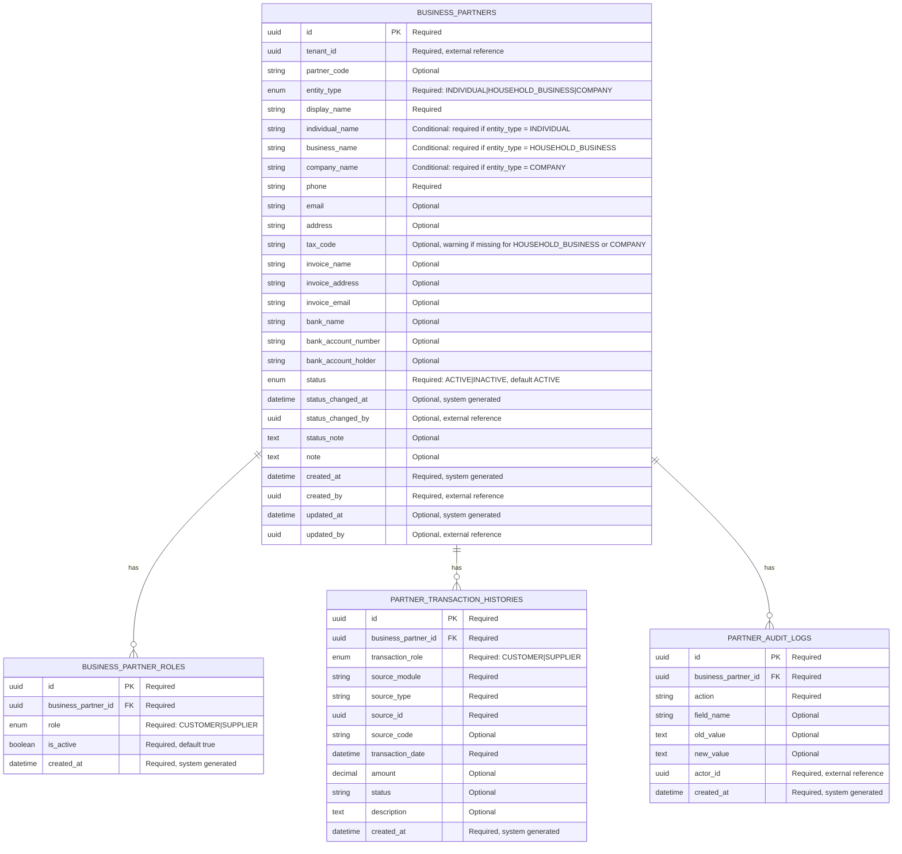
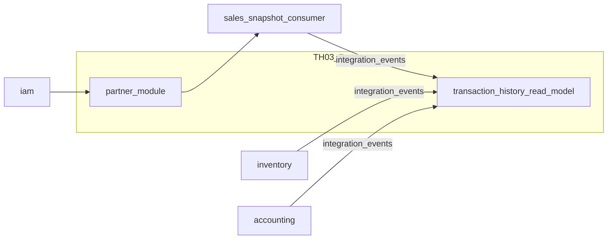
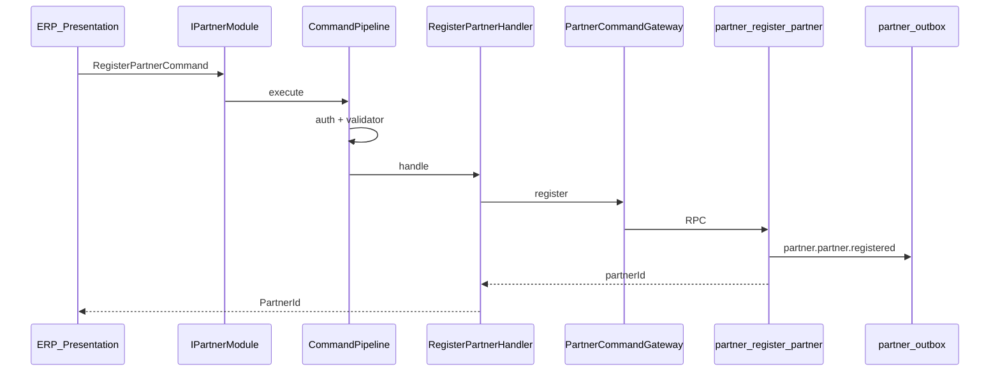
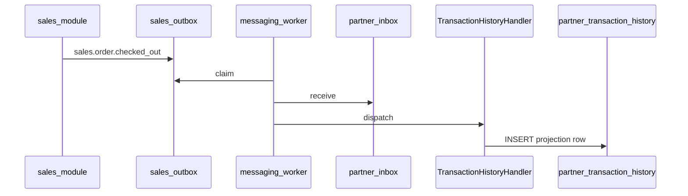

# TH-03 Partner - Combined Documentation

Generated from all Markdown files under docs/themes/TH-03-partner.

## File Index

- docs/themes/TH-03-partner/01-business-scope.md
- docs/themes/TH-03-partner/Epic-01-partner-profile/README.md
- docs/themes/TH-03-partner/Epic-01-partner-profile/US-01/FR-01.md
- docs/themes/TH-03-partner/Epic-01-partner-profile/US-01/FR-02.md
- docs/themes/TH-03-partner/Epic-01-partner-profile/US-01/FR-03.md
- docs/themes/TH-03-partner/Epic-01-partner-profile/US-01/FR-04.md
- docs/themes/TH-03-partner/Epic-01-partner-profile/US-01/FR-05.md
- docs/themes/TH-03-partner/Epic-01-partner-profile/US-01/README.md
- docs/themes/TH-03-partner/Epic-01-partner-profile/US-02/FR-01.md
- docs/themes/TH-03-partner/Epic-01-partner-profile/US-02/FR-02.md
- docs/themes/TH-03-partner/Epic-01-partner-profile/US-02/FR-03.md
- docs/themes/TH-03-partner/Epic-01-partner-profile/US-02/FR-04.md
- docs/themes/TH-03-partner/Epic-01-partner-profile/US-02/FR-05.md
- docs/themes/TH-03-partner/Epic-01-partner-profile/US-02/FR-06.md
- docs/themes/TH-03-partner/Epic-01-partner-profile/US-02/README.md
- docs/themes/TH-03-partner/Epic-01-partner-profile/US-03/FR-01.md
- docs/themes/TH-03-partner/Epic-01-partner-profile/US-03/FR-02.md
- docs/themes/TH-03-partner/Epic-01-partner-profile/US-03/FR-03.md
- docs/themes/TH-03-partner/Epic-01-partner-profile/US-03/FR-04.md
- docs/themes/TH-03-partner/Epic-01-partner-profile/US-03/FR-05.md
- docs/themes/TH-03-partner/Epic-01-partner-profile/US-03/FR-06.md
- docs/themes/TH-03-partner/Epic-01-partner-profile/US-03/README.md
- docs/themes/TH-03-partner/Epic-01-partner-profile/US-04/FR-01.md
- docs/themes/TH-03-partner/Epic-01-partner-profile/US-04/FR-02.md
- docs/themes/TH-03-partner/Epic-01-partner-profile/US-04/FR-03.md
- docs/themes/TH-03-partner/Epic-01-partner-profile/US-04/FR-04.md
- docs/themes/TH-03-partner/Epic-01-partner-profile/US-04/FR-05.md
- docs/themes/TH-03-partner/Epic-01-partner-profile/US-04/README.md
- docs/themes/TH-03-partner/Epic-02-partner-status/README.md
- docs/themes/TH-03-partner/Epic-02-partner-status/US-01/FR-01.md
- docs/themes/TH-03-partner/Epic-02-partner-status/US-01/FR-02.md
- docs/themes/TH-03-partner/Epic-02-partner-status/US-01/FR-03.md
- docs/themes/TH-03-partner/Epic-02-partner-status/US-01/FR-04.md
- docs/themes/TH-03-partner/Epic-02-partner-status/US-01/FR-05.md
- docs/themes/TH-03-partner/Epic-02-partner-status/US-01/README.md
- docs/themes/TH-03-partner/Epic-02-partner-status/US-02/FR-01.md
- docs/themes/TH-03-partner/Epic-02-partner-status/US-02/FR-02.md
- docs/themes/TH-03-partner/Epic-02-partner-status/US-02/FR-03.md
- docs/themes/TH-03-partner/Epic-02-partner-status/US-02/FR-04.md
- docs/themes/TH-03-partner/Epic-02-partner-status/US-02/README.md
- docs/themes/TH-03-partner/Epic-03-partner-transaction-history/README.md
- docs/themes/TH-03-partner/Epic-03-partner-transaction-history/US-01/FR-01.md
- docs/themes/TH-03-partner/Epic-03-partner-transaction-history/US-01/FR-02.md
- docs/themes/TH-03-partner/Epic-03-partner-transaction-history/US-01/FR-03.md
- docs/themes/TH-03-partner/Epic-03-partner-transaction-history/US-01/FR-04.md
- docs/themes/TH-03-partner/Epic-03-partner-transaction-history/US-01/FR-05.md
- docs/themes/TH-03-partner/Epic-03-partner-transaction-history/US-01/README.md
- docs/themes/TH-03-partner/README.md
- docs/themes/TH-03-partner/harness/00-agent-ritual.md
- docs/themes/TH-03-partner/harness/01-domain-model.md
- docs/themes/TH-03-partner/harness/02-module-map.md
- docs/themes/TH-03-partner/harness/03-architecture-and-flows.md
- docs/themes/TH-03-partner/harness/04-slice-roadmap.md
- docs/themes/TH-03-partner/harness/05-traceability.md
- docs/themes/TH-03-partner/harness/06-harness-notes.md
- docs/themes/TH-03-partner/harness/07-api-contracts.md

---

## docs/themes/TH-03-partner/01-business-scope.md

# TH-03 — Business scope

### Purpose

Theme Khách hàng & NCC giúp người dùng quản lý hồ sơ đối tác trong hệ thống, bao gồm khách hàng, nhà cung cấp và đối tác vừa là khách hàng vừa là nhà cung cấp.

Theme này chuẩn hóa dữ liệu đối tác như thông tin định danh, thông tin liên hệ, thông tin thuế, vai trò, trạng thái và lịch sử liên quan, để phục vụ các nghiệp vụ bán hàng, nhập hàng, hóa đơn, công nợ, tra cứu lịch sử giao dịch và quản lý vận hành.

### Business context

Trong thực tế vận hành của hộ kinh doanh và doanh nghiệp thương mại nhỏ, cùng một cá nhân hoặc tổ chức có thể vừa mua hàng từ cửa hàng, vừa cung cấp hàng hóa cho cửa hàng. Nếu quản lý khách hàng và nhà cung cấp tách rời hoàn toàn, dữ liệu dễ bị trùng lặp, khó đối soát lịch sử giao dịch và khó kiểm soát công nợ theo từng vai trò.

Theme Khách hàng & NCC đóng vai trò là nguồn dữ liệu đối tác thống nhất cho VET45. Từ một hồ sơ đối tác, hệ thống có thể xác định đối tác đang tham gia với vai trò khách hàng, nhà cung cấp hoặc cả hai, đồng thời vẫn giữ được dữ liệu lịch sử, chứng từ và trạng thái xử lý theo từng nghiệp vụ phát sinh.

Theme này giúp VET45 tạo nền tảng dữ liệu sạch cho các module khác như Bán hàng & Đơn hàng, Nhập hàng, Công nợ, Hóa đơn điện tử, Ghi sổ và Báo cáo. Đây là một phần quan trọng trong định hướng xây dựng luồng dữ liệu xuyên suốt từ vận hành thực tế đến tuân thủ và quản trị.

### Scope

Theme này bao gồm các nghiệp vụ chính sau:

- Tạo mới hồ sơ đối tác từ màn quản lý Khách hàng & NCC.
- Tạo nhanh hồ sơ đối tác từ các luồng nghiệp vụ khác như bán hàng hoặc nhập hàng, nếu module gọi có nhu cầu.
- Cập nhật thông tin hồ sơ đối tác.
- Quản lý loại đối tác gồm Khách hàng, Nhà cung cấp, hoặc Khách hàng & Nhà cung cấp.
- Quản lý loại hồ sơ gồm Cá nhân hoặc Tổ chức.
- Quản lý thông tin cơ bản của đối tác như tên đối tác, số điện thoại, email, địa chỉ, mã số thuế và ghi chú.
- Cảnh báo dữ liệu có khả năng bị trùng như số điện thoại, email hoặc mã số thuế.
- Cảnh báo khi đối tác tổ chức thiếu mã số thuế nhưng không chặn lưu nếu nghiệp vụ cho phép.
- Tra cứu danh sách đối tác.
- Tìm kiếm đối tác theo tên, số điện thoại, email, mã số thuế hoặc thông tin định danh phù hợp.
- Lọc danh sách đối tác theo loại đối tác, loại hồ sơ và trạng thái.
- Xem chi tiết hồ sơ đối tác.
- Quản lý trạng thái đối tác gồm Đang hoạt động, Ngừng hoạt động và Đã xóa mềm.
- Ngừng hoạt động đối tác để không cho phép dùng trong giao dịch mới.
- Kích hoạt lại đối tác đã ngừng hoạt động.
- Xóa mềm đối tác theo điều kiện hợp lệ.
- Xem lịch sử giao dịch liên quan đến đối tác theo vai trò Khách hàng hoặc Nhà cung cấp.
- Kiểm soát quyền truy cập và thao tác với dữ liệu đối tác theo tenant hiện tại.
- Ghi nhận thông tin người tạo, thời điểm tạo, người cập nhật gần nhất và thời điểm cập nhật gần nhất.
- Ghi nhận audit log cho các thay đổi quan trọng của hồ sơ đối tác.

### Out of scope

Các nội dung sau không nằm trong phạm vi xử lý chính của Theme Khách hàng & NCC:

- Tạo đơn bán hàng, chỉnh sửa đơn bán hàng hoặc xử lý thanh toán đơn hàng.
- Tạo phiếu nhập hàng, xử lý nhập kho hoặc thanh toán cho nhà cung cấp.
- Chọn và áp dụng đối tác vào một đơn bán, phiếu nhập hoặc chứng từ cụ thể; phần này thuộc phạm vi của module nghiệp vụ đang gọi.
- Tính toán, ghi nhận và xử lý công nợ chi tiết phát sinh từ bán hàng, nhập hàng, trả hàng, hoàn tiền hoặc cấn trừ.
- Phát hành, ký số, gửi email hoặc xử lý lỗi hóa đơn điện tử.
- Quản lý danh mục sản phẩm, giá bán, tồn kho hoặc giá vốn.
- Quản lý phân quyền chi tiết hoặc cho phép chủ cửa hàng tự cấu hình ma trận quyền nâng cao.
- Báo cáo phân tích khách hàng, phân nhóm khách hàng, chấm điểm khách hàng hoặc CRM nâng cao.
- Quản lý chương trình chăm sóc khách hàng, loyalty, khuyến mãi hoặc chiến dịch marketing.
- Import hàng loạt khách hàng/NCC nếu chưa được định nghĩa trong theme hoặc US riêng.
- Tích hợp với hệ thống CRM, kế toán, nhà cung cấp hoặc cổng đối tác bên ngoài.

## Epic map

| Epic | Mô tả | Folder |
| ---- | ----- | ------ |
| Epic 01 - Quản lý danh sách và hồ sơ đối tác | Quản lý hồ sơ gốc của đối tác, bao gồm tra cứu danh sách, ghi nhận đối tác mới, bổ sung/chỉnh sửa thông tin và kiểm tra hồ sơ chi tiết. | [Epic-01-partner-profile/](Epic-01-partner-profile/) |
| Epic 02 - Quản lý trạng thái đối tác | Kiểm soát việc ngừng hoạt động, kích hoạt lại và loại bỏ hồ sơ đối tác tạo nhầm theo điều kiện dữ liệu đã phát sinh. | [Epic-02-partner-status/](Epic-02-partner-status/) |
| Epic 03 - Theo dõi lịch sử giao dịch của đối tác | Cho phép xem lịch sử làm việc/giao dịch đã phát sinh với đối tác, hỗ trợ lọc, tìm kiếm và mở chi tiết giao dịch nguồn khi cần. | [Epic-03-partner-transaction-history/](Epic-03-partner-transaction-history/) |

Harness engineering: [harness/](harness/) · Index: [README.md](README.md)

---

## docs/themes/TH-03-partner/Epic-01-partner-profile/README.md

# Epic-01- Partner Profile

## Epic overview

Epic này quản lý hồ sơ gốc của đối tác trong hệ thống, bao gồm khách hàng, nhà cung cấp và đối tác vừa là khách hàng vừa là nhà cung cấp. Đây là lớp dữ liệu nền giúp hệ thống biết đối tác là ai, thuộc vai trò nào, có thông tin liên hệ nào, có thông tin thuế hay chưa và có thể được sử dụng trong các nghiệp vụ nào.

Giá trị chính của epic này là tạo ra một nguồn dữ liệu đối tác đủ tin cậy cho các module khác như bán hàng, nhập hàng, công nợ, hóa đơn và lịch sử giao dịch. Khi hồ sơ đối tác được chuẩn hóa từ đầu, hệ thống hạn chế được các lỗi như tạo trùng khách hàng/NCC, chọn sai đối tác khi lập chứng từ, thiếu thông tin xuất hóa đơn hoặc khó đối chiếu công nợ sau này.

Phạm vi của epic tập trung vào tạo mới và cập nhật hồ sơ đối tác, bao gồm loại đối tác, loại hồ sơ, thông tin liên hệ, thông tin thuế, ghi chú, cảnh báo trùng dữ liệu và ghi nhận thông tin tạo/cập nhật. Epic này không xử lý chi tiết giao dịch phát sinh như đơn bán, phiếu nhập, thanh toán, công nợ hoặc phát hành hóa đơn.

## User roles

| Role | Role definition | Role intent in this epic |
| ---- | --------------- | ------------------------ |
| Chủ cửa hàng | Người chịu trách nhiệm cao nhất về dữ liệu vận hành và chất lượng quản lý của cửa hàng. | Cần hồ sơ đối tác được quản lý thống nhất để hạn chế trùng dữ liệu, sai công nợ, thiếu thông tin hóa đơn hoặc khó kiểm tra lịch sử giao dịch. |
| Quản lý cửa hàng | Người theo dõi vận hành hằng ngày và hỗ trợ kiểm soát dữ liệu khách hàng/NCC trong quá trình làm việc. | Cần tạo, kiểm tra và cập nhật hồ sơ đối tác để dữ liệu sử dụng trong bán hàng, nhập hàng và đối soát luôn đúng với thực tế. |
| Nhân viên bán hàng | Người trực tiếp lập đơn, chọn khách hàng và xử lý giao dịch bán tại cửa hàng. | Cần nhận diện đúng khách hàng hoặc tạo nhanh hồ sơ tối thiểu để tiếp tục bán hàng mà không làm gián đoạn luồng giao dịch. |
| Nhân viên nhập hàng / kho | Người ghi nhận hàng nhập và làm việc với nhà cung cấp trong quá trình nhập hàng. | Cần chọn đúng nhà cung cấp để phiếu nhập, lịch sử nhập hàng và công nợ phải trả gắn đúng đối tác. |
| Kế toán | Người kiểm tra dữ liệu phục vụ hóa đơn, công nợ, chứng từ và đối soát giao dịch. | Cần thông tin đối tác đủ tin cậy để kiểm tra chứng từ, xuất hóa đơn, theo dõi công nợ và truy vết khi có sai lệch. |

## User stories

| US | Tên | Folder |
| -- | --- | ------ |
| US-01 | Tìm kiếm và rà soát danh sách | [US-01/](US-01/) |
| US-02 | Ghi nhận đối tác mới | [US-02/](US-02/) |
| US-03 | Bổ sung và chỉnh sửa | [US-03/](US-03/) |
| US-04 | Kiểm tra hồ sơ | [US-04/](US-04/) |


---

## docs/themes/TH-03-partner/Epic-01-partner-profile/US-01/FR-01.md

# FR-01. Mở danh sách đối tác

## Business Rules


| ID    | Business Rule                                                                                                                                                                                                                                                                                                                        |
| ----- | ------------------------------------------------------------------------------------------------------------------------------------------------------------------------------------------------------------------------------------------------------------------------------------------------------------------------------------ |
| BR-01 | Người dùng chỉ được vào danh sách đối tác khi đã đăng nhập và có quyền xem đối tác trong tenant hiện tại.                                                                                                                                                                                                                            |
| BR-02 | Danh sách đối tác chỉ được tải và hiển thị dữ liệu thuộc tenant hiện tại của người dùng.                                                                                                                                                                                                                                             |
| BR-03 | Danh sách đối tác bao gồm hồ sơ có vai trò Khách hàng, Nhà cung cấp hoặc Khách hàng & Nhà cung cấp.                                                                                                                                                                                                                                  |
| BR-04 | Trong phạm vi danh sách, trạng thái sử dụng của hồ sơ đối tác gồm: Đang hoạt động, Ngừng hoạt động và Đã xóa. Đang hoạt động là hồ sơ thuộc danh sách làm việc mặc định; Ngừng hoạt động là hồ sơ còn lưu để tra cứu nhưng không thuộc danh sách mặc định; Đã xóa là hồ sơ đã bị xóa mềm và không thuộc danh sách làm việc mặc định. |
| BR-05 | Khi người dùng mở danh sách đối tác, hệ thống mặc định chỉ hiển thị các hồ sơ ở trạng thái Đang hoạt động.                                                                                                                                                                                                                           |
| BR-06 | Danh sách đối tác mặc định được sắp xếp theo thời điểm cập nhật gần nhất của hồ sơ; nếu hồ sơ chưa từng được cập nhật sau khi tạo, hệ thống dùng thời điểm tạo hồ sơ để sắp xếp.                                                                                                                                                     |


## Edge Cases


| ID    | Edge Case                                                  | Expected Behavior                                                                                                                                         |
| ----- | ---------------------------------------------------------- | --------------------------------------------------------------------------------------------------------------------------------------------------------- |
| EC-01 | Người dùng chưa đăng nhập hoặc phiên đăng nhập đã hết hạn. | Hệ thống chuyển người dùng về màn hình đăng nhập và không tải dữ liệu đối tác.                                                                            |
| EC-02 | Người dùng đã đăng nhập nhưng không có quyền xem đối tác.  | Hệ thống từ chối truy cập danh sách đối tác, không hiển thị dữ liệu và thông báo người dùng không có quyền phù hợp.                                       |
| EC-03 | Tenant hiện tại chưa có đối tác nào.                       | Hệ thống hiển thị trạng thái rỗng và gợi ý người dùng ghi nhận đối tác mới. Quyền thực hiện ghi nhận đối tác mới được kiểm soát ở luồng ghi nhận đối tác. |
| EC-04 | Hệ thống không tải được danh sách đối tác.                 | Hệ thống hiển thị thông báo lỗi, cho phép người dùng tải lại và không hiển thị dữ liệu sai hoặc dữ liệu ngoài tenant hiện tại.                            |


## User Interface


### Purpose

Cho phép người dùng bắt đầu hành trình rà soát khách hàng/NCC từ danh sách đối tác trong tenant hiện tại.

### Fields


| Field                       | Required    | Editable | Description                                                                           |
| --------------------------- | ----------- | -------- | ------------------------------------------------------------------------------------- |
| Danh sách đối tác           | Yes         | No       | Khu vực hiển thị các hồ sơ đối tác thuộc tenant hiện tại theo điều kiện tải mặc định. |
| Trạng thái tải dữ liệu      | Yes         | No       | Thể hiện trạng thái đang tải, tải thành công, rỗng hoặc lỗi tải danh sách.            |
| Trạng thái rỗng             | Conditional | No       | Hiển thị khi tenant hiện tại chưa có hồ sơ đối tác nào.                               |
| Gợi ý ghi nhận đối tác mới  | Conditional | Yes      | Gợi ý người dùng chuyển sang luồng ghi nhận đối tác mới khi chưa có dữ liệu.          |
| Thông báo lỗi tải danh sách | Conditional | No       | Hiển thị khi hệ thống không tải được danh sách đối tác.                               |
| Tải lại danh sách           | Conditional | Yes      | Hành động cho phép người dùng tải lại danh sách khi có lỗi tải dữ liệu.               |


### Validation Summary


| ID    | Validation                                                                                        | Applies to             |
| ----- | ------------------------------------------------------------------------------------------------- | ---------------------- |
| UI-01 | Người dùng chưa đăng nhập thì không được vào danh sách đối tác.                                   | Vào danh sách đối tác  |
| UI-02 | Người dùng không có quyền xem đối tác thì không được vào danh sách đối tác.                       | Vào danh sách đối tác  |
| UI-03 | Dữ liệu hiển thị trên danh sách phải thuộc tenant hiện tại.                                       | Danh sách đối tác      |
| UI-04 | Khi tải danh sách thất bại, hệ thống phải hiển thị lỗi rõ ràng và cho phép tải lại.               | Trạng thái tải dữ liệu |
| UI-05 | Khi tenant chưa có đối tác, hệ thống phải hiển thị trạng thái rỗng và gợi ý ghi nhận đối tác mới. | Trạng thái rỗng        |


## Scenarios

```gherkin
Background:
  Given hệ thống có module "Khách hàng & NCC"

# FR-01. Mở danh sách đối tác

pass
Scenario: SCN-01 - Chuyển hướng người dùng chưa đăng nhập
  Given người dùng chưa đăng nhập hoặc phiên đăng nhập đã hết hạn
  When người dùng mở danh sách đối tác
  Then hệ thống chuyển người dùng về màn hình đăng nhập
  And hệ thống không tải dữ liệu đối tác

pass
Scenario: SCN-02 - Chặn truy cập khi thiếu quyền xem đối tác
  Given người dùng đã đăng nhập hệ thống
  And người dùng đang làm việc trong một tenant hợp lệ
  And người dùng không có quyền "Xem đối tác"
  When người dùng mở danh sách đối tác
  Then hệ thống từ chối truy cập danh sách đối tác
  And hệ thống không hiển thị dữ liệu đối tác
  And hệ thống thông báo người dùng không có quyền phù hợp

pass
Scenario: SCN-03 - Mở danh sách đối tác thành công
  Given người dùng đã đăng nhập hệ thống
  And người dùng đang làm việc trong tenant hiện tại
  And người dùng có quyền "Xem đối tác"
  And tenant hiện tại có hồ sơ đối tác ở nhiều trạng thái sử dụng
  When người dùng mở danh sách đối tác
  Then hệ thống hiển thị danh sách đối tác thuộc tenant hiện tại
  And danh sách mặc định chỉ hiển thị hồ sơ ở trạng thái "Đang hoạt động"
  And danh sách được sắp xếp theo thời điểm cập nhật gần nhất, nếu chưa có thì dùng thời điểm tạo hồ sơ

pass
Scenario: SCN-04 - Hiển thị trạng thái rỗng khi tenant chưa có đối tác
  Given người dùng đã đăng nhập hệ thống
  And người dùng đang làm việc trong tenant hiện tại
  And người dùng có quyền "Xem đối tác"
  And tenant hiện tại chưa có hồ sơ đối tác nào
  When người dùng mở danh sách đối tác
  Then hệ thống hiển thị trạng thái rỗng
  And hệ thống gợi ý người dùng ghi nhận đối tác mới

pass
Scenario: SCN-05 - Không tải được danh sách đối tác
  Given người dùng đã đăng nhập hệ thống
  And người dùng đang làm việc trong tenant hiện tại
  And người dùng có quyền "Xem đối tác"
  And hệ thống không thể tải danh sách đối tác
  When người dùng mở danh sách đối tác
  Then hệ thống hiển thị thông báo lỗi tải danh sách
  And hệ thống cho phép người dùng tải lại
  And hệ thống không hiển thị dữ liệu sai hoặc dữ liệu ngoài tenant hiện tại
```


---

## docs/themes/TH-03-partner/Epic-01-partner-profile/US-01/FR-02.md

# FR-02. Tìm kiếm đối tác

## Business Rules


| ID    | Business Rule                                                                                                                                                           |
| ----- | ----------------------------------------------------------------------------------------------------------------------------------------------------------------------- |
| BR-01 | Người dùng có thể tìm kiếm đối tác trong tenant hiện tại bằng từ khóa.                                                                                                  |
| BR-02 | Từ khóa tìm kiếm được áp dụng trên các thông tin nhận diện của hồ sơ đối tác gồm: tên đối tác, số điện thoại, email và mã số thuế nếu hồ sơ có dữ liệu tương ứng.       |
| BR-03 | Kết quả tìm kiếm chỉ bao gồm các hồ sơ đối tác thuộc tenant hiện tại và thỏa mãn điều kiện hiển thị hiện tại của danh sách.                                             |
| BR-04 | Tìm kiếm theo tên, email và mã số thuế không phân biệt chữ hoa, chữ thường.                                                                                             |
| BR-05 | Trước khi xử lý tìm kiếm, hệ thống phải loại bỏ khoảng trắng dư ở đầu và cuối từ khóa.                                                                                  |
| BR-06 | Khi tìm kiếm theo số điện thoại, hệ thống có thể chuẩn hóa từ khóa bằng cách bỏ khoảng trắng và ký tự phân tách phổ biến để tăng khả năng khớp với dữ liệu đã lưu.      |
| BR-07 | Nếu từ khóa không khớp với hồ sơ đối tác nào trong phạm vi dữ liệu hiện tại, hệ thống phải hiển thị trạng thái không có kết quả phù hợp.                                |
| BR-08 | Khi người dùng xóa từ khóa tìm kiếm, hệ thống quay về danh sách theo điều kiện lọc hiện tại; nếu không có bộ lọc nào đang áp dụng, hệ thống quay về danh sách mặc định. |


## Edge Cases


| ID    | Edge Case                                                                    | Expected Behavior                                                                                           |
| ----- | ---------------------------------------------------------------------------- | ----------------------------------------------------------------------------------------------------------- |
| EC-01 | Người dùng nhập toàn khoảng trắng.                                           | Hệ thống xử lý như từ khóa rỗng và hiển thị danh sách theo điều kiện hiện tại.                              |
| EC-02 | Người dùng nhập từ khóa không khớp với hồ sơ đối tác nào.                    | Hệ thống hiển thị trạng thái không có kết quả phù hợp với từ khóa.                                          |
| EC-03 | Người dùng nhập số điện thoại có khoảng trắng hoặc ký tự phân tách phổ biến. | Hệ thống chuẩn hóa từ khóa trước khi tìm kiếm nếu dữ liệu cho phép chuẩn hóa.                               |
| EC-04 | Người dùng xóa từ khóa sau khi đã tìm kiếm.                                  | Hệ thống tải lại danh sách theo điều kiện lọc hiện tại hoặc danh sách mặc định nếu không còn điều kiện lọc. |
| EC-05 | Hệ thống không xử lý được tìm kiếm do lỗi tải dữ liệu.                       | Hệ thống hiển thị lỗi tìm kiếm hoặc lỗi tải dữ liệu và không hiển thị dữ liệu sai.                          |


## User Interface


### Purpose

Cho phép người dùng nhanh chóng tìm đúng khách hàng/NCC cần kiểm tra bằng các thông tin quen thuộc như tên, số điện thoại, email hoặc mã số thuế.

### Fields


| Field                       | Required    | Editable | Description                                                                   |
| --------------------------- | ----------- | -------- | ----------------------------------------------------------------------------- |
| Từ khóa tìm kiếm            | No          | Yes      | Ô nhập từ khóa để tìm đối tác theo tên, số điện thoại, email hoặc mã số thuế. |
| Kết quả tìm kiếm            | Conditional | No       | Danh sách đối tác phù hợp với từ khóa và điều kiện lọc hiện tại.              |
| Trạng thái không có kết quả | Conditional | No       | Thông báo khi không tìm thấy đối tác phù hợp với từ khóa.                     |
| Xóa từ khóa                 | Conditional | Yes      | Hành động xóa từ khóa để quay về danh sách theo điều kiện hiện tại.           |
| Trạng thái lỗi tìm kiếm     | Conditional | No       | Thông báo khi hệ thống không xử lý được tìm kiếm hoặc không tải được dữ liệu. |


### Validation Summary


| ID    | Validation                                                                                               | Applies to                  |
| ----- | -------------------------------------------------------------------------------------------------------- | --------------------------- |
| UI-01 | Từ khóa tìm kiếm phải được loại bỏ khoảng trắng dư ở đầu và cuối trước khi xử lý.                        | Từ khóa tìm kiếm            |
| UI-02 | Tìm kiếm không được làm thay đổi dữ liệu hồ sơ đối tác.                                                  | Action tìm kiếm             |
| UI-03 | Kết quả tìm kiếm phải nằm trong tenant hiện tại.                                                         | Kết quả tìm kiếm            |
| UI-04 | Khi không có kết quả, hệ thống phải hiển thị thông báo rõ ràng thay vì chỉ để danh sách trống.           | Trạng thái không có kết quả |
| UI-05 | Khi xóa từ khóa, danh sách phải được tải lại theo điều kiện lọc hiện tại hoặc danh sách mặc định.        | Xóa từ khóa                 |
| UI-06 | Khi tìm kiếm thất bại do lỗi hệ thống, hệ thống phải hiển thị lỗi rõ ràng và không hiển thị dữ liệu sai. | Trạng thái lỗi tìm kiếm     |


## Scenarios

```gherkin
Background:
  Given người dùng đã đăng nhập hệ thống
  And người dùng đang làm việc trong tenant hiện tại
  And người dùng có quyền "Xem đối tác"
  And người dùng đang ở danh sách đối tác
  And danh sách đối tác đã được tải thành công

# FR-03. Tìm kiếm đối tác

pass
Scenario: SCN-01 - Tìm đối tác theo tên
  Given tenant hiện tại có đối tác có tên phù hợp với từ khóa
  When người dùng nhập tên đối tác vào ô tìm kiếm
  Then hệ thống hiển thị các đối tác có tên phù hợp với từ khóa
  And hệ thống chỉ hiển thị hồ sơ thuộc tenant hiện tại

pass
Scenario: SCN-02 - Tìm đối tác theo số điện thoại
  Given tenant hiện tại có đối tác có số điện thoại phù hợp với từ khóa
  When người dùng nhập số điện thoại vào ô tìm kiếm
  Then hệ thống hiển thị các đối tác có số điện thoại phù hợp
  And hệ thống chỉ hiển thị hồ sơ thuộc tenant hiện tại

pass
Scenario: SCN-03 - Tìm đối tác theo email
  Given tenant hiện tại có đối tác có email phù hợp với từ khóa
  When người dùng nhập email vào ô tìm kiếm
  Then hệ thống hiển thị các đối tác có email phù hợp
  And hệ thống không phân biệt chữ hoa, chữ thường khi xử lý email

pass
Scenario: SCN-04 - Tìm đối tác theo mã số thuế
  Given tenant hiện tại có đối tác có mã số thuế phù hợp với từ khóa
  When người dùng nhập mã số thuế vào ô tìm kiếm
  Then hệ thống hiển thị các đối tác có mã số thuế phù hợp
  And hệ thống chỉ hiển thị hồ sơ thuộc tenant hiện tại

pass
Scenario: SCN-05 - Tìm kiếm không phân biệt chữ hoa, chữ thường
  Given tenant hiện tại có đối tác có tên phù hợp với từ khóa khi không phân biệt chữ hoa, chữ thường
  When người dùng nhập từ khóa có chữ hoa hoặc chữ thường khác với dữ liệu đã lưu
  Then hệ thống vẫn hiển thị đối tác phù hợp

pass
Scenario: SCN-06 - Xử lý từ khóa toàn khoảng trắng
  Given danh sách đối tác đang có dữ liệu theo điều kiện hiện tại
  When người dùng nhập từ khóa chỉ gồm khoảng trắng
  Then hệ thống xử lý như từ khóa rỗng
  And hệ thống hiển thị danh sách theo điều kiện hiện tại

pass
Scenario: SCN-07 - Không tìm thấy đối tác phù hợp
  Given tenant hiện tại không có đối tác nào phù hợp với từ khóa
  When người dùng nhập từ khóa tìm kiếm
  Then hệ thống hiển thị trạng thái không có kết quả phù hợp với từ khóa
  And hệ thống không hiển thị dữ liệu sai hoặc dữ liệu ngoài tenant hiện tại

pass
Scenario: SCN-08 - Xóa từ khóa tìm kiếm
  Given người dùng đang xem kết quả tìm kiếm theo một từ khóa
  When người dùng xóa từ khóa tìm kiếm
  Then hệ thống tải lại danh sách theo điều kiện lọc hiện tại
  And nếu không có bộ lọc nào đang áp dụng, hệ thống hiển thị danh sách mặc định

pass
Scenario: SCN-09 - Không xử lý được tìm kiếm do lỗi hệ thống
  Given hệ thống không thể xử lý tìm kiếm hoặc không thể tải dữ liệu kết quả
  When người dùng nhập từ khóa tìm kiếm
  Then hệ thống hiển thị thông báo lỗi tìm kiếm
  And hệ thống không hiển thị dữ liệu sai hoặc dữ liệu ngoài tenant hiện tại
```


---

## docs/themes/TH-03-partner/Epic-01-partner-profile/US-01/FR-03.md

# FR-03. Lọc danh sách đối tác

## Business Rules


| ID    | Business Rule                                                                                                                                                  |
| ----- | -------------------------------------------------------------------------------------------------------------------------------------------------------------- |
| BR-01 | Người dùng có thể lọc danh sách đối tác trong tenant hiện tại theo loại đối tác, loại hồ sơ và trạng thái sử dụng.                                             |
| BR-02 | Bộ lọc loại đối tác được áp dụng theo vai trò của hồ sơ đối tác, gồm: Khách hàng, Nhà cung cấp và Khách hàng & Nhà cung cấp.                                   |
| BR-03 | Khi lọc theo "Khách hàng", kết quả bao gồm các hồ sơ có vai trò Khách hàng, bao gồm cả hồ sơ "Khách hàng & Nhà cung cấp".                                      |
| BR-04 | Khi lọc theo "Nhà cung cấp", kết quả bao gồm các hồ sơ có vai trò Nhà cung cấp, bao gồm cả hồ sơ "Khách hàng & Nhà cung cấp".                                  |
| BR-05 | Khi lọc theo "Khách hàng & Nhà cung cấp", kết quả chỉ bao gồm các hồ sơ có đồng thời hai vai trò Khách hàng và Nhà cung cấp.                                   |
| BR-06 | Bộ lọc loại hồ sơ gồm: Cá nhân và Tổ chức.                                                                                                                     |
| BR-07 | Bộ lọc trạng thái sử dụng trên danh sách làm việc gồm: Đang hoạt động và Ngừng hoạt động.                                                                      |
| BR-08 | Khi có nhiều điều kiện lọc hoặc có cả từ khóa tìm kiếm, kết quả phải thỏa mãn đồng thời tất cả điều kiện hiện tại.                                             |
| BR-09 | Khi người dùng xóa một điều kiện lọc, hệ thống tải lại danh sách theo các điều kiện còn lại; nếu không còn điều kiện nào, hệ thống quay về danh sách mặc định. |


## Edge Cases


| ID    | Edge Case                                                                                                   | Expected Behavior                                                                                                                |
| ----- | ----------------------------------------------------------------------------------------------------------- | -------------------------------------------------------------------------------------------------------------------------------- |
| EC-01 | Người dùng chọn điều kiện lọc nhưng không có hồ sơ đối tác nào phù hợp.                                     | Hệ thống hiển thị trạng thái không có dữ liệu phù hợp với điều kiện hiện tại.                                                    |
| EC-02 | Người dùng lọc trạng thái "Ngừng hoạt động" nhưng tenant hiện tại không có đối tác ngừng hoạt động phù hợp. | Hệ thống hiển thị trạng thái không có dữ liệu phù hợp với trạng thái đã chọn.                                                    |
| EC-03 | Người dùng kết hợp từ khóa tìm kiếm với bộ lọc nhưng không có kết quả phù hợp.                              | Hệ thống hiển thị trạng thái không có dữ liệu phù hợp với từ khóa và điều kiện lọc hiện tại.                                     |
| EC-04 | Hệ thống không tải được danh sách sau khi áp dụng bộ lọc.                                                   | Hệ thống hiển thị lỗi tải dữ liệu, cho phép người dùng thử lại và không hiển thị dữ liệu sai hoặc dữ liệu ngoài tenant hiện tại. |


## User Interface


### Purpose

Cho phép người dùng thu hẹp danh sách đối tác theo nhu cầu rà soát, ví dụ chỉ xem khách hàng, nhà cung cấp, tổ chức, cá nhân hoặc đối tác ngừng hoạt động.

### Fields


| Field                               | Required    | Editable | Description                                                                                           |
| ----------------------------------- | ----------- | -------- | ----------------------------------------------------------------------------------------------------- |
| Bộ lọc loại đối tác                 | No          | Yes      | Thu hẹp danh sách theo vai trò Khách hàng, Nhà cung cấp hoặc Khách hàng & Nhà cung cấp.               |
| Bộ lọc loại hồ sơ                   | No          | Yes      | Thu hẹp danh sách theo Cá nhân hoặc Tổ chức.                                                          |
| Bộ lọc trạng thái sử dụng           | No          | Yes      | Thu hẹp danh sách theo Đang hoạt động hoặc Ngừng hoạt động.                                           |
| Điều kiện lọc đang áp dụng          | Conditional | No       | Thể hiện các điều kiện lọc hiện tại để người dùng biết danh sách đang được thu hẹp theo tiêu chí nào. |
| Xóa điều kiện lọc                   | Conditional | Yes      | Cho phép người dùng xóa một hoặc toàn bộ điều kiện lọc đang áp dụng.                                  |
| Kết quả lọc                         | Conditional | No       | Danh sách đối tác thỏa mãn đồng thời các điều kiện lọc và từ khóa tìm kiếm hiện tại.                  |
| Trạng thái không có dữ liệu phù hợp | Conditional | No       | Hiển thị khi không có hồ sơ đối tác nào phù hợp với điều kiện lọc hiện tại.                           |


### Validation Summary


| ID    | Validation                                                                                                               | Applies to        |
| ----- | ------------------------------------------------------------------------------------------------------------------------ | ----------------- |
| UI-01 | Bộ lọc chỉ được áp dụng trên dữ liệu đối tác thuộc tenant hiện tại.                                                      | Bộ lọc danh sách  |
| UI-02 | Kết quả lọc phải thỏa mãn đồng thời các điều kiện lọc và từ khóa tìm kiếm hiện tại.                                      | Kết quả lọc       |
| UI-03 | Khi xóa một điều kiện lọc, danh sách phải được tải lại theo các điều kiện còn lại.                                       | Xóa điều kiện lọc |
| UI-04 | Khi xóa toàn bộ điều kiện lọc và không còn từ khóa tìm kiếm, danh sách phải quay về trạng thái mặc định.                 | Xóa điều kiện lọc |
| UI-05 | Khi không có dữ liệu phù hợp, hệ thống phải hiển thị trạng thái không có dữ liệu phù hợp thay vì chỉ để danh sách trống. | Kết quả lọc       |
| UI-06 | Khi tải dữ liệu theo bộ lọc thất bại, hệ thống phải hiển thị lỗi rõ ràng và không hiển thị dữ liệu sai.                  | Kết quả lọc       |


## Scenarios

```gherkin
Background:
  Given người dùng đã đăng nhập hệ thống
  And người dùng đang làm việc trong tenant hiện tại
  And người dùng có quyền "Xem đối tác"
  And người dùng đang ở danh sách đối tác
  And danh sách đối tác đã được tải thành công

# FR-04. Lọc danh sách đối tác

pass
Scenario: SCN-01 - Lọc danh sách theo vai trò Khách hàng
  Given tenant hiện tại có hồ sơ đối tác có vai trò Khách hàng
  When người dùng chọn bộ lọc loại đối tác là "Khách hàng"
  Then hệ thống hiển thị các hồ sơ có vai trò Khách hàng trong tenant hiện tại
  And kết quả bao gồm hồ sơ có loại đối tác "Khách hàng & Nhà cung cấp" nếu hồ sơ có vai trò Khách hàng

pass
Scenario: SCN-02 - Lọc danh sách theo vai trò Nhà cung cấp
  Given tenant hiện tại có hồ sơ đối tác có vai trò Nhà cung cấp
  When người dùng chọn bộ lọc loại đối tác là "Nhà cung cấp"
  Then hệ thống hiển thị các hồ sơ có vai trò Nhà cung cấp trong tenant hiện tại
  And kết quả bao gồm hồ sơ có loại đối tác "Khách hàng & Nhà cung cấp" nếu hồ sơ có vai trò Nhà cung cấp

pass
Scenario: SCN-03 - Lọc danh sách theo đối tác có cả hai vai trò
  Given tenant hiện tại có hồ sơ đối tác có loại đối tác "Khách hàng & Nhà cung cấp"
  When người dùng chọn bộ lọc loại đối tác là "Khách hàng & Nhà cung cấp"
  Then hệ thống chỉ hiển thị các hồ sơ có đồng thời vai trò Khách hàng và Nhà cung cấp trong tenant hiện tại

pass
Scenario: SCN-04 - Lọc danh sách theo loại hồ sơ
  Given tenant hiện tại có hồ sơ đối tác thuộc loại hồ sơ "Tổ chức"
  When người dùng chọn bộ lọc loại hồ sơ là "Tổ chức"
  Then hệ thống chỉ hiển thị các hồ sơ có loại hồ sơ "Tổ chức" trong tenant hiện tại

pass
Scenario: SCN-05 - Lọc danh sách theo trạng thái Ngừng hoạt động
  Given tenant hiện tại có hồ sơ đối tác ở trạng thái "Ngừng hoạt động"
  When người dùng chọn bộ lọc trạng thái sử dụng là "Ngừng hoạt động"
  Then hệ thống hiển thị các hồ sơ đối tác ở trạng thái "Ngừng hoạt động" trong tenant hiện tại

pass
Scenario: SCN-06 - Kết hợp từ khóa tìm kiếm với bộ lọc
  Given người dùng đã nhập từ khóa tìm kiếm hợp lệ
  And tenant hiện tại có hồ sơ đối tác phù hợp với từ khóa và điều kiện lọc
  When người dùng chọn thêm một điều kiện lọc
  Then hệ thống hiển thị các hồ sơ thỏa mãn đồng thời từ khóa tìm kiếm và điều kiện lọc hiện tại
  And hệ thống chỉ hiển thị hồ sơ thuộc tenant hiện tại

pass
Scenario: SCN-07 - Không có dữ liệu phù hợp với điều kiện lọc
  Given tenant hiện tại không có hồ sơ đối tác nào phù hợp với điều kiện lọc
  When người dùng chọn điều kiện lọc
  Then hệ thống hiển thị trạng thái không có dữ liệu phù hợp
  And hệ thống không hiển thị dữ liệu sai hoặc dữ liệu ngoài tenant hiện tại

pass
Scenario: SCN-08 - Xóa một điều kiện lọc
  Given danh sách đang được lọc bởi nhiều điều kiện
  When người dùng xóa một điều kiện lọc
  Then hệ thống tải lại danh sách theo các điều kiện còn lại
  And hệ thống chỉ hiển thị hồ sơ thuộc tenant hiện tại

pass
Scenario: SCN-09 - Xóa toàn bộ điều kiện lọc
  Given danh sách đang được lọc
  And người dùng không nhập từ khóa tìm kiếm
  When người dùng xóa toàn bộ điều kiện lọc
  Then hệ thống quay về danh sách mặc định
  And hệ thống ưu tiên hiển thị các hồ sơ ở trạng thái "Đang hoạt động"

pass
Scenario: SCN-10 - Không tải được danh sách sau khi lọc
  Given hệ thống không thể tải dữ liệu theo điều kiện lọc hiện tại
  When người dùng chọn điều kiện lọc
  Then hệ thống hiển thị lỗi tải dữ liệu
  And hệ thống cho phép người dùng thử lại
  And hệ thống không hiển thị dữ liệu sai hoặc dữ liệu ngoài tenant hiện tại
```


---

## docs/themes/TH-03-partner/Epic-01-partner-profile/US-01/FR-04.md

# FR-04. Xử lý khi không có dữ liệu phù hợp

## Business Rules


| ID    | Business Rule                                                                                                                                                                    |
| ----- | -------------------------------------------------------------------------------------------------------------------------------------------------------------------------------- |
| BR-01 | Hệ thống phải phân biệt các tình huống không có dữ liệu gồm: tenant chưa có hồ sơ đối tác, từ khóa không có kết quả phù hợp, và điều kiện lọc hiện tại không có dữ liệu phù hợp. |
| BR-02 | Nội dung trạng thái không có dữ liệu phải phản ánh đúng nguyên nhân, không chỉ hiển thị danh sách trống.                                                                         |
| BR-03 | Khi tenant hiện tại chưa có hồ sơ đối tác nào, hệ thống hiển thị trạng thái rỗng của danh sách đối tác.                                                                          |
| BR-04 | Khi tenant hiện tại có dữ liệu đối tác nhưng từ khóa tìm kiếm không khớp hồ sơ nào, hệ thống hiển thị trạng thái không tìm thấy đối tác phù hợp với từ khóa.                     |
| BR-05 | Khi tenant hiện tại có dữ liệu đối tác nhưng điều kiện lọc hiện tại không khớp hồ sơ nào, hệ thống hiển thị trạng thái không có dữ liệu phù hợp với điều kiện lọc.               |
| BR-06 | Khi vừa có từ khóa tìm kiếm vừa có điều kiện lọc, kết quả rỗng phải được hiểu là không có hồ sơ nào thỏa mãn đồng thời tất cả điều kiện hiện tại.                                |
| BR-07 | Trạng thái không có dữ liệu có thể gợi ý hướng xử lý phù hợp như đổi từ khóa, xóa từ khóa, xóa bộ lọc hoặc ghi nhận đối tác mới; các gợi ý này không tự động tạo hồ sơ đối tác.  |


## Edge Cases


| ID    | Edge Case                                                                       | Expected Behavior                                                                                      |
| ----- | ------------------------------------------------------------------------------- | ------------------------------------------------------------------------------------------------------ |
| EC-01 | Tenant hiện tại chưa có hồ sơ đối tác nào.                                      | Hệ thống hiển thị trạng thái rỗng của danh sách và có thể gợi ý ghi nhận đối tác mới.                  |
| EC-02 | Tenant hiện tại có dữ liệu đối tác nhưng từ khóa tìm kiếm không khớp hồ sơ nào. | Hệ thống hiển thị trạng thái không tìm thấy đối tác phù hợp với từ khóa hiện tại.                      |
| EC-03 | Tenant hiện tại có dữ liệu đối tác nhưng bộ lọc không có kết quả phù hợp.       | Hệ thống hiển thị trạng thái không có dữ liệu phù hợp với điều kiện lọc hiện tại.                      |
| EC-04 | Người dùng vừa nhập từ khóa vừa chọn bộ lọc nhưng không có kết quả phù hợp.     | Hệ thống hiển thị trạng thái không có dữ liệu phù hợp với đồng thời từ khóa và điều kiện lọc hiện tại. |
| EC-05 | Người dùng xóa từ khóa nhưng vẫn còn bộ lọc không có dữ liệu phù hợp.           | Hệ thống tiếp tục hiển thị trạng thái không có dữ liệu theo điều kiện lọc còn lại.                     |
| EC-06 | Người dùng xóa bộ lọc nhưng từ khóa hiện tại vẫn không có kết quả phù hợp.      | Hệ thống tiếp tục hiển thị trạng thái không tìm thấy đối tác phù hợp với từ khóa hiện tại.             |


## User Interface


### Purpose

Giúp người dùng hiểu rõ vì sao danh sách không hiển thị dữ liệu, từ đó biết nên đổi từ khóa, xóa từ khóa, xóa bộ lọc hoặc ghi nhận đối tác mới nếu thật sự chưa có dữ liệu phù hợp.

### Fields


| Field                                   | Required    | Editable | Description                                                                     |
| --------------------------------------- | ----------- | -------- | ------------------------------------------------------------------------------- |
| Trạng thái rỗng danh sách               | Conditional | No       | Hiển thị khi tenant hiện tại chưa có hồ sơ đối tác nào.                         |
| Trạng thái không có kết quả tìm kiếm    | Conditional | No       | Hiển thị khi từ khóa không khớp với hồ sơ đối tác nào trong điều kiện hiện tại. |
| Trạng thái không có dữ liệu theo bộ lọc | Conditional | No       | Hiển thị khi điều kiện lọc hiện tại không có dữ liệu phù hợp.                   |
| Từ khóa hiện tại                        | Conditional | No       | Từ khóa đang làm cho danh sách không có kết quả, nếu có.                        |
| Điều kiện lọc hiện tại                  | Conditional | No       | Các điều kiện lọc đang làm cho danh sách không có dữ liệu phù hợp, nếu có.      |
| Gợi ý đổi hoặc xóa từ khóa              | Conditional | Yes      | Hướng dẫn người dùng điều chỉnh hoặc xóa từ khóa khi không có kết quả tìm kiếm. |
| Gợi ý xóa bộ lọc                        | Conditional | Yes      | Hướng dẫn người dùng xóa một hoặc nhiều điều kiện lọc đang áp dụng.             |
| Gợi ý ghi nhận đối tác mới              | Conditional | Yes      | Gợi ý người dùng chuyển sang luồng ghi nhận đối tác mới khi cần.                |


### Validation Summary


| ID    | Validation                                                                                                          | Applies to                              |
| ----- | ------------------------------------------------------------------------------------------------------------------- | --------------------------------------- |
| UI-01 | Trạng thái không có dữ liệu phải phản ánh đúng nguyên nhân hiện tại.                                                | Trạng thái không có dữ liệu             |
| UI-02 | Khi không có kết quả theo từ khóa, hệ thống phải giữ hoặc thể hiện từ khóa hiện tại để người dùng biết đang tìm gì. | Trạng thái không có kết quả tìm kiếm    |
| UI-03 | Khi không có dữ liệu theo bộ lọc, hệ thống phải thể hiện điều kiện lọc đang áp dụng.                                | Trạng thái không có dữ liệu theo bộ lọc |
| UI-04 | Gợi ý ghi nhận đối tác mới không được tự động tạo hồ sơ đối tác.                                                    | Gợi ý ghi nhận đối tác mới              |
| UI-05 | Khi người dùng xóa từ khóa hoặc bộ lọc, hệ thống phải tải lại danh sách theo điều kiện còn lại.                     | Xóa từ khóa, xóa bộ lọc                 |
| UI-06 | Lỗi tải dữ liệu không được hiển thị như trạng thái không có dữ liệu.                                                | Trạng thái tải dữ liệu                  |


## Scenarios

```gherkin
Background:
  Given người dùng đã đăng nhập hệ thống
  And người dùng đang làm việc trong tenant hiện tại
  And người dùng có quyền "Xem đối tác"
  And người dùng đang ở danh sách đối tác

# FR-05. Xử lý khi không có dữ liệu phù hợp

pass
Scenario: SCN-01 - Tenant chưa có hồ sơ đối tác nào
  Given tenant hiện tại chưa có hồ sơ đối tác nào
  When người dùng mở danh sách đối tác
  Then hệ thống hiển thị trạng thái rỗng của danh sách đối tác
  And hệ thống có thể gợi ý người dùng ghi nhận đối tác mới

pass
Scenario: SCN-02 - Không tìm thấy đối tác theo từ khóa
  Given tenant hiện tại đã có dữ liệu đối tác
  And không có hồ sơ đối tác nào phù hợp với từ khóa người dùng nhập
  When người dùng nhập từ khóa tìm kiếm
  Then hệ thống hiển thị trạng thái không tìm thấy đối tác phù hợp với từ khóa
  And hệ thống thể hiện từ khóa hiện tại để người dùng có thể kiểm tra lại

pass
Scenario: SCN-03 - Không có dữ liệu theo bộ lọc
  Given tenant hiện tại đã có dữ liệu đối tác
  And không có hồ sơ đối tác nào phù hợp với điều kiện lọc người dùng chọn
  When người dùng chọn điều kiện lọc
  Then hệ thống hiển thị trạng thái không có dữ liệu phù hợp với điều kiện lọc hiện tại
  And hệ thống thể hiện điều kiện lọc đang áp dụng

pass
Scenario: SCN-04 - Không có dữ liệu khi kết hợp từ khóa và bộ lọc
  Given người dùng đã nhập một từ khóa tìm kiếm
  And tenant hiện tại không có hồ sơ nào thỏa mãn đồng thời từ khóa và điều kiện lọc mới
  When người dùng chọn thêm điều kiện lọc
  Then hệ thống hiển thị trạng thái không có dữ liệu phù hợp với điều kiện hiện tại
  And hệ thống thể hiện cả từ khóa và điều kiện lọc đang áp dụng

pass
Scenario: SCN-05 - Xóa từ khóa nhưng vẫn không có dữ liệu theo bộ lọc còn lại
  Given người dùng đang xem trạng thái không có dữ liệu
  And danh sách đang có từ khóa tìm kiếm và điều kiện lọc
  And điều kiện lọc còn lại không khớp hồ sơ đối tác nào
  When người dùng xóa từ khóa tìm kiếm
  Then hệ thống tải lại danh sách theo điều kiện lọc còn lại
  And hệ thống tiếp tục hiển thị trạng thái không có dữ liệu phù hợp với điều kiện lọc hiện tại

pass
Scenario: SCN-06 - Xóa bộ lọc nhưng vẫn không có kết quả theo từ khóa còn lại
  Given người dùng đang xem trạng thái không có dữ liệu
  And danh sách đang có từ khóa tìm kiếm và điều kiện lọc
  And từ khóa còn lại không khớp hồ sơ đối tác nào
  When người dùng xóa điều kiện lọc
  Then hệ thống tải lại danh sách theo từ khóa hiện tại
  And hệ thống tiếp tục hiển thị trạng thái không tìm thấy đối tác phù hợp với từ khóa

pass
Scenario: SCN-07 - Không nhầm lỗi tải dữ liệu với trạng thái không có dữ liệu
  Given hệ thống không thể tải dữ liệu danh sách đối tác
  When người dùng mở danh sách đối tác
  Then hệ thống hiển thị lỗi tải dữ liệu
  And hệ thống không hiển thị lỗi này như trạng thái không có dữ liệu
```


---

## docs/themes/TH-03-partner/Epic-01-partner-profile/US-01/FR-05.md

# FR-05. Tiếp tục thao tác từ danh sách

## Business Rules


| ID    | Business Rule                                                                                                                                                                      |
| ----- | ---------------------------------------------------------------------------------------------------------------------------------------------------------------------------------- |
| BR-01 | Người dùng có thể mở hồ sơ chi tiết từ một dòng đối tác thuộc tenant hiện tại khi có quyền xem chi tiết đối tác.                                                                   |
| BR-02 | Người dùng có thể bắt đầu luồng ghi nhận đối tác mới từ danh sách khi có quyền ghi nhận đối tác mới; hành động này chỉ mở luồng ghi nhận, không tự tạo hồ sơ đối tác.              |
| BR-03 | Người dùng có thể bắt đầu luồng bổ sung hoặc chỉnh sửa thông tin từ danh sách khi có quyền cập nhật đối tác; hành động này chỉ mở luồng cập nhật, không tự thay đổi dữ liệu hồ sơ. |
| BR-04 | Nếu hồ sơ đối tác còn thiếu thông tin nhận diện hoặc liên hệ quan trọng, hệ thống có thể gợi ý người dùng bổ sung hoặc chỉnh sửa thông tin khi người dùng có quyền phù hợp.        |
| BR-05 | Trước khi cho người dùng tiếp tục thao tác từ danh sách, hệ thống phải kiểm tra quyền thao tác, tenant của hồ sơ và trạng thái mới nhất của hồ sơ tại thời điểm thao tác.          |
| BR-06 | Hồ sơ ở trạng thái "Ngừng hoạt động" vẫn có thể được mở để kiểm tra thông tin nếu người dùng có quyền xem chi tiết đối tác.                                                        |
| BR-07 | Các hành động tiếp tục thao tác từ danh sách không được tự động chọn đối tác vào đơn bán, phiếu nhập hoặc chứng từ nghiệp vụ khác.                                                 |


## Edge Cases


| ID    | Edge Case                                                                                      | Expected Behavior                                                                                                            |
| ----- | ---------------------------------------------------------------------------------------------- | ---------------------------------------------------------------------------------------------------------------------------- |
| EC-01 | Người dùng có quyền xem danh sách nhưng không có quyền xem chi tiết đối tác.                   | Hệ thống không cho mở hồ sơ chi tiết và không hiển thị dữ liệu chi tiết của đối tác.                                         |
| EC-02 | Người dùng có quyền xem danh sách nhưng không có quyền ghi nhận đối tác mới.                   | Hệ thống không hiển thị hoặc vô hiệu hóa hành động ghi nhận đối tác mới.                                                     |
| EC-03 | Người dùng có quyền xem danh sách nhưng không có quyền cập nhật đối tác.                       | Hệ thống không hiển thị hoặc vô hiệu hóa hành động bổ sung/chỉnh sửa thông tin.                                              |
| EC-04 | Người dùng chọn một đối tác vừa bị thay đổi trạng thái bởi người dùng khác.                    | Hệ thống tải trạng thái mới nhất của hồ sơ trước khi tiếp tục và hiển thị trạng thái hiện tại phù hợp.                       |
| EC-05 | Người dùng chọn một đối tác không còn tồn tại, đã bị xóa mềm hoặc không thuộc tenant hiện tại. | Hệ thống không cho mở hoặc cập nhật hồ sơ, đồng thời thông báo hồ sơ không tìm thấy hoặc người dùng không có quyền truy cập. |
| EC-06 | Quyền thao tác của người dùng bị thay đổi sau khi danh sách đã được tải.                       | Hệ thống kiểm tra lại quyền tại thời điểm thao tác và không cho tiếp tục nếu quyền hiện tại không còn phù hợp.               |


## User Interface


### Purpose

Cho phép người dùng tiếp tục hành trình làm việc sau khi rà soát danh sách đối tác, gồm mở hồ sơ chi tiết, bắt đầu ghi nhận đối tác mới hoặc chuyển sang bổ sung/chỉnh sửa thông tin nếu có quyền phù hợp.

### Fields


| Field                             | Required    | Editable | Description                                                                                                                                        |
| --------------------------------- | ----------- | -------- | -------------------------------------------------------------------------------------------------------------------------------------------------- |
| Mở hồ sơ                          | Conditional | Yes      | Hành động mở hồ sơ chi tiết của đối tác được chọn.                                                                                                 |
| Ghi nhận đối tác mới              | Conditional | Yes      | Hành động bắt đầu luồng ghi nhận khách hàng/NCC mới.                                                                                               |
| Bổ sung hoặc chỉnh sửa thông tin  | Conditional | Yes      | Hành động chuyển sang luồng cập nhật hồ sơ đối tác.                                                                                                |
| Trạng thái khả dụng của hành động | Conditional | No       | Cho biết hành động có thể thực hiện hay không theo quyền, tenant và trạng thái mới nhất của hồ sơ.                                                 |
| Thông báo không thể tiếp tục      | Conditional | No       | Hiển thị khi hệ thống không cho tiếp tục do thiếu quyền, hồ sơ không tồn tại, hồ sơ không thuộc tenant hiện tại hoặc trạng thái không còn phù hợp. |


### Validation Summary


| ID    | Validation                                                                                                                     | Applies to                                                       |
| ----- | ------------------------------------------------------------------------------------------------------------------------------ | ---------------------------------------------------------------- |
| UI-01 | Khi người dùng chọn mở hồ sơ, hệ thống phải kiểm tra hồ sơ còn tồn tại và thuộc tenant hiện tại.                               | Mở hồ sơ                                                         |
| UI-02 | Khi người dùng chọn mở hồ sơ, hệ thống phải kiểm tra quyền xem chi tiết đối tác tại thời điểm thao tác.                        | Mở hồ sơ                                                         |
| UI-03 | Khi người dùng chọn ghi nhận đối tác mới, hệ thống phải kiểm tra quyền ghi nhận đối tác mới tại thời điểm thao tác.            | Ghi nhận đối tác mới                                             |
| UI-04 | Khi người dùng chọn bổ sung hoặc chỉnh sửa thông tin, hệ thống phải kiểm tra quyền cập nhật đối tác tại thời điểm thao tác.    | Bổ sung hoặc chỉnh sửa thông tin                                 |
| UI-05 | Nếu trạng thái hồ sơ đã thay đổi sau khi danh sách được tải, hệ thống phải sử dụng trạng thái mới nhất khi tiếp tục thao tác.  | Mở hồ sơ, bổ sung hoặc chỉnh sửa thông tin                       |
| UI-06 | Các hành động điều hướng từ danh sách không được tự động tạo mới, cập nhật hồ sơ hoặc gắn đối tác vào chứng từ nghiệp vụ khác. | Mở hồ sơ, ghi nhận đối tác mới, bổ sung hoặc chỉnh sửa thông tin |


## Scenarios

```gherkin
Background:
  Given người dùng đã đăng nhập hệ thống
  And người dùng đang làm việc trong tenant hiện tại
  And người dùng đang ở danh sách đối tác

# FR-06. Tiếp tục thao tác từ danh sách

pass
Scenario: SCN-01 - Mở hồ sơ đối tác từ danh sách
  Given người dùng có quyền "Xem chi tiết đối tác"
  And danh sách có một hồ sơ đối tác thuộc tenant hiện tại
  And hồ sơ đối tác còn tồn tại
  When người dùng chọn một đối tác trong danh sách
  Then hệ thống mở hồ sơ chi tiết của đối tác đó
  And hệ thống hiển thị dữ liệu theo trạng thái mới nhất của hồ sơ

pass
Scenario: SCN-02 - Không cho mở hồ sơ khi thiếu quyền xem chi tiết
  Given người dùng không có quyền "Xem chi tiết đối tác"
  And danh sách có một hồ sơ đối tác thuộc tenant hiện tại
  When người dùng chọn một đối tác trong danh sách
  Then hệ thống không mở hồ sơ chi tiết của đối tác đó
  And hệ thống không hiển thị dữ liệu chi tiết của đối tác

pass
Scenario: SCN-03 - Bắt đầu ghi nhận đối tác mới từ danh sách
  Given người dùng có quyền "Ghi nhận đối tác mới"
  When người dùng chọn hành động "Ghi nhận đối tác mới"
  Then hệ thống mở luồng ghi nhận đối tác mới
  And hệ thống chưa tạo hồ sơ đối tác mới cho đến khi người dùng lưu hợp lệ ở luồng ghi nhận

pass
Scenario: SCN-04 - Không hiển thị hành động ghi nhận đối tác mới khi thiếu quyền
  Given người dùng không có quyền "Ghi nhận đối tác mới"
  When người dùng xem các hành động khả dụng trên danh sách
  Then hệ thống không hiển thị hoặc vô hiệu hóa hành động "Ghi nhận đối tác mới"

pass
Scenario: SCN-05 - Chuyển sang bổ sung hoặc chỉnh sửa thông tin từ danh sách
  Given người dùng có quyền "Cập nhật đối tác"
  And danh sách có một hồ sơ đối tác thuộc tenant hiện tại
  And hồ sơ đối tác còn tồn tại
  When người dùng chọn hành động "Bổ sung hoặc chỉnh sửa thông tin"
  Then hệ thống mở luồng cập nhật hồ sơ đối tác
  And hệ thống chưa thay đổi dữ liệu hồ sơ cho đến khi người dùng lưu hợp lệ ở luồng cập nhật

pass
Scenario: SCN-06 - Không hiển thị hành động bổ sung hoặc chỉnh sửa khi thiếu quyền
  Given người dùng không có quyền "Cập nhật đối tác"
  And danh sách có một hồ sơ đối tác thuộc tenant hiện tại
  When người dùng xem các hành động khả dụng của hồ sơ đó
  Then hệ thống không hiển thị hoặc vô hiệu hóa hành động "Bổ sung hoặc chỉnh sửa thông tin"

pass
Scenario: SCN-07 - Mở hồ sơ đối tác ngừng hoạt động
  Given người dùng có quyền "Xem chi tiết đối tác"
  And danh sách có một hồ sơ đối tác ở trạng thái "Ngừng hoạt động"
  When người dùng chọn hồ sơ đối tác đó
  Then hệ thống mở hồ sơ chi tiết của đối tác
  And hệ thống thể hiện trạng thái mới nhất là "Ngừng hoạt động"

pass
Scenario: SCN-08 - Không mở hồ sơ không còn tồn tại hoặc không thuộc tenant hiện tại
  Given danh sách đang hiển thị một hồ sơ đối tác từ dữ liệu đã tải trước đó
  And hồ sơ đó không còn tồn tại, đã bị xóa mềm hoặc không thuộc tenant hiện tại tại thời điểm thao tác
  When người dùng chọn hồ sơ đối tác đó
  Then hệ thống không mở hồ sơ chi tiết
  And hệ thống thông báo hồ sơ không tìm thấy hoặc người dùng không có quyền truy cập

pass
Scenario: SCN-09 - Tải trạng thái mới nhất khi hồ sơ đã thay đổi sau khi danh sách được tải
  Given người dùng có quyền "Xem chi tiết đối tác"
  And danh sách đang hiển thị một hồ sơ đối tác theo trạng thái cũ
  And hồ sơ đó đã được người dùng khác thay đổi trạng thái
  When người dùng chọn hồ sơ đối tác đó
  Then hệ thống tải trạng thái mới nhất của hồ sơ
  And hệ thống hiển thị hồ sơ theo trạng thái hiện tại

pass
Scenario: SCN-10 - Không tự động gắn đối tác vào chứng từ từ danh sách
  Given người dùng đang ở danh sách đối tác
  And danh sách có một hồ sơ đối tác hợp lệ
  When người dùng chọn một hành động tiếp tục thao tác từ danh sách
  Then hệ thống chỉ mở luồng tương ứng theo hành động đã chọn
  And hệ thống không tự động gắn đối tác vào đơn bán, phiếu nhập hoặc chứng từ nghiệp vụ khác
```


---

## docs/themes/TH-03-partner/Epic-01-partner-profile/US-01/README.md

# US 01 - Tìm kiếm và rà soát danh sách đối tác

## User story

**Là** chủ cửa hàng,
**Tôi muốn** tìm kiếm và rà soát danh sách khách hàng/NCC trong hệ thống,
**Để** nhanh chóng xác định đối tác đã tồn tại hay chưa, kiểm tra thông tin cơ bản và tiếp tục thao tác phù hợp như ghi nhận mới, kiểm tra hồ sơ hoặc chỉnh sửa thông tin.

## User story context

US này tập trung vào bước người dùng rà soát danh sách đối tác trước khi quyết định thao tác tiếp theo. Đối tác trong phạm vi US này bao gồm khách hàng, nhà cung cấp và đối tác vừa là khách hàng vừa là nhà cung cấp.

Trong vận hành thực tế, người dùng thường cần kiểm tra nhanh xem một khách hàng/NCC đã có trong hệ thống hay chưa trước khi tạo mới, mở hồ sơ chi tiết hoặc chỉnh sửa thông tin. Nếu danh sách không hỗ trợ tìm kiếm, lọc và nhận diện rõ đối tác, hệ thống dễ phát sinh trùng hồ sơ, chọn sai đối tác hoặc mất thời gian kiểm tra thủ công.

US này xử lý việc mở danh sách đối tác, hiển thị thông tin tóm tắt, tìm kiếm, lọc, xử lý trạng thái không có dữ liệu và điều hướng sang thao tác tiếp theo. US này không xử lý việc ghi nhận mới, chỉnh sửa hồ sơ, thay đổi trạng thái hoặc xem lịch sử giao dịch chi tiết của đối tác.

## Functional requirement map

| FR | Purpose | Main behavior | Key rules / Constraints | Output / Result |
|---|---|---|---|---|
| FR-1 - Mở danh sách đối tác | Cho phép người dùng bắt đầu rà soát danh sách khách hàng/NCC | Hệ thống tải và hiển thị danh sách đối tác trong tenant hiện tại | Chỉ người dùng đã đăng nhập và có quyền xem đối tác mới được vào danh sách; danh sách chỉ hiển thị dữ liệu trong tenant hiện tại; mặc định ưu tiên hiển thị đối tác đang hoạt động | Người dùng nhìn thấy danh sách đối tác hợp lệ để rà soát |
| FR-2 - Tìm kiếm đối tác | Giúp người dùng nhanh chóng xác định đối tác đã tồn tại hay chưa | Hệ thống cho phép tìm kiếm đối tác theo các thông tin nhận diện như tên, số điện thoại, email hoặc mã số thuế | Tìm kiếm chỉ áp dụng trong phạm vi tenant hiện tại; kết quả phải phản ánh đúng dữ liệu phù hợp với từ khóa | Danh sách được thu hẹp theo từ khóa tìm kiếm |
| FR-3 - Lọc danh sách đối tác | Giúp người dùng thu hẹp danh sách theo nhu cầu kiểm tra | Hệ thống cho phép lọc danh sách theo loại đối tác, loại hồ sơ và trạng thái sử dụng | Bộ lọc có thể kết hợp với từ khóa tìm kiếm; đối tác ngưng hoạt động chỉ hiển thị khi người dùng chọn bộ lọc trạng thái phù hợp | Danh sách hiển thị đúng các đối tác phù hợp với điều kiện lọc |
| FR-4 - Xử lý khi không có dữ liệu phù hợp | Giúp người dùng hiểu vì sao danh sách không có kết quả | Hệ thống hiển thị trạng thái rỗng khi tenant chưa có đối tác, không tìm thấy theo từ khóa hoặc không có dữ liệu theo bộ lọc | Cần phân biệt rõ chưa có dữ liệu, không khớp từ khóa và không khớp bộ lọc; không hiển thị dữ liệu sai tenant | Người dùng hiểu lý do không có dữ liệu và biết có thể ghi nhận đối tác mới nếu có quyền |
| FR-5 - Điều hướng thao tác tiếp theo | Cho phép người dùng tiếp tục thao tác phù hợp sau khi rà soát danh sách | Hệ thống cho phép mở hồ sơ đối tác đã có hoặc bắt đầu ghi nhận đối tác mới nếu người dùng có quyền | Chỉ hiển thị hành động phù hợp với quyền người dùng và trạng thái dữ liệu; thao tác chi tiết được xử lý ở US tương ứng | Người dùng có thể đi tiếp sang kiểm tra hồ sơ, chỉnh sửa hoặc ghi nhận đối tác mới mà không bị đứt mạch thao tác |

---

## docs/themes/TH-03-partner/Epic-01-partner-profile/US-02/FR-01.md

# FR-01. Bắt đầu ghi nhận đối tác mới

## Business Rules

| ID | Business Rule |
|---|---|
| BR-01 | Người dùng chỉ được bắt đầu ghi nhận đối tác mới khi đã đăng nhập và có quyền ghi nhận đối tác mới trong tenant hiện tại. |
| BR-02 | Hồ sơ đối tác mới chỉ được ghi nhận trong phạm vi tenant hiện tại của người dùng. |
| BR-03 | Người dùng có thể bắt đầu ghi nhận đối tác mới từ danh sách đối tác hoặc điểm điều hướng phù hợp trong module Khách hàng & NCC. |
| BR-04 | Tạo nhanh khách hàng/NCC từ bán hàng, nhập hàng hoặc nghiệp vụ khác không thuộc phạm vi FR này. |
| BR-05 | Khi người dùng mở form ghi nhận đối tác mới, hệ thống chưa tạo hồ sơ đối tác cho đến khi người dùng lưu hợp lệ. |
| BR-06 | Việc mở form, hủy form hoặc rời form khi chưa lưu không được tạo hồ sơ đối tác mới. |
| BR-07 | Trong MVP, hệ thống không yêu cầu người dùng nhập mã đối tác khi ghi nhận đối tác mới. Nếu hệ thống cần định danh kỹ thuật cho đối tác, định danh đó là dữ liệu nội bộ và không phải thông tin user-facing trong FR này. |

## Edge Cases

| ID | Edge Case | Expected Behavior |
|---|---|---|
| EC-01 | Người dùng chưa đăng nhập hoặc phiên đăng nhập đã hết hạn. | Hệ thống chuyển người dùng về màn hình đăng nhập và không mở form ghi nhận đối tác mới. |
| EC-02 | Người dùng đã đăng nhập nhưng không có quyền ghi nhận đối tác mới. | Hệ thống không cho mở form hoặc vô hiệu hóa hành động ghi nhận đối tác mới. |
| EC-03 | Người dùng truy cập trực tiếp đường dẫn form ghi nhận đối tác mới nhưng không có quyền phù hợp. | Hệ thống từ chối truy cập, không hiển thị form và không tạo hồ sơ đối tác mới. |
| EC-04 | Người dùng mở form nhưng chưa nhập hoặc thay đổi dữ liệu rồi thoát. | Hệ thống cho phép thoát form và không tạo hồ sơ đối tác mới. |
| EC-05 | Người dùng đã nhập hoặc thay đổi dữ liệu rồi chọn rời form. | Hệ thống hiển thị xác nhận trước khi rời form để tránh mất dữ liệu đang nhập. |
| EC-06 | Quyền ghi nhận đối tác mới của người dùng bị thay đổi sau khi form đã mở. | Hệ thống kiểm tra lại quyền tại thời điểm lưu và không cho lưu nếu quyền hiện tại không còn phù hợp. |

## User Interface

### Purpose

Cho phép người dùng bắt đầu ghi nhận khách hàng/NCC mới từ module Khách hàng & NCC sau khi xác định cần tạo hồ sơ đối tác mới.

### Fields / Actions

| Field / Action | Required | Editable | Description |
|---|---|---|---|
| Tiêu đề form | Yes | No | Hiển thị tên form ghi nhận đối tác mới. |
| Nhóm thông tin đối tác | Yes | Yes | Khu vực để người dùng nhập thông tin cần thiết của hồ sơ đối tác mới. |
| Hành động lưu | Yes | Action | Hoàn tất ghi nhận đối tác mới khi dữ liệu hợp lệ. |
| Hành động hủy | No | Action | Hủy thao tác và rời form khi người dùng không tiếp tục ghi nhận. |
| Cảnh báo dữ liệu chưa lưu | Conditional | No | Hiển thị khi người dùng rời form sau khi đã nhập hoặc thay đổi dữ liệu nhưng chưa lưu. |

### UI Notes

| ID | Note |
|---|---|
| UI-N01 | Form ghi nhận đối tác mới không hiển thị hoặc yêu cầu người dùng nhập mã đối tác trong MVP. |
| UI-N02 | Việc hiển thị chi tiết các trường thông tin đối tác theo loại hồ sơ được xử lý ở các FR sau. |

## Validation Summary

| ID | Validation | Applies to |
|---|---|---|
| UI-01 | Người dùng chưa đăng nhập thì không được mở form ghi nhận đối tác mới. | Mở form ghi nhận đối tác |
| UI-02 | Người dùng không có quyền ghi nhận đối tác mới thì không được mở hoặc lưu form. | Mở form, Lưu hồ sơ |
| UI-03 | Nếu form có dữ liệu chưa lưu, hệ thống phải xác nhận trước khi cho người dùng rời form. | Hủy form, Rời form |
| UI-04 | Mở form, hủy form hoặc rời form khi chưa lưu không được tạo hồ sơ đối tác mới. | Mở form, Hủy form, Rời form |
| UI-05 | Hệ thống không validate mã đối tác user-facing vì trường này không thuộc form ghi nhận đối tác mới trong MVP. | Lưu hồ sơ |

## Scenarios

```gherkin
# FR-01. Bắt đầu ghi nhận đối tác mới

pass
Scenario: SCN-01 - Bắt đầu ghi nhận đối tác mới thành công
  Given người dùng đã đăng nhập hệ thống
  And người dùng có quyền "Ghi nhận đối tác mới" trong tenant hiện tại
  When người dùng chọn hành động "Ghi nhận đối tác mới"
  Then hệ thống hiển thị form ghi nhận đối tác mới
  And hệ thống chưa tạo hồ sơ đối tác cho đến khi người dùng lưu hợp lệ
  And form không yêu cầu người dùng nhập mã đối tác

fail
Scenario: SCN-02 - Chặn người dùng không có quyền ghi nhận đối tác mới
  Given người dùng đã đăng nhập hệ thống
  And người dùng không có quyền "Ghi nhận đối tác mới" trong tenant hiện tại
  When người dùng chọn hành động "Ghi nhận đối tác mới"
  Then hệ thống không mở form ghi nhận đối tác mới
  And hệ thống thông báo người dùng không có quyền phù hợp

pass
Scenario: SCN-03 - Cảnh báo khi rời form có dữ liệu chưa lưu
  Given người dùng đã đăng nhập hệ thống
  And người dùng có quyền "Ghi nhận đối tác mới" trong tenant hiện tại
  And người dùng đang ở form ghi nhận đối tác mới
  And người dùng đã nhập hoặc thay đổi ít nhất một thông tin
  When người dùng rời khỏi form
  Then hệ thống hiển thị xác nhận tiếp tục nhập hoặc bỏ dữ liệu chưa lưu
  And hệ thống chưa tạo hồ sơ đối tác mới

pass
Scenario: SCN-04 - Rời form khi chưa phát sinh dữ liệu
  Given người dùng đã đăng nhập hệ thống
  And người dùng có quyền "Ghi nhận đối tác mới" trong tenant hiện tại
  And người dùng đang ở form ghi nhận đối tác mới
  And người dùng chưa nhập hoặc thay đổi thông tin nào
  When người dùng rời khỏi form
  Then hệ thống đóng form ghi nhận đối tác mới
  And hệ thống không tạo hồ sơ đối tác mới

pass
Scenario: SCN-05 - Chặn lưu khi quyền bị thay đổi sau khi mở form
  Given người dùng đã đăng nhập hệ thống
  And người dùng đang ở form ghi nhận đối tác mới
  And quyền "Ghi nhận đối tác mới" của người dùng đã bị thu hồi sau khi form được mở
  When người dùng chọn hành động "Lưu"
  Then hệ thống không lưu hồ sơ đối tác mới
  And hệ thống thông báo người dùng không còn quyền phù hợp
```

---

## docs/themes/TH-03-partner/Epic-01-partner-profile/US-02/FR-02.md

# FR-02. Xác định vai trò và loại hồ sơ đối tác

## Business Rules

| ID | Business Rule |
|---|---|
| BR-01 | Mỗi hồ sơ đối tác mới phải có vai trò đối tác trước khi được lưu. |
| BR-02 | Vai trò đối tác gồm: Khách hàng, Nhà cung cấp và Khách hàng & Nhà cung cấp. |
| BR-03 | Mỗi hồ sơ đối tác mới phải có loại hồ sơ trước khi được lưu. |
| BR-04 | Loại hồ sơ trong MVP gồm: Cá nhân, Hộ kinh doanh và Công ty. |
| BR-05 | Vai trò đối tác xác định nhóm nghiệp vụ mà hồ sơ đối tác có thể được sử dụng làm dữ liệu nền sau khi lưu thành công. |
| BR-06 | Hồ sơ có vai trò Khách hàng có thể được module liên quan sử dụng làm dữ liệu nền cho các nghiệp vụ với khách hàng như bán hàng, hóa đơn bán hàng và lịch sử mua hàng. |
| BR-07 | Hồ sơ có vai trò Nhà cung cấp có thể được module liên quan sử dụng làm dữ liệu nền cho các nghiệp vụ với NCC như nhập hàng và lịch sử làm việc với NCC. |
| BR-08 | Hồ sơ có vai trò Khách hàng & Nhà cung cấp được ghi nhận đồng thời hai vai trò trên cùng một hồ sơ đối tác. |
| BR-09 | Loại hồ sơ ảnh hưởng đến bộ thông tin nhận diện bắt buộc và các cảnh báo dữ liệu liên quan ở các bước nhập thông tin sau. |
| BR-10 | Với Hộ kinh doanh hoặc Công ty, hệ thống cần kiểm tra cảnh báo thiếu mã số thuế theo rule của FR nhận biết dữ liệu có khả năng trùng/cảnh báo dữ liệu. |
| BR-11 | Với Cá nhân, thiếu mã số thuế không phát sinh cảnh báo mặc định khi ghi nhận đối tác mới. |

## Edge Cases

| ID | Edge Case | Expected Behavior |
|---|---|---|
| EC-01 | Người dùng chưa chọn vai trò đối tác khi lưu. | Hệ thống chặn lưu và hiển thị lỗi tại trường vai trò đối tác. |
| EC-02 | Người dùng chưa chọn loại hồ sơ khi lưu. | Hệ thống chặn lưu và hiển thị lỗi tại trường loại hồ sơ. |
| EC-03 | Người dùng chọn vai trò Khách hàng & Nhà cung cấp. | Hệ thống ghi nhận hồ sơ đối tác đang nhập có đồng thời vai trò Khách hàng và Nhà cung cấp. |
| EC-04 | Người dùng thay đổi vai trò đối tác trước khi lưu. | Hệ thống cập nhật vai trò đang nhập theo lựa chọn mới nhất và chưa tạo hồ sơ cho đến khi lưu hợp lệ. |
| EC-05 | Người dùng thay đổi loại hồ sơ trước khi lưu. | Hệ thống cập nhật loại hồ sơ đang nhập theo lựa chọn mới nhất, giữ lại dữ liệu còn phù hợp và áp dụng validation theo loại hồ sơ mới tại thời điểm lưu. |
| EC-06 | Người dùng chọn Hộ kinh doanh hoặc Công ty nhưng chưa nhập mã số thuế. | Hệ thống chưa chặn ngay tại bước chọn loại hồ sơ; cảnh báo thiếu mã số thuế được xử lý theo rule cảnh báo dữ liệu của FR liên quan. |
| EC-07 | Người dùng chọn Cá nhân và không nhập mã số thuế. | Hệ thống không hiển thị cảnh báo thiếu mã số thuế mặc định. |

## User Interface

### Purpose

Cho phép người dùng xác định đối tác mới là khách hàng, nhà cung cấp hoặc cả hai vai trò, đồng thời phân biệt hồ sơ Cá nhân, Hộ kinh doanh và Công ty để hệ thống áp dụng bộ thông tin nhận diện và cảnh báo dữ liệu phù hợp.

### Fields

| Field | Required | Editable | Description |
|---|---|---|---|
| Vai trò đối tác | Yes | Yes | Vai trò của hồ sơ đối tác: Khách hàng, Nhà cung cấp hoặc Khách hàng & Nhà cung cấp. |
| Loại hồ sơ | Yes | Yes | Phân loại hồ sơ là Cá nhân, Hộ kinh doanh hoặc Công ty. |

### Validation Summary

| ID | Validation | Applies to |
|---|---|---|
| UI-01 | Vai trò đối tác là thông tin bắt buộc khi lưu hồ sơ đối tác mới. | Vai trò đối tác |
| UI-02 | Vai trò đối tác phải thuộc một trong các giá trị hợp lệ: Khách hàng, Nhà cung cấp, Khách hàng & Nhà cung cấp. | Vai trò đối tác |
| UI-03 | Loại hồ sơ là thông tin bắt buộc khi lưu hồ sơ đối tác mới. | Loại hồ sơ |
| UI-04 | Loại hồ sơ phải thuộc một trong các giá trị hợp lệ: Cá nhân, Hộ kinh doanh, Công ty. | Loại hồ sơ |
| UI-05 | Nếu người dùng chọn Khách hàng & Nhà cung cấp, hệ thống phải ghi nhận đồng thời hai vai trò trên cùng một hồ sơ. | Vai trò đối tác |
| UI-06 | Thay đổi vai trò đối tác hoặc loại hồ sơ trước khi lưu chưa được tạo hồ sơ đối tác mới. | Vai trò đối tác, Loại hồ sơ |
| UI-07 | Hộ kinh doanh/Công ty thiếu mã số thuế không bị chặn tại FR này; cảnh báo được xử lý ở FR nhận biết dữ liệu có khả năng trùng/cảnh báo dữ liệu. | Loại hồ sơ, Mã số thuế |

## Scenarios

```gherkin
Background:
  Given người dùng đã đăng nhập hệ thống
  And người dùng đang làm việc trong tenant hiện tại
  And người dùng có quyền "Ghi nhận đối tác mới"
  And người dùng đang ở form ghi nhận đối tác mới

# FR-02. Xác định vai trò và loại hồ sơ đối tác

pass
Scenario: SCN-01 - Xác định đối tác là khách hàng
  When người dùng chọn vai trò đối tác là "Khách hàng"
  Then hệ thống ghi nhận vai trò Khách hàng cho hồ sơ đối tác đang nhập
  And hệ thống chưa tạo hồ sơ đối tác mới cho đến khi người dùng lưu hợp lệ

pass
Scenario: SCN-02 - Xác định đối tác là nhà cung cấp
  When người dùng chọn vai trò đối tác là "Nhà cung cấp"
  Then hệ thống ghi nhận vai trò Nhà cung cấp cho hồ sơ đối tác đang nhập
  And hệ thống chưa tạo hồ sơ đối tác mới cho đến khi người dùng lưu hợp lệ

pass
Scenario: SCN-03 - Xác định đối tác có cả hai vai trò
  When người dùng chọn vai trò đối tác là "Khách hàng & Nhà cung cấp"
  Then hệ thống ghi nhận hồ sơ đối tác đang nhập có cả vai trò Khách hàng và Nhà cung cấp
  And hệ thống chưa tạo hồ sơ đối tác mới cho đến khi người dùng lưu hợp lệ

pass
Scenario: SCN-04 - Xác định loại hồ sơ là cá nhân
  When người dùng chọn loại hồ sơ là "Cá nhân"
  Then hệ thống ghi nhận loại hồ sơ Cá nhân cho hồ sơ đối tác đang nhập
  And hệ thống áp dụng bộ thông tin nhận diện dành cho Cá nhân ở các bước nhập thông tin sau

pass
Scenario: SCN-05 - Xác định loại hồ sơ là hộ kinh doanh
  When người dùng chọn loại hồ sơ là "Hộ kinh doanh"
  Then hệ thống ghi nhận loại hồ sơ Hộ kinh doanh cho hồ sơ đối tác đang nhập
  And hệ thống áp dụng bộ thông tin nhận diện dành cho Hộ kinh doanh ở các bước nhập thông tin sau

pass
Scenario: SCN-06 - Xác định loại hồ sơ là công ty
  When người dùng chọn loại hồ sơ là "Công ty"
  Then hệ thống ghi nhận loại hồ sơ Công ty cho hồ sơ đối tác đang nhập
  And hệ thống áp dụng bộ thông tin nhận diện dành cho Công ty ở các bước nhập thông tin sau
```

---

## docs/themes/TH-03-partner/Epic-01-partner-profile/US-02/FR-03.md

# FR-03. Nhập thông tin nhận diện đối tác

## Business Rules

| ID | Business Rule |
|---|---|
| BR-01 | Thông tin nhận diện chính là bắt buộc khi ghi nhận đối tác mới; với hồ sơ Cá nhân là tên đối tác, với hồ sơ Hộ kinh doanh/Công ty là tên hộ kinh doanh/công ty. |
| BR-02 | Với hồ sơ Cá nhân, tên đối tác là tên cá nhân dùng để nhận diện khách hàng hoặc nhà cung cấp. |
| BR-03 | Với hồ sơ Hộ kinh doanh/Công ty, tên hộ kinh doanh/công ty là tên chính của đơn vị giao dịch. |
| BR-04 | Tên thường gọi/biệt danh là thông tin không bắt buộc, dùng để hỗ trợ nhận diện và tìm kiếm theo cách gọi thực tế tại cửa hàng. |
| BR-05 | Tên người liên hệ là thông tin không bắt buộc, áp dụng chủ yếu với Hộ kinh doanh/Công ty khi người làm việc thực tế khác với tên đơn vị. |
| BR-06 | Số điện thoại chính là thông tin bắt buộc khi ghi nhận đối tác mới từ module Khách hàng & NCC. |
| BR-07 | Số điện thoại chính được dùng làm thông tin nhận diện để tìm kiếm, phân biệt và liên hệ với đối tác trong MVP. |
| BR-08 | MVP chỉ ghi nhận một số điện thoại chính cho mỗi hồ sơ đối tác, chưa quản lý nhiều số điện thoại hoặc nhiều người liên hệ. |
| BR-09 | Các trường nhận diện bắt buộc sau khi loại bỏ khoảng trắng dư ở đầu/cuối không được để trống. |
| BR-10 | Số điện thoại chính phải đúng định dạng được hệ thống hỗ trợ. |

## Edge Cases

| ID | Edge Case | Expected Behavior |
|---|---|---|
| EC-01 | Người dùng chọn loại hồ sơ Cá nhân nhưng bỏ trống tên đối tác khi lưu. | Hệ thống chặn lưu và hiển thị lỗi tại trường tên đối tác. |
| EC-02 | Người dùng chọn loại hồ sơ Cá nhân nhưng nhập tên đối tác chỉ gồm khoảng trắng khi lưu. | Hệ thống xử lý như chưa nhập tên và hiển thị lỗi tại trường tên đối tác. |
| EC-03 | Người dùng chọn loại hồ sơ Hộ kinh doanh/Công ty nhưng bỏ trống tên hộ kinh doanh/công ty khi lưu. | Hệ thống chặn lưu và hiển thị lỗi tại trường tên hộ kinh doanh/công ty. |
| EC-04 | Người dùng chọn loại hồ sơ Hộ kinh doanh/Công ty nhưng nhập tên hộ kinh doanh/công ty chỉ gồm khoảng trắng khi lưu. | Hệ thống xử lý như chưa nhập tên và hiển thị lỗi tại trường tên hộ kinh doanh/công ty. |
| EC-05 | Người dùng bỏ trống số điện thoại chính khi lưu. | Hệ thống chặn lưu và hiển thị lỗi tại trường số điện thoại chính. |
| EC-06 | Người dùng nhập số điện thoại chính sai định dạng khi lưu. | Hệ thống chặn lưu và hiển thị lỗi tại trường số điện thoại chính. |
| EC-07 | Người dùng bỏ trống tên thường gọi/biệt danh. | Hệ thống vẫn cho lưu nếu các thông tin bắt buộc hợp lệ. |
| EC-08 | Người dùng chọn loại hồ sơ Hộ kinh doanh/Công ty nhưng bỏ trống tên người liên hệ. | Hệ thống vẫn cho lưu nếu các thông tin bắt buộc hợp lệ. |
| EC-09 | Người dùng nhập thông tin nhận diện có khoảng trắng dư ở đầu/cuối. | Hệ thống loại bỏ khoảng trắng dư trước khi kiểm tra và ghi nhận dữ liệu. |

## User Interface

### Purpose

Cho phép người dùng nhập thông tin nhận diện chính để cửa hàng phân biệt đối tác mới với các khách hàng/NCC khác trong hệ thống theo từng loại hồ sơ.

### Fields

#### Với hồ sơ Cá nhân

| Field | Required | Editable | Description |
|---|---|---|---|
| Tên đối tác | Yes | Yes | Tên cá nhân của khách hàng/NCC. |
| Tên thường gọi / biệt danh | No | Yes | Tên quen dùng trong vận hành. |
| Số điện thoại chính | Yes | Yes | Số điện thoại dùng để liên hệ, tìm kiếm và phân biệt hồ sơ. |

#### Với hồ sơ Hộ kinh doanh / Công ty

| Field | Required | Editable | Description |
|---|---|---|---|
| Tên hộ kinh doanh / công ty | Yes | Yes | Tên chính của đơn vị giao dịch. |
| Tên thường gọi / tên giao dịch | No | Yes | Tên cửa hàng, đại lý hoặc tên quen dùng. |
| Tên người liên hệ | No | Yes | Người thường làm việc trực tiếp với cửa hàng. |
| Số điện thoại chính | Yes | Yes | Số điện thoại chính dùng để liên hệ, tìm kiếm và phân biệt hồ sơ. |

## Validation Summary

| ID | Validation | Applies to |
|---|---|---|
| UI-01 | Với hồ sơ Cá nhân, tên đối tác là thông tin bắt buộc. | Tên đối tác |
| UI-02 | Tên đối tác không được chỉ gồm khoảng trắng. | Tên đối tác |
| UI-03 | Với hồ sơ Hộ kinh doanh/Công ty, tên hộ kinh doanh/công ty là thông tin bắt buộc. | Tên hộ kinh doanh / công ty |
| UI-04 | Tên hộ kinh doanh/công ty không được chỉ gồm khoảng trắng. | Tên hộ kinh doanh / công ty |
| UI-05 | Số điện thoại chính là thông tin bắt buộc. | Số điện thoại chính |
| UI-06 | Số điện thoại chính phải đúng định dạng được hệ thống hỗ trợ. | Số điện thoại chính |
| UI-07 | Khoảng trắng dư ở đầu/cuối các trường nhận diện phải được loại bỏ trước khi kiểm tra và ghi nhận. | Tên đối tác, Tên hộ kinh doanh/công ty, Tên thường gọi/biệt danh, Tên người liên hệ, Số điện thoại chính |
| UI-08 | Tên thường gọi/biệt danh không bắt buộc. | Tên thường gọi / biệt danh |
| UI-09 | Tên người liên hệ không bắt buộc. | Tên người liên hệ |

## Scenarios

```gherkin
Background:
  Given người dùng đã đăng nhập hệ thống
  And người dùng đang làm việc trong tenant hiện tại
  And người dùng có quyền "Ghi nhận đối tác mới"
  And người dùng đang ở form ghi nhận đối tác mới

# FR-03. Nhập thông tin nhận diện đối tác

Scenario: SCN-01 - Nhập thông tin nhận diện hợp lệ cho hồ sơ cá nhân
  Given người dùng đã chọn loại hồ sơ là "Cá nhân"
  When người dùng nhập thông tin nhận diện cá nhân hợp lệ
  Then hệ thống ghi nhận tên đối tác và số điện thoại chính trên form
  And hệ thống ghi nhận tên thường gọi/biệt danh nếu người dùng có nhập
  And hệ thống chưa tạo hồ sơ đối tác mới cho đến khi người dùng lưu hợp lệ

Scenario: SCN-02 - Nhập thông tin nhận diện hợp lệ cho hồ sơ hộ kinh doanh hoặc công ty
  Given người dùng đã chọn loại hồ sơ là "Hộ kinh doanh" hoặc "Công ty"
  When người dùng nhập thông tin nhận diện đơn vị hợp lệ
  Then hệ thống ghi nhận tên hộ kinh doanh/công ty và số điện thoại chính trên form
  And hệ thống ghi nhận tên thường gọi/tên giao dịch và tên người liên hệ nếu người dùng có nhập
  And hệ thống chưa tạo hồ sơ đối tác mới cho đến khi người dùng lưu hợp lệ

Scenario: SCN-03 - Bỏ trống tên đối tác với hồ sơ cá nhân khi lưu
  Given người dùng đã chọn loại hồ sơ là "Cá nhân"
  And người dùng chưa nhập tên đối tác
  And các dữ liệu bắt buộc khác trên form đã hợp lệ
  When người dùng chọn lưu hồ sơ
  Then hệ thống không lưu hồ sơ đối tác
  And hệ thống hiển thị lỗi tại trường tên đối tác

pass
Scenario: SCN-04 - Nhập tên đối tác toàn khoảng trắng với hồ sơ cá nhân
  Given người dùng đã chọn loại hồ sơ là "Cá nhân"
  And người dùng nhập tên đối tác chỉ gồm khoảng trắng
  And các dữ liệu bắt buộc khác trên form đã hợp lệ
  When người dùng chọn lưu hồ sơ
  Then hệ thống không lưu hồ sơ đối tác
  And hệ thống hiển thị lỗi tại trường tên đối tác

Scenario: SCN-05 - Bỏ trống tên hộ kinh doanh hoặc công ty khi lưu
  Given người dùng đã chọn loại hồ sơ là "Hộ kinh doanh" hoặc "Công ty"
  And người dùng chưa nhập tên hộ kinh doanh/công ty
  And các dữ liệu bắt buộc khác trên form đã hợp lệ
  When người dùng chọn lưu hồ sơ
  Then hệ thống không lưu hồ sơ đối tác
  And hệ thống hiển thị lỗi tại trường tên hộ kinh doanh/công ty

Scenario: SCN-06 - Nhập tên hộ kinh doanh hoặc công ty toàn khoảng trắng
  Given người dùng đã chọn loại hồ sơ là "Hộ kinh doanh" hoặc "Công ty"
  And người dùng nhập tên hộ kinh doanh/công ty chỉ gồm khoảng trắng
  And các dữ liệu bắt buộc khác trên form đã hợp lệ
  When người dùng chọn lưu hồ sơ
  Then hệ thống không lưu hồ sơ đối tác
  And hệ thống hiển thị lỗi tại trường tên hộ kinh doanh/công ty

Scenario: SCN-07 - Bỏ trống số điện thoại chính khi lưu
  Given người dùng chưa nhập số điện thoại chính
  And các dữ liệu bắt buộc khác trên form đã hợp lệ
  When người dùng chọn lưu hồ sơ
  Then hệ thống không lưu hồ sơ đối tác
  And hệ thống hiển thị lỗi tại trường số điện thoại chính

Scenario: SCN-08 - Nhập số điện thoại chính sai định dạng
  Given người dùng nhập số điện thoại chính sai định dạng
  And các dữ liệu bắt buộc khác trên form đã hợp lệ
  When người dùng chọn lưu hồ sơ
  Then hệ thống không lưu hồ sơ đối tác
  And hệ thống hiển thị lỗi tại trường số điện thoại chính

Scenario: SCN-09 - Loại bỏ khoảng trắng dư trước khi ghi nhận
  Given người dùng đã nhập thông tin nhận diện có khoảng trắng dư ở đầu/cuối
  When người dùng chọn lưu hồ sơ
  Then hệ thống loại bỏ khoảng trắng dư trước khi kiểm tra dữ liệu
  And hệ thống tiếp tục xử lý lưu nếu dữ liệu sau chuẩn hóa hợp lệ

Scenario: SCN-10 - Bỏ trống thông tin nhận diện không bắt buộc
  Given người dùng đã nhập đầy đủ thông tin nhận diện bắt buộc hợp lệ
  And người dùng không nhập tên thường gọi/biệt danh hoặc tên người liên hệ
  When người dùng chọn lưu hồ sơ
  Then hệ thống không hiển thị lỗi cho các trường không bắt buộc
  And hệ thống tiếp tục xử lý lưu hồ sơ theo các rule còn lại
```

---

## docs/themes/TH-03-partner/Epic-01-partner-profile/US-02/FR-04.md

# FR-04. Bổ sung thông tin liên hệ, hóa đơn và ghi chú

## Business Rules

| ID | Business Rule |
|---|---|
| BR-01 | Người dùng có thể bổ sung email liên hệ của đối tác. |
| BR-02 | Người dùng có thể bổ sung địa chỉ liên hệ hoặc địa chỉ giao dịch thông thường của đối tác. |
| BR-03 | Người dùng có thể bổ sung tên trên hóa đơn, mã số thuế, địa chỉ trên hóa đơn và email nhận hóa đơn nếu có. |
| BR-04 | Người dùng có thể bổ sung ghi chú nội bộ cho hồ sơ đối tác. |
| BR-05 | Các thông tin trong FR này không bắt buộc khi ghi nhận hồ sơ đối tác mới. |
| BR-06 | Nếu người dùng nhập email liên hệ hoặc email nhận hóa đơn, giá trị phải đúng định dạng email được hệ thống hỗ trợ. |
| BR-07 | Nếu người dùng nhập mã số thuế, giá trị phải đúng định dạng mã số thuế được hệ thống hỗ trợ. |
| BR-08 | Nếu người dùng không nhập một hoặc nhiều thông tin bổ sung, hệ thống vẫn cho phép lưu hồ sơ nếu các dữ liệu bắt buộc và điều kiện khác hợp lệ. |

## Edge Cases

| ID | Edge Case | Expected Behavior |
|---|---|---|
| EC-01 | Người dùng không nhập email liên hệ. | Hệ thống vẫn cho phép lưu nếu các dữ liệu bắt buộc và điều kiện khác hợp lệ. |
| EC-02 | Người dùng nhập email liên hệ sai định dạng. | Hệ thống chặn lưu và hiển thị lỗi tại trường email. |
| EC-03 | Người dùng không nhập địa chỉ. | Hệ thống vẫn cho phép lưu nếu các dữ liệu bắt buộc và điều kiện khác hợp lệ. |
| EC-04 | Người dùng không nhập thông tin hóa đơn. | Hệ thống vẫn cho phép lưu nếu các dữ liệu bắt buộc và điều kiện khác hợp lệ. |
| EC-05 | Người dùng nhập mã số thuế sai định dạng. | Hệ thống chặn lưu và hiển thị lỗi tại trường mã số thuế. |
| EC-06 | Người dùng nhập email nhận hóa đơn sai định dạng. | Hệ thống chặn lưu và hiển thị lỗi tại trường email nhận hóa đơn. |
| EC-07 | Người dùng không nhập ghi chú. | Hệ thống vẫn cho phép lưu nếu các dữ liệu bắt buộc và điều kiện khác hợp lệ. |

## User Interface

### Purpose

Cho phép người dùng bổ sung thông tin liên hệ, thông tin hóa đơn và ghi chú để hồ sơ đối tác rõ ràng hơn cho giao dịch, hóa đơn, công nợ và đối soát sau này.

### Fields

| Field | Required | Editable | Description |
|---|---|---|---|
| Email | No | Yes | Email dùng để liên hệ với đối tác. Nếu nhập phải đúng định dạng email. |
| Địa chỉ | No | Yes | Địa chỉ liên hệ hoặc địa chỉ giao dịch thông thường của đối tác. |
| Tên trên hóa đơn | No | Yes | Tên dùng khi cần lập hóa đơn cho đối tác. |
| Mã số thuế | No | Yes | Mã số thuế của đối tác nếu có. Nếu nhập phải đúng định dạng. |
| Địa chỉ trên hóa đơn | No | Yes | Địa chỉ dùng khi cần lập hóa đơn cho đối tác. |
| Email nhận hóa đơn | No | Yes | Email dùng để gửi hóa đơn cho đối tác nếu có. Nếu nhập phải đúng định dạng email. |
| Ghi chú | No | Yes | Ghi chú nội bộ phục vụ quản lý đối tác nếu có. |

### Validation Summary

| ID | Validation | Applies to |
|---|---|---|
| UI-01 | Email phải đúng định dạng email nếu người dùng nhập. | Email |
| UI-02 | Mã số thuế phải đúng định dạng nếu người dùng nhập. | Mã số thuế |
| UI-03 | Email nhận hóa đơn phải đúng định dạng email nếu người dùng nhập. | Email nhận hóa đơn |
| UI-04 | Các trường thông tin bổ sung không bắt buộc khi ghi nhận hồ sơ đối tác mới. | Thông tin bổ sung |
| UI-05 | Không nhập thông tin bổ sung không được chặn lưu nếu các dữ liệu bắt buộc và điều kiện khác hợp lệ. | Hành động lưu |

## Scenarios

```gherkin
Background:
  Given người dùng đã đăng nhập hệ thống
  And người dùng đang làm việc trong tenant hiện tại
  And người dùng có quyền "Ghi nhận đối tác mới"
  And người dùng đang ở form ghi nhận đối tác mới

# FR-04. Bổ sung thông tin liên hệ, hóa đơn và ghi chú
pass
Scenario: SCN-01 - Bổ sung thông tin liên hệ và hóa đơn hợp lệ
  When người dùng nhập thông tin liên hệ, thông tin hóa đơn hoặc ghi chú hợp lệ
  Then hệ thống ghi nhận các thông tin đã nhập trên form
  And hệ thống chưa tạo hồ sơ đối tác mới cho đến khi người dùng lưu hợp lệ

pass
Scenario: SCN-02 - Nhập email sai định dạng
  Given người dùng nhập email sai định dạng
  And các dữ liệu khác trên form đã hợp lệ
  When người dùng chọn lưu hồ sơ
  Then hệ thống không lưu hồ sơ đối tác
  And hệ thống hiển thị lỗi tại trường email

sai requirement
Scenario: SCN-03 - Nhập mã số thuế sai định dạng
  Given người dùng nhập mã số thuế sai định dạng
  And các dữ liệu khác trên form đã hợp lệ
  When người dùng chọn lưu hồ sơ
  Then hệ thống không lưu hồ sơ đối tác
  And hệ thống hiển thị lỗi tại trường mã số thuế

sai requirement
Scenario: SCN-04 - Nhập email nhận hóa đơn sai định dạng
  Given người dùng nhập email nhận hóa đơn sai định dạng
  And các dữ liệu khác trên form đã hợp lệ
  When người dùng chọn lưu hồ sơ
  Then hệ thống không lưu hồ sơ đối tác
  And hệ thống hiển thị lỗi tại trường email nhận hóa đơn

pass
Scenario: SCN-05 - Không nhập thông tin bổ sung
  Given người dùng không nhập email, địa chỉ, thông tin hóa đơn hoặc ghi chú
  And các dữ liệu bắt buộc trên form đã hợp lệ
  When người dùng chọn lưu hồ sơ
  Then hệ thống vẫn cho phép lưu hồ sơ đối tác
  And hệ thống không yêu cầu bổ sung các thông tin không bắt buộc
```

---

## docs/themes/TH-03-partner/Epic-01-partner-profile/US-02/FR-05.md

# FR-05. Nhận biết dữ liệu có khả năng trùng

## Business Rules

| ID | Business Rule |
|---|---|
| BR-01 | Hệ thống phải kiểm tra khả năng trùng dữ liệu trong phạm vi tenant hiện tại trước khi lưu hồ sơ đối tác mới. |
| BR-02 | Nếu số điện thoại đã tồn tại ở hồ sơ đối tác khác trong cùng tenant, hệ thống phải cảnh báo dữ liệu có khả năng trùng. |
| BR-03 | Nếu mã số thuế đã tồn tại ở hồ sơ đối tác khác trong cùng tenant, hệ thống phải cảnh báo dữ liệu có khả năng trùng. |
| BR-04 | Nếu email đã tồn tại ở hồ sơ đối tác khác trong cùng tenant và hệ thống có kiểm soát trùng email, hệ thống phải cảnh báo dữ liệu có khả năng trùng. |
| BR-05 | Cảnh báo trùng dữ liệu không tự động chặn lưu hồ sơ nếu người dùng xác nhận vẫn tiếp tục và các dữ liệu khác hợp lệ. |
| BR-06 | Nếu người dùng không xác nhận tiếp tục sau cảnh báo trùng dữ liệu, hệ thống không lưu hồ sơ và phải giữ lại dữ liệu đang nhập. |
| BR-07 | Kiểm tra trùng dữ liệu không được so sánh với hồ sơ đối tác ngoài tenant hiện tại. |

## Edge Cases

| ID | Edge Case | Expected Behavior |
|---|---|---|
| EC-01 | Số điện thoại đã tồn tại ở hồ sơ đối tác khác trong tenant hiện tại. | Hệ thống hiển thị cảnh báo dữ liệu có khả năng trùng và yêu cầu người dùng xác nhận trước khi tiếp tục lưu. |
| EC-02 | Mã số thuế đã tồn tại ở hồ sơ đối tác khác trong tenant hiện tại. | Hệ thống hiển thị cảnh báo dữ liệu có khả năng trùng và yêu cầu người dùng xác nhận trước khi tiếp tục lưu. |
| EC-03 | Email đã tồn tại ở hồ sơ đối tác khác trong tenant hiện tại và hệ thống có kiểm soát trùng email. | Hệ thống hiển thị cảnh báo dữ liệu có khả năng trùng và yêu cầu người dùng xác nhận trước khi tiếp tục lưu. |
| EC-04 | Người dùng không tiếp tục sau cảnh báo trùng. | Hệ thống không lưu hồ sơ và giữ lại dữ liệu người dùng đã nhập. |
| EC-05 | Người dùng xác nhận vẫn tiếp tục sau cảnh báo trùng. | Hệ thống tiếp tục lưu nếu các dữ liệu bắt buộc, dữ liệu định dạng và điều kiện khác hợp lệ. |
| EC-06 | Dữ liệu trùng tồn tại ở tenant khác. | Hệ thống không cảnh báo trùng dựa trên dữ liệu ngoài tenant hiện tại. |

## User Interface

### Purpose

Giúp người dùng nhận biết các hồ sơ có khả năng trùng trước khi hoàn tất ghi nhận đối tác mới, từ đó giảm rủi ro tạo nhiều hồ sơ cho cùng một khách hàng/NCC.

### Fields

| Field | Required | Editable | Description |
|---|---|---|---|
| Cảnh báo trùng số điện thoại | Conditional | No | Hiển thị khi số điện thoại đã tồn tại ở hồ sơ đối tác khác trong tenant hiện tại. |
| Cảnh báo trùng email | Conditional | No | Hiển thị khi email đã tồn tại ở hồ sơ đối tác khác trong tenant hiện tại và hệ thống có kiểm soát trùng email. |
| Cảnh báo trùng mã số thuế | Conditional | No | Hiển thị khi mã số thuế đã tồn tại ở hồ sơ đối tác khác trong tenant hiện tại. |
| Hành động tiếp tục lưu | Conditional | Yes | Cho phép người dùng xác nhận vẫn tiếp tục lưu sau cảnh báo trùng. |
| Hành động quay lại kiểm tra | Conditional | Yes | Cho phép người dùng quay lại form để kiểm tra hoặc chỉnh dữ liệu đang nhập. |

### Validation Summary

| ID | Validation | Applies to |
|---|---|---|
| UI-01 | Kiểm tra trùng số điện thoại trong tenant hiện tại nếu người dùng nhập số điện thoại hợp lệ. | Số điện thoại |
| UI-02 | Kiểm tra trùng mã số thuế trong tenant hiện tại nếu người dùng nhập mã số thuế hợp lệ. | Mã số thuế |
| UI-03 | Kiểm tra trùng email trong tenant hiện tại nếu người dùng nhập email hợp lệ và hệ thống có kiểm soát trùng email. | Email |
| UI-04 | Nếu có cảnh báo trùng dữ liệu, người dùng phải xác nhận trước khi hệ thống tiếp tục lưu. | Hành động lưu |
| UI-05 | Nếu người dùng quay lại kiểm tra, hệ thống phải giữ lại dữ liệu đang nhập. | Hành động quay lại kiểm tra |
| UI-06 | Hệ thống không được dùng dữ liệu ngoài tenant hiện tại để cảnh báo trùng. | Kiểm tra trùng dữ liệu |

## Scenarios

```gherkin
Background:
  Given người dùng đã đăng nhập hệ thống
  And người dùng đang làm việc trong tenant hiện tại
  And người dùng có quyền "Ghi nhận đối tác mới"
  And người dùng đang ở form ghi nhận đối tác mới

# FR-05. Nhận biết dữ liệu có khả năng trùng

pass
Scenario: SCN-01 - Cảnh báo số điện thoại có khả năng trùng
  Given số điện thoại đã tồn tại ở một hồ sơ đối tác khác trong tenant hiện tại
  And các dữ liệu khác trên form đã hợp lệ
  When người dùng chọn lưu hồ sơ
  Then hệ thống hiển thị cảnh báo số điện thoại có khả năng trùng
  And hệ thống yêu cầu người dùng xác nhận trước khi tiếp tục lưu
fail
Scenario: SCN-02 - Cảnh báo mã số thuế có khả năng trùng
  Given mã số thuế đã tồn tại ở một hồ sơ đối tác khác trong tenant hiện tại
  And các dữ liệu khác trên form đã hợp lệ
  When người dùng chọn lưu hồ sơ
  Then hệ thống hiển thị cảnh báo mã số thuế có khả năng trùng
  And hệ thống yêu cầu người dùng xác nhận trước khi tiếp tục lưu

pass
Scenario: SCN-03 - Cảnh báo email có khả năng trùng
  Given hệ thống có kiểm soát trùng email
  And email đã tồn tại ở một hồ sơ đối tác khác trong tenant hiện tại
  And các dữ liệu khác trên form đã hợp lệ
  When người dùng chọn lưu hồ sơ
  Then hệ thống hiển thị cảnh báo email có khả năng trùng
  And hệ thống yêu cầu người dùng xác nhận trước khi tiếp tục lưu

pass
Scenario: SCN-04 - Không tiếp tục sau cảnh báo trùng
  Given hệ thống đang hiển thị cảnh báo dữ liệu có khả năng trùng
  When người dùng chọn quay lại kiểm tra
  Then hệ thống không lưu hồ sơ đối tác
  And hệ thống giữ lại dữ liệu người dùng đã nhập

pass
Scenario: SCN-05 - Xác nhận vẫn tiếp tục sau cảnh báo trùng
  Given hệ thống đang hiển thị cảnh báo dữ liệu có khả năng trùng
  And các dữ liệu bắt buộc, dữ liệu định dạng và điều kiện khác đều hợp lệ
  When người dùng xác nhận vẫn tiếp tục lưu
  Then hệ thống tiếp tục xử lý lưu hồ sơ đối tác mới

pass
Scenario: SCN-06 - Không cảnh báo trùng theo dữ liệu ngoài tenant hiện tại
  Given dữ liệu trùng chỉ tồn tại ở tenant khác
  And tenant hiện tại không có hồ sơ đối tác nào trùng dữ liệu đang nhập
  When người dùng chọn lưu hồ sơ
  Then hệ thống không hiển thị cảnh báo trùng theo dữ liệu ngoài tenant hiện tại
  And hệ thống tiếp tục xử lý lưu nếu các điều kiện khác hợp lệ
```

---

## docs/themes/TH-03-partner/Epic-01-partner-profile/US-02/FR-06.md

# FR-06. Hoàn tất ghi nhận đối tác mới

## Business Rules

| ID | Business Rule |
|---|---|
| BR-01 | Hệ thống chỉ lưu hồ sơ đối tác mới khi các dữ liệu bắt buộc, dữ liệu định dạng và điều kiện kiểm tra hiện tại đều hợp lệ. |
| BR-02 | Hồ sơ đối tác mới được lưu trong tenant hiện tại của người dùng. |
| BR-03 | Khi lưu thành công, hệ thống phải ghi nhận người tạo và thời điểm tạo hồ sơ. |
| BR-04 | Khi lưu thành công, hệ thống phải ghi nhận trạng thái sử dụng mặc định là Đang hoạt động. |
| BR-05 | Khi lưu thành công, hệ thống lưu các thông tin bổ sung nếu người dùng đã nhập hợp lệ. |
| BR-06 | Khi lưu thành công, hồ sơ đối tác mới có thể được sử dụng trong các nghiệp vụ liên quan theo loại đối tác đã ghi nhận. |
| BR-07 | Nếu lưu thất bại, hệ thống không được tạo hồ sơ đối tác không hoàn chỉnh. |
| BR-08 | Nếu người dùng bấm lưu nhiều lần liên tiếp hoặc hệ thống nhận nhiều yêu cầu lưu lặp, hệ thống chỉ được xử lý một yêu cầu lưu hợp lệ. |
| BR-09 | Sau khi lưu thành công, hệ thống hiển thị thông báo thành công và điều hướng người dùng theo thiết kế hiện tại. |

## Edge Cases

| ID | Edge Case | Expected Behavior |
|---|---|---|
| EC-01 | Hệ thống mất kết nối khi lưu. | Hệ thống không tạo hồ sơ không hoàn chỉnh, hiển thị lỗi và cho phép người dùng thử lại. |
| EC-02 | Người dùng bấm lưu nhiều lần liên tiếp. | Hệ thống chỉ xử lý một yêu cầu lưu hợp lệ. |
| EC-03 | Lưu thất bại do lỗi hệ thống. | Hệ thống hiển thị thông báo lỗi và giữ lại dữ liệu người dùng đã nhập. |
| EC-04 | Quyền ghi nhận đối tác mới không còn hợp lệ tại thời điểm lưu. | Hệ thống không lưu hồ sơ và thông báo người dùng không có quyền phù hợp. |
| EC-05 | Tenant hiện tại không còn hợp lệ tại thời điểm lưu. | Hệ thống không lưu hồ sơ và yêu cầu người dùng tải lại hoặc đăng nhập lại theo trạng thái phiên làm việc. |
| EC-06 | Không ghi nhận được người tạo hoặc thời điểm tạo. | Hệ thống không hoàn tất lưu hồ sơ và hiển thị lỗi để tránh thiếu dữ liệu truy vết. |

## User Interface

### Purpose

Cho phép người dùng hoàn tất việc ghi nhận đối tác mới sau khi đã nhập đủ thông tin cần thiết và xử lý các cảnh báo liên quan.

### Fields

| Field | Required | Editable | Description |
|---|---|---|---|
| Hành động lưu | Yes | Yes | Hoàn tất ghi nhận đối tác mới khi dữ liệu hợp lệ. |
| Thông báo thành công | Conditional | No | Hiển thị sau khi hồ sơ đối tác được lưu thành công. |
| Thông báo lỗi | Conditional | No | Hiển thị khi hệ thống không thể lưu hồ sơ đối tác. |
| Người tạo | System generated | No | Người dùng đã ghi nhận hồ sơ đối tác. |
| Thời điểm tạo | System generated | No | Thời điểm hồ sơ đối tác được ghi nhận trong hệ thống. |

### Validation Summary

| ID | Validation | Applies to |
|---|---|---|
| UI-01 | Chỉ lưu hồ sơ khi các trường bắt buộc hợp lệ. | Hành động lưu |
| UI-02 | Chỉ lưu hồ sơ trong tenant hiện tại của người dùng. | Hành động lưu |
| UI-03 | Hệ thống phải kiểm tra quyền ghi nhận đối tác mới tại thời điểm lưu. | Hành động lưu |
| UI-04 | Nếu lưu thất bại, hệ thống phải giữ lại dữ liệu người dùng đã nhập. | Hành động lưu |
| UI-05 | Nếu người dùng bấm lưu nhiều lần, hệ thống chỉ xử lý một yêu cầu lưu hợp lệ. | Hành động lưu |
| UI-06 | Hồ sơ chỉ được xem là lưu thành công khi có đủ dữ liệu truy vết gồm người tạo và thời điểm tạo. | Hành động lưu |

## Scenarios

```gherkin
Background:
  Given người dùng đã đăng nhập hệ thống
  And người dùng đang làm việc trong tenant hiện tại
  And người dùng có quyền "Ghi nhận đối tác mới"
  And người dùng đang ở form ghi nhận đối tác mới

# FR-06. Hoàn tất ghi nhận đối tác mới

pass
Scenario: SCN-01 - Hoàn tất ghi nhận đối tác mới thành công
  Given người dùng đã nhập đầy đủ dữ liệu bắt buộc hợp lệ
  And các dữ liệu định dạng trên form đều hợp lệ
  And không còn cảnh báo cần người dùng xác nhận
  When người dùng chọn lưu hồ sơ
  Then hệ thống lưu hồ sơ đối tác trong tenant hiện tại
  And hệ thống ghi nhận người tạo và thời điểm tạo
  And hệ thống ghi nhận trạng thái đối tác là "Đang hoạt động"
  And hệ thống hiển thị thông báo thành công

pass
Scenario: SCN-02 - Lưu thông tin bổ sung khi dữ liệu hợp lệ
  Given người dùng đã nhập đầy đủ dữ liệu bắt buộc hợp lệ
  And người dùng đã nhập thông tin bổ sung hợp lệ
  When người dùng chọn lưu hồ sơ
  Then hệ thống lưu hồ sơ đối tác mới
  And hệ thống ghi nhận các thông tin bổ sung đã nhập hợp lệ

pass
Scenario: SCN-03 - Lưu thất bại do lỗi hệ thống
  Given dữ liệu trên form hợp lệ
  And hệ thống phát sinh lỗi khi xử lý lưu
  When người dùng chọn lưu hồ sơ
  Then hệ thống không tạo hồ sơ đối tác không hoàn chỉnh
  And hệ thống hiển thị thông báo lỗi
  And hệ thống giữ lại dữ liệu người dùng đã nhập

pass
Scenario: SCN-04 - Người dùng bấm lưu nhiều lần liên tiếp
  Given dữ liệu trên form hợp lệ
  When người dùng bấm lưu nhiều lần liên tiếp
  Then hệ thống chỉ xử lý một yêu cầu lưu hợp lệ
  And hệ thống không tạo nhiều hồ sơ đối tác trùng từ cùng một lần thao tác

fail
Scenario: SCN-05 - Không lưu khi quyền không còn hợp lệ tại thời điểm lưu
  Given dữ liệu trên form hợp lệ
  And quyền "Ghi nhận đối tác mới" của người dùng không còn hợp lệ tại thời điểm lưu
  When người dùng chọn lưu hồ sơ
  Then hệ thống không lưu hồ sơ đối tác
  And hệ thống thông báo người dùng không có quyền phù hợp

pass
Scenario: SCN-06 - Không hoàn tất khi thiếu dữ liệu truy vết
  Given dữ liệu trên form hợp lệ
  And hệ thống không thể ghi nhận người tạo hoặc thời điểm tạo
  When người dùng chọn lưu hồ sơ
  Then hệ thống không hoàn tất lưu hồ sơ đối tác
  And hệ thống hiển thị lỗi không thể lưu do thiếu dữ liệu truy vết
```

---

## docs/themes/TH-03-partner/Epic-01-partner-profile/US-02/README.md

# US 02 - Ghi nhận đối tác mới

## User story

**Là** chủ cửa hàng,
**Tôi muốn** ghi nhận khách hàng/NCC mới vào hệ thống,
**Để** cửa hàng có hồ sơ đối tác rõ ràng, dùng được cho bán hàng, nhập hàng, hóa đơn và các nghiệp vụ quản lý liên quan.

## User story context

US này tập trung vào việc ghi nhận một hồ sơ đối tác mới từ module Khách hàng & NCC sau khi người dùng đã rà soát danh sách và xác định đối tác chưa có trong hệ thống.

Đối tác mới có thể là khách hàng, nhà cung cấp hoặc vừa là khách hàng vừa là nhà cung cấp. Khi ghi nhận đối tác, hệ thống cần đảm bảo người dùng xác định đúng vai trò, loại hồ sơ, thông tin nhận diện, thông tin liên hệ và thông tin phục vụ hóa đơn nếu có.

US này xử lý việc mở form ghi nhận đối tác mới, nhập thông tin, nhận biết dữ liệu có khả năng trùng và hoàn tất lưu hồ sơ đối tác mới. US này không xử lý luồng tạo nhanh khách hàng/NCC từ bán hàng, nhập hàng hoặc các nghiệp vụ khác.

## Functional requirement map

| FR | Purpose | Main behavior | Key rules / Constraints | Output / Result |
|---|---|---|---|---|
| FR-1 - Bắt đầu ghi nhận đối tác mới | Cho phép người dùng bắt đầu tạo hồ sơ đối tác mới từ module Khách hàng & NCC | Hệ thống hiển thị form ghi nhận đối tác mới khi người dùng có quyền phù hợp | Chỉ người dùng đã đăng nhập và có quyền ghi nhận đối tác mới được mở form; hệ thống chưa tạo hồ sơ cho đến khi lưu hợp lệ | Người dùng có thể bắt đầu nhập thông tin đối tác mới |
| FR-2 - Xác định vai trò và loại hồ sơ đối tác | Xác định đối tác là khách hàng, nhà cung cấp hoặc cả hai, và là cá nhân hay tổ chức | Người dùng chọn loại đối tác và loại hồ sơ trên form | Loại đối tác và loại hồ sơ là dữ liệu quan trọng để hệ thống hiểu cách sử dụng và hiển thị hồ sơ | Hệ thống xác định được vai trò và bản chất hồ sơ của đối tác mới |
| FR-3 - Nhập thông tin nhận diện đối tác | Ghi nhận thông tin tối thiểu để nhận diện và sử dụng đối tác trong vận hành | Người dùng nhập tên đối tác, số điện thoại và các thông tin nhận diện bắt buộc theo form | Không cho lưu nếu thiếu thông tin bắt buộc hoặc dữ liệu không hợp lệ | Hồ sơ có đủ thông tin nền để được kiểm tra trước khi lưu |
| FR-4 - Bổ sung thông tin hồ sơ | Cho phép người dùng nhập thêm thông tin liên hệ, thuế, hóa đơn và ghi chú nếu có | Người dùng có thể bổ sung email, địa chỉ, tên trên hóa đơn, mã số thuế, địa chỉ hóa đơn, email nhận hóa đơn và ghi chú | Các thông tin bổ sung không bắt buộc nếu không có rule điều kiện; nếu nhập thì phải đúng định dạng được hỗ trợ | Hồ sơ đối tác có thêm dữ liệu phục vụ liên hệ, hóa đơn và quản lý |
| FR-5 - Nhận biết dữ liệu có khả năng trùng | Giảm rủi ro tạo nhiều hồ sơ cho cùng một đối tác | Hệ thống kiểm tra và cảnh báo nếu số điện thoại, email hoặc mã số thuế có khả năng trùng với đối tác khác trong tenant | Cảnh báo trùng dữ liệu không tự động chặn lưu nếu người dùng xác nhận tiếp tục; kiểm tra trùng chỉ áp dụng trong tenant hiện tại | Người dùng được cảnh báo trước khi hoàn tất ghi nhận đối tác mới |
| FR-6 - Hoàn tất ghi nhận đối tác mới | Lưu hồ sơ đối tác mới thành dữ liệu chính thức trong hệ thống | Hệ thống lưu hồ sơ khi dữ liệu hợp lệ, ghi nhận trạng thái mặc định, người tạo và thời điểm tạo | Không tạo hồ sơ không hoàn chỉnh nếu lưu thất bại; thao tác lưu cần tránh xử lý trùng khi người dùng bấm nhiều lần | Hồ sơ đối tác mới được tạo thành công và có thể sử dụng theo trạng thái hợp lệ |

---

## docs/themes/TH-03-partner/Epic-01-partner-profile/US-03/FR-01.md

# FR-01. Bắt đầu bổ sung hoặc chỉnh sửa hồ sơ đối tác

## Business Rules

| ID | Business Rule |
|---|---|
| BR-01 | Người dùng chỉ được bắt đầu bổ sung hoặc chỉnh sửa hồ sơ đối tác khi đã đăng nhập và có quyền chỉnh sửa đối tác trong tenant hiện tại. |
| BR-02 | Người dùng chỉ được bổ sung hoặc chỉnh sửa hồ sơ đối tác thuộc tenant hiện tại. |
| BR-03 | Người dùng có thể bắt đầu bổ sung hoặc chỉnh sửa từ hồ sơ chi tiết đối tác hoặc từ điểm điều hướng phù hợp trong danh sách đối tác. |
| BR-04 | Hệ thống phải tải dữ liệu hiện tại của đối tác trước khi cho phép người dùng chỉnh sửa. |
| BR-05 | Nếu đối tác không tồn tại, đã bị xóa mềm hoặc không thuộc tenant hiện tại, hệ thống không cho phép chỉnh sửa hồ sơ. |
| BR-06 | Việc mở form chỉnh sửa chưa làm thay đổi dữ liệu hồ sơ đối tác cho đến khi người dùng lưu thay đổi hợp lệ. |
| BR-07 | Nếu người dùng rời form khi đã thay đổi dữ liệu nhưng chưa lưu, hệ thống phải yêu cầu xác nhận để tránh mất dữ liệu đang nhập. |

## Edge Cases

| ID | Edge Case | Expected Behavior |
|---|---|---|
| EC-01 | Người dùng chưa đăng nhập hoặc phiên đăng nhập đã hết hạn. | Hệ thống chuyển người dùng về màn hình đăng nhập và không mở form chỉnh sửa hồ sơ đối tác. |
| EC-02 | Người dùng không có quyền chỉnh sửa đối tác. | Hệ thống không cho mở form hoặc vô hiệu hóa hành động bổ sung/chỉnh sửa. |
| EC-03 | Đối tác không tồn tại, đã bị xóa mềm hoặc không thuộc tenant hiện tại tại thời điểm mở form. | Hệ thống từ chối truy cập, không hiển thị dữ liệu hồ sơ và thông báo hồ sơ không thể chỉnh sửa. |
| EC-04 | Hệ thống không tải được dữ liệu hiện tại của đối tác. | Hệ thống hiển thị lỗi, không cho tiếp tục chỉnh sửa và cho phép người dùng tải lại. |
| EC-05 | Người dùng đã thay đổi dữ liệu rồi rời form. | Hệ thống hiển thị xác nhận tiếp tục chỉnh sửa hoặc bỏ thay đổi chưa lưu. |
| EC-06 | Quyền chỉnh sửa của người dùng bị thu hồi sau khi form đã mở. | Hệ thống kiểm tra lại quyền tại thời điểm lưu và không cho lưu nếu quyền hiện tại không còn phù hợp. |

## User Interface

### Purpose

Cho phép người dùng bắt đầu bổ sung hoặc chỉnh sửa thông tin khách hàng/NCC đã có, sau khi đã kiểm tra đúng hồ sơ cần cập nhật.

### Fields

| Field | Required | Editable | Description |
|---|---|---|---|
| Tiêu đề form | Yes | No | Tên form bổ sung hoặc chỉnh sửa hồ sơ đối tác. |
| Thông tin hiện tại của đối tác | Yes | Yes | Dữ liệu hồ sơ hiện tại được tải lên form để người dùng kiểm tra và chỉnh sửa. |
| Hành động lưu thay đổi | Yes | Yes | Hoàn tất việc bổ sung hoặc chỉnh sửa khi dữ liệu hợp lệ. |
| Hành động hủy | No | Yes | Hủy thao tác và quay lại màn trước đó. |
| Cảnh báo dữ liệu chưa lưu | Conditional | Yes | Hiển thị khi người dùng rời form sau khi đã thay đổi dữ liệu nhưng chưa lưu. |
| Thông báo lỗi tải dữ liệu | Conditional | No | Hiển thị khi hệ thống không tải được dữ liệu hiện tại của đối tác. |

### Validation Summary

| ID | Validation | Applies to |
|---|---|---|
| UI-01 | Hệ thống phải tải được dữ liệu hiện tại của đối tác trước khi cho phép chỉnh sửa. | Form chỉnh sửa |
| UI-02 | Nếu form có dữ liệu đã thay đổi nhưng chưa lưu, hệ thống phải xác nhận trước khi cho người dùng rời form. | Hủy form, Rời form |
| UI-03 | Mở form, hủy form hoặc rời form khi chưa lưu không được làm thay đổi dữ liệu hồ sơ đối tác. | Form chỉnh sửa |
| UI-04 | Khi lỗi tải dữ liệu xảy ra, hệ thống phải hiển thị lỗi rõ ràng và không hiển thị dữ liệu sai. | Thông báo lỗi tải dữ liệu |

## Scenarios

```gherkin
Background:
  Given người dùng đang làm việc trong tenant hiện tại

# FR-01. Bắt đầu bổ sung hoặc chỉnh sửa hồ sơ đối tác

sai requirement
Scenario: SCN-01 - Chuyển hướng người dùng chưa đăng nhập
  Given người dùng chưa đăng nhập hoặc phiên đăng nhập đã hết hạn
  When người dùng chọn hành động "Bổ sung hoặc chỉnh sửa thông tin"
  Then hệ thống chuyển người dùng về màn hình đăng nhập
  And hệ thống không mở form chỉnh sửa hồ sơ đối tác

pass
Scenario: SCN-02 - Bắt đầu bổ sung hoặc chỉnh sửa hồ sơ đối tác thành công
  Given người dùng đã đăng nhập hệ thống
  And người dùng có quyền "Chỉnh sửa đối tác"
  And đối tác thuộc tenant hiện tại
  And đối tác còn tồn tại và chưa bị xóa mềm
  When người dùng chọn hành động "Bổ sung hoặc chỉnh sửa thông tin"
  Then hệ thống mở form chỉnh sửa hồ sơ đối tác
  And hệ thống tải dữ liệu hiện tại của đối tác lên form
  And hệ thống chưa thay đổi dữ liệu hồ sơ đối tác

fail
Scenario: SCN-03 - Chặn người dùng không có quyền chỉnh sửa đối tác
  Given người dùng đã đăng nhập hệ thống
  And người dùng không có quyền "Chỉnh sửa đối tác"
  When người dùng chọn hành động "Bổ sung hoặc chỉnh sửa thông tin"
  Then hệ thống không mở form chỉnh sửa hồ sơ đối tác
  And hệ thống thông báo người dùng không có quyền phù hợp

pass
Scenario: SCN-04 - Không cho chỉnh sửa đối tác không hợp lệ
  Given người dùng đã đăng nhập hệ thống
  And người dùng có quyền "Chỉnh sửa đối tác"
  And đối tác không tồn tại, đã bị xóa mềm hoặc không thuộc tenant hiện tại
  When người dùng truy cập form chỉnh sửa hồ sơ đối tác
  Then hệ thống từ chối truy cập
  And hệ thống không hiển thị dữ liệu hồ sơ đối tác

viet widget test
Scenario: SCN-05 - Không tiếp tục chỉnh sửa khi không tải được dữ liệu hiện tại
  Given người dùng đã đăng nhập hệ thống
  And người dùng có quyền "Chỉnh sửa đối tác"
  And đối tác thuộc tenant hiện tại
  And hệ thống không thể tải dữ liệu hiện tại của đối tác
  When người dùng truy cập form chỉnh sửa hồ sơ đối tác
  Then hệ thống hiển thị thông báo lỗi
  And hệ thống không cho phép tiếp tục chỉnh sửa
  And hệ thống cho phép người dùng tải lại

pass
Scenario: SCN-06 - Cảnh báo khi rời form có thay đổi chưa lưu
  Given người dùng đã đăng nhập hệ thống
  And người dùng có quyền "Chỉnh sửa đối tác"
  And người dùng đang ở form chỉnh sửa hồ sơ đối tác
  And người dùng đã thay đổi ít nhất một thông tin
  When người dùng rời khỏi form
  Then hệ thống hiển thị xác nhận tiếp tục chỉnh sửa hoặc bỏ thay đổi chưa lưu
  And hệ thống chưa thay đổi dữ liệu hồ sơ đối tác
```

---

## docs/themes/TH-03-partner/Epic-01-partner-profile/US-03/FR-02.md

# FR-02. Rà soát thông tin hiện tại trước khi chỉnh sửa

## Business Rules

| ID | Business Rule |
|---|---|
| BR-01 | Khi mở form chỉnh sửa, hệ thống phải hiển thị dữ liệu hiện tại mới nhất của hồ sơ đối tác tại thời điểm mở form. |
| BR-02 | Thông tin hiện tại của hồ sơ đối tác gồm: loại đối tác, loại hồ sơ, tên đối tác, số điện thoại, email, địa chỉ, thông tin hóa đơn, ghi chú và trạng thái sử dụng. |
| BR-03 | Hệ thống phải hiển thị thông tin truy vết của hồ sơ nếu đã có dữ liệu, gồm người tạo, thời điểm tạo, người cập nhật gần nhất và thời điểm cập nhật gần nhất. |
| BR-04 | Các thông tin hệ thống như người tạo, thời điểm tạo, người cập nhật gần nhất và thời điểm cập nhật gần nhất chỉ được xem, không được chỉnh sửa trực tiếp. |
| BR-05 | Trạng thái sử dụng của đối tác được hiển thị để người dùng nhận biết tình trạng hồ sơ; việc thay đổi trạng thái không thuộc FR này. |
| BR-06 | Các trường chưa có dữ liệu được để trống hoặc thể hiện phù hợp, không được tự sinh dữ liệu thay thế nếu người dùng chưa nhập. |

## Edge Cases

| ID | Edge Case | Expected Behavior |
|---|---|---|
| EC-01 | Hồ sơ đối tác thiếu một số thông tin không bắt buộc như email, địa chỉ, thông tin hóa đơn hoặc ghi chú. | Hệ thống vẫn hiển thị form và để trống các trường chưa có dữ liệu. |
| EC-02 | Hồ sơ chưa từng được chỉnh sửa sau khi tạo. | Hệ thống không hiển thị người cập nhật gần nhất hoặc hiển thị trạng thái phù hợp theo thiết kế. |
| EC-03 | Hồ sơ có dữ liệu cũ thiếu số điện thoại do được tạo trước khi áp dụng rule bắt buộc số điện thoại. | Hệ thống vẫn hiển thị form và thể hiện trường số điện thoại cần được bổ sung trước khi lưu thay đổi. |
| EC-04 | Dữ liệu hồ sơ đã thay đổi bởi người dùng khác trước thời điểm mở form. | Hệ thống hiển thị dữ liệu mới nhất tại thời điểm mở form. |
| EC-05 | Hệ thống không tải được dữ liệu hiện tại. | Hệ thống không cho tiếp tục chỉnh sửa, hiển thị lỗi và cho phép tải lại. |

## User Interface

### Purpose

Cho phép người dùng kiểm tra lại thông tin hiện tại của đối tác trước khi quyết định bổ sung hoặc chỉnh sửa, giúp hạn chế chỉnh nhầm hồ sơ.

### Fields

| Field | Required | Editable | Description |
|---|---|---|---|
| Loại đối tác | Yes | Yes | Vai trò hiện tại của đối tác: Khách hàng, Nhà cung cấp hoặc Khách hàng & Nhà cung cấp. |
| Loại hồ sơ | Yes | Yes | Cá nhân hoặc Tổ chức. |
| Tên đối tác | Yes | Yes | Tên chính để nhận diện khách hàng hoặc nhà cung cấp. |
| Số điện thoại | Yes | Yes | Số điện thoại của đối tác, dùng để nhận diện, tìm kiếm và liên hệ. |
| Email | No | Yes | Email liên hệ nếu có. |
| Địa chỉ | No | Yes | Địa chỉ liên hệ hoặc địa chỉ giao dịch thông thường của đối tác. |
| Tên trên hóa đơn | No | Yes | Tên dùng khi cần lập hóa đơn cho đối tác. |
| Mã số thuế | No | Yes | Mã số thuế của đối tác nếu có. |
| Địa chỉ trên hóa đơn | No | Yes | Địa chỉ dùng khi cần lập hóa đơn cho đối tác. |
| Email nhận hóa đơn | No | Yes | Email dùng để gửi hóa đơn cho đối tác nếu có. |
| Ghi chú | No | Yes | Ghi chú nội bộ phục vụ quản lý đối tác nếu có. |
| Trạng thái sử dụng | Yes | No | Trạng thái hiện tại của hồ sơ đối tác. |
| Người tạo | System generated | No | Người đã ghi nhận hồ sơ đối tác. |
| Thời điểm tạo | System generated | No | Thời điểm hồ sơ đối tác được ghi nhận. |
| Người cập nhật gần nhất | System generated | No | Người gần nhất bổ sung hoặc chỉnh sửa hồ sơ đối tác nếu có. |
| Thời điểm cập nhật gần nhất | System generated | No | Thời điểm hồ sơ được bổ sung hoặc chỉnh sửa gần nhất nếu có. |

### Validation Summary

| ID | Validation | Applies to |
|---|---|---|
| UI-01 | Hệ thống phải tải dữ liệu hiện tại trước khi cho phép chỉnh sửa. | Form chỉnh sửa |
| UI-02 | Các trường chỉ đọc không được chỉnh sửa trực tiếp. | Thông tin hệ thống, Trạng thái sử dụng |
| UI-03 | Các trường chưa có dữ liệu không được làm vỡ bố cục form. | Form chỉnh sửa |
| UI-04 | Dữ liệu đang hiển thị phải thuộc đúng hồ sơ đối tác và tenant hiện tại. | Form chỉnh sửa |

## Scenarios

```gherkin
Background:
  Given người dùng đã đăng nhập hệ thống
  And người dùng đang làm việc trong tenant hiện tại
  And người dùng có quyền "Chỉnh sửa đối tác"

# FR-02. Rà soát thông tin hiện tại trước khi chỉnh sửa

fail
Scenario: SCN-01 - Hiển thị thông tin hiện tại của đối tác
  Given đối tác thuộc tenant hiện tại
  And đối tác còn tồn tại và chưa bị xóa mềm
  When người dùng mở form chỉnh sửa hồ sơ đối tác
  Then hệ thống hiển thị thông tin hiện tại của đối tác
  And hệ thống hiển thị các trường có thể chỉnh sửa theo quyền phù hợp
  And hệ thống hiển thị các thông tin hệ thống ở trạng thái chỉ đọc

pass
Scenario: SCN-02 - Hiển thị hồ sơ thiếu thông tin không bắt buộc
  Given đối tác chưa có email, địa chỉ, thông tin hóa đơn hoặc ghi chú
  When người dùng mở form chỉnh sửa hồ sơ đối tác
  Then hệ thống vẫn hiển thị form chỉnh sửa
  And các trường chưa có dữ liệu được để trống hoặc thể hiện phù hợp

pass
Scenario: SCN-03 - Hiển thị hồ sơ chưa từng được chỉnh sửa
  Given đối tác đã được tạo thành công
  And đối tác chưa từng được chỉnh sửa sau khi tạo
  When người dùng mở form chỉnh sửa hồ sơ đối tác
  Then hệ thống hiển thị người tạo và thời điểm tạo nếu có dữ liệu
  And hệ thống không yêu cầu phải có người cập nhật gần nhất hoặc thời điểm cập nhật gần nhất

pass
Scenario: SCN-04 - Hiển thị hồ sơ thiếu số điện thoại do dữ liệu cũ
  Given đối tác thuộc dữ liệu cũ và chưa có số điện thoại
  When người dùng mở form chỉnh sửa hồ sơ đối tác
  Then hệ thống vẫn hiển thị form chỉnh sửa
  And hệ thống thể hiện trường số điện thoại cần được bổ sung trước khi lưu thay đổi

viet widget test
Scenario: SCN-05 - Không tải được dữ liệu hiện tại
  Given đối tác thuộc tenant hiện tại
  And hệ thống không thể tải dữ liệu hiện tại của đối tác
  When người dùng mở form chỉnh sửa hồ sơ đối tác
  Then hệ thống hiển thị thông báo lỗi
  And hệ thống không cho phép tiếp tục chỉnh sửa
  And hệ thống cho phép người dùng tải lại
```

---

## docs/themes/TH-03-partner/Epic-01-partner-profile/US-03/FR-03.md

# FR-03. Bổ sung hoặc chỉnh sửa thông tin hồ sơ

## Business Rules

| ID | Business Rule |
|---|---|
| BR-01 | Người dùng có thể bổ sung hoặc chỉnh sửa thông tin nhận diện và liên hệ của đối tác, gồm tên đối tác, số điện thoại, email và địa chỉ. |
| BR-02 | Người dùng có thể bổ sung hoặc chỉnh sửa thông tin phục vụ hóa đơn, gồm tên trên hóa đơn, mã số thuế, địa chỉ trên hóa đơn và email nhận hóa đơn. |
| BR-03 | Người dùng có thể bổ sung, chỉnh sửa hoặc xóa ghi chú nội bộ của hồ sơ đối tác. |
| BR-04 | Tên đối tác và số điện thoại là thông tin bắt buộc của hồ sơ đối tác sau khi chỉnh sửa. |
| BR-05 | Các trường không bắt buộc như email, địa chỉ, thông tin hóa đơn và ghi chú có thể để trống nếu không vi phạm điều kiện nghiệp vụ hiện tại. |
| BR-06 | Nếu người dùng nhập số điện thoại, email, mã số thuế hoặc email nhận hóa đơn, dữ liệu phải đúng định dạng được hệ thống hỗ trợ. |
| BR-07 | Các thay đổi trong FR này chỉ cập nhật dữ liệu hồ sơ hiện tại của đối tác sau khi lưu thành công. |

## Edge Cases

| ID | Edge Case | Expected Behavior |
|---|---|---|
| EC-01 | Người dùng xóa thông tin không bắt buộc như email, địa chỉ, thông tin hóa đơn hoặc ghi chú. | Hệ thống cho phép lưu nếu tên đối tác, số điện thoại và các điều kiện khác hợp lệ. |
| EC-02 | Hồ sơ có giao dịch, hóa đơn hoặc chứng từ đã phát sinh trước đó. | Việc chỉnh sửa hồ sơ chỉ cập nhật thông tin hiện tại của đối tác; dữ liệu đã phát sinh trước đó không bị cập nhật ngược. |
| EC-03 | Người dùng thay đổi thông tin rồi phát hiện sai và chưa lưu. | Hệ thống cho phép tiếp tục chỉnh sửa hoặc hủy thay đổi theo luồng xác nhận dữ liệu chưa lưu. |
| EC-04 | Người dùng chỉnh sửa dữ liệu nhưng hồ sơ bị thay đổi bởi người dùng khác trước khi lưu. | Hệ thống xử lý theo cơ chế kiểm tra dữ liệu mới nhất tại thời điểm lưu, không ghi đè dữ liệu không hợp lệ nếu phát hiện xung đột. |

## User Interface

### Purpose

Cho phép người dùng bổ sung hoặc chỉnh sửa thông tin hồ sơ đối tác để dữ liệu khách hàng/NCC phản ánh đúng thông tin hiện tại.

### Fields

| Field | Required | Editable | Description |
|---|---|---|---|
| Tên đối tác | Yes | Yes | Tên chính để nhận diện khách hàng hoặc nhà cung cấp. |
| Số điện thoại | Yes | Yes | Số điện thoại của đối tác, dùng để liên hệ, tìm kiếm và phân biệt hồ sơ. |
| Email | No | Yes | Email dùng để liên hệ với đối tác. |
| Địa chỉ | No | Yes | Địa chỉ liên hệ hoặc địa chỉ giao dịch thông thường của đối tác. |
| Tên trên hóa đơn | No | Yes | Tên dùng khi cần lập hóa đơn cho đối tác. |
| Mã số thuế | No | Yes | Mã số thuế của đối tác nếu có. |
| Địa chỉ trên hóa đơn | No | Yes | Địa chỉ dùng khi cần lập hóa đơn cho đối tác. |
| Email nhận hóa đơn | No | Yes | Email dùng để gửi hóa đơn cho đối tác nếu có. |
| Ghi chú | No | Yes | Ghi chú nội bộ phục vụ quản lý đối tác nếu có. |

### Validation Summary

| ID | Validation | Applies to |
|---|---|---|
| UI-01 | Tên đối tác là thông tin bắt buộc. | Tên đối tác |
| UI-02 | Tên đối tác không được chỉ gồm khoảng trắng. | Tên đối tác |
| UI-03 | Số điện thoại là thông tin bắt buộc. | Số điện thoại |
| UI-04 | Số điện thoại phải đúng định dạng nếu người dùng nhập. | Số điện thoại |
| UI-05 | Email phải đúng định dạng email nếu người dùng nhập. | Email |
| UI-06 | Mã số thuế phải đúng định dạng nếu người dùng nhập. | Mã số thuế |
| UI-07 | Email nhận hóa đơn phải đúng định dạng email nếu người dùng nhập. | Email nhận hóa đơn |
| UI-08 | Các trường không bắt buộc có thể được để trống nếu không vi phạm điều kiện nghiệp vụ hiện tại. | Email, Địa chỉ, Thông tin hóa đơn, Ghi chú |

## Scenarios

```gherkin
Background:
  Given người dùng đã đăng nhập hệ thống
  And người dùng đang làm việc trong tenant hiện tại
  And người dùng có quyền "Chỉnh sửa đối tác"
  And người dùng đang ở form chỉnh sửa hồ sơ đối tác

# FR-03. Bổ sung hoặc chỉnh sửa thông tin hồ sơ

pass
Scenario: SCN-01 - Bổ sung hoặc chỉnh sửa thông tin hồ sơ hợp lệ
  Given người dùng đã nhập dữ liệu hồ sơ hợp lệ
  When người dùng lưu thông tin hồ sơ
  Then hệ thống ghi nhận các thông tin đã nhập trên form
  And hệ thống chưa cập nhật hồ sơ cho đến khi toàn bộ thao tác lưu thành công

fail chua hiển thị dưới textfield
Scenario: SCN-02 - Bỏ trống tên đối tác sau khi chỉnh sửa
  Given người dùng xóa tên đối tác
  When người dùng lưu thông tin hồ sơ
  Then hệ thống không lưu thay đổi
  And hệ thống hiển thị lỗi tại trường tên đối tác

fail chưa hiển thị dưới textfield
Scenario: SCN-03 - Bỏ trống số điện thoại sau khi chỉnh sửa
  Given người dùng xóa số điện thoại
  When người dùng lưu thông tin hồ sơ
  Then hệ thống không lưu thay đổi
  And hệ thống hiển thị lỗi tại trường số điện thoại

pass
Scenario: SCN-04 - Nhập số điện thoại sai định dạng
  Given người dùng nhập số điện thoại sai định dạng
  When người dùng lưu thông tin hồ sơ
  Then hệ thống không lưu thay đổi
  And hệ thống hiển thị lỗi tại trường số điện thoại

fail chưa hiển thị dưới textfield
Scenario: SCN-05 - Nhập email sai định dạng
  Given người dùng nhập email sai định dạng
  When người dùng lưu thông tin hồ sơ
  Then hệ thống không lưu thay đổi
  And hệ thống hiển thị lỗi tại trường email

fail chưa hiển thị dưới textfield
Scenario: SCN-06 - Nhập mã số thuế sai định dạng
  Given người dùng nhập mã số thuế sai định dạng
  When người dùng lưu thông tin hồ sơ
  Then hệ thống không lưu thay đổi
  And hệ thống hiển thị lỗi tại trường mã số thuế

sai requirement
Scenario: SCN-07 - Nhập email nhận hóa đơn sai định dạng
  Given người dùng nhập email nhận hóa đơn sai định dạng
  When người dùng lưu thông tin hồ sơ
  Then hệ thống không lưu thay đổi
  And hệ thống hiển thị lỗi tại trường email nhận hóa đơn

pass
Scenario: SCN-08 - Xóa thông tin không bắt buộc
  Given người dùng xóa email, địa chỉ, thông tin hóa đơn hoặc ghi chú
  And tên đối tác và số điện thoại vẫn hợp lệ
  When người dùng lưu thông tin hồ sơ
  Then hệ thống cho phép tiếp tục lưu nếu các điều kiện khác hợp lệ

pass
Scenario: SCN-09 - Không cập nhật ngược dữ liệu đã phát sinh
  Given đối tác đã có hóa đơn hoặc chứng từ phát sinh trước đó
  And người dùng đã thay đổi thông tin hồ sơ đối tác hợp lệ
  When người dùng lưu thông tin hồ sơ
  Then hồ sơ đối tác hiển thị thông tin mới sau khi lưu thành công
  And hóa đơn hoặc chứng từ đã phát sinh trước đó vẫn giữ thông tin đã ghi nhận tại thời điểm phát sinh
```

---

## docs/themes/TH-03-partner/Epic-01-partner-profile/US-03/FR-04.md

# FR-04. Điều chỉnh loại hồ sơ và vai trò đối tác

## Business Rules

| ID | Business Rule |
|---|---|
| BR-01 | Người dùng có thể điều chỉnh loại hồ sơ của đối tác giữa Cá nhân và Tổ chức nếu có quyền chỉnh sửa đối tác. |
| BR-02 | Người dùng có thể bổ sung vai trò Khách hàng cho đối tác đang là Nhà cung cấp. |
| BR-03 | Người dùng có thể bổ sung vai trò Nhà cung cấp cho đối tác đang là Khách hàng. |
| BR-04 | Khi bổ sung vai trò còn lại, hệ thống ghi nhận loại đối tác là Khách hàng & Nhà cung cấp. |
| BR-05 | Người dùng không được xóa vai trò Khách hàng nếu đối tác đã phát sinh dữ liệu theo vai trò Khách hàng, gồm đơn bán, hóa đơn bán, công nợ phải thu hoặc lịch sử giao dịch bán hàng liên quan. |
| BR-06 | Người dùng không được xóa vai trò Nhà cung cấp nếu đối tác đã phát sinh dữ liệu theo vai trò Nhà cung cấp, gồm phiếu nhập, công nợ phải trả hoặc lịch sử giao dịch nhập hàng liên quan. |
| BR-07 | Nếu vai trò chưa phát sinh dữ liệu nghiệp vụ liên quan, hệ thống có thể cho phép bỏ vai trò đó nếu hồ sơ vẫn còn ít nhất một vai trò hợp lệ. |
| BR-08 | Đối tác phải luôn có ít nhất một vai trò hợp lệ: Khách hàng hoặc Nhà cung cấp. |
| BR-09 | Nếu hồ sơ Tổ chức chưa có mã số thuế, hệ thống cảnh báo thiếu mã số thuế nhưng không chặn lưu trong US này. |

## Edge Cases

| ID | Edge Case | Expected Behavior |
|---|---|---|
| EC-01 | Người dùng bổ sung vai trò Nhà cung cấp cho đối tác hiện là Khách hàng. | Hệ thống ghi nhận loại đối tác là Khách hàng & Nhà cung cấp nếu dữ liệu hợp lệ. |
| EC-02 | Người dùng bổ sung vai trò Khách hàng cho đối tác hiện là Nhà cung cấp. | Hệ thống ghi nhận loại đối tác là Khách hàng & Nhà cung cấp nếu dữ liệu hợp lệ. |
| EC-03 | Người dùng xóa vai trò đã phát sinh dữ liệu nghiệp vụ liên quan. | Hệ thống chặn thao tác và thể hiện lý do không thể xóa vai trò. |
| EC-04 | Người dùng cố xóa toàn bộ vai trò của đối tác. | Hệ thống chặn thao tác vì đối tác phải có ít nhất một vai trò hợp lệ. |
| EC-05 | Người dùng đổi loại hồ sơ sang Tổ chức nhưng chưa có mã số thuế. | Hệ thống hiển thị cảnh báo thiếu mã số thuế nhưng không chặn lưu nếu các điều kiện khác hợp lệ. |
| EC-06 | Người dùng đổi loại hồ sơ nhưng thiếu thông tin bắt buộc theo loại hồ sơ mới. | Hệ thống yêu cầu bổ sung thông tin bắt buộc tương ứng trước khi lưu. |

## User Interface

### Purpose

Cho phép người dùng điều chỉnh phân loại hồ sơ và vai trò của đối tác khi quan hệ làm việc thay đổi, ví dụ một nhà cung cấp bắt đầu mua hàng hoặc một khách hàng bắt đầu bán hàng cho cửa hàng.

### Fields

| Field | Required | Editable | Description |
|---|---|---|---|
| Loại hồ sơ | Yes | Yes | Phân loại hồ sơ là Cá nhân hoặc Tổ chức. |
| Loại đối tác | Yes | Yes | Vai trò của hồ sơ: Khách hàng, Nhà cung cấp hoặc Khách hàng & Nhà cung cấp. |
| Cảnh báo vai trò đã phát sinh dữ liệu | Conditional | No | Hiển thị khi người dùng muốn xóa vai trò đã có dữ liệu nghiệp vụ liên quan. |
| Cảnh báo thiếu mã số thuế | Conditional | No | Hiển thị khi hồ sơ Tổ chức chưa có mã số thuế. |
| Gợi ý chuyển thành Khách hàng & Nhà cung cấp | Conditional | No | Hiển thị khi người dùng bổ sung vai trò còn lại cho đối tác. |

### Validation Summary

| ID | Validation | Applies to |
|---|---|---|
| UI-01 | Loại hồ sơ là thông tin bắt buộc. | Loại hồ sơ |
| UI-02 | Loại đối tác là thông tin bắt buộc. | Loại đối tác |
| UI-03 | Đối tác phải có ít nhất một vai trò hợp lệ. | Loại đối tác |
| UI-04 | Không được xóa vai trò đã phát sinh dữ liệu nghiệp vụ liên quan. | Loại đối tác |
| UI-05 | Hồ sơ Tổ chức thiếu mã số thuế phải có cảnh báo phù hợp. | Mã số thuế, Loại hồ sơ |

## Scenarios

```gherkin
Background:
  Given người dùng đã đăng nhập hệ thống
  And người dùng đang làm việc trong tenant hiện tại
  And người dùng có quyền "Chỉnh sửa đối tác"
  And người dùng đang ở form chỉnh sửa hồ sơ đối tác

# FR-04. Điều chỉnh loại hồ sơ và vai trò đối tác

pass
Scenario: SCN-01 - Bổ sung vai trò Nhà cung cấp cho khách hàng hiện có
  Given đối tác hiện có loại đối tác là "Khách hàng"
  When người dùng bổ sung vai trò "Nhà cung cấp"
  Then hệ thống ghi nhận loại đối tác là "Khách hàng & Nhà cung cấp"

pass
Scenario: SCN-02 - Bổ sung vai trò Khách hàng cho nhà cung cấp hiện có
  Given đối tác hiện có loại đối tác là "Nhà cung cấp"
  When người dùng bổ sung vai trò "Khách hàng"
  Then hệ thống ghi nhận loại đối tác là "Khách hàng & Nhà cung cấp"

fail chưa có epic 3
Scenario: SCN-03 - Chặn xóa vai trò Khách hàng đã phát sinh dữ liệu nghiệp vụ
  Given đối tác đã phát sinh đơn bán, hóa đơn bán, công nợ phải thu hoặc lịch sử giao dịch bán hàng
  When người dùng xóa vai trò "Khách hàng"
  Then hệ thống không cho phép xóa vai trò
  And hệ thống thể hiện lý do vai trò đã có dữ liệu nghiệp vụ liên quan

fail chưa có epic 3
Scenario: SCN-04 - Chặn xóa vai trò Nhà cung cấp đã phát sinh dữ liệu nghiệp vụ
  Given đối tác đã phát sinh phiếu nhập, công nợ phải trả hoặc lịch sử giao dịch nhập hàng
  When người dùng xóa vai trò "Nhà cung cấp"
  Then hệ thống không cho phép xóa vai trò
  And hệ thống thể hiện lý do vai trò đã có dữ liệu nghiệp vụ liên quan

pass
Scenario: SCN-05 - Chặn xóa toàn bộ vai trò đối tác
  Given đối tác chỉ còn một vai trò hợp lệ
  When người dùng xóa vai trò cuối cùng của đối tác
  Then hệ thống không cho phép xóa vai trò
  And hệ thống yêu cầu hồ sơ đối tác phải có ít nhất một vai trò hợp lệ

pass
Scenario: SCN-06 - Đổi loại hồ sơ sang Tổ chức
  Given người dùng đang chỉnh sửa hồ sơ Cá nhân
  When người dùng chọn loại hồ sơ là "Tổ chức"
  Then hệ thống ghi nhận loại hồ sơ đang nhập là "Tổ chức"
  And hệ thống áp dụng các validation phù hợp với hồ sơ Tổ chức khi lưu

pass
Scenario: SCN-07 - Cảnh báo tổ chức thiếu mã số thuế
  Given hồ sơ đang được chọn loại hồ sơ là "Tổ chức"
  And người dùng chưa nhập mã số thuế
  When người dùng lưu phân loại hồ sơ và vai trò
  Then hệ thống hiển thị cảnh báo thiếu mã số thuế
  And hệ thống không chặn lưu nếu các dữ liệu bắt buộc và điều kiện khác hợp lệ
```

---

## docs/themes/TH-03-partner/Epic-01-partner-profile/US-03/FR-05.md

# FR-05. Nhận biết dữ liệu có khả năng trùng khi chỉnh sửa

## Business Rules

| ID | Business Rule |
|---|---|
| BR-01 | Hệ thống phải kiểm tra khả năng trùng dữ liệu trong phạm vi tenant hiện tại trước khi lưu các thay đổi liên quan đến số điện thoại, email hoặc mã số thuế. |
| BR-02 | Nếu số điện thoại sau khi chỉnh sửa trùng với hồ sơ đối tác khác trong cùng tenant, hệ thống phải cảnh báo dữ liệu có khả năng trùng. |
| BR-03 | Nếu mã số thuế sau khi chỉnh sửa trùng với hồ sơ đối tác khác trong cùng tenant, hệ thống phải cảnh báo dữ liệu có khả năng trùng. |
| BR-04 | Nếu email sau khi chỉnh sửa trùng với hồ sơ đối tác khác trong cùng tenant và hệ thống có kiểm soát trùng email, hệ thống phải cảnh báo dữ liệu có khả năng trùng. |
| BR-05 | Hệ thống không cảnh báo trùng nếu giá trị trùng thuộc chính hồ sơ đối tác đang được chỉnh sửa. |
| BR-06 | Cảnh báo trùng dữ liệu không tự động chặn lưu nếu người dùng xác nhận vẫn tiếp tục và các dữ liệu khác hợp lệ. |
| BR-07 | Nếu người dùng không xác nhận tiếp tục sau cảnh báo trùng dữ liệu, hệ thống không lưu thay đổi và phải giữ lại dữ liệu đang nhập. |

## Edge Cases

| ID | Edge Case | Expected Behavior |
|---|---|---|
| EC-01 | Số điện thoại mới trùng với hồ sơ đối tác khác trong tenant hiện tại. | Hệ thống cảnh báo dữ liệu có khả năng trùng và yêu cầu người dùng xác nhận trước khi tiếp tục lưu. |
| EC-02 | Mã số thuế mới trùng với hồ sơ đối tác khác trong tenant hiện tại. | Hệ thống cảnh báo dữ liệu có khả năng trùng và yêu cầu người dùng xác nhận trước khi tiếp tục lưu. |
| EC-03 | Email mới trùng với hồ sơ đối tác khác trong tenant hiện tại và hệ thống có kiểm soát trùng email. | Hệ thống cảnh báo dữ liệu có khả năng trùng và yêu cầu người dùng xác nhận trước khi tiếp tục lưu. |
| EC-04 | Số điện thoại, email hoặc mã số thuế giữ nguyên của chính hồ sơ đang chỉnh sửa. | Hệ thống không cảnh báo trùng với chính hồ sơ hiện tại. |
| EC-05 | Người dùng không tiếp tục sau cảnh báo trùng. | Hệ thống không lưu thay đổi và giữ lại dữ liệu đang nhập. |
| EC-06 | Dữ liệu trùng chỉ tồn tại ở tenant khác. | Hệ thống không cảnh báo trùng dựa trên dữ liệu ngoài tenant hiện tại. |

## User Interface

### Purpose

Giúp người dùng nhận biết thông tin mới nhập có khả năng trùng với hồ sơ đối tác khác trước khi hoàn tất chỉnh sửa.

### Fields

| Field | Required | Editable | Description |
|---|---|---|---|
| Cảnh báo trùng số điện thoại | Conditional | No | Hiển thị khi số điện thoại trùng với hồ sơ đối tác khác trong tenant hiện tại. |
| Cảnh báo trùng email | Conditional | No | Hiển thị khi email trùng với hồ sơ đối tác khác trong tenant hiện tại và hệ thống có kiểm soát trùng email. |
| Cảnh báo trùng mã số thuế | Conditional | No | Hiển thị khi mã số thuế trùng với hồ sơ đối tác khác trong tenant hiện tại. |
| Hành động tiếp tục lưu | Conditional | Yes | Cho phép người dùng xác nhận vẫn tiếp tục lưu sau cảnh báo trùng. |
| Hành động quay lại kiểm tra | Conditional | Yes | Cho phép người dùng quay lại form để kiểm tra hoặc chỉnh dữ liệu. |

### Validation Summary

| ID | Validation | Applies to |
|---|---|---|
| UI-01 | Kiểm tra trùng số điện thoại trong tenant hiện tại nếu người dùng nhập hoặc thay đổi số điện thoại hợp lệ. | Số điện thoại |
| UI-02 | Kiểm tra trùng mã số thuế trong tenant hiện tại nếu người dùng nhập hoặc thay đổi mã số thuế hợp lệ. | Mã số thuế |
| UI-03 | Kiểm tra trùng email trong tenant hiện tại nếu người dùng nhập hoặc thay đổi email hợp lệ và hệ thống có kiểm soát trùng email. | Email |
| UI-04 | Không cảnh báo trùng nếu dữ liệu thuộc chính hồ sơ đang chỉnh sửa. | Kiểm tra trùng |
| UI-05 | Nếu có cảnh báo trùng, người dùng phải xác nhận trước khi hệ thống tiếp tục lưu. | Hành động lưu |

## Scenarios

```gherkin
Background:
  Given người dùng đã đăng nhập hệ thống
  And người dùng đang làm việc trong tenant hiện tại
  And người dùng có quyền "Chỉnh sửa đối tác"
  And người dùng đang ở form chỉnh sửa hồ sơ đối tác

# FR-05. Nhận biết dữ liệu có khả năng trùng khi chỉnh sửa

pass
Scenario: SCN-01 - Cảnh báo số điện thoại mới có khả năng trùng
  Given người dùng đã thay đổi số điện thoại
  And số điện thoại mới đã tồn tại ở một hồ sơ đối tác khác trong tenant hiện tại
  When người dùng lưu thay đổi hồ sơ
  Then hệ thống hiển thị cảnh báo số điện thoại có khả năng trùng
  And hệ thống yêu cầu người dùng xác nhận trước khi tiếp tục lưu

pass
Scenario: SCN-02 - Cảnh báo mã số thuế mới có khả năng trùng
  Given người dùng đã thay đổi mã số thuế
  And mã số thuế mới đã tồn tại ở một hồ sơ đối tác khác trong tenant hiện tại
  When người dùng lưu thay đổi hồ sơ
  Then hệ thống hiển thị cảnh báo mã số thuế có khả năng trùng
  And hệ thống yêu cầu người dùng xác nhận trước khi tiếp tục lưu

pass
Scenario: SCN-03 - Cảnh báo email mới có khả năng trùng
  Given hệ thống có kiểm soát trùng email
  And người dùng đã thay đổi email
  And email mới đã tồn tại ở một hồ sơ đối tác khác trong tenant hiện tại
  When người dùng lưu thay đổi hồ sơ
  Then hệ thống hiển thị cảnh báo email có khả năng trùng
  And hệ thống yêu cầu người dùng xác nhận trước khi tiếp tục lưu

pass nhưng khác logic
Scenario: SCN-04 - Không cảnh báo khi giữ nguyên dữ liệu của chính hồ sơ
  Given hồ sơ đối tác đã có số điện thoại, email hoặc mã số thuế
  And người dùng không thay đổi giá trị đó
  When người dùng lưu thay đổi hồ sơ
  Then hệ thống không hiển thị cảnh báo trùng với chính hồ sơ hiện tại

viet widget test
Scenario: SCN-05 - Không cảnh báo trùng theo dữ liệu ngoài tenant hiện tại
  Given dữ liệu trùng chỉ tồn tại ở tenant khác
  And tenant hiện tại không có hồ sơ đối tác nào trùng dữ liệu đang chỉnh sửa
  When người dùng lưu thay đổi hồ sơ
  Then hệ thống không hiển thị cảnh báo trùng theo dữ liệu ngoài tenant hiện tại

pass
Scenario: SCN-06 - Người dùng quay lại kiểm tra sau cảnh báo trùng
  Given hệ thống đang hiển thị cảnh báo dữ liệu có khả năng trùng
  When người dùng chọn quay lại kiểm tra
  Then hệ thống không lưu thay đổi
  And hệ thống giữ lại dữ liệu người dùng đã nhập

pass
Scenario: SCN-07 - Người dùng xác nhận vẫn tiếp tục sau cảnh báo trùng
  Given hệ thống đang hiển thị cảnh báo dữ liệu có khả năng trùng
  And các dữ liệu bắt buộc, dữ liệu định dạng và điều kiện khác đều hợp lệ
  When người dùng xác nhận vẫn tiếp tục lưu
  Then hệ thống tiếp tục xử lý lưu thay đổi hồ sơ đối tác
```

---

## docs/themes/TH-03-partner/Epic-01-partner-profile/US-03/FR-06.md

# FR-06. Hoàn tất bổ sung hoặc chỉnh sửa hồ sơ đối tác

## Business Rules

| ID | Business Rule |
|---|---|
| BR-01 | Hệ thống chỉ lưu thay đổi khi các dữ liệu bắt buộc, dữ liệu định dạng và điều kiện kiểm tra hiện tại đều hợp lệ. |
| BR-02 | Thay đổi hồ sơ đối tác chỉ được lưu trong tenant hiện tại. |
| BR-03 | Hệ thống phải kiểm tra lại quyền chỉnh sửa đối tác tại thời điểm lưu thay đổi. |
| BR-04 | Khi lưu thành công, hệ thống ghi nhận người cập nhật gần nhất và thời điểm cập nhật gần nhất. |
| BR-05 | Khi lưu thành công, hệ thống lưu các thông tin bổ sung hoặc chỉnh sửa hợp lệ của hồ sơ đối tác. |
| BR-06 | Khi lưu thành công, hệ thống ghi nhận audit log cho các thay đổi quan trọng của hồ sơ đối tác. |
| BR-07 | Nếu lưu thất bại, hệ thống không được cập nhật một phần dữ liệu đối tác. |
| BR-08 | Nếu người dùng bấm lưu nhiều lần liên tiếp hoặc hệ thống nhận nhiều yêu cầu lưu lặp, hệ thống chỉ được xử lý một yêu cầu lưu hợp lệ. |
| BR-09 | Việc chỉnh sửa hồ sơ đối tác không được làm thay đổi thông tin snapshot đã ghi nhận trên đơn hàng, hóa đơn, phiếu nhập hoặc chứng từ đã phát sinh trước đó. |
| BR-10 | Việc chỉnh sửa hồ sơ đối tác không bao gồm cập nhật công nợ, lịch sử công nợ hoặc dữ liệu nghiệp vụ đã phát sinh ở module khác. |
| BR-11 | Sau khi lưu thành công, hệ thống hiển thị thông báo thành công và điều hướng người dùng theo thiết kế hiện tại. |

## Edge Cases

| ID | Edge Case | Expected Behavior |
|---|---|---|
| EC-01 | Hệ thống mất kết nối khi lưu. | Hệ thống không cập nhật dữ liệu không hoàn chỉnh, hiển thị lỗi và cho phép người dùng thử lại. |
| EC-02 | Người dùng bấm lưu nhiều lần liên tiếp. | Hệ thống chỉ xử lý một yêu cầu lưu hợp lệ. |
| EC-03 | Lưu thất bại do lỗi hệ thống. | Hệ thống không cập nhật một phần dữ liệu, hiển thị thông báo lỗi và giữ lại dữ liệu người dùng đã nhập. |
| EC-04 | Quyền chỉnh sửa đối tác không còn hợp lệ tại thời điểm lưu. | Hệ thống không lưu thay đổi và thông báo người dùng không có quyền phù hợp. |
| EC-05 | Hồ sơ đối tác không còn tồn tại, đã bị xóa mềm hoặc không thuộc tenant hiện tại tại thời điểm lưu. | Hệ thống không lưu thay đổi và thông báo hồ sơ không thể cập nhật. |
| EC-06 | Giao dịch cũ đã sử dụng thông tin đối tác trước khi chỉnh sửa. | Giao dịch cũ vẫn giữ snapshot cũ; hồ sơ đối tác chỉ phản ánh thông tin hiện tại sau khi lưu thành công. |
| EC-07 | Không ghi nhận được người cập nhật hoặc thời điểm cập nhật. | Hệ thống không hoàn tất lưu thay đổi để tránh thiếu dữ liệu truy vết. |

## User Interface

### Purpose

Cho phép người dùng hoàn tất việc bổ sung hoặc chỉnh sửa hồ sơ đối tác sau khi dữ liệu đã được kiểm tra hợp lệ.

### Fields

| Field | Required | Editable | Description |
|---|---|---|---|
| Hành động lưu thay đổi | Yes | Yes | Hoàn tất việc bổ sung hoặc chỉnh sửa hồ sơ đối tác khi dữ liệu hợp lệ. |
| Thông báo thành công | Conditional | No | Hiển thị sau khi hồ sơ đối tác được lưu thay đổi thành công. |
| Thông báo lỗi | Conditional | No | Hiển thị khi hệ thống không thể lưu thay đổi. |
| Người cập nhật gần nhất | System generated | No | Người dùng gần nhất bổ sung hoặc chỉnh sửa hồ sơ đối tác. |
| Thời điểm cập nhật gần nhất | System generated | No | Thời điểm hồ sơ đối tác được bổ sung hoặc chỉnh sửa gần nhất. |

### Validation Summary

| ID | Validation | Applies to |
|---|---|---|
| UI-01 | Chỉ lưu thay đổi khi các trường bắt buộc hợp lệ. | Hành động lưu |
| UI-02 | Nếu lưu thất bại, hệ thống phải giữ lại dữ liệu người dùng đã nhập. | Hành động lưu |
| UI-03 | Nếu người dùng bấm lưu nhiều lần, hệ thống chỉ xử lý một yêu cầu lưu hợp lệ. | Hành động lưu |
| UI-04 | Hồ sơ chỉ được xem là lưu thành công khi có đủ người cập nhật gần nhất và thời điểm cập nhật gần nhất. | Hành động lưu |
| UI-05 | Chỉnh sửa hồ sơ đối tác không được cập nhật ngược snapshot của giao dịch đã phát sinh. | Lưu thay đổi |

## Scenarios

```gherkin
Background:
  Given người dùng đã đăng nhập hệ thống
  And người dùng đang làm việc trong tenant hiện tại
  And người dùng có quyền "Chỉnh sửa đối tác"
  And người dùng đang ở form chỉnh sửa hồ sơ đối tác

# FR-06. Hoàn tất bổ sung hoặc chỉnh sửa hồ sơ đối tác

pass
Scenario: SCN-01 - Hoàn tất bổ sung hoặc chỉnh sửa hồ sơ thành công
  Given người dùng đã thay đổi thông tin hợp lệ
  And không còn cảnh báo cần người dùng xác nhận
  When người dùng lưu thay đổi hồ sơ
  Then hệ thống lưu thay đổi hồ sơ đối tác trong tenant hiện tại
  And hệ thống ghi nhận người cập nhật gần nhất và thời điểm cập nhật gần nhất
  And hệ thống ghi nhận audit log cho các thay đổi quan trọng
  And hệ thống hiển thị thông báo thành công

pass
Scenario: SCN-02 - Lưu thông tin bổ sung hợp lệ
  Given người dùng đã bổ sung thông tin hợp lệ vào các trường chưa có dữ liệu
  When người dùng lưu thay đổi hồ sơ
  Then hệ thống lưu các thông tin bổ sung vào hồ sơ đối tác
  And hệ thống cập nhật người cập nhật gần nhất và thời điểm cập nhật gần nhất

viet widget test
Scenario: SCN-03 - Lưu thất bại do lỗi hệ thống
  Given dữ liệu trên form hợp lệ
  And hệ thống phát sinh lỗi khi xử lý lưu thay đổi
  When người dùng lưu thay đổi hồ sơ
  Then hệ thống không cập nhật một phần dữ liệu đối tác
  And hệ thống hiển thị thông báo lỗi
  And hệ thống giữ lại dữ liệu người dùng đã nhập

pass
Scenario: SCN-04 - Người dùng bấm lưu nhiều lần liên tiếp
  Given dữ liệu trên form hợp lệ
  When người dùng bấm lưu nhiều lần liên tiếp
  Then hệ thống chỉ xử lý một yêu cầu lưu hợp lệ
  And hệ thống không ghi nhận nhiều lần cập nhật từ cùng một thao tác


fail vì chưa có quyền
Scenario: SCN-05 - Không lưu khi quyền không còn hợp lệ tại thời điểm lưu
  Given dữ liệu trên form hợp lệ
  And quyền "Chỉnh sửa đối tác" của người dùng không còn hợp lệ tại thời điểm lưu
  When người dùng lưu thay đổi hồ sơ
  Then hệ thống không lưu thay đổi
  And hệ thống thông báo người dùng không có quyền phù hợp

pass
Scenario: SCN-06 - Không lưu khi hồ sơ không còn hợp lệ tại thời điểm lưu
  Given dữ liệu trên form hợp lệ
  And hồ sơ đối tác không còn tồn tại, đã bị xóa mềm hoặc không thuộc tenant hiện tại tại thời điểm lưu
  When người dùng lưu thay đổi hồ sơ
  Then hệ thống không lưu thay đổi
  And hệ thống thông báo hồ sơ không thể cập nhật

pass
Scenario: SCN-07 - Không hoàn tất khi thiếu dữ liệu truy vết
  Given dữ liệu trên form hợp lệ
  And hệ thống không thể ghi nhận người cập nhật hoặc thời điểm cập nhật
  When người dùng lưu thay đổi hồ sơ
  Then hệ thống không hoàn tất lưu thay đổi
  And hệ thống hiển thị lỗi không thể lưu do thiếu dữ liệu truy vết

pass
Scenario: SCN-08 - Giao dịch cũ không bị thay đổi sau khi chỉnh sửa hồ sơ
  Given đối tác đã phát sinh giao dịch trước đó
  And người dùng đã thay đổi tên hoặc thông tin liên hệ của đối tác hợp lệ
  When người dùng lưu thay đổi hồ sơ
  Then hồ sơ đối tác hiển thị thông tin mới sau khi lưu thành công
  And các giao dịch đã phát sinh trước đó vẫn giữ snapshot thông tin cũ
```

---

## docs/themes/TH-03-partner/Epic-01-partner-profile/US-03/README.md

# US 03 - Bổ sung và chỉnh sửa thông tin đối tác

## User story

**Là** chủ cửa hàng,
**Tôi muốn** bổ sung hoặc chỉnh sửa thông tin của khách hàng/NCC đã có trong hệ thống,
**Để** hồ sơ đối tác luôn phản ánh đúng thông tin hiện tại mà không làm sai lệch các giao dịch đã phát sinh trước đó.

## User story context

US này tập trung vào việc bổ sung hoặc chỉnh sửa hồ sơ đối tác đã tồn tại trong hệ thống.

Trong quá trình vận hành, thông tin của khách hàng/NCC có thể thay đổi hoặc cần được bổ sung, ví dụ số điện thoại, email, địa chỉ, thông tin hóa đơn, mã số thuế hoặc ghi chú. Khi chỉnh sửa, hệ thống cần đảm bảo dữ liệu mới hợp lệ, không tạo trùng không kiểm soát, không làm sai lệch các giao dịch đã phát sinh và vẫn ghi nhận được lịch sử cập nhật.

US này xử lý việc mở form chỉnh sửa, rà soát thông tin hiện tại, bổ sung/chỉnh sửa thông tin hồ sơ, điều chỉnh vai trò đối tác, cảnh báo dữ liệu có khả năng trùng và hoàn tất lưu thay đổi. US này không xử lý thay đổi trạng thái ngừng hoạt động, kích hoạt lại, xóa hồ sơ hoặc xem lịch sử giao dịch chi tiết.

## Functional requirement map

| FR | Purpose | Main behavior | Key rules / Constraints | Output / Result |
|---|---|---|---|---|
| FR-1 - Bắt đầu bổ sung hoặc chỉnh sửa hồ sơ đối tác | Cho phép người dùng bắt đầu chỉnh sửa hồ sơ đối tác đã có | Hệ thống cho phép mở form bổ sung/chỉnh sửa từ hồ sơ chi tiết hoặc điểm điều hướng phù hợp | Chỉ người dùng đã đăng nhập và có quyền chỉnh sửa đối tác mới được thao tác; đối tác phải thuộc tenant hiện tại | Người dùng có thể bắt đầu chỉnh sửa hồ sơ hợp lệ |
| FR-2 - Rà soát thông tin hiện tại trước khi chỉnh sửa | Đảm bảo người dùng nhìn thấy dữ liệu hiện tại trước khi thay đổi | Hệ thống tải và hiển thị thông tin hiện tại của đối tác trên form chỉnh sửa | Dữ liệu hiển thị phải là dữ liệu mới nhất tại thời điểm mở form; nếu không tải được dữ liệu thì không cho tiếp tục chỉnh sửa | Người dùng có cơ sở để kiểm tra và chỉnh sửa đúng thông tin |
| FR-3 - Bổ sung hoặc chỉnh sửa thông tin hồ sơ | Cho phép cập nhật thông tin định danh, liên hệ, thuế, hóa đơn và ghi chú | Người dùng chỉnh sửa các trường được phép như tên, số điện thoại, email, địa chỉ, mã số thuế, thông tin hóa đơn và ghi chú | Tên đối tác và số điện thoại không được để trống sau khi chỉnh sửa; dữ liệu nhập phải đúng định dạng; không làm thay đổi snapshot giao dịch cũ | Hồ sơ đối tác được cập nhật thông tin mới cho các nghiệp vụ phát sinh sau này |
| FR-4 - Điều chỉnh vai trò đối tác | Cho phép cập nhật vai trò khi quan hệ với đối tác thay đổi | Người dùng có thể bổ sung hoặc điều chỉnh vai trò Khách hàng, Nhà cung cấp hoặc Khách hàng & Nhà cung cấp | Không được xóa vai trò đã phát sinh giao dịch; đối tác phải luôn còn ít nhất một vai trò hợp lệ | Vai trò đối tác được cập nhật đúng mà không làm mất liên kết dữ liệu đã phát sinh |
| FR-5 - Nhận biết dữ liệu có khả năng trùng khi chỉnh sửa | Giảm nguy cơ cập nhật thông tin trùng với hồ sơ khác | Hệ thống kiểm tra số điện thoại, email hoặc mã số thuế có khả năng trùng trong tenant hiện tại | Cảnh báo trùng dữ liệu không tự động chặn lưu nếu người dùng xác nhận tiếp tục; không kiểm tra trùng ngoài tenant | Người dùng được cảnh báo trước khi lưu thay đổi có khả năng gây trùng dữ liệu |
| FR-6 - Hoàn tất bổ sung hoặc chỉnh sửa hồ sơ đối tác | Ghi nhận thay đổi vào hồ sơ đối tác | Hệ thống lưu dữ liệu hợp lệ, cập nhật người chỉnh sửa gần nhất, thời điểm chỉnh sửa và audit log nếu cần | Không cập nhật một phần nếu lưu thất bại; không làm thay đổi dữ liệu giao dịch, hóa đơn, phiếu nhập hoặc chứng từ đã phát sinh trước đó | Hồ sơ đối tác được cập nhật thành công và có dữ liệu phục vụ truy vết |

---

## docs/themes/TH-03-partner/Epic-01-partner-profile/US-04/FR-01.md

# FR-01. Mở hồ sơ đối tác

## Business Rules


| ID    | Business Rule                                                                                                                                              |
| ----- | ---------------------------------------------------------------------------------------------------------------------------------------------------------- |
| BR-01 | Người dùng chỉ được mở hồ sơ đối tác khi đã đăng nhập và có quyền xem chi tiết đối tác trong tenant hiện tại.                                              |
| BR-02 | Hồ sơ đối tác chỉ được tải và hiển thị nếu hồ sơ thuộc tenant hiện tại của người dùng.                                                                     |
| BR-03 | Người dùng có thể mở hồ sơ đối tác từ danh sách đối tác hoặc từ điểm điều hướng phù hợp trong module Khách hàng & NCC.                                     |
| BR-04 | Khi mở hồ sơ, hệ thống phải tải dữ liệu hiện tại mới nhất của đối tác tại thời điểm truy cập.                                                              |
| BR-05 | Nếu đối tác không tồn tại, đã bị xóa mềm, không thuộc tenant hiện tại hoặc người dùng không có quyền truy cập, hệ thống không được hiển thị dữ liệu hồ sơ. |
| BR-06 | Hồ sơ đối tác trong US này chỉ phục vụ kiểm tra thông tin; việc bổ sung, chỉnh sửa hoặc thay đổi trạng thái được thực hiện qua các luồng riêng.            |
| BR-07 | Việc mở và xem hồ sơ đối tác không được làm thay đổi dữ liệu hồ sơ hoặc dữ liệu nghiệp vụ liên quan.                                                       |


## Edge Cases


| ID    | Edge Case                                                                    | Expected Behavior                                                                                        |
| ----- | ---------------------------------------------------------------------------- | -------------------------------------------------------------------------------------------------------- |
| EC-01 | Người dùng chưa đăng nhập hoặc phiên đăng nhập đã hết hạn.                   | Hệ thống chuyển người dùng về màn hình đăng nhập và không tải dữ liệu hồ sơ đối tác.                     |
| EC-02 | Người dùng đã đăng nhập nhưng không có quyền xem chi tiết đối tác.           | Hệ thống không cho mở hồ sơ và không hiển thị dữ liệu chi tiết của đối tác.                              |
| EC-03 | Đối tác không tồn tại hoặc đã bị xóa mềm tại thời điểm truy cập.             | Hệ thống không hiển thị dữ liệu hồ sơ và thông báo hồ sơ không tìm thấy hoặc không thể truy cập.         |
| EC-04 | Đối tác không thuộc tenant hiện tại.                                         | Hệ thống từ chối truy cập và không hiển thị dữ liệu hồ sơ.                                               |
| EC-05 | Hệ thống không tải được dữ liệu hồ sơ.                                       | Hệ thống hiển thị lỗi tải dữ liệu, cho phép người dùng tải lại và không hiển thị dữ liệu sai.            |
| EC-06 | Quyền xem chi tiết của người dùng bị thay đổi sau khi danh sách đã được tải. | Hệ thống kiểm tra lại quyền tại thời điểm mở hồ sơ và không cho mở nếu quyền hiện tại không còn phù hợp. |


## User Interface


### Purpose

Cho phép người dùng mở và kiểm tra hồ sơ chi tiết của một khách hàng/NCC sau khi đã xác định đúng đối tác cần làm việc.

### Fields


| Field                        | Required    | Editable | Description                                                                                            |
| ---------------------------- | ----------- | -------- | ------------------------------------------------------------------------------------------------------ |
| Hồ sơ đối tác                | Yes         | No       | Khu vực hiển thị thông tin chi tiết của đối tác được chọn.                                             |
| Trạng thái tải hồ sơ         | Yes         | No       | Thể hiện trạng thái đang tải, tải thành công hoặc lỗi tải hồ sơ.                                       |
| Thông báo không thể truy cập | Conditional | No       | Hiển thị khi hồ sơ không tồn tại, không thuộc tenant hiện tại hoặc người dùng không có quyền truy cập. |
| Tải lại hồ sơ                | Conditional | Yes      | Hành động cho phép người dùng tải lại hồ sơ khi phát sinh lỗi tải dữ liệu.                             |
| Quay lại danh sách           | No          | Yes      | Hành động quay lại danh sách đối tác sau khi kiểm tra hồ sơ.                                           |


### Validation Summary


| ID    | Validation                                                                                   | Applies to           |
| ----- | -------------------------------------------------------------------------------------------- | -------------------- |
| UI-01 | Khi không tải được hồ sơ, hệ thống phải hiển thị trạng thái lỗi rõ ràng và cho phép tải lại. | Trạng thái tải hồ sơ |
| UI-02 | Khi hồ sơ không thể truy cập, hệ thống không được hiển thị dữ liệu chi tiết của hồ sơ.       | Hồ sơ đối tác        |
| UI-03 | Dữ liệu hồ sơ hiển thị phải là dữ liệu mới nhất tại thời điểm truy cập thành công.           | Hồ sơ đối tác        |
| UI-04 | Việc mở, xem, tải lại hoặc quay lại từ hồ sơ không được làm thay đổi dữ liệu đối tác.        | Hồ sơ đối tác        |


## Scenarios

```gherkin
Background:
  Given người dùng đang làm việc trong tenant hiện tại

# FR-01. Mở hồ sơ đối tác

chưa rõ tài liệu
Scenario: SCN-01 - Chuyển hướng người dùng chưa đăng nhập
  Given người dùng chưa đăng nhập hoặc phiên đăng nhập đã hết hạn
  When người dùng mở hồ sơ đối tác
  Then hệ thống chuyển người dùng về màn hình đăng nhập
  And hệ thống không tải dữ liệu hồ sơ đối tác

pass
Scenario: SCN-02 - Mở hồ sơ đối tác thành công
  Given người dùng đã đăng nhập hệ thống
  And người dùng có quyền "Xem chi tiết đối tác"
  And đối tác thuộc tenant hiện tại
  And đối tác còn tồn tại và có thể truy cập
  When người dùng mở hồ sơ đối tác
  Then hệ thống hiển thị hồ sơ chi tiết của đối tác
  And hệ thống tải dữ liệu hiện tại mới nhất của đối tác tại thời điểm truy cập
  And hệ thống không làm thay đổi dữ liệu hồ sơ đối tác

fail
Scenario: SCN-03 - Chặn người dùng không có quyền xem chi tiết
  Given người dùng đã đăng nhập hệ thống
  And người dùng không có quyền "Xem chi tiết đối tác"
  When người dùng mở hồ sơ đối tác
  Then hệ thống không hiển thị hồ sơ chi tiết
  And hệ thống thông báo người dùng không có quyền phù hợp

pass
Scenario: SCN-04 - Không hiển thị hồ sơ không tồn tại hoặc đã bị xóa mềm
  Given người dùng đã đăng nhập hệ thống
  And người dùng có quyền "Xem chi tiết đối tác"
  And đối tác không tồn tại hoặc đã bị xóa mềm tại thời điểm truy cập
  When người dùng mở hồ sơ đối tác
  Then hệ thống không hiển thị dữ liệu hồ sơ
  And hệ thống thông báo hồ sơ không tìm thấy hoặc không thể truy cập

pass
Scenario: SCN-05 - Không hiển thị hồ sơ ngoài tenant hiện tại
  Given người dùng đã đăng nhập hệ thống
  And người dùng có quyền "Xem chi tiết đối tác"
  And đối tác không thuộc tenant hiện tại
  When người dùng mở hồ sơ đối tác
  Then hệ thống từ chối truy cập hồ sơ
  And hệ thống không hiển thị dữ liệu của đối tác

viết widget test
Scenario: SCN-06 - Không tải được dữ liệu hồ sơ
  Given người dùng đã đăng nhập hệ thống
  And người dùng có quyền "Xem chi tiết đối tác"
  And đối tác thuộc tenant hiện tại
  And hệ thống không thể tải dữ liệu hồ sơ
  When người dùng mở hồ sơ đối tác
  Then hệ thống hiển thị lỗi tải dữ liệu
  And hệ thống cho phép người dùng tải lại
  And hệ thống không hiển thị dữ liệu sai
```


---

## docs/themes/TH-03-partner/Epic-01-partner-profile/US-04/FR-02.md

# FR-02. Kiểm tra thông tin nhận diện và vai trò đối tác

## Business Rules


| ID    | Business Rule                                                                                                  |
| ----- | -------------------------------------------------------------------------------------------------------------- |
| BR-01 | Hồ sơ chi tiết phải cung cấp thông tin nhận diện chính để người dùng xác định đúng đối tác đang kiểm tra.      |
| BR-02 | Thông tin nhận diện chính của đối tác gồm: tên đối tác, số điện thoại nếu có, loại đối tác và loại hồ sơ.      |
| BR-03 | Loại đối tác gồm: Khách hàng, Nhà cung cấp và Khách hàng & Nhà cung cấp.                                       |
| BR-04 | Loại hồ sơ gồm: Cá nhân và Tổ chức.                                                                            |
| BR-05 | Với hồ sơ Tổ chức, tên đối tác là tên tổ chức, hộ kinh doanh, đại lý hoặc đơn vị giao dịch theo dữ liệu hồ sơ. |
| BR-06 | Với hồ sơ Cá nhân, tên đối tác là tên cá nhân theo dữ liệu hồ sơ.                                              |
| BR-07 | Nếu hồ sơ có cả hai vai trò, hệ thống phải thể hiện đối tác có đồng thời vai trò Khách hàng và Nhà cung cấp.   |
| BR-08 | Việc kiểm tra thông tin nhận diện và vai trò không được làm thay đổi dữ liệu hồ sơ đối tác.                    |


## Edge Cases


| ID    | Edge Case                                                                                       | Expected Behavior                                                                                            |
| ----- | ----------------------------------------------------------------------------------------------- | ------------------------------------------------------------------------------------------------------------ |
| EC-01 | Hồ sơ đối tác có cả hai vai trò Khách hàng và Nhà cung cấp.                                     | Hệ thống thể hiện rõ loại đối tác là Khách hàng & Nhà cung cấp.                                              |
| EC-02 | Hồ sơ đối tác là Cá nhân.                                                                       | Hệ thống hiển thị loại hồ sơ là Cá nhân và hiển thị tên cá nhân theo dữ liệu hồ sơ.                          |
| EC-03 | Hồ sơ đối tác là Tổ chức.                                                                       | Hệ thống hiển thị loại hồ sơ là Tổ chức và hiển thị tên tổ chức theo dữ liệu hồ sơ.                          |
| EC-04 | Hồ sơ thiếu số điện thoại do dữ liệu cũ được tạo trước khi áp dụng rule bắt buộc số điện thoại. | Hệ thống vẫn hiển thị hồ sơ và thể hiện hồ sơ đang thiếu số điện thoại để người dùng có thể bổ sung khi cần. |
| EC-05 | Dữ liệu nhận diện bị thiếu một phần do dữ liệu cũ.                                              | Hệ thống vẫn hiển thị các dữ liệu hiện có, không tự sinh dữ liệu thay thế và không làm vỡ bố cục hồ sơ.      |


## User Interface


### Purpose

Cho phép người dùng xác định nhanh đối tác đang kiểm tra là ai, thuộc vai trò nào và là hồ sơ cá nhân hay tổ chức.

### Fields


| Field                        | Required    | Editable | Description                                                                          |
| ---------------------------- | ----------- | -------- | ------------------------------------------------------------------------------------ |
| Tên đối tác                  | Yes         | No       | Tên chính để nhận diện khách hàng hoặc nhà cung cấp.                                 |
| Số điện thoại                | Conditional | No       | Số điện thoại của đối tác nếu hồ sơ có dữ liệu.                                      |
| Loại đối tác                 | Yes         | No       | Vai trò của hồ sơ: Khách hàng, Nhà cung cấp hoặc Khách hàng & Nhà cung cấp.          |
| Loại hồ sơ                   | Yes         | No       | Phân loại hồ sơ là Cá nhân hoặc Tổ chức.                                             |
| Dấu hiệu thiếu số điện thoại | Conditional | No       | Thể hiện khi hồ sơ thiếu số điện thoại do dữ liệu cũ hoặc dữ liệu chưa được bổ sung. |


### Validation Summary


| ID    | Validation                                                                                         | Applies to                   |
| ----- | -------------------------------------------------------------------------------------------------- | ---------------------------- |
| UI-01 | Tên đối tác, loại đối tác và loại hồ sơ phải được hiển thị khi hồ sơ được tải thành công.          | Hồ sơ đối tác                |
| UI-02 | Số điện thoại phải được hiển thị nếu hồ sơ có dữ liệu.                                             | Số điện thoại                |
| UI-03 | Hồ sơ thiếu số điện thoại do dữ liệu cũ phải được thể hiện rõ để người dùng nhận biết cần bổ sung. | Dấu hiệu thiếu số điện thoại |
| UI-04 | Các thông tin nhận diện không có dữ liệu không được làm vỡ bố cục hồ sơ.                           | Hồ sơ đối tác                |
| UI-05 | Các trường thông tin nhận diện trong hồ sơ chi tiết là dữ liệu chỉ đọc trong US này.               | Thông tin nhận diện          |


## Scenarios

```gherkin
Background:
  Given người dùng đã đăng nhập hệ thống
  And người dùng đang làm việc trong tenant hiện tại
  And người dùng có quyền "Xem chi tiết đối tác"
  And người dùng đang ở hồ sơ đối tác

# FR-02. Kiểm tra thông tin nhận diện và vai trò đối tác

pass
Scenario: SCN-01 - Kiểm tra thông tin nhận diện chính của đối tác
  Given hồ sơ đối tác có thông tin nhận diện chính
  When người dùng xem thông tin nhận diện của đối tác
  Then hệ thống hiển thị tên đối tác
  And hệ thống hiển thị loại đối tác
  And hệ thống hiển thị loại hồ sơ
  And hệ thống hiển thị số điện thoại nếu hồ sơ có dữ liệu

pass
Scenario: SCN-02 - Kiểm tra đối tác có cả hai vai trò
  Given đối tác có đồng thời vai trò Khách hàng và Nhà cung cấp
  When người dùng xem thông tin nhận diện của đối tác
  Then hệ thống thể hiện loại đối tác là "Khách hàng & Nhà cung cấp"

pass
Scenario: SCN-03 - Kiểm tra hồ sơ cá nhân
  Given đối tác có loại hồ sơ là "Cá nhân"
  When người dùng xem thông tin nhận diện của đối tác
  Then hệ thống hiển thị loại hồ sơ là "Cá nhân"
  And hệ thống hiển thị tên cá nhân theo dữ liệu hồ sơ

pass
Scenario: SCN-04 - Kiểm tra hồ sơ tổ chức
  Given đối tác có loại hồ sơ là "Tổ chức"
  When người dùng xem thông tin nhận diện của đối tác
  Then hệ thống hiển thị loại hồ sơ là "Tổ chức"
  And hệ thống hiển thị tên tổ chức theo dữ liệu hồ sơ

pass
Scenario: SCN-05 - Hồ sơ thiếu số điện thoại do dữ liệu cũ
  Given đối tác chưa có số điện thoại do dữ liệu cũ
  When người dùng xem thông tin nhận diện của đối tác
  Then hệ thống vẫn hiển thị hồ sơ đối tác
  And hệ thống thể hiện hồ sơ đang thiếu số điện thoại

pass
Scenario: SCN-06 - Không thay đổi dữ liệu khi kiểm tra thông tin nhận diện
  Given hồ sơ đối tác đã được tải thành công
  When người dùng xem thông tin nhận diện của đối tác
  Then hệ thống không thay đổi dữ liệu hồ sơ đối tác
```


---

## docs/themes/TH-03-partner/Epic-01-partner-profile/US-04/FR-03.md

# FR-03. Kiểm tra thông tin liên hệ, hóa đơn và ghi chú

## Business Rules


| ID    | Business Rule                                                                                                  |
| ----- | -------------------------------------------------------------------------------------------------------------- |
| BR-01 | Hồ sơ chi tiết phải cung cấp thông tin liên hệ của đối tác nếu hồ sơ có dữ liệu liên hệ.                       |
| BR-02 | Thông tin liên hệ gồm email và địa chỉ liên hệ hoặc địa chỉ giao dịch thông thường.                            |
| BR-03 | Hồ sơ chi tiết phải cung cấp thông tin phục vụ hóa đơn nếu hồ sơ có dữ liệu hóa đơn.                           |
| BR-04 | Thông tin phục vụ hóa đơn gồm tên trên hóa đơn, mã số thuế, địa chỉ trên hóa đơn và email nhận hóa đơn nếu có. |
| BR-05 | Hồ sơ chi tiết phải cung cấp ghi chú nội bộ nếu hồ sơ có dữ liệu ghi chú.                                      |
| BR-06 | Việc thiếu email, địa chỉ, thông tin hóa đơn hoặc ghi chú không được chặn người dùng xem hồ sơ đối tác.        |
| BR-07 | Việc kiểm tra thông tin liên hệ, hóa đơn và ghi chú không được làm thay đổi dữ liệu hồ sơ đối tác.             |


## Edge Cases


| ID    | Edge Case                                                   | Expected Behavior                                                                                                    |
| ----- | ----------------------------------------------------------- | -------------------------------------------------------------------------------------------------------------------- |
| EC-01 | Hồ sơ có email hoặc địa chỉ liên hệ.                        | Hệ thống hiển thị thông tin liên hệ hiện có của đối tác.                                                             |
| EC-02 | Hồ sơ có thông tin hóa đơn.                                 | Hệ thống hiển thị thông tin hóa đơn hiện có của đối tác.                                                             |
| EC-03 | Hồ sơ có mã số thuế.                                        | Hệ thống hiển thị mã số thuế theo dữ liệu hồ sơ.                                                                     |
| EC-04 | Hồ sơ có ghi chú nội bộ.                                    | Hệ thống hiển thị ghi chú nội bộ theo dữ liệu hồ sơ.                                                                 |
| EC-05 | Hồ sơ thiếu một hoặc nhiều thông tin không bắt buộc.        | Hệ thống vẫn hiển thị hồ sơ, để trống hoặc thể hiện phù hợp các trường chưa có dữ liệu.                              |
| EC-06 | Dữ liệu cũ có định dạng chưa chuẩn ở trường không bắt buộc. | Hệ thống vẫn hiển thị dữ liệu hiện có để người dùng kiểm tra, không tự động chỉnh sửa dữ liệu trong luồng xem hồ sơ. |


## User Interface


### Purpose

Cho phép người dùng kiểm tra các thông tin liên hệ, thông tin hóa đơn và ghi chú hiện có của đối tác để phục vụ giao dịch, hóa đơn, công nợ và đối soát sau này.

### Fields


| Field                | Required | Editable | Description                                                 |
| -------------------- | -------- | -------- | ----------------------------------------------------------- |
| Email                | No       | No       | Email dùng để liên hệ với đối tác nếu có.                   |
| Địa chỉ              | No       | No       | Địa chỉ liên hệ hoặc địa chỉ giao dịch thông thường nếu có. |
| Tên trên hóa đơn     | No       | No       | Tên dùng khi lập hóa đơn cho đối tác nếu có.                |
| Mã số thuế           | No       | No       | Mã số thuế của cá nhân, tổ chức hoặc hộ kinh doanh nếu có.  |
| Địa chỉ trên hóa đơn | No       | No       | Địa chỉ dùng khi lập hóa đơn cho đối tác nếu có.            |
| Email nhận hóa đơn   | No       | No       | Email dùng để gửi hóa đơn cho đối tác nếu có.               |
| Ghi chú              | No       | No       | Ghi chú nội bộ phục vụ quản lý đối tác nếu có.              |


### Validation Summary


| ID    | Validation                                                                                    | Applies to                                                             |
| ----- | --------------------------------------------------------------------------------------------- | ---------------------------------------------------------------------- |
| UI-01 | Các trường liên hệ không có dữ liệu vẫn phải được để trống hoặc thể hiện theo bố cục phù hợp. | Email, Địa chỉ                                                         |
| UI-02 | Các trường hóa đơn không có dữ liệu vẫn phải được để trống hoặc thể hiện theo bố cục phù hợp. | Tên trên hóa đơn, Mã số thuế, Địa chỉ trên hóa đơn, Email nhận hóa đơn |
| UI-03 | Ghi chú không có dữ liệu không được làm vỡ bố cục hồ sơ.                                      | Ghi chú                                                                |
| UI-04 | Các trường thông tin trong FR này là dữ liệu chỉ đọc trong US kiểm tra hồ sơ.                 | Thông tin liên hệ, hóa đơn, ghi chú                                    |
| UI-05 | Việc xem thông tin liên hệ, hóa đơn và ghi chú không được làm thay đổi dữ liệu hồ sơ đối tác. | Hồ sơ đối tác                                                          |


## Scenarios

```gherkin
Background:
  Given người dùng đã đăng nhập hệ thống
  And người dùng đang làm việc trong tenant hiện tại
  And người dùng có quyền "Xem chi tiết đối tác"
  And người dùng đang ở hồ sơ đối tác

# FR-03. Kiểm tra thông tin liên hệ, hóa đơn và ghi chú

pass
Scenario: SCN-01 - Kiểm tra thông tin liên hệ của đối tác
  Given đối tác có email hoặc địa chỉ liên hệ
  When người dùng xem thông tin liên hệ của đối tác
  Then hệ thống hiển thị các thông tin liên hệ hiện có
  And hệ thống không cho chỉnh sửa trực tiếp trong luồng kiểm tra hồ sơ

fail
Scenario: SCN-02 - Kiểm tra thông tin hóa đơn của đối tác
  Given đối tác có thông tin phục vụ hóa đơn
  When người dùng xem thông tin hóa đơn của đối tác
  Then hệ thống hiển thị tên trên hóa đơn, mã số thuế, địa chỉ trên hóa đơn hoặc email nhận hóa đơn nếu có dữ liệu tương ứng

pass
Scenario: SCN-03 - Kiểm tra ghi chú nội bộ của đối tác
  Given đối tác có ghi chú nội bộ
  When người dùng xem ghi chú của đối tác
  Then hệ thống hiển thị ghi chú nội bộ theo dữ liệu hồ sơ

pass
Scenario: SCN-04 - Hồ sơ thiếu thông tin không bắt buộc
  Given đối tác chưa có email, địa chỉ, thông tin hóa đơn hoặc ghi chú
  When người dùng xem thông tin liên hệ, hóa đơn và ghi chú
  Then hệ thống vẫn hiển thị hồ sơ đối tác
  And các trường chưa có dữ liệu được để trống hoặc thể hiện phù hợp

pass
Scenario: SCN-05 - Không tự động chỉnh sửa dữ liệu cũ khi xem hồ sơ
  Given hồ sơ có dữ liệu cũ ở trường liên hệ hoặc hóa đơn
  When người dùng xem thông tin liên hệ, hóa đơn và ghi chú
  Then hệ thống hiển thị dữ liệu hiện có để người dùng kiểm tra
  And hệ thống không tự động chỉnh sửa dữ liệu trong luồng xem hồ sơ

pass
Scenario: SCN-06 - Không thay đổi dữ liệu khi kiểm tra thông tin liên hệ
  Given hồ sơ đối tác đã được tải thành công
  When người dùng xem thông tin liên hệ, hóa đơn và ghi chú
  Then hệ thống không thay đổi dữ liệu hồ sơ đối tác
```


---

## docs/themes/TH-03-partner/Epic-01-partner-profile/US-04/FR-04.md

# FR-04. Kiểm tra trạng thái sử dụng và thông tin hệ thống

## Business Rules


| ID    | Business Rule                                                                                                                                                                                            |
| ----- | -------------------------------------------------------------------------------------------------------------------------------------------------------------------------------------------------------- |
| BR-01 | Hồ sơ chi tiết phải cung cấp trạng thái sử dụng hiện tại của đối tác.                                                                                                                                    |
| BR-02 | Trạng thái sử dụng của đối tác gồm: Đang hoạt động, Ngừng hoạt động và Đã xóa.                                                                                                                           |
| BR-03 | Đang hoạt động là trạng thái cho phép đối tác được sử dụng trong nghiệp vụ mới theo vai trò phù hợp.                                                                                                     |
| BR-04 | Ngừng hoạt động là trạng thái giữ hồ sơ để tra cứu và đối soát, nhưng không cho sử dụng trong nghiệp vụ mới.                                                                                             |
| BR-05 | Đã xóa là trạng thái xóa mềm; hồ sơ không thuộc danh sách làm việc mặc định và chỉ được xem lại trong luồng quản trị, truy vết hoặc kiểm tra dữ liệu nếu hệ thống hỗ trợ và người dùng có quyền phù hợp. |
| BR-06 | Hồ sơ chi tiết phải cung cấp thông tin hệ thống nếu có dữ liệu, gồm người tạo, thời điểm tạo, người cập nhật gần nhất và thời điểm cập nhật gần nhất.                                                    |
| BR-07 | Trạng thái sử dụng và thông tin hệ thống là dữ liệu chỉ đọc trong US kiểm tra hồ sơ.                                                                                                                     |
| BR-08 | Việc xem trạng thái sử dụng và thông tin hệ thống không được làm thay đổi dữ liệu hồ sơ đối tác.                                                                                                         |


## Edge Cases


| ID    | Edge Case                                                                       | Expected Behavior                                                                                             |
| ----- | ------------------------------------------------------------------------------- | ------------------------------------------------------------------------------------------------------------- |
| EC-01 | Đối tác đang ở trạng thái Đang hoạt động.                                       | Hệ thống hiển thị trạng thái Đang hoạt động rõ ràng trên hồ sơ.                                               |
| EC-02 | Đối tác đang ở trạng thái Ngừng hoạt động.                                      | Hệ thống hiển thị trạng thái Ngừng hoạt động rõ ràng trên hồ sơ.                                              |
| EC-03 | Đối tác đang ở trạng thái Đã xóa và người dùng có quyền truy cập luồng phù hợp. | Hệ thống hiển thị hồ sơ ở trạng thái Đã xóa và không hiển thị như hồ sơ đang làm việc bình thường.            |
| EC-04 | Đối tác đã được tạo nhưng chưa từng được cập nhật sau đó.                       | Hệ thống hiển thị thông tin tạo nếu có dữ liệu và để trống hoặc thể hiện phù hợp thông tin cập nhật gần nhất. |
| EC-05 | Hệ thống không có đủ dữ liệu người tạo hoặc thời điểm tạo do dữ liệu cũ.        | Hệ thống vẫn hiển thị hồ sơ, đồng thời không tự sinh dữ liệu truy vết thay thế.                               |
| EC-06 | Hồ sơ đã từng được bổ sung, chỉnh sửa hoặc thay đổi trạng thái.                 | Hệ thống hiển thị người cập nhật gần nhất và thời điểm cập nhật gần nhất nếu có dữ liệu.                      |


## User Interface


### Purpose

Cho phép người dùng nhận biết đối tác hiện có thể sử dụng trong nghiệp vụ mới hay chỉ còn phục vụ tra cứu, đồng thời kiểm tra thông tin truy vết cơ bản của hồ sơ.

### Fields


| Field                       | Required    | Editable | Description                                                                               |
| --------------------------- | ----------- | -------- | ----------------------------------------------------------------------------------------- |
| Trạng thái sử dụng          | Yes         | No       | Trạng thái hiện tại của hồ sơ: Đang hoạt động, Ngừng hoạt động hoặc Đã xóa.               |
| Người tạo                   | Conditional | No       | Người đã ghi nhận hồ sơ đối tác nếu hệ thống có dữ liệu.                                  |
| Thời điểm tạo               | Conditional | No       | Thời điểm hồ sơ đối tác được ghi nhận nếu hệ thống có dữ liệu.                            |
| Người cập nhật gần nhất     | Conditional | No       | Người gần nhất bổ sung, chỉnh sửa hoặc thay đổi trạng thái hồ sơ nếu có dữ liệu.          |
| Thời điểm cập nhật gần nhất | Conditional | No       | Thời điểm hồ sơ được bổ sung, chỉnh sửa hoặc thay đổi trạng thái gần nhất nếu có dữ liệu. |


### Validation Summary


| ID    | Validation                                                                                       | Applies to                                                                     |
| ----- | ------------------------------------------------------------------------------------------------ | ------------------------------------------------------------------------------ |
| UI-01 | Trạng thái sử dụng phải được hiển thị khi hồ sơ được tải thành công.                             | Trạng thái sử dụng                                                             |
| UI-02 | Hồ sơ Ngừng hoạt động phải được thể hiện khác với hồ sơ Đang hoạt động.                          | Trạng thái sử dụng                                                             |
| UI-03 | Hồ sơ Đã xóa không được hiển thị như hồ sơ đang làm việc bình thường.                            | Trạng thái sử dụng                                                             |
| UI-04 | Thông tin hệ thống không có dữ liệu không được làm vỡ bố cục hồ sơ.                              | Người tạo, Thời điểm tạo, Người cập nhật gần nhất, Thời điểm cập nhật gần nhất |
| UI-05 | Trạng thái sử dụng và thông tin hệ thống không được chỉnh sửa trực tiếp trong US kiểm tra hồ sơ. | Trạng thái sử dụng, Thông tin hệ thống                                         |


## Scenarios

```gherkin
Background:
  Given người dùng đã đăng nhập hệ thống
  And người dùng đang làm việc trong tenant hiện tại
  And người dùng có quyền "Xem chi tiết đối tác"
  And người dùng đang ở hồ sơ đối tác

# FR-04. Kiểm tra trạng thái sử dụng và thông tin hệ thống

pass
Scenario: SCN-01 - Kiểm tra đối tác đang hoạt động
  Given đối tác đang ở trạng thái "Đang hoạt động"
  When người dùng xem trạng thái sử dụng của đối tác
  Then hệ thống hiển thị trạng thái "Đang hoạt động"
  And hệ thống thể hiện hồ sơ có thể được sử dụng trong nghiệp vụ mới theo vai trò phù hợp

pass
Scenario: SCN-02 - Kiểm tra đối tác ngừng hoạt động
  Given đối tác đang ở trạng thái "Ngừng hoạt động"
  When người dùng xem trạng thái sử dụng của đối tác
  Then hệ thống hiển thị trạng thái "Ngừng hoạt động"
  And hệ thống thể hiện hồ sơ không được sử dụng trong nghiệp vụ mới

fail
Scenario: SCN-03 - Kiểm tra đối tác đã xóa trong luồng được phép
  Given đối tác đang ở trạng thái "Đã xóa"
  And người dùng có quyền truy cập luồng quản trị, truy vết hoặc kiểm tra dữ liệu phù hợp
  When người dùng xem trạng thái sử dụng của đối tác
  Then hệ thống hiển thị trạng thái "Đã xóa"
  And hệ thống không hiển thị hồ sơ như một hồ sơ đang làm việc bình thường

pass
Scenario: SCN-04 - Kiểm tra thông tin tạo hồ sơ
  Given hồ sơ đối tác có dữ liệu người tạo hoặc thời điểm tạo
  When người dùng xem thông tin hệ thống của hồ sơ
  Then hệ thống hiển thị người tạo nếu có dữ liệu
  And hệ thống hiển thị thời điểm tạo nếu có dữ liệu


pass
Scenario: SCN-05 - Kiểm tra hồ sơ chưa từng được cập nhật
  Given hồ sơ đối tác chưa từng được cập nhật sau khi tạo
  When người dùng xem thông tin hệ thống của hồ sơ
  Then hệ thống không yêu cầu phải có người cập nhật gần nhất hoặc thời điểm cập nhật gần nhất
  And hệ thống vẫn hiển thị hồ sơ đối tác bình thường

pass
Scenario: SCN-06 - Kiểm tra thông tin cập nhật gần nhất
  Given hồ sơ đã từng được bổ sung, chỉnh sửa hoặc thay đổi trạng thái
  When người dùng xem thông tin hệ thống của hồ sơ
  Then hệ thống hiển thị người cập nhật gần nhất nếu có dữ liệu
  And hệ thống hiển thị thời điểm cập nhật gần nhất nếu có dữ liệu

pass
Scenario: SCN-07 - Không thay đổi dữ liệu khi xem trạng thái và thông tin hệ thống
  Given hồ sơ đối tác đã được tải thành công
  When người dùng xem trạng thái sử dụng và thông tin hệ thống
  Then hệ thống không thay đổi trạng thái sử dụng
  And hệ thống không thay đổi thông tin hệ thống của hồ sơ
```


---

## docs/themes/TH-03-partner/Epic-01-partner-profile/US-04/FR-05.md

# FR-05. Tiếp tục thao tác từ hồ sơ đối tác

## Business Rules


| ID    | Business Rule                                                                                                                                                                                                                                                             |
| ----- | ------------------------------------------------------------------------------------------------------------------------------------------------------------------------------------------------------------------------------------------------------------------------- |
| BR-01 | Người dùng có thể quay lại danh sách đối tác từ hồ sơ chi tiết.                                                                                                                                                                                                           |
| BR-02 | Các hành động tiếp tục thao tác từ hồ sơ phải phù hợp với quyền hiện tại của người dùng, trạng thái hiện tại của hồ sơ và dữ liệu nghiệp vụ đã phát sinh của đối tác.                                                                                                     |
| BR-03 | Người dùng có thể chuyển sang luồng bổ sung hoặc chỉnh sửa thông tin khi có quyền chỉnh sửa đối tác và hồ sơ chưa ở trạng thái Đã xóa.                                                                                                                                    |
| BR-04 | Với đối tác Đang hoạt động, người dùng có thể chuyển sang luồng Ngừng hoạt động đối tác khi có quyền ngừng hoạt động đối tác.                                                                                                                                             |
| BR-05 | Với đối tác Ngừng hoạt động, người dùng có thể chuyển sang luồng Kích hoạt lại đối tác khi có quyền kích hoạt lại đối tác.                                                                                                                                                |
| BR-06 | Người dùng chỉ có thể chuyển sang luồng Xóa hồ sơ nếu có quyền xóa đối tác và hồ sơ chưa phát sinh dữ liệu nghiệp vụ liên quan trong tenant hiện tại, gồm đơn bán, hóa đơn bán, phiếu nhập, công nợ phải thu, công nợ phải trả hoặc lịch sử giao dịch bán/nhập liên quan. |
| BR-07 | Với hồ sơ đã phát sinh dữ liệu nghiệp vụ liên quan, hệ thống không cho phép bắt đầu luồng Xóa hồ sơ từ hồ sơ chi tiết; nếu cần ngăn sử dụng trong nghiệp vụ mới thì người dùng chuyển sang luồng Ngừng hoạt động đối tác.                                                 |
| BR-08 | Các thao tác chọn đối tác vào đơn bán, phiếu nhập hoặc chứng từ nghiệp vụ cụ thể không thuộc phạm vi US này.                                                                                                                                                              |


## Edge Cases


| ID    | Edge Case                                                            | Expected Behavior                                                                                                               |
| ----- | -------------------------------------------------------------------- | ------------------------------------------------------------------------------------------------------------------------------- |
| EC-01 | Người dùng không có quyền chỉnh sửa đối tác.                         | Hệ thống không hiển thị hoặc vô hiệu hóa hành động bổ sung/chỉnh sửa thông tin.                                                 |
| EC-02 | Đối tác đang ở trạng thái Đang hoạt động.                            | Hệ thống hiển thị hành động Ngừng hoạt động nếu người dùng có quyền phù hợp.                                                    |
| EC-03 | Đối tác đang ở trạng thái Ngừng hoạt động.                           | Hệ thống hiển thị hành động Kích hoạt lại nếu người dùng có quyền phù hợp.                                                      |
| EC-04 | Đối tác đã phát sinh dữ liệu nghiệp vụ liên quan.                    | Hệ thống không hiển thị hoặc vô hiệu hóa hành động Xóa hồ sơ.                                                                   |
| EC-05 | Đối tác chưa phát sinh dữ liệu nghiệp vụ liên quan.                  | Hệ thống có thể hiển thị hành động Xóa hồ sơ nếu người dùng có quyền xóa đối tác.                                               |
| EC-06 | Đối tác đang ở trạng thái Đã xóa.                                    | Hệ thống không hiển thị các hành động sử dụng trong nghiệp vụ mới và không cho chỉnh sửa như hồ sơ đang làm việc bình thường.   |
| EC-07 | Quyền thao tác của người dùng bị thay đổi sau khi hồ sơ đã được tải. | Hệ thống kiểm tra lại quyền tại thời điểm người dùng chọn hành động và không cho tiếp tục nếu quyền hiện tại không còn phù hợp. |


## User Interface


### Purpose

Cho phép người dùng tiếp tục hành trình sau khi kiểm tra hồ sơ đối tác, gồm quay lại danh sách, chuyển sang chỉnh sửa, ngừng hoạt động, kích hoạt lại hoặc bắt đầu xóa hồ sơ nếu đủ điều kiện.

### Fields


| Field                             | Required    | Editable | Description                                                                                                                |
| --------------------------------- | ----------- | -------- | -------------------------------------------------------------------------------------------------------------------------- |
| Quay lại danh sách                | No          | Yes      | Hành động quay lại danh sách đối tác.                                                                                      |
| Bổ sung hoặc chỉnh sửa thông tin  | Conditional | Yes      | Hành động chuyển sang luồng cập nhật hồ sơ đối tác nếu có quyền và hồ sơ đủ điều kiện.                                     |
| Ngừng hoạt động                   | Conditional | Yes      | Hành động chuyển sang luồng ngừng hoạt động đối tác khi hồ sơ đang Đang hoạt động.                                         |
| Kích hoạt lại                     | Conditional | Yes      | Hành động chuyển sang luồng kích hoạt lại đối tác khi hồ sơ đang Ngừng hoạt động.                                          |
| Xóa hồ sơ                         | Conditional | Yes      | Hành động chuyển sang luồng xóa hồ sơ khi hồ sơ chưa phát sinh dữ liệu nghiệp vụ liên quan và người dùng có quyền phù hợp. |
| Trạng thái khả dụng của hành động | Conditional | No       | Cho biết hành động có thể thực hiện hay không theo quyền, trạng thái hồ sơ và dữ liệu nghiệp vụ đã phát sinh.              |
| Thông báo không thể tiếp tục      | Conditional | No       | Hiển thị khi người dùng không thể thực hiện hành động do thiếu quyền hoặc hồ sơ không còn đủ điều kiện.                    |


### Validation Summary


| ID    | Validation                                                                                                                              | Applies to                       |
| ----- | --------------------------------------------------------------------------------------------------------------------------------------- | -------------------------------- |
| UI-01 | Chỉ hiển thị hoặc cho phép hành động bổ sung/chỉnh sửa khi người dùng có quyền chỉnh sửa đối tác và hồ sơ chưa ở trạng thái Đã xóa.     | Bổ sung hoặc chỉnh sửa thông tin |
| UI-02 | Chỉ hiển thị hoặc cho phép hành động Ngừng hoạt động khi hồ sơ đang Đang hoạt động và người dùng có quyền ngừng hoạt động đối tác.      | Ngừng hoạt động                  |
| UI-03 | Chỉ hiển thị hoặc cho phép hành động Kích hoạt lại khi hồ sơ đang Ngừng hoạt động và người dùng có quyền kích hoạt lại đối tác.         | Kích hoạt lại                    |
| UI-04 | Chỉ hiển thị hoặc cho phép hành động Xóa hồ sơ khi hồ sơ chưa phát sinh dữ liệu nghiệp vụ liên quan và người dùng có quyền xóa đối tác. | Xóa hồ sơ                        |
| UI-05 | Nếu quyền hoặc điều kiện hồ sơ thay đổi tại thời điểm thao tác, hệ thống phải kiểm tra lại trước khi cho tiếp tục.                      | Các hành động từ hồ sơ           |
| UI-06 | Các hành động từ hồ sơ không được tự động gắn đối tác vào đơn bán, phiếu nhập hoặc chứng từ nghiệp vụ khác.                             | Các hành động từ hồ sơ           |


## Scenarios

```gherkin
Background:
  Given người dùng đã đăng nhập hệ thống
  And người dùng đang làm việc trong tenant hiện tại
  And người dùng có quyền "Xem chi tiết đối tác"
  And người dùng đang ở hồ sơ đối tác

# FR-05. Tiếp tục thao tác từ hồ sơ đối tác

pass
Scenario: SCN-01 - Quay lại danh sách đối tác
  When người dùng chọn hành động "Quay lại danh sách"
  Then hệ thống đưa người dùng về danh sách đối tác
  And hệ thống không làm thay đổi dữ liệu hồ sơ đối tác

pass
Scenario: SCN-02 - Chuyển sang bổ sung hoặc chỉnh sửa thông tin
  Given người dùng có quyền "Chỉnh sửa đối tác"
  And hồ sơ đối tác chưa ở trạng thái "Đã xóa"
  When người dùng chọn hành động "Bổ sung hoặc chỉnh sửa thông tin"
  Then hệ thống mở luồng bổ sung hoặc chỉnh sửa hồ sơ đối tác
  And hệ thống chưa thay đổi dữ liệu hồ sơ cho đến khi người dùng lưu hợp lệ ở luồng cập nhật

fail
Scenario: SCN-03 - Không cho chỉnh sửa khi thiếu quyền
  Given người dùng không có quyền "Chỉnh sửa đối tác"
  When người dùng xem các hành động khả dụng trên hồ sơ
  Then hệ thống không hiển thị hoặc vô hiệu hóa hành động "Bổ sung hoặc chỉnh sửa thông tin"

pass
Scenario: SCN-04 - Chuyển sang luồng ngừng hoạt động đối tác
  Given người dùng có quyền "Ngừng hoạt động đối tác"
  And đối tác đang ở trạng thái "Đang hoạt động"
  When người dùng chọn hành động "Ngừng hoạt động"
  Then hệ thống mở luồng ngừng hoạt động đối tác
  And hệ thống chưa thay đổi trạng thái đối tác cho đến khi người dùng xác nhận hợp lệ ở luồng ngừng hoạt động

pass
Scenario: SCN-05 - Chuyển sang luồng kích hoạt lại đối tác
  Given người dùng có quyền "Kích hoạt lại đối tác"
  And đối tác đang ở trạng thái "Ngừng hoạt động"
  When người dùng chọn hành động "Kích hoạt lại"
  Then hệ thống mở luồng kích hoạt lại đối tác
  And hệ thống chưa thay đổi trạng thái đối tác cho đến khi người dùng xác nhận hợp lệ ở luồng kích hoạt lại

pass
Scenario: SCN-06 - Cho phép bắt đầu xóa hồ sơ chưa phát sinh dữ liệu nghiệp vụ
  Given người dùng có quyền "Xóa đối tác"
  And đối tác chưa phát sinh đơn bán, hóa đơn bán, phiếu nhập, công nợ phải thu, công nợ phải trả hoặc lịch sử giao dịch bán/nhập liên quan
  When người dùng chọn hành động "Xóa hồ sơ"
  Then hệ thống mở luồng xóa hồ sơ đối tác
  And hệ thống chưa xóa hồ sơ cho đến khi người dùng xác nhận hợp lệ ở luồng xóa hồ sơ

fail
Scenario: SCN-07 - Không cho xóa hồ sơ đã phát sinh dữ liệu nghiệp vụ
  Given người dùng có quyền "Xóa đối tác"
  And đối tác đã phát sinh dữ liệu nghiệp vụ liên quan
  When người dùng xem các hành động khả dụng trên hồ sơ
  Then hệ thống không hiển thị hoặc vô hiệu hóa hành động "Xóa hồ sơ"
  And hệ thống vẫn có thể cho phép chuyển sang luồng "Ngừng hoạt động" nếu người dùng có quyền phù hợp và trạng thái hồ sơ cho phép

pass
Scenario: SCN-08 - Không hiển thị hành động nghiệp vụ mới với hồ sơ đã xóa
  Given đối tác đang ở trạng thái "Đã xóa"
  When người dùng xem các hành động khả dụng trên hồ sơ
  Then hệ thống không hiển thị các hành động sử dụng trong nghiệp vụ mới
  And hệ thống không cho chỉnh sửa hồ sơ như một hồ sơ đang làm việc bình thường

fail
Scenario: SCN-09 - Kiểm tra lại quyền tại thời điểm chọn hành động
  Given hồ sơ đã được tải thành công
  And quyền thao tác của người dùng đã thay đổi sau khi hồ sơ được tải
  When người dùng chọn một hành động tiếp tục thao tác từ hồ sơ
  Then hệ thống kiểm tra lại quyền hiện tại của người dùng
  And hệ thống không cho tiếp tục nếu quyền hiện tại không còn phù hợp

pass
Scenario: SCN-10 - Không tự động gắn đối tác vào chứng từ từ hồ sơ
  Given hồ sơ đối tác đã được tải thành công
  When người dùng chọn một hành động tiếp tục thao tác từ hồ sơ
  Then hệ thống chỉ mở luồng tương ứng theo hành động đã chọn
  And hệ thống không tự động gắn đối tác vào đơn bán, phiếu nhập hoặc chứng từ nghiệp vụ khác
```


---

## docs/themes/TH-03-partner/Epic-01-partner-profile/US-04/README.md

# US 04 - Kiểm tra hồ sơ đối tác

## User story

**Là** chủ cửa hàng,
**Tôi muốn** kiểm tra hồ sơ chi tiết của một khách hàng/NCC,
**Để** nắm được đầy đủ thông tin nhận diện, vai trò, liên hệ, thuế và trạng thái sử dụng trước khi tiếp tục làm việc với đối tác đó.

## User story context

US này tập trung vào việc xem và kiểm tra hồ sơ chi tiết của một đối tác đã tồn tại trong hệ thống.

Sau khi tìm thấy đối tác trên danh sách, người dùng cần mở hồ sơ để kiểm tra thông tin đầy đủ trước khi quyết định thao tác tiếp theo như bổ sung/chỉnh sửa, ngừng hoạt động, kích hoạt lại, xóa nếu đủ điều kiện hoặc xem lịch sử liên quan. Hồ sơ chi tiết cần giúp người dùng hiểu đối tác là ai, thuộc vai trò nào, có thông tin liên hệ/thuế gì, đang ở trạng thái nào và có thông tin hệ thống nào phục vụ truy vết.

US này chỉ xử lý việc mở và kiểm tra hồ sơ đối tác. US này không xử lý chỉnh sửa dữ liệu, thay đổi trạng thái, xóa hồ sơ, chọn đối tác vào giao dịch mới hoặc xử lý lịch sử giao dịch chi tiết.

## Functional requirement map

| FR | Purpose | Main behavior | Key rules / Constraints | Output / Result |
|---|---|---|---|---|
| FR-1 - Mở hồ sơ đối tác | Cho phép người dùng truy cập hồ sơ chi tiết của đối tác | Hệ thống mở hồ sơ từ danh sách đối tác hoặc điểm điều hướng phù hợp trong module Khách hàng & NCC | Chỉ người dùng đã đăng nhập và có quyền xem chi tiết đối tác mới được mở hồ sơ; đối tác phải thuộc tenant hiện tại | Người dùng mở được hồ sơ đối tác hợp lệ |
| FR-2 - Kiểm tra thông tin nhận diện và vai trò đối tác | Giúp người dùng xác định đúng đối tác và vai trò của đối tác | Hệ thống hiển thị tên đối tác, loại đối tác, loại hồ sơ và các thông tin nhận diện chính | Với đối tác có nhiều vai trò, hệ thống phải thể hiện rõ Khách hàng & Nhà cung cấp | Người dùng nhận diện đúng đối tác và hiểu đối tác đang đóng vai trò nào |
| FR-3 - Kiểm tra thông tin liên hệ | Giúp người dùng kiểm tra thông tin liên hệ, thuế, hóa đơn và ghi chú của đối tác | Hệ thống hiển thị số điện thoại, email, địa chỉ, mã số thuế, thông tin hóa đơn và ghi chú nếu có | Trường không có dữ liệu cần hiển thị phù hợp, không làm vỡ bố cục; việc bổ sung/chỉnh sửa thuộc US khác | Người dùng xem được đầy đủ thông tin hồ sơ hiện có |
| FR-4 - Kiểm tra trạng thái sử dụng và thông tin hệ thống | Giúp người dùng biết đối tác còn được sử dụng hay không và dữ liệu có thể truy vết thế nào | Hệ thống hiển thị trạng thái hiện tại, người tạo, thời điểm tạo, người cập nhật gần nhất và thời điểm cập nhật gần nhất nếu có | Việc xem trạng thái không được làm thay đổi dữ liệu; thay đổi trạng thái thuộc US quản lý trạng thái | Người dùng hiểu trạng thái sử dụng và thông tin truy vết của hồ sơ |
| FR-5 - Tiếp tục thao tác từ hồ sơ đối tác | Giúp người dùng đi tiếp sang thao tác phù hợp sau khi kiểm tra hồ sơ | Hệ thống hiển thị các hành động phù hợp như quay lại danh sách, bổ sung/chỉnh sửa, ngừng hoạt động, kích hoạt lại, xóa nếu đủ điều kiện hoặc xem lịch sử liên quan | Hành động phải phù hợp với quyền người dùng, trạng thái hiện tại và lịch sử phát sinh của đối tác; thao tác chi tiết xử lý ở US tương ứng | Người dùng có thể tiếp tục xử lý đúng luồng mà không nhầm phạm vi nghiệp vụ |

---

## docs/themes/TH-03-partner/Epic-02-partner-status/README.md

# Epic-02 — Quản lý trạng thái đối tác

## Epic overview

Epic này kiểm soát việc ngừng hoạt động, kích hoạt lại và loại bỏ hồ sơ đối tác tạo nhầm theo điều kiện dữ liệu đã phát sinh.

Trong vận hành, đối tác có thể tạm ngừng hợp tác hoặc bị tạo nhầm. Epic này đảm bảo thay đổi trạng thái không làm mất dữ liệu giao dịch đã phát sinh, và chỉ cho xóa hồ sơ khi chưa có giao dịch liên quan.

Epic này **không** xử lý chỉnh sửa hồ sơ (Epic-01), **không** xử lý lịch sử giao dịch (Epic-03).

## User stories

| US | Tên | Folder |
| -- | --- | ------ |
| US-01 | Dừng sử dụng và sử dụng lại đối tác | [US-01/](US-01/) |
| US-02 | Loại bỏ hồ sơ đối tác tạo nhầm | [US-02/](US-02/) |

## Out of scope

- Cập nhật thông tin hồ sơ (Epic-01/US-03)
- Xem lịch sử giao dịch (Epic-03)
- Xử lý đơn bán, phiếu nhập, công nợ, hóa đơn


---

## docs/themes/TH-03-partner/Epic-02-partner-status/US-01/FR-01.md

# FR-01. Bắt đầu thay đổi trạng thái đối tác

## Business Rules


| ID    | Business Rule                                                                                                                          |
| ----- | -------------------------------------------------------------------------------------------------------------------------------------- |
| BR-01 | Người dùng chỉ được bắt đầu thay đổi trạng thái đối tác khi đã đăng nhập và có quyền quản lý trạng thái đối tác trong tenant hiện tại. |
| BR-02 | Người dùng chỉ được bắt đầu thay đổi trạng thái đối tác thuộc tenant hiện tại.                                                         |
| BR-03 | Người dùng có thể bắt đầu thay đổi trạng thái từ hồ sơ chi tiết đối tác hoặc từ điểm thao tác phù hợp trong danh sách đối tác.         |
| BR-04 | Hệ thống phải tải trạng thái mới nhất của đối tác trước khi xác định hành động thay đổi trạng thái khả dụng.                           |
| BR-05 | Với đối tác đang ở trạng thái Đang hoạt động, hệ thống có thể cho phép bắt đầu hành động Ngừng hoạt động.                              |
| BR-06 | Với đối tác đang ở trạng thái Ngừng hoạt động, hệ thống có thể cho phép bắt đầu hành động Kích hoạt lại.                               |
| BR-07 | Với đối tác đang ở trạng thái Đã xóa, hệ thống không cho phép bắt đầu hành động Ngừng hoạt động hoặc Kích hoạt lại trong US này.       |


## Edge Cases


| ID    | Edge Case                                                             | Expected Behavior                                                                                   |
| ----- | --------------------------------------------------------------------- | --------------------------------------------------------------------------------------------------- |
| EC-01 | Người dùng chưa đăng nhập hoặc phiên đăng nhập đã hết hạn.            | Hệ thống chuyển người dùng về màn hình đăng nhập và không hiển thị hành động thay đổi trạng thái.   |
| EC-02 | Người dùng không có quyền quản lý trạng thái đối tác.                 | Hệ thống không hiển thị hoặc vô hiệu hóa hành động Ngừng hoạt động/Kích hoạt lại.                   |
| EC-03 | Đối tác không thuộc tenant hiện tại.                                  | Hệ thống từ chối truy cập và không hiển thị dữ liệu hoặc hành động thay đổi trạng thái của đối tác. |
| EC-04 | Đối tác không tồn tại hoặc đã bị xóa mềm tại thời điểm truy cập.      | Hệ thống không cho bắt đầu thay đổi trạng thái và thông báo hồ sơ không thể thao tác.               |
| EC-05 | Trạng thái đối tác đã thay đổi sau khi danh sách hoặc hồ sơ được tải. | Hệ thống sử dụng trạng thái mới nhất để xác định hành động khả dụng.                                |


## User Interface


### Purpose

Cho phép người dùng bắt đầu thao tác ngừng hoạt động hoặc kích hoạt lại đối tác từ hồ sơ/danh sách, đồng thời chỉ hiển thị hành động phù hợp với quyền, tenant và trạng thái hiện tại của hồ sơ.

### Fields


| Field                             | Required    | Editable | Description                                                                                                  |
| --------------------------------- | ----------- | -------- | ------------------------------------------------------------------------------------------------------------ |
| Trạng thái hiện tại               | Yes         | No       | Trạng thái mới nhất của đối tác: Đang hoạt động, Ngừng hoạt động hoặc Đã xóa.                                |
| Hành động Ngừng hoạt động         | Conditional | Yes      | Hành động bắt đầu luồng ngừng hoạt động khi đối tác đang Đang hoạt động và người dùng đủ điều kiện thao tác. |
| Hành động Kích hoạt lại           | Conditional | Yes      | Hành động bắt đầu luồng kích hoạt lại khi đối tác đang Ngừng hoạt động và người dùng đủ điều kiện thao tác.  |
| Trạng thái khả dụng của hành động | Conditional | No       | Thể hiện hành động có thể thực hiện hay không theo quyền, tenant và trạng thái mới nhất của đối tác.         |
| Thông báo không thể thao tác      | Conditional | No       | Hiển thị khi hồ sơ không thể thay đổi trạng thái do không đủ điều kiện.                                      |


### Validation Summary


| ID    | Validation                                                                                         | Applies to                        |
| ----- | -------------------------------------------------------------------------------------------------- | --------------------------------- |
| UI-01 | Hành động Ngừng hoạt động chỉ khả dụng khi đối tác đang ở trạng thái Đang hoạt động.               | Hành động Ngừng hoạt động         |
| UI-02 | Hành động Kích hoạt lại chỉ khả dụng khi đối tác đang ở trạng thái Ngừng hoạt động.                | Hành động Kích hoạt lại           |
| UI-03 | Đối tác ở trạng thái Đã xóa không được hiển thị như hồ sơ có thể thay đổi trạng thái trong US này. | Trạng thái hiện tại               |
| UI-04 | Trạng thái hiển thị phải phản ánh trạng thái mới nhất đã tải được của hồ sơ.                       | Trạng thái hiện tại               |
| UI-05 | Khi không thể bắt đầu thao tác, hệ thống phải thể hiện trạng thái không thể thao tác rõ ràng.      | Trạng thái khả dụng của hành động |


## Scenarios

```gherkin
Background:
  Given người dùng đang làm việc trong tenant hiện tại

# FR-01. Bắt đầu thay đổi trạng thái đối tác

pass
Scenario: SCN-01 - Chuyển hướng người dùng chưa đăng nhập
  Given người dùng chưa đăng nhập hoặc phiên đăng nhập đã hết hạn
  When người dùng mở hành động thay đổi trạng thái đối tác
  Then hệ thống chuyển người dùng về màn hình đăng nhập
  And hệ thống không hiển thị hành động thay đổi trạng thái

pass
Scenario: SCN-02 - Hiển thị hành động Ngừng hoạt động
  Given người dùng đã đăng nhập hệ thống
  And người dùng có quyền "Quản lý trạng thái đối tác"
  And đối tác thuộc tenant hiện tại
  And đối tác đang ở trạng thái "Đang hoạt động"
  When người dùng mở hồ sơ đối tác
  Then hệ thống hiển thị trạng thái hiện tại là "Đang hoạt động"
  And hệ thống cho phép bắt đầu hành động "Ngừng hoạt động"

pass
Scenario: SCN-03 - Hiển thị hành động Kích hoạt lại
  Given người dùng đã đăng nhập hệ thống
  And người dùng có quyền "Quản lý trạng thái đối tác"
  And đối tác thuộc tenant hiện tại
  And đối tác đang ở trạng thái "Ngừng hoạt động"
  When người dùng mở hồ sơ đối tác
  Then hệ thống hiển thị trạng thái hiện tại là "Ngừng hoạt động"
  And hệ thống cho phép bắt đầu hành động "Kích hoạt lại"

fail
Scenario: SCN-04 - Không hiển thị hành động khi thiếu quyền
  Given người dùng đã đăng nhập hệ thống
  And người dùng không có quyền "Quản lý trạng thái đối tác"
  And đối tác thuộc tenant hiện tại
  When người dùng mở hồ sơ đối tác
  Then hệ thống không hiển thị hoặc vô hiệu hóa hành động thay đổi trạng thái

pass
Scenario: SCN-05 - Không cho thao tác với hồ sơ đã xóa
  Given người dùng đã đăng nhập hệ thống
  And người dùng có quyền "Quản lý trạng thái đối tác"
  And đối tác đang ở trạng thái "Đã xóa"
  When người dùng mở hồ sơ đối tác
  Then hệ thống không cho bắt đầu hành động "Ngừng hoạt động"
  And hệ thống không cho bắt đầu hành động "Kích hoạt lại"

pass
Scenario: SCN-06 - Sử dụng trạng thái mới nhất để xác định hành động khả dụng
  Given người dùng đã đăng nhập hệ thống
  And người dùng có quyền "Quản lý trạng thái đối tác"
  And trạng thái đối tác đã thay đổi sau khi danh sách được tải
  When người dùng mở hồ sơ đối tác
  Then hệ thống tải trạng thái mới nhất của đối tác
  And hệ thống xác định hành động khả dụng theo trạng thái mới nhất
```


---

## docs/themes/TH-03-partner/Epic-02-partner-status/US-01/FR-02.md

# FR-02. Kiểm tra điều kiện trước khi thay đổi trạng thái

## Business Rules


| ID    | Business Rule                                                                                                                            |
| ----- | ---------------------------------------------------------------------------------------------------------------------------------------- |
| BR-01 | Trước khi thay đổi trạng thái, hệ thống phải kiểm tra đối tác còn tồn tại và thuộc tenant hiện tại.                                      |
| BR-02 | Trước khi thay đổi trạng thái, hệ thống phải kiểm tra quyền quản lý trạng thái đối tác của người dùng tại thời điểm thao tác.            |
| BR-03 | Trước khi thay đổi trạng thái, hệ thống phải kiểm tra trạng thái mới nhất của đối tác.                                                   |
| BR-04 | Chỉ đối tác Đang hoạt động mới được chuyển sang Ngừng hoạt động.                                                                         |
| BR-05 | Chỉ đối tác Ngừng hoạt động mới được chuyển sang Đang hoạt động thông qua hành động Kích hoạt lại.                                       |
| BR-06 | Đối tác Đã xóa không được Ngừng hoạt động hoặc Kích hoạt lại trong US này.                                                               |
| BR-07 | Việc Ngừng hoạt động không yêu cầu đối tác chưa phát sinh giao dịch; dữ liệu giao dịch đã phát sinh vẫn được giữ để tra cứu và đối soát. |


## Edge Cases


| ID    | Edge Case                                                               | Expected Behavior                                                                     |
| ----- | ----------------------------------------------------------------------- | ------------------------------------------------------------------------------------- |
| EC-01 | Đối tác không còn tồn tại hoặc đã bị xóa mềm tại thời điểm thao tác.    | Hệ thống không thực hiện thay đổi trạng thái và thông báo hồ sơ không thể thao tác.   |
| EC-02 | Đối tác không thuộc tenant hiện tại.                                    | Hệ thống từ chối thao tác và không cập nhật trạng thái.                               |
| EC-03 | Quyền quản lý trạng thái của người dùng bị thu hồi trước khi xác nhận.  | Hệ thống không cho tiếp tục thao tác và không cập nhật trạng thái.                    |
| EC-04 | Người dùng chọn Ngừng hoạt động đối tác đã Ngừng hoạt động.             | Hệ thống không thực hiện thay đổi và hiển thị trạng thái hiện tại của đối tác.        |
| EC-05 | Người dùng chọn Kích hoạt lại đối tác đang Đang hoạt động.              | Hệ thống không thực hiện thay đổi và hiển thị trạng thái hiện tại của đối tác.        |
| EC-06 | Người dùng chọn thay đổi trạng thái với đối tác Đã xóa.                 | Hệ thống không thực hiện thay đổi và thông báo hồ sơ không còn cho phép thao tác này. |
| EC-07 | Trạng thái đối tác bị người dùng khác thay đổi ngay trước khi xác nhận. | Hệ thống không ghi đè theo trạng thái cũ và yêu cầu tải lại trạng thái mới nhất.      |


## User Interface


### Purpose

Đảm bảo thao tác Ngừng hoạt động hoặc Kích hoạt lại chỉ được tiếp tục khi hồ sơ còn hợp lệ, thuộc đúng tenant, người dùng còn quyền phù hợp và trạng thái hiện tại cho phép chuyển trạng thái.

### Fields


| Field                        | Required    | Editable | Description                                                                                    |
| ---------------------------- | ----------- | -------- | ---------------------------------------------------------------------------------------------- |
| Hồ sơ đối tác                | Yes         | No       | Hồ sơ cần thay đổi trạng thái.                                                                 |
| Trạng thái hiện tại          | Yes         | No       | Trạng thái mới nhất của đối tác trước khi thực hiện thay đổi.                                  |
| Hành động được yêu cầu       | Yes         | No       | Ngừng hoạt động hoặc Kích hoạt lại.                                                            |
| Kết quả kiểm tra điều kiện   | Conditional | No       | Thể hiện hồ sơ có đủ điều kiện tiếp tục thao tác hay không.                                    |
| Thông báo không đủ điều kiện | Conditional | No       | Hiển thị khi hệ thống không cho tiếp tục do trạng thái, quyền, tenant hoặc hồ sơ không hợp lệ. |


### Validation Summary


| ID    | Validation                                                                                                                       | Applies to                    |
| ----- | -------------------------------------------------------------------------------------------------------------------------------- | ----------------------------- |
| UI-01 | Không cho tiếp tục Ngừng hoạt động nếu trạng thái hiện tại không phải Đang hoạt động.                                            | Hành động Ngừng hoạt động     |
| UI-02 | Không cho tiếp tục Kích hoạt lại nếu trạng thái hiện tại không phải Ngừng hoạt động.                                             | Hành động Kích hoạt lại       |
| UI-03 | Không cho tiếp tục thao tác nếu hồ sơ ở trạng thái Đã xóa.                                                                       | Hành động thay đổi trạng thái |
| UI-04 | Nếu trạng thái đã thay đổi sau khi tải hồ sơ, hệ thống phải yêu cầu tải lại hoặc sử dụng trạng thái mới nhất trước khi tiếp tục. | Trạng thái hiện tại           |
| UI-05 | Khi điều kiện không hợp lệ, hệ thống không được cập nhật trạng thái đối tác.                                                     | Hành động thay đổi trạng thái |


## Scenarios

```gherkin
Background:
  Given người dùng đã đăng nhập hệ thống
  And người dùng đang làm việc trong tenant hiện tại
  And người dùng có quyền "Quản lý trạng thái đối tác"

# FR-02. Kiểm tra điều kiện trước khi thay đổi trạng thái

pass
Scenario: SCN-01 - Đủ điều kiện ngừng hoạt động
  Given đối tác thuộc tenant hiện tại
  And đối tác còn tồn tại
  And đối tác đang ở trạng thái "Đang hoạt động"
  When người dùng chọn hành động "Ngừng hoạt động"
  Then hệ thống cho phép người dùng tiếp tục thao tác ngừng hoạt động

pass
Scenario: SCN-02 - Đủ điều kiện kích hoạt lại
  Given đối tác thuộc tenant hiện tại
  And đối tác còn tồn tại
  And đối tác đang ở trạng thái "Ngừng hoạt động"
  When người dùng chọn hành động "Kích hoạt lại"
  Then hệ thống cho phép người dùng tiếp tục thao tác kích hoạt lại

pass
Scenario: SCN-03 - Không cho ngừng hoạt động đối tác đã ngừng hoạt động
  Given đối tác đang ở trạng thái "Ngừng hoạt động"
  When người dùng chọn hành động "Ngừng hoạt động"
  Then hệ thống không thực hiện thay đổi trạng thái
  And hệ thống hiển thị trạng thái hiện tại của đối tác

pass
Scenario: SCN-04 - Không cho kích hoạt lại đối tác đang hoạt động
  Given đối tác đang ở trạng thái "Đang hoạt động"
  When người dùng chọn hành động "Kích hoạt lại"
  Then hệ thống không thực hiện thay đổi trạng thái
  And hệ thống hiển thị trạng thái hiện tại của đối tác

pass
Scenario: SCN-05 - Không cho thao tác với đối tác đã xóa
  Given đối tác đang ở trạng thái "Đã xóa"
  When người dùng chọn hành động thay đổi trạng thái
  Then hệ thống không thực hiện thay đổi trạng thái
  And hệ thống thông báo hồ sơ không còn cho phép thao tác này

fail
Scenario: SCN-06 - Không cho thao tác khi quyền bị thu hồi
  Given quyền "Quản lý trạng thái đối tác" của người dùng không còn hợp lệ tại thời điểm thao tác
  And đối tác thuộc tenant hiện tại
  When người dùng chọn hành động thay đổi trạng thái
  Then hệ thống không cho tiếp tục thao tác
  And hệ thống không cập nhật trạng thái đối tác

pass
Scenario: SCN-07 - Không ghi đè khi trạng thái đã thay đổi trước khi xác nhận
  Given đối tác đã được tải ở trạng thái cũ
  And trạng thái đối tác đã được người dùng khác thay đổi trước khi thao tác
  When người dùng chọn hành động thay đổi trạng thái
  Then hệ thống không ghi đè theo trạng thái cũ
  And hệ thống yêu cầu tải lại trạng thái mới nhất
```


---

## docs/themes/TH-03-partner/Epic-02-partner-status/US-01/FR-03.md

# FR-03. Ngừng hoạt động đối tác

## Business Rules


| ID    | Business Rule                                                                                                                                                 |
| ----- | ------------------------------------------------------------------------------------------------------------------------------------------------------------- |
| BR-01 | Người dùng có thể Ngừng hoạt động đối tác đang ở trạng thái Đang hoạt động khi đủ điều kiện thao tác.                                                         |
| BR-02 | Khi Ngừng hoạt động thành công, trạng thái đối tác chuyển từ Đang hoạt động sang Ngừng hoạt động.                                                             |
| BR-03 | Đối tác Ngừng hoạt động không được sử dụng trong giao dịch mới theo bất kỳ vai trò nào của hồ sơ.                                                             |
| BR-04 | Đối tác Ngừng hoạt động vẫn được giữ hồ sơ và dữ liệu đã phát sinh để phục vụ tra cứu, đối soát, công nợ, hóa đơn, phiếu nhập và lịch sử giao dịch liên quan. |
| BR-05 | Việc Ngừng hoạt động không xóa hồ sơ đối tác và không tạo hồ sơ mới.                                                                                          |
| BR-06 | Việc Ngừng hoạt động không làm thay đổi dữ liệu giao dịch, hóa đơn, phiếu nhập, công nợ hoặc chứng từ đã phát sinh trước đó.                                  |
| BR-07 | Nếu người dùng hủy thao tác trước khi xác nhận Ngừng hoạt động, hệ thống không thay đổi trạng thái đối tác.                                                   |


## Edge Cases


| ID    | Edge Case                                                                                      | Expected Behavior                                                                                                         |
| ----- | ---------------------------------------------------------------------------------------------- | ------------------------------------------------------------------------------------------------------------------------- |
| EC-01 | Người dùng Ngừng hoạt động đối tác Đang hoạt động.                                             | Hệ thống chuyển trạng thái thành Ngừng hoạt động nếu điều kiện hợp lệ.                                                    |
| EC-02 | Người dùng hủy thao tác Ngừng hoạt động trước khi xác nhận.                                    | Hệ thống không thay đổi trạng thái đối tác.                                                                               |
| EC-03 | Hệ thống lỗi khi lưu trạng thái Ngừng hoạt động.                                               | Hệ thống không cập nhật trạng thái một phần, hiển thị lỗi và cho phép thử lại.                                            |
| EC-04 | Đối tác đã phát sinh giao dịch trước đó.                                                       | Hệ thống vẫn cho phép Ngừng hoạt động nếu các điều kiện khác hợp lệ và giữ nguyên dữ liệu đã phát sinh.                   |
| EC-05 | Đối tác đang được chọn trong một giao dịch mới chưa hoàn tất tại thời điểm bị Ngừng hoạt động. | Giao dịch mới phải kiểm tra lại trạng thái đối tác trước khi ghi nhận chính thức theo rule của module nghiệp vụ đang gọi. |
| EC-06 | Người dùng xác nhận Ngừng hoạt động nhiều lần liên tiếp.                                       | Hệ thống chỉ xử lý một yêu cầu hợp lệ và không ghi nhận nhiều lần thay đổi từ cùng một thao tác.                          |


## User Interface


### Purpose

Cho phép người dùng ngừng sử dụng đối tác trong các giao dịch mới, nhưng vẫn giữ lại hồ sơ và dữ liệu cũ để tra cứu và đối soát.

### Fields


| Field                        | Required    | Editable | Description                                                             |
| ---------------------------- | ----------- | -------- | ----------------------------------------------------------------------- |
| Thông tin đối tác            | Yes         | No       | Thông tin tóm tắt của hồ sơ chuẩn bị Ngừng hoạt động.                   |
| Trạng thái hiện tại          | Yes         | No       | Trạng thái trước thao tác, phải là Đang hoạt động.                      |
| Lý do ngừng hoạt động        | No          | Yes      | Ghi chú lý do ngừng hoạt động nếu người dùng muốn lưu phục vụ truy vết. |
| Xác nhận Ngừng hoạt động     | Yes         | Yes      | Hành động xác nhận chuyển đối tác sang trạng thái Ngừng hoạt động.      |
| Hủy thao tác                 | No          | Yes      | Hủy luồng Ngừng hoạt động và giữ nguyên trạng thái hiện tại.            |
| Thông báo lỗi lưu trạng thái | Conditional | No       | Hiển thị khi hệ thống không thể lưu trạng thái Ngừng hoạt động.         |


### Validation Summary


| ID    | Validation                                                                          | Applies to               |
| ----- | ----------------------------------------------------------------------------------- | ------------------------ |
| UI-01 | Chỉ cho xác nhận Ngừng hoạt động khi trạng thái hiện tại là Đang hoạt động.         | Xác nhận Ngừng hoạt động |
| UI-02 | Lý do ngừng hoạt động là thông tin không bắt buộc.                                  | Lý do ngừng hoạt động    |
| UI-03 | Hủy thao tác Ngừng hoạt động không được làm thay đổi trạng thái đối tác.            | Hủy thao tác             |
| UI-04 | Nếu lưu trạng thái thất bại, hệ thống phải giữ nguyên trạng thái trước thao tác.    | Xác nhận Ngừng hoạt động |
| UI-05 | Nếu người dùng xác nhận nhiều lần liên tiếp, hệ thống chỉ xử lý một yêu cầu hợp lệ. | Xác nhận Ngừng hoạt động |


## Scenarios

```gherkin
Background:
  Given người dùng đã đăng nhập hệ thống
  And người dùng đang làm việc trong tenant hiện tại
  And người dùng có quyền "Quản lý trạng thái đối tác"

# FR-03. Ngừng hoạt động đối tác

pass
Scenario: SCN-01 - Mở xác nhận ngừng hoạt động đối tác
  Given đối tác thuộc tenant hiện tại
  And đối tác đang ở trạng thái "Đang hoạt động"
  When người dùng chọn hành động "Ngừng hoạt động"
  Then hệ thống hiển thị thông tin đối tác chuẩn bị ngừng hoạt động
  And hệ thống cho phép người dùng xác nhận hoặc hủy thao tác

fail
Scenario: SCN-02 - Ngừng hoạt động đối tác thành công
  Given đối tác thuộc tenant hiện tại
  And đối tác đang ở trạng thái "Đang hoạt động"
  And điều kiện thay đổi trạng thái hợp lệ
  When người dùng xác nhận "Ngừng hoạt động"
  Then hệ thống chuyển trạng thái đối tác thành "Ngừng hoạt động"
  And hệ thống giữ nguyên các dữ liệu đã phát sinh trước đó
  And hệ thống không cho phép đối tác được sử dụng trong giao dịch mới sau khi trạng thái được cập nhật

fail
Scenario: SCN-03 - Ngừng hoạt động đối tác đã có giao dịch trước đó
  Given đối tác đang ở trạng thái "Đang hoạt động"
  And đối tác đã phát sinh giao dịch trước đó
  When người dùng xác nhận "Ngừng hoạt động"
  Then hệ thống chuyển trạng thái đối tác thành "Ngừng hoạt động" nếu điều kiện thao tác hợp lệ
  And hệ thống giữ nguyên giao dịch, hóa đơn, phiếu nhập, công nợ và chứng từ đã phát sinh trước đó

pass
Scenario: SCN-04 - Hủy thao tác ngừng hoạt động
  Given đối tác đang ở trạng thái "Đang hoạt động"
  And hệ thống đang hiển thị xác nhận ngừng hoạt động
  When người dùng chọn hủy thao tác ngừng hoạt động
  Then hệ thống không thay đổi trạng thái đối tác

fail
Scenario: SCN-05 - Lưu trạng thái ngừng hoạt động thất bại
  Given đối tác đang ở trạng thái "Đang hoạt động"
  And hệ thống sẽ phát sinh lỗi khi lưu trạng thái
  When người dùng xác nhận "Ngừng hoạt động"
  Then hệ thống không cập nhật trạng thái một phần
  And hệ thống giữ nguyên trạng thái trước thao tác
  And hệ thống hiển thị thông báo lỗi

pass
Scenario: SCN-06 - Xác nhận ngừng hoạt động nhiều lần liên tiếp
  Given đối tác đang ở trạng thái "Đang hoạt động"
  And điều kiện thay đổi trạng thái hợp lệ
  When người dùng xác nhận "Ngừng hoạt động" nhiều lần liên tiếp
  Then hệ thống chỉ xử lý một yêu cầu hợp lệ
  And hệ thống không ghi nhận nhiều lần thay đổi trạng thái từ cùng một thao tác
```


---

## docs/themes/TH-03-partner/Epic-02-partner-status/US-01/FR-04.md

# FR-04. Kích hoạt lại đối tác

## Business Rules


| ID    | Business Rule                                                                                                              |
| ----- | -------------------------------------------------------------------------------------------------------------------------- |
| BR-01 | Người dùng có thể Kích hoạt lại đối tác đang ở trạng thái Ngừng hoạt động khi đủ điều kiện thao tác.                       |
| BR-02 | Khi Kích hoạt lại thành công, trạng thái đối tác chuyển từ Ngừng hoạt động sang Đang hoạt động.                            |
| BR-03 | Đối tác Đang hoạt động được hiển thị lại trong danh sách làm việc mặc định theo quy tắc sắp xếp hiện tại.                  |
| BR-04 | Đối tác Đang hoạt động có thể được sử dụng trong giao dịch mới theo vai trò phù hợp.                                       |
| BR-05 | Việc Kích hoạt lại không tạo hồ sơ mới và không nhân bản hồ sơ đối tác.                                                    |
| BR-06 | Việc Kích hoạt lại không làm thay đổi dữ liệu giao dịch, hóa đơn, phiếu nhập, công nợ hoặc chứng từ đã phát sinh trước đó. |
| BR-07 | Nếu người dùng hủy thao tác trước khi xác nhận Kích hoạt lại, hệ thống không thay đổi trạng thái đối tác.                  |
| BR-08 | Đối tác Đã xóa không được Kích hoạt lại trong US này.                                                                      |


## Edge Cases


| ID    | Edge Case                                                 | Expected Behavior                                                                                  |
| ----- | --------------------------------------------------------- | -------------------------------------------------------------------------------------------------- |
| EC-01 | Người dùng Kích hoạt lại đối tác Ngừng hoạt động.         | Hệ thống chuyển trạng thái thành Đang hoạt động nếu điều kiện hợp lệ.                              |
| EC-02 | Người dùng Kích hoạt lại đối tác Đang hoạt động.          | Hệ thống không thực hiện thay đổi và hiển thị trạng thái hiện tại.                                 |
| EC-03 | Người dùng Kích hoạt lại đối tác Đã xóa.                  | Hệ thống không thực hiện thay đổi và thông báo hồ sơ không còn cho phép thao tác này trong US này. |
| EC-04 | Người dùng hủy thao tác Kích hoạt lại trước khi xác nhận. | Hệ thống không thay đổi trạng thái đối tác.                                                        |
| EC-05 | Hệ thống lỗi khi lưu trạng thái Kích hoạt lại.            | Hệ thống không cập nhật trạng thái một phần, hiển thị lỗi và cho phép thử lại.                     |
| EC-06 | Người dùng xác nhận Kích hoạt lại nhiều lần liên tiếp.    | Hệ thống chỉ xử lý một yêu cầu hợp lệ và không ghi nhận nhiều lần thay đổi từ cùng một thao tác.   |


## User Interface


### Purpose

Cho phép người dùng sử dụng lại một đối tác đã Ngừng hoạt động để hồ sơ có thể tiếp tục được chọn trong các giao dịch mới theo vai trò phù hợp.

### Fields


| Field                        | Required    | Editable | Description                                                       |
| ---------------------------- | ----------- | -------- | ----------------------------------------------------------------- |
| Thông tin đối tác            | Yes         | No       | Thông tin tóm tắt của hồ sơ chuẩn bị Kích hoạt lại.               |
| Trạng thái hiện tại          | Yes         | No       | Trạng thái trước thao tác, phải là Ngừng hoạt động.               |
| Xác nhận Kích hoạt lại       | Yes         | Yes      | Hành động xác nhận chuyển đối tác sang trạng thái Đang hoạt động. |
| Hủy thao tác                 | No          | Yes      | Hủy luồng Kích hoạt lại và giữ nguyên trạng thái hiện tại.        |
| Thông báo lỗi lưu trạng thái | Conditional | No       | Hiển thị khi hệ thống không thể lưu trạng thái Kích hoạt lại.     |


### Validation Summary


| ID    | Validation                                                                          | Applies to             |
| ----- | ----------------------------------------------------------------------------------- | ---------------------- |
| UI-01 | Chỉ cho xác nhận Kích hoạt lại khi trạng thái hiện tại là Ngừng hoạt động.          | Xác nhận Kích hoạt lại |
| UI-02 | Đối tác Đã xóa không được xác nhận Kích hoạt lại trong US này.                      | Xác nhận Kích hoạt lại |
| UI-03 | Hủy thao tác Kích hoạt lại không được làm thay đổi trạng thái đối tác.              | Hủy thao tác           |
| UI-04 | Nếu lưu trạng thái thất bại, hệ thống phải giữ nguyên trạng thái trước thao tác.    | Xác nhận Kích hoạt lại |
| UI-05 | Nếu người dùng xác nhận nhiều lần liên tiếp, hệ thống chỉ xử lý một yêu cầu hợp lệ. | Xác nhận Kích hoạt lại |


## Scenarios

```gherkin
Background:
  Given người dùng đã đăng nhập hệ thống
  And người dùng đang làm việc trong tenant hiện tại
  And người dùng có quyền "Quản lý trạng thái đối tác"

# FR-04. Kích hoạt lại đối tác

pass
Scenario: SCN-01 - Mở xác nhận kích hoạt lại đối tác
  Given đối tác thuộc tenant hiện tại
  And đối tác đang ở trạng thái "Ngừng hoạt động"
  When người dùng chọn hành động "Kích hoạt lại"
  Then hệ thống hiển thị thông tin đối tác chuẩn bị kích hoạt lại
  And hệ thống cho phép người dùng xác nhận hoặc hủy thao tác

fail
Scenario: SCN-02 - Kích hoạt lại đối tác thành công
  Given đối tác thuộc tenant hiện tại
  And đối tác đang ở trạng thái "Ngừng hoạt động"
  And điều kiện thay đổi trạng thái hợp lệ
  When người dùng xác nhận "Kích hoạt lại"
  Then hệ thống chuyển trạng thái đối tác thành "Đang hoạt động"
  And hệ thống cho phép đối tác được sử dụng trong giao dịch mới theo vai trò phù hợp
  And hệ thống không tạo hồ sơ đối tác mới

pass
Scenario: SCN-03 - Không kích hoạt lại đối tác đang hoạt động
  Given đối tác đang ở trạng thái "Đang hoạt động"
  When người dùng chọn hành động "Kích hoạt lại"
  Then hệ thống không thực hiện thay đổi trạng thái
  And hệ thống hiển thị trạng thái hiện tại của đối tác

pass
Scenario: SCN-04 - Không kích hoạt lại hồ sơ đã xóa
  Given đối tác đang ở trạng thái "Đã xóa"
  When người dùng chọn hành động "Kích hoạt lại"
  Then hệ thống không thực hiện thay đổi trạng thái
  And hệ thống thông báo hồ sơ không còn cho phép thao tác này

pass
Scenario: SCN-05 - Hủy thao tác kích hoạt lại
  Given đối tác đang ở trạng thái "Ngừng hoạt động"
  And hệ thống đang hiển thị xác nhận kích hoạt lại
  When người dùng chọn hủy thao tác kích hoạt lại
  Then hệ thống không thay đổi trạng thái đối tác

fail
Scenario: SCN-06 - Lưu trạng thái kích hoạt lại thất bại
  Given đối tác đang ở trạng thái "Ngừng hoạt động"
  And hệ thống sẽ phát sinh lỗi khi lưu trạng thái
  When người dùng xác nhận "Kích hoạt lại"
  Then hệ thống không cập nhật trạng thái một phần
  And hệ thống giữ nguyên trạng thái trước thao tác
  And hệ thống hiển thị thông báo lỗi

pass
Scenario: SCN-07 - Xác nhận kích hoạt lại nhiều lần liên tiếp
  Given đối tác đang ở trạng thái "Ngừng hoạt động"
  And điều kiện thay đổi trạng thái hợp lệ
  When người dùng xác nhận "Kích hoạt lại" nhiều lần liên tiếp
  Then hệ thống chỉ xử lý một yêu cầu hợp lệ
  And hệ thống không ghi nhận nhiều lần thay đổi trạng thái từ cùng một thao tác
```


---

## docs/themes/TH-03-partner/Epic-02-partner-status/US-01/FR-05.md

# FR-05. Ghi nhận kết quả thay đổi trạng thái

## Business Rules


| ID    | Business Rule                                                                                                                                |
| ----- | -------------------------------------------------------------------------------------------------------------------------------------------- |
| BR-01 | Khi thay đổi trạng thái thành công, hệ thống phải cập nhật trạng thái mới cho hồ sơ đối tác trong tenant hiện tại.                           |
| BR-02 | Khi thay đổi trạng thái thành công, hệ thống phải ghi nhận người cập nhật gần nhất và thời điểm cập nhật gần nhất.                           |
| BR-03 | Khi thay đổi trạng thái thành công, hệ thống phải ghi nhận audit log nếu hệ thống có cơ chế audit log cho thay đổi trạng thái đối tác.       |
| BR-04 | Nếu người dùng nhập lý do Ngừng hoạt động, hệ thống lưu lý do này cùng lần thay đổi trạng thái để phục vụ truy vết.                          |
| BR-05 | Nếu thay đổi trạng thái thất bại, hệ thống không được cập nhật một phần dữ liệu hồ sơ đối tác.                                               |
| BR-06 | Nếu người dùng xác nhận nhiều lần liên tiếp hoặc hệ thống nhận nhiều yêu cầu lặp, hệ thống chỉ xử lý một yêu cầu thay đổi trạng thái hợp lệ. |
| BR-07 | Thay đổi trạng thái đối tác không làm thay đổi dữ liệu giao dịch, hóa đơn, phiếu nhập, công nợ hoặc chứng từ đã phát sinh trước đó.          |
| BR-08 | Sau khi thay đổi trạng thái thành công, trạng thái hiển thị trên hồ sơ và danh sách liên quan phải phản ánh trạng thái mới nhất.             |


## Edge Cases


| ID    | Edge Case                                                                                 | Expected Behavior                                                                            |
| ----- | ----------------------------------------------------------------------------------------- | -------------------------------------------------------------------------------------------- |
| EC-01 | Người dùng xác nhận thao tác nhiều lần liên tiếp.                                         | Hệ thống chỉ xử lý một yêu cầu hợp lệ.                                                       |
| EC-02 | Hệ thống mất kết nối khi lưu trạng thái.                                                  | Hệ thống không cập nhật trạng thái một phần, hiển thị lỗi và cho phép thử lại.               |
| EC-03 | Trạng thái đã được người dùng khác thay đổi trước khi lưu.                                | Hệ thống không ghi đè theo trạng thái cũ và tải lại dữ liệu mới nhất.                        |
| EC-04 | Không ghi nhận được người cập nhật hoặc thời điểm cập nhật.                               | Hệ thống không hoàn tất thay đổi trạng thái để tránh thiếu dữ liệu truy vết.                 |
| EC-05 | Không ghi nhận được audit log trong tenant có bật audit bắt buộc cho thay đổi trạng thái. | Hệ thống không hoàn tất thay đổi trạng thái và hiển thị lỗi lưu thay đổi.                    |
| EC-06 | Thay đổi trạng thái thành công nhưng danh sách/hồ sơ đang hiển thị dữ liệu cũ.            | Hệ thống cập nhật lại dữ liệu hiển thị hoặc yêu cầu tải lại để phản ánh trạng thái mới nhất. |


## User Interface


### Purpose

Cho phép người dùng nhận biết kết quả sau khi thay đổi trạng thái, đồng thời đảm bảo hồ sơ, danh sách và dữ liệu truy vết phản ánh đúng trạng thái mới nhất.

### Fields


| Field                       | Required         | Editable | Description                                                               |
| --------------------------- | ---------------- | -------- | ------------------------------------------------------------------------- |
| Trạng thái sau thay đổi     | Yes              | No       | Trạng thái mới nhất của hồ sơ sau khi thay đổi thành công.                |
| Người cập nhật gần nhất     | System generated | No       | Người thực hiện thay đổi trạng thái gần nhất.                             |
| Thời điểm cập nhật gần nhất | System generated | No       | Thời điểm trạng thái đối tác được thay đổi gần nhất.                      |
| Lý do ngừng hoạt động       | Conditional      | No       | Lý do đã ghi nhận khi người dùng nhập trong thao tác Ngừng hoạt động.     |
| Thông báo thành công        | Conditional      | No       | Hiển thị khi hệ thống đã thay đổi trạng thái thành công.                  |
| Thông báo lỗi               | Conditional      | No       | Hiển thị khi hệ thống không thể hoàn tất thay đổi trạng thái.             |
| Tải lại dữ liệu             | Conditional      | Yes      | Hành động tải lại hồ sơ hoặc danh sách khi dữ liệu hiển thị cần cập nhật. |


### Validation Summary


| ID    | Validation                                                                                                   | Applies to                             |
| ----- | ------------------------------------------------------------------------------------------------------------ | -------------------------------------- |
| UI-01 | Trạng thái sau thay đổi phải phản ánh trạng thái mới nhất đã lưu thành công.                                 | Trạng thái sau thay đổi                |
| UI-02 | Hồ sơ chỉ được xem là thay đổi trạng thái thành công khi ghi nhận được người cập nhật và thời điểm cập nhật. | Hành động xác nhận thay đổi trạng thái |
| UI-03 | Nếu lưu trạng thái thất bại, hệ thống phải giữ nguyên dữ liệu trước thao tác.                                | Hành động xác nhận thay đổi trạng thái |
| UI-04 | Nếu nhận nhiều yêu cầu xác nhận lặp, hệ thống chỉ xử lý một yêu cầu hợp lệ.                                  | Hành động xác nhận thay đổi trạng thái |
| UI-05 | Khi trạng thái hiển thị không còn mới nhất, hệ thống phải cập nhật lại hoặc cho phép tải lại dữ liệu.        | Hồ sơ đối tác, Danh sách đối tác       |


## Scenarios

```gherkin
Background:
  Given người dùng đã đăng nhập hệ thống
  And người dùng đang làm việc trong tenant hiện tại
  And người dùng có quyền "Quản lý trạng thái đối tác"

# FR-05. Ghi nhận kết quả thay đổi trạng thái

pass
Scenario: SCN-01 - Ghi nhận kết quả thay đổi trạng thái thành công
  Given đối tác thuộc tenant hiện tại
  And thao tác thay đổi trạng thái đã được xác nhận hợp lệ
  When hệ thống lưu thay đổi trạng thái thành công
  Then hệ thống cập nhật trạng thái mới cho hồ sơ đối tác
  And hệ thống ghi nhận người cập nhật gần nhất và thời điểm cập nhật gần nhất
  And hệ thống cập nhật trạng thái hiển thị trên hồ sơ đối tác

fail
Scenario: SCN-02 - Lưu lý do ngừng hoạt động
  Given người dùng đã nhập lý do ngừng hoạt động
  And thao tác ngừng hoạt động đã được xác nhận hợp lệ
  When hệ thống lưu thay đổi trạng thái thành công
  Then hệ thống lưu lý do ngừng hoạt động cùng lần thay đổi trạng thái
  And hệ thống cho phép truy vết lý do này trên dữ liệu thay đổi trạng thái nếu có quyền phù hợp

pass
Scenario: SCN-03 - Ghi nhận audit log khi thay đổi trạng thái
  Given tenant hiện tại có bật cơ chế audit log cho thay đổi trạng thái đối tác
  And thao tác thay đổi trạng thái đã được xác nhận hợp lệ
  When hệ thống lưu thay đổi trạng thái thành công
  Then hệ thống ghi nhận audit log cho thao tác thay đổi trạng thái
  And audit log phản ánh người thực hiện, thời điểm thao tác, trạng thái trước và trạng thái sau

fail
Scenario: SCN-04 - Không hoàn tất khi thiếu dữ liệu truy vết
  Given thao tác thay đổi trạng thái đã được xác nhận hợp lệ
  And hệ thống không thể ghi nhận người cập nhật hoặc thời điểm cập nhật
  When hệ thống xử lý lưu thay đổi trạng thái
  Then hệ thống không hoàn tất thay đổi trạng thái
  And hệ thống giữ nguyên dữ liệu trước thao tác
  And hệ thống hiển thị lỗi lưu thay đổi

fail
Scenario: SCN-05 - Không hoàn tất khi không ghi được audit log bắt buộc
  Given tenant hiện tại bắt buộc audit log cho thay đổi trạng thái đối tác
  And hệ thống không thể ghi nhận audit log
  When hệ thống xử lý lưu thay đổi trạng thái
  Then hệ thống không hoàn tất thay đổi trạng thái
  And hệ thống giữ nguyên dữ liệu trước thao tác
  And hệ thống hiển thị lỗi lưu thay đổi

fail
Scenario: SCN-06 - Không cập nhật một phần khi lưu trạng thái thất bại
  Given thao tác thay đổi trạng thái đã được xác nhận hợp lệ
  And hệ thống sẽ phát sinh lỗi khi lưu trạng thái
  When hệ thống xử lý lưu thay đổi trạng thái
  Then hệ thống không cập nhật một phần dữ liệu hồ sơ đối tác
  And hệ thống giữ nguyên trạng thái trước thao tác
  And hệ thống hiển thị thông báo lỗi

pass
Scenario: SCN-07 - Chỉ xử lý một yêu cầu xác nhận lặp
  Given thao tác thay đổi trạng thái đã được xác nhận hợp lệ
  When hệ thống nhận nhiều yêu cầu xác nhận lặp từ cùng một thao tác
  Then hệ thống chỉ xử lý một yêu cầu thay đổi trạng thái hợp lệ
  And hệ thống không ghi nhận nhiều lần cập nhật từ cùng một thao tác

pass
Scenario: SCN-08 - Không thay đổi dữ liệu đã phát sinh trước đó
  Given đối tác đã phát sinh giao dịch, hóa đơn, phiếu nhập, công nợ hoặc chứng từ trước đó
  And thao tác thay đổi trạng thái đã được xác nhận hợp lệ
  When hệ thống lưu thay đổi trạng thái thành công
  Then hệ thống chỉ cập nhật trạng thái hiện tại của hồ sơ đối tác
  And hệ thống không thay đổi dữ liệu giao dịch, hóa đơn, phiếu nhập, công nợ hoặc chứng từ đã phát sinh trước đó
```


---

## docs/themes/TH-03-partner/Epic-02-partner-status/US-01/README.md

# US 01 - Dừng sử dụng và sử dụng lại đối tác

## User story

**Là** chủ cửa hàng,
**Tôi muốn** ngừng hoạt động hoặc kích hoạt lại khách hàng/NCC,
**Để** kiểm soát đối tác nào còn được dùng trong giao dịch mới mà vẫn giữ được hồ sơ và dữ liệu đã phát sinh trước đó.

## User story context

US này tập trung vào việc thay đổi trạng thái sử dụng của một hồ sơ đối tác đã tồn tại trong hệ thống.

Trong quá trình vận hành, có những khách hàng/NCC không còn giao dịch, tạm ngừng hợp tác hoặc chưa nên được sử dụng trong giao dịch mới. Tuy nhiên, nếu đối tác đã từng phát sinh giao dịch, hệ thống vẫn cần giữ hồ sơ và dữ liệu liên quan để phục vụ tra cứu, đối soát, hóa đơn, công nợ và lịch sử giao dịch.

US này xử lý việc ngừng hoạt động và kích hoạt lại đối tác. US này không xử lý việc xóa hồ sơ đối tác, không thay đổi dữ liệu giao dịch đã phát sinh và không xử lý chi tiết các nghiệp vụ nguồn như bán hàng, nhập hàng, công nợ hoặc hóa đơn.

## Functional requirement map

| FR | Purpose | Main behavior | Key rules / Constraints | Output / Result |
|---|---|---|---|---|
| FR-1 - Bắt đầu thay đổi trạng thái đối tác | Cho phép người dùng bắt đầu thao tác ngừng hoạt động hoặc kích hoạt lại đối tác | Hệ thống hiển thị hành động thay đổi trạng thái từ hồ sơ chi tiết hoặc điểm thao tác phù hợp | Chỉ người dùng đã đăng nhập và có quyền quản lý trạng thái đối tác mới được thao tác; đối tác phải thuộc tenant hiện tại | Người dùng nhìn thấy hành động phù hợp với trạng thái hiện tại của đối tác |
| FR-2 - Kiểm tra điều kiện trước khi thay đổi trạng thái | Đảm bảo thao tác thay đổi trạng thái được thực hiện trên dữ liệu hợp lệ và mới nhất | Hệ thống tải trạng thái mới nhất của đối tác và kiểm tra quyền, tenant, trạng thái hiện tại trước khi cho phép thao tác | Không cho thay đổi trạng thái nếu đối tác không tồn tại, không thuộc tenant hiện tại, đã bị xóa hoặc người dùng không có quyền | Hệ thống xác định được đối tác có đủ điều kiện thay đổi trạng thái hay không |
| FR-3 - Ngừng hoạt động đối tác | Cho phép đưa đối tác đang hoạt động sang trạng thái ngừng hoạt động | Hệ thống chuyển trạng thái đối tác từ Đang hoạt động sang Ngừng hoạt động sau khi người dùng xác nhận | Đối tác ngừng hoạt động không được sử dụng trong giao dịch mới; dữ liệu và lịch sử cũ vẫn được giữ lại để truy vết | Đối tác được ngừng hoạt động và không còn xuất hiện như lựa chọn hợp lệ cho giao dịch mới |
| FR-4 - Kích hoạt lại đối tác | Cho phép sử dụng lại đối tác đã ngừng hoạt động | Hệ thống chuyển trạng thái đối tác từ Ngừng hoạt động sang Đang hoạt động sau khi người dùng xác nhận | Chỉ áp dụng với đối tác đang ở trạng thái Ngừng hoạt động; không áp dụng với đối tác đã bị xóa | Đối tác được kích hoạt lại và có thể được sử dụng trong giao dịch mới theo quyền và điều kiện hợp lệ |
| FR-5 - Ghi nhận kết quả thay đổi trạng thái | Đảm bảo thao tác thay đổi trạng thái có thể truy vết | Hệ thống lưu trạng thái mới, người thực hiện, thời điểm thực hiện và audit log nếu cần | Không được cập nhật một phần nếu thao tác thất bại; thay đổi trạng thái không làm thay đổi dữ liệu giao dịch cũ | Trạng thái đối tác được cập nhật thành công và có dữ liệu phục vụ truy vết |

## UI artifacts

| Widget | Package path |
| ------ | ------------ |
| PartnerDetailPage | `apps/erp/lib/features/partner/presentation/pages/partner_detail_page.dart` |
| DeactivatePartnerDialog | `modules/partner/presentation/lib/src/widgets/deactivate_partner_dialog.dart` |
| ReactivatePartnerDialog | `modules/partner/presentation/lib/src/widgets/reactivate_partner_dialog.dart` |

Agent scaffold các file trên theo [presentation-layer skill](../../../../.cursor/skills/presentation-layer/SKILL.md) trước khi implement FR.

---

## docs/themes/TH-03-partner/Epic-02-partner-status/US-02/FR-01.md

# FR-01. Bắt đầu xóa hồ sơ đối tác

## Business Rules

| ID | Business Rule |
|---|---|
| BR-01 | Người dùng chỉ được bắt đầu xóa hồ sơ đối tác khi đã đăng nhập và có quyền xóa hồ sơ đối tác trong tenant hiện tại. |
| BR-02 | Người dùng chỉ được bắt đầu xóa hồ sơ đối tác thuộc tenant hiện tại. |
| BR-03 | Người dùng có thể bắt đầu xóa hồ sơ từ hồ sơ chi tiết đối tác hoặc từ điểm thao tác phù hợp trong danh sách đối tác. |
| BR-04 | Hệ thống phải tải dữ liệu, trạng thái mới nhất và tình trạng phát sinh dữ liệu nghiệp vụ liên quan của đối tác trước khi xác định hành động xóa có khả dụng hay không. |
| BR-05 | Hành động xóa hồ sơ chỉ áp dụng cho hồ sơ đối tác chưa phát sinh dữ liệu nghiệp vụ liên quan trong tenant hiện tại. |
| BR-06 | Nếu hồ sơ đã phát sinh dữ liệu nghiệp vụ liên quan, hệ thống không cho phép bắt đầu xóa hồ sơ và có thể gợi ý người dùng chuyển sang luồng Ngừng hoạt động nếu cần ngăn sử dụng trong giao dịch mới. |
| BR-07 | Nếu hồ sơ đã ở trạng thái Đã xóa, hệ thống không cho phép bắt đầu xóa lại trong US này. |
| BR-08 | Việc bắt đầu xóa hồ sơ chưa làm thay đổi trạng thái hồ sơ cho đến khi người dùng xác nhận xóa hợp lệ. |

## Edge Cases

| ID | Edge Case | Expected Behavior |
|---|---|---|
| EC-01 | Người dùng chưa đăng nhập hoặc phiên đăng nhập đã hết hạn. | Hệ thống chuyển người dùng về màn hình đăng nhập và không hiển thị hành động xóa hồ sơ. |
| EC-02 | Người dùng không có quyền xóa hồ sơ đối tác. | Hệ thống không hiển thị hoặc vô hiệu hóa hành động xóa hồ sơ. |
| EC-03 | Đối tác không thuộc tenant hiện tại. | Hệ thống từ chối truy cập và không hiển thị dữ liệu hoặc hành động xóa hồ sơ của đối tác. |
| EC-04 | Đối tác không tồn tại hoặc đã bị xóa mềm tại thời điểm truy cập. | Hệ thống không cho bắt đầu xóa và thông báo hồ sơ không thể thao tác. |
| EC-05 | Đối tác đã phát sinh dữ liệu nghiệp vụ liên quan. | Hệ thống không cho bắt đầu xóa và có thể gợi ý chuyển sang Ngừng hoạt động nếu người dùng có quyền phù hợp. |
| EC-06 | Trạng thái hoặc dữ liệu phát sinh của đối tác đã thay đổi sau khi danh sách/hồ sơ được tải. | Hệ thống sử dụng dữ liệu mới nhất để xác định hành động xóa có khả dụng hay không. |

## User Interface

### Purpose

Cho phép người dùng bắt đầu loại bỏ hồ sơ đối tác tạo nhầm, đồng thời chỉ hiển thị hành động xóa khi hồ sơ thuộc đúng tenant, người dùng có quyền và hồ sơ chưa phát sinh dữ liệu nghiệp vụ liên quan.

### Fields

| Field | Required | Editable | Description |
|---|---|---|---|
| Thông tin đối tác | Yes | No | Thông tin tóm tắt của hồ sơ đang được xem xét xóa. |
| Trạng thái hiện tại | Yes | No | Trạng thái mới nhất của hồ sơ: Đang hoạt động, Ngừng hoạt động hoặc Đã xóa. |
| Tình trạng phát sinh dữ liệu nghiệp vụ | Yes | No | Cho biết hồ sơ đã phát sinh dữ liệu nghiệp vụ liên quan hay chưa. |
| Hành động Xóa hồ sơ | Conditional | Yes | Hành động bắt đầu luồng xóa hồ sơ khi hồ sơ đủ điều kiện. |
| Gợi ý Ngừng hoạt động | Conditional | Yes | Gợi ý chuyển sang luồng Ngừng hoạt động khi hồ sơ không được xóa do đã phát sinh dữ liệu nghiệp vụ liên quan. |
| Thông báo không thể xóa | Conditional | No | Hiển thị khi hồ sơ không đủ điều kiện xóa hoặc người dùng không có quyền phù hợp. |

### Validation Summary

| ID | Validation | Applies to |
|---|---|---|
| UI-01 | Hành động Xóa hồ sơ chỉ được hiển thị hoặc cho phép thao tác khi hồ sơ chưa phát sinh dữ liệu nghiệp vụ liên quan. | Hành động Xóa hồ sơ |
| UI-02 | Hành động Xóa hồ sơ không được hiển thị như một hành động khả dụng với hồ sơ đã ở trạng thái Đã xóa. | Hành động Xóa hồ sơ |
| UI-03 | Nếu hồ sơ không đủ điều kiện xóa, hệ thống phải thể hiện lý do không thể xóa. | Thông báo không thể xóa |
| UI-04 | Việc mở hành động xóa không được làm thay đổi trạng thái hồ sơ đối tác. | Hành động Xóa hồ sơ |

## Scenarios

```gherkin
Background:
  Given người dùng đang làm việc trong tenant hiện tại

# FR-01. Bắt đầu xóa hồ sơ đối tác

pass
Scenario: SCN-01 - Chuyển hướng người dùng chưa đăng nhập
  Given người dùng chưa đăng nhập hoặc phiên đăng nhập đã hết hạn
  When người dùng mở hành động xóa hồ sơ đối tác
  Then hệ thống chuyển người dùng về màn hình đăng nhập
  And hệ thống không hiển thị hành động xóa hồ sơ

pass
Scenario: SCN-02 - Hiển thị hành động xóa hồ sơ đủ điều kiện
  Given người dùng đã đăng nhập hệ thống
  And người dùng có quyền "Xóa hồ sơ đối tác"
  And đối tác thuộc tenant hiện tại
  And đối tác chưa phát sinh dữ liệu nghiệp vụ liên quan
  And đối tác chưa ở trạng thái "Đã xóa"
  When người dùng mở hồ sơ đối tác
  Then hệ thống hiển thị hành động "Xóa hồ sơ"
  And hệ thống chưa thay đổi trạng thái hồ sơ đối tác

fail chưa có quyền
Scenario: SCN-03 - Không hiển thị hành động xóa khi thiếu quyền
  Given người dùng đã đăng nhập hệ thống
  And người dùng không có quyền "Xóa hồ sơ đối tác"
  And đối tác thuộc tenant hiện tại
  When người dùng mở hồ sơ đối tác
  Then hệ thống không hiển thị hoặc vô hiệu hóa hành động "Xóa hồ sơ"

pass
Scenario: SCN-04 - Không cho bắt đầu xóa hồ sơ ngoài tenant
  Given người dùng đã đăng nhập hệ thống
  And người dùng có quyền "Xóa hồ sơ đối tác"
  And đối tác không thuộc tenant hiện tại
  When người dùng mở hồ sơ đối tác
  Then hệ thống từ chối truy cập hồ sơ
  And hệ thống không hiển thị hành động "Xóa hồ sơ"

pass
Scenario: SCN-05 - Gợi ý ngừng hoạt động khi hồ sơ đã phát sinh dữ liệu
  Given người dùng đã đăng nhập hệ thống
  And người dùng có quyền "Xóa hồ sơ đối tác"
  And đối tác thuộc tenant hiện tại
  And đối tác đã phát sinh dữ liệu nghiệp vụ liên quan
  When người dùng mở hồ sơ đối tác
  Then hệ thống không cho bắt đầu xóa hồ sơ
  And hệ thống thể hiện lý do hồ sơ đã có dữ liệu nghiệp vụ liên quan
  And hệ thống có thể gợi ý chuyển sang luồng "Ngừng hoạt động" nếu người dùng có quyền phù hợp

pass
Scenario: SCN-06 - Không cho xóa lại hồ sơ đã xóa
  Given người dùng đã đăng nhập hệ thống
  And người dùng có quyền "Xóa hồ sơ đối tác"
  And đối tác đang ở trạng thái "Đã xóa"
  When người dùng mở hồ sơ đối tác
  Then hệ thống không hiển thị hành động "Xóa hồ sơ"
```

---

## docs/themes/TH-03-partner/Epic-02-partner-status/US-02/FR-02.md

# FR-02. Kiểm tra điều kiện trước khi xóa hồ sơ

## Business Rules

| ID | Business Rule |
|---|---|
| BR-01 | Trước khi xóa hồ sơ, hệ thống phải kiểm tra đối tác còn tồn tại và thuộc tenant hiện tại. |
| BR-02 | Trước khi xóa hồ sơ, hệ thống phải kiểm tra quyền xóa hồ sơ đối tác của người dùng tại thời điểm thao tác. |
| BR-03 | Trước khi xóa hồ sơ, hệ thống phải kiểm tra trạng thái mới nhất của đối tác. |
| BR-04 | Trước khi xóa hồ sơ, hệ thống phải kiểm tra hồ sơ đã phát sinh dữ liệu nghiệp vụ liên quan hay chưa. |
| BR-05 | Dữ liệu nghiệp vụ liên quan gồm các dữ liệu đã dùng hồ sơ đối tác làm nguồn tham chiếu trong tenant hiện tại, ví dụ: đơn bán, hóa đơn bán, phiếu nhập, công nợ phải thu, công nợ phải trả, chứng từ hoặc lịch sử giao dịch bán/nhập liên quan. |
| BR-06 | Hồ sơ chưa phát sinh dữ liệu nghiệp vụ liên quan có thể được xóa nếu người dùng có quyền phù hợp và trạng thái hồ sơ cho phép. |
| BR-07 | Hồ sơ đã phát sinh dữ liệu nghiệp vụ liên quan không được xóa để tránh mất liên kết, sai lệch truy vết hoặc làm hỏng dữ liệu đối soát. |
| BR-08 | Hồ sơ Đã xóa không được xóa lại trong US này. |
| BR-09 | Nếu điều kiện xóa không hợp lệ, hệ thống phải thông báo rõ lý do để người dùng hiểu vì sao không thể xóa. |

## Edge Cases

| ID | Edge Case | Expected Behavior |
|---|---|---|
| EC-01 | Hồ sơ chưa phát sinh dữ liệu nghiệp vụ liên quan. | Hệ thống cho phép người dùng tiếp tục thao tác xóa nếu các điều kiện khác hợp lệ. |
| EC-02 | Hồ sơ đã phát sinh đơn bán hoặc hóa đơn bán. | Hệ thống không cho xóa và hiển thị lý do hồ sơ đã có dữ liệu bán hàng/hóa đơn liên quan. |
| EC-03 | Hồ sơ đã phát sinh phiếu nhập hoặc chứng từ nhập hàng. | Hệ thống không cho xóa và hiển thị lý do hồ sơ đã có dữ liệu nhập hàng liên quan. |
| EC-04 | Hồ sơ đã phát sinh công nợ phải thu hoặc công nợ phải trả. | Hệ thống không cho xóa và hiển thị lý do hồ sơ đã có dữ liệu công nợ liên quan. |
| EC-05 | Hồ sơ đã ở trạng thái Đã xóa. | Hệ thống không cho thao tác lại. |
| EC-06 | Có dữ liệu nghiệp vụ phát sinh trong lúc người dùng đang thao tác xóa. | Hệ thống không xóa theo dữ liệu cũ và yêu cầu tải lại hoặc kiểm tra lại hồ sơ. |
| EC-07 | Không kiểm tra được điều kiện phát sinh dữ liệu nghiệp vụ do lỗi hệ thống. | Hệ thống không cho tiếp tục xóa và hiển thị lỗi kiểm tra điều kiện. |

## User Interface

### Purpose

Đảm bảo chỉ những hồ sơ đối tác tạo nhầm và chưa phát sinh dữ liệu nghiệp vụ liên quan mới được tiếp tục xóa.

### Fields

| Field | Required | Editable | Description |
|---|---|---|---|
| Kết quả kiểm tra hồ sơ | Yes | No | Cho biết hồ sơ còn tồn tại, thuộc tenant hiện tại và chưa ở trạng thái Đã xóa hay không. |
| Kết quả kiểm tra dữ liệu nghiệp vụ | Yes | No | Cho biết hồ sơ đã phát sinh dữ liệu nghiệp vụ liên quan hay chưa. |
| Nhóm dữ liệu liên quan | Conditional | No | Nhóm dữ liệu khiến hồ sơ không thể xóa, ví dụ bán hàng, nhập hàng, hóa đơn hoặc công nợ. |
| Thông báo không đủ điều kiện xóa | Conditional | No | Hiển thị khi hệ thống không cho tiếp tục xóa. |
| Hành động tiếp tục xóa | Conditional | Yes | Chỉ khả dụng khi hồ sơ đủ điều kiện xóa. |

### Validation Summary

| ID | Validation | Applies to |
|---|---|---|
| UI-01 | Không cho tiếp tục xóa nếu hồ sơ đã phát sinh dữ liệu nghiệp vụ liên quan. | Hành động tiếp tục xóa |
| UI-02 | Không cho tiếp tục xóa nếu hồ sơ đã ở trạng thái Đã xóa. | Hành động tiếp tục xóa |
| UI-03 | Khi không đủ điều kiện xóa, hệ thống phải hiển thị lý do cụ thể. | Thông báo không đủ điều kiện xóa |
| UI-04 | Nếu không kiểm tra được điều kiện xóa, hệ thống không được cho tiếp tục xóa. | Kết quả kiểm tra điều kiện |
| UI-05 | Nếu dữ liệu phát sinh thay đổi trong lúc thao tác, hệ thống phải kiểm tra lại trước khi xác nhận xóa. | Hành động tiếp tục xóa |

## Scenarios

```gherkin
Background:
  Given người dùng đã đăng nhập hệ thống
  And người dùng đang làm việc trong tenant hiện tại
  And người dùng có quyền "Xóa hồ sơ đối tác"

# FR-02. Kiểm tra điều kiện trước khi xóa hồ sơ

pass
Scenario: SCN-01 - Hồ sơ đủ điều kiện xóa
  Given đối tác thuộc tenant hiện tại
  And đối tác còn tồn tại
  And đối tác chưa ở trạng thái "Đã xóa"
  And đối tác chưa phát sinh dữ liệu nghiệp vụ liên quan
  When người dùng chọn hành động "Xóa hồ sơ"
  Then hệ thống cho phép người dùng tiếp tục thao tác xóa hồ sơ

pass
Scenario: SCN-02 - Không cho xóa hồ sơ đã phát sinh đơn bán hoặc hóa đơn bán
  Given đối tác đã phát sinh đơn bán hoặc hóa đơn bán trong tenant hiện tại
  When người dùng chọn hành động "Xóa hồ sơ"
  Then hệ thống không cho tiếp tục xóa hồ sơ
  And hệ thống hiển thị lý do hồ sơ đã có dữ liệu bán hàng hoặc hóa đơn liên quan

pass
Scenario: SCN-03 - Không cho xóa hồ sơ đã phát sinh phiếu nhập
  Given đối tác đã phát sinh phiếu nhập hoặc chứng từ nhập hàng trong tenant hiện tại
  When người dùng chọn hành động "Xóa hồ sơ"
  Then hệ thống không cho tiếp tục xóa hồ sơ
  And hệ thống hiển thị lý do hồ sơ đã có dữ liệu nhập hàng liên quan

pass
Scenario: SCN-04 - Không cho xóa hồ sơ đã phát sinh công nợ
  Given đối tác đã phát sinh công nợ phải thu hoặc công nợ phải trả trong tenant hiện tại
  When người dùng chọn hành động "Xóa hồ sơ"
  Then hệ thống không cho tiếp tục xóa hồ sơ
  And hệ thống hiển thị lý do hồ sơ đã có dữ liệu công nợ liên quan

pass
Scenario: SCN-05 - Không cho xóa lại hồ sơ đã xóa
  Given đối tác đang ở trạng thái "Đã xóa"
  When người dùng chọn hành động "Xóa hồ sơ"
  Then hệ thống không cho tiếp tục xóa hồ sơ
  And hệ thống hiển thị trạng thái hiện tại của hồ sơ

fail chưa test được
Scenario: SCN-06 - Không xóa theo dữ liệu cũ khi phát sinh dữ liệu trong lúc thao tác
  Given đối tác chưa phát sinh dữ liệu nghiệp vụ tại thời điểm mở hồ sơ
  And đối tác đã phát sinh dữ liệu nghiệp vụ liên quan trước khi người dùng xác nhận xóa
  When người dùng chọn hành động "Xóa hồ sơ"
  Then hệ thống không cho tiếp tục xóa hồ sơ theo dữ liệu cũ
  And hệ thống yêu cầu tải lại hoặc kiểm tra lại hồ sơ

fail chưa test được
Scenario: SCN-07 - Không cho tiếp tục khi không kiểm tra được điều kiện xóa
  Given hệ thống không thể kiểm tra tình trạng phát sinh dữ liệu nghiệp vụ của đối tác
  When người dùng chọn hành động "Xóa hồ sơ"
  Then hệ thống không cho tiếp tục xóa hồ sơ
  And hệ thống hiển thị lỗi kiểm tra điều kiện xóa
```

---

## docs/themes/TH-03-partner/Epic-02-partner-status/US-02/FR-03.md

# FR-03. Xác nhận xóa hồ sơ đối tác

## Business Rules

| ID | Business Rule |
|---|---|
| BR-01 | Trước khi xóa hồ sơ, hệ thống phải yêu cầu người dùng xác nhận thao tác xóa. |
| BR-02 | Nội dung xác nhận phải thể hiện rõ hồ sơ sẽ được chuyển sang trạng thái Đã xóa và không còn hiển thị trong danh sách làm việc mặc định. |
| BR-03 | Người dùng chỉ được xác nhận xóa khi hồ sơ vẫn đủ điều kiện xóa tại thời điểm xác nhận. |
| BR-04 | Nếu người dùng hủy thao tác xóa trước khi xác nhận, hệ thống không được thay đổi trạng thái hồ sơ. |
| BR-05 | Nếu điều kiện xóa không còn hợp lệ tại thời điểm xác nhận, hệ thống không được xóa hồ sơ và phải thông báo lý do. |
| BR-06 | Nếu người dùng xác nhận xóa nhiều lần liên tiếp, hệ thống chỉ được xử lý một yêu cầu xóa hợp lệ. |
| BR-07 | Hành động xác nhận xóa không được xóa vật lý hồ sơ khỏi hệ thống; hệ thống xử lý theo cơ chế xóa mềm bằng trạng thái Đã xóa. |

## Edge Cases

| ID | Edge Case | Expected Behavior |
|---|---|---|
| EC-01 | Người dùng chọn xóa hồ sơ đủ điều kiện. | Hệ thống hiển thị xác nhận xóa hồ sơ. |
| EC-02 | Người dùng hủy thao tác xóa. | Hệ thống đóng xác nhận xóa và giữ nguyên trạng thái hồ sơ. |
| EC-03 | Điều kiện xóa không còn hợp lệ trước khi người dùng xác nhận. | Hệ thống không xóa hồ sơ và hiển thị lý do hồ sơ không còn đủ điều kiện xóa. |
| EC-04 | Người dùng xác nhận xóa nhiều lần liên tiếp. | Hệ thống chỉ xử lý một yêu cầu xóa hợp lệ. |
| EC-05 | Người dùng mất quyền xóa hồ sơ tại thời điểm xác nhận. | Hệ thống không xóa hồ sơ và thông báo người dùng không có quyền phù hợp. |
| EC-06 | Hệ thống lỗi khi xử lý xác nhận xóa. | Hệ thống không cập nhật trạng thái một phần, hiển thị lỗi và cho phép thử lại. |

## User Interface

### Purpose

Yêu cầu người dùng xác nhận rõ ràng trước khi xóa mềm hồ sơ đối tác, tránh loại bỏ nhầm hồ sơ vẫn cần sử dụng.

### Fields

| Field | Required | Editable | Description |
|---|---|---|---|
| Thông tin hồ sơ chuẩn bị xóa | Yes | No | Thông tin tóm tắt giúp người dùng kiểm tra đúng hồ sơ trước khi xác nhận. |
| Cảnh báo xóa hồ sơ | Yes | No | Nội dung cảnh báo rằng hồ sơ sẽ chuyển sang trạng thái Đã xóa. |
| Xác nhận xóa | Yes | Yes | Hành động xác nhận xóa mềm hồ sơ nếu điều kiện vẫn hợp lệ. |
| Hủy thao tác | No | Yes | Hủy thao tác xóa và giữ nguyên hồ sơ. |
| Thông báo điều kiện không còn hợp lệ | Conditional | No | Hiển thị khi hệ thống không thể tiếp tục xóa tại thời điểm xác nhận. |
| Thông báo lỗi xử lý xóa | Conditional | No | Hiển thị khi hệ thống phát sinh lỗi trong lúc xử lý xác nhận xóa. |

### Validation Summary

| ID | Validation | Applies to |
|---|---|---|
| UI-01 | Người dùng phải xác nhận trước khi hệ thống xử lý xóa hồ sơ. | Xác nhận xóa |
| UI-02 | Hủy thao tác xóa không được làm thay đổi trạng thái hồ sơ. | Hủy thao tác |
| UI-03 | Nếu điều kiện xóa không còn hợp lệ khi xác nhận, hệ thống không được xóa hồ sơ. | Xác nhận xóa |
| UI-04 | Nếu người dùng xác nhận nhiều lần, hệ thống chỉ xử lý một yêu cầu hợp lệ. | Xác nhận xóa |
| UI-05 | Nếu xử lý xóa thất bại, hệ thống phải giữ nguyên trạng thái trước thao tác. | Xác nhận xóa |

## Scenarios

```gherkin
Background:
  Given người dùng đã đăng nhập hệ thống
  And người dùng đang làm việc trong tenant hiện tại
  And người dùng có quyền "Xóa hồ sơ đối tác"

# FR-03. Xác nhận xóa hồ sơ đối tác

pass
Scenario: SCN-01 - Hiển thị xác nhận xóa hồ sơ
  Given đối tác đủ điều kiện xóa
  When người dùng chọn hành động "Xóa hồ sơ"
  Then hệ thống hiển thị xác nhận xóa hồ sơ
  And hệ thống hiển thị thông tin tóm tắt của hồ sơ chuẩn bị xóa

pass
Scenario: SCN-02 - Người dùng xác nhận xóa
  Given hệ thống đang hiển thị xác nhận xóa hồ sơ
  And điều kiện xóa vẫn hợp lệ
  When người dùng xác nhận xóa hồ sơ
  Then hệ thống tiếp tục xử lý xóa mềm hồ sơ đối tác

pass
Scenario: SCN-03 - Người dùng hủy thao tác xóa
  Given hệ thống đang hiển thị xác nhận xóa hồ sơ
  When người dùng chọn hủy thao tác xóa
  Then hệ thống đóng xác nhận xóa
  And hệ thống không thay đổi trạng thái hồ sơ đối tác

fail chưa tạo widget để test
Scenario: SCN-04 - Điều kiện xóa không còn hợp lệ khi xác nhận
  Given hệ thống đang hiển thị xác nhận xóa hồ sơ
  And hồ sơ phát sinh dữ liệu nghiệp vụ liên quan trước khi người dùng xác nhận
  When người dùng xác nhận xóa hồ sơ
  Then hệ thống không xóa hồ sơ
  And hệ thống hiển thị thông báo hồ sơ không còn đủ điều kiện xóa

fail chưa phân quyền
Scenario: SCN-05 - Không xóa khi người dùng mất quyền tại thời điểm xác nhận
  Given hệ thống đang hiển thị xác nhận xóa hồ sơ
  And quyền "Xóa hồ sơ đối tác" của người dùng không còn hợp lệ tại thời điểm xác nhận
  When người dùng xác nhận xóa hồ sơ
  Then hệ thống không xóa hồ sơ
  And hệ thống thông báo người dùng không có quyền phù hợp

pass
Scenario: SCN-06 - Chỉ xử lý một yêu cầu xác nhận xóa lặp
  Given hệ thống đang hiển thị xác nhận xóa hồ sơ
  And điều kiện xóa vẫn hợp lệ
  When người dùng xác nhận xóa hồ sơ nhiều lần liên tiếp
  Then hệ thống chỉ xử lý một yêu cầu xóa hợp lệ
  And hệ thống không ghi nhận nhiều lần xóa từ cùng một thao tác

fail tạo widget test
Scenario: SCN-07 - Xử lý xóa thất bại
  Given hệ thống đang hiển thị xác nhận xóa hồ sơ
  And điều kiện xóa vẫn hợp lệ
  And hệ thống sẽ phát sinh lỗi khi xử lý xóa
  When người dùng xác nhận xóa hồ sơ
  Then hệ thống không cập nhật trạng thái một phần
  And hệ thống giữ nguyên trạng thái trước thao tác
  And hệ thống hiển thị thông báo lỗi
```

---

## docs/themes/TH-03-partner/Epic-02-partner-status/US-02/FR-04.md

# FR-04. Ghi nhận kết quả xóa hồ sơ

## Business Rules

| ID | Business Rule |
|---|---|
| BR-01 | Khi xóa hồ sơ thành công, hệ thống chuyển trạng thái hồ sơ đối tác sang Đã xóa. |
| BR-02 | Hồ sơ Đã xóa không hiển thị trong danh sách làm việc mặc định. |
| BR-03 | Hồ sơ Đã xóa không được chọn cho giao dịch mới trong các module nghiệp vụ liên quan. |
| BR-04 | Khi xóa hồ sơ thành công, hệ thống phải ghi nhận người cập nhật gần nhất và thời điểm cập nhật gần nhất. |
| BR-05 | Khi xóa hồ sơ thành công, hệ thống phải ghi nhận audit log nếu hệ thống có cơ chế audit log cho thao tác xóa hồ sơ đối tác. |
| BR-06 | Xóa hồ sơ không làm thay đổi dữ liệu giao dịch, hóa đơn, phiếu nhập, công nợ hoặc chứng từ đã phát sinh trước đó. |
| BR-07 | Nếu xóa hồ sơ thất bại, hệ thống không được cập nhật một phần dữ liệu hồ sơ. |
| BR-08 | Sau khi xóa hồ sơ thành công, trạng thái hiển thị trên hồ sơ, danh sách liên quan và các luồng chọn đối tác phải phản ánh trạng thái mới nhất. |

## Edge Cases

| ID | Edge Case | Expected Behavior |
|---|---|---|
| EC-01 | Xóa hồ sơ thành công. | Hệ thống chuyển trạng thái hồ sơ sang Đã xóa, cập nhật dữ liệu truy vết và hiển thị thông báo thành công. |
| EC-02 | Hồ sơ đã xóa xuất hiện trong danh sách làm việc mặc định. | Hệ thống không hiển thị hồ sơ này trong danh sách mặc định. |
| EC-03 | Người dùng hoặc module nghiệp vụ cố chọn hồ sơ đã xóa cho giao dịch mới. | Hệ thống không cho chọn hồ sơ đã xóa. |
| EC-04 | Không ghi nhận được người cập nhật hoặc thời điểm cập nhật. | Hệ thống không hoàn tất xóa hồ sơ để tránh thiếu dữ liệu truy vết. |
| EC-05 | Không ghi nhận được audit log trong tenant có bật audit bắt buộc cho thao tác xóa. | Hệ thống không hoàn tất xóa hồ sơ và hiển thị lỗi lưu thay đổi. |
| EC-06 | Xóa hồ sơ thất bại do lỗi hệ thống. | Hệ thống không cập nhật trạng thái một phần, giữ nguyên dữ liệu trước thao tác và hiển thị lỗi. |
| EC-07 | Dữ liệu hiển thị vẫn là trạng thái cũ sau khi xóa thành công. | Hệ thống cập nhật lại dữ liệu hiển thị hoặc yêu cầu tải lại để phản ánh trạng thái mới nhất. |

## User Interface

### Purpose

Cho phép người dùng nhận biết kết quả xóa mềm hồ sơ đối tác, đồng thời đảm bảo danh sách và các luồng chọn đối tác không còn sử dụng hồ sơ đã xóa.

### Fields

| Field | Required | Editable | Description |
|---|---|---|---|
| Trạng thái sau xóa | Yes | No | Trạng thái mới nhất của hồ sơ sau khi xóa thành công: Đã xóa. |
| Người cập nhật gần nhất | System generated | No | Người thực hiện thao tác xóa hồ sơ. |
| Thời điểm cập nhật gần nhất | System generated | No | Thời điểm hồ sơ được chuyển sang trạng thái Đã xóa. |
| Thông báo thành công | Conditional | No | Hiển thị khi hồ sơ được xóa thành công. |
| Thông báo lỗi | Conditional | No | Hiển thị khi hệ thống không thể hoàn tất xóa hồ sơ. |
| Tải lại dữ liệu | Conditional | Yes | Hành động tải lại hồ sơ hoặc danh sách khi dữ liệu hiển thị cần cập nhật. |

### Validation Summary

| ID | Validation | Applies to |
|---|---|---|
| UI-01 | Trạng thái sau xóa phải phản ánh trạng thái Đã xóa sau khi lưu thành công. | Trạng thái sau xóa |
| UI-02 | Hồ sơ chỉ được xem là xóa thành công khi ghi nhận được người cập nhật và thời điểm cập nhật. | Kết quả xóa hồ sơ |
| UI-03 | Nếu xóa thất bại, hệ thống phải giữ nguyên dữ liệu trước thao tác. | Kết quả xóa hồ sơ |
| UI-04 | Hồ sơ Đã xóa không được hiển thị trong danh sách làm việc mặc định. | Danh sách đối tác |
| UI-05 | Hồ sơ Đã xóa không được chọn trong các luồng giao dịch mới. | Luồng chọn đối tác |
| UI-06 | Khi trạng thái hiển thị không còn mới nhất, hệ thống phải cập nhật lại hoặc cho phép tải lại dữ liệu. | Hồ sơ đối tác, Danh sách đối tác |

## Scenarios

```gherkin
Background:
  Given người dùng đã đăng nhập hệ thống
  And người dùng đang làm việc trong tenant hiện tại
  And người dùng có quyền "Xóa hồ sơ đối tác"

# FR-04. Ghi nhận kết quả xóa hồ sơ

pass
Scenario: SCN-01 - Ghi nhận kết quả xóa hồ sơ thành công
  Given đối tác đủ điều kiện xóa
  And người dùng đã xác nhận xóa hồ sơ hợp lệ
  When người dùng xác nhận xóa hồ sơ
  Then hệ thống chuyển trạng thái hồ sơ đối tác sang "Đã xóa"
  And hệ thống ghi nhận người cập nhật gần nhất và thời điểm cập nhật gần nhất
  And hệ thống hiển thị thông báo xóa hồ sơ thành công

pass
Scenario: SCN-02 - Hồ sơ đã xóa không hiển thị trong danh sách mặc định
  Given đối tác đã được chuyển sang trạng thái "Đã xóa"
  When người dùng mở danh sách đối tác mặc định
  Then hệ thống không hiển thị hồ sơ đối tác đã xóa

pass
Scenario: SCN-03 - Hồ sơ đã xóa không được chọn cho giao dịch mới
  Given đối tác đang ở trạng thái "Đã xóa"
  When người dùng mở luồng nghiệp vụ cần chọn đối tác
  Then hệ thống không cho chọn hồ sơ đối tác đã xóa

pass
Scenario: SCN-04 - Ghi nhận audit log khi xóa hồ sơ
  Given tenant hiện tại có bật cơ chế audit log cho thao tác xóa hồ sơ đối tác
  And đối tác đủ điều kiện xóa
  And người dùng đã xác nhận xóa hồ sơ hợp lệ
  When người dùng xác nhận xóa hồ sơ
  Then hệ thống ghi nhận audit log cho thao tác xóa hồ sơ
  And audit log phản ánh người thực hiện, thời điểm thao tác, trạng thái trước và trạng thái sau

fail chưa tạo widget test
Scenario: SCN-05 - Không hoàn tất khi thiếu dữ liệu truy vết
  Given đối tác đủ điều kiện xóa
  And hệ thống không thể ghi nhận người cập nhật hoặc thời điểm cập nhật
  When người dùng xác nhận xóa hồ sơ
  Then hệ thống không hoàn tất xóa hồ sơ
  And hệ thống giữ nguyên dữ liệu trước thao tác
  And hệ thống hiển thị lỗi lưu thay đổi

pass
Scenario: SCN-06 - Không hoàn tất khi không ghi được audit log bắt buộc
  Given tenant hiện tại bắt buộc audit log cho thao tác xóa hồ sơ đối tác
  And hệ thống không thể ghi nhận audit log
  When người dùng xác nhận xóa hồ sơ
  Then hệ thống không hoàn tất xóa hồ sơ
  And hệ thống giữ nguyên dữ liệu trước thao tác
  And hệ thống hiển thị lỗi lưu thay đổi

pass
Scenario: SCN-07 - Không cập nhật một phần khi xóa thất bại
  Given đối tác đủ điều kiện xóa
  And hệ thống sẽ phát sinh lỗi khi xử lý xóa
  When người dùng xác nhận xóa hồ sơ
  Then hệ thống không cập nhật trạng thái một phần
  And hệ thống giữ nguyên dữ liệu trước thao tác
  And hệ thống hiển thị thông báo lỗi

fail chưa test được
Scenario: SCN-08 - Không làm thay đổi dữ liệu đã phát sinh trước đó
  Given đối tác không có dữ liệu nghiệp vụ liên quan nên đủ điều kiện xóa
  And hệ thống có dữ liệu truy vết hoặc audit log liên quan đến hồ sơ
  When người dùng xác nhận xóa hồ sơ
  Then hệ thống chỉ chuyển trạng thái hiện tại của hồ sơ đối tác sang "Đã xóa"
  And hệ thống không xóa dữ liệu truy vết hoặc audit log đã ghi nhận trước đó
```

---

## docs/themes/TH-03-partner/Epic-02-partner-status/US-02/README.md

# US 02 - Loại bỏ hồ sơ đối tác tạo nhầm

## User story

**Là** chủ cửa hàng,
**Tôi muốn** xóa những hồ sơ khách hàng/NCC được tạo nhầm và chưa phát sinh giao dịch,
**Để** danh sách đối tác gọn gàng, tránh chọn nhầm hồ sơ sai trong quá trình vận hành.

## User story context

US này tập trung vào việc loại bỏ hồ sơ đối tác bị tạo nhầm, không còn giá trị sử dụng và chưa phát sinh dữ liệu nghiệp vụ.

Trong vận hành thực tế, người dùng có thể tạo nhầm khách hàng/NCC hoặc tạo hồ sơ trùng nhưng chưa sử dụng trong bất kỳ giao dịch nào. Những hồ sơ này nếu vẫn tồn tại trong danh sách sẽ làm người dùng dễ chọn nhầm, tạo dữ liệu rác và gây khó khăn khi rà soát danh sách đối tác.

US này xử lý việc bắt đầu xóa hồ sơ, kiểm tra điều kiện xóa, xác nhận xóa và ghi nhận kết quả xóa. US này không cho phép xóa hồ sơ đã phát sinh giao dịch, chứng từ, công nợ, hóa đơn hoặc dữ liệu liên quan; trong trường hợp đó, người dùng chỉ có thể ngừng hoạt động đối tác nếu cần.

## Functional requirement map

| FR | Purpose | Main behavior | Key rules / Constraints | Output / Result |
|---|---|---|---|---|
| FR-1 - Bắt đầu xóa hồ sơ đối tác | Cho phép người dùng bắt đầu thao tác xóa hồ sơ đối tác tạo nhầm | Hệ thống hiển thị hành động xóa từ hồ sơ chi tiết hoặc điểm thao tác phù hợp | Chỉ người dùng đã đăng nhập và có quyền xóa hồ sơ đối tác mới được thao tác; đối tác phải thuộc tenant hiện tại | Người dùng có thể bắt đầu thao tác xóa hồ sơ nếu có quyền |
| FR-2 - Kiểm tra điều kiện trước khi thay đổi trạng thái | Đảm bảo chỉ hồ sơ đủ điều kiện mới được xóa | Hệ thống tải dữ liệu mới nhất và kiểm tra đối tác đã phát sinh giao dịch hay chưa | Chỉ cho xóa hồ sơ chưa phát sinh giao dịch; không cho xóa hồ sơ đã liên quan đến đơn bán, phiếu nhập, công nợ, hóa đơn hoặc chứng từ | Hệ thống xác định hồ sơ có được phép xóa hay không |
| FR-3 - Xác nhận xóa hồ sơ đối tác | Giảm rủi ro người dùng xóa nhầm hồ sơ | Hệ thống hiển thị xác nhận trước khi thực hiện xóa hồ sơ | Nội dung xác nhận cần cho người dùng hiểu đây là thao tác ảnh hưởng đến hồ sơ đối tác; nếu người dùng hủy thì không thay đổi dữ liệu | Người dùng xác nhận rõ ràng trước khi hệ thống xóa hồ sơ |
| FR-4 - Ghi nhận kết quả xóa hồ sơ | Hoàn tất thao tác xóa và đảm bảo dữ liệu sau xóa nhất quán | Hệ thống cập nhật trạng thái/loại bỏ hồ sơ khỏi danh sách làm việc và ghi nhận thông tin thao tác nếu cần | Không được xóa nếu kiểm tra điều kiện thất bại; không được xóa dữ liệu ngoài tenant; không làm ảnh hưởng đến hồ sơ khác | Hồ sơ đối tác tạo nhầm được loại bỏ khỏi danh sách làm việc và kết quả thao tác được ghi nhận |


---

## docs/themes/TH-03-partner/Epic-03-partner-transaction-history/README.md

# Epic-03 — Theo dõi lịch sử giao dịch của đối tác

## Epic overview

Epic này cho phép xem lịch sử làm việc/giao dịch đã phát sinh với đối tác, hỗ trợ lọc, tìm kiếm và mở chi tiết giao dịch nguồn khi cần.

Dữ liệu lịch sử được tổng hợp từ các module nguồn (bán hàng, nhập hàng, công nợ, …) qua integration events vào read model của module partner — **không** query trực tiếp bảng module khác tại runtime.

Epic này chỉ phục vụ **tra cứu và điều hướng**; không chỉnh sửa giao dịch nguồn.

## Phụ thuộc

| Module nguồn | Trạng thái | Ghi chú |
| ------------ | ---------- | ------- |
| sales | skeleton | Publish `sales.order.checked_out` (planned) |
| inventory | skeleton | Publish inbound events (planned) |
| accounting | skeleton | Publish receivable events (planned) |

**Trạng thái epic:** blocked cho đến khi module nguồn publish integration events.

## User stories

| US | Tên | Folder |
| -- | --- | ------ |
| US-01 | Theo dõi lịch sử làm việc với đối tác | [US-01/](US-01/) |

## Out of scope

- Tạo/sửa đơn bán, phiếu nhập, công nợ từ màn lịch sử
- Tính toán công nợ chi tiết


---

## docs/themes/TH-03-partner/Epic-03-partner-transaction-history/US-01/FR-01.md

# FR-01. Mở lịch sử làm việc của đối tác

## Business Rules

| ID | Business Rule |
|---|---|
| BR-01 | Người dùng chỉ được mở lịch sử làm việc của đối tác khi đã đăng nhập và có quyền xem lịch sử làm việc đối tác trong tenant hiện tại. |
| BR-02 | Người dùng chỉ được xem lịch sử làm việc của hồ sơ đối tác thuộc tenant hiện tại. |
| BR-03 | Người dùng có thể mở lịch sử làm việc từ hồ sơ chi tiết đối tác. |
| BR-04 | Hệ thống chỉ hiển thị lịch sử liên quan đến đúng hồ sơ đối tác đang được xem. |
| BR-05 | Khi người dùng mở lịch sử làm việc, hệ thống phải tải dữ liệu lịch sử mới nhất tại thời điểm truy cập. |
| BR-06 | Lịch sử làm việc trong US này là dữ liệu tra cứu, không cho phép chỉnh sửa, hủy, thanh toán, phát hành hóa đơn hoặc xử lý nghiệp vụ giao dịch trực tiếp tại Theme Khách hàng & NCC. |
| BR-07 | Việc mở hoặc xem lịch sử làm việc không được làm thay đổi dữ liệu hồ sơ đối tác, trạng thái đối tác hoặc dữ liệu giao dịch nguồn. |

## Edge Cases

| ID | Edge Case | Expected Behavior |
|---|---|---|
| EC-01 | Người dùng chưa đăng nhập hoặc phiên đăng nhập đã hết hạn. | Hệ thống chuyển người dùng về màn hình đăng nhập và không tải dữ liệu lịch sử làm việc. |
| EC-02 | Người dùng đã đăng nhập nhưng không có quyền xem lịch sử làm việc đối tác. | Hệ thống không hiển thị khu vực lịch sử hoặc thông báo người dùng không có quyền phù hợp. |
| EC-03 | Đối tác không thuộc tenant hiện tại. | Hệ thống từ chối truy cập và không hiển thị dữ liệu lịch sử làm việc. |
| EC-04 | Đối tác không tồn tại hoặc không còn truy cập được tại thời điểm mở lịch sử. | Hệ thống không hiển thị dữ liệu lịch sử và thông báo hồ sơ đối tác không tìm thấy hoặc không thể truy cập. |
| EC-05 | Đối tác chưa phát sinh giao dịch nào. | Hệ thống hiển thị trạng thái chưa có lịch sử làm việc. |
| EC-06 | Hệ thống không tải được dữ liệu lịch sử làm việc. | Hệ thống hiển thị lỗi tải dữ liệu, cho phép người dùng tải lại và không hiển thị dữ liệu sai. |

## User Interface

### Purpose

Cho phép người dùng mở khu vực lịch sử làm việc từ hồ sơ đối tác để kiểm tra các giao dịch đã phát sinh với đối tác đó.

### Fields

| Field | Required | Editable | Description |
|---|---|---|---|
| Khu vực lịch sử làm việc | Conditional | No | Khu vực hiển thị lịch sử giao dịch liên quan đến hồ sơ đối tác đang xem. |
| Trạng thái tải lịch sử | Yes | No | Thể hiện trạng thái đang tải, tải thành công, không có dữ liệu hoặc lỗi tải dữ liệu. |
| Trạng thái chưa có lịch sử | Conditional | No | Hiển thị khi đối tác chưa phát sinh giao dịch nào trong phạm vi dữ liệu được phép xem. |
| Thông báo không có quyền | Conditional | No | Hiển thị khi người dùng không có quyền xem lịch sử làm việc đối tác. |
| Thông báo lỗi tải dữ liệu | Conditional | No | Hiển thị khi hệ thống không tải được dữ liệu lịch sử. |
| Tải lại lịch sử | Conditional | Yes | Hành động tải lại lịch sử khi có lỗi tải dữ liệu. |

### Validation Summary

| ID | Validation | Applies to |
|---|---|---|
| UI-01 | Khi không tải được lịch sử, hệ thống phải hiển thị lỗi rõ ràng và cho phép tải lại. | Trạng thái tải lịch sử |
| UI-02 | Khi đối tác chưa có giao dịch, hệ thống phải hiển thị trạng thái chưa có lịch sử thay vì chỉ để danh sách trống. | Trạng thái chưa có lịch sử |
| UI-03 | Khu vực lịch sử là dữ liệu chỉ đọc trong US này. | Khu vực lịch sử làm việc |
| UI-04 | Mở hoặc xem lịch sử không được làm thay đổi dữ liệu hồ sơ đối tác hoặc dữ liệu giao dịch nguồn. | Khu vực lịch sử làm việc |

## Scenarios

```gherkin
Background:
  Given người dùng đang làm việc trong tenant hiện tại

# FR-01. Mở lịch sử làm việc của đối tác

Scenario: SCN-01 - Chuyển hướng người dùng chưa đăng nhập
  Given người dùng chưa đăng nhập hoặc phiên đăng nhập đã hết hạn
  When người dùng mở khu vực lịch sử làm việc của đối tác
  Then hệ thống chuyển người dùng về màn hình đăng nhập
  And hệ thống không tải dữ liệu lịch sử làm việc

Scenario: SCN-02 - Mở lịch sử làm việc thành công
  Given người dùng đã đăng nhập hệ thống
  And người dùng có quyền "Xem lịch sử làm việc đối tác"
  And đối tác thuộc tenant hiện tại
  And đối tác còn tồn tại và có thể truy cập
  When người dùng mở khu vực lịch sử làm việc của đối tác
  Then hệ thống tải dữ liệu lịch sử mới nhất của đối tác
  And hệ thống chỉ hiển thị lịch sử liên quan đến đúng đối tác đang được xem
  And hệ thống không làm thay đổi dữ liệu hồ sơ đối tác hoặc giao dịch nguồn

Scenario: SCN-03 - Không hiển thị lịch sử khi thiếu quyền
  Given người dùng đã đăng nhập hệ thống
  And người dùng không có quyền "Xem lịch sử làm việc đối tác"
  And đối tác thuộc tenant hiện tại
  When người dùng mở khu vực lịch sử làm việc của đối tác
  Then hệ thống không hiển thị dữ liệu lịch sử làm việc
  And hệ thống thông báo người dùng không có quyền phù hợp

Scenario: SCN-04 - Không hiển thị lịch sử của đối tác ngoài tenant
  Given người dùng đã đăng nhập hệ thống
  And người dùng có quyền "Xem lịch sử làm việc đối tác"
  And đối tác không thuộc tenant hiện tại
  When người dùng mở khu vực lịch sử làm việc của đối tác
  Then hệ thống từ chối truy cập
  And hệ thống không hiển thị dữ liệu lịch sử làm việc

Scenario: SCN-05 - Đối tác chưa có lịch sử làm việc
  Given người dùng đã đăng nhập hệ thống
  And người dùng có quyền "Xem lịch sử làm việc đối tác"
  And đối tác thuộc tenant hiện tại
  And đối tác chưa phát sinh giao dịch nào
  When người dùng mở khu vực lịch sử làm việc của đối tác
  Then hệ thống hiển thị trạng thái chưa có lịch sử làm việc

Scenario: SCN-06 - Không tải được lịch sử làm việc
  Given người dùng đã đăng nhập hệ thống
  And người dùng có quyền "Xem lịch sử làm việc đối tác"
  And đối tác thuộc tenant hiện tại
  And hệ thống không thể tải dữ liệu lịch sử
  When người dùng mở khu vực lịch sử làm việc của đối tác
  Then hệ thống hiển thị thông báo lỗi tải dữ liệu
  And hệ thống cho phép người dùng tải lại
  And hệ thống không hiển thị dữ liệu sai
```

---

## docs/themes/TH-03-partner/Epic-03-partner-transaction-history/US-01/FR-02.md

# FR-02. Hiển thị danh sách lịch sử làm việc

## Business Rules

| ID | Business Rule |
|---|---|
| BR-01 | Hệ thống hiển thị danh sách các giao dịch, chứng từ hoặc bản ghi nghiệp vụ đã phát sinh liên quan đến đối tác nếu module nguồn có dữ liệu. |
| BR-02 | Lịch sử làm việc có thể bao gồm các dữ liệu nguồn như đơn bán, phiếu nhập, hóa đơn, thanh toán, công nợ hoặc chứng từ liên quan. |
| BR-03 | Với đối tác có vai trò Khách hàng, hệ thống hiển thị lịch sử liên quan đến vai trò Khách hàng nếu có dữ liệu. |
| BR-04 | Với đối tác có vai trò Nhà cung cấp, hệ thống hiển thị lịch sử liên quan đến vai trò Nhà cung cấp nếu có dữ liệu. |
| BR-05 | Với đối tác có cả hai vai trò, hệ thống có thể hiển thị lịch sử của cả vai trò Khách hàng và Nhà cung cấp, đồng thời phải giúp người dùng phân biệt vai trò liên quan của từng dòng lịch sử. |
| BR-06 | Mỗi dòng lịch sử phải cung cấp thông tin đủ để nhận biết giao dịch, gồm ngày phát sinh, loại giao dịch, mã giao dịch nếu có, diễn giải ngắn, trạng thái và giá trị giao dịch nếu có. |
| BR-07 | Danh sách lịch sử được sắp xếp mặc định từ thời điểm phát sinh mới nhất đến cũ nhất. |
| BR-08 | Danh sách lịch sử là dữ liệu chỉ đọc; việc hiển thị danh sách không được cập nhật, tạo mới, hủy hoặc xóa giao dịch nguồn. |

## Edge Cases

| ID | Edge Case | Expected Behavior |
|---|---|---|
| EC-01 | Đối tác có lịch sử theo vai trò Khách hàng. | Hệ thống hiển thị các dòng lịch sử liên quan đến vai trò Khách hàng nếu người dùng có quyền phù hợp. |
| EC-02 | Đối tác có lịch sử theo vai trò Nhà cung cấp. | Hệ thống hiển thị các dòng lịch sử liên quan đến vai trò Nhà cung cấp nếu người dùng có quyền phù hợp. |
| EC-03 | Đối tác có cả hai vai trò và đã phát sinh giao dịch theo cả hai vai trò. | Hệ thống hiển thị lịch sử của cả hai vai trò và thể hiện rõ vai trò liên quan của từng dòng. |
| EC-04 | Một dòng lịch sử không có mã giao dịch. | Hệ thống vẫn hiển thị dòng lịch sử nếu các dữ liệu nhận diện khác còn đủ để tra cứu. |
| EC-05 | Một dòng lịch sử không có giá trị giao dịch. | Hệ thống vẫn hiển thị dòng lịch sử và không làm vỡ bố cục danh sách. |
| EC-06 | Dữ liệu lịch sử từ module nguồn chưa đồng bộ hoặc không đủ thông tin tóm tắt. | Hệ thống hiển thị các thông tin hiện có, không tự sinh dữ liệu sai để thay thế. |
| EC-07 | Đối tác chưa phát sinh giao dịch nào trong phạm vi được phép xem. | Hệ thống hiển thị trạng thái chưa có lịch sử làm việc. |

## User Interface

### Purpose

Cho phép người dùng rà soát nhanh các giao dịch đã phát sinh với đối tác, phân biệt giao dịch theo vai trò Khách hàng/Nhà cung cấp và nắm được trạng thái, thời điểm, giá trị liên quan.

### Fields

| Field | Required | Editable | Description |
|---|---|---|---|
| Ngày phát sinh | Yes | No | Thời điểm giao dịch hoặc chứng từ nguồn phát sinh. |
| Loại giao dịch | Yes | No | Nhóm giao dịch như đơn bán, phiếu nhập, hóa đơn, thanh toán, công nợ hoặc chứng từ liên quan. |
| Vai trò liên quan | Conditional | No | Vai trò của đối tác trong dòng lịch sử: Khách hàng hoặc Nhà cung cấp. |
| Mã giao dịch | Conditional | No | Mã giao dịch hoặc mã chứng từ nếu module nguồn có dữ liệu. |
| Diễn giải ngắn | Conditional | No | Nội dung tóm tắt giúp người dùng hiểu giao dịch là gì. |
| Trạng thái giao dịch | Conditional | No | Trạng thái hiện tại hoặc trạng thái đã ghi nhận của giao dịch nguồn nếu có. |
| Giá trị giao dịch | Conditional | No | Giá trị tiền của giao dịch nếu module nguồn có dữ liệu phù hợp. |
| Danh sách lịch sử làm việc | Conditional | No | Danh sách các dòng lịch sử liên quan đến đối tác. |

### Validation Summary

| ID | Validation | Applies to |
|---|---|---|
| UI-01 | Danh sách lịch sử phải hiển thị theo thứ tự mặc định từ mới nhất đến cũ nhất. | Danh sách lịch sử làm việc |
| UI-02 | Nếu đối tác có cả hai vai trò, từng dòng lịch sử phải thể hiện vai trò liên quan khi có dữ liệu. | Vai trò liên quan |
| UI-03 | Trường không có dữ liệu không được làm vỡ bố cục danh sách. | Dòng lịch sử |
| UI-04 | Danh sách lịch sử trong US này phải ở trạng thái chỉ đọc. | Danh sách lịch sử làm việc |
| UI-05 | Khi đối tác chưa có lịch sử, hệ thống phải hiển thị trạng thái chưa có lịch sử làm việc. | Danh sách lịch sử làm việc |

## Scenarios

```gherkin
Background:
  Given người dùng đã đăng nhập hệ thống
  And người dùng đang làm việc trong tenant hiện tại
  And người dùng có quyền "Xem lịch sử làm việc đối tác"
  And người dùng đang ở hồ sơ đối tác

# FR-02. Hiển thị danh sách lịch sử làm việc

Scenario: SCN-01 - Hiển thị danh sách lịch sử làm việc
  Given đối tác đã phát sinh giao dịch
  When người dùng mở khu vực lịch sử làm việc
  Then hệ thống hiển thị danh sách giao dịch liên quan đến đối tác
  And hệ thống sắp xếp dữ liệu từ mới nhất đến cũ nhất

Scenario: SCN-02 - Hiển thị lịch sử theo vai trò Khách hàng
  Given đối tác có vai trò "Khách hàng"
  And đối tác đã phát sinh giao dịch theo vai trò Khách hàng
  When người dùng mở khu vực lịch sử làm việc
  Then hệ thống hiển thị các dòng lịch sử liên quan đến vai trò Khách hàng

Scenario: SCN-03 - Hiển thị lịch sử theo vai trò Nhà cung cấp
  Given đối tác có vai trò "Nhà cung cấp"
  And đối tác đã phát sinh giao dịch theo vai trò Nhà cung cấp
  When người dùng mở khu vực lịch sử làm việc
  Then hệ thống hiển thị các dòng lịch sử liên quan đến vai trò Nhà cung cấp

Scenario: SCN-04 - Hiển thị lịch sử của đối tác có cả hai vai trò
  Given đối tác có loại đối tác là "Khách hàng & Nhà cung cấp"
  And đối tác đã phát sinh giao dịch theo cả hai vai trò
  When người dùng mở khu vực lịch sử làm việc
  Then hệ thống hiển thị lịch sử liên quan đến cả hai vai trò
  And hệ thống thể hiện vai trò liên quan của từng dòng lịch sử

Scenario: SCN-05 - Hiển thị dòng lịch sử thiếu mã giao dịch
  Given một dòng lịch sử không có mã giao dịch
  When người dùng mở khu vực lịch sử làm việc
  Then hệ thống vẫn hiển thị dòng lịch sử đó nếu có đủ dữ liệu nhận diện khác
  And hệ thống không tự sinh mã giao dịch sai để thay thế

Scenario: SCN-06 - Hiển thị dòng lịch sử thiếu giá trị giao dịch
  Given một dòng lịch sử không có giá trị giao dịch
  When người dùng mở khu vực lịch sử làm việc
  Then hệ thống vẫn hiển thị dòng lịch sử đó
  And bố cục danh sách không bị lỗi

Scenario: SCN-07 - Không làm thay đổi giao dịch nguồn khi hiển thị lịch sử
  Given đối tác đã phát sinh giao dịch
  When người dùng mở khu vực lịch sử làm việc
  Then hệ thống chỉ hiển thị dữ liệu lịch sử để tra cứu
  And hệ thống không tạo, sửa, hủy hoặc xóa giao dịch nguồn
```

---

## docs/themes/TH-03-partner/Epic-03-partner-transaction-history/US-01/FR-03.md

# FR-03. Lọc và tìm kiếm trong lịch sử làm việc

## Business Rules

| ID | Business Rule |
|---|---|
| BR-01 | Người dùng có thể tìm kiếm trong lịch sử làm việc theo mã giao dịch hoặc từ khóa diễn giải nếu hệ thống có dữ liệu phù hợp. |
| BR-02 | Người dùng có thể lọc lịch sử làm việc theo loại giao dịch. |
| BR-03 | Người dùng có thể lọc lịch sử làm việc theo vai trò liên quan khi đối tác có cả hai vai trò Khách hàng và Nhà cung cấp. |
| BR-04 | Người dùng có thể lọc lịch sử làm việc theo khoảng thời gian phát sinh. |
| BR-05 | Từ khóa và bộ lọc chỉ áp dụng trong phạm vi lịch sử của đối tác hiện tại và tenant hiện tại. |
| BR-06 | Khi kết hợp từ khóa và nhiều điều kiện lọc, kết quả phải thỏa mãn đồng thời tất cả điều kiện hiện tại. |
| BR-07 | Khi người dùng xóa từ khóa hoặc bộ lọc, hệ thống tải lại danh sách lịch sử theo các điều kiện còn lại; nếu không còn điều kiện nào, hệ thống quay về danh sách lịch sử mặc định. |
| BR-08 | Nếu không có dữ liệu phù hợp với từ khóa hoặc điều kiện lọc hiện tại, hệ thống hiển thị trạng thái không có kết quả phù hợp. |

## Edge Cases

| ID | Edge Case | Expected Behavior |
|---|---|---|
| EC-01 | Người dùng nhập từ khóa không khớp lịch sử nào. | Hệ thống hiển thị trạng thái không có kết quả phù hợp. |
| EC-02 | Người dùng chọn loại giao dịch không có dữ liệu phù hợp. | Hệ thống hiển thị trạng thái không có kết quả phù hợp với loại giao dịch đã chọn. |
| EC-03 | Người dùng lọc theo vai trò liên quan nhưng đối tác chỉ có một vai trò. | Hệ thống không hiển thị bộ lọc vai trò hoặc không áp dụng điều kiện không phù hợp. |
| EC-04 | Người dùng chọn khoảng thời gian không có giao dịch phát sinh. | Hệ thống hiển thị trạng thái không có kết quả phù hợp trong khoảng thời gian đã chọn. |
| EC-05 | Người dùng chọn khoảng thời gian không hợp lệ. | Hệ thống không áp dụng bộ lọc thời gian và yêu cầu người dùng điều chỉnh lại khoảng thời gian. |
| EC-06 | Người dùng xóa toàn bộ điều kiện tìm kiếm và lọc. | Hệ thống quay về danh sách lịch sử mặc định của đối tác hiện tại. |
| EC-07 | Hệ thống không tải được kết quả sau khi tìm kiếm hoặc lọc. | Hệ thống hiển thị lỗi tải dữ liệu, cho phép tải lại và không hiển thị dữ liệu sai. |

## User Interface

### Purpose

Cho phép người dùng thu hẹp lịch sử làm việc của đối tác theo mã giao dịch, diễn giải, loại giao dịch, vai trò liên quan hoặc khoảng thời gian để đối soát nhanh hơn.

### Fields

| Field | Required | Editable | Description |
|---|---|---|---|
| Từ khóa tìm kiếm lịch sử | No | Yes | Từ khóa dùng để tìm theo mã giao dịch hoặc diễn giải nếu có dữ liệu phù hợp. |
| Bộ lọc loại giao dịch | No | Yes | Thu hẹp lịch sử theo nhóm giao dịch như đơn bán, phiếu nhập, hóa đơn, thanh toán, công nợ hoặc chứng từ liên quan. |
| Bộ lọc vai trò liên quan | Conditional | Yes | Thu hẹp lịch sử theo vai trò Khách hàng hoặc Nhà cung cấp khi đối tác có cả hai vai trò. |
| Bộ lọc khoảng thời gian | No | Yes | Thu hẹp lịch sử theo thời gian phát sinh giao dịch. |
| Điều kiện đang áp dụng | Conditional | No | Thể hiện từ khóa và bộ lọc đang được áp dụng. |
| Xóa điều kiện | Conditional | Yes | Cho phép người dùng xóa từ khóa hoặc bộ lọc đang áp dụng. |
| Kết quả lịch sử | Conditional | No | Danh sách dòng lịch sử phù hợp với điều kiện hiện tại. |
| Trạng thái không có kết quả | Conditional | No | Hiển thị khi không có lịch sử phù hợp với từ khóa hoặc bộ lọc hiện tại. |

### Validation Summary

| ID | Validation | Applies to |
|---|---|---|
| UI-01 | Từ khóa tìm kiếm phải được loại bỏ khoảng trắng dư ở đầu và cuối trước khi xử lý. | Từ khóa tìm kiếm lịch sử |
| UI-02 | Khoảng thời gian lọc phải hợp lệ trước khi áp dụng. | Bộ lọc khoảng thời gian |
| UI-03 | Bộ lọc vai trò liên quan chỉ áp dụng khi đối tác có cả hai vai trò hoặc hệ thống có dữ liệu vai trò liên quan. | Bộ lọc vai trò liên quan |
| UI-04 | Kết quả phải thỏa mãn đồng thời từ khóa và các điều kiện lọc đang áp dụng. | Kết quả lịch sử |
| UI-05 | Khi không có kết quả, hệ thống phải hiển thị trạng thái không có kết quả phù hợp thay vì chỉ để danh sách trống. | Trạng thái không có kết quả |
| UI-06 | Khi xóa toàn bộ điều kiện, hệ thống phải quay về danh sách lịch sử mặc định của đối tác hiện tại. | Xóa điều kiện |

## Scenarios

```gherkin
Background:
  Given người dùng đã đăng nhập hệ thống
  And người dùng đang làm việc trong tenant hiện tại
  And người dùng có quyền "Xem lịch sử làm việc đối tác"
  And người dùng đang ở khu vực lịch sử làm việc của đối tác

# FR-03. Lọc và tìm kiếm trong lịch sử làm việc

Scenario: SCN-01 - Tìm lịch sử theo mã giao dịch
  Given đối tác đã phát sinh giao dịch có mã giao dịch phù hợp với từ khóa
  When người dùng nhập mã giao dịch vào ô tìm kiếm lịch sử
  Then hệ thống hiển thị các dòng lịch sử có mã giao dịch phù hợp
  And hệ thống chỉ tìm trong lịch sử của đối tác hiện tại

Scenario: SCN-02 - Tìm lịch sử theo diễn giải
  Given đối tác đã phát sinh giao dịch có diễn giải phù hợp với từ khóa
  When người dùng nhập từ khóa diễn giải vào ô tìm kiếm lịch sử
  Then hệ thống hiển thị các dòng lịch sử có diễn giải phù hợp
  And hệ thống chỉ tìm trong lịch sử của đối tác hiện tại

Scenario: SCN-03 - Lọc lịch sử theo loại giao dịch
  Given đối tác có nhiều loại giao dịch khác nhau
  When người dùng chọn loại giao dịch là "Đơn bán"
  Then hệ thống chỉ hiển thị các dòng lịch sử thuộc loại "Đơn bán"

Scenario: SCN-04 - Lọc lịch sử theo vai trò liên quan
  Given đối tác có loại đối tác là "Khách hàng & Nhà cung cấp"
  And đối tác đã phát sinh lịch sử theo cả hai vai trò
  When người dùng chọn vai trò liên quan là "Nhà cung cấp"
  Then hệ thống chỉ hiển thị các dòng lịch sử liên quan đến vai trò Nhà cung cấp

Scenario: SCN-05 - Lọc lịch sử theo thời gian
  Given đối tác đã phát sinh giao dịch ở nhiều thời điểm khác nhau
  When người dùng chọn khoảng thời gian cần xem
  Then hệ thống chỉ hiển thị các dòng lịch sử phát sinh trong khoảng thời gian đã chọn

Scenario: SCN-06 - Kết hợp từ khóa và bộ lọc
  Given đối tác có lịch sử làm việc
  And có các dòng lịch sử phù hợp đồng thời với từ khóa và bộ lọc hiện tại
  When người dùng chọn thêm một điều kiện lọc
  Then hệ thống hiển thị các dòng lịch sử thỏa mãn đồng thời từ khóa và các điều kiện lọc hiện tại

Scenario: SCN-07 - Không có lịch sử phù hợp với điều kiện
  Given đối tác có lịch sử làm việc
  When người dùng nhập từ khóa hoặc chọn bộ lọc không khớp dữ liệu nào
  Then hệ thống hiển thị trạng thái không có kết quả phù hợp

Scenario: SCN-08 - Xóa toàn bộ điều kiện tìm kiếm và lọc
  Given danh sách lịch sử đang được thu hẹp bởi từ khóa hoặc bộ lọc
  When người dùng xóa toàn bộ điều kiện tìm kiếm và lọc
  Then hệ thống quay về danh sách lịch sử mặc định của đối tác hiện tại

Scenario: SCN-09 - Không tải được kết quả tìm kiếm hoặc lọc
  Given hệ thống không thể tải kết quả lịch sử theo điều kiện hiện tại
  When người dùng nhập từ khóa hoặc chọn bộ lọc
  Then hệ thống hiển thị lỗi tải dữ liệu
  And hệ thống cho phép người dùng tải lại
  And hệ thống không hiển thị dữ liệu sai
```

---

## docs/themes/TH-03-partner/Epic-03-partner-transaction-history/US-01/FR-04.md

# FR-04. Mở chi tiết giao dịch từ lịch sử

## Business Rules

| ID | Business Rule |
|---|---|
| BR-01 | Người dùng có thể mở chi tiết giao dịch từ một dòng lịch sử nếu giao dịch nguồn còn tồn tại, thuộc tenant hiện tại và người dùng có quyền xem chi tiết giao dịch nguồn. |
| BR-02 | Khi mở chi tiết giao dịch, hệ thống điều hướng người dùng sang module nguồn tương ứng với loại giao dịch. |
| BR-03 | Theme Khách hàng & NCC chỉ đóng vai trò điểm truy vết đến giao dịch nguồn, không xử lý chỉnh sửa, hủy, thanh toán, phát hành hóa đơn hoặc nghiệp vụ chi tiết của giao dịch nguồn. |
| BR-04 | Nếu người dùng không có quyền xem chi tiết giao dịch nguồn, hệ thống không cho mở chi tiết giao dịch. |
| BR-05 | Nếu giao dịch nguồn không còn tồn tại hoặc không còn truy cập được, hệ thống vẫn giữ dòng lịch sử nếu dữ liệu lịch sử còn được phép hiển thị. |
| BR-06 | Việc mở chi tiết giao dịch từ lịch sử không được làm thay đổi dữ liệu hồ sơ đối tác, danh sách lịch sử hoặc giao dịch nguồn. |

## Edge Cases

| ID | Edge Case | Expected Behavior |
|---|---|---|
| EC-01 | Giao dịch nguồn còn tồn tại và người dùng có quyền xem chi tiết. | Hệ thống điều hướng sang chi tiết giao dịch ở module nguồn. |
| EC-02 | Người dùng không có quyền xem chi tiết giao dịch nguồn. | Hệ thống không điều hướng sang module nguồn và thông báo người dùng không có quyền phù hợp. |
| EC-03 | Giao dịch nguồn không còn tồn tại. | Hệ thống không điều hướng và thông báo không tìm thấy giao dịch nguồn. |
| EC-04 | Giao dịch nguồn không thuộc tenant hiện tại. | Hệ thống từ chối truy cập và không hiển thị dữ liệu chi tiết giao dịch nguồn. |
| EC-05 | Module nguồn tạm thời không truy cập được. | Hệ thống không điều hướng hoặc hiển thị lỗi truy cập phù hợp, đồng thời giữ nguyên danh sách lịch sử. |
| EC-06 | Người dùng mở chi tiết giao dịch từ lịch sử. | Dữ liệu hồ sơ đối tác, danh sách lịch sử và giao dịch nguồn không bị thay đổi chỉ vì thao tác mở chi tiết. |

## User Interface

### Purpose

Cho phép người dùng đi từ một dòng lịch sử sang chứng từ hoặc giao dịch nguồn để kiểm tra chi tiết, nhưng không xử lý nghiệp vụ nguồn trong Theme Khách hàng & NCC.

### Fields

| Field | Required | Editable | Description |
|---|---|---|---|
| Dòng lịch sử | Yes | No | Dòng lịch sử được chọn để mở chi tiết giao dịch nguồn. |
| Liên kết giao dịch nguồn | Conditional | Yes | Hành động mở chi tiết giao dịch nguồn nếu còn truy cập được và người dùng có quyền phù hợp. |
| Loại giao dịch nguồn | Yes | No | Module hoặc nhóm nghiệp vụ nguồn tương ứng với dòng lịch sử. |
| Mã giao dịch nguồn | Conditional | No | Mã giao dịch hoặc mã chứng từ nguồn nếu có dữ liệu. |
| Thông báo không có quyền | Conditional | No | Hiển thị khi người dùng không có quyền xem chi tiết giao dịch nguồn. |
| Thông báo không tìm thấy giao dịch nguồn | Conditional | No | Hiển thị khi giao dịch nguồn không còn tồn tại hoặc không còn truy cập được. |

### Validation Summary

| ID | Validation | Applies to |
|---|---|---|
| UI-01 | Chỉ cho mở chi tiết khi giao dịch nguồn còn tồn tại và có thể truy cập. | Liên kết giao dịch nguồn |
| UI-02 | Khi không có quyền xem chi tiết giao dịch nguồn, hệ thống phải không điều hướng sang module nguồn. | Liên kết giao dịch nguồn |
| UI-03 | Khi giao dịch nguồn không còn tồn tại, hệ thống phải hiển thị thông báo phù hợp và giữ nguyên danh sách lịch sử. | Liên kết giao dịch nguồn |
| UI-04 | Mở chi tiết giao dịch từ lịch sử không được làm thay đổi dữ liệu hồ sơ đối tác hoặc danh sách lịch sử. | Liên kết giao dịch nguồn |

## Scenarios

```gherkin
Background:
  Given người dùng đã đăng nhập hệ thống
  And người dùng đang làm việc trong tenant hiện tại
  And người dùng có quyền "Xem lịch sử làm việc đối tác"
  And người dùng đang ở khu vực lịch sử làm việc của đối tác

# FR-04. Mở chi tiết giao dịch từ lịch sử

Scenario: SCN-01 - Mở chi tiết giao dịch nguồn thành công
  Given một dòng lịch sử có giao dịch nguồn còn tồn tại trong tenant hiện tại
  And người dùng có quyền xem chi tiết giao dịch nguồn
  When người dùng chọn mở chi tiết giao dịch
  Then hệ thống điều hướng người dùng sang chi tiết giao dịch ở module nguồn

Scenario: SCN-02 - Không có quyền xem chi tiết giao dịch nguồn
  Given một dòng lịch sử có giao dịch nguồn còn tồn tại
  And người dùng không có quyền xem chi tiết giao dịch nguồn
  When người dùng chọn mở chi tiết giao dịch
  Then hệ thống không điều hướng sang module nguồn
  And hệ thống hiển thị thông báo không có quyền phù hợp

Scenario: SCN-03 - Giao dịch nguồn không còn tồn tại
  Given một dòng lịch sử tham chiếu đến giao dịch nguồn không còn tồn tại
  When người dùng chọn mở chi tiết giao dịch
  Then hệ thống không điều hướng sang chi tiết giao dịch nguồn
  And hệ thống hiển thị thông báo không tìm thấy giao dịch nguồn

Scenario: SCN-04 - Giao dịch nguồn không thuộc tenant hiện tại
  Given một dòng lịch sử tham chiếu đến giao dịch nguồn không thuộc tenant hiện tại
  When người dùng chọn mở chi tiết giao dịch
  Then hệ thống từ chối truy cập giao dịch nguồn
  And hệ thống không hiển thị dữ liệu chi tiết giao dịch nguồn

Scenario: SCN-05 - Module nguồn tạm thời không truy cập được
  Given một dòng lịch sử có giao dịch nguồn còn tồn tại
  And module nguồn tạm thời không truy cập được
  When người dùng chọn mở chi tiết giao dịch
  Then hệ thống hiển thị lỗi truy cập giao dịch nguồn
  And hệ thống giữ nguyên danh sách lịch sử làm việc

Scenario: SCN-06 - Mở chi tiết không làm thay đổi dữ liệu
  Given một dòng lịch sử có giao dịch nguồn còn tồn tại
  And người dùng có quyền xem chi tiết giao dịch nguồn
  When người dùng chọn mở chi tiết giao dịch
  Then dữ liệu hồ sơ đối tác không bị thay đổi
  And danh sách lịch sử làm việc không bị thay đổi
  And giao dịch nguồn không bị thay đổi chỉ vì thao tác mở chi tiết
```

---

## docs/themes/TH-03-partner/Epic-03-partner-transaction-history/US-01/FR-05.md

# FR-05. Xử lý lịch sử khi trạng thái đối tác thay đổi

## Business Rules

| ID | Business Rule |
|---|---|
| BR-01 | Đối tác Đang hoạt động được xem lịch sử làm việc theo quyền phù hợp. |
| BR-02 | Đối tác Ngừng hoạt động vẫn được xem lịch sử làm việc theo quyền phù hợp. |
| BR-03 | Việc Ngừng hoạt động đối tác không làm mất, ẩn hoặc thay đổi lịch sử giao dịch đã phát sinh trước đó. |
| BR-04 | Đối tác Đã xóa không hiển thị trong danh sách làm việc mặc định, nhưng lịch sử liên quan có thể được giữ lại để phục vụ truy vết trong luồng được phép nếu hệ thống hỗ trợ. |
| BR-05 | Nếu hồ sơ đã Đã xóa nhưng chưa từng phát sinh giao dịch, hệ thống có thể không có lịch sử làm việc để hiển thị. |
| BR-06 | Việc xem lịch sử làm việc của đối tác không được khôi phục, kích hoạt lại, xóa hoặc thay đổi trạng thái đối tác. |
| BR-07 | Trạng thái hiện tại của đối tác phải được thể hiện khi trạng thái đó ảnh hưởng đến cách người dùng hiểu hoặc truy cập lịch sử. |

## Edge Cases

| ID | Edge Case | Expected Behavior |
|---|---|---|
| EC-01 | Đối tác đang ở trạng thái Đang hoạt động. | Hệ thống cho phép xem lịch sử theo quyền phù hợp. |
| EC-02 | Đối tác đang ở trạng thái Ngừng hoạt động. | Hệ thống cho phép xem lịch sử theo quyền phù hợp. |
| EC-03 | Đối tác đã Ngừng hoạt động sau khi có giao dịch. | Lịch sử cũ vẫn hiển thị theo quyền phù hợp và không bị thay đổi. |
| EC-04 | Đối tác ở trạng thái Đã xóa. | Hệ thống chỉ hiển thị lịch sử trong luồng được phép nếu hệ thống hỗ trợ. |
| EC-05 | Đối tác Đã xóa và chưa từng phát sinh giao dịch. | Hệ thống hiển thị trạng thái không có lịch sử làm việc nếu người dùng đang ở luồng được phép xem hồ sơ đã xóa. |
| EC-06 | Người dùng xem lịch sử của đối tác Ngừng hoạt động. | Hệ thống không thay đổi trạng thái đối tác. |
| EC-07 | Người dùng xem lịch sử của đối tác Đã xóa trong luồng truy vết được phép. | Hệ thống không khôi phục hoặc kích hoạt lại hồ sơ đối tác. |

## User Interface

### Purpose

Đảm bảo người dùng vẫn có thể truy vết lịch sử làm việc cần thiết khi đối tác không còn hoạt động, đồng thời không làm thay đổi trạng thái hồ sơ.

### Fields

| Field | Required | Editable | Description |
|---|---|---|---|
| Trạng thái đối tác | Yes | No | Trạng thái hiện tại của hồ sơ: Đang hoạt động, Ngừng hoạt động hoặc Đã xóa. |
| Danh sách lịch sử làm việc | Conditional | No | Lịch sử giao dịch liên quan đến đối tác nếu có dữ liệu và người dùng có quyền phù hợp. |
| Thông báo giới hạn truy cập | Conditional | No | Hiển thị khi hồ sơ Đã xóa hoặc lịch sử không thể truy cập trong luồng hiện tại. |
| Trạng thái chưa có lịch sử | Conditional | No | Hiển thị khi hồ sơ không có giao dịch lịch sử trong phạm vi được phép xem. |

### Validation Summary

| ID | Validation | Applies to |
|---|---|---|
| UI-01 | Đối tác Ngừng hoạt động vẫn được xem lịch sử theo quyền phù hợp. | Danh sách lịch sử làm việc |
| UI-02 | Hồ sơ Đã xóa chỉ hiển thị lịch sử trong luồng được phép nếu hệ thống hỗ trợ. | Danh sách lịch sử làm việc |
| UI-03 | Việc xem lịch sử không được thay đổi trạng thái đối tác. | Trạng thái đối tác |
| UI-04 | Khi không có lịch sử trong luồng được phép, hệ thống phải hiển thị trạng thái chưa có lịch sử làm việc. | Trạng thái chưa có lịch sử |
| UI-05 | Khi bị giới hạn truy cập do trạng thái hồ sơ, hệ thống phải hiển thị thông báo phù hợp. | Thông báo giới hạn truy cập |

## Scenarios

```gherkin
Background:
  Given người dùng đã đăng nhập hệ thống
  And người dùng đang làm việc trong tenant hiện tại
  And người dùng có quyền "Xem lịch sử làm việc đối tác"

# FR-05. Xử lý lịch sử khi trạng thái đối tác thay đổi

Scenario: SCN-01 - Xem lịch sử của đối tác đang hoạt động
  Given đối tác đang ở trạng thái "Đang hoạt động"
  And đối tác có lịch sử làm việc
  When người dùng mở khu vực lịch sử làm việc của đối tác
  Then hệ thống hiển thị lịch sử làm việc theo quyền phù hợp

Scenario: SCN-02 - Xem lịch sử của đối tác ngừng hoạt động
  Given đối tác đang ở trạng thái "Ngừng hoạt động"
  And đối tác có lịch sử làm việc
  When người dùng mở khu vực lịch sử làm việc của đối tác
  Then hệ thống hiển thị lịch sử làm việc theo quyền phù hợp
  And hệ thống thể hiện trạng thái hiện tại của đối tác là "Ngừng hoạt động"

Scenario: SCN-03 - Lịch sử không bị mất sau khi ngừng hoạt động
  Given đối tác đã phát sinh giao dịch trước khi chuyển sang trạng thái "Ngừng hoạt động"
  When người dùng mở khu vực lịch sử làm việc của đối tác
  Then hệ thống vẫn hiển thị các lịch sử đã phát sinh theo quyền phù hợp
  And hệ thống không thay đổi dữ liệu lịch sử đã phát sinh

Scenario: SCN-04 - Xem lịch sử của đối tác đã xóa trong luồng được phép
  Given đối tác đang ở trạng thái "Đã xóa"
  And hệ thống hỗ trợ luồng truy vết lịch sử của hồ sơ đã xóa
  And người dùng có quyền truy cập luồng đó
  When người dùng mở khu vực lịch sử làm việc của đối tác
  Then hệ thống hiển thị lịch sử trong phạm vi được phép
  And hệ thống thể hiện hồ sơ đang ở trạng thái "Đã xóa"

Scenario: SCN-05 - Không hiển thị lịch sử của đối tác đã xóa ngoài luồng được phép
  Given đối tác đang ở trạng thái "Đã xóa"
  And người dùng không ở luồng được phép xem lịch sử hồ sơ đã xóa
  When người dùng mở khu vực lịch sử làm việc của đối tác
  Then hệ thống không hiển thị lịch sử làm việc
  And hệ thống hiển thị thông báo giới hạn truy cập phù hợp

Scenario: SCN-06 - Đối tác đã xóa nhưng chưa có lịch sử làm việc
  Given đối tác đang ở trạng thái "Đã xóa"
  And đối tác chưa từng phát sinh giao dịch
  And người dùng đang ở luồng được phép xem hồ sơ đã xóa
  When người dùng mở khu vực lịch sử làm việc của đối tác
  Then hệ thống hiển thị trạng thái chưa có lịch sử làm việc

Scenario: SCN-07 - Xem lịch sử không thay đổi trạng thái đối tác
  Given đối tác đang ở trạng thái "Ngừng hoạt động" hoặc "Đã xóa"
  When người dùng mở khu vực lịch sử làm việc của đối tác
  Then hệ thống không khôi phục đối tác
  And hệ thống không kích hoạt lại đối tác
  And hệ thống không thay đổi trạng thái hiện tại của đối tác
```

---

## docs/themes/TH-03-partner/Epic-03-partner-transaction-history/US-01/README.md

# US 01 - Theo dõi lịch sử làm việc với đối tác

## User story

**Là** chủ cửa hàng,
**Tôi muốn** xem lịch sử giao dịch đã phát sinh của một khách hàng,
**Để** tra cứu các đơn hàng, hóa đơn, thanh toán hoặc công nợ liên quan khi cần đối soát, chăm sóc khách hàng hoặc xử lý thắc mắc.

## User story context

US này tập trung vào việc xem lịch sử làm việc/giao dịch đã phát sinh của một đối tác từ hồ sơ chi tiết đối tác.

Trong quá trình vận hành, người dùng thường cần kiểm tra lại một khách hàng/NCC đã từng phát sinh giao dịch gì, vào thời điểm nào, thuộc loại giao dịch nào và có liên quan đến đơn hàng, hóa đơn, thanh toán hoặc công nợ nào. Nếu không có điểm tra cứu tập trung theo đối tác, người dùng phải đi qua nhiều module khác nhau, mất thời gian và dễ bỏ sót thông tin.

US này xử lý việc mở lịch sử làm việc, hiển thị danh sách lịch sử, lọc/tìm kiếm lịch sử, mở chi tiết giao dịch nguồn và xử lý hiển thị lịch sử khi trạng thái đối tác thay đổi. US này chỉ phục vụ tra cứu và điều hướng, không cho chỉnh sửa, hủy hoặc xử lý nghiệp vụ giao dịch trực tiếp trong Theme Khách hàng & NCC.

## Functional requirement map

| FR | Purpose | Main behavior | Key rules / Constraints | Output / Result |
|---|---|---|---|---|
| FR-1 - Mở lịch sử làm việc của đối tác | Cho phép người dùng truy cập khu vực lịch sử từ hồ sơ đối tác | Hệ thống mở lịch sử làm việc từ hồ sơ chi tiết đối tác và tải dữ liệu mới nhất | Chỉ người dùng đã đăng nhập và có quyền xem lịch sử mới được mở; chỉ hiển thị lịch sử của đối tác trong tenant hiện tại | Người dùng mở được khu vực lịch sử làm việc của đúng đối tác |
| FR-2 - Hiển thị danh sách lịch sử làm việc | Giúp người dùng xem các giao dịch đã phát sinh với đối tác | Hệ thống hiển thị danh sách lịch sử theo các giao dịch liên quan đến đối tác | Lịch sử chỉ đọc; chỉ hiển thị dữ liệu tổng hợp/tóm tắt từ module nguồn; không cho sửa hoặc xử lý giao dịch tại Theme 3 | Người dùng xem được các giao dịch đã phát sinh với đối tác |
| FR-3 - Lọc và tìm kiếm trong lịch sử làm việc | Giúp người dùng nhanh chóng tìm đúng giao dịch cần kiểm tra | Hệ thống cho phép lọc/tìm kiếm lịch sử theo khoảng thời gian, loại giao dịch, trạng thái hoặc mã giao dịch nếu có | Bộ lọc và tìm kiếm chỉ áp dụng trên dữ liệu lịch sử của đúng đối tác và tenant hiện tại | Danh sách lịch sử được thu hẹp theo điều kiện người dùng chọn |
| FR-4 - Mở chi tiết giao dịch từ lịch sử | Cho phép người dùng truy vết từ lịch sử đối tác sang giao dịch nguồn | Hệ thống điều hướng từ một dòng lịch sử sang màn chi tiết giao dịch ở module nguồn | Chỉ mở được nếu người dùng có quyền xem giao dịch nguồn; dữ liệu chi tiết do module nguồn xử lý | Người dùng có thể kiểm tra sâu giao dịch liên quan mà không chỉnh sửa trực tiếp từ lịch sử đối tác |
| FR-5 - Xử lý lịch sử khi trạng thái đối tác thay đổi | Đảm bảo lịch sử vẫn truy vết được dù đối tác không còn hoạt động | Hệ thống vẫn hiển thị lịch sử của đối tác ngừng hoạt động nếu người dùng có quyền | Trạng thái đối tác không được làm mất lịch sử giao dịch đã phát sinh; nếu đối tác không tồn tại hoặc không thuộc tenant thì không hiển thị lịch sử | Người dùng vẫn tra cứu được lịch sử hợp lệ và hiểu trạng thái hiện tại của đối tác |

---

## docs/themes/TH-03-partner/README.md

# TH-03: Khách hàng & NCC

**Trạng thái deliver:** `in_progress`

## Mục tiêu

Quản lý hồ sơ đối tác (khách hàng, nhà cung cấp, hoặc cả hai) làm lớp dữ liệu nền cho bán hàng, nhập hàng, hóa đơn, công nợ và tra cứu lịch sử giao dịch.

## Module tham gia

| Module | Vai trò | Package |
| ------ | ------- | ------- |
| partner | **Owner** — codegen enabled | `modules/partner/` ([README](../../../modules/partner/README.md)) |
| iam | Supporting — auth, tenant, permission | `modules/iam/` |
| sales | Supporting — snapshot, publish transaction events | `modules/sales/` |
| inventory | Supporting — publish inbound events | `modules/inventory/` |
| accounting | Supporting — publish debt/payment events | `modules/accounting/` |

## Tài liệu

| Nhóm | File |
| ---- | ---- |
| Business scope | [01-business-scope.md](01-business-scope.md) |
| Harness (agent/engineer) | [harness/](harness/) (incl. [07-api-contracts](harness/07-api-contracts.md)) |
| Platform architecture | [docs/architecture/](../../architecture/README.md) |

## Epic index

| Epic | Folder | US | FR | Status |
| ---- | ------ | -- | -- | ------ |
| Epic 01 — Hồ sơ đối tác | [Epic-01-partner-profile/](Epic-01-partner-profile/) | US-01..04 | 5+6+6+5 | **done** |
| Epic 02 — Trạng thái đối tác | [Epic-02-partner-status/](Epic-02-partner-status/) | US-01..02 | 5+4 | todo |
| Epic 03 — Lịch sử giao dịch | [Epic-03-partner-transaction-history/](Epic-03-partner-transaction-history/) | US-01 | 5 | blocked |

Chi tiết slice order và phụ thuộc: [harness/04-slice-roadmap.md](harness/04-slice-roadmap.md).

## Quy ước ID

```text
TH-03 / Epic-{nn} / US-{nn} / FR-{nn} / BR-{nn} / SCN-{nn}
Test id (khi có): scn_e01_u02_fr06_01
```

## Agent prompt mẫu

```text
Implement TH-03/Epic-01/US-02/FR-06 per docs/themes/TH-03-partner/harness/00-agent-ritual.md.
Read README → slice-roadmap → US README → FR spec → harness domain-model + architecture.
Verify: melos run test && ./scripts/ci/verify_harness.sh
```


---

## docs/themes/TH-03-partner/harness/00-agent-ritual.md

# TH-03 — Agent ritual

Thứ tự đọc khi implement một FR slice. Platform CQRS/module layout: [docs/architecture/README.md](../../../architecture/README.md) — **không duplicate** ở đây.

## Trước khi code

```text
1. AGENTS.md + .cursor/rules/vet45-architecture.mdc
2. docs/harness/PROGRESS.md
3. TH-03/README.md
4. harness/04-slice-roadmap.md — lane status (Contract/BE/FE/E2E) + parallel group
5. harness/07-api-contracts.md — contract + fake scenarios (đọc TRƯỚC khi chọn lane)
6. Epic-{nn}/US-{nn}/README.md
7. Epic-{nn}/US-{nn}/FR-{nn}.md — BR/EC/UI/SCN (product)
8. harness/01-domain-model.md + harness/02-module-map.md
9. harness/03-architecture-and-flows.md — khi viết RPC/gateway (BE lane)
10. harness/05-traceability.md — cập nhật row theo Role khi slice in_progress
11. Skill theo layer / lane:
    - CONTRACT: application stubs + 07-api-contracts section
    - BE: domain / application / infrastructure skills
    - FE: presentation-layer skill + FakePartnerModule scenarios
10b. FR có UI/Dialog/SCN:
    - đọc UI artifacts trong US/FR
    - tạo widget manifest (tên file) TRƯỚC khi implement
12. harness/06-harness-notes.md — pitfalls đã ghi
```

## Sau khi code

```bash
melos bootstrap
melos run analyze
melos run test
melos run codegen          # BE lane: sau handler/validator mới
./scripts/ci/verify_harness.sh
cd apps/erp && flutter test test/features/partner/   # khi slice có UI
```

## Reference code

| Mục đích | Path |
| -------- | ---- |
| Codegen + CQRS wiring (golden) | `modules/iam/` + [modules/iam/README.md](../../../../modules/iam/README.md) |
| Partner codegen + vertical slice | `modules/partner/` + [modules/partner/README.md](../../../../modules/partner/README.md) |
| Command + handler annotations (fixtures) | `packages/vet45_generator/test/fixtures/lib/src/` |
| Domain VO + rule (full) | `modules/accounting/domain/lib/src/money.dart` |
| Pipeline test | `packages/vet45_shared/testing/test/shared_testing_test.dart` |
| Module layout | `docs/MODULES_IMPLEMENTATION_TEMPLATE.md` |
| Page mỏng + widgets tách file | `apps/erp/lib/features/dashboard/presentation/` |
| FE fake theo contract | `modules/partner/application/lib/testing.dart` (`FakePartnerModule`) |
| API contracts | [harness/07-api-contracts.md](07-api-contracts.md) |

**Copy CQRS + codegen pattern từ `modules/iam/` hoặc `modules/partner/`** — không copy từ `modules/sales/` (scaffold).


---

## docs/themes/TH-03-partner/harness/01-domain-model.md

# TH-03 — Domain model

> Bounded context: **partner** (`modules/partner/`). Schema Postgres: `partner`.
> Analyze: [ddd-domain-modeling](../../../../.cursor/skills/ddd-domain-modeling/SKILL.md) · Implement: [domain-layer](../../../../.cursor/skills/domain-layer/SKILL.md)



## Lifecycle

```text
[nháp form] → Register → active
            → Update profile / đổi role
            → deactivate → reactivate
            → delete nếu chưa phát sinh giao dịch
```

## Aggregate

| Aggregate | Folder | Ghi chú |
| --------- | ------ | ------- |
| `BusinessPartner` | `domain/lib/src/business_partner/` | Aggregate chính của bounded context partner. Quản lý hồ sơ đối tác, loại chủ thể, vai trò và trạng thái sử dụng. |

## Database tables

| Table | Ghi chú |
| ----- | ------- |
| `business_partners` | Bảng trung tâm, lưu hồ sơ gốc của khách hàng/NCC. |
| `business_partner_roles` | Lưu vai trò của đối tác: customer, supplier. Một đối tác có thể có cả hai vai trò. |
| `partner_transaction_histories` | Read model/projection để xem lịch sử giao dịch của đối tác. Không phải dữ liệu giao dịch gốc. |
| `partner_audit_logs` | Ghi nhận thay đổi quan trọng của hồ sơ đối tác, vai trò, trạng thái và thao tác xóa/bị chặn xóa. |

## Value objects

| VO | Mô tả |
| -- | ----- |
| `PartnerRole` | `customer`, `supplier`. Một đối tác có thể có nhiều role thông qua `business_partner_roles`. |
| `EntityType` | `individual`, `household_business`, `company`. Dùng để phân biệt cá nhân, hộ kinh doanh và công ty. |
| `PartnerName` | Required, không được rỗng hoặc chỉ gồm whitespace. |
| `PhoneNumber` | Bắt buộc khi ghi nhận đối tác. Sai định dạng thì chặn lưu; trùng thì cảnh báo theo tenant. |
| `Email` | Optional. Nếu nhập thì validate format; trùng thì cảnh báo theo tenant. |
| `TaxCode` | Optional. Nếu nhập thì validate format; trùng thì cảnh báo theo tenant. Với `household_business` hoặc `company`, thiếu MST thì cảnh báo nhưng không chặn lưu. |
| `Address` | Optional. Địa chỉ liên hệ của đối tác. |
| `InvoiceProfile` | Tên/địa chỉ/email dùng cho hóa đơn. Có thể default từ hồ sơ đối tác nếu người dùng không nhập riêng. |
| `BankAccount` | Optional. Gồm tên ngân hàng, số tài khoản và chủ tài khoản. |
| `PartnerStatus` | `active`, `inactive`. Không có trạng thái `deleted`. |

## Commands

| Command | Epic/US | Ghi chú |
| ------- | ------- | ------- |
| `RegisterPartnerCommand` | Epic-01/US-02 | Ghi nhận hồ sơ đối tác mới. Mặc định status là `active`. |
| `UpdatePartnerProfileCommand` | Epic-01/US-03 | Cập nhật thông tin hồ sơ đối tác. |
| `ChangePartnerRoleCommand` | Epic-01/US-03 | Thay đổi vai trò customer/supplier của đối tác. |
| `DeactivatePartnerCommand` | Epic-02/US-01 | Chuyển đối tác từ `active` sang `inactive`. |
| `ReactivatePartnerCommand` | Epic-02/US-01 | Chuyển đối tác từ `inactive` sang `active`. |
| `DeletePartnerCommand` | Epic-02/US-02 | Chỉ cho phép xóa nếu đối tác chưa phát sinh giao dịch. Nếu đã phát sinh giao dịch thì reject command. |

## Queries

| Query | Epic/US | Ghi chú |
| ----- | ------- | ------- |
| `SearchPartnersQuery` | Epic-01/US-01 | Tìm kiếm danh sách đối tác theo tên, SĐT, email, MST, role, entity type và trạng thái. |
| `GetPartnerDetailQuery` | Epic-01/US-04 | Xem chi tiết hồ sơ đối tác. |
| `GetPartnerTransactionHistoryQuery` | Epic-03/US-01 | Xem lịch sử giao dịch từ projection/read model `partner_transaction_histories`. Không fan-out trực tiếp sang sales/inventory/accounting khi query. |

## Domain events

| Event | Khi |
| ----- | --- |
| `PartnerRegistered` | Sau khi ghi nhận đối tác thành công. |
| `PartnerProfileUpdated` | Sau khi cập nhật hồ sơ đối tác. |
| `PartnerRoleChanged` | Sau khi thay đổi role của đối tác. |
| `PartnerDeactivated` | Sau khi chuyển đối tác sang inactive. |
| `PartnerReactivated` | Sau khi kích hoạt lại đối tác. |
| `PartnerDeleted` | Sau khi xóa đối tác khỏi database vì chưa phát sinh giao dịch. |
| `PartnerDeleteRejected` | Khi yêu cầu xóa bị chặn do đối tác đã phát sinh giao dịch. |

## Integration events — publish

| Type | Khi |
| ---- | --- |
| `partner.partner.registered` | Register |
| `partner.partner.profile_updated` | Update profile |
| `partner.partner.role_changed` | Đổi role |
| `partner.partner.deactivated` | Deactivate |
| `partner.partner.reactivated` | Reactivate |
| `partner.partner.deleted` | Xóa khỏi database khi chưa phát sinh giao dịch |
| `partner.partner.delete_rejected` | Yêu cầu xóa bị chặn do đã phát sinh giao dịch |

## Integration events — consume

| Source | Event | Mục đích |
| ------ | ----- | -------- |
| sales | `sales.order.checked_out` | Cập nhật projection lịch sử giao dịch của đối tác với vai trò customer. |
| inventory | `inventory.inbound.recorded` | Cập nhật projection lịch sử giao dịch của đối tác với vai trò supplier. |
| accounting | `accounting.receivable.created` | Cập nhật projection lịch sử công nợ phải thu liên quan đến đối tác. |
| accounting | `accounting.payable.created` | Cập nhật projection lịch sử công nợ phải trả liên quan đến đối tác. |

## Data rules

| Rule ID | Rule |
| ------- | ---- |
| DR-01 | Mỗi đối tác phải có `display_name`, `phone`, `entity_type`, `status` và ít nhất một role. |
| DR-02 | `entity_type` chỉ gồm `individual`, `household_business`, `company`. |
| DR-03 | Nếu `entity_type = individual`, thông tin chính là tên cá nhân. |
| DR-04 | Nếu `entity_type = household_business`, thông tin chính là tên hộ kinh doanh. |
| DR-05 | Nếu `entity_type = company`, thông tin chính là tên công ty. |
| DR-06 | `phone` bắt buộc; sai định dạng thì chặn lưu; trùng thì cảnh báo theo tenant. |
| DR-07 | `email` không bắt buộc; nếu nhập thì validate format; trùng thì cảnh báo theo tenant. |
| DR-08 | `tax_code` không bắt buộc; nếu nhập thì validate format; trùng thì cảnh báo theo tenant. |
| DR-09 | Nếu `entity_type = household_business` hoặc `company` nhưng thiếu `tax_code`, hệ thống cảnh báo nhưng không chặn lưu. |
| DR-10 | Đối tác mới mặc định có status `active`. |
| DR-11 | Đối tác `inactive` vẫn xem được hồ sơ và lịch sử, nhưng không được chọn cho giao dịch mới. |
| DR-12 | Chỉ xóa đối tác nếu chưa phát sinh dữ liệu nghiệp vụ. |
| DR-13 | Nếu đối tác đã phát sinh dữ liệu nghiệp vụ, không cho xóa, chỉ cho chuyển sang `inactive`. |
| DR-14 | Tạo, cập nhật, đổi role, đổi trạng thái, xóa hoặc bị chặn xóa đều cần ghi audit log. |
| DR-15 | `partner_transaction_histories` là projection/read model, không thuộc aggregate `BusinessPartner`. |

## Constraints & indexes

| Type | Target | Rule |
| ---- | ------ | ---- |
| Primary key | `business_partners.id` | Khóa chính hồ sơ đối tác. |
| Primary key | `business_partner_roles.id` | Khóa chính vai trò đối tác. |
| Primary key | `partner_transaction_histories.id` | Khóa chính lịch sử giao dịch. |
| Primary key | `partner_audit_logs.id` | Khóa chính audit log. |
| Foreign key | `business_partner_roles.business_partner_id` | Tham chiếu `business_partners.id`. |
| Foreign key | `partner_transaction_histories.business_partner_id` | Tham chiếu `business_partners.id`. |
| Foreign key | `partner_audit_logs.business_partner_id` | Tham chiếu `business_partners.id`. |
| Unique | `business_partner_roles.business_partner_id + role` | Không cho trùng cùng một vai trò trên một đối tác. |
| Index | `business_partners.tenant_id` | Lọc dữ liệu theo tenant. |
| Index | `business_partners.display_name` | Tìm kiếm theo tên. |
| Index | `business_partners.phone` | Tìm kiếm và cảnh báo trùng SĐT. |
| Index | `business_partners.email` | Tìm kiếm và cảnh báo trùng email. |
| Index | `business_partners.tax_code` | Tìm kiếm và cảnh báo trùng MST. |
| Index | `business_partners.status` | Lọc theo trạng thái. |
| Index | `business_partners.entity_type` | Lọc theo cá nhân, hộ kinh doanh hoặc công ty. |
| Index | `partner_transaction_histories.business_partner_id` | Tải lịch sử theo đối tác. |
| Index | `partner_transaction_histories.transaction_date` | Sắp xếp/lọc lịch sử theo thời gian. |
| Index | `partner_audit_logs.business_partner_id` | Tải log theo đối tác. |
| Check | `business_partners.entity_type` | Chỉ nhận `individual`, `household_business`, `company`. |
| Check | `business_partners.status` | Chỉ nhận `active`, `inactive`. |
| Check | `business_partner_roles.role` | Chỉ nhận `customer`, `supplier`. |

## Anti-patterns

- God aggregate gộp transaction history vào `BusinessPartner`.
- Dùng `deleted` như một trạng thái nghiệp vụ của đối tác.
- Gọi là soft delete nhưng thực tế vẫn giữ bản ghi trong database.
- Tách cứng `Customer` và `Supplier` thành hai aggregate riêng khi cùng một đối tác có thể có cả hai vai trò.
- Dup-check chỉ ở UI. Cần có RPC/query tenant-scoped để kiểm tra trùng SĐT, email, MST.
- Query-time fan-out sang sales/inventory/accounting cho lịch sử. Nên dùng inbox projection/read model.
- Cho phép xóa đối tác đã phát sinh giao dịch.

## Implement

Code domain từ document này: [domain-layer skill](../../../../.cursor/skills/domain-layer/SKILL.md) → `modules/partner/domain/lib/src/business_partner/`. Commands/handlers: [application-layer](../../../../.cursor/skills/application-layer/SKILL.md).


---

## docs/themes/TH-03-partner/harness/02-module-map.md

# TH-03 — Module map

## Bảng module

| Module | Vai trò | Owner / Supporting | Package | Trạng thái |
| ------ | ------- | ------------------ | ------- | ---------- |
| partner | Hồ sơ, trạng thái, lịch sử read model | **Owner** | `modules/partner/` | **codegen enabled** (Epic-01..02) |
| iam | Auth, tenant, RBAC | Supporting | `modules/iam/` | golden / codegen |
| sales | Snapshot KH; publish order events | Supporting | `modules/sales/` | skeleton |
| inventory | Publish inbound events | Supporting | `modules/inventory/` | skeleton |
| accounting | Publish receivable events | Supporting | `modules/accounting/` | skeleton |

## Sơ đồ phụ thuộc



## Public contracts — integration events (publish)

Package: `modules/partner/integration_events/`

Xem [01-domain-model.md](01-domain-model.md) cho danh sách event types.

## Snapshot DTOs (cho module khác)

| DTO | Consumer |
| --- | -------- |
| `CustomerSnapshot` | sales |
| `SupplierSnapshot` | inventory |

## Permissions

Constants: `PartnerPermissions` trong `modules/partner/domain/` — dùng trong `@RequiresPermission` trên commands/queries; codegen emit `partner_access_metadata.g.dart`.

| Permission code | Gherkin label (ví dụ) | Epic/US |
| --------------- | --------------------- | ------- |
| `partner.view` | Xem danh sách đối tác | Epic-01/US-01 |
| `partner.create` | Ghi nhận đối tác mới | Epic-01/US-02 |
| `partner.update` | Chỉnh sửa hồ sơ | Epic-01/US-03 |
| `partner.view_detail` | Xem chi tiết đối tác | Epic-01/US-04 |
| `partner.manage_status` | Quản lý trạng thái đối tác | Epic-02/US-01 |
| `partner.delete` | Xóa hồ sơ đối tác | Epic-02/US-02 |
| `partner.view_transaction_history` | Xem lịch sử làm việc đối tác | Epic-03/US-01 |

## Ranh giới

- Partner **không** tạo đơn bán, phiếu nhập, hóa đơn, thu/trả công nợ
- Quick-create từ luồng khác: out of scope Epic-01/US-02 — module gọi dùng `RegisterPartnerCommand` qua facade
- Lịch sử giao dịch: partner **chỉ đọc** projection; mutation thuộc module nguồn

## Messaging

Schema `partner`: outbox/inbox/internal_commands — [messaging_schema.md](../../../operations/messaging_schema.md).

## Presentation layout

Dual path — pages trong ERP shell, dialog/widget tái dùng trong module presentation:

```text
apps/erp/lib/features/partner/presentation/
  pages/          — route screens (thin composition, ≤ 500 dòng)
  widgets/        — widget chỉ dùng trong feature partner (ERP shell)
  bloc/           — feature state (optional)

modules/partner/presentation/
  lib/src/widgets/ — DeactivatePartnerDialog, ReactivatePartnerDialog, ...
```

**Import rule:** `apps/erp` → `vet45_partner_presentation`; module presentation **không** import `apps/erp`.

Skill: [.cursor/skills/presentation-layer/SKILL.md](../../../../.cursor/skills/presentation-layer/SKILL.md)


---

## docs/themes/TH-03-partner/harness/03-architecture-and-flows.md

# TH-03 — Architecture & flows

Tuân theo [05-layered-module-structure.md](../../../architecture/05-layered-module-structure.md) và [02-architecture-style.md](../../../architecture/02-architecture-style.md) (CQRS, RPC-first).

## Luồng ghi nhận đối tác (Epic-01/US-02)



## Luồng tra cứu (Epic-01/US-01, US-04)

```text
UI → IPartnerModule.executeQueryAsync(SearchPartnersQuery | GetPartnerDetailQuery)
  → QueryBus → Handler
  → IPartnerReadGateway → partner.v_* views
  → DTO
```

## Dup-check (Epic-01/US-02 FR-5)

```text
1. Optional pre-check: partner.check_duplicate (read, tenant-scoped)
2. UI cảnh báo, user confirm
3. RegisterPartnerCommand kèm confirmDuplicate=true
4. RPC validate tenant-scoped (defense in depth)
```

## Điểm commit

| Bước | RPC |
| ---- | --- |
| Ghi nhận mới | `partner.register_partner` |
| Cập nhật | `partner.update_partner` |
| Đổi trạng thái | `partner.deactivate_partner` / `partner.reactivate_partner` |
| Xóa mềm | `partner.delete_partner` |

## Epic-03 — Read model lịch sử (inbox projection)



**Không** query-time fan-out sang `sales.orders` từ partner module.

## Read vs write

| | Cơ chế |
| - | ------ |
| Writes | Command → Gateway → RPC (+ outbox same txn) |
| Reads | Query → Read gateway → `partner.v_*` views |
| History | Query → `partner.v_partner_transaction_history` |

## Liên kết

- [07-integration-and-messaging.md](../../../architecture/07-integration-and-messaging.md)
- [09-application-commands.md](../../../architecture/09-application-commands.md)


---

## docs/themes/TH-03-partner/harness/04-slice-roadmap.md

# TH-03 — Slice roadmap

Thứ tự implement vertical slice. Lane status: `todo` | `in_progress` | `done` | `blocked` | `n/a`.

**Slice done** = Contract + BE + FE + E2E đều `done` (hoặc `n/a`). **Prerequisite chỉ bind lane E2E** — không block FE fake / BE handler unit test.

| # | Slice | Type | Contract | BE | FE | E2E | Parallel group | E2E blocked by |
| - | ----- | ---- | -------- | -- | -- | --- | -------------- | -------------- |
| 1 | [Epic-01/US-02](../Epic-01-partner-profile/US-02/) — Ghi nhận đối tác mới | write | done | done | done | done | — | — |
| 2 | [Epic-01/US-01](../Epic-01-partner-profile/US-01/) — Tìm kiếm danh sách | read | done | done | done | done | A | US-02 (data) |
| 3 | [Epic-01/US-04](../Epic-01-partner-profile/US-04/) — Kiểm tra hồ sơ | read | done | done | done | done | A | US-02 |
| 4 | [Epic-01/US-03](../Epic-01-partner-profile/US-03/) — Bổ sung/chỉnh sửa | write | done | done | done | done | A | US-02 |
| 5 | [Epic-02/US-01](../Epic-02-partner-status/US-01/) — Dừng sử dụng / kích hoạt lại | write | done | done | done | done | B | US-04 |
| 6 | [Epic-02/US-02](../Epic-02-partner-status/US-02/) — Loại bỏ hồ sơ tạo nhầm | write | done | done | done | done | C | US-04 |
| 7 | [Epic-03/US-01](../Epic-03-partner-transaction-history/US-01/) — Lịch sử giao dịch | read cross-module | todo | **blocked** | todo | **blocked** | D | sales/inventory/accounting events |

### Parallel groups

| Group | Slices | Ghi chú |
| ----- | ------ | ------- |
| A | US-01, US-03, US-04 | Retrofit — đã implement tuần tự; E2E cần US-02 data |
| B | Epic-02/US-01 | BE ∥ FE sau CONTRACT; E2E via `FakePartnerModule` page test |
| C | Epic-02/US-02 | Delete soft — done trên branch |
| D | Epic-03/US-01 | FE + CONTRACT không blocked; BE/E2E blocked |

## Definition of Done (per lane)

### CONTRACT

- [ ] Commands/Queries/DTOs exported trong `modules/<owner>/application/`
- [ ] Section trong [07-api-contracts.md](07-api-contracts.md) + fake scenario table
- [ ] BE + FE sign-off (review PR)

### BE

- [ ] Domain, handler, validator, gateway, RPC migration
- [ ] Handler annotated `@CommandHandlerFor` / `@QueryHandlerFor`; message `implements ICommand` / `IQuery`
- [ ] `melos run codegen` + commit `modules/partner/infrastructure/.../generated/*.g.dart`
- [ ] Handler test `scn_*` pass

### FE

- [ ] UI + cubit wired `IPartnerModule` / `IModuleMediator`
- [ ] Widget test `wgt_*` với `FakePartnerModule` scenario (khi FR có dialog/SCN)

### E2E

- [ ] ERP DI real module; integration / flutter test qua mediator thật
- [ ] `melos run test` + `./scripts/ci/verify_harness.sh` pass
- [ ] `cd apps/erp && flutter test` pass (khi slice có UI)

### Chung (mọi lane)

- [ ] Product FR spec đã đọc (BR/EC/SCN)
- [ ] Traceability rows trong [05-traceability.md](05-traceability.md) cập nhật theo Role
- [ ] Page ≤ 500 dòng (`guard_presentation_size.sh` pass)

## Epic → module

| Epic/US | Owner module | Ghi chú |
| ------- | ------------ | ------- |
| Epic-01 | partner | Core profile CRUD |
| Epic-02 | partner | Status mutations |
| Epic-03 | partner (read) + sales/inventory/accounting (publish) | Inbox projection |


---

## docs/themes/TH-03-partner/harness/05-traceability.md

# TH-03 — Traceability

Ma trận truy vết FR → Role → contract → artifact → test.

```text
e{epic}/u{us}/fr{fr}/{TYPE}-{id}   ví dụ: e01/u02/fr06/SCN-01
Test id: scn_e01_u02_fr06_01 (BE), wgt_e02_u01_fr03_01 (FE), e2e_e01_u02_fr06_01 (E2E)
```

<!-- exemplar-complete: e02/u01 -->

**Exemplar:** Epic-01 + Epic-02/US-01 — lane BE/FE/E2E.

Contracts: [07-api-contracts.md](07-api-contracts.md)

---

## Platform — Partner codegen (infrastructure)

| Req ID | Role | Contract § | Enforce layer | Artifact | Test id | Status |
| ------ | ---- | ---------- | ------------- | -------- | ------- | ------ |
| TH-03-PLATFORM | BE | — | infrastructure | `build.yaml` (4 builders), `PartnerCommandPipeline`, `PartnerModuleDefinition` | — | done |
| TH-03-PLATFORM | BE | — | infrastructure | `registerGeneratedPartnerHandlers` / `partner_access_metadata.g.dart` | partner_access_metadata_registry_test | done |

Codegen ritual: [modules/partner/README.md](../../../../modules/partner/README.md).

---

## Epic-01 / US-02 — Ghi nhận đối tác mới

| Req ID | Role | Contract § | Enforce layer | Artifact | Test id | Status |
| ------ | ---- | ---------- | ------------- | -------- | ------- | ------ |
| US-02 | CONTRACT | §US-02 | application | `RegisterPartnerCommand`, `CheckDuplicatePartnersQuery`, DTOs | — | done |
| FR-06 | BE | §US-02 | application | `RegisterPartnerCommandHandler` | scn_e01_u02_fr06_01 | done |
| FR-06 | BE | §US-02 | infrastructure | `partner.register_partner` RPC | — | done |
| FR-05 | BE | §US-02 | application | `CheckDuplicatePartnersQueryHandler` | scn_e01_u02_fr05_01 | done |
| FR-01..06 | FE | §US-02 | presentation | `partner_create_page.dart`, cubit, form widgets | — | done |
| FR-06 | E2E | §US-02 | integration | ERP via `IPartnerModule` | — | done |

---

## Epic-01 / US-01 — Tìm kiếm danh sách

| Req ID | Role | Contract § | Enforce layer | Artifact | Test id | Status |
| ------ | ---- | ---------- | ------------- | -------- | ------- | ------ |
| US-01 | CONTRACT | §US-01 | application | `SearchPartnersQuery`, `PartnerSearchResultDto` | — | done |
| FR-01..05 | BE | §US-01 | application | `SearchPartnersQueryHandler` | scn_e01_u01_fr01_01 | done |
| FR-01..05 | BE | §US-01 | infrastructure | `partner.search_partners` RPC, `SupabasePartnerReadGateway` | — | done |
| FR-01..05 | FE | §US-01 | presentation | `partner_list_page.dart`, `partner_list_item.dart`, `partner_list_cubit.dart`, search/filter widgets, `partner_list_cubit_test.dart` | — | done |
| FR-01..05 | E2E | §US-01 | integration | list with real data | — | done |

---

## Epic-01 / US-04 — Kiểm tra hồ sơ

| Req ID | Role | Contract § | Enforce layer | Artifact | Test id | Status |
| ------ | ---- | ---------- | ------------- | -------- | ------- | ------ |
| US-04 | CONTRACT | §US-04 | application | `GetPartnerDetailQuery`, `PartnerDetailDto` | — | done |
| FR-04 | BE | §US-04 | application | `GetPartnerDetailQueryHandler` | scn_e01_u04_fr04_01 | done |
| FR-02 | BE | §US-04 | infrastructure | `partner.get_partner_detail` RPC | — | done |
| FR-01..05 | FE | §US-04 | presentation | `partner_detail_page.dart`, detail cubit/widgets | wgt_e01_u04_fr01_01 | done |
| FR-05 | FE | §US-04 | presentation | `partner_transaction_history_tab.dart` | — | placeholder (Epic-03) |
| FR-01..04 | E2E | §US-04 | integration | detail load via real module | — | done |

---

## Epic-01 / US-03 — Bổ sung và chỉnh sửa

| Req ID | Role | Contract § | Enforce layer | Artifact | Test id | Status |
| ------ | ---- | ---------- | ------------- | -------- | ------- | ------ |
| US-03 | CONTRACT | §US-03 | application | `UpdatePartnerProfileCommand`, `CheckDuplicatePartnersForUpdateQuery` | — | done |
| FR-06 | BE | §US-03 | application | `UpdatePartnerProfileCommandHandler` | scn_e01_u03_fr06_01 | done |
| FR-04 | BE | §US-03 | domain | `BusinessPartner.updateProfile` | scn_e01_u03_fr04_01 | done |
| FR-03 | BE | §US-03 | infrastructure | `partner.update_partner` RPC | — | done |
| FR-01..06 | FE | §US-03 | presentation | `partner_edit_page.dart`, edit cubit/widgets | wgt_e01_u03_fr01_01 | done |
| FR-06 | E2E | §US-03 | integration | edit save via real module | — | done |

---

## Epic-02 / US-01 — Dừng sử dụng / sử dụng lại

> Pilot contract-first — exemplar lane cho guard traceability.

| Req ID | Role | Contract § | Enforce layer | Artifact | Test id | Status |
| ------ | ---- | ---------- | ------------- | -------- | ------- | ------ |
| US-01 | CONTRACT | §US-01 | application | `DeactivatePartnerCommand`, `ReactivatePartnerCommand` | — | done |
| FR-02 | BE | §US-01 | application | Commands + validators | scn_e02_u01_fr02_01 | done |
| FR-03 | BE | §US-01 | domain | `BusinessPartner.deactivate` | scn_e02_u01_fr03_01 | done |
| FR-03 | BE | §US-01 | infrastructure | `partner.deactivate_partner` RPC | scn_e02_u01_fr02_01 | done |
| FR-04 | BE | §US-01 | domain | `BusinessPartner.reactivate` | — | done |
| FR-04 | BE | §US-01 | infrastructure | `partner.reactivate_partner` RPC | scn_e02_u01_fr02_01 | done |
| FR-05 | BE | §US-01 | application | `DeactivatePartnerCommandHandler` / `ReactivatePartnerCommandHandler` | scn_e02_u01_fr02_01 | done |
| FR-01 | FE | §US-01 | presentation | `modules/partner/presentation/lib/src/widgets/partner_detail_menu.dart`, `apps/erp/lib/features/partner/presentation/pages/partner_detail_page.dart` | — | done |
| FR-03 | FE | §US-01 | presentation | `modules/partner/presentation/lib/src/widgets/deactivate_partner_dialog.dart` | wgt_e02_u01_fr03_01 | done |
| FR-04 | FE | §US-01 | presentation | `modules/partner/presentation/lib/src/widgets/reactivate_partner_dialog.dart` | wgt_e02_u01_fr04_01 | done |
| FR-03/04 | E2E | §US-01 | integration | detail → deactivate/reactivate flow | e2e_e02_u01_fr03_01 | done |

---

## Epic-02 / US-02 — Loại bỏ hồ sơ tạo nhầm

| Req ID | Role | Contract § | Enforce layer | Artifact | Test id | Status |
| ------ | ---- | ---------- | ------------- | -------- | ------- | ------ |
| US-02 | CONTRACT | §US-02 | application | `DeletePartnerCommand` | — | done |
| FR-02 | BE | §US-02 | application | `DeletePartnerCommandHandler` | scn_e02_u02_fr04_01 | done |
| FR-02 | BE | §US-02 | domain | `PartnerMustHaveNoTransactionHistoryRule`, `BusinessPartner.delete` | scn_e02_u02_fr02_01 | done |
| FR-03 | BE | §US-02 | infrastructure | `partner.delete_partner` RPC | scn_e02_u02_fr04_01 | done |
| FR-01 | FE | §US-02 | presentation | `partner_detail_menu.dart` | wgt_e02_u02_fr01_01 | done |
| FR-03 | FE | §US-02 | presentation | `delete_partner_dialog.dart` | scn_e02_u02_fr03_01 | done |
| FR-04 | FE | §US-02 | presentation | `partner_detail_page.dart`, `PartnerDetailCubit.deletePartner` | wgt_e02_u02_fr04_01 | done |
| FR-04 | E2E | §US-02 | integration | delete flow via real module | scn_e02_u02_fr04_01 | done |

---

## Epic-03 / US-01 — Theo dõi lịch sử làm việc

> BE + E2E blocked; FE + CONTRACT có thể tiến.

| Req ID | Role | Contract § | Enforce layer | Artifact | Test id | Status |
| ------ | ---- | ---------- | ------------- | -------- | ------- | ------ |
| US-01 | CONTRACT | §US-01 | application | `ListPartnerTransactionHistoryQuery` (stub) | — | todo |
| FR-01..05 | BE | §US-01 | infrastructure | inbox projection handler | — | blocked |
| FR-01..05 | FE | §US-01 | presentation | `partner_transaction_history_tab.dart` | wgt_e03_u01_fr01_01 | todo |
| FR-01..05 | E2E | §US-01 | integration | cross-module events | — | blocked |


---

## docs/themes/TH-03-partner/harness/06-harness-notes.md

# TH-03 — Harness notes

## Guards áp dụng

| Guard | Script |
| ----- | ------ |
| Layer imports | `scripts/ci/guard_layer_imports.sh` |
| Infra Dart-only | `scripts/ci/guard_infra_dart_only.sh` |
| Theme docs structure | `scripts/ci/guard_theme_structure.sh` |
| Theme traceability | `scripts/ci/guard_theme_traceability.sh` |
| Presentation file size | `scripts/ci/guard_presentation_size.sh` |
| Inline dialogs in pages | `scripts/ci/guard_presentation_dialogs.sh` |
| Doc links | `scripts/ci/guard_docs_reference.sh` |

Umbrella: `scripts/ci/verify_harness.sh`

## Verify chain (mỗi slice)

```bash
melos bootstrap
melos run analyze
melos run test
melos run codegen          # sau handler mới (BE lane)
./scripts/ci/verify_harness.sh
cd apps/erp && flutter test test/features/partner/   # khi slice có UI
```

## Flywheel log

| Date | Lỗi / ghi chú | Biện pháp |
| ---- | ------------- | --------- |
| 2026-06-30 | Khởi tạo harness/ scaffold TH-03 | README + harness layer + guards |
| 2026-06-30 | God Widget / inline dialog | presentation-layer skill + UI guards + dashboard golden ref |
| — | Dup-check chỉ UI | Ghi nhớ: RPC tenant-scoped khi implement US-02 FR-5 |
| — | Permission label tiếng Việt vs code | Bảng mapping trong 02-module-map.md |
| — | Epic-03 blocked | Chờ sales/inventory/accounting events |
| 2026-07-01 | BE/FE lane confusion | 07-api-contracts + FakePartnerModule + traceability Role column |
| 2026-07-02 | Partner hand-wired CQRS | Bật codegen (mirror IAM); cập nhật ritual + [modules/partner/README.md](../../../../modules/partner/README.md) |

## Liên kết

- [harness-engineering.md](../../../architecture/harness-engineering.md)
- [PROGRESS.md](../../../harness/PROGRESS.md)


---

## docs/themes/TH-03-partner/harness/07-api-contracts.md

# TH-03 — API contracts (FE ↔ BE)

Source of truth giữa presentation và application layer. Types live in `modules/partner/application/`. RPC mapping: [03-architecture-and-flows.md](03-architecture-and-flows.md).

Facade: `IPartnerModule` (`modules/partner/application/lib/src/contracts/i_partner_module.dart`).

**Access control:** commands/queries dùng `@RequiresPermission(PartnerPermissions.*)` + `@RequiresTenant()`; codegen emit `partner_access_metadata.g.dart` — xem [modules/partner/README.md](../../../../modules/partner/README.md).

**Quy tắc:** FE fake theo contract này — không fake RPC trực tiếp. Scenario ids dùng trong `FakePartnerModule` (`modules/partner/application/lib/src/testing/fake_partner_module.dart`, import `package:vet45_partner_application/testing.dart`).

---

## Epic-01 / US-02 — Ghi nhận đối tác mới

### Commands / Queries

| Symbol | Input (summary) | Success | Errors |
| ------ | --------------- | ------- | ------ |
| `RegisterPartnerCommand` | tenantId, actorId, entityType, displayName, phone, roles, confirmDuplicate, optional profile fields | `RegisterPartnerResult` (businessPartnerId, hasTaxCodeWarning) | Validation, PermissionDenied, DuplicateNotConfirmed |
| `CheckDuplicatePartnersQuery` | tenantId, phone?, email?, taxCode? | `List<PartnerDuplicateMatchDto>` | PermissionDenied |

Package: `vet45_partner_application` — `register_partner/`, `check_duplicate/`.

### RPC mapping (BE)

| Use case | RPC |
| -------- | --- |
| Register | `partner.register_partner` |
| Dup check | `partner.check_duplicate` |

### Fake scenarios (FE)

| scenario_id | trigger | fake response |
| ----------- | ------- | ------------- |
| `register_save_ok` | RegisterPartnerCommand valid | `RegisterPartnerResult(businessPartnerId: 'partner-new-1')` |
| `register_dup_warning` | CheckDuplicatePartnersQuery | non-empty `PartnerDuplicateMatchDto` list |
| `register_dup_confirmed` | RegisterPartnerCommand confirmDuplicate=true | `RegisterPartnerResult` |
| `register_validation_error` | invalid command | throws validation error |
| `register_permission_denied` | no partner.create | PermissionDenied |

### Parallel notes

- FE có thể fake: **yes** (sau CONTRACT)
- E2E prerequisite: —

---

## Epic-01 / US-01 — Tìm kiếm danh sách

### Commands / Queries

| Symbol | Input (summary) | Success | Errors |
| ------ | --------------- | ------- | ------ |
| `SearchPartnersQuery` | tenantId, PartnerSearchCriteria, limit, offset | `PartnerSearchResultDto` (items, totalCount) | PermissionDenied |

Package: `vet45_partner_application` — `search_partners/`.

### RPC mapping (BE)

| Use case | RPC / view |
| -------- | ---------- |
| Search | `partner.search_partners` / `partner.v_partner_list` |

### Fake scenarios (FE)

| scenario_id | trigger | fake response |
| ----------- | ------- | ------------- |
| `search_empty` | SearchPartnersQuery | empty items |
| `search_results` | SearchPartnersQuery | list of `PartnerListItemDto` |
| `search_filtered` | criteria with role/status | filtered subset |

### Parallel notes

- FE có thể fake: **yes**
- E2E prerequisite: US-02 (data) — **chỉ lane E2E**

---

## Epic-01 / US-04 — Kiểm tra hồ sơ

### Commands / Queries

| Symbol | Input (summary) | Success | Errors |
| ------ | --------------- | ------- | ------ |
| `GetPartnerDetailQuery` | tenantId, partnerId | `PartnerDetailDto?` | PermissionDenied, NotFound (null) |

Package: `vet45_partner_application` — `get_partner_detail/`.

### RPC mapping (BE)

| Use case | RPC / view |
| -------- | ---------- |
| Detail | `partner.get_partner_detail` |

### Fake scenarios (FE)

| scenario_id | trigger | fake response |
| ----------- | ------- | ------------- |
| `detail_active` | GetPartnerDetailQuery | `PartnerDetailDto` status=active |
| `detail_inactive` | GetPartnerDetailQuery | `PartnerDetailDto` status=inactive |
| `detail_not_found` | GetPartnerDetailQuery | null |
| `detail_refresh` | sequential loads | version increments (edit return flow) |

### Parallel notes

- FE có thể fake: **yes**
- E2E prerequisite: US-02 (partner id)

---

## Epic-01 / US-03 — Bổ sung và chỉnh sửa

### Commands / Queries

| Symbol | Input (summary) | Success | Errors |
| ------ | --------------- | ------- | ------ |
| `UpdatePartnerProfileCommand` | tenantId, actorId, partnerId, expectedVersion, profile fields, confirmDuplicate | `UpdatePartnerProfileResult` | Validation, ConcurrencyConflict, DuplicateNotConfirmed |
| `CheckDuplicatePartnersForUpdateQuery` | tenantId, phone?, email?, taxCode?, excludePartnerId | `List<PartnerDuplicateMatchDto>` | PermissionDenied |
| `GetPartnerDetailQuery` | (load for edit) | `PartnerDetailDto?` | — |

Package: `vet45_partner_application` — `update_partner_profile/`, `check_duplicate/`.

### RPC mapping (BE)

| Use case | RPC |
| -------- | --- |
| Update | `partner.update_partner` |
| Dup check (update) | `partner.check_duplicate` |

### Fake scenarios (FE)

| scenario_id | trigger | fake response |
| ----------- | ------- | ------------- |
| `update_save_ok` | UpdatePartnerProfileCommand valid | `UpdatePartnerProfileResult` |
| `update_dup_warning` | CheckDuplicatePartnersForUpdateQuery | non-empty matches |
| `update_concurrency` | stale expectedVersion | ConcurrencyConflict |

### Parallel notes

- FE có thể fake: **yes**
- E2E prerequisite: US-02 (partner id)

---

## Epic-02 / US-01 — Dừng sử dụng / kích hoạt lại

> CONTRACT implemented — Epic-02/US-01 pilot for contract-first parallel lanes.

### Commands / Queries

| Symbol | Input (summary) | Success | Errors |
| ------ | --------------- | ------- | ------ |
| `DeactivatePartnerCommand` | tenantId, actorId, partnerId, expectedVersion, currentStatus, statusNote? | `DeactivatePartnerResult` | Validation, NotFound, InvalidStatus, PermissionDenied |
| `ReactivatePartnerCommand` | tenantId, actorId, partnerId, expectedVersion, currentStatus | `ReactivatePartnerResult` | Validation, NotFound, InvalidStatus, PermissionDenied |
| `GetPartnerDetailQuery` | (reload after mutation) | `PartnerDetailDto?` | — |

Package: `vet45_partner_application` — `deactivate_partner/`, `reactivate_partner/`.

### RPC mapping (BE)

| Use case | RPC |
| -------- | --- |
| Deactivate | `partner.deactivate_partner` |
| Reactivate | `partner.reactivate_partner` |

### Fake scenarios (FE)

| scenario_id | trigger | fake response |
| ----------- | ------- | ------------- |
| `deactivate_ok` | DeactivatePartnerCommand | success, status→inactive |
| `reactivate_ok` | ReactivatePartnerCommand | success, status→active |
| `deactivate_already_inactive` | DeactivatePartnerCommand | InvalidStatus |
| `reactivate_already_active` | ReactivatePartnerCommand | InvalidStatus |
| `status_permission_denied` | either command | PermissionDenied |
| `status_network_error` | either command | throws |

### Parallel notes

- FE có thể fake: **yes** (sau CONTRACT)
- E2E prerequisite: US-04 (partner detail context)

---

## Epic-02 / US-02 — Loại bỏ hồ sơ tạo nhầm

### Commands / Queries

| Symbol | Input (summary) | Success | Errors |
| ------ | --------------- | ------- | ------ |
| `DeletePartnerCommand` | tenantId, actorId, partnerId, expectedVersion, hasBusinessData | `DeletePartnerResult` | Validation, NotFound, HasBusinessData, PermissionDenied |

Package: `vet45_partner_application` — `delete_partner/`.

### RPC mapping (BE)

| Use case | RPC |
| -------- | --- |
| Soft delete | `partner.delete_partner` |

### Fake scenarios (FE)

| scenario_id | trigger | fake response |
| ----------- | ------- | ------------- |
| `delete_ok` | DeletePartnerCommand | success |
| `delete_has_business_data` | DeletePartnerCommand or detail `hasBusinessData=true` | HasBusinessData error |

### Parallel notes

- FE có thể fake: **yes**
- E2E prerequisite: US-04

---

## Epic-03 / US-01 — Lịch sử giao dịch

> CONTRACT stub — BE projection blocked; FE có thể fake.

### Commands / Queries

| Symbol | Input (summary) | Success | Errors |
| ------ | --------------- | ------- | ------ |
| `ListPartnerTransactionHistoryQuery` | tenantId, partnerId, limit, offset | `PartnerTransactionHistoryResultDto` | PermissionDenied |

Package: stub when slice opens.

### Fake scenarios (FE)

| scenario_id | trigger | fake response |
| ----------- | ------- | ------------- |
| `history_empty` | query | empty list |
| `history_items` | query | sample transaction rows |

### Parallel notes

- FE có thể fake: **yes**
- E2E blocked by: sales/inventory/accounting publish events
- BE lane: **blocked** until source modules publish

