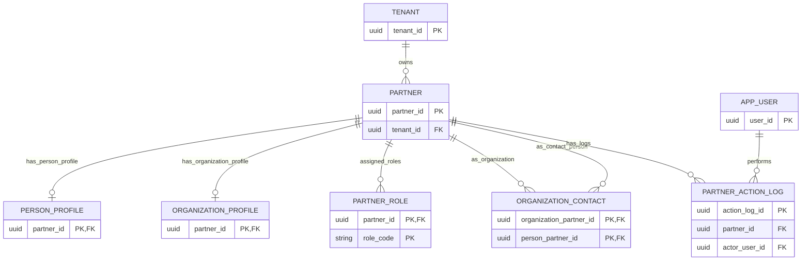

# Theme 3: Khách hàng & NCC

# 1. Theme overview

### 1.1 Mục tiêu theme

Theme 3 quản lý toàn bộ dữ liệu nền về đối tác giao dịch của cửa hàng/doanh nghiệp, bao gồm khách hàng, nhà cung cấp, đối tác vừa là khách hàng vừa là nhà cung cấp, cá nhân liên hệ trong tổ chức, trạng thái sử dụng và lịch sử làm việc với đối tác.

Mục tiêu chính là tạo một nguồn dữ liệu nhất quán để phục vụ bán hàng, nhập hàng, hóa đơn, công nợ, đối soát, báo cáo và truy vết lịch sử.

### 1.2 Bối cảnh nghiệp vụ

Trong vận hành thực tế, một cửa hàng thường làm việc với cả cá nhân và tổ chức. Điểm quan trọng của bản nâng cấp Theme 3 là tách rõ: Cá nhân/Tổ chức là loại hồ sơ CRM, còn Khách hàng/Nhà cung cấp là vai trò giao dịch.

|**Tình huống**|**Cách hiểu đúng trong Theme 3**|
|---|---|
|Chị Hoa mua thuốc thú y tại cửa hàng|Cá nhân, vai trò Khách hàng|
|Đại lý Minh Phát cung cấp hàng cho cửa hàng|Tổ chức, vai trò Nhà cung cấp|
|Một đại lý vừa mua hàng vừa cung cấp hàng|Tổ chức, vai trò KH & NCC|
|Anh Nam là người phụ trách đặt hàng của Đại lý Minh Phát|Cá nhân liên hệ thuộc Tổ chức|

### 1.3 Phạm vi theme

|**Nhóm**|**Nội dung**|
|---|---|
|Danh sách đối tác|Tìm kiếm, lọc, xem danh sách Cá nhân/Tổ chức|
|Tạo mới đối tác|Tạo Cá nhân hoặc Tổ chức|
|Hồ sơ đối tác|Xem, bổ sung, chỉnh sửa thông tin|
|Người liên hệ|Quản lý người liên hệ của Tổ chức|
|Transform|Chuyển Cá nhân thành Tổ chức|
|Trạng thái|Ngừng hoạt động, kích hoạt lại, xóa mềm|
|Lịch sử|Xem lịch sử làm việc/giao dịch liên quan đến đối tác|

### 1.4 Ngoài phạm vi theme

|**Nhóm**|**Lý do**|
|---|---|
|Merge hồ sơ trùng|Phase 1 chỉ cảnh báo trùng, chưa xử lý hợp nhất dữ liệu|
|Tổ chức → Cá nhân|Không hỗ trợ vì dễ làm mất nghĩa dữ liệu tổ chức|
|CRM nâng cao|Chưa có lead, pipeline, chăm sóc khách hàng|
|Phân nhóm khách hàng nâng cao|Chưa có segment, hạng khách hàng, điểm thưởng|
|Export lịch sử đối tác|Để Phase sau|
|Xóa cứng dữ liệu|Phase 1 chỉ soft delete|
|Khôi phục hồ sơ đã xóa|Để Phase sau nếu có nhu cầu quản trị/truy vết|

### 1.5 Người dùng chính

|**Người dùng**|**Nhu cầu chính**|
|---|---|
|Chủ cửa hàng|Kiểm soát danh sách khách hàng/NCC, tránh trùng và sai dữ liệu|
|Quản lý cửa hàng|Tìm, tạo, cập nhật và rà soát hồ sơ đối tác|
|Nhân viên bán hàng|Tìm khách hàng để bán hàng, hóa đơn, công nợ|
|Nhân viên nhập hàng/kho|Tìm nhà cung cấp để nhập hàng, đối soát phiếu nhập|
|Kế toán/công nợ|Kiểm tra thông tin hóa đơn, MST, địa chỉ, lịch sử giao dịch|
|Admin hệ thống|Quản lý quyền, trạng thái, xóa mềm và truy vết thao tác|

### 1.6 Khái niệm chính

|**Khái niệm**|**Định nghĩa**|
|---|---|
|Partner|Root entity đại diện cho một đối tác giao dịch trong hệ thống|
|Person|Hồ sơ cá nhân, có thể là khách hàng cá nhân hoặc người liên hệ|
|Organization|Hồ sơ tổ chức, ví dụ công ty, đại lý, hộ kinh doanh, nhà cung cấp|
|Customer|Vai trò giao dịch khi Partner mua hàng từ cửa hàng|
|Supplier|Vai trò giao dịch khi Partner cung cấp hàng/dịch vụ cho cửa hàng|
|KH & NCC|Partner đồng thời có vai trò Customer và Supplier|
|OrganizationContact|Quan hệ giữa Organization và Person làm người liên hệ|
|Snapshot|Dữ liệu được ghi nhận tại thời điểm giao dịch phát sinh|
|Soft delete|Xóa mềm bằng trạng thái, không xóa cứng khỏi database|
|Action log|Lịch sử thao tác với Partner|

### 1.7 Relationship model

```Plain Text
Organization 1 --- N OrganizationContact --- 1 Person
Person 0..N --- 0..N Organization
```

### 1.8 Epic map

|**Epic**|**Tên**|**Mục tiêu**|
|---|---|---|
|EP-01|Quản lý danh sách, hồ sơ và lịch sử đối tác|Tìm kiếm, tạo mới, chỉnh sửa, xem hồ sơ, quản lý contact, transform và lịch sử làm việc|
|EP-02|Quản lý trạng thái đối tác|Ngừng hoạt động, kích hoạt lại và xóa mềm hồ sơ tạo nhầm|

# 2. Data foundation

## 2.1 Mục tiêu & nguyên tắc

### Mục tiêu

Data foundation của Theme 3 định nghĩa mô hình dữ liệu cốt lõi cho đối tác giao dịch, bảo đảm mọi nghiệp vụ bán hàng, nhập hàng, hóa đơn, công nợ và lịch sử đều tham chiếu cùng một root entity là Partner.

### Nguyên tắc dữ liệu nền

|**ID**|**Nguyên tắc**|
|---|---|
|DF-01|Partner là root entity duy nhất đại diện cho đối tác giao dịch|
|DF-02|Person và Organization là hai loại hồ sơ thật, không chỉ là nhãn hiển thị|
|DF-03|Customer và Supplier là vai trò giao dịch độc lập với loại hồ sơ|
|DF-04|Giao dịch nguồn tham chiếu `partner_id`, không tham chiếu trực tiếp tên hiển thị|
|DF-05|Hồ sơ hiện tại có thể thay đổi nhưng giao dịch đã phát sinh giữ snapshot riêng|
|DF-06|Soft delete dùng trạng thái `deleted`, không xóa cứng mặc định|
|DF-07|Mọi thay đổi quan trọng phải có audit/action log|

### Snapshot rule

|**ID**|**Rule**|
|---|---|
|SS-01|Giao dịch đã phát sinh phải lưu snapshot thông tin đối tác cần thiết tại module nguồn|
|SS-02|Khi Partner đổi tên, SĐT, MST hoặc trạng thái, giao dịch cũ không bị cập nhật ngược|
|SS-03|PartnerHistoryView có thể hiển thị dữ liệu nguồn hiện tại và/hoặc snapshot tùy module nguồn|
|SS-04|Theme 3 không chịu trách nhiệm sửa snapshot giao dịch đã khóa hoặc đã phát sinh|

### Data quality rule

|**ID**|**Rule**|
|---|---|
|DQ-01|Kiểm tra trùng SĐT trong cùng tenant|
|DQ-02|Kiểm tra trùng email trong cùng tenant|
|DQ-03|Kiểm tra trùng MST trong cùng tenant|
|DQ-04|Kiểm tra gần trùng theo tên + SĐT|
|DQ-05|Phase 1 chỉ cảnh báo, chưa merge hồ sơ|
|DQ-06|Dữ liệu optional thiếu không chặn lưu nhưng có thể hiển thị warning nhẹ|

### Data lifecycle

|**From**|**To**|**Cho phép**|**Ghi chú**|
|---|---|---|---|
|`active`|`inactive`|Yes|Ngừng hoạt động|
|`inactive`|`active`|Yes|Kích hoạt lại|
|`active`|`deleted`|Yes|Xóa mềm nếu đủ điều kiện|
|`inactive`|`deleted`|Yes|Xóa mềm nếu đủ điều kiện|
|`deleted`|`active`|No|Không khôi phục trong Phase 1|
|`deleted`|hard delete|No|Không xóa cứng trong Phase 1|

## 2.2 Entity

### Domain model

```Plain Text
Partner
├── PartnerProfile
│   ├── PersonProfile
│   └── OrganizationProfile
├── PartnerRole
│   ├── Customer
│   └── Supplier
├── PartnerStatus
│   ├── Active
│   ├── Inactive
│   └── Deleted
├── OrganizationContact
├── PartnerHistoryView
└── PartnerActionLog
```

### Relationship model

```Plain Text
Tenant 1 --- N Partner
Partner 1 --- 0..1 PersonProfile
Partner 1 --- 0..1 OrganizationProfile
Partner 1 --- N PartnerRole
Organization Partner 1 --- N OrganizationContact --- 1 Person Partner
Partner 1 --- N PartnerActionLog
Partner 1 --- N PartnerHistoryView
```

### ERD



### Entity catalog

|**Entity**|**Loại**|**Mục đích**|**Ghi chú**|
|---|---|---|---|
|Partner|Root entity|Đại diện cho đối tác giao dịch|Mọi giao dịch nên reference `partner_id`|
|PersonProfile<br>|Profile entity|Lưu thông tin cá nhân|Dùng cho khách cá nhân hoặc contact|
|OrganizationProfile|Profile entity|Lưu thông tin tổ chức|Dùng cho công ty, đại lý, HKD, NCC|
|PartnerRole|Role entity|Lưu vai trò Customer/Supplier|Một Partner có thể có nhiều role|
|OrganizationContact|Relationship entity|Liên kết Organization với Person|Có thể đánh dấu contact chính|
|PartnerStatus|State attribute|Quản lý Active/Inactive/Deleted|Ảnh hưởng luồng chọn giao dịch mới|
|PartnerHistoryView|Read model|Tổng hợp lịch sử làm việc|Không sửa giao dịch nguồn trong Theme 3|
|PartnerActionLog|Audit entity|Ghi lịch sử thao tác|Tạo, sửa, status, delete, transform, contact|

### Entity: Partner

|**Field**|**Type**|**Required**|**Rule**|
|---|---|---|---|
|`partner_id`|UUID/string|Yes|ID duy nhất của Partner|
|`tenant_id`|UUID/string|Yes|Dùng để phân vùng dữ liệu theo tenant|
|`partner_type`|enum|Yes|`person` hoặc `organization`|
|`status`|enum|Yes|`active`, `inactive`, `deleted`; mặc định `active`|
|`display_name`|string|Yes|Sinh từ Person hoặc Organization profile|
|`created_by`|audit|Yes|Ghi khi tạo|
|`created_at`|audit|Yes|Ghi khi tạo|
|`updated_by`|audit|Yes|Ghi khi cập nhật|
|`updated_at`|audit|Yes|Ghi khi cập nhật|

### Entity: PersonProfile

|Field|Type|Required|Rule|
|---|---|---|---|
|`partner_id`|UUID/string|Yes|FK đến Partner type `person`|
|`title`|enum|Yes|Cách xưng hô/danh xưng: `ông`, `bà`, `anh`, `chị`, `cô`, `bác`, `chú`, `dì`, `thím`, `em`, `cậu`, ...|
|`full_name`|string|Yes|Tên cá nhân hoặc người liên hệ|
|`nickname`|string|No|Tên gọi thân mật/tên thường gọi, phục vụ tìm kiếm và giao tiếp|
|`phone`|string|Yes|SĐT chính, bắt buộc trong Phase 1|
|`phone2`|string|No|SĐT phụ; Phase sau có thể nâng cấp thành nhiều số điện thoại/custom contact fields|
|`email`|string|No|Validate định dạng nếu có|
|`tax_code`|string|No|Optional, dùng cho hóa đơn nếu có|
|`invoice_name`|string|No|Thông tin hóa đơn optional|
|`invoice_address`|string|No|Thông tin hóa đơn optional|
|`invoice_email`|string|No|Thông tin hóa đơn optional|
|`delivery_province`|string|No|Tỉnh/thành giao hàng mặc định|
|`delivery_commune`|string|No|Xã/phường/thị trấn giao hàng mặc định|
|`delivery_address`|string|No|Địa chỉ giao hàng chi tiết|
|`note`|text|No|Ghi chú nội bộ|

### Entity: OrganizationProfile

|Field|Type|Required|Rule|
|---|---|---|---|
|`partner_id`|UUID/string|Yes|FK đến Partner type `organization`|
|`type`|enum|Yes|Loại tổ chức: `company`, `business_household`, `other`|
|`organization_name`|string|Yes|Tên tổ chức hiển thị chính|
|`short_name`|string|No|Tên viết tắt/tên gọi ngắn của tổ chức|
|`intl_name`|string|No|Tên quốc tế/tên tiếng Anh nếu có|
|`phone`|string|Yes|SĐT chính của tổ chức|
|`email`|string|No|Validate định dạng nếu có|
|`tax_code`|string|No|Optional; nên cảnh báo nếu thiếu với `company` hoặc `business_household`|
|`company_address`|string|No|Địa chỉ tổ chức/địa chỉ đăng ký/địa chỉ hoạt động|
|`invoice_name`|string|No|Thông tin hóa đơn optional|
|`invoice_address`|string|No|Thông tin hóa đơn optional|
|`invoice_email`|string|No|Thông tin hóa đơn optional|
|`delivery_province`|string|No|Tỉnh/thành giao hàng mặc định|
|`delivery_commune`|string|No|Xã/phường/thị trấn giao hàng mặc định|
|`note`|text|No|Ghi chú nội bộ|

### Entity: PartnerRole

|Field|Type|Required|Rule|
|---|---|---|---|
|`partner_id`|UUID/string|Yes|FK đến Partner|
|`role`|enum|Yes|`customer` hoặc `supplier`|
|`is_active`|boolean|Yes|Dùng để xác định role hiện còn dùng|
|`created_at`|datetime|Yes|Thời điểm gán role|
|`updated_at`|datetime|Yes|Thời điểm cập nhật role|

### Entity: OrganizationContact

|Field|Type|Required|Rule|
|---|---|---|---|
|`organization_partner_id`|UUID/string|Yes|Partner type phải là `organization`|
|`person_partner_id`|UUID/string|Yes|Partner type phải là `person`|
|`contact_role`|string|No|Ví dụ: Chủ đại lý, Kế toán, Người mua hàng|
|`is_primary`|boolean|Yes|Mỗi Organization tối đa một primary contact|
|`note`|text|No|Ghi chú nội bộ cho quan hệ contact|
|`created_by`|audit|Yes|Ghi khi tạo liên kết|
|`created_at`|audit|Yes|Ghi khi tạo liên kết|
|`updated_by`|audit|Yes|Ghi khi cập nhật liên kết|
|`updated_at`|audit|Yes|Ghi khi cập nhật liên kết|

### Entity: PartnerHistoryView

|Field|Type|Required|Rule|
|---|---|---|---|
|`history_id`|UUID/string|Yes|ID dòng lịch sử/read model|
|`partner_id`|UUID/string|Yes|Partner liên quan|
|`role`|enum|Yes|`customer` hoặc `supplier` theo chiều giao dịch|
|`transaction_type`|enum|Yes|Ví dụ `sales_order`, `purchase_receipt`, `invoice`, `payment`, `debt`|
|`source_module`|string|Yes|Module nguồn của dữ liệu|
|`source_id`|UUID/string|Yes|ID giao dịch/chứng từ nguồn|
|`reference_code`|string|Yes|Mã hiển thị của giao dịch nguồn|
|`transaction_date`|datetime|Yes|Ngày phát sinh giao dịch|
|`status`|string|Yes|Trạng thái theo module nguồn|
|`amount`|number/string|No|Giá trị nếu giao dịch có tiền|
|`currency`|number/string|No|Giá trị nếu giao dịch có tiền|
|`can_open_source`|boolean|Yes|Phụ thuộc quyền với module nguồn|

### Entity: PartnerActionLog

|Field|Type|Required|Rule|
|---|---|---|---|
|`action_log_id`|UUID/string|Yes|ID log|
|`partner_id`|UUID/string|Yes|Partner bị tác động|
|`action_type`|enum|Yes|`create`, `update`, `add_contact`, `remove_contact`, `transform`, `deactivate`, `reactivate`, `delete`|
|`actor_user_id`|UUID/string|Yes|Người thực hiện|
|`reason`|text|No|Lý do thao tác nếu có|
|`before_state`|json|No|Snapshot trước thao tác nếu cần audit|
|`after_state`|json|No|Snapshot sau thao tác nếu cần audit|
|`created_at`|datetime|Yes|Thời điểm ghi log|

# 3. Theme-level business rules

### Quy tắc trạng thái và lifecycle

|Status|Ý nghĩa|
|---|---|
|Active|Được chọn cho giao dịch mới|
|Inactive|Không được chọn cho giao dịch mới nhưng vẫn xem được hồ sơ và lịch sử theo quyền|
|Deleted|Không hiển thị trong danh sách làm việc mặc định và không được chọn cho giao dịch mới|

### Quy tắc loại hồ sơ và vai trò giao dịch

|ID|Business Rule|
|---|---|
|BR-01|`partner_type` gồm `person` và `organization`|
|BR-02|`roles` gồm `customer` và `supplier`|
|BR-03|`organization` gồm `công ty`, `hộ kinh doanh`, `khác`|
|BR-04|Một Partner phải có ít nhất một role|
|BR-05|Một Partner có thể đồng thời là Customer và Supplier|
|BR-06|Partner Type và Partner Role độc lập với nhau|

### Quy tắc chỉnh sửa và transform

|**ID**|**Business Rule**|
|---|---|
|BR-01|Chỉnh sửa hồ sơ chỉ cập nhật dữ liệu hiện tại của Partner|
|BR-02|Không đổi trực tiếp `partner_type` trong form chỉnh sửa thông thường|
|BR-03|Chỉ hỗ trợ transform Person → Organization|
|BR-04|Không hỗ trợ Organization → Person|
|BR-05|Khi transform Person → Organization, giữ nguyên `partner_id`, roles và status|
|BR-06|Person ban đầu được lưu làm người liên hệ chính của Organization|
|BR-07|Transform phải ghi action log|

### Quy tắc người liên hệ của tổ chức

|**ID**|**Business Rule**|
|---|---|
|BR-01|Chỉ Organization mới có danh sách người liên hệ con|
|BR-02|Người liên hệ được lưu dưới dạng Person|
|BR-03|Quan hệ Organization-Person được quản lý qua OrganizationContact|
|BR-04|Mỗi Organization tối đa một primary contact|
|BR-05|Gỡ contact chỉ xóa liên kết, không mặc định xóa Person|
|BR-06|Contact không bắt buộc có role Customer hoặc Supplier|
|BR-07|Một Person có thể tồn tại độc lập hoặc là contact của Organization|

### Quy tắc trùng dữ liệu và chất lượng dữ liệu

|ID|Business Rule|
|---|---|
|BR-01|Cảnh báo khi trùng SĐT trong cùng tenant|
|BR-02|Cảnh báo khi trùng email trong cùng tenant|
|BR-03|Cảnh báo khi trùng MST trong cùng tenant|
|BR-04|Cảnh báo khi tên + SĐT gần giống hồ sơ đã có|
|BR-05|Phase 1 chỉ cảnh báo trùng, chưa merge hồ sơ|
|BR-06|Người dùng có thể tiếp tục lưu nếu có quyền và nghiệp vụ cho phép|
|BR-07|Dữ liệu thiếu optional field không chặn sử dụng nhưng có thể hiển thị warning nhẹ|

### Quy tắc audit/log

|**ID**|**Business Rule**|
|---|---|
|BR-01|Tạo mới Partner phải ghi `created_by`, `created_at`|
|BR-02|Cập nhật Partner phải ghi `updated_by`, `updated_at`|
|BR-03|Thao tác trạng thái phải ghi action log|
|BR-04|Xóa mềm phải ghi action log|
|BR-05|Transform phải ghi action log|
|BR-06|Quản lý contact phải ghi action log|
|BR-07|Reason nếu được nhập phải lưu trong action log|

### Quy tắc phân quyền

|**Permission**|**Ý nghĩa**|
|---|---|
|`partner.view`|Xem danh sách đối tác|
|`partner.detail.view`|Xem hồ sơ chi tiết đối tác|
|`partner.create`|Tạo mới đối tác|
|`partner.update`|Chỉnh sửa thông tin đối tác|
|`partner.contact.manage`|Quản lý người liên hệ của tổ chức|
|`partner.transform`|Chuyển Cá nhân thành Tổ chức|
|`partner.status.manage`|Ngừng hoạt động/kích hoạt lại đối tác|
|`partner.delete`|Xóa mềm hồ sơ đối tác|
|`partner.history.view`|Xem lịch sử làm việc với đối tác|

# 4. Theme-level business commands

## 4.1 Mục tiêu business command

Business command định nghĩa các hành động nghiệp vụ chính mà người dùng hoặc hệ thống có thể thực hiện với Partner. Các command này là lớp ngôn ngữ nghiệp vụ nằm giữa user story, UI action và API implementation.

## 4.2 Command principles

|**ID**|**Principle**|
|---|---|
|CP-01|Command phải thể hiện hành động nghiệp vụ rõ ràng, không chỉ là tên API|
|CP-02|Command write phải kiểm tra quyền, tenant, trạng thái mới nhất và điều kiện nghiệp vụ trước khi ghi dữ liệu|
|CP-03|Command thành công phải cập nhật audit fields và action log nếu có thay đổi dữ liệu|
|CP-04|Command không được cập nhật ngược snapshot của giao dịch đã phát sinh|
|CP-05|Command bị chặn phải trả lý do rõ ràng để UI hiển thị đúng state|

## 4.3 Command blocked response standard

|**Code**|**Ý nghĩa**|**UI state gợi ý**|
|---|---|---|
|`NO_PERMISSION`|Người dùng không có quyền thực hiện command|No permission state|
|`NOT_FOUND`|Không tìm thấy Partner hoặc không thuộc tenant|Not found state|
|`VALIDATION_ERROR`|Dữ liệu bắt buộc thiếu hoặc sai định dạng|Inline error|
|`DUPLICATE_WARNING`|Dữ liệu có khả năng trùng|Warning modal/block|
|`INVALID_STATUS`|Trạng thái hiện tại không phù hợp command|Blocked state|
|`HAS_TRANSACTIONS`|Partner đã phát sinh dữ liệu, không thể xóa|Blocked with suggested deactivate|
|`STATE_CHANGED`|Dữ liệu đã thay đổi bởi người khác|Reload/refresh state|
|`SYSTEM_ERROR`|Lỗi hệ thống khi xử lý command|Error state + retry|

## 4.4 Command catalog

|**Command**|**Loại**|**Mục tiêu**|**Permission**|**API chính**|**US liên quan**|
|---|---|---|---|---|---|
|CMD-01|Query<br>|Tìm kiếm và lọc danh sách Partner|`partner.view`|`GET /partners`|EP-01/US-01|
|CMD-02|Query|Xem hồ sơ Partner|`partner.detail.view`|`GET /partners/{id}`|EP-01/US-04|
|CMD-03|Write|Tạo Partner mới|`partner.create`|`POST /partners`|EP-01/US-02|
|CMD-04|Write|Cập nhật hồ sơ Partner|`partner.update`|`PATCH /partners/{id}`|EP-01/US-03|
|CMD-05|Write|Thêm người liên hệ vào Organization|`partner.contact.manage`|`POST /partners/{id}/contacts`|EP-01/US-05|
|CMD-06|Write|Cập nhật người liên hệ của Organization|`partner.contact.manage`|`PATCH /partners/{id}/contacts/{person_id}`|EP-01/US-05|
|CMD-07|Write|Gỡ người liên hệ khỏi Organization|`partner.contact.manage`|`DELETE /partners/{id}/contacts/{person_id}`|EP-01/US-05|
|CMD-08|Write|Chuyển Person thành Organization|`partner.transform`|`POST /partners/{id}/transform-to-organization`|EP-01/US-06|
|CMD-09|Write|Ngừng hoạt động Partner|`partner.status.manage`|`POST /partners/{id}/deactivate`|EP-02/US-01|
|CMD-10|Write|Kích hoạt lại Partner|`partner.status.manage`|`POST /partners/{id}/reactivate`|EP-02/US-01|
|CMD-11|Query|Kiểm tra điều kiện xóa Partner|`partner.delete`|`GET /partners/{id}/delete-eligibility`|EP-02/US-02|
|CMD-12|Write|Xóa mềm Partner tạo nhầm|`partner.delete`|`POST /partners/{id}/delete`|EP-02/US-02|
|CMD-13|Query|Xem lịch sử làm việc với Partner|`partner.history.view`|`GET /partners/{id}/history`|EP-01/US-07|

### CMD-01 — Tìm kiếm và lọc danh sách Partner

|**Thuộc tính**|**Nội dung**|
|---|---|
|Trigger|Người dùng mở danh sách, nhập search hoặc áp dụng filter|
|Input chính|`q`, `partner_type`, `role`, `status`, `page`, `limit`, `sort`|
|Preconditions|Người dùng có `partner.view`; tenant hợp lệ|
|Effects|Không ghi dữ liệu; trả danh sách Partner phù hợp|
|Blocked/Error|Không có quyền, lỗi tải dữ liệu, tenant không hợp lệ|

### CMD-02 — Xem hồ sơ Partner

|**Thuộc tính**|**Nội dung**|
|---|---|
|Trigger|Người dùng mở Partner từ danh sách hoặc từ liên kết liên quan|
|Input chính|`partner_id`|
|Preconditions|Người dùng có `partner.detail.view`; Partner thuộc tenant hiện tại|
|Effects|Không ghi dữ liệu; trả hồ sơ hiện tại và `available_actions`|
|Blocked/Error|Không có quyền, Partner không tồn tại, không thuộc tenant, lỗi tải dữ liệu|

### CMD-03 — Tạo Partner mới

|**Thuộc tính**|**Nội dung**|
|---|---|
|Trigger|Người dùng lưu form tạo Cá nhân hoặc Tổ chức|
|Input chính|`partner_type`, `roles`, PersonProfile hoặc OrganizationProfile, optional primary contact|
|Preconditions|Người dùng có `partner.create`; dữ liệu bắt buộc hợp lệ|
|Effects|Tạo Partner, profile tương ứng, role, audit fields và action log|
|Blocked/Error|Thiếu field bắt buộc, định dạng sai, warning trùng dữ liệu, lỗi lưu|

### CMD-04 — Cập nhật hồ sơ Partner

|**Thuộc tính**|**Nội dung**|
|---|---|
|Trigger|Người dùng lưu form chỉnh sửa Partner|
|Input chính|`partner_id`, profile fields, roles|
|Preconditions|Người dùng có `partner.update`; Partner thuộc tenant; không đổi `partner_type` qua command này|
|Effects|Cập nhật hồ sơ hiện tại, role nếu hợp lệ, audit fields và action log|
|Blocked/Error|Không có quyền, thiếu field bắt buộc, trạng thái không hợp lệ, warning trùng, lỗi lưu|

### CMD-05/CMD-06/CMD-07 — Quản lý Organization contact

|**Thuộc tính**|**Nội dung**|
|---|---|
|Trigger|Người dùng thêm, sửa, đặt chính hoặc gỡ người liên hệ trong hồ sơ Organization|
|Input chính|`organization_partner_id`, `person_partner_id` hoặc person fields, `contact_role`, `is_primary`|
|Preconditions|Người dùng có `partner.contact.manage`; Partner đích là Organization|
|Effects|Tạo/cập nhật/xóa liên kết OrganizationContact; cập nhật primary contact nếu có; ghi action log|
|Blocked/Error|Hồ sơ là Person, không có quyền, contact trùng, thiếu họ tên/SĐT, lỗi lưu|

### CMD-08 — Chuyển Person thành Organization

|**Thuộc tính**|**Nội dung**|
|---|---|
|Trigger|Người dùng xác nhận `Chuyển cá nhân thành tổ chức`|
|Input chính|`partner_id`, OrganizationProfile mới, primary contact fields|
|Preconditions|Người dùng có `partner.transform`; Partner hiện tại là Person; dữ liệu tổ chức hợp lệ|
|Effects|Đổi `partner_type` sang Organization, giữ `partner_id`, giữ role/status, tạo Person contact chính, ghi action log|
|Blocked/Error|Partner không phải Person, không có quyền, thiếu tên tổ chức/SĐT chính, dữ liệu đã thay đổi, lỗi lưu|

### CMD-09/CMD-10 — Ngừng hoạt động và kích hoạt lại Partner

|**Thuộc tính**|**Nội dung**|
|---|---|
|Trigger|Người dùng xác nhận ngừng hoạt động hoặc kích hoạt lại|
|Input chính|`partner_id`, optional `reason`|
|Preconditions|Người dùng có `partner.status.manage`; Partner thuộc tenant; trạng thái hiện tại phù hợp|
|Effects|Cập nhật `status`, audit fields và action log; không cập nhật giao dịch cũ|
|Blocked/Error|Không có quyền, Partner đã deleted, state changed, lỗi lưu|

### CMD-11/CMD-12 — Kiểm tra điều kiện xóa và xóa mềm Partner

|**Thuộc tính**|**Nội dung**|
|---|---|
|Trigger|Người dùng chọn và xác nhận `Xóa hồ sơ`|
|Input chính|`partner_id`, optional `reason`|
|Preconditions|Người dùng có `partner.delete`; Partner thuộc tenant; chưa phát sinh dữ liệu nghiệp vụ bị chặn|
|Effects|Nếu đủ điều kiện, cập nhật `status = deleted`, audit fields và action log|
|Blocked/Error|Đã có giao dịch/chứng từ liên quan, không có quyền, state changed, lỗi lưu|

### CMD-13 — Xem lịch sử làm việc với Partner

|**Thuộc tính**|**Nội dung**|
|---|---|
|Trigger|Người dùng mở tab/card lịch sử trong hồ sơ Partner|
|Input chính<br>|`partner_id`, `role`, `transaction_type`, `status`, `date_from`, `date_to`, pagination|
|Preconditions|Người dùng có `partner.history.view`; Partner thuộc tenant|
|Effects|Không ghi dữ liệu; trả read model lịch sử từ các module nguồn|
|Blocked/Error|Không có quyền, lỗi tải lịch sử, không có quyền mở giao dịch nguồn|

# 5. Epic EP-01 — Quản lý danh sách, hồ sơ và lịch sử đối tác

### 5.1 Epic overview

#### 5.1.1 Mục tiêu epic

EP-01 bao phủ luồng người dùng từ tìm đối tác, tạo mới, xem hồ sơ, chỉnh sửa, quản lý người liên hệ, chuyển cá nhân thành tổ chức và xem lịch sử làm việc.

#### 5.1.2 Phạm vi epic

|**Nhóm**|**Nội dung**|
|---|---|
|Danh sách|Tìm kiếm, lọc, xem danh sách Partner|
|Tạo mới|Tạo Person hoặc Organization|
|Cập nhật|Bổ sung/chỉnh sửa thông tin hiện tại|
|Hồ sơ|Xem chi tiết Person/Organization|
|Contact|Quản lý người liên hệ của Organization|
|Transform|Chuyển Person thành Organization|
|History|Xem lịch sử làm việc read-only|

#### 5.1.3 Ngoài phạm vi epic

|**Nhóm**|**Ghi chú**|
|---|---|
|Lifecycle status|Thuộc EP-02|
|Delete/soft delete|Thuộc EP-02|
|Xử lý giao dịch nguồn|Thuộc module bán hàng, nhập hàng, hóa đơn, công nợ|
|Merge hồ sơ|Out of scope Phase 1|

#### 5.1.4 Entry points chính

|**Entry point**|**Mô tả**|
|---|---|
|Danh sách Khách hàng & NCC|Nơi bắt đầu tìm kiếm, lọc, tạo mới|
|FAB `+`|Mở lựa chọn tạo Cá nhân/Tổ chức|
|Hồ sơ chi tiết|Nơi xem thông tin hiện tại và mở các action tiếp theo|
|`Thao tác ︿`|Secondary button mở action sheet|
|Card/tab Lịch sử|Mở lịch sử làm việc read-only|

#### 5.1.5 User story map

|**US**|**Tên**|
|---|---|
|US-01|Tìm kiếm và rà soát danh sách đối tác|
|US-02|Ghi nhận đối tác mới|
|US-03|Bổ sung và chỉnh sửa thông tin đối tác|
|US-04|Kiểm tra hồ sơ đối tác|
|US-05|Quản lý người liên hệ của tổ chức|
|US-06|Chuyển cá nhân thành tổ chức|
|US-07|Theo dõi lịch sử làm việc với đối tác|

### 5.2 US-01 — Tìm kiếm và rà soát danh sách đối tác

#### 5.2.1 Business Context

Người dùng cần một màn hình danh sách để tìm nhanh khách hàng, nhà cung cấp hoặc đối tác có cả hai vai trò, trước khi mở hồ sơ, chỉnh sửa, tạo mới hoặc kiểm tra lịch sử giao dịch.

Danh sách phải phân biệt rõ Cá nhân/Tổ chức và Khách hàng/Nhà cung cấp/KH & NCC để tránh nhầm giữa loại hồ sơ CRM và vai trò giao dịch.

#### 5.2.2 Functional Requirements

|**ID**|**Functional Requirement**|
|---|---|
|FR-01|Người dùng có thể mở danh sách đối tác trong phạm vi tenant hiện tại|
|FR-02|Hệ thống hiển thị cả hồ sơ Cá nhân và Tổ chức trên cùng danh sách|
|FR-03|Mỗi item hiển thị tên, loại hồ sơ, vai trò, trạng thái, SĐT và cập nhật gần nhất nếu có|
|FR-04|Người dùng có thể tìm kiếm theo tên, SĐT, email hoặc MST|
|FR-05|Người dùng có thể lọc theo vai trò, loại hồ sơ và trạng thái|
|FR-06|Người dùng có thể mở hồ sơ chi tiết từ danh sách nếu có quyền phù hợp|
|FR-07|Người dùng có thể bắt đầu tạo mới Cá nhân hoặc Tổ chức từ danh sách nếu có quyền phù hợp|

#### 5.2.3 Business Rules

|ID|Business Rule|
|---|---|
|BR-01|Chỉ người dùng có quyền `partner.view` mới được xem danh sách|
|BR-02|Danh sách chỉ hiển thị dữ liệu thuộc tenant hiện tại|
|BR-03|Partner Type gồm Cá nhân và Tổ chức; Partner Role gồm Khách hàng và Nhà cung cấp|
|BR-04|Một Partner có thể có một vai trò hoặc đồng thời cả hai vai trò Khách hàng & Nhà cung cấp|
|BR-05|Mặc định danh sách chỉ hiển thị Partner Đang hoạt động|
|BR-06|Partner Ngừng hoạt động chỉ hiển thị khi lọc trạng thái phù hợp|
|BR-07|Partner Đã xóa không hiển thị trong danh sách làm việc mặc định|

#### 5.2.4 Edge Cases

|**ID**|**Edge Case**|**Expected Behavior**|
|---|---|---|
|EC-01|Không có quyền xem danh sách|Chặn truy cập và hiển thị thông báo không có quyền|
|EC-02|Tenant chưa có đối tác nào|Hiển thị empty state và CTA tạo mới nếu có quyền|
|EC-03|Không có kết quả theo từ khóa|Hiển thị no result state|
|EC-04|Không có dữ liệu theo bộ lọc|Hiển thị no data state và gợi ý đặt lại bộ lọc|
|EC-05|Đối tác thiếu SĐT do dữ liệu cũ|Vẫn hiển thị hồ sơ, kèm cảnh báo thiếu thông tin|
|EC-06|Nhiều đối tác trùng tên|Hiển thị thêm SĐT, loại hồ sơ, vai trò hoặc MST để phân biệt|
|EC-07|Tải danh sách thất bại|Hiển thị error state, cho phép tải lại|

#### 5.2.5 UI Contract

|ID|UI Contract|
|---|---|
|UI-01|Top bar title `Khách hàng & NCC` căn giữa|
|UI-02|Search dưới top bar, placeholder `Tìm tên, SĐT, email, MST`|
|UI-03|Filter icon dùng slider/tuning controls|
|UI-04|Quick filters: Tất cả, Khách hàng, Nhà cung cấp, Tổ chức|
|UI-05|Partner card hiển thị tên, chip type, chip role, status, SĐT, cập nhật gần nhất|
|UI-06|FAB `+` là hành động tạo mới chính|
|UI-07|Filter bottom sheet có Vai trò, Loại hồ sơ, Trạng thái, Đặt lại, Áp dụng|

#### 5.2.6 Design Contract

|**ID**|**Screen/State**|**Ghi chú thiết kế**|
|---|---|---|
|**D-01**|**Danh sách đối tác mặc định**|Màn chính Khách hàng & NCC; search dưới top bar; filter icon dạng slider; sort; item card hiển thị tên, SĐT, loại hồ sơ, vai trò, trạng thái; FAB + dẫn sang US-02.|
|**D-02**|**Đang tìm kiếm / Kết quả search**|Khi nhập từ khóa, list cập nhật theo tên, SĐT, email, MST; có số lượng kết quả; giữ filter/sort hiện tại nếu đang áp dụng.|
|**D-03**|**Filter bottom sheet**|Bottom sheet có dim overlay + handle; lọc theo Loại hồ sơ, Vai trò giao dịch, Trạng thái; CTA Đặt lại và Áp dụng.|
|**D-04**|**Danh sách đã áp dụng bộ lọc**|Hiển thị active filter chips như Tổ chức ×, Nhà cung cấp ×, Đang hoạt động ×; có CTA Xóa lọc; list phản ánh đúng bộ lọc.|
|**D-05**|**Sort bottom sheet**|Bottom sheet sắp xếp danh sách; options đề xuất: Cập nhật gần nhất, Mới tạo, Tên A–Z, Tên Z–A; không làm mất search/filter hiện tại.|
|**D-06**|**Empty / No result / Loading / Error**|Gom các state phụ: chưa có đối tác, không có kết quả, skeleton loading, lỗi tải danh sách; CTA theo ngữ cảnh như + Thêm đối tác, Đặt lại bộ lọc, Thử lại.|
|**D-07**|**No permission**|State khi không có quyền partner.view; không hiển thị dữ liệu, search, filter, sort hoặc FAB.|


#### 5.2.7 Data/API Contract

```HTTP
GET /partners
```

|Param|Type|Ghi chú|
|---|---|---|
|`q`|string|Tìm theo tên, SĐT, email, MST|
|`partner_type`|enum|person, organization, all|
|`role`|enum|customer, supplier, both, all|
|`status`|enum|active, inactive, all|
|`page`/`limit`|number|Phân trang|
|`sort`|string|Mặc định updated_at_desc|

```JSON
{"partner_id":"ptr_001","partner_type":"organization","display_name":"Đại lý Chăn nuôi Minh Phát","roles":["supplier"],"status":"active","phone":"02838225511","contact_count":2,"updated_at":"2026-06-18T11:05:00+07:00"}
```

#### 5.2.8 Scenarios

```Gherkin
Background:
  Given người dùng đã đăng nhập hệ thống
  And người dùng đang làm việc trong một tenant hợp lệ
Scenario: SCN-01 - Mở danh sách đối tác thành công
  Given người dùng có quyền "partner.view"
  When người dùng mở màn hình "Khách hàng & NCC"
  Then hệ thống hiển thị danh sách đối tác thuộc tenant hiện tại
Scenario: SCN-02 - Hiển thị rõ cá nhân và tổ chức
  Given danh sách có cả Partner type "Person" và "Organization"
  Then mỗi item hiển thị chip "Cá nhân" hoặc "Tổ chức" phù hợp
Scenario: SCN-03 - Hiển thị rõ vai trò giao dịch
  Given một Partner có vai trò Customer hoặc Supplier
  Then hệ thống hiển thị vai trò là Khách hàng, Nhà cung cấp hoặc KH & NCC
Scenario: SCN-04 - Tìm kiếm đối tác
  When người dùng nhập tên, SĐT, email hoặc MST
  Then hệ thống hiển thị các đối tác phù hợp trong tenant hiện tại
Scenario: SCN-05 - Lọc danh sách
  When người dùng chọn bộ lọc vai trò, loại hồ sơ hoặc trạng thái
  Then hệ thống chỉ hiển thị các đối tác thỏa mãn điều kiện lọc
Scenario: SCN-06 - Bắt đầu tạo mới đối tác
  Given người dùng có quyền "partner.create"
  When người dùng bấm FAB "+"
  Then hệ thống hiển thị action sheet có Tạo cá nhân và Tạo tổ chức
Scenario: SCN-07 - Không có quyền xem danh sách
  Given người dùng không có quyền "partner.view"
  When người dùng mở màn hình
  Then hệ thống không hiển thị danh sách
```

#### 5.2.9 Acceptance Criteria 

|ID|Acceptance Criteria|
|---|---|
|AC-01|Người dùng có quyền chỉ thấy danh sách đối tác trong tenant hiện tại|
|AC-02|Danh sách phân biệt rõ Cá nhân/Tổ chức|
|AC-03|Danh sách phân biệt rõ Khách hàng/Nhà cung cấp/KH & NCC|
|AC-04|Search hoạt động với tên, SĐT, email, MST|
|AC-05|Filter hoạt động theo vai trò, loại hồ sơ và trạng thái|
|AC-06|Empty/No result/Error state hiển thị đúng tình huống|
|AC-07|FAB tạo mới mở action sheet chọn Tạo cá nhân hoặc Tạo tổ chức|

#### 5.2.10 Open questions

|ID|Open Question|
|---|---|
|OQ-01|Có cần hiển thị `contact_count` trên list ngay Phase 1 không?|
|OQ-02|Search theo tên người liên hệ có trả về Organization không?|
|OQ-03|Có cần lọc Đã xóa trong list không?|
|OQ-04|KH & NCC là một chip hay hai chip?|

### 5.3 US-02 — Ghi nhận đối tác mới

#### 5.3.1 Business Context

Người dùng cần ghi nhận nhanh một đối tác mới khi cửa hàng bắt đầu làm việc với khách hàng, nhà cung cấp hoặc một bên vừa mua vừa bán với cửa hàng.

Người dùng cần chọn trước Tạo cá nhân hoặc Tạo tổ chức để giảm nhầm lẫn giữa Person và Organization.

#### 5.3.2 Functional Requirements

|ID|Functional Requirement|
|---|---|
|FR-01|Bắt đầu tạo mới đối tác từ danh sách nếu có quyền|
|FR-02|Chọn loại hồ sơ cần tạo: Cá nhân hoặc Tổ chức|
|FR-03|Chọn vai trò giao dịch: Khách hàng, Nhà cung cấp hoặc KH & NCC|
|FR-04|Nhập thông tin nhận diện bắt buộc theo loại hồ sơ|
|FR-05|Nhập thông tin liên hệ, thuế, hóa đơn và ghi chú nếu có|
|FR-06|Hệ thống cảnh báo dữ liệu có khả năng trùng trước khi lưu|
|FR-07|Lưu hồ sơ mới khi dữ liệu hợp lệ và ghi thông tin tạo/audit|

#### 5.3.3 Business Rules

|ID|Business Rule|
|---|---|
|BR-01|Chỉ người dùng có quyền `partner.create` mới được tạo đối tác mới|
|BR-02|Đối tác mới chỉ được tạo trong tenant hiện tại|
|BR-03|Mỗi hồ sơ mới phải có partner_type Person hoặc Organization|
|BR-04|Mỗi hồ sơ mới phải có ít nhất một vai trò Customer hoặc Supplier|
|BR-05|Với Cá nhân, bắt buộc họ tên và số điện thoại|
|BR-06|Với Tổ chức, bắt buộc tên tổ chức và số điện thoại chính|
|BR-07|Hồ sơ mới mặc định Đang hoạt động|

#### 5.3.4 Edge Cases

|ID|Edge Case|Expected Behavior|
|---|---|---|
|EC-01|Không có quyền tạo mới|Ẩn hoặc vô hiệu hóa FAB/action tạo mới|
|EC-02|Chưa chọn Cá nhân/Tổ chức|Yêu cầu chọn loại hồ sơ trước|
|EC-03|Bỏ trống trường bắt buộc|Chặn lưu và hiển thị lỗi inline|
|EC-04|SĐT/email/MST sai định dạng|Chặn lưu và hiển thị rule lỗi|
|EC-05|Dữ liệu có khả năng trùng|Hiển thị cảnh báo và cho phép kiểm tra/tiếp tục nếu được phép|
|EC-06|Rời form khi có dữ liệu chưa lưu|Hiển thị confirmation modal|
|EC-07|Lưu thất bại|Không tạo hồ sơ không hoàn chỉnh, giữ dữ liệu đã nhập|

#### 5.3.5 UI Contract

|ID|UI Contract|
|---|---|
|UI-01|FAB `+` mở create action sheet|
|UI-02|Options: `Tạo cá nhân ›`, `Tạo tổ chức ›`|
|UI-03|Form tạo cá nhân gồm Vai trò, Thông tin cá nhân, Hóa đơn, Ghi chú|
|UI-04|Form tạo tổ chức gồm Vai trò, Thông tin tổ chức, Hóa đơn, Người liên hệ chính optional, Ghi chú|
|UI-05|Primary CTA `Lưu đối tác`|
|UI-06|Secondary CTA `Hủy` hoặc back `←`|
|UI-07|Success toast `Đã tạo đối tác`|

#### 5.3.6 Design Contract

|ID|Screen/State|Ghi chú thiết kế|
|---|---|---|
|D-01|Create action sheet|Dim overlay, handle, 2 action row|
|D-02|Form tạo cá nhân|Top bar `Tạo cá nhân`, back `←`|
|D-03|Form tạo tổ chức|Top bar `Tạo tổ chức`, back `←`|
|D-04|Duplicate warning|Cảnh báo trùng SĐT/email/MST|
|D-05|Confirmation rời form|Có dữ liệu chưa lưu|
|D-06|Tạo thành công|Toast dark bar, check xanh|
|D-07|Error/No permission|Lỗi lưu hoặc không có quyền|


#### 5.3.7 Data/API Contract

```HTTP
POST /partners
```

```JSON
{"partner_type":"person","roles":["customer"],"person":{"full_name":"Trần Thị Hoa","phone":"0987654321","email":"hoa@example.com"}}
```

```JSON
{"partner_type":"organization","roles":["supplier"],"organization":{"organization_name":"Đại lý Chăn nuôi Minh Phát","phone":"02838225511","tax_code":"0312345678"},"primary_contact":{"full_name":"Anh Nam","phone":"0909123456"}}
```

|ID|Data Rule|
|---|---|
|DR-01|display_name lấy từ full_name hoặc organization_name|
|DR-02|roles phải có ít nhất một giá trị|
|DR-03|status mặc định active|
|DR-04|Kiểm tra trùng trong tenant hiện tại|
|DR-05|primary_contact tạo Person liên kết Organization nếu có|
|DR-06|Lưu thành công ghi created_by, created_at và action log|

#### 5.3.8 Scenarios

```Gherkin
Background:
  Given người dùng đã đăng nhập hệ thống
Scenario: SCN-01 - Mở lựa chọn tạo mới đối tác
  Given người dùng có quyền "partner.create"
  When người dùng bấm FAB "+"
  Then hệ thống hiển thị lựa chọn Tạo cá nhân và Tạo tổ chức
Scenario: SCN-02 - Tạo cá nhân thành công
  Given người dùng nhập họ tên, số điện thoại và vai trò hợp lệ
  When người dùng lưu
  Then hệ thống tạo Partner type Person và status Active
Scenario: SCN-03 - Tạo tổ chức thành công
  Given người dùng nhập tên tổ chức, số điện thoại chính và vai trò hợp lệ
  When người dùng lưu
  Then hệ thống tạo Partner type Organization và status Active
Scenario: SCN-04 - Thiếu thông tin bắt buộc
  When người dùng lưu thiếu trường bắt buộc
  Then hệ thống chặn lưu và hiển thị lỗi inline
Scenario: SCN-05 - Cảnh báo trùng
  Given SĐT hoặc MST đã tồn tại trong tenant
  When người dùng lưu
  Then hệ thống hiển thị cảnh báo trùng
Scenario: SCN-06 - Rời form có dữ liệu chưa lưu
  When người dùng rời form
  Then hệ thống hiển thị confirmation modal
Scenario: SCN-07 - Không có quyền tạo mới
  Given người dùng không có quyền
  Then hệ thống ẩn hoặc vô hiệu hóa hành động tạo mới
```

#### 5.3.9 Acceptance Criteria 

|ID|Acceptance Criteria|
|---|---|
|AC-01|Người dùng có quyền có thể bắt đầu tạo mới từ FAB|
|AC-02|Người dùng phải chọn rõ Tạo cá nhân hoặc Tạo tổ chức|
|AC-03|Form cá nhân và tổ chức hiển thị field phù hợp|
|AC-04|Vai trò giao dịch là bắt buộc và độc lập với loại hồ sơ|
|AC-05|Hệ thống validate trường bắt buộc và định dạng|
|AC-06|Hệ thống cảnh báo trùng trước khi hoàn tất lưu|
|AC-07|Lưu thành công tạo Partner Active và ghi audit|

#### 5.3.10 Open questions

|ID|Open Question|
|---|---|
|OQ-01|Tổ chức có bắt buộc nhập người liên hệ chính không?|
|OQ-02|MST tổ chức có bắt buộc không?|
|OQ-03|Sau khi tạo thành công điều hướng về đâu?|
|OQ-04|Cảnh báo trùng dùng modal hay inline block?|

### 5.4 US-03 — Bổ sung và chỉnh sửa thông tin đối tác

#### 5.4.1 Business Context

Thông tin đối tác có thể thay đổi theo thời gian như SĐT, email, địa chỉ, MST, hóa đơn, vai trò hoặc ghi chú.

Chỉnh sửa hồ sơ chỉ ảnh hưởng thông tin hiện tại dùng cho giao dịch mới; giao dịch cũ giữ snapshot.

#### 5.4.2 Functional Requirements

|ID|Functional Requirement|
|---|---|
|FR-01|Mở form chỉnh sửa nếu có quyền|
|FR-02|Hiển thị dữ liệu hiện tại theo đúng Cá nhân/Tổ chức|
|FR-03|Chỉnh sửa thông tin nhận diện, liên hệ, thuế, hóa đơn, ghi chú|
|FR-04|Bổ sung hoặc điều chỉnh vai trò giao dịch|
|FR-05|Validate trường bắt buộc, định dạng và cảnh báo trùng|
|FR-06|Lưu thay đổi và ghi audit|
|FR-07|Không cập nhật ngược giao dịch/hóa đơn/chứng từ đã phát sinh|

#### 5.4.3 Business Rules

|ID|Business Rule|
|---|---|
|BR-01|Chỉ người dùng có quyền `partner.update` mới được chỉnh sửa|
|BR-02|Chỉ chỉnh sửa đối tác thuộc tenant hiện tại|
|BR-03|Không đổi trực tiếp partner_type trong form edit|
|BR-04|Hồ sơ luôn có ít nhất một vai trò giao dịch|
|BR-05|Cá nhân phải còn họ tên và SĐT sau khi lưu|
|BR-06|Tổ chức phải còn tên tổ chức và SĐT chính sau khi lưu|
|BR-07|Chỉnh sửa không làm thay đổi snapshot giao dịch cũ|

#### 5.4.4 Edge Cases

|ID|Edge Case|Expected Behavior|
|---|---|---|
|EC-01|Không có quyền chỉnh sửa|Ẩn/vô hiệu hóa action chỉnh sửa|
|EC-02|Đối tác không tồn tại/không thuộc tenant|Từ chối truy cập|
|EC-03|Xóa trường bắt buộc rồi lưu|Chặn lưu và lỗi inline|
|EC-04|SĐT/email/MST sai định dạng|Chặn lưu và nêu rule lỗi|
|EC-05|Dữ liệu trùng|Hiển thị cảnh báo trùng|
|EC-06|Rời form khi có thay đổi chưa lưu|Hiển thị confirmation modal|
|EC-07|Lưu thất bại|Không cập nhật một phần, giữ dữ liệu đã nhập|

#### 5.4.5 UI Contract

|ID|UI Contract|
|---|---|
|UI-01|Entry point từ hồ sơ chi tiết qua Chỉnh sửa|
|UI-02|Chỉ hiển thị action nếu có quyền partner.update|
|UI-03|Form chỉnh sửa cá nhân có role, thông tin cá nhân, hóa đơn, ghi chú, hệ thống read-only|
|UI-04|Form chỉnh sửa tổ chức có role, thông tin tổ chức, hóa đơn, ghi chú, hệ thống read-only|
|UI-05|Primary CTA `Lưu thay đổi`|
|UI-06|Secondary CTA `Hủy` hoặc back `←`|
|UI-07|Success toast `Đã cập nhật đối tác`|

#### 5.4.6 Design Contract

|ID|Screen/State|Ghi chú thiết kế|
|---|---|---|
|D-01|Form chỉnh sửa cá nhân|Top bar `Chỉnh sửa cá nhân`|
|D-02|Form chỉnh sửa tổ chức|Top bar `Chỉnh sửa tổ chức`|
|D-03|Duplicate warning|Nêu rõ trường trùng|
|D-04|Confirmation rời form|Có thay đổi chưa lưu|
|D-05|Cập nhật thành công|Toast success|
|D-06|Error lưu thất bại|Có CTA thử lại|
|D-07|No permission/Not found|State chặn phù hợp|


#### 5.4.7 Data/API Contract

```HTTP
GET /partners/{partner_id}
PATCH /partners/{partner_id}
```

```JSON
{"roles":["customer","supplier"],"person":{"full_name":"Trần Thị Hoa","phone":"0987654321","invoice_name":"Trần Thị Hoa"}}
```

|ID|Data Rule|
|---|---|
|DR-01|Không cập nhật partner_type qua API edit thường|
|DR-02|roles phải có ít nhất một giá trị|
|DR-03|Kiểm tra trùng bỏ qua chính hồ sơ đang sửa|
|DR-04|Lưu thành công ghi updated_by, updated_at, action log|
|DR-05|Không cập nhật ngược snapshot giao dịch|

#### 5.4.8 Scenarios

```Gherkin
Background:
  Given người dùng đã đăng nhập
Scenario: SCN-01 - Mở form chỉnh sửa
  Given người dùng có quyền partner.update
  When chọn Chỉnh sửa
  Then hệ thống mở form phù hợp với loại hồ sơ
Scenario: SCN-02 - Cập nhật cá nhân thành công
  Given đối tác type Person
  When lưu dữ liệu hợp lệ
  Then hệ thống cập nhật hồ sơ cá nhân
Scenario: SCN-03 - Cập nhật tổ chức thành công
  Given đối tác type Organization
  When lưu dữ liệu hợp lệ
  Then hệ thống cập nhật hồ sơ tổ chức
Scenario: SCN-04 - Thiếu thông tin bắt buộc
  When lưu thiếu dữ liệu bắt buộc
  Then hệ thống không lưu và hiển thị lỗi inline
Scenario: SCN-05 - Cảnh báo trùng
  Given dữ liệu trùng với đối tác khác
  Then hệ thống hiển thị cảnh báo
Scenario: SCN-06 - Rời form chưa lưu
  When rời form
  Then hiển thị confirmation
Scenario: SCN-07 - Giao dịch cũ không đổi
  When cập nhật hồ sơ thành công
  Then giao dịch cũ giữ snapshot
```

#### 5.4.9 Acceptance Criteria 

|ID|Acceptance Criteria|
|---|---|
|AC-01|Có quyền mới mở được form chỉnh sửa|
|AC-02|Form đúng theo Cá nhân/Tổ chức|
|AC-03|Cập nhật được thông tin và vai trò|
|AC-04|Validate trước khi lưu|
|AC-05|Cảnh báo trùng trước khi lưu|
|AC-06|Lưu thành công ghi audit|
|AC-07|Giao dịch cũ không bị cập nhật ngược|

#### 5.4.10 Open questions

|ID|Open Question|
|---|---|
|OQ-01|Có cho sửa vai trò từ KH & NCC về chỉ KH/NCC không?|
|OQ-02|Có cho sửa SĐT chính nếu đã có giao dịch không?|
|OQ-03|Có cho đổi loại hồ sơ trong form chỉnh sửa không?|
|OQ-04|Cảnh báo thiếu MST tổ chức có chặn lưu không?|

### 5.5 US-04 — Kiểm tra hồ sơ đối tác

#### 5.5.1 Business Context

Người dùng cần kiểm tra hồ sơ đối tác sau khi tìm thấy trên danh sách, gồm loại hồ sơ, vai trò, trạng thái và thông tin hiện tại.

Hồ sơ chi tiết là nơi hiển thị thông tin hiện tại; giao dịch đã phát sinh vẫn dùng snapshot riêng.

#### 5.5.2 Functional Requirements

|ID|Functional Requirement|
|---|---|
|FR-01|Mở hồ sơ chi tiết nếu có quyền|
|FR-02|Hiển thị thông tin tổng quan theo Cá nhân/Tổ chức|
|FR-03|Hiển thị vai trò, trạng thái và thông tin hệ thống|
|FR-04|Hiển thị thông tin liên hệ, thuế, hóa đơn, ghi chú|
|FR-05|Với Tổ chức, hiển thị tóm tắt người liên hệ|
|FR-06|Hiển thị hành động phù hợp theo quyền/trạng thái/điều kiện|
|FR-07|Xử lý loading, error, no permission, not found, dữ liệu thiếu|

#### 5.5.3 Business Rules

|ID|Business Rule|
|---|---|
|BR-01|Chỉ người có quyền `partner.detail.view` mới xem hồ sơ|
|BR-02|Chỉ xem hồ sơ thuộc tenant hiện tại|
|BR-03|Detail phải hiển thị đúng partner_type|
|BR-04|Vai trò Customer/Supplier độc lập với Cá nhân/Tổ chức|
|BR-05|Hồ sơ Inactive vẫn xem được nhưng không dùng cho giao dịch mới|
|BR-06|Deleted không xuất hiện trong luồng làm việc mặc định|
|BR-07|Xem hồ sơ không làm thay đổi snapshot giao dịch cũ|

#### 5.5.4 Edge Cases

|ID|Edge Case|Expected Behavior|
|---|---|---|
|EC-01|Không có quyền xem chi tiết|Hiển thị state không có quyền|
|EC-02|Đối tác không tồn tại/không thuộc tenant|Hiển thị not found/từ chối truy cập|
|EC-03|Thiếu thông tin optional|Dùng placeholder hoặc gợi ý bổ sung|
|EC-04|Thiếu SĐT do dữ liệu cũ|Hiển thị cảnh báo nhẹ|
|EC-05|Đối tác Inactive|Badge trạng thái rõ và giới hạn action|
|EC-06|Không tải được hồ sơ|Error state và CTA tải lại|
|EC-07|Trạng thái vừa thay đổi bởi người khác|Hiển thị dữ liệu mới nhất khi mở|

#### 5.5.5 UI Contract

|ID|UI Contract|
|---|---|
|UI-01|Back dùng `←`|
|UI-02|Title `Hồ sơ đối tác`|
|UI-03|Profile header có avatar initials, display name, type chip, role chip, status badge|
|UI-04|Content cards: thông tin cá nhân/tổ chức, contact, hóa đơn, ghi chú, hệ thống|
|UI-05|Chỉnh sửa hiển thị nếu có quyền partner.update|
|UI-06|`Thao tác ︿` là secondary button|
|UI-07|Action sheet chỉ hiển thị action phù hợp|

#### 5.5.6 Design Contract

|ID|Screen/State|Ghi chú thiết kế|
|---|---|---|
|D-01|Hồ sơ cá nhân|Header rõ Cá nhân + role + status|
|D-02|Hồ sơ tổ chức|Có card/tóm tắt Người liên hệ|
|D-03|Action sheet thao tác|Dim overlay, handle|
|D-04|Hồ sơ Inactive/Deleted|Badge rõ, giới hạn action|
|D-05|Dữ liệu thiếu|Không vỡ layout|
|D-06|Loading/Error|Skeleton/CTA tải lại|
|D-07|No permission/Not found|State chặn phù hợp|


#### 5.5.7 Data/API Contract

```HTTP
GET /partners/{partner_id}
```

```JSON
{"partner_id":"ptr_201","partner_type":"organization","display_name":"Đại lý Chăn nuôi Minh Phát","roles":["supplier"],"status":"active","organization":{"organization_name":"Đại lý Chăn nuôi Minh Phát","phone":"02838225511"},"contact_summary":{"primary_contact_name":"Anh Nam","contact_count":2},"available_actions":["edit","deactivate","view_history"]}
```

|ID|Data Rule|
|---|---|
|DR-01|API chỉ trả dữ liệu trong tenant hiện tại|
|DR-02|display_name lấy từ full_name hoặc organization_name|
|DR-03|available_actions tính từ quyền, trạng thái, điều kiện nghiệp vụ|
|DR-04|contact_summary chỉ áp dụng cho Organization|
|DR-05|Dữ liệu trả về là hiện tại, không phải snapshot giao dịch cũ|

#### 5.5.8 Scenarios

```Gherkin
Background:
  Given người dùng đã đăng nhập
Scenario: SCN-01 - Mở hồ sơ thành công
  Given có quyền partner.detail.view
  When mở hồ sơ
  Then hiển thị dữ liệu hiện tại
Scenario: SCN-02 - Hiển thị hồ sơ cá nhân
  Given type Person
  Then hiển thị thông tin cá nhân và chip Cá nhân
Scenario: SCN-03 - Hiển thị hồ sơ tổ chức
  Given type Organization
  Then hiển thị thông tin tổ chức và tóm tắt contact nếu có
Scenario: SCN-04 - Hiển thị vai trò và trạng thái
  Then hiển thị role và status rõ ràng
Scenario: SCN-05 - Không có quyền
  Then không hiển thị hồ sơ
Scenario: SCN-06 - Thiếu thông tin optional
  Then vẫn hiển thị hồ sơ với placeholder phù hợp
Scenario: SCN-07 - Action theo quyền/trạng thái
  Then chỉ hiển thị action phù hợp
```

#### 5.5.9 Acceptance Criteria 

|ID|Acceptance Criteria|
|---|---|
|AC-01|Có quyền mới mở được detail|
|AC-02|Detail đúng Cá nhân/Tổ chức|
|AC-03|Hiển thị rõ vai trò|
|AC-04|Hiển thị rõ trạng thái|
|AC-05|Organization có tóm tắt contact|
|AC-06|Action theo quyền/trạng thái/điều kiện|
|AC-07|Xem hồ sơ không đổi dữ liệu cũ|

#### 5.5.10 Open questions

|ID|Open Question|
|---|---|
|OQ-01|Có hiển thị contact chính ở header không?|
|OQ-02|Có đặt tab Lịch sử trong hồ sơ không?|
|OQ-03|Hồ sơ Deleted có xem từ detail thường không?|
|OQ-04|Có cảnh báo thiếu MST tổ chức không?|

### 5.6 US-05 — Quản lý người liên hệ của tổ chức

#### 5.6.1 Business Context

Tổ chức thường có nhiều người làm việc với cửa hàng như chủ đại lý, kế toán, người mua hàng, giao nhận hoặc phụ trách công nợ.

Hồ sơ tổ chức cần khu vực riêng để quản lý người liên hệ. US này chỉ áp dụng cho Organization.

#### 5.6.2 Functional Requirements

|ID|Functional Requirement|
|---|---|
|FR-01|Xem danh sách người liên hệ trong hồ sơ Tổ chức|
|FR-02|Thêm người liên hệ mới nếu có quyền|
|FR-03|Chỉnh sửa thông tin người liên hệ|
|FR-04|Đánh dấu người liên hệ chính|
|FR-05|Gỡ người liên hệ khỏi tổ chức nếu điều kiện cho phép|
|FR-06|Cảnh báo dữ liệu có khả năng trùng khi thêm/sửa|
|FR-07|Ghi audit khi thay đổi danh sách contact|

#### 5.6.3 Business Rules

|ID|Business Rule|
|---|---|
|BR-01|Chỉ Organization có khu vực Người liên hệ|
|BR-02|Chỉ người có quyền `partner.contact.manage` mới được thêm/sửa/gỡ|
|BR-03|Contact được lưu dưới dạng Person và liên kết qua OrganizationContact|
|BR-04|Contact không bắt buộc có role Customer/Supplier|
|BR-05|Mỗi Organization tối đa một primary contact|
|BR-06|Gỡ contact chỉ xóa liên kết, không xóa Person nếu còn dùng nơi khác|
|BR-07|Thay đổi contact không làm thay đổi dữ liệu giao dịch cũ|

#### 5.6.4 Edge Cases

|ID|Edge Case|Expected Behavior|
|---|---|---|
|EC-01|Không có quyền quản lý contact|Chỉ cho xem, ẩn action quản lý|
|EC-02|Hồ sơ là Cá nhân|Không hiển thị contact con|
|EC-03|Tổ chức chưa có contact|Empty state trong card Người liên hệ|
|EC-04|Thiếu họ tên/SĐT contact|Chặn lưu và lỗi inline|
|EC-05|SĐT/email contact trùng|Hiển thị cảnh báo|
|EC-06|Gỡ contact chính|Yêu cầu xác nhận|
|EC-07|Lưu thất bại|Không cập nhật một phần, cho thử lại|

#### 5.6.5 UI Contract

|ID|UI Contract|
|---|---|
|UI-01|Card Người liên hệ nằm trong detail tổ chức|
|UI-02|Danh sách contact hiển thị contact chính trước|
|UI-03|CTA `Thêm người liên hệ` nếu có quyền|
|UI-04|Action từng contact: sửa, đặt chính, gỡ|
|UI-05|Contact card gồm họ tên, SĐT, email, vai trò liên hệ, badge chính|
|UI-06|Form thêm/sửa gồm họ tên, SĐT, email, vai trò, đặt làm chính, ghi chú|
|UI-07|Action sheet contact có header và các action phù hợp|

#### 5.6.6 Design Contract

|ID|Screen/State|Ghi chú thiết kế|
|---|---|---|
|D-01|Card Người liên hệ|Hiển thị contact chính và số lượng contact|
|D-02|Danh sách người liên hệ|List card gọn|
|D-03|Form thêm contact|Top bar `Thêm người liên hệ`|
|D-04|Form sửa contact|Prefill dữ liệu hiện tại|
|D-05|Contact action sheet|Dim overlay, handle|
|D-06|Confirmation gỡ liên hệ|Modal xác nhận|
|D-07|Empty/Error/No permission|State phụ|


#### 5.6.7 Data/API Contract

```HTTP
GET /partners/{organization_partner_id}/contacts
POST /partners/{organization_partner_id}/contacts
PATCH /partners/{organization_partner_id}/contacts/{person_partner_id}
DELETE /partners/{organization_partner_id}/contacts/{person_partner_id}
```

```JSON
{"person":{"full_name":"Nguyễn Văn Nam","phone":"0909123456","email":"nam@example.com"},"contact_role":"Người mua hàng","is_primary":true}
```

|ID|Data Rule|
|---|---|
|DR-01|organization_partner_id phải là Organization|
|DR-02|Contact lưu bằng person_partner_id và OrganizationContact|
|DR-03|is_primary=true sẽ bỏ primary flag cũ|
|DR-04|Gỡ contact chỉ xóa liên kết|
|DR-05|Kiểm tra trùng trong tenant|
|DR-06|Thay đổi contact ghi audit|

#### 5.6.8 Scenarios

```Gherkin
Background:
  Given người dùng đã đăng nhập
Scenario: SCN-01 - Xem danh sách contact
  Given đối tác type Organization
  Then hiển thị danh sách contact
Scenario: SCN-02 - Thêm contact mới
  Given có quyền partner.contact.manage
  When nhập contact hợp lệ
  Then tạo Person và liên kết Organization
Scenario: SCN-03 - Đặt contact chính
  When đặt một contact làm chính
  Then bỏ chính cũ nếu có
Scenario: SCN-04 - Chỉnh sửa contact
  When cập nhật thông tin hợp lệ
  Then lưu thay đổi contact
Scenario: SCN-05 - Gỡ contact
  When xác nhận gỡ
  Then xóa liên kết OrganizationContact
Scenario: SCN-06 - Hồ sơ cá nhân không có contact con
  Given type Person
  Then không hiển thị khu vực contact con
Scenario: SCN-07 - Thiếu thông tin bắt buộc
  Then chặn lưu và lỗi inline
```

#### 5.6.9 Acceptance Criteria 

|ID|Acceptance Criteria|
|---|---|
|AC-01|Organization có khu vực quản lý contact|
|AC-02|Person không có contact con|
|AC-03|Có quyền mới thêm/sửa/đặt chính/gỡ contact|
|AC-04|Contact lưu như Person liên kết Organization|
|AC-05|Organization tối đa một primary contact|
|AC-06|Gỡ contact không xóa Person mặc định|
|AC-07|Thay đổi contact không cập nhật giao dịch cũ|

#### 5.6.10 Open questions

|ID|Open Question|
|---|---|
|OQ-01|Có cho chọn Person đã tồn tại làm contact không?|
|OQ-02|Contact có tự động thành Customer/Supplier không?|
|OQ-03|Organization có bắt buộc contact chính không?|
|OQ-04|Một Person làm contact nhiều Organization không?|

### 5.7 US-06 — Chuyển cá nhân thành tổ chức

#### 5.7.1 Business Context

Người dùng có thể tạo nhầm một đối tác dưới dạng Cá nhân rồi sau đó phát hiện cá nhân đó đại diện cho tổ chức.

Hệ thống cho phép chuyển Cá nhân thành Tổ chức và giữ cá nhân ban đầu làm người liên hệ chính. Chỉ hỗ trợ Person → Organization.

#### 5.7.2 Functional Requirements

|ID|Functional Requirement|
|---|---|
|FR-01|Bắt đầu chuyển Cá nhân thành Tổ chức nếu có quyền|
|FR-02|Hiển thị dữ liệu cá nhân hiện tại để rà soát|
|FR-03|Nhập thông tin tổ chức mới|
|FR-04|Tạo contact chính từ thông tin cá nhân ban đầu|
|FR-05|Validate dữ liệu và cảnh báo trùng|
|FR-06|Yêu cầu xác nhận trước khi chuyển|
|FR-07|Sau khi chuyển, hồ sơ thành Tổ chức, giữ role/status và ghi audit|

#### 5.7.3 Business Rules

|ID|Business Rule|
|---|---|
|BR-01|Chỉ người có quyền `partner.transform` mới được chuyển|
|BR-02|Chỉ Partner type Person được chuyển thành Organization|
|BR-03|Organization không chuyển ngược thành Person|
|BR-04|Khi chuyển giữ partner_id, role, status|
|BR-05|Thông tin cá nhân ban đầu thành contact chính|
|BR-06|Tên tổ chức và SĐT chính bắt buộc|
|BR-07|Transform không đổi snapshot giao dịch cũ|

#### 5.7.4 Edge Cases

|ID|Edge Case|Expected Behavior|
|---|---|---|
|EC-01|Không có quyền transform|Ẩn/vô hiệu hóa action|
|EC-02|Hồ sơ hiện tại là Tổ chức|Không hiển thị action|
|EC-03|Hồ sơ không tồn tại/không thuộc tenant|Từ chối truy cập|
|EC-04|Thiếu tên tổ chức/SĐT chính|Chặn chuyển và lỗi inline|
|EC-05|MST/SĐT tổ chức trùng|Cảnh báo trùng|
|EC-06|Hủy xác nhận|Không thay đổi hồ sơ|
|EC-07|Transform thất bại|Không cập nhật một phần|

#### 5.7.5 UI Contract

|ID|UI Contract|
|---|---|
|UI-01|Entry từ hồ sơ cá nhân qua `Thao tác ︿`|
|UI-02|Chỉ hiển thị nếu type Person và có quyền transform|
|UI-03|Form gồm cá nhân hiện tại, thông tin tổ chức, hóa đơn, contact chính, ghi chú|
|UI-04|Modal title `Chuyển cá nhân thành tổ chức?`|
|UI-05|Body nêu cá nhân hiện tại được giữ làm contact chính|
|UI-06|Secondary CTA `Quay lại`|
|UI-07|Primary CTA `Xác nhận chuyển`|

#### 5.7.6 Design Contract

|ID|Screen/State|Ghi chú thiết kế|
|---|---|---|
|**D-01**|Hồ sơ cá nhân — Entry point||
|**D-02**|Action sheet — Chuyển thành tổ chức|Có row Chuyển thành tổ chức|
|**D-03**|Form chuyển thành tổ chức|Top bar, back ←|
|**D-04**|Confirmation — Xác nhận chuyển đổi|Dim overlay, icon warning/info|
|**D-05**|Chuyển đổi thành công — Hồ sơ tổ chức|Toast và mở hồ sơ tổ chức|
|**D-06**|Validation / Blocked|Không hợp lệ hoặc data changed|
|**D-07**|No permission / Source changed / Error|State phù hợp|


#### 5.7.7 Data/API Contract

```HTTP
POST /partners/{partner_id}/transform-to-organization
```

```JSON
{"organization":{"organization_name":"Đại lý Chăn nuôi Minh Phát","phone":"02838225511","tax_code":"0312345678"},"primary_contact":{"full_name":"Nguyễn Văn Nam","phone":"0909123456","contact_role":"Người liên hệ chính"}}
```

|ID|Data Rule|
|---|---|
|DR-01|API chỉ xử lý Partner thuộc tenant hiện tại|
|DR-02|partner_id giữ nguyên sau chuyển đổi|
|DR-03|partner_type đổi từ person sang organization|
|DR-04|Tạo/giữ Person làm primary_contact|
|DR-05|Giữ role và status|
|DR-06|Ghi updated_by, updated_at, action log|
|DR-07|Không cập nhật ngược snapshot giao dịch cũ|

#### 5.7.8 Scenarios

```Gherkin
Background:
  Given người dùng đã đăng nhập
Scenario: SCN-01 - Mở flow transform
  Given có quyền partner.transform và type Person
  When chọn Chuyển thành tổ chức
  Then mở form transform
Scenario: SCN-02 - Transform thành công
  When nhập tổ chức hợp lệ và xác nhận
  Then Partner thành Organization và cá nhân ban đầu là contact chính
Scenario: SCN-03 - Không hiển thị với Organization
  Given type Organization
  Then không hiển thị action transform
Scenario: SCN-04 - Thiếu dữ liệu bắt buộc
  Then chặn chuyển và lỗi inline
Scenario: SCN-05 - Cảnh báo trùng
  Then hiển thị cảnh báo trùng
Scenario: SCN-06 - Hủy xác nhận
  Then không thay đổi hồ sơ
Scenario: SCN-07 - Snapshot cũ không đổi
  Then giao dịch cũ giữ snapshot
```

#### 5.7.9 Acceptance Criteria 

|ID|Acceptance Criteria|
|---|---|
|AC-01|Chỉ hồ sơ Cá nhân có action transform|
|AC-02|Phải có quyền partner.transform|
|AC-03|Phải nhập tên tổ chức và SĐT chính hợp lệ|
|AC-04|Sau chuyển hồ sơ thành Tổ chức và giữ partner_id|
|AC-05|Cá nhân ban đầu là contact chính|
|AC-06|Role/status giữ nguyên|
|AC-07|Snapshot giao dịch cũ không bị cập nhật|

#### 5.7.10 Open questions

|ID|Open Question|
|---|---|
|OQ-01|Có cho sửa thông tin contact chính trong lúc transform không?|
|OQ-02|Nếu cá nhân đã là contact tổ chức khác thì sao?|
|OQ-03|Có transform hồ sơ Inactive không?|
|OQ-04|Có cần banner “Đã chuyển từ cá nhân” không?|

### 5.8 US-07 — Theo dõi lịch sử làm việc với đối tác

#### 5.8.1 Business Context

Người dùng cần biết đối tác đã từng mua hàng, cung cấp hàng, phát sinh công nợ, hóa đơn hoặc chứng từ liên quan hay chưa.

Lịch sử hiển thị theo đúng Partner hiện tại và phân biệt chiều Khách hàng/Nhà cung cấp. Theme 3 chỉ tra cứu, không xử lý giao dịch nguồn.

#### 5.8.2 Functional Requirements

|ID|Functional Requirement|
|---|---|
|FR-01|Mở lịch sử từ hồ sơ nếu có quyền|
|FR-02|Hiển thị lịch sử đúng partner_id trong tenant|
|FR-03|Xem theo vai trò Khách hàng/Nhà cung cấp/Tất cả|
|FR-04|Hiển thị loại giao dịch, mã tham chiếu, ngày, trạng thái, giá trị|
|FR-05|Lọc theo thời gian, loại giao dịch, trạng thái|
|FR-06|Mở chi tiết giao dịch nguồn nếu có quyền|
|FR-07|Xử lý empty, loading, error, no permission|

#### 5.8.3 Business Rules

|ID|Business Rule|
|---|---|
|BR-01|Chỉ người có quyền `partner.history.view` mới xem lịch sử|
|BR-02|Lịch sử chỉ thuộc tenant hiện tại|
|BR-03|Truy vấn theo partner_id, không theo tên hiển thị|
|BR-04|Vai trò Khách hàng gồm đơn bán, hóa đơn bán, thu tiền, công nợ phải thu|
|BR-05|Vai trò Nhà cung cấp gồm phiếu nhập, hóa đơn đầu vào, trả tiền, công nợ phải trả|
|BR-06|Không chỉnh sửa giao dịch nguồn trong Theme 3|
|BR-07|Lịch sử hiển thị theo snapshot/dữ liệu module nguồn|

#### 5.8.4 Edge Cases

|ID|Edge Case|Expected Behavior|
|---|---|---|
|EC-01|Không có quyền xem lịch sử|Không hiển thị lịch sử hoặc state không quyền|
|EC-02|Chưa phát sinh giao dịch|Empty state|
|EC-03|Chỉ có vai trò Khách hàng|Chỉ hiện filter phù hợp|
|EC-04|Có cả hai vai trò|Hiển thị Tất cả/Khách hàng/Nhà cung cấp|
|EC-05|Không tải được lịch sử|Error state và CTA tải lại|
|EC-06|Không có quyền xem chi tiết nguồn|Vẫn hiển thị dòng lịch sử nhưng không mở chi tiết|
|EC-07|Giao dịch nguồn bị hủy/xóa mềm|Hiển thị trạng thái hiện tại theo nguồn|

#### 5.8.5 UI Contract

|ID|UI Contract|
|---|---|
|UI-01|Entry từ hồ sơ đối tác qua tab/card Lịch sử|
|UI-02|Permission guard bằng partner.history.view|
|UI-03|Header có tên, type chip, role chip, status|
|UI-04|Role filter tùy vai trò đối tác|
|UI-05|Filter theo thời gian, loại giao dịch, trạng thái|
|UI-06|History item có loại, mã, ngày, trạng thái, giá trị, nguồn|
|UI-07|Row có chevron nếu mở được chi tiết nguồn|

#### 5.8.6 Design Contract

|**ID**|**Screen/State**|**Ghi chú thiết kế**|
|---|---|---|
|**D-01**|**Section Lịch sử trong hồ sơ đối tác**|Entry point từ US-04; hiển thị 2–3 hoạt động gần nhất và CTA Xem tất cả lịch sử.|
|**D-02**|**Danh sách lịch sử làm việc**|Timeline/list đầy đủ; có quick filter, filter icon dạng slider; item hiển thị loại hoạt động, mã, ngày, trạng thái, số tiền nếu có.|
|**D-03**|**Bộ lọc lịch sử**|Bottom sheet có dim overlay và handle; lọc theo vai trò, loại hoạt động, thời gian và trạng thái.|
|**D-04**|**Kết quả sau lọc / Không có kết quả**|Hiển thị active filter chips; nếu không có kết quả thì hiển thị no-result state và CTA Đặt lại bộ lọc.|
|**D-05**|**Chi tiết một hoạt động**|Màn/bottom sheet read-only; hiển thị thông tin chi tiết activity, không cho chỉnh sửa hoặc hủy nghiệp vụ nguồn.|
|**D-06**|**Chứng từ đính kèm / Source link**|Hiển thị file liên quan và link Xem trong module nguồn; quyền xem/tải phụ thuộc permission.|
|**D-07**|**State phụ**|Gom Empty, Loading, Error, No permission, Not found / Source unavailable; không có CTA tạo giao dịch.|


#### 5.8.7 Data/API Contract

```HTTP
GET /partners/{partner_id}/history
```

|Param|Type|Ghi chú|
|---|---|---|
|role|enum|customer, supplier, all|
|transaction_type|enum|sales_order, purchase_receipt, invoice, payment, debt, all|
|status|string|Trạng thái giao dịch theo module nguồn|
|date_from/date_to|date|Khoảng thời gian|
|page/limit|number|Phân trang|

```JSON
{"history_id":"hist_001","partner_id":"ptr_201","role":"customer","transaction_type":"sales_order","reference_code":"SO-000128","transaction_date":"2026-06-18T10:30:00+07:00","status":"completed","amount":2450000,"can_open_source":true}
```

|ID|Data Rule|
|---|---|
|DR-01|Chỉ trả lịch sử của Partner thuộc tenant hiện tại|
|DR-02|Dữ liệu tổng hợp từ module nguồn qua read model/query service|
|DR-03|role xác định chiều giao dịch|
|DR-04|can_open_source phụ thuộc quyền module nguồn|
|DR-05|Theme 3 không cập nhật dữ liệu giao dịch nguồn|
|DR-06|Số tiền, mã, trạng thái giữ đúng theo module nguồn|

#### 5.8.8 Scenarios

```Gherkin
Background:
  Given người dùng đã đăng nhập
Scenario: SCN-01 - Xem lịch sử
  Given có quyền partner.history.view
  Then hiển thị lịch sử liên quan Partner
Scenario: SCN-02 - Lọc vai trò Khách hàng
  When chọn Khách hàng
  Then hiển thị giao dịch chiều khách hàng
Scenario: SCN-03 - Lọc vai trò Nhà cung cấp
  When chọn Nhà cung cấp
  Then hiển thị giao dịch chiều nhà cung cấp
Scenario: SCN-04 - Chưa có lịch sử
  Then hiển thị empty state
Scenario: SCN-05 - Filter không có kết quả
  Then hiển thị no result và gợi ý reset
Scenario: SCN-06 - Mở chi tiết nguồn
  Given có quyền module nguồn
  Then điều hướng đến chi tiết nguồn
Scenario: SCN-07 - Không có quyền
  Then không hiển thị lịch sử
```

#### 5.8.9 Acceptance Criteria 

|ID|Acceptance Criteria|
|---|---|
|AC-01|Có quyền mới xem lịch sử|
|AC-02|Lịch sử đúng Partner và tenant|
|AC-03|Phân biệt vai trò Khách hàng/Nhà cung cấp|
|AC-04|Lọc theo thời gian, loại giao dịch, trạng thái|
|AC-05|State empty/no result/error/no permission đúng|
|AC-06|Chỉ mở nguồn nếu có quyền|
|AC-07|Không chỉnh sửa giao dịch nguồn từ Theme 3|

#### 5.8.10 Open questions

|ID|Open Question|
|---|---|
|OQ-01|Có gom công nợ vào cùng danh sách không?|
|OQ-02|Có hiển thị tổng mua/tổng bán không?|
|OQ-03|Organization có hiển thị lịch sử contact không?|
|OQ-04|Có export lịch sử không?|

# 6. Epic EP-02 — Quản lý trạng thái đối tác

### 6.1 Epic overview

#### 6.1.1 Mục tiêu epic

EP-02 tập trung vào lifecycle/status của Partner: ngừng hoạt động, kích hoạt lại và xóa mềm hồ sơ tạo nhầm.

#### 6.1.2 Phạm vi epic

|Nhóm|Nội dung|
|---|---|
|Ngừng hoạt động|Active → Inactive|
|Kích hoạt lại|Inactive → Active|
|Xóa mềm|Active/Inactive → Deleted nếu đủ điều kiện|
|Audit|Ghi nhận người thao tác, thời điểm và lý do nếu có|

#### 6.1.3 Ngoài phạm vi epic

|Nhóm|Ghi chú|
|---|---|
|Khôi phục Deleted|Để Phase sau|
|Hard delete|Không hỗ trợ Phase 1|
|Merge hồ sơ|Out of scope|
|Xử lý công nợ/hóa đơn nguồn|Thuộc module nguồn|

#### 6.1.4 Entry points chính

|Entry point|Mô tả|
|---|---|
|Hồ sơ chi tiết đối tác|Nơi hiển thị trạng thái và hành động phù hợp|
|`Thao tác ︿`|Secondary button mở action sheet|
|Confirmation modal|Bắt buộc với status change/delete|
|Blocked state|Hiển thị khi trạng thái, quyền hoặc điều kiện không hợp lệ|

#### 6.1.5 User story map

|US|Tên|
|---|---|
|US-01|Dừng sử dụng và sử dụng lại đối tác|
|US-02|Loại bỏ hồ sơ đối tác tạo nhầm|

### 6.2 US-01 — Dừng sử dụng và sử dụng lại đối tác

#### 6.2.1 Business Context

Một khách hàng, nhà cung cấp, cá nhân hoặc tổ chức có thể tạm thời không còn giao dịch với cửa hàng. Người dùng cần ngừng sử dụng hồ sơ đó để tránh chọn nhầm trong giao dịch mới.

Đối tác đã phát sinh giao dịch vẫn phải được giữ lại để truy vết và có thể kích hoạt lại khi quay lại giao dịch.

#### 6.2.2 Functional Requirements

|ID|Functional Requirement|
|---|---|
|FR-01|Bắt đầu thao tác từ hồ sơ chi tiết hoặc action sheet|
|FR-02|Ngừng hoạt động đối tác đang Active|
|FR-03|Kích hoạt lại đối tác đang Inactive|
|FR-04|Kiểm tra quyền, tenant, trạng thái mới nhất trước khi thay đổi|
|FR-05|Yêu cầu confirmation modal trước khi đổi trạng thái|
|FR-06|Cập nhật trạng thái, người cập nhật, thời điểm, action log|
|FR-07|Không làm thay đổi giao dịch/hóa đơn/chứng từ đã phát sinh|

#### 6.2.3 Business Rules

|ID|Business Rule|
|---|---|
|BR-01|Chỉ người có quyền `partner.status.manage` mới đổi trạng thái|
|BR-02|Chỉ đổi trạng thái đối tác thuộc tenant hiện tại|
|BR-03|Chỉ Active mới chuyển sang Inactive|
|BR-04|Chỉ Inactive mới chuyển sang Active|
|BR-05|Deleted không được thao tác trong US này|
|BR-06|Status áp dụng ở Partner root|
|BR-07|Inactive không chọn cho giao dịch mới nhưng vẫn xem được hồ sơ/lịch sử|

#### 6.2.4 Edge Cases

|ID|Edge Case|Expected Behavior|
|---|---|---|
|EC-01|Không có quyền|Ẩn/vô hiệu hóa action trạng thái|
|EC-02|Không thuộc tenant|Từ chối truy cập|
|EC-03|Đã ở trạng thái cần chuyển|Không cập nhật trùng|
|EC-04|Đã bị xóa|Không cho thao tác|
|EC-05|Trạng thái bị người khác đổi|Không ghi đè, yêu cầu tải lại|
|EC-06|Hủy modal|Không đổi trạng thái|
|EC-07|Lưu thất bại|Không cập nhật một phần, cho thử lại|

#### 6.2.5 UI Contract

|ID|UI Contract|
|---|---|
|UI-01|Hồ sơ hiển thị trạng thái hiện tại|
|UI-02|`Thao tác ︿` secondary mở action sheet|
|UI-03|Ngừng hoạt động hiển thị khi Active|
|UI-04|Kích hoạt lại hiển thị khi Inactive|
|UI-05|Modal ngừng hoạt động nêu không còn được chọn cho giao dịch mới|
|UI-06|Modal kích hoạt lại nêu được dùng lại cho giao dịch mới|
|UI-07|Success toast theo action|

#### 6.2.6 Design Contract

|**ID**|**Screen/State**|**Ghi chú thiết kế**|
|---|---|---|
|**D-01**|**Hồ sơ đối tác đang hoạt động**|Entry point; vertical accordion; badge Đang hoạt động; có Chỉnh sửa và Thao tác ︿.|
|**D-02**|**Action sheet — Ngừng hoạt động**|Bottom sheet có dim overlay, handle; chỉ hiển thị action phù hợp với trạng thái Active.|
|**D-03**|**Confirmation — Ngừng hoạt động**|Modal xác nhận; nêu rõ đối tác không được chọn cho giao dịch mới; có lý do nếu cần audit.|
|**D-04**|**Hồ sơ đối tác đã ngừng hoạt động**|Badge Ngừng hoạt động; vẫn xem được hồ sơ/lịch sử; không dùng cho giao dịch mới.|
|**D-05**|**Action sheet — Kích hoạt lại**|Bottom sheet cho trạng thái Inactive; hiển thị action Kích hoạt lại.|
|**D-06**|**Confirmation — Kích hoạt lại**|Modal xác nhận; CTA primary xanh; sau xác nhận chuyển về Đang hoạt động.|
|**D-07**|**State phụ**|Gom Blocked, No permission, Source changed, Loading, Error, Success toast.|


#### 6.2.7 Data/API Contract

```HTTP
POST /partners/{partner_id}/deactivate
POST /partners/{partner_id}/reactivate
```

```JSON
{"reason":"Không còn giao dịch thường xuyên"}
```

```JSON
{"partner_id":"ptr_201","status":"inactive","updated_by":"usr_001","updated_at":"2026-07-06T19:05:00+07:00"}
```

|ID|Data Rule|
|---|---|
|DR-01|API chỉ xử lý Partner thuộc tenant hiện tại|
|DR-02|Deactivate chỉ nhận active|
|DR-03|Reactivate chỉ nhận inactive|
|DR-04|Status lưu ở Partner root|
|DR-05|reason lưu trong action log nếu có|
|DR-06|Thành công ghi audit|
|DR-07|Không cập nhật ngược giao dịch cũ|

#### 6.2.8 Scenarios

```Gherkin
Background:
  Given người dùng đã đăng nhập
Scenario: SCN-01 - Ngừng hoạt động thành công
  Given có quyền và đối tác Active
  When xác nhận Ngừng hoạt động
  Then status thành Inactive
Scenario: SCN-02 - Kích hoạt lại thành công
  Given đối tác Inactive
  When xác nhận Kích hoạt lại
  Then status thành Active
Scenario: SCN-03 - Không có quyền
  Then không hiển thị/vô hiệu hóa action
Scenario: SCN-04 - Trạng thái không hợp lệ
  Then không cập nhật và hiển thị lý do
Scenario: SCN-05 - Hủy modal
  Then không đổi trạng thái
Scenario: SCN-06 - Lưu thất bại
  Then không cập nhật một phần
Scenario: SCN-07 - Giao dịch cũ không đổi
  Then giao dịch/hóa đơn/chứng từ cũ giữ nguyên
```

#### 6.2.9 Acceptance Criteria 

|ID|Acceptance Criteria|
|---|---|
|AC-01|Có quyền mới thấy action status|
|AC-02|Active chuyển sang Inactive sau confirmation|
|AC-03|Inactive chuyển sang Active sau confirmation|
|AC-04|Inactive không được chọn cho giao dịch mới|
|AC-05|Inactive vẫn xem được hồ sơ/lịch sử|
|AC-06|Đổi trạng thái ghi audit|
|AC-07|Giao dịch cũ không bị cập nhật ngược|

#### 6.3.10 Open questions

|ID|Open Question|
|---|---|
|OQ-01|Lý do ngừng hoạt động có bắt buộc không?|
|OQ-02|Ngừng Organization có tự ngừng contact không?|
|OQ-03|Contact của Organization ngừng hoạt động có còn hiển thị không?|
|OQ-04|Có cho ngừng đối tác có công nợ mở không?|

### 6.3 US-02 — Loại bỏ hồ sơ đối tác tạo nhầm

#### 6.3.1 Business Context

Người dùng có thể tạo nhầm hồ sơ Cá nhân hoặc Tổ chức. Nếu hồ sơ chưa phát sinh dữ liệu nghiệp vụ, có thể xóa mềm để không xuất hiện trong danh sách làm việc.

Nếu đã phát sinh đơn bán, phiếu nhập, hóa đơn, công nợ hoặc chứng từ, không được xóa; nên dùng Ngừng hoạt động.

#### 6.3.2 Functional Requirements

|ID|Functional Requirement|
|---|---|
|FR-01|Bắt đầu xóa từ hồ sơ chi tiết/action sheet nếu có quyền|
|FR-02|Kiểm tra quyền, tenant, trạng thái và dữ liệu phát sinh trước khi xóa|
|FR-03|Chỉ cho xóa hồ sơ chưa phát sinh dữ liệu nghiệp vụ|
|FR-04|Chặn xóa hồ sơ đã phát sinh dữ liệu và gợi ý ngừng hoạt động|
|FR-05|Yêu cầu confirmation modal trước khi xóa|
|FR-06|Xóa thành công chuyển status Deleted và ghi audit|
|FR-07|Deleted không hiển thị trong list và không dùng cho giao dịch mới|

#### 6.3.3 Business Rules

|ID|Business Rule|
|---|---|
|BR-01|Chỉ người có quyền `partner.delete` mới xóa hồ sơ|
|BR-02|Chỉ xóa hồ sơ thuộc tenant hiện tại|
|BR-03|Chỉ hồ sơ chưa phát sinh dữ liệu mới được xóa|
|BR-04|Hồ sơ đã phát sinh dữ liệu không được xóa|
|BR-05|Deleted không được xóa lại|
|BR-06|Phase 1 là soft delete, không hard delete|
|BR-07|Xóa không làm thay đổi giao dịch/chứng từ đã phát sinh|

#### 6.3.4 Edge Cases

|ID|Edge Case|Expected Behavior|
|---|---|---|
|EC-01|Không có quyền xóa|Ẩn/vô hiệu hóa action xóa|
|EC-02|Không thuộc tenant|Từ chối truy cập|
|EC-03|Đã phát sinh giao dịch|Chặn xóa và gợi ý ngừng hoạt động|
|EC-04|Đã Deleted|Không cho thao tác lại|
|EC-05|Dữ liệu phát sinh trong lúc thao tác|Không xóa theo dữ liệu cũ|
|EC-06|Hủy confirmation|Không đổi status|
|EC-07|Xóa thất bại|Không cập nhật một phần, cho thử lại|

#### 6.3.5 UI Contract

|ID|UI Contract|
|---|---|
|UI-01|Entry từ hồ sơ chi tiết|
|UI-02|`Thao tác ︿` mở action sheet|
|UI-03|Xóa hồ sơ là action danger|
|UI-04|Khi không thể xóa, gợi ý Ngừng hoạt động nếu có quyền|
|UI-05|Modal title `Xóa hồ sơ đối tác?`|
|UI-06|Body nêu hồ sơ không còn hiển thị trong danh sách làm việc|
|UI-07|Destructive CTA `Xóa hồ sơ`|

#### 6.3.6 Design Contract

|**ID**|**Screen/State**|**Ghi chú thiết kế**|
|---|---|---|
|**D-01**|**Hồ sơ đối tác đủ điều kiện xóa**|Entry point từ hồ sơ chi tiết; vertical accordion; có Thao tác ︿.|
|**D-02**|**Action sheet — Xóa hồ sơ**|Bottom sheet có dim overlay và handle; Xóa hồ sơ là danger action.|
|**D-03**|**Confirmation — Xóa hồ sơ**|Modal xác nhận; nêu rõ tác động; có lý do xóa nếu cần audit.|
|**D-04**|**Xóa thành công**|Toast success; quay về danh sách; hồ sơ không còn trong list mặc định.|
|**D-05**|**Bị chặn do đã phát sinh dữ liệu**|Hiển thị lý do chặn và gợi ý Ngừng hoạt động.|
|**D-06**|**No permission / Source changed**|Không có quyền xóa hoặc dữ liệu đã thay đổi trong lúc thao tác.|
|**D-07**|**Loading / Error / Already deleted**|Gom trạng thái đang xử lý, lỗi hệ thống và hồ sơ đã bị xóa trước đó.|


#### 6.3.7 Data/API Contract

```HTTP
GET /partners/{partner_id}/delete-eligibility
POST /partners/{partner_id}/delete
```

```JSON
{"partner_id":"ptr_101","can_delete":false,"blocking_reasons":[{"code":"HAS_TRANSACTIONS","message":"Đối tác đã phát sinh giao dịch"}],"suggested_action":"deactivate"}
```

```JSON
{"reason":"Hồ sơ tạo nhầm"}
```

```JSON
{"partner_id":"ptr_101","status":"deleted","updated_by":"usr_001","updated_at":"2026-07-06T19:15:00+07:00"}
```

|ID|Data Rule|
|---|---|
|DR-01|API chỉ xử lý Partner thuộc tenant hiện tại|
|DR-02|Trước khi xóa phải kiểm tra dữ liệu mới nhất|
|DR-03|Đủ điều kiện thì status=deleted|
|DR-04|Không đủ điều kiện thì trả blocking_reasons|
|DR-05|Xóa thành công ghi audit|
|DR-06|Deleted không trả về trong danh sách mặc định|
|DR-07|Không xóa/cập nhật ngược dữ liệu giao dịch|

#### 6.3.8 Scenarios

```Gherkin
Background:
  Given người dùng đã đăng nhập
Scenario: SCN-01 - Xóa hồ sơ đủ điều kiện
  Given có quyền và chưa phát sinh dữ liệu
  When xác nhận Xóa hồ sơ
  Then status thành Deleted
Scenario: SCN-02 - Chặn xóa đã phát sinh dữ liệu
  Given đã có giao dịch/chứng từ
  Then không cho xóa và hiển thị lý do
Scenario: SCN-03 - Gợi ý ngừng hoạt động
  Given không đủ điều kiện xóa
  Then có thể gợi ý Ngừng hoạt động
Scenario: SCN-04 - Không có quyền xóa
  Then ẩn/vô hiệu hóa action Xóa
Scenario: SCN-05 - Hủy confirmation
  Then không đổi status
Scenario: SCN-06 - Dữ liệu phát sinh trong lúc thao tác
  Then không xóa và yêu cầu tải lại
Scenario: SCN-07 - Lỗi hệ thống
  Then không cập nhật một phần và cho thử lại
```

#### 6.3.9 Acceptance Criteria 

|ID|Acceptance Criteria|
|---|---|
|AC-01|Có quyền mới thấy/thực hiện xóa|
|AC-02|Chỉ hồ sơ chưa phát sinh dữ liệu được xóa|
|AC-03|Hồ sơ đã phát sinh dữ liệu bị chặn và có lý do|
|AC-04|Xóa cần confirmation|
|AC-05|Xóa thành công status Deleted|
|AC-06|Deleted không xuất hiện trong list/luồng chọn giao dịch|
|AC-07|Xóa ghi audit|

#### 6.4.10 Open questions

|ID|Open Question|
|---|---|
|OQ-01|Lý do xóa có bắt buộc không?|
|OQ-02|Hồ sơ có contact nhưng chưa giao dịch có được xóa không?|
|OQ-03|Có khôi phục Deleted không?|
|OQ-04|Có hiển thị Deleted trong audit không?|

# 7. Traceability matrix

### 7.1 Business goal → Epic

|Business goal|Epic|
|---|---|
|Quản lý dữ liệu đối tác hiện tại|EP-01|
|Tìm kiếm, tạo, xem, sửa hồ sơ|EP-01|
|Quản lý contact và transform|EP-01|
|Tra cứu lịch sử làm việc|EP-01|
|Kiểm soát đối tác có được dùng tiếp không|EP-02|
|Xóa mềm hồ sơ tạo nhầm|EP-02|

### 7.2 User Story → Permission

|Epic|US|Permission|
|---|---|---|
|EP-01|US-01|partner.view, partner.detail.view, partner.create|
|EP-01|US-02|partner.create|
|EP-01|US-03|partner.update|
|EP-01|US-04|partner.detail.view|
|EP-01|US-05|partner.contact.manage|
|EP-01|US-06|partner.transform|
|EP-01|US-07|partner.history.view|
|EP-02|US-01|partner.status.manage|
|EP-02|US-02|partner.delete, partner.status.manage|

### 7.3 User Story → API

|Epic|US|API chính|
|---|---|---|
|EP-01|US-01|GET /partners|
|EP-01|US-02|POST /partners|
|EP-01|US-03|GET/PATCH /partners/{id}|
|EP-01|US-04|GET /partners/{id}|
|EP-01|US-05|Contact APIs|
|EP-01|US-06|POST /partners/{id}/transform-to-organization|
|EP-01|US-07|GET /partners/{id}/history|
|EP-02|US-01|POST deactivate/reactivate|
|EP-02|US-02|GET delete-eligibility, POST delete|

# 8. Appendix A — Design coverage map

|US|Screens/States|
|---|---|
|EP-01/US-01|List, search result, filter sheet, no result, empty, loading/error, no permission|
|EP-01/US-02|Create sheet, form person, form organization, duplicate warning, leave form, success, error/no permission|
|EP-01/US-03|Edit person, edit organization, duplicate warning, leave form, success, error, no permission/not found|
|EP-01/US-04|Detail person, detail organization, action sheet, inactive/deleted, missing data, loading/error, no permission/not found|
|EP-01/US-05|Contact card/list, add/edit contact, action sheet, remove confirmation, empty/error/no permission|
|EP-01/US-06|Action sheet, transform form, duplicate warning, confirmation, success, blocked, no permission/error|
|EP-01/US-07|History list, role filter, filter sheet, empty, no result, loading/error, no permission|
|EP-02/US-01|Active action sheet, deactivate modal/success, inactive action sheet, reactivate modal/success, blocked/error|
|EP-02/US-02|Delete action sheet, delete confirmation/success, blocked, no permission, state changed/not found, error|

# 9. Appendix B — Data/API reference

|Entity|Mô tả|
|---|---|
|Partner|Root entity của đối tác giao dịch|
|PersonProfile|Hồ sơ cá nhân|
|OrganizationProfile|Hồ sơ tổ chức|
|PartnerRole|Customer/Supplier|
|OrganizationContact|Quan hệ Organization-Person|
|PartnerStatus|Active/Inactive/Deleted|
|PartnerHistoryView|Read model lịch sử làm việc|
|PartnerActionLog|Audit log thao tác|
|**Common field**|**Ý nghĩa**|
|---|---|
|partner_id|ID Partner|
|tenant_id|Tenant hiện tại|
|partner_type|person hoặc organization|
|display_name|Tên hiển thị|
|roles|Vai trò giao dịch|
|status|active, inactive, deleted|
|created_at/updated_at|Thời điểm tạo/cập nhật|
|available_actions|Action theo quyền và trạng thái|
|**Common error code**|**Ý nghĩa**|
|---|---|
|NO_PERMISSION|Không có quyền|
|NOT_FOUND|Không tìm thấy hoặc không thuộc tenant|
|VALIDATION_ERROR|Dữ liệu không hợp lệ|
|DUPLICATE_WARNING|Có khả năng trùng dữ liệu|
|INVALID_STATUS|Trạng thái không hợp lệ|
|STATE_CHANGED|Dữ liệu/trạng thái đã bị thay đổi|
|HAS_TRANSACTIONS|Đã phát sinh giao dịch nên bị chặn xóa|
|SYSTEM_ERROR|Lỗi hệ thống|

# 10. Appendix C — Glossary

|Term|Definition|
|---|---|
|Partner|Đối tác giao dịch trong hệ thống|
|Person|Hồ sơ cá nhân|
|Organization|Hồ sơ tổ chức|
|Customer|Vai trò khách hàng|
|Supplier|Vai trò nhà cung cấp|
|OrganizationContact|Quan hệ người liên hệ của tổ chức|
|Active|Đang hoạt động|
|Inactive|Ngừng hoạt động|
|Deleted|Đã xóa mềm|
|Snapshot|Bản ghi dữ liệu tại thời điểm giao dịch phát sinh|
|Soft delete|Xóa bằng trạng thái, không hard delete|
|Action log|Lịch sử thao tác/audit|

# 11. Appendix D — Open questions

|ID|Open Question|Đề xuất|
|---|---|---|
|OQ-01|Có cần luồng quản trị xem hồ sơ Deleted không?|Để Phase sau hoặc chỉ cho admin/audit|
|OQ-02|Có cần merge hồ sơ trùng ngay Phase 1 không?|Không, chỉ cảnh báo trùng|
|OQ-03|Có cần search Organization theo contact name không?|Để Phase 2|
|OQ-04|Có cần export lịch sử đối tác không?|Để Phase 2|
|OQ-05|Có cần khôi phục hồ sơ đã xóa không?|Không trong Phase 1|

# 12. Phase 2 candidates

|Candidate|Ghi chú|
|---|---|
|Merge hồ sơ trùng|Hợp nhất Partner, xử lý lịch sử và công nợ|
|Khôi phục hồ sơ đã xóa|Luồng admin/audit|
|Search Organization theo contact|Nâng cấp query/index|
|Export lịch sử|CSV/Excel/PDF tùy nhu cầu|
|CRM nâng cao|Segment, hạng khách, chăm sóc khách hàng|
|Customer/Supplier analytics|Tổng mua, tổng bán, công nợ, tần suất giao dịch|


