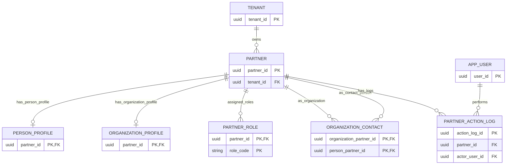

# Theme 3: Đối tác giao dịch

# 1. Theme overview

### 1.1 Mục tiêu theme

Theme 3 quản lý toàn bộ dữ liệu nền về đối tác giao dịch (sau đây có thể gọi tắt là "đối tác") của cửa hàng/doanh nghiệp, bao gồm:

- đối tác là khách hàng

- đối tác là nhà cung cấp

- đối tác vừa là khách hàng vừa là nhà cung cấp

Mục tiêu chính là tạo một nguồn dữ liệu nhất quán để phục vụ bán hàng, nhập hàng, hóa đơn, công nợ, đối soát, báo cáo và truy vết lịch sử.

### 1.2 Bối cảnh nghiệp vụ

Trong vận hành thực tế, một cửa hàng thường làm việc với cả cá nhân và tổ chức. Cá nhân/Tổ chức là loại hồ sơ CRM, còn Khách hàng/Nhà cung cấp là vai trò giao dịch.

|**Tình huống**|**Cách hiểu đúng trong Theme 3**|
|---|---|
|Chị Hoa mua thuốc thú y tại cửa hàng|Cá nhân, vai trò Khách hàng|
|Đại lý Minh Phát cung cấp hàng cho cửa hàng|Tổ chức, vai trò Nhà cung cấp|
|Một đại lý vừa mua hàng vừa cung cấp hàng|Tổ chức, vai trò KH & NCC|
|Anh Nam là người phụ trách đặt hàng của Đại lý Minh Phát|Cá nhân liên hệ thuộc Tổ chức|

### 1.3 Phạm vi theme

|**Nhóm**|**Nội dung**|
|---|---|
|Danh sách đối tác|Tìm kiếm, lọc, xem danh sách Cá nhân/Tổ chức|
|Tạo mới đối tác|Tạo Cá nhân hoặc Tổ chức|
|Hồ sơ đối tác|Xem, bổ sung, chỉnh sửa thông tin|
|Người liên hệ|Quản lý người liên hệ của Tổ chức|
|Transform|Chuyển Cá nhân thành Tổ chức|
|Trạng thái|Ngừng hoạt động, kích hoạt lại, xóa mềm|
|Lịch sử|Xem lịch sử làm việc/giao dịch liên quan đến đối tác|

### 1.4 Ngoài phạm vi theme

|**Nhóm**|**Lý do**|
|---|---|
|Merge hồ sơ trùng|Phase 1 chỉ cảnh báo trùng, chưa xử lý hợp nhất dữ liệu|
|Tổ chức → Cá nhân|Không hỗ trợ vì dễ làm mất nghĩa dữ liệu tổ chức|
|CRM nâng cao|Chưa có lead, pipeline, chăm sóc khách hàng|
|Phân nhóm khách hàng nâng cao|Chưa có segment, hạng khách hàng, điểm thưởng|
|Export lịch sử đối tác|Để Phase sau|
|Xóa cứng dữ liệu|Phase 1 chỉ soft delete|
|Khôi phục hồ sơ đã xóa|Để Phase sau nếu có nhu cầu quản trị/truy vết|

### 1.5 Người dùng chính

|**Người dùng**|**Nhu cầu chính**|
|---|---|
|Chủ cửa hàng|Kiểm soát danh sách khách hàng/NCC, tránh trùng và sai dữ liệu|
|Quản lý cửa hàng|Tìm, tạo, cập nhật và rà soát hồ sơ đối tác|
|Nhân viên bán hàng|Tìm khách hàng để bán hàng, hóa đơn, công nợ|
|Nhân viên nhập hàng/kho|Tìm nhà cung cấp để nhập hàng, đối soát phiếu nhập|
|Kế toán/công nợ|Kiểm tra thông tin hóa đơn, MST, địa chỉ, lịch sử giao dịch|
|Admin hệ thống|Quản lý quyền, trạng thái, xóa mềm và truy vết thao tác|

### 1.6 Khái niệm chính

|**Khái niệm**|**Định nghĩa**|
|---|---|
|Partner|Root entity đại diện cho một đối tác giao dịch trong hệ thống|
|Person|Hồ sơ cá nhân, có thể là khách hàng cá nhân hoặc người liên hệ|
|Organization|Hồ sơ tổ chức, ví dụ công ty, đại lý, hộ kinh doanh, nhà cung cấp|
|Customer|Vai trò giao dịch khi Partner mua hàng từ cửa hàng|
|Supplier|Vai trò giao dịch khi Partner cung cấp hàng/dịch vụ cho cửa hàng|
|KH & NCC|Partner đồng thời có vai trò Customer và Supplier|
|OrganizationContact|Quan hệ giữa Organization và Person làm người liên hệ|
|Snapshot|Dữ liệu được ghi nhận tại thời điểm giao dịch phát sinh|
|Soft delete|Xóa mềm bằng trạng thái, không xóa cứng khỏi database|
|Action log|Lịch sử thao tác với Partner|

### 1.7 Epic map

|**Epic**|**Tên**|**Mục tiêu**|
|---|---|---|
|EP-01|Quản lý danh sách, hồ sơ và lịch sử đối tác|Tìm kiếm, tạo mới, chỉnh sửa, xem hồ sơ, quản lý contact, transform và lịch sử làm việc|
|EP-02|Quản lý trạng thái đối tác|Ngừng hoạt động, kích hoạt lại và xóa mềm hồ sơ tạo nhầm|

# 2. Data foundation

## 2.1 Mục tiêu & nguyên tắc

### Mục tiêu

Data foundation của Theme 3 định nghĩa mô hình dữ liệu cốt lõi cho đối tác giao dịch, bảo đảm mọi nghiệp vụ bán hàng, nhập hàng, hóa đơn, công nợ và lịch sử đều tham chiếu cùng một root entity là Partner.

### Nguyên tắc dữ liệu nền

|**ID**|**Nguyên tắc**|
|---|---|
|DF-01|Partner là root entity duy nhất đại diện cho đối tác giao dịch|
|DF-02|Person và Organization là hai loại hồ sơ thật, không chỉ là nhãn hiển thị|
|DF-03|Customer và Supplier là vai trò giao dịch độc lập với loại hồ sơ|
|DF-04|Giao dịch nguồn tham chiếu `partner_id`, không tham chiếu trực tiếp tên hiển thị|
|DF-05|Hồ sơ hiện tại có thể thay đổi nhưng giao dịch đã phát sinh giữ snapshot riêng|
|DF-06|Soft delete dùng trạng thái `deleted`, không xóa cứng mặc định|
|DF-07|Mọi thay đổi quan trọng phải có audit/action log|

### Snapshot rule

|**ID**|**Rule**|
|---|---|
|SS-01|Giao dịch đã phát sinh phải lưu snapshot thông tin đối tác cần thiết tại module nguồn|
|SS-02|Khi Partner đổi tên, SĐT, MST hoặc trạng thái, giao dịch cũ không bị cập nhật ngược|
|SS-03|PartnerHistoryView có thể hiển thị dữ liệu nguồn hiện tại và/hoặc snapshot tùy module nguồn|
|SS-04|Theme 3 không chịu trách nhiệm sửa snapshot giao dịch đã khóa hoặc đã phát sinh|

### Data quality rule

|**ID**|**Rule**|
|---|---|
|DQ-01|Kiểm tra trùng SĐT trong cùng tenant|
|DQ-02|Kiểm tra trùng email trong cùng tenant|
|DQ-03|Kiểm tra trùng MST trong cùng tenant|
|DQ-04|Kiểm tra gần trùng theo tên + SĐT|
|DQ-05|Phase 1 chỉ cảnh báo, chưa merge hồ sơ|
|DQ-06|Dữ liệu optional thiếu không chặn lưu nhưng có thể hiển thị warning nhẹ|

### Data lifecycle

|**From**|**To**|**Cho phép**|**Ghi chú**|
|---|---|---|---|
|`active`|`inactive`|Yes|Ngừng hoạt động|
|`inactive`|`active`|Yes|Kích hoạt lại|
|`active`|`deleted`|Yes|Xóa mềm nếu đủ điều kiện|
|`inactive`|`deleted`|Yes|Xóa mềm nếu đủ điều kiện|
|`deleted`|`active`|No|Không khôi phục trong Phase 1|
|`deleted`|hard delete|No|Không xóa cứng trong Phase 1|

## 2.2 Entity

### Domain model

```Plain Text
Partner
├── PartnerProfile
│   ├── PersonProfile
│   └── OrganizationProfile
├── PartnerRole
│   ├── Customer
│   └── Supplier
├── PartnerStatus
│   ├── Active
│   ├── Inactive
│   └── Deleted
├── OrganizationContact
├── PartnerHistoryView
└── PartnerActionLog
```

### Relationship model

```Plain Text
Tenant 1 --- N Partner
Partner 1 --- 0..1 PersonProfile
Partner 1 --- 0..1 OrganizationProfile
Partner 1 --- N PartnerRole
Organization Partner 1 --- N OrganizationContact --- 1 Person Partner
Partner 1 --- N PartnerActionLog
Partner 1 --- N PartnerHistoryView
```

### ERD



### Entity catalog

|**Entity**|**Loại**|**Mục đích**|**Ghi chú**|
|---|---|---|---|
|Partner|Root entity|Đại diện cho đối tác giao dịch|Mọi giao dịch nên reference `partner_id`|
|PersonProfile<br>|Profile entity|Lưu thông tin cá nhân|Dùng cho khách cá nhân hoặc contact|
|OrganizationProfile|Profile entity|Lưu thông tin tổ chức|Dùng cho công ty, đại lý, HKD, NCC|
|PartnerRole|Role entity|Lưu vai trò Customer/Supplier|Một Partner có thể có nhiều role|
|OrganizationContact|Relationship entity|Liên kết Organization với Person|Có thể đánh dấu contact chính|
|PartnerStatus|State attribute|Quản lý Active/Inactive/Deleted|Ảnh hưởng luồng chọn giao dịch mới|
|PartnerHistoryView|Read model|Tổng hợp lịch sử làm việc|Không sửa giao dịch nguồn trong Theme 3|
|PartnerActionLog|Audit entity|Ghi lịch sử thao tác|Tạo, sửa, status, delete, transform, contact|

#### Entity: Partner

|**Field**|**Type**|**Required**|**Rule**|
|---|---|---|---|
|`partner_id`|UUID/string|Yes|ID duy nhất của Partner|
|`tenant_id`|UUID/string|Yes|Dùng để phân vùng dữ liệu theo tenant|
|`partner_type`|enum|Yes|`person` hoặc `organization`|
|`status`|enum|Yes|`active`, `inactive`, `deleted`; mặc định `active`|
|`display_name`|string|Yes|Sinh từ Person hoặc Organization profile|
|`created_by`|audit|Yes|Ghi khi tạo|
|`created_at`|audit|Yes|Ghi khi tạo|
|`updated_by`|audit|Yes|Ghi khi cập nhật|
|`updated_at`|audit|Yes|Ghi khi cập nhật|

#### Entity: PersonProfile

|Field|Type|Required|Rule|
|---|---|---|---|
|`partner_id`|UUID/string|Yes|FK đến Partner type `person`|
|`title`|enum|Yes|Cách xưng hô/danh xưng: `ông`, `bà`, `anh`, `chị`, `cô`, `bác`, `chú`, `dì`, `thím`, `em`, `cậu`, ...|
|`full_name`|string|Yes|Tên cá nhân hoặc người liên hệ|
|`nickname`|string|No|Tên gọi thân mật/tên thường gọi, phục vụ tìm kiếm và giao tiếp|
|`phone`|string|Yes|SĐT chính, bắt buộc trong Phase 1|
|`phone2`|string|No|SĐT phụ; Phase sau có thể nâng cấp thành nhiều số điện thoại/custom contact fields|
|`email`|string|No|Validate định dạng nếu có|
|`tax_code`|string|No|Optional, dùng cho hóa đơn nếu có|
|`invoice_name`|string|No|Thông tin hóa đơn optional|
|`invoice_address`|string|No|Thông tin hóa đơn optional|
|`invoice_email`|string|No|Thông tin hóa đơn optional|
|`delivery_province`|string <br>|No|Tỉnh/thành giao hàng mặc định|
|`delivery_commune`|string|No|Xã/phường/thị trấn giao hàng mặc định|
|`delivery_address`|string|No|Địa chỉ giao hàng chi tiết|
|`note`|text|No|Ghi chú nội bộ|

#### Entity: OrganizationProfile

|Field|Type|Required|Rule|
|---|---|---|---|
|`partner_id`|UUID/string|Yes|FK đến Partner type `organization`|
|`type`|enum|Yes|Loại tổ chức: `company`, `business_household`, `other`|
|`organization_name`|string|Yes|Tên tổ chức hiển thị chính|
|`short_name`|string|No|Tên viết tắt/tên gọi ngắn của tổ chức|
|`intl_name`|string|No|Tên quốc tế/tên tiếng Anh nếu có|
|`phone`|string|Yes|SĐT chính của tổ chức|
|`email`|string|No|Validate định dạng nếu có|
|`tax_code`|string|No|Optional; nên cảnh báo nếu thiếu với `company` hoặc `business_household`|
|`company_address`|string|No|Địa chỉ tổ chức/địa chỉ đăng ký/địa chỉ hoạt động|
|`invoice_name`|string|No|Thông tin hóa đơn optional|
|`invoice_address`|string|No|Thông tin hóa đơn optional|
|`invoice_email`|string|No|Thông tin hóa đơn optional|
|`delivery_province`|string|No|Tỉnh/thành giao hàng mặc định|
|`delivery_commune`|string|No|Xã/phường/thị trấn giao hàng mặc định|
|`note`|text|No|Ghi chú nội bộ|

#### Entity: PartnerRole

|Field|Type|Required|Rule|
|---|---|---|---|
|`partner_id`|UUID/string|Yes|FK đến Partner|
|`role`|enum|Yes|`customer` hoặc `supplier`|
|`is_active`|boolean|Yes|Dùng để xác định role hiện còn dùng|
|`created_at`|datetime|Yes|Thời điểm gán role|
|`updated_at`|datetime|Yes|Thời điểm cập nhật role|

#### Entity: OrganizationContact

|Field|Type|Required|Rule|
|---|---|---|---|
|`organization_partner_id`|UUID/string|Yes|Partner type phải là `organization`|
|`person_partner_id`|UUID/string|Yes|Partner type phải là `person`|
|`contact_role`|string|No|Ví dụ: Chủ đại lý, Kế toán, Người mua hàng|
|`is_primary`|boolean|Yes|Mỗi Organization tối đa một primary contact|
|`note`|text|No|Ghi chú nội bộ cho quan hệ contact|
|`created_by`|audit|Yes|Ghi khi tạo liên kết|
|`created_at`|audit|Yes|Ghi khi tạo liên kết|
|`updated_by`|audit|Yes|Ghi khi cập nhật liên kết|
|`updated_at`|audit|Yes|Ghi khi cập nhật liên kết|

#### Entity: PartnerHistoryView

|Field|Type|Required|Rule|
|---|---|---|---|
|`history_id`|UUID/string|Yes|ID dòng lịch sử/read model|
|`partner_id`|UUID/string|Yes|Partner liên quan|
|`role`|enum|Yes|`customer` hoặc `supplier` theo chiều giao dịch|
|`transaction_type`|enum|Yes|Ví dụ `sales_order`, `purchase_receipt`, `invoice`, `payment`, `debt`|
|`source_module`|string|Yes|Module nguồn của dữ liệu|
|`source_id`|UUID/string|Yes|ID giao dịch/chứng từ nguồn|
|`reference_code`|string|Yes|Mã hiển thị của giao dịch nguồn|
|`transaction_date`|datetime|Yes|Ngày phát sinh giao dịch|
|`status`|string|Yes|Trạng thái theo module nguồn|
|`amount`|number/string|No|Giá trị nếu giao dịch có tiền|
|`currency`|number/string|No|Giá trị nếu giao dịch có tiền|
|`can_open_source`|boolean|Yes|Phụ thuộc quyền với module nguồn|

#### Entity: PartnerActionLog

|Field|Type|Required|Rule|
|---|---|---|---|
|`action_log_id`|UUID/string|Yes|ID log|
|`partner_id`|UUID/string|Yes|Partner bị tác động|
|`action_type`|enum|Yes|`create`, `update`, `add_contact`, `remove_contact`, `transform`, `deactivate`, `reactivate`, `delete`|
|`actor_user_id`|UUID/string|Yes|Người thực hiện|
|`reason`|text|No|Lý do thao tác nếu có|
|`before_state`|json|No|Snapshot trước thao tác nếu cần audit|
|`after_state`|json|No|Snapshot sau thao tác nếu cần audit|
|`created_at`|datetime|Yes|Thời điểm ghi log|

# 3. Theme-level business rules

### Quy tắc trạng thái và lifecycle

|**Status**|**Ý nghĩa**|
|---|---|
|Active|Được chọn cho giao dịch mới|
|Inactive|Không được chọn cho giao dịch mới nhưng vẫn xem được hồ sơ và lịch sử theo quyền|
|Deleted|Không hiển thị trong danh sách làm việc mặc định và không được chọn cho giao dịch mới|

### Quy tắc loại hồ sơ và vai trò giao dịch

|**ID**|**Business Rule**|
|---|---|
|BR-01|`partner_type` gồm `person` và `organization`|
|BR-02|`roles` gồm `customer` và `supplier`|
|BR-03|`organization` gồm `công ty`, `hộ kinh doanh`, `khác`|
|BR-04|Một Partner phải có ít nhất một role|
|BR-05|Một Partner có thể đồng thời là Customer và Supplier|
|BR-06|Partner Type và Partner Role độc lập với nhau|

### Quy tắc chỉnh sửa và transform

|**ID**|**Business Rule**|
|---|---|
|BR-01|Chỉnh sửa hồ sơ chỉ cập nhật dữ liệu hiện tại của Partner|
|BR-02|Không đổi trực tiếp `partner_type` trong form chỉnh sửa thông thường|
|BR-03|Chỉ hỗ trợ transform Person → Organization|
|BR-04|Không hỗ trợ Organization → Person|
|BR-05|Khi transform Person → Organization, giữ nguyên `partner_id`, roles và status|
|BR-06|Person ban đầu được lưu làm người liên hệ chính của Organization|
|BR-07|Transform phải ghi action log|

### Quy tắc người liên hệ của tổ chức

|**ID**|**Business Rule**|
|---|---|
|BR-01|Chỉ Organization mới có danh sách người liên hệ con|
|BR-02|Người liên hệ được lưu dưới dạng Person|
|BR-03|Quan hệ Organization-Person được quản lý qua OrganizationContact|
|BR-04|Mỗi Organization tối đa một primary contact|
|BR-05|Gỡ contact chỉ xóa liên kết, không mặc định xóa Person|
|BR-06|Contact không bắt buộc có role Customer hoặc Supplier|
|BR-07|Một Person có thể tồn tại độc lập hoặc là contact của Organization|

### Quy tắc trùng dữ liệu và chất lượng dữ liệu

|ID|Business Rule|
|---|---|
|BR-01|Cảnh báo khi trùng SĐT trong cùng tenant|
|BR-02|Cảnh báo khi trùng email trong cùng tenant|
|BR-03|Cảnh báo khi trùng MST trong cùng tenant|
|BR-04|Cảnh báo khi tên + SĐT gần giống hồ sơ đã có|
|BR-05|Phase 1 chỉ cảnh báo trùng, chưa merge hồ sơ|
|BR-06|Người dùng có thể tiếp tục lưu nếu có quyền và nghiệp vụ cho phép|
|BR-07|Dữ liệu thiếu optional field không chặn sử dụng nhưng có thể hiển thị warning nhẹ|

### Quy tắc audit/log

|**ID**|**Business Rule**|
|---|---|
|BR-01|Tạo mới Partner phải ghi `created_by`, `created_at`|
|BR-02|Cập nhật Partner phải ghi `updated_by`, `updated_at`|
|BR-03|Thao tác trạng thái phải ghi action log|
|BR-04|Xóa mềm phải ghi action log|
|BR-05|Transform phải ghi action log|
|BR-06|Quản lý contact phải ghi action log|
|BR-07|Reason nếu được nhập phải lưu trong action log|

### Quy tắc phân quyền

|**Permission**|**Ý nghĩa**|
|---|---|
|`partner.view`|Xem danh sách đối tác|
|`partner.detail.view`|Xem hồ sơ chi tiết đối tác|
|`partner.create`|Tạo mới đối tác|
|`partner.update`|Chỉnh sửa thông tin đối tác|
|`partner.contact.manage`|Quản lý người liên hệ của tổ chức|
|`partner.transform`|Chuyển Cá nhân thành Tổ chức|
|`partner.status.manage`|Ngừng hoạt động/kích hoạt lại đối tác|
|`partner.delete`|Xóa mềm hồ sơ đối tác|
|`partner.history.view`|Xem lịch sử làm việc với đối tác|

# 4. Theme-level business commands

## 4.1 Mục tiêu business command

Business command định nghĩa các hành động nghiệp vụ chính mà người dùng hoặc hệ thống có thể thực hiện với Partner. Các command này là lớp ngôn ngữ nghiệp vụ nằm giữa user story, UI action và API implementation.

## 4.2 Command principles

|**ID**|**Principle**|
|---|---|
|CP-01|Command phải thể hiện hành động nghiệp vụ rõ ràng, không chỉ là tên API|
|CP-02|Command write phải kiểm tra quyền, tenant, trạng thái mới nhất và điều kiện nghiệp vụ trước khi ghi dữ liệu|
|CP-03|Command thành công phải cập nhật audit fields và action log nếu có thay đổi dữ liệu|
|CP-04|Command không được cập nhật ngược snapshot của giao dịch đã phát sinh|
|CP-05|Command bị chặn phải trả lý do rõ ràng để UI hiển thị đúng state|

## 4.3 Command blocked response standard

|**Code**|**Ý nghĩa**|**UI state gợi ý**|
|---|---|---|
|`NO_PERMISSION`|Người dùng không có quyền thực hiện command|No permission state|
|`NOT_FOUND`|Không tìm thấy Partner hoặc không thuộc tenant|Not found state|
|`VALIDATION_ERROR`|Dữ liệu bắt buộc thiếu hoặc sai định dạng|Inline error|
|`DUPLICATE_WARNING`|Dữ liệu có khả năng trùng|Warning modal/block|
|`INVALID_STATUS`|Trạng thái hiện tại không phù hợp command|Blocked state|
|`HAS_TRANSACTIONS`|Partner đã phát sinh dữ liệu, không thể xóa|Blocked with suggested deactivate|
|`STATE_CHANGED`|Dữ liệu đã thay đổi bởi người khác|Reload/refresh state|
|`SYSTEM_ERROR`|Lỗi hệ thống khi xử lý command|Error state + retry|

## 4.4 Command catalog

|**Command**|**Loại**|**Mục tiêu**|**Permission**|**API chính**|**US liên quan**|
|---|---|---|---|---|---|
|CMD-01|Query<br>|Tìm kiếm và lọc danh sách Partner|`partner.view`|`GET /partners`|EP-01/US-01|
|CMD-02|Query|Xem hồ sơ Partner|`partner.detail.view`|`GET /partners/{id}`|EP-01/US-04|
|CMD-03|Write|Tạo Partner mới|`partner.create`|`POST /partners`|EP-01/US-02|
|CMD-04|Write|Cập nhật hồ sơ Partner|`partner.update`|`PATCH /partners/{id}`|EP-01/US-03|
|CMD-05|Write|Thêm người liên hệ vào Organization|`partner.contact.manage`|`POST /partners/{id}/contacts`|EP-01/US-05|
|CMD-06|Write|Cập nhật người liên hệ của Organization|`partner.contact.manage`|`PATCH /partners/{id}/contacts/{person_id}`|EP-01/US-05|
|CMD-07|Write|Gỡ người liên hệ khỏi Organization|`partner.contact.manage`|`DELETE /partners/{id}/contacts/{person_id}`|EP-01/US-05|
|CMD-08|Write|Chuyển Person thành Organization|`partner.transform`|`POST /partners/{id}/transform-to-organization`|EP-01/US-06|
|CMD-09|Write|Ngừng hoạt động Partner|`partner.status.manage`|`POST /partners/{id}/deactivate`|EP-02/US-01|
|CMD-10|Write|Kích hoạt lại Partner|`partner.status.manage`|`POST /partners/{id}/reactivate`|EP-02/US-01|
|CMD-11|Query|Kiểm tra điều kiện xóa Partner|`partner.delete`|`GET /partners/{id}/delete-eligibility`|EP-02/US-02|
|CMD-12|Write|Xóa mềm Partner tạo nhầm|`partner.delete`|`POST /partners/{id}/delete`|EP-02/US-02|
|CMD-13|Query|Xem lịch sử làm việc với Partner|`partner.history.view`|`GET /partners/{id}/history`|EP-01/US-07|

### CMD-01 — Tìm kiếm và lọc danh sách Partner

|**Thuộc tính**|**Nội dung**|
|---|---|
|Trigger|Người dùng mở danh sách, nhập search hoặc áp dụng filter|
|Input chính|`q`, `partner_type`, `role`, `status`, `page`, `limit`, `sort`|
|Preconditions|Người dùng có `partner.view`; tenant hợp lệ|
|Effects|Không ghi dữ liệu; trả danh sách Partner phù hợp|
|Blocked/Error|Không có quyền, lỗi tải dữ liệu, tenant không hợp lệ|

### CMD-02 — Xem hồ sơ Partner

|**Thuộc tính**|**Nội dung**|
|---|---|
|Trigger|Người dùng mở Partner từ danh sách hoặc từ liên kết liên quan|
|Input chính|`partner_id`|
|Preconditions|Người dùng có `partner.detail.view`; Partner thuộc tenant hiện tại|
|Effects|Không ghi dữ liệu; trả hồ sơ hiện tại và `available_actions`|
|Blocked/Error|Không có quyền, Partner không tồn tại, không thuộc tenant, lỗi tải dữ liệu|

### CMD-03 — Tạo Partner mới

|**Thuộc tính**|**Nội dung**|
|---|---|
|Trigger|Người dùng lưu form tạo Cá nhân hoặc Tổ chức|
|Input chính|`partner_type`, `roles`, PersonProfile hoặc OrganizationProfile, optional primary contact|
|Preconditions|Người dùng có `partner.create`; dữ liệu bắt buộc hợp lệ|
|Effects|Tạo Partner, profile tương ứng, role, audit fields và action log|
|Blocked/Error|Thiếu field bắt buộc, định dạng sai, warning trùng dữ liệu, lỗi lưu|

### CMD-04 — Cập nhật hồ sơ Partner

|**Thuộc tính**|**Nội dung**|
|---|---|
|Trigger|Người dùng lưu form chỉnh sửa Partner|
|Input chính|`partner_id`, profile fields, roles|
|Preconditions|Người dùng có `partner.update`; Partner thuộc tenant; không đổi `partner_type` qua command này|
|Effects|Cập nhật hồ sơ hiện tại, role nếu hợp lệ, audit fields và action log|
|Blocked/Error|Không có quyền, thiếu field bắt buộc, trạng thái không hợp lệ, warning trùng, lỗi lưu|

### CMD-05/CMD-06/CMD-07 — Quản lý Organization contact

|**Thuộc tính**|**Nội dung**|
|---|---|
|Trigger|Người dùng thêm, sửa, đặt chính hoặc gỡ người liên hệ trong hồ sơ Organization|
|Input chính|`organization_partner_id`, `person_partner_id` hoặc person fields, `contact_role`, `is_primary`|
|Preconditions|Người dùng có `partner.contact.manage`; Partner đích là Organization|
|Effects|Tạo/cập nhật/xóa liên kết OrganizationContact; cập nhật primary contact nếu có; ghi action log|
|Blocked/Error|Hồ sơ là Person, không có quyền, contact trùng, thiếu họ tên/SĐT, lỗi lưu|

### CMD-08 — Chuyển Person thành Organization

|**Thuộc tính**|**Nội dung**|
|---|---|
|Trigger|Người dùng xác nhận `Chuyển cá nhân thành tổ chức`|
|Input chính|`partner_id`, OrganizationProfile mới, primary contact fields|
|Preconditions|Người dùng có `partner.transform`; Partner hiện tại là Person; dữ liệu tổ chức hợp lệ|
|Effects|Đổi `partner_type` sang Organization, giữ `partner_id`, giữ role/status, tạo Person contact chính, ghi action log|
|Blocked/Error|Partner không phải Person, không có quyền, thiếu tên tổ chức/SĐT chính, dữ liệu đã thay đổi, lỗi lưu|

### CMD-09/CMD-10 — Ngừng hoạt động và kích hoạt lại Partner

|**Thuộc tính**|**Nội dung**|
|---|---|
|Trigger|Người dùng xác nhận ngừng hoạt động hoặc kích hoạt lại|
|Input chính|`partner_id`, optional `reason`|
|Preconditions|Người dùng có `partner.status.manage`; Partner thuộc tenant; trạng thái hiện tại phù hợp|
|Effects|Cập nhật `status`, audit fields và action log; không cập nhật giao dịch cũ|
|Blocked/Error|Không có quyền, Partner đã deleted, state changed, lỗi lưu|

### CMD-11/CMD-12 — Kiểm tra điều kiện xóa và xóa mềm Partner

|**Thuộc tính**|**Nội dung**|
|---|---|
|Trigger|Người dùng chọn và xác nhận `Xóa hồ sơ`|
|Input chính|`partner_id`, optional `reason`|
|Preconditions|Người dùng có `partner.delete`; Partner thuộc tenant; chưa phát sinh dữ liệu nghiệp vụ bị chặn|
|Effects|Nếu đủ điều kiện, cập nhật `status = deleted`, audit fields và action log|
|Blocked/Error|Đã có giao dịch/chứng từ liên quan, không có quyền, state changed, lỗi lưu|

### CMD-13 — Xem lịch sử làm việc với Partner

|**Thuộc tính**|**Nội dung**|
|---|---|
|Trigger|Người dùng mở tab/card lịch sử trong hồ sơ Partner|
|Input chính<br>|`partner_id`, `role`, `transaction_type`, `status`, `date_from`, `date_to`, pagination|
|Preconditions|Người dùng có `partner.history.view`; Partner thuộc tenant|
|Effects|Không ghi dữ liệu; trả read model lịch sử từ các module nguồn|
|Blocked/Error|Không có quyền, lỗi tải lịch sử, không có quyền mở giao dịch nguồn|

# 5. Epic EP-01 — Quản lý danh sách, hồ sơ và lịch sử đối tác

### 5.1 Epic overview

#### 5.1.1 Mục tiêu epic

EP-01 bao phủ luồng người dùng từ tìm đối tác, tạo mới, xem hồ sơ, chỉnh sửa, quản lý người liên hệ, chuyển cá nhân thành tổ chức và xem lịch sử làm việc.

#### 5.1.2 Phạm vi epic

|**Nhóm**|**Nội dung**|
|---|---|
|Danh sách|Tìm kiếm, lọc, xem danh sách Partner|
|Tạo mới|Tạo Person hoặc Organization|
|Cập nhật|Bổ sung/chỉnh sửa thông tin hiện tại|
|Hồ sơ|Xem chi tiết Person/Organization|
|Contact|Quản lý người liên hệ của Organization|
|Transform|Chuyển Person thành Organization|
|History|Xem lịch sử làm việc read-only|

#### 5.1.3 Ngoài phạm vi epic

|**Nhóm**|**Ghi chú**|
|---|---|
|Lifecycle status|Thuộc EP-02|
|Delete/soft delete|Thuộc EP-02|
|Xử lý giao dịch nguồn|Thuộc module bán hàng, nhập hàng, hóa đơn, công nợ|
|Merge hồ sơ|Out of scope Phase 1|

#### 5.1.4 Entry points chính

|**Entry point**|**Mô tả**|
|---|---|
|Danh sách Khách hàng & NCC|Nơi bắt đầu tìm kiếm, lọc, tạo mới|
|FAB `+`|Mở lựa chọn tạo Cá nhân/Tổ chức|
|Hồ sơ chi tiết|Nơi xem thông tin hiện tại và mở các action tiếp theo|
|`Thao tác ︿`|Secondary button mở action sheet|
|Card/tab Lịch sử|Mở lịch sử làm việc read-only|

#### 5.1.5 User story map

|**US**|**Tên**|
|---|---|
|US-01|Tìm kiếm và rà soát danh sách đối tác|
|US-02|Ghi nhận đối tác mới|
|US-03|Bổ sung và chỉnh sửa thông tin đối tác|
|US-04|Kiểm tra hồ sơ đối tác|
|US-05|Quản lý người liên hệ của tổ chức|
|US-06|Chuyển cá nhân thành tổ chức|
|US-07|Theo dõi lịch sử làm việc với đối tác|

### 5.2 US-01 — Tìm kiếm và rà soát danh sách đối tác

#### 5.2.1 Business Context

Người dùng cần một màn hình danh sách để tìm nhanh khách hàng, nhà cung cấp hoặc đối tác có cả hai vai trò, trước khi mở hồ sơ, chỉnh sửa, tạo mới hoặc kiểm tra lịch sử giao dịch.

Danh sách phải phân biệt rõ Cá nhân/Tổ chức và Khách hàng/Nhà cung cấp/KH & NCC để tránh nhầm giữa loại hồ sơ CRM và vai trò giao dịch.

#### 5.2.2 Functional Requirements

|**ID**|**Functional Requirement**|
|---|---|
|FR-01|Người dùng có thể mở danh sách đối tác trong phạm vi tenant hiện tại|
|FR-02|Hệ thống hiển thị cả hồ sơ Cá nhân và Tổ chức trên cùng danh sách|
|FR-03|Mỗi item hiển thị tên, loại hồ sơ, vai trò, trạng thái, SĐT và cập nhật gần nhất nếu có|
|FR-04|Người dùng có thể tìm kiếm theo tên, SĐT, email hoặc MST|
|FR-05|Người dùng có thể lọc theo vai trò, loại hồ sơ và trạng thái|
|FR-06|Người dùng có thể mở hồ sơ chi tiết từ danh sách nếu có quyền phù hợp|
|FR-07|Người dùng có thể bắt đầu tạo mới Cá nhân hoặc Tổ chức từ danh sách nếu có quyền phù hợp|

#### 5.2.3 Business Rules

|ID|Business Rule|
|---|---|
|BR-01|Chỉ người dùng có quyền `partner.view` mới được xem danh sách|
|BR-02|Danh sách chỉ hiển thị dữ liệu thuộc tenant hiện tại|
|BR-03|Partner Type gồm Cá nhân và Tổ chức; Partner Role gồm Khách hàng và Nhà cung cấp|
|BR-04|Một Partner có thể có một vai trò hoặc đồng thời cả hai vai trò Khách hàng & Nhà cung cấp|
|BR-05|Mặc định danh sách chỉ hiển thị Partner Đang hoạt động|
|BR-06|Partner Ngừng hoạt động chỉ hiển thị khi lọc trạng thái phù hợp|
|BR-07|Partner Đã xóa không hiển thị trong danh sách làm việc mặc định|

#### 5.2.4 Edge Cases

|**ID**|**Edge Case**|**Expected Behavior**|
|---|---|---|
|EC-01|Không có quyền xem danh sách|Chặn truy cập và hiển thị thông báo không có quyền|
|EC-02|Tenant chưa có đối tác nào|Hiển thị empty state và CTA tạo mới nếu có quyền|
|EC-03|Không có kết quả theo từ khóa|Hiển thị no result state|
|EC-04|Không có dữ liệu theo bộ lọc|Hiển thị no data state và gợi ý đặt lại bộ lọc|
|EC-05|Đối tác thiếu SĐT do dữ liệu cũ|Vẫn hiển thị hồ sơ, kèm cảnh báo thiếu thông tin|
|EC-06|Nhiều đối tác trùng tên|Hiển thị thêm SĐT, loại hồ sơ, vai trò hoặc MST để phân biệt|
|EC-07|Tải danh sách thất bại|Hiển thị error state, cho phép tải lại|

#### 5.2.5 Design reference

[Appendix A / 8.4.1 SG-01 — Danh sách & khám phá KH & NCC](https://hamsacorp.sg.larksuite.com/wiki/WElRw9lsHiz6MnkmEfhlwrV4ghg#share-HT2Ad8lGsoSkJVxQbyvlyQo7g3c)

#### 5.2.6 Data/API Contract

```HTTP
GET /partners
```

|Param|Type|Ghi chú|
|---|---|---|
|`q`|string|Tìm theo tên, SĐT, email, MST|
|`partner_type`|enum|person, organization, all|
|`role`|enum|customer, supplier, both, all|
|`status`|enum|active, inactive, all|
|`page`/`limit`|number|Phân trang|
|`sort`|string|Mặc định updated_at_desc|

```JSON
{"partner_id":"ptr_001","partner_type":"organization","display_name":"Đại lý Chăn nuôi Minh Phát","roles":["supplier"],"status":"active","phone":"02838225511","contact_count":2,"updated_at":"2026-06-18T11:05:00+07:00"}
```

#### 5.2.7 Scenarios

```Gherkin
Background:
  Given người dùng đã đăng nhập hệ thống
  And người dùng đang làm việc trong một tenant hợp lệ
Scenario: SCN-01 - Mở danh sách đối tác thành công
  Given người dùng có quyền "partner.view"
  When người dùng mở màn hình "Khách hàng & NCC"
  Then hệ thống hiển thị danh sách đối tác thuộc tenant hiện tại

Scenario: SCN-02 - Hiển thị rõ cá nhân và tổ chức
  Given danh sách có cả Partner type "Person" và "Organization"
  Then mỗi item hiển thị chip "Cá nhân" hoặc "Tổ chức" phù hợp

Scenario: SCN-03 - Hiển thị rõ vai trò giao dịch
  Given một Partner có vai trò Customer hoặc Supplier
  Then hệ thống hiển thị vai trò là Khách hàng, Nhà cung cấp hoặc KH & NCC

Scenario: SCN-04 - Tìm kiếm đối tác
  When người dùng nhập tên, SĐT, email hoặc MST
  Then hệ thống hiển thị các đối tác phù hợp trong tenant hiện tại

Scenario: SCN-05 - Lọc danh sách
  When người dùng chọn bộ lọc vai trò, loại hồ sơ hoặc trạng thái
  Then hệ thống chỉ hiển thị các đối tác thỏa mãn điều kiện lọc

Scenario: SCN-06 - Bắt đầu tạo mới đối tác
  Given người dùng có quyền "partner.create"
  When người dùng bấm FAB "+"
  Then hệ thống hiển thị action sheet có Tạo cá nhân và Tạo tổ chức

Scenario: SCN-07 - Không có quyền xem danh sách
  Given người dùng không có quyền "partner.view"
  When người dùng mở màn hình
  Then hệ thống không hiển thị danh sách
```

#### 5.2.8 Acceptance Criteria

|ID|Acceptance Criteria|
|---|---|
|AC-01|Người dùng có quyền chỉ thấy danh sách đối tác trong tenant hiện tại|
|AC-02|Danh sách phân biệt rõ Cá nhân/Tổ chức|
|AC-03|Danh sách phân biệt rõ Khách hàng/Nhà cung cấp/KH & NCC|
|AC-04|Search hoạt động với tên, SĐT, email, MST|
|AC-05|Filter hoạt động theo vai trò, loại hồ sơ và trạng thái|
|AC-06|Empty/No result/Error state hiển thị đúng tình huống|
|AC-07|FAB tạo mới mở action sheet chọn Tạo cá nhân hoặc Tạo tổ chức|

#### 5.2.9 Open questions

|ID|Open Question|
|---|---|
|OQ-01|Có cần hiển thị `contact_count` trên list ngay Phase 1 không?|
|OQ-02|Search theo tên người liên hệ có trả về Organization không?|
|OQ-03|Có cần lọc Đã xóa trong list không?|
|OQ-04|KH & NCC là một chip hay hai chip?|

### 5.3 US-02 — Ghi nhận đối tác mới

#### 5.3.1 Business Context

Người dùng cần ghi nhận nhanh một đối tác mới khi cửa hàng bắt đầu làm việc với khách hàng, nhà cung cấp hoặc một bên vừa mua vừa bán với cửa hàng.

Người dùng cần chọn trước Tạo cá nhân hoặc Tạo tổ chức để giảm nhầm lẫn giữa Person và Organization.

#### 5.3.2 Functional Requirements

|ID|Functional Requirement|
|---|---|
|FR-01|Bắt đầu tạo mới đối tác từ danh sách nếu có quyền|
|FR-02|Chọn loại hồ sơ cần tạo: Cá nhân hoặc Tổ chức|
|FR-03|Chọn vai trò giao dịch: Khách hàng, Nhà cung cấp hoặc KH & NCC|
|FR-04|Nhập thông tin nhận diện bắt buộc theo loại hồ sơ|
|FR-05|Nhập thông tin liên hệ, thuế, hóa đơn và ghi chú nếu có|
|FR-06|Hệ thống cảnh báo dữ liệu có khả năng trùng trước khi lưu|
|FR-07|Lưu hồ sơ mới khi dữ liệu hợp lệ và ghi thông tin tạo/audit|

#### 5.3.3 Business Rules

|ID|Business Rule|
|---|---|
|BR-01|Chỉ người dùng có quyền `partner.create` mới được tạo đối tác mới|
|BR-02|Đối tác mới chỉ được tạo trong tenant hiện tại|
|BR-03|Mỗi hồ sơ mới phải có partner_type Person hoặc Organization|
|BR-04|Mỗi hồ sơ mới phải có ít nhất một vai trò Customer hoặc Supplier|
|BR-05|Với Cá nhân, bắt buộc họ tên và số điện thoại|
|BR-06|Với Tổ chức, bắt buộc tên tổ chức và số điện thoại chính|
|BR-07|Hồ sơ mới mặc định Đang hoạt động|

#### 5.3.4 Edge Cases

|ID|Edge Case|Expected Behavior|
|---|---|---|
|EC-01|Không có quyền tạo mới|Ẩn hoặc vô hiệu hóa FAB/action tạo mới|
|EC-02|Chưa chọn Cá nhân/Tổ chức|Yêu cầu chọn loại hồ sơ trước|
|EC-03|Bỏ trống trường bắt buộc|Chặn lưu và hiển thị lỗi inline|
|EC-04|SĐT/email/MST sai định dạng|Chặn lưu và hiển thị rule lỗi|
|EC-05|Dữ liệu có khả năng trùng|Hiển thị cảnh báo và cho phép kiểm tra/tiếp tục nếu được phép|
|EC-06|Rời form khi có dữ liệu chưa lưu|Hiển thị confirmation modal|
|EC-07|Lưu thất bại|Không tạo hồ sơ không hoàn chỉnh, giữ dữ liệu đã nhập|

#### 5.3.5 Design reference

[Appendix A / 8.4.2 SG-02 — Tạo mới & chỉnh sửa KH & NCC](https://hamsacorp.sg.larksuite.com/wiki/WElRw9lsHiz6MnkmEfhlwrV4ghg#share-Pv7BdlDsOoTpimx9yRSlD4LRgYd)

#### 5.3.6 Data/API Contract

```HTTP
POST /partners
```

```JSON
{"partner_type":"person","roles":["customer"],"person":{"full_name":"Trần Thị Hoa","phone":"0987654321","email":"hoa@example.com"}}
```

```JSON
{"partner_type":"organization","roles":["supplier"],"organization":{"organization_name":"Đại lý Chăn nuôi Minh Phát","phone":"02838225511","tax_code":"0312345678"},"primary_contact":{"full_name":"Anh Nam","phone":"0909123456"}}
```

|ID|Data Rule|
|---|---|
|DR-01|display_name lấy từ full_name hoặc organization_name|
|DR-02|roles phải có ít nhất một giá trị|
|DR-03|status mặc định active|
|DR-04|Kiểm tra trùng trong tenant hiện tại|
|DR-05|primary_contact tạo Person liên kết Organization nếu có|
|DR-06|Lưu thành công ghi created_by, created_at và action log|

#### 5.3.7 Scenarios

```Gherkin
Background:
  Given người dùng đã đăng nhập hệ thống
Scenario: SCN-01 - Mở lựa chọn tạo mới đối tác
  Given người dùng có quyền "partner.create"
  When người dùng bấm FAB "+"
  Then hệ thống hiển thị lựa chọn Tạo cá nhân và Tạo tổ chức
Scenario: SCN-02 - Tạo cá nhân thành công
  Given người dùng nhập họ tên, số điện thoại và vai trò hợp lệ
  When người dùng lưu
  Then hệ thống tạo Partner type Person và status Active
Scenario: SCN-03 - Tạo tổ chức thành công
  Given người dùng nhập tên tổ chức, số điện thoại chính và vai trò hợp lệ
  When người dùng lưu
  Then hệ thống tạo Partner type Organization và status Active
Scenario: SCN-04 - Thiếu thông tin bắt buộc
  When người dùng lưu thiếu trường bắt buộc
  Then hệ thống chặn lưu và hiển thị lỗi inline
Scenario: SCN-05 - Cảnh báo trùng
  Given SĐT hoặc MST đã tồn tại trong tenant
  When người dùng lưu
  Then hệ thống hiển thị cảnh báo trùng
Scenario: SCN-06 - Rời form có dữ liệu chưa lưu
  When người dùng rời form
  Then hệ thống hiển thị confirmation modal
Scenario: SCN-07 - Không có quyền tạo mới
  Given người dùng không có quyền
  Then hệ thống ẩn hoặc vô hiệu hóa hành động tạo mới
```

#### 5.3.8 Acceptance Criteria

|ID|Acceptance Criteria|
|---|---|
|AC-01|Người dùng có quyền có thể bắt đầu tạo mới từ FAB|
|AC-02|Người dùng phải chọn rõ Tạo cá nhân hoặc Tạo tổ chức|
|AC-03|Form cá nhân và tổ chức hiển thị field phù hợp|
|AC-04|Vai trò giao dịch là bắt buộc và độc lập với loại hồ sơ|
|AC-05|Hệ thống validate trường bắt buộc và định dạng|
|AC-06|Hệ thống cảnh báo trùng trước khi hoàn tất lưu|
|AC-07|Lưu thành công tạo Partner Active và ghi audit|

#### 5.3.9 Open questions

|ID|Open Question|
|---|---|
|OQ-01|Tổ chức có bắt buộc nhập người liên hệ chính không?|
|OQ-02|MST tổ chức có bắt buộc không?|
|OQ-03|Sau khi tạo thành công điều hướng về đâu?|
|OQ-04|Cảnh báo trùng dùng modal hay inline block?|

### 5.4 US-03 — Bổ sung và chỉnh sửa thông tin đối tác

#### 5.4.1 Business Context

Thông tin đối tác có thể thay đổi theo thời gian như SĐT, email, địa chỉ, MST, hóa đơn, vai trò hoặc ghi chú.

Chỉnh sửa hồ sơ chỉ ảnh hưởng thông tin hiện tại dùng cho giao dịch mới; giao dịch cũ giữ snapshot.

#### 5.4.2 Functional Requirements

|ID|Functional Requirement|
|---|---|
|FR-01|Mở form chỉnh sửa nếu có quyền|
|FR-02|Hiển thị dữ liệu hiện tại theo đúng Cá nhân/Tổ chức|
|FR-03|Chỉnh sửa thông tin nhận diện, liên hệ, thuế, hóa đơn, ghi chú|
|FR-04|Bổ sung hoặc điều chỉnh vai trò giao dịch|
|FR-05|Validate trường bắt buộc, định dạng và cảnh báo trùng|
|FR-06|Lưu thay đổi và ghi audit|
|FR-07|Không cập nhật ngược giao dịch/hóa đơn/chứng từ đã phát sinh|

#### 5.4.3 Business Rules

|ID|Business Rule|
|---|---|
|BR-01|Chỉ người dùng có quyền `partner.update` mới được chỉnh sửa|
|BR-02|Chỉ chỉnh sửa đối tác thuộc tenant hiện tại|
|BR-03|Không đổi trực tiếp partner_type trong form edit|
|BR-04|Hồ sơ luôn có ít nhất một vai trò giao dịch|
|BR-05|Cá nhân phải còn họ tên và SĐT sau khi lưu|
|BR-06|Tổ chức phải còn tên tổ chức và SĐT chính sau khi lưu|
|BR-07|Chỉnh sửa không làm thay đổi snapshot giao dịch cũ|

#### 5.4.4 Edge Cases

|ID|Edge Case|Expected Behavior|
|---|---|---|
|EC-01|Không có quyền chỉnh sửa|Ẩn/vô hiệu hóa action chỉnh sửa|
|EC-02|Đối tác không tồn tại/không thuộc tenant|Từ chối truy cập|
|EC-03|Xóa trường bắt buộc rồi lưu|Chặn lưu và lỗi inline|
|EC-04|SĐT/email/MST sai định dạng|Chặn lưu và nêu rule lỗi|
|EC-05|Dữ liệu trùng|Hiển thị cảnh báo trùng|
|EC-06|Rời form khi có thay đổi chưa lưu|Hiển thị confirmation modal|
|EC-07|Lưu thất bại|Không cập nhật một phần, giữ dữ liệu đã nhập|

#### 5.4.5 Design reference

[Appendix A / 8.4.2 SG-02 — Tạo mới & chỉnh sửa KH & NCC](https://hamsacorp.sg.larksuite.com/wiki/WElRw9lsHiz6MnkmEfhlwrV4ghg#share-Pv7BdlDsOoTpimx9yRSlD4LRgYd);

[8.4.3 SG-03 — Hồ sơ KH & NCC](https://hamsacorp.sg.larksuite.com/wiki/WElRw9lsHiz6MnkmEfhlwrV4ghg#share-C48hdf21eo60BQx2PIDl2IocgAf)

#### 5.4.6 Data/API Contract

```HTTP
GET /partners/{partner_id}
PATCH /partners/{partner_id}
```

```JSON
{"roles":["customer","supplier"],"person":{"full_name":"Trần Thị Hoa","phone":"0987654321","invoice_name":"Trần Thị Hoa"}}
```

|ID|Data Rule|
|---|---|
|DR-01|Không cập nhật partner_type qua API edit thường|
|DR-02|roles phải có ít nhất một giá trị|
|DR-03|Kiểm tra trùng bỏ qua chính hồ sơ đang sửa|
|DR-04|Lưu thành công ghi updated_by, updated_at, action log|
|DR-05|Không cập nhật ngược snapshot giao dịch|

#### 5.4.7 Scenarios

```Gherkin
Background:
  Given người dùng đã đăng nhập
Scenario: SCN-01 - Mở form chỉnh sửa
  Given người dùng có quyền partner.update
  When chọn Chỉnh sửa
  Then hệ thống mở form phù hợp với loại hồ sơ
Scenario: SCN-02 - Cập nhật cá nhân thành công
  Given đối tác type Person
  When lưu dữ liệu hợp lệ
  Then hệ thống cập nhật hồ sơ cá nhân
Scenario: SCN-03 - Cập nhật tổ chức thành công
  Given đối tác type Organization
  When lưu dữ liệu hợp lệ
  Then hệ thống cập nhật hồ sơ tổ chức
Scenario: SCN-04 - Thiếu thông tin bắt buộc
  When lưu thiếu dữ liệu bắt buộc
  Then hệ thống không lưu và hiển thị lỗi inline
Scenario: SCN-05 - Cảnh báo trùng
  Given dữ liệu trùng với đối tác khác
  Then hệ thống hiển thị cảnh báo
Scenario: SCN-06 - Rời form chưa lưu
  When rời form
  Then hiển thị confirmation
Scenario: SCN-07 - Giao dịch cũ không đổi
  When cập nhật hồ sơ thành công
  Then giao dịch cũ giữ snapshot
```

#### 5.4.8 Acceptance Criteria

|ID|Acceptance Criteria|
|---|---|
|AC-01|Có quyền mới mở được form chỉnh sửa|
|AC-02|Form đúng theo Cá nhân/Tổ chức|
|AC-03|Cập nhật được thông tin và vai trò|
|AC-04|Validate trước khi lưu|
|AC-05|Cảnh báo trùng trước khi lưu|
|AC-06|Lưu thành công ghi audit|
|AC-07|Giao dịch cũ không bị cập nhật ngược|

#### 5.4.9 Open questions

|ID|Open Question|
|---|---|
|OQ-01|Có cho sửa vai trò từ KH & NCC về chỉ KH/NCC không?|
|OQ-02|Có cho sửa SĐT chính nếu đã có giao dịch không?|
|OQ-03|Có cho đổi loại hồ sơ trong form chỉnh sửa không?|
|OQ-04|Cảnh báo thiếu MST tổ chức có chặn lưu không?|

### 5.5 US-04 — Kiểm tra hồ sơ đối tác

#### 5.5.1 Business Context

Người dùng cần kiểm tra hồ sơ đối tác sau khi tìm thấy trên danh sách, gồm loại hồ sơ, vai trò, trạng thái và thông tin hiện tại.

Hồ sơ chi tiết là nơi hiển thị thông tin hiện tại; giao dịch đã phát sinh vẫn dùng snapshot riêng.

#### 5.5.2 Functional Requirements

|ID|Functional Requirement|
|---|---|
|FR-01|Mở hồ sơ chi tiết nếu có quyền|
|FR-02|Hiển thị thông tin tổng quan theo Cá nhân/Tổ chức|
|FR-03|Hiển thị vai trò, trạng thái và thông tin hệ thống|
|FR-04|Hiển thị thông tin liên hệ, thuế, hóa đơn, ghi chú|
|FR-05|Với Tổ chức, hiển thị tóm tắt người liên hệ|
|FR-06|Hiển thị hành động phù hợp theo quyền/trạng thái/điều kiện|
|FR-07|Xử lý loading, error, no permission, not found, dữ liệu thiếu|

#### 5.5.3 Business Rules

|ID|Business Rule|
|---|---|
|BR-01|Chỉ người có quyền `partner.detail.view` mới xem hồ sơ|
|BR-02|Chỉ xem hồ sơ thuộc tenant hiện tại|
|BR-03|Detail phải hiển thị đúng partner_type|
|BR-04|Vai trò Customer/Supplier độc lập với Cá nhân/Tổ chức|
|BR-05|Hồ sơ Inactive vẫn xem được nhưng không dùng cho giao dịch mới|
|BR-06|Deleted không xuất hiện trong luồng làm việc mặc định|
|BR-07|Xem hồ sơ không làm thay đổi snapshot giao dịch cũ|

#### 5.5.4 Edge Cases

|ID|Edge Case|Expected Behavior|
|---|---|---|
|EC-01|Không có quyền xem chi tiết|Hiển thị state không có quyền|
|EC-02|Đối tác không tồn tại/không thuộc tenant|Hiển thị not found/từ chối truy cập|
|EC-03|Thiếu thông tin optional|Dùng placeholder hoặc gợi ý bổ sung|
|EC-04|Thiếu SĐT do dữ liệu cũ|Hiển thị cảnh báo nhẹ|
|EC-05|Đối tác Inactive|Badge trạng thái rõ và giới hạn action|
|EC-06|Không tải được hồ sơ|Error state và CTA tải lại|
|EC-07|Trạng thái vừa thay đổi bởi người khác|Hiển thị dữ liệu mới nhất khi mở|

#### 5.5.5 Design reference

[Appendix A / 8.4.3 SG-03 — Hồ sơ KH & NCC](https://hamsacorp.sg.larksuite.com/wiki/WElRw9lsHiz6MnkmEfhlwrV4ghg#share-M2TXdHEO9osI0bxkh2llGdlhg8c)

#### 5.5.6 Data/API Contract

```HTTP
GET /partners/{partner_id}
```

```JSON
{"partner_id":"ptr_201","partner_type":"organization","display_name":"Đại lý Chăn nuôi Minh Phát","roles":["supplier"],"status":"active","organization":{"organization_name":"Đại lý Chăn nuôi Minh Phát","phone":"02838225511"},"contact_summary":{"primary_contact_name":"Anh Nam","contact_count":2},"available_actions":["edit","deactivate","view_history"]}
```

|ID|Data Rule|
|---|---|
|DR-01|API chỉ trả dữ liệu trong tenant hiện tại|
|DR-02|display_name lấy từ full_name hoặc organization_name|
|DR-03|available_actions tính từ quyền, trạng thái, điều kiện nghiệp vụ|
|DR-04|contact_summary chỉ áp dụng cho Organization|
|DR-05|Dữ liệu trả về là hiện tại, không phải snapshot giao dịch cũ|

#### 5.5.7 Scenarios

```Gherkin
Background:
  Given người dùng đã đăng nhập
Scenario: SCN-01 - Mở hồ sơ thành công
  Given có quyền partner.detail.view
  When mở hồ sơ
  Then hiển thị dữ liệu hiện tại
Scenario: SCN-02 - Hiển thị hồ sơ cá nhân
  Given type Person
  Then hiển thị thông tin cá nhân và chip Cá nhân
Scenario: SCN-03 - Hiển thị hồ sơ tổ chức
  Given type Organization
  Then hiển thị thông tin tổ chức và tóm tắt contact nếu có
Scenario: SCN-04 - Hiển thị vai trò và trạng thái
  Then hiển thị role và status rõ ràng
Scenario: SCN-05 - Không có quyền
  Then không hiển thị hồ sơ
Scenario: SCN-06 - Thiếu thông tin optional
  Then vẫn hiển thị hồ sơ với placeholder phù hợp
Scenario: SCN-07 - Action theo quyền/trạng thái
  Then chỉ hiển thị action phù hợp
```

#### 5.5.8 Acceptance Criteria

|ID|Acceptance Criteria|
|---|---|
|AC-01|Có quyền mới mở được detail|
|AC-02|Detail đúng Cá nhân/Tổ chức|
|AC-03|Hiển thị rõ vai trò|
|AC-04|Hiển thị rõ trạng thái|
|AC-05|Organization có tóm tắt contact|
|AC-06|Action theo quyền/trạng thái/điều kiện|
|AC-07|Xem hồ sơ không đổi dữ liệu cũ|

#### 5.5.9 Open questions

|ID|Open Question|
|---|---|
|OQ-01|Có hiển thị contact chính ở header không?|
|OQ-02|Có đặt tab Lịch sử trong hồ sơ không?|
|OQ-03|Hồ sơ Deleted có xem từ detail thường không?|
|OQ-04|Có cảnh báo thiếu MST tổ chức không?|

### 5.6 US-05 — Quản lý người liên hệ của tổ chức

#### 5.6.1 Business Context

Tổ chức thường có nhiều người làm việc với cửa hàng như chủ đại lý, kế toán, người mua hàng, giao nhận hoặc phụ trách công nợ.

Hồ sơ tổ chức cần khu vực riêng để quản lý người liên hệ. US này chỉ áp dụng cho Organization.

#### 5.6.2 Functional Requirements

|ID|Functional Requirement|
|---|---|
|FR-01|Xem danh sách người liên hệ trong hồ sơ Tổ chức|
|FR-02|Thêm người liên hệ mới nếu có quyền|
|FR-03|Chỉnh sửa thông tin người liên hệ|
|FR-04|Đánh dấu người liên hệ chính|
|FR-05|Gỡ người liên hệ khỏi tổ chức nếu điều kiện cho phép|
|FR-06|Cảnh báo dữ liệu có khả năng trùng khi thêm/sửa|
|FR-07|Ghi audit khi thay đổi danh sách contact|

#### 5.6.3 Business Rules

|ID|Business Rule|
|---|---|
|BR-01|Chỉ Organization có khu vực Người liên hệ|
|BR-02|Chỉ người có quyền `partner.contact.manage` mới được thêm/sửa/gỡ|
|BR-03|Contact được lưu dưới dạng Person và liên kết qua OrganizationContact|
|BR-04|Contact không bắt buộc có role Customer/Supplier|
|BR-05|Mỗi Organization tối đa một primary contact|
|BR-06|Gỡ contact chỉ xóa liên kết, không xóa Person nếu còn dùng nơi khác|
|BR-07|Thay đổi contact không làm thay đổi dữ liệu giao dịch cũ|

#### 5.6.4 Edge Cases

|ID|Edge Case|Expected Behavior|
|---|---|---|
|EC-01|Không có quyền quản lý contact|Chỉ cho xem, ẩn action quản lý|
|EC-02|Hồ sơ là Cá nhân|Không hiển thị contact con|
|EC-03|Tổ chức chưa có contact|Empty state trong card Người liên hệ|
|EC-04|Thiếu họ tên/SĐT contact|Chặn lưu và lỗi inline|
|EC-05|SĐT/email contact trùng|Hiển thị cảnh báo|
|EC-06|Gỡ contact chính|Yêu cầu xác nhận|
|EC-07|Lưu thất bại|Không cập nhật một phần, cho thử lại|

#### 5.6.5 Design reference

[Appendix A / 8.4.4 SG-04 — Người liên hệ của tổ chức](https://hamsacorp.sg.larksuite.com/wiki/WElRw9lsHiz6MnkmEfhlwrV4ghg#share-GeIbdPdcOouoL4xc3rPlwJOOgGd)

#### 5.6.6 Data/API Contract

```HTTP
GET /partners/{organization_partner_id}/contacts
POST /partners/{organization_partner_id}/contacts
PATCH /partners/{organization_partner_id}/contacts/{person_partner_id}
DELETE /partners/{organization_partner_id}/contacts/{person_partner_id}
```

```JSON
{"person":{"full_name":"Nguyễn Văn Nam","phone":"0909123456","email":"nam@example.com"},"contact_role":"Người mua hàng","is_primary":true}
```

|ID|Data Rule|
|---|---|
|DR-01|organization_partner_id phải là Organization|
|DR-02|Contact lưu bằng person_partner_id và OrganizationContact|
|DR-03|is_primary=true sẽ bỏ primary flag cũ|
|DR-04|Gỡ contact chỉ xóa liên kết|
|DR-05|Kiểm tra trùng trong tenant|
|DR-06|Thay đổi contact ghi audit|

#### 5.6.7 Scenarios

```Gherkin
Background:
  Given người dùng đã đăng nhập
Scenario: SCN-01 - Xem danh sách contact
  Given đối tác type Organization
  Then hiển thị danh sách contact
Scenario: SCN-02 - Thêm contact mới
  Given có quyền partner.contact.manage
  When nhập contact hợp lệ
  Then tạo Person và liên kết Organization
Scenario: SCN-03 - Đặt contact chính
  When đặt một contact làm chính
  Then bỏ chính cũ nếu có
Scenario: SCN-04 - Chỉnh sửa contact
  When cập nhật thông tin hợp lệ
  Then lưu thay đổi contact
Scenario: SCN-05 - Gỡ contact
  When xác nhận gỡ
  Then xóa liên kết OrganizationContact
Scenario: SCN-06 - Hồ sơ cá nhân không có contact con
  Given type Person
  Then không hiển thị khu vực contact con
Scenario: SCN-07 - Thiếu thông tin bắt buộc
  Then chặn lưu và lỗi inline
```

#### 5.6.8 Acceptance Criteria

|ID|Acceptance Criteria|
|---|---|
|AC-01|Organization có khu vực quản lý contact|
|AC-02|Person không có contact con|
|AC-03|Có quyền mới thêm/sửa/đặt chính/gỡ contact|
|AC-04|Contact lưu như Person liên kết Organization|
|AC-05|Organization tối đa một primary contact|
|AC-06|Gỡ contact không xóa Person mặc định|
|AC-07|Thay đổi contact không cập nhật giao dịch cũ|

#### 5.6.9 Open questions

|ID|Open Question|
|---|---|
|OQ-01|Có cho chọn Person đã tồn tại làm contact không?|
|OQ-02|Contact có tự động thành Customer/Supplier không?|
|OQ-03|Organization có bắt buộc contact chính không?|
|OQ-04|Một Person làm contact nhiều Organization không?|

### 5.7 US-06 — Chuyển cá nhân thành tổ chức

#### 5.7.1 Business Context

Người dùng có thể tạo nhầm một đối tác dưới dạng Cá nhân rồi sau đó phát hiện cá nhân đó đại diện cho tổ chức.

Hệ thống cho phép chuyển Cá nhân thành Tổ chức và giữ cá nhân ban đầu làm người liên hệ chính. Chỉ hỗ trợ Person → Organization.

#### 5.7.2 Functional Requirements

|ID|Functional Requirement|
|---|---|
|FR-01|Bắt đầu chuyển Cá nhân thành Tổ chức nếu có quyền|
|FR-02|Hiển thị dữ liệu cá nhân hiện tại để rà soát|
|FR-03|Nhập thông tin tổ chức mới|
|FR-04|Tạo contact chính từ thông tin cá nhân ban đầu|
|FR-05|Validate dữ liệu và cảnh báo trùng|
|FR-06|Yêu cầu xác nhận trước khi chuyển|
|FR-07|Sau khi chuyển, hồ sơ thành Tổ chức, giữ role/status và ghi audit|

#### 5.7.3 Business Rules

|ID|Business Rule|
|---|---|
|BR-01|Chỉ người có quyền `partner.transform` mới được chuyển|
|BR-02|Chỉ Partner type Person được chuyển thành Organization|
|BR-03|Organization không chuyển ngược thành Person|
|BR-04|Khi chuyển giữ partner_id, role, status|
|BR-05|Thông tin cá nhân ban đầu thành contact chính|
|BR-06|Tên tổ chức và SĐT chính bắt buộc|
|BR-07|Transform không đổi snapshot giao dịch cũ|

#### 5.7.4 Edge Cases

|ID|Edge Case|Expected Behavior|
|---|---|---|
|EC-01|Không có quyền transform|Ẩn/vô hiệu hóa action|
|EC-02|Hồ sơ hiện tại là Tổ chức|Không hiển thị action|
|EC-03|Hồ sơ không tồn tại/không thuộc tenant|Từ chối truy cập|
|EC-04|Thiếu tên tổ chức/SĐT chính|Chặn chuyển và lỗi inline|
|EC-05|MST/SĐT tổ chức trùng|Cảnh báo trùng|
|EC-06|Hủy xác nhận|Không thay đổi hồ sơ|
|EC-07|Transform thất bại|Không cập nhật một phần|

#### 5.7.5 Design reference

[Appendix A / 8.4.5 SG-05 — Chuyển cá nhân thành tổ chức](https://hamsacorp.sg.larksuite.com/wiki/WElRw9lsHiz6MnkmEfhlwrV4ghg#share-RGjBdf0CXo1nwex3fHYlPVJ8gl2)

#### 5.7.6 Data/API Contract

```HTTP
POST /partners/{partner_id}/transform-to-organization
```

```JSON
{"organization":{"organization_name":"Đại lý Chăn nuôi Minh Phát","phone":"02838225511","tax_code":"0312345678"},"primary_contact":{"full_name":"Nguyễn Văn Nam","phone":"0909123456","contact_role":"Người liên hệ chính"}}
```

|ID|Data Rule|
|---|---|
|DR-01|API chỉ xử lý Partner thuộc tenant hiện tại|
|DR-02|partner_id giữ nguyên sau chuyển đổi|
|DR-03|partner_type đổi từ person sang organization|
|DR-04|Tạo/giữ Person làm primary_contact|
|DR-05|Giữ role và status|
|DR-06|Ghi updated_by, updated_at, action log|
|DR-07|Không cập nhật ngược snapshot giao dịch cũ|

#### 5.7.7 Scenarios

```Gherkin
Background:
  Given người dùng đã đăng nhập
Scenario: SCN-01 - Mở flow transform
  Given có quyền partner.transform và type Person
  When chọn Chuyển thành tổ chức
  Then mở form transform
Scenario: SCN-02 - Transform thành công
  When nhập tổ chức hợp lệ và xác nhận
  Then Partner thành Organization và cá nhân ban đầu là contact chính
Scenario: SCN-03 - Không hiển thị với Organization
  Given type Organization
  Then không hiển thị action transform
Scenario: SCN-04 - Thiếu dữ liệu bắt buộc
  Then chặn chuyển và lỗi inline
Scenario: SCN-05 - Cảnh báo trùng
  Then hiển thị cảnh báo trùng
Scenario: SCN-06 - Hủy xác nhận
  Then không thay đổi hồ sơ
Scenario: SCN-07 - Snapshot cũ không đổi
  Then giao dịch cũ giữ snapshot
```

#### 5.7.8 Acceptance Criteria

|ID|Acceptance Criteria|
|---|---|
|AC-01|Chỉ hồ sơ Cá nhân có action transform|
|AC-02|Phải có quyền partner.transform|
|AC-03|Phải nhập tên tổ chức và SĐT chính hợp lệ|
|AC-04|Sau chuyển hồ sơ thành Tổ chức và giữ partner_id|
|AC-05|Cá nhân ban đầu là contact chính|
|AC-06|Role/status giữ nguyên|
|AC-07|Snapshot giao dịch cũ không bị cập nhật|

#### 5.7.9 Open questions

|ID|Open Question|
|---|---|
|OQ-01|Có cho sửa thông tin contact chính trong lúc transform không?|
|OQ-02|Nếu cá nhân đã là contact tổ chức khác thì sao?|
|OQ-03|Có transform hồ sơ Inactive không?|
|OQ-04|Có cần banner “Đã chuyển từ cá nhân” không?|

### 5.8 US-07 — Theo dõi lịch sử làm việc với đối tác

#### 5.8.1 Business Context

Người dùng cần biết đối tác đã từng mua hàng, cung cấp hàng, phát sinh công nợ, hóa đơn hoặc chứng từ liên quan hay chưa.

Lịch sử hiển thị theo đúng Partner hiện tại và phân biệt chiều Khách hàng/Nhà cung cấp. Theme 3 chỉ tra cứu, không xử lý giao dịch nguồn.

#### 5.8.2 Functional Requirements

|ID|Functional Requirement|
|---|---|
|FR-01|Mở lịch sử từ hồ sơ nếu có quyền|
|FR-02|Hiển thị lịch sử đúng partner_id trong tenant|
|FR-03|Xem theo vai trò Khách hàng/Nhà cung cấp/Tất cả|
|FR-04|Hiển thị loại giao dịch, mã tham chiếu, ngày, trạng thái, giá trị|
|FR-05|Lọc theo thời gian, loại giao dịch, trạng thái|
|FR-06|Mở chi tiết giao dịch nguồn nếu có quyền|
|FR-07|Xử lý empty, loading, error, no permission|

#### 5.8.3 Business Rules

|ID|Business Rule|
|---|---|
|BR-01|Chỉ người có quyền `partner.history.view` mới xem lịch sử|
|BR-02|Lịch sử chỉ thuộc tenant hiện tại|
|BR-03|Truy vấn theo partner_id, không theo tên hiển thị|
|BR-04|Vai trò Khách hàng gồm đơn bán, hóa đơn bán, thu tiền, công nợ phải thu|
|BR-05|Vai trò Nhà cung cấp gồm phiếu nhập, hóa đơn đầu vào, trả tiền, công nợ phải trả|
|BR-06|Không chỉnh sửa giao dịch nguồn trong Theme 3|
|BR-07|Lịch sử hiển thị theo snapshot/dữ liệu module nguồn|

#### 5.8.4 Edge Cases

|ID|Edge Case|Expected Behavior|
|---|---|---|
|EC-01|Không có quyền xem lịch sử|Không hiển thị lịch sử hoặc state không quyền|
|EC-02|Chưa phát sinh giao dịch|Empty state|
|EC-03|Chỉ có vai trò Khách hàng|Chỉ hiện filter phù hợp|
|EC-04|Có cả hai vai trò|Hiển thị Tất cả/Khách hàng/Nhà cung cấp|
|EC-05|Không tải được lịch sử|Error state và CTA tải lại|
|EC-06|Không có quyền xem chi tiết nguồn|Vẫn hiển thị dòng lịch sử nhưng không mở chi tiết|
|EC-07|Giao dịch nguồn bị hủy/xóa mềm|Hiển thị trạng thái hiện tại theo nguồn|

#### 5.8.5 Design reference

[Appendix A / 8.4.6 SG-06 — Lịch sử làm việc với KH & NCC](https://hamsacorp.sg.larksuite.com/wiki/WElRw9lsHiz6MnkmEfhlwrV4ghg#share-GV7TdBQLwoEWAKxzYe7lvDyrggh)

#### 5.8.6 Data/API Contract

```HTTP
GET /partners/{partner_id}/history
```

|Param|Type|Ghi chú|
|---|---|---|
|role|enum|customer, supplier, all|
|transaction_type|enum|sales_order, purchase_receipt, invoice, payment, debt, all|
|status|string|Trạng thái giao dịch theo module nguồn|
|date_from/date_to|date|Khoảng thời gian|
|page/limit|number|Phân trang|

```JSON
{"history_id":"hist_001","partner_id":"ptr_201","role":"customer","transaction_type":"sales_order","reference_code":"SO-000128","transaction_date":"2026-06-18T10:30:00+07:00","status":"completed","amount":2450000,"can_open_source":true}
```

|ID|Data Rule|
|---|---|
|DR-01|Chỉ trả lịch sử của Partner thuộc tenant hiện tại|
|DR-02|Dữ liệu tổng hợp từ module nguồn qua read model/query service|
|DR-03|role xác định chiều giao dịch|
|DR-04|can_open_source phụ thuộc quyền module nguồn|
|DR-05|Theme 3 không cập nhật dữ liệu giao dịch nguồn|
|DR-06|Số tiền, mã, trạng thái giữ đúng theo module nguồn|

#### 5.8.7 Scenarios

```Gherkin
Background:
  Given người dùng đã đăng nhập
Scenario: SCN-01 - Xem lịch sử
  Given có quyền partner.history.view
  Then hiển thị lịch sử liên quan Partner
Scenario: SCN-02 - Lọc vai trò Khách hàng
  When chọn Khách hàng
  Then hiển thị giao dịch chiều khách hàng
Scenario: SCN-03 - Lọc vai trò Nhà cung cấp
  When chọn Nhà cung cấp
  Then hiển thị giao dịch chiều nhà cung cấp
Scenario: SCN-04 - Chưa có lịch sử
  Then hiển thị empty state
Scenario: SCN-05 - Filter không có kết quả
  Then hiển thị no result và gợi ý reset
Scenario: SCN-06 - Mở chi tiết nguồn
  Given có quyền module nguồn
  Then điều hướng đến chi tiết nguồn
Scenario: SCN-07 - Không có quyền
  Then không hiển thị lịch sử
```

#### 5.8.8 Acceptance Criteria

|ID|Acceptance Criteria|
|---|---|
|AC-01|Có quyền mới xem lịch sử|
|AC-02|Lịch sử đúng Partner và tenant|
|AC-03|Phân biệt vai trò Khách hàng/Nhà cung cấp|
|AC-04|Lọc theo thời gian, loại giao dịch, trạng thái|
|AC-05|State empty/no result/error/no permission đúng|
|AC-06|Chỉ mở nguồn nếu có quyền|
|AC-07|Không chỉnh sửa giao dịch nguồn từ Theme 3|

#### 5.8.9 Open questions

|ID|Open Question|
|---|---|
|OQ-01|Có gom công nợ vào cùng danh sách không?|
|OQ-02|Có hiển thị tổng mua/tổng bán không?|
|OQ-03|Organization có hiển thị lịch sử contact không?|
|OQ-04|Có export lịch sử không?|

# 6. Epic EP-02 — Quản lý trạng thái đối tác

### 6.1 Epic overview

#### 6.1.1 Mục tiêu epic

EP-02 tập trung vào lifecycle/status của Partner: ngừng hoạt động, kích hoạt lại và xóa mềm hồ sơ tạo nhầm.

#### 6.1.2 Phạm vi epic

|Nhóm|Nội dung|
|---|---|
|Ngừng hoạt động|Active → Inactive|
|Kích hoạt lại|Inactive → Active|
|Xóa mềm|Active/Inactive → Deleted nếu đủ điều kiện|
|Audit|Ghi nhận người thao tác, thời điểm và lý do nếu có|

#### 6.1.3 Ngoài phạm vi epic

|Nhóm|Ghi chú|
|---|---|
|Khôi phục Deleted|Để Phase sau|
|Hard delete|Không hỗ trợ Phase 1|
|Merge hồ sơ|Out of scope|
|Xử lý công nợ/hóa đơn nguồn|Thuộc module nguồn|

#### 6.1.4 Entry points chính

|Entry point|Mô tả|
|---|---|
|Hồ sơ chi tiết đối tác|Nơi hiển thị trạng thái và hành động phù hợp|
|`Thao tác ︿`|Secondary button mở action sheet|
|Confirmation modal|Bắt buộc với status change/delete|
|Blocked state|Hiển thị khi trạng thái, quyền hoặc điều kiện không hợp lệ|

#### 6.1.5 User story map

|US|Tên|
|---|---|
|US-01|Dừng sử dụng và sử dụng lại đối tác|
|US-02|Loại bỏ hồ sơ đối tác tạo nhầm|

### 6.2 US-01 — Dừng sử dụng và sử dụng lại đối tác

#### 6.2.1 Business Context

Một khách hàng, nhà cung cấp, cá nhân hoặc tổ chức có thể tạm thời không còn giao dịch với cửa hàng. Người dùng cần ngừng sử dụng hồ sơ đó để tránh chọn nhầm trong giao dịch mới.

Đối tác đã phát sinh giao dịch vẫn phải được giữ lại để truy vết và có thể kích hoạt lại khi quay lại giao dịch.

#### 6.2.2 Functional Requirements

|ID|Functional Requirement|
|---|---|
|FR-01|Bắt đầu thao tác từ hồ sơ chi tiết hoặc action sheet|
|FR-02|Ngừng hoạt động đối tác đang Active|
|FR-03|Kích hoạt lại đối tác đang Inactive|
|FR-04|Kiểm tra quyền, tenant, trạng thái mới nhất trước khi thay đổi|
|FR-05|Yêu cầu confirmation modal trước khi đổi trạng thái|
|FR-06|Cập nhật trạng thái, người cập nhật, thời điểm, action log|
|FR-07|Không làm thay đổi giao dịch/hóa đơn/chứng từ đã phát sinh|

#### 6.2.3 Business Rules

|ID|Business Rule|
|---|---|
|BR-01|Chỉ người có quyền `partner.status.manage` mới đổi trạng thái|
|BR-02|Chỉ đổi trạng thái đối tác thuộc tenant hiện tại|
|BR-03|Chỉ Active mới chuyển sang Inactive|
|BR-04|Chỉ Inactive mới chuyển sang Active|
|BR-05|Deleted không được thao tác trong US này|
|BR-06|Status áp dụng ở Partner root|
|BR-07|Inactive không chọn cho giao dịch mới nhưng vẫn xem được hồ sơ/lịch sử|

#### 6.2.4 Edge Cases

|ID|Edge Case|Expected Behavior|
|---|---|---|
|EC-01|Không có quyền|Ẩn/vô hiệu hóa action trạng thái|
|EC-02|Không thuộc tenant|Từ chối truy cập|
|EC-03|Đã ở trạng thái cần chuyển|Không cập nhật trùng|
|EC-04|Đã bị xóa|Không cho thao tác|
|EC-05|Trạng thái bị người khác đổi|Không ghi đè, yêu cầu tải lại|
|EC-06|Hủy modal|Không đổi trạng thái|
|EC-07|Lưu thất bại|Không cập nhật một phần, cho thử lại|

#### 6.2.5 Design reference

[Appendix A / 8.4.7 SG-07 — Trạng thái & xóa mềm KH & NCC](https://hamsacorp.sg.larksuite.com/wiki/WElRw9lsHiz6MnkmEfhlwrV4ghg#share-R2s2d8kNpojzgFxf92Dl1AL8gdg)

#### 6.2.6 Data/API Contract

```HTTP
POST /partners/{partner_id}/deactivate
POST /partners/{partner_id}/reactivate
```

```JSON
{"reason":"Không còn giao dịch thường xuyên"}
```

```JSON
{"partner_id":"ptr_201","status":"inactive","updated_by":"usr_001","updated_at":"2026-07-06T19:05:00+07:00"}
```

|ID|Data Rule|
|---|---|
|DR-01|API chỉ xử lý Partner thuộc tenant hiện tại|
|DR-02|Deactivate chỉ nhận active|
|DR-03|Reactivate chỉ nhận inactive|
|DR-04|Status lưu ở Partner root|
|DR-05|reason lưu trong action log nếu có|
|DR-06|Thành công ghi audit|
|DR-07|Không cập nhật ngược giao dịch cũ|

#### 6.2.7 Scenarios

```Gherkin
Background:
  Given người dùng đã đăng nhập
Scenario: SCN-01 - Ngừng hoạt động thành công
  Given có quyền và đối tác Active
  When xác nhận Ngừng hoạt động
  Then status thành Inactive
Scenario: SCN-02 - Kích hoạt lại thành công
  Given đối tác Inactive
  When xác nhận Kích hoạt lại
  Then status thành Active
Scenario: SCN-03 - Không có quyền
  Then không hiển thị/vô hiệu hóa action
Scenario: SCN-04 - Trạng thái không hợp lệ
  Then không cập nhật và hiển thị lý do
Scenario: SCN-05 - Hủy modal
  Then không đổi trạng thái
Scenario: SCN-06 - Lưu thất bại
  Then không cập nhật một phần
Scenario: SCN-07 - Giao dịch cũ không đổi
  Then giao dịch/hóa đơn/chứng từ cũ giữ nguyên
```

#### 6.2.8 Acceptance Criteria

|ID|Acceptance Criteria|
|---|---|
|AC-01|Có quyền mới thấy action status|
|AC-02|Active chuyển sang Inactive sau confirmation|
|AC-03|Inactive chuyển sang Active sau confirmation|
|AC-04|Inactive không được chọn cho giao dịch mới|
|AC-05|Inactive vẫn xem được hồ sơ/lịch sử|
|AC-06|Đổi trạng thái ghi audit|
|AC-07|Giao dịch cũ không bị cập nhật ngược|

#### 6.3.9 Open questions

|ID|Open Question|
|---|---|
|OQ-01|Lý do ngừng hoạt động có bắt buộc không?|
|OQ-02|Ngừng Organization có tự ngừng contact không?|
|OQ-03|Contact của Organization ngừng hoạt động có còn hiển thị không?|
|OQ-04|Có cho ngừng đối tác có công nợ mở không?|

### 6.3 US-02 — Loại bỏ hồ sơ đối tác tạo nhầm

#### 6.3.1 Business Context

Người dùng có thể tạo nhầm hồ sơ Cá nhân hoặc Tổ chức. Nếu hồ sơ chưa phát sinh dữ liệu nghiệp vụ, có thể xóa mềm để không xuất hiện trong danh sách làm việc.

Nếu đã phát sinh đơn bán, phiếu nhập, hóa đơn, công nợ hoặc chứng từ, không được xóa; nên dùng Ngừng hoạt động.

#### 6.3.2 Functional Requirements

|ID|Functional Requirement|
|---|---|
|FR-01|Bắt đầu xóa từ hồ sơ chi tiết/action sheet nếu có quyền|
|FR-02|Kiểm tra quyền, tenant, trạng thái và dữ liệu phát sinh trước khi xóa|
|FR-03|Chỉ cho xóa hồ sơ chưa phát sinh dữ liệu nghiệp vụ|
|FR-04|Chặn xóa hồ sơ đã phát sinh dữ liệu và gợi ý ngừng hoạt động|
|FR-05|Yêu cầu confirmation modal trước khi xóa|
|FR-06|Xóa thành công chuyển status Deleted và ghi audit|
|FR-07|Deleted không hiển thị trong list và không dùng cho giao dịch mới|

#### 6.3.3 Business Rules

|ID|Business Rule|
|---|---|
|BR-01|Chỉ người có quyền `partner.delete` mới xóa hồ sơ|
|BR-02|Chỉ xóa hồ sơ thuộc tenant hiện tại|
|BR-03|Chỉ hồ sơ chưa phát sinh dữ liệu mới được xóa|
|BR-04|Hồ sơ đã phát sinh dữ liệu không được xóa|
|BR-05|Deleted không được xóa lại|
|BR-06|Phase 1 là soft delete, không hard delete|
|BR-07|Xóa không làm thay đổi giao dịch/chứng từ đã phát sinh|

#### 6.3.4 Edge Cases

|ID|Edge Case|Expected Behavior|
|---|---|---|
|EC-01|Không có quyền xóa|Ẩn/vô hiệu hóa action xóa|
|EC-02|Không thuộc tenant|Từ chối truy cập|
|EC-03|Đã phát sinh giao dịch|Chặn xóa và gợi ý ngừng hoạt động|
|EC-04|Đã Deleted|Không cho thao tác lại|
|EC-05|Dữ liệu phát sinh trong lúc thao tác|Không xóa theo dữ liệu cũ|
|EC-06|Hủy confirmation|Không đổi status|
|EC-07|Xóa thất bại|Không cập nhật một phần, cho thử lại|

#### 6.3.5 Design reference

[Appendix A / 8.4.7 SG-07 — Trạng thái & xóa mềm KH & NCC](https://hamsacorp.sg.larksuite.com/wiki/WElRw9lsHiz6MnkmEfhlwrV4ghg#share-R2s2d8kNpojzgFxf92Dl1AL8gdg)

#### 6.3.6 Data/API Contract

```HTTP
GET /partners/{partner_id}/delete-eligibility
POST /partners/{partner_id}/delete
```

```JSON
{"partner_id":"ptr_101","can_delete":false,"blocking_reasons":[{"code":"HAS_TRANSACTIONS","message":"Đối tác đã phát sinh giao dịch"}],"suggested_action":"deactivate"}
```

```JSON
{"reason":"Hồ sơ tạo nhầm"}
```

```JSON
{"partner_id":"ptr_101","status":"deleted","updated_by":"usr_001","updated_at":"2026-07-06T19:15:00+07:00"}
```

|ID|Data Rule|
|---|---|
|DR-01|API chỉ xử lý Partner thuộc tenant hiện tại|
|DR-02|Trước khi xóa phải kiểm tra dữ liệu mới nhất|
|DR-03|Đủ điều kiện thì status=deleted|
|DR-04|Không đủ điều kiện thì trả blocking_reasons|
|DR-05|Xóa thành công ghi audit|
|DR-06|Deleted không trả về trong danh sách mặc định|
|DR-07|Không xóa/cập nhật ngược dữ liệu giao dịch|

#### 6.3.7 Scenarios

```Gherkin
Background:
  Given người dùng đã đăng nhập
Scenario: SCN-01 - Xóa hồ sơ đủ điều kiện
  Given có quyền và chưa phát sinh dữ liệu
  When xác nhận Xóa hồ sơ
  Then status thành Deleted
Scenario: SCN-02 - Chặn xóa đã phát sinh dữ liệu
  Given đã có giao dịch/chứng từ
  Then không cho xóa và hiển thị lý do
Scenario: SCN-03 - Gợi ý ngừng hoạt động
  Given không đủ điều kiện xóa
  Then có thể gợi ý Ngừng hoạt động
Scenario: SCN-04 - Không có quyền xóa
  Then ẩn/vô hiệu hóa action Xóa
Scenario: SCN-05 - Hủy confirmation
  Then không đổi status
Scenario: SCN-06 - Dữ liệu phát sinh trong lúc thao tác
  Then không xóa và yêu cầu tải lại
Scenario: SCN-07 - Lỗi hệ thống
  Then không cập nhật một phần và cho thử lại
```

#### 6.3.8 Acceptance Criteria

|ID|Acceptance Criteria|
|---|---|
|AC-01|Có quyền mới thấy/thực hiện xóa|
|AC-02|Chỉ hồ sơ chưa phát sinh dữ liệu được xóa|
|AC-03|Hồ sơ đã phát sinh dữ liệu bị chặn và có lý do|
|AC-04|Xóa cần confirmation|
|AC-05|Xóa thành công status Deleted|
|AC-06|Deleted không xuất hiện trong list/luồng chọn giao dịch|
|AC-07|Xóa ghi audit|

#### 6.4.9 Open questions

|ID|Open Question|
|---|---|
|OQ-01|Lý do xóa có bắt buộc không?|
|OQ-02|Hồ sơ có contact nhưng chưa giao dịch có được xóa không?|
|OQ-03|Có khôi phục Deleted không?|
|OQ-04|Có hiển thị Deleted trong audit không?|

# 7. Traceability matrix

### 7.1 Business goal → Epic

|Business goal|Epic|
|---|---|
|Quản lý dữ liệu đối tác hiện tại|EP-01|
|Tìm kiếm, tạo, xem, sửa hồ sơ|EP-01|
|Quản lý contact và transform|EP-01|
|Tra cứu lịch sử làm việc|EP-01|
|Kiểm soát đối tác có được dùng tiếp không|EP-02|
|Xóa mềm hồ sơ tạo nhầm|EP-02|

### 7.2 User Story → Permission

|Epic|US|Permission|
|---|---|---|
|EP-01|US-01|partner.view, partner.detail.view, partner.create|
|EP-01|US-02|partner.create|
|EP-01|US-03|partner.update|
|EP-01|US-04|partner.detail.view|
|EP-01|US-05|partner.contact.manage|
|EP-01|US-06|partner.transform|
|EP-01|US-07|partner.history.view|
|EP-02|US-01|partner.status.manage|
|EP-02|US-02|partner.delete, partner.status.manage|

### 7.3 User Story → API

|Epic|US|API chính|
|---|---|---|
|EP-01|US-01|GET /partners|
|EP-01|US-02|POST /partners|
|EP-01|US-03|GET/PATCH /partners/{id}|
|EP-01|US-04|GET /partners/{id}|
|EP-01|US-05|Contact APIs|
|EP-01|US-06|POST /partners/{id}/transform-to-organization|
|EP-01|US-07|GET /partners/{id}/history|
|EP-02|US-01|POST deactivate/reactivate|
|EP-02|US-02|GET delete-eligibility, POST delete|

# Appendix A — UI/UX Design Specification

Appendix A định nghĩa đặc tả UI/UX cho Theme 3 — Đối tác giao dịch. Trên UI, module sử dụng tên ngắn gọn **KH & NCC** để thân thiện, thuần Việt và dễ đọc trên mobile. Trong domain/SRS, khái niệm gốc vẫn là **Đối tác giao dịch**, với `Partner` là root entity, `Person/Organization` là loại hồ sơ, còn `Customer/Supplier` là vai trò giao dịch.
 Appendix này thay thế mục cũ `8. Appendix A — Design coverage map` và gom toàn bộ đặc tả UI/UX theo **Screen groups**, thay vì đặt rải rác trong từng User Story.

## 8.1 Design principles

- DP-01: **Mobile-first** — Tất cả màn hình của Theme 3 được thiết kế ưu tiên cho mobile portrait, phục vụ thao tác nhanh tại cửa hàng.

- DP-02: **Clear over clever** — Label phải rõ nghĩa, ưu tiên thuật ngữ quen thuộc như `KH & NCC`, `Cá nhân`, `Tổ chức`, `Khách hàng`, `Nhà cung cấp`.

- DP-03: **Business-flow first** — Luồng UI đi theo cách người dùng làm việc: tìm KH & NCC → kiểm tra hồ sơ → thao tác tiếp theo.

- DP-04: **One primary action** — Mỗi màn chỉ có một hành động chính rõ ràng, ví dụ `Lưu KH & NCC`, `Lưu thay đổi`, `Xác nhận chuyển`, `Kích hoạt lại`.

- DP-05: **Progressive disclosure** — Hồ sơ và form dài phải chia thành card/section, không phơi toàn bộ dữ liệu cùng lúc.

- DP-06: **Prevent before correct** — Các thao tác nhạy cảm như xóa mềm, ngừng hoạt động, chuyển cá nhân thành tổ chức phải có confirmation hoặc blocked state rõ ràng.

- DP-07: **Status is always honest** — Trạng thái `Đang hoạt động`, `Ngừng hoạt động`, `Đã xóa` phải luôn hiển thị rõ tại list, detail và action flow.
 Các nguyên tắc này bám theo VET45 Design System: mobile-first, clear over clever, business-flow first, one primary action, progressive disclosure và prevent before correct.

## 8.2 Visual architecture

Theme 3 được thiết kế như một module **KH & NCC** thống nhất, không tách thành hai module riêng “Khách hàng” và “Nhà cung cấp”.

```Plain Text
KH & NCC
├── Danh sách
│   ├── Search
│   ├── Filter
│   ├── Sort
│   └── Tạo mới
├── Hồ sơ
│   ├── Tổng quan
│   ├── Thông tin cá nhân / tổ chức
│   ├── Người liên hệ
│   ├── Hóa đơn / thuế
│   ├── Địa chỉ giao hàng
│   ├── Lịch sử gần đây
│   ├── Thông tin hệ thống
│   └── Thao tác
├── Tạo / chỉnh sửa
├── Quản lý người liên hệ
├── Chuyển cá nhân thành tổ chức
├── Lịch sử làm việc
└── Trạng thái / xóa mềm
```

**Primary flow**

```Plain Text
Danh sách KH & NCC
→ Hồ sơ KH & NCC
→ Chỉnh sửa / Người liên hệ / Lịch sử / Thao tác
```

**Create flow**

```Plain Text
Danh sách KH & NCC
→ FAB +
→ Tạo cá nhân / Tạo tổ chức
→ Form tạo
→ Lưu
→ Hồ sơ hoặc danh sách
```

**Status flow**

```Plain Text
Hồ sơ KH & NCC
→ Thao tác ︿
→ Ngừng hoạt động / Kích hoạt lại / Xóa hồ sơ
→ Confirmation / Blocked state
→ Success / Error
```

**Transform flow**

```Plain Text
Hồ sơ cá nhân
→ Thao tác ︿
→ Chuyển thành tổ chức
→ Form chuyển đổi
→ Before / After preview
→ Confirmation
→ Hồ sơ tổ chức
```

## 8.3 Component rules

**Partner card**
 Dùng trong danh sách, kết quả tìm kiếm, danh sách liên quan.

```Plain Text
[MP]  Đại lý Minh Phát                 [Đang hoạt động]
      Tổ chức · Nhà cung cấp
      02838225511 · MST 0312345678
      Cập nhật 18/06/2026
```

- PC-01: Tên KH & NCC là thông tin nổi bật nhất.

- PC-02: Loại hồ sơ và vai trò giao dịch nằm ngay dưới tên.

- PC-03: SĐT là thông tin nhận diện ưu tiên.

- PC-04: MST chỉ hiển thị nếu có.

- PC-05: Status badge phải dễ nhìn.

- PC-06: Card mở hồ sơ chi tiết khi tap.

- PC-07: Không nhồi quá nhiều metadata trên list.
**Profile header**
 Dùng trong hồ sơ chi tiết.

```Plain Text
[MP]
Đại lý Minh Phát
Tổ chức · Nhà cung cấp
[Đang hoạt động]
02838225511
MST 0312345678
```

- PH-01: Header phải giúp nhận diện KH & NCC trong 3 giây.

- PH-02: Luôn hiển thị type, role và status.

- PH-03: Không đặt quá nhiều action trong header.

- PH-04: Nếu thiếu dữ liệu quan trọng, hiển thị warning block dưới header.

- PH-05: Với Organization, có thể hiển thị tóm tắt contact chính.
**Chip & badge**
 | Loại | Ví dụ | Style |
 |---|---|---|
 | Type chip | Cá nhân, Tổ chức | Neutral chip |
 | Role chip | Khách hàng, Nhà cung cấp, KH & NCC | Brand/info soft chip |
 | Status badge | Đang hoạt động, Ngừng hoạt động, Đã xóa | Semantic badge |
 | Warning badge | Thiếu MST, Thiếu SĐT | Warning soft badge |
 | Primary contact badge | Chính | Brand soft badge |

- CB-01: Không dùng cùng một style cho type và role.

- CB-02: Status badge có độ ưu tiên cao hơn type/role chip.

- CB-03: `KH & NCC` dùng một chip trên list để tiết kiệm không gian.

- CB-04: Trong detail/form, có thể hiển thị đầy đủ là `Khách hàng & Nhà cung cấp` nếu cần làm rõ.

- CB-05: `Đã xóa` dùng danger/disabled treatment.

- CB-06: `Ngừng hoạt động` không dùng cho giao dịch mới nhưng vẫn xem hồ sơ/lịch sử.
**Section card**
 Dùng trong hồ sơ, form và detail.

```Plain Text
Thông tin tổ chức
Tên tổ chức        Đại lý Minh Phát
Loại tổ chức       Hộ kinh doanh
SĐT chính          02838225511
Email              —
```

- SC-01: Mỗi card chỉ chứa một nhóm thông tin nghiệp vụ.

- SC-02: Value trống dùng `—`, không để trống layout.

- SC-03: Field lỗi hoặc thiếu dữ liệu dùng helper/warning.

- SC-04: Card dài có thể collapse hoặc chia section.

- SC-05: Không dùng icon trang trí nếu không giúp nhận diện nhanh.
**Action sheet**

```Plain Text
──────── handle ────────
Đại lý Minh Phát
Tổ chức · Nhà cung cấp · Đang hoạt động
Chỉnh sửa                ›
Xem lịch sử              ›
Quản lý người liên hệ    ›
Ngừng hoạt động          ›
Xóa hồ sơ                ›
```

- AS-01: Có dim overlay và handle.

- AS-02: Header sheet nêu tên KH & NCC và trạng thái.

- AS-03: Chỉ hiển thị action phù hợp với quyền/trạng thái.

- AS-04: Action danger đặt cuối.

- AS-05: Row dùng chevron `›` nếu mở bước tiếp theo.

- AS-06: `Thao tác ︿` trên detail là secondary button.
**Confirmation modal**

```Plain Text
Ngừng hoạt động KH & NCC?
KH & NCC này sẽ không còn được chọn cho giao dịch mới.
Hồ sơ và lịch sử vẫn được giữ lại.
[Lý do — không bắt buộc]
Quay lại        Ngừng hoạt động
```

- CM-01: Title phải nói rõ action.

- CM-02: Body phải nói rõ tác động.

- CM-03: Destructive action dùng danger CTA.

- CM-04: Reversible action dùng tone nhẹ hơn.

- CM-05: Không dùng copy mơ hồ như “Bạn có chắc không?”.
**State pattern**
 | State | Khi dùng | CTA |
 |---|---|---|
 | Empty | Tenant chưa có KH & NCC | `+ Thêm KH & NCC` nếu có quyền |
 | No search result | Search không có kết quả | Gợi ý sửa từ khóa |
 | No filter result | Filter không có kết quả | `Đặt lại bộ lọc` |
 | Loading | Đang tải list/detail/history | Skeleton |
 | Error | Lỗi hệ thống | `Thử lại` |
 | No permission | Thiếu quyền | Không có CTA nghiệp vụ |
 | Not found | Không tìm thấy/không thuộc tenant | `Quay lại` |
 | Source changed | Dữ liệu đổi trong lúc thao tác | `Tải lại` |
 | Blocked | Bị chặn bởi business rule | CTA thay thế nếu có |

## 8.4 Screen groups

### 8.4.0 Group mapping

### 8.4.1 SG-01 — Danh sách & khám phá KH & NCC

#### Purpose

SG-01 là entry point chính của Theme 3 trên UI. Mục tiêu là giúp người dùng nhanh chóng tìm, rà soát và phân biệt KH & NCC theo tên, SĐT, email, MST, loại hồ sơ, vai trò giao dịch và trạng thái trước khi mở hồ sơ chi tiết hoặc tạo mới.

#### Covered user stories

- EP-01/US-01 — Tìm kiếm và rà soát danh sách đối tác

#### Main entry points

- Menu/bottom navigation: `KH & NCC`

- Module shortcut từ dashboard nếu có

- Điều hướng quay lại từ form tạo/sửa hoặc hồ sơ chi tiết

#### Screens / states

|ID|Screen / State|Purpose|
|---|---|---|
|D-01|Danh sách mặc định|Hiển thị danh sách KH & NCC đang hoạt động|
|D-02|Kết quả tìm kiếm|Hiển thị danh sách sau khi nhập từ khóa|
|D-03|Filter bottom sheet|Lọc theo loại hồ sơ, vai trò giao dịch, trạng thái|
|D-04|Danh sách đã áp dụng bộ lọc|Hiển thị active filter chips và kết quả tương ứng|
|D-05|Sort bottom sheet|Sắp xếp theo cập nhật gần nhất, mới tạo, tên A–Z/Z–A|
|D-06|Empty / No result / Loading / Error|Các state phụ của danh sách|
|D-07|No permission|Chặn truy cập khi không có quyền `partner.view`|

#### UI Contract

- UI-01: Top bar title dùng `KH & NCC`, căn giữa.

- UI-02: Search nằm ngay dưới top bar, placeholder `Tìm tên, SĐT, email, MST`.

- UI-03: Filter icon dùng dạng sliders/tuning, không dùng funnel/phễu.

- UI-04: Quick filters gồm `Tất cả`, `Khách hàng`, `Nhà cung cấp`, `Tổ chức`.

- UI-05: Partner card hiển thị `display_name`, type chip, role chip, status badge, SĐT, MST nếu có, thời gian cập nhật.

- UI-06: FAB `+` là hành động tạo mới chính, mở create action sheet thuộc SG-02.

- UI-07: Sort là action phụ, không làm mất search/filter hiện tại.

- UI-08: Khi filter được áp dụng, hiển thị active filter chips có dấu `×`.

- UI-09: Empty state có CTA `+ Thêm KH & NCC` nếu người dùng có quyền `partner.create`.

- UI-10: No permission state không hiển thị danh sách, search, filter, sort hoặc FAB.

#### Business display rules

- BR-UI-01: Mặc định chỉ hiển thị KH & NCC có trạng thái `Đang hoạt động`.

- BR-UI-02: `Cá nhân` và `Tổ chức` là loại hồ sơ, hiển thị bằng type chip.

- BR-UI-03: `Khách hàng`, `Nhà cung cấp`, `KH & NCC` là vai trò giao dịch, hiển thị bằng role chip.

- BR-UI-04: KH & NCC `Ngừng hoạt động` chỉ xuất hiện khi filter trạng thái phù hợp.

- BR-UI-05: KH & NCC `Đã xóa` không xuất hiện trong danh sách mặc định.

- BR-UI-06: Nếu thiếu SĐT do dữ liệu cũ, card vẫn hiển thị nhưng có warning nhẹ `Thiếu SĐT`.

- BR-UI-07: Nếu nhiều KH & NCC trùng tên, card phải hiển thị thêm SĐT, MST hoặc loại hồ sơ để phân biệt.

#### Low-fi wireframes

```Plain Text
D-01 — Danh sách mặc định
┌─────────────────────────────┐
│ 9:41                  100%  │
│             KH & NCC    ⋯   │
│ ┌─────────────────────┐ ┌─┐ │
│ │ 🔍 Tìm tên, SĐT...  │ │≡│ │
│ └─────────────────────┘ └─┘ │
│ [Tất cả] [KH] [NCC] [Tổ chức]│
│                             │
│ ┌─────────────────────────┐ │
│ │ MP  Đại lý Minh Phát    │ │
│ │     Tổ chức · Nhà cung cấp│ │
│ │     02838225511 · MST...│ │
│ │     Cập nhật 18/06      │ │
│ │              Đang hoạt động│
│ └─────────────────────────┘ │
│ ┌─────────────────────────┐ │
│ │ TH  Trần Thị Hoa        │ │
│ │     Cá nhân · Khách hàng│ │
│ │     0987654321          │ │
│ │     Cập nhật 16/06      │ │
│ │              Đang hoạt động│
│ └─────────────────────────┘ │
│                         +   │
└─────────────────────────────┘
```

```Plain Text
D-02 — Kết quả tìm kiếm
┌─────────────────────────────┐
│ 9:41                  100%  │
│             KH & NCC    ⋯   │
│ ┌─────────────────────┐ ┌─┐ │
│ │ minh phát           │ │≡│ │
│ └─────────────────────┘ └─┘ │
│ 2 kết quả phù hợp           │
│ [Tất cả] [KH] [NCC] [Tổ chức]│
│ ┌─────────────────────────┐ │
│ │ MP  Đại lý Minh Phát    │ │
│ │     Tổ chức · Nhà cung cấp│ │
│ │     02838225511 · MST...│ │
│ └─────────────────────────┘ │
│ ┌─────────────────────────┐ │
│ │ PM  Minh Phát Pet       │ │
│ │     Tổ chức · KH & NCC  │ │
│ │     0909123456          │ │
│ └─────────────────────────┘ │
│                         +   │
└─────────────────────────────┘
```

```Plain Text
D-03 — Filter bottom sheet
┌─────────────────────────────┐
│             KH & NCC        │
│ ┌─────────────────────┐ ┌─┐ │
│ │ 🔍 Tìm tên, SĐT...  │ │≡│ │
│ └─────────────────────┘ └─┘ │
│ ┌─────────────────────────┐ │
│ │ List dimmed behind      │ │
│ │                         │ │
│ └─────────────────────────┘ │
│ ░░░░░░░░░░░░░░░░░░░░░░░░░░ │
│ ┌─────────────────────────┐ │
│ │           ───           │ │
│ │ Bộ lọc KH & NCC         │ │
│ │ Loại hồ sơ              │ │
│ │ [Tất cả] [Cá nhân] [Tổ chức]│
│ │ Vai trò giao dịch       │ │
│ │ [KH] [NCC] [KH & NCC]   │ │
│ │ Trạng thái              │ │
│ │ [Đang hoạt động] [Ngừng]│ │
│ │                         │ │
│ │ [Đặt lại]      [Áp dụng]│ │
│ └─────────────────────────┘ │
└─────────────────────────────┘
```

```Plain Text
D-04 — Danh sách đã áp dụng bộ lọc
┌─────────────────────────────┐
│ 9:41                  100%  │
│             KH & NCC    ⋯   │
│ ┌─────────────────────┐ ┌─┐ │
│ │ 🔍 Tìm tên, SĐT...  │ │≡│ │
│ └─────────────────────┘ └─┘ │
│ [Tổ chức ×] [NCC ×] [Đang hoạt động ×]│
│ 8 kết quả · Xóa lọc         │
│ ┌─────────────────────────┐ │
│ │ MP  Đại lý Minh Phát    │ │
│ │     Tổ chức · Nhà cung cấp│ │
│ │     02838225511 · MST...│ │
│ │              Đang hoạt động│
│ └─────────────────────────┘ │
│ ┌─────────────────────────┐ │
│ │ AG  AgriVet Hà Nam      │ │
│ │     Tổ chức · Nhà cung cấp│ │
│ │     0911222333          │ │
│ │              Đang hoạt động│
│ └─────────────────────────┘ │
│                         +   │
└─────────────────────────────┘
```

```Plain Text
D-05 — Sort bottom sheet
┌─────────────────────────────┐
│             KH & NCC        │
│ ┌─────────────────────┐ ┌─┐ │
│ │ 🔍 Tìm tên, SĐT...  │ │≡│ │
│ └─────────────────────┘ └─┘ │
│ ┌─────────────────────────┐ │
│ │ List dimmed behind      │ │
│ └─────────────────────────┘ │
│ ░░░░░░░░░░░░░░░░░░░░░░░░░░ │
│ ┌─────────────────────────┐ │
│ │           ───           │ │
│ │ Sắp xếp danh sách       │ │
│ │ ✓ Cập nhật gần nhất     │ │
│ │   Mới tạo               │ │
│ │   Tên A–Z               │ │
│ │   Tên Z–A               │ │
│ │                         │ │
│ │              [Áp dụng]  │ │
│ └─────────────────────────┘ │
└─────────────────────────────┘
```

```Plain Text
D-06A — Empty state
┌─────────────────────────────┐
│             KH & NCC        │
│ ┌─────────────────────┐ ┌─┐ │
│ │ 🔍 Tìm tên, SĐT...  │ │≡│ │
│ └─────────────────────┘ └─┘ │
│                             │
│            👥               │
│     Chưa có KH & NCC        │
│ Thêm khách hàng hoặc NCC    │
│ đầu tiên để sử dụng khi bán │
│ hàng, nhập hàng, công nợ.   │
│                             │
│        [+ Thêm KH & NCC]    │
└─────────────────────────────┘
```

```Plain Text
D-06B — No result / Error
┌─────────────────────────────┐
│             KH & NCC        │
│ ┌─────────────────────┐ ┌─┐ │
│ │ abcxyz              │ │≡│ │
│ └─────────────────────┘ └─┘ │
│                             │
│            🔍               │
│ Không tìm thấy kết quả      │
│ Thử kiểm tra lại tên, SĐT,  │
│ email hoặc MST.             │
│                             │
│        [Xóa từ khóa]        │
│                             │
│ ─ Trường hợp lỗi tải ─      │
│ Không tải được danh sách    │
│        [Thử lại]            │
└─────────────────────────────┘
```

```Plain Text
D-07 — No permission
┌─────────────────────────────┐
│ 9:41                  100%  │
│             KH & NCC        │
│                             │
│            🔒               │
│ Anh chưa có quyền xem       │
│ danh sách KH & NCC.         │
│                             │
│ Vui lòng liên hệ quản trị   │
│ viên để được cấp quyền.     │
│                             │
│        [Quay lại]           │
└─────────────────────────────┘
```

#### Visual Design

- VD-01: Màn danh sách dùng mobile portrait, top bar title `KH & NCC` căn giữa, nội dung có edge padding 16px.

- VD-02: Background dùng màu nền nhẹ của VET45; card dùng surface trắng, border nhẹ, radius mềm.

- VD-03: Search input nằm dưới top bar, cao tối thiểu 44px, icon search bên trái, placeholder rõ nghĩa.

- VD-04: Filter icon là sliders/tuning control; khi có filter active, icon có indicator nhỏ hoặc active state nhẹ.

- VD-05: Quick filters dùng pill chips ngang, scroll được nếu thiếu chiều rộng; chip đang chọn dùng brand soft surface.

- VD-06: Partner card dùng card trắng, radius 12, border default, padding 12–16px; avatar initials bên trái; status badge ưu tiên góc phải.

- VD-07: Type chip `Cá nhân`, `Tổ chức` dùng neutral chip.

- VD-08: Role chip `Khách hàng`, `Nhà cung cấp`, `KH & NCC` dùng brand/info soft chip, không dùng cùng style với type.

- VD-09: Status badge `Đang hoạt động` dùng success/green; `Ngừng hoạt động` dùng warning/neutral; `Đã xóa` không hiển thị mặc định.

- VD-10: FAB `+` dùng primary green, fixed ở góc phải dưới, không che card cuối.

- VD-11: Bottom sheet có dim overlay, handle, radius top 16–20px, CTA `Áp dụng` primary, `Đặt lại` secondary/ghost.

- VD-12: Empty state dùng icon tối giản, copy ngắn, CTA chỉ hiện nếu có quyền tạo.

- VD-13: Error state không dùng danger quá nặng nếu chỉ là lỗi tải; CTA chính là `Thử lại`.

- VD-14: No permission không hiển thị search/filter/list/FAB để tránh gợi ý sai quyền.


#### Interaction rules

- IR-01: Tap partner card mở `SG-03 — Hồ sơ KH & NCC`.

- IR-02: Tap FAB `+` mở create action sheet trong `SG-02`.

- IR-03: Nhập search debounce trước khi gọi API; giữ nguyên filter/sort đang áp dụng.

- IR-04: Xóa search query trả về danh sách theo filter/sort hiện tại.

- IR-05: Áp dụng filter đóng bottom sheet và hiển thị active filter chips.

- IR-06: Tap `Xóa lọc` reset filter nhưng giữ search query nếu đang nhập.

- IR-07: Sort không reset search/filter.

- IR-08: Pull-to-refresh hoặc CTA `Thử lại` dùng lại query/filter/sort hiện tại.

#### API / Data dependency

- API chính: `GET /partners`

- Query params: `q`, `partner_type`, `role`, `status`, `page`, `limit`, `sort`

- Required permission: `partner.view`

- Create permission ảnh hưởng FAB/empty CTA: `partner.create`

- Card fields: `partner_id`, `partner_type`, `display_name`, `roles`, `status`, `phone`, `tax_code`, `updated_at`, `contact_count`

#### Acceptance checklist

- AC-SG01-01: Màn list dùng title `KH & NCC`.

- AC-SG01-02: Search hỗ trợ tên, SĐT, email, MST.

- AC-SG01-03: Filter phân biệt rõ `Loại hồ sơ`, `Vai trò giao dịch`, `Trạng thái`.

- AC-SG01-04: Card phân biệt rõ `Cá nhân/Tổ chức` và `Khách hàng/Nhà cung cấp/KH & NCC`.

- AC-SG01-05: Status hiển thị rõ, không lẫn với role chip.

- AC-SG01-06: Empty, no result, loading, error, no permission có copy/CTA riêng.

- AC-SG01-07: FAB chỉ hiển thị nếu có quyền tạo mới.

- AC-SG01-08: No permission không hiển thị dữ liệu, search, filter, sort, FAB.

- AC-SG01-09: Filter/sort/search không làm mất trạng thái của nhau.

- AC-SG01-10: Visual tuân thủ VET45 Design System và không stretch mobile frame.

### 8.4.2 SG-02 — Tạo mới & chỉnh sửa KH & NCC

#### Purpose

SG-02 cover toàn bộ flow tạo mới và chỉnh sửa hồ sơ KH & NCC. Mục tiêu là giúp người dùng ghi nhận nhanh một cá nhân hoặc tổ chức, chọn đúng vai trò giao dịch, bổ sung thông tin nhận diện quan trọng, giảm lỗi trùng dữ liệu và lưu được hồ sơ với cấu trúc rõ ràng trên mobile.

#### Covered user stories

- EP-01/US-02 — Ghi nhận đối tác mới

- EP-01/US-03 — Bổ sung và chỉnh sửa thông tin đối tác

#### Main entry points

- Từ `SG-01 — Danh sách & khám phá KH & NCC`: tap FAB `+`

- Từ `SG-03 — Hồ sơ KH & NCC`: tap `Chỉnh sửa`

- Từ empty state của SG-01: tap `+ Thêm KH & NCC`

- Từ duplicate warning: tiếp tục tạo nếu người dùng có quyền và xác nhận

#### Screens / states

|ID|Screen / State|Purpose|
|---|---|---|
|D-01|Create action sheet|Chọn tạo `Cá nhân` hoặc `Tổ chức`|
|D-02|Person — Loại hồ sơ & vai trò|Xác nhận loại Cá nhân và chọn vai trò giao dịch|
|D-03|Person — Thông tin cá nhân|Nhập thông tin nhận diện bắt buộc của cá nhân|
|D-04|Organization — Thông tin tổ chức|Xác nhận loại Tổ chức, chọn vai trò và nhập thông tin tổ chức|
|D-05|Organization — Người liên hệ chính|Nhập người liên hệ chính nếu có|
|D-06|Hóa đơn / thuế|Nhập MST và thông tin xuất hóa đơn|
|D-07|Địa chỉ giao hàng|Nhập địa chỉ giao hàng mặc định|
|D-08|Ghi chú|Nhập ghi chú nội bộ nếu có|
|D-09A|Possible duplicate bottom sheet|Cảnh báo hồ sơ có thể trùng và cho phép xác nhận tiếp tục|
|D-09B|Exact duplicate bottom sheet|Chặn tạo mới khi hồ sơ trùng khớp hoàn toàn|
|D-10|Save success handoff|Hiển thị toast và chuyển tới hồ sơ vừa tạo|

Leave form confirmation, inline validation, save error, no-permission và source-changed là state phụ của create/edit flow, không cấp D-ID riêng.

#### UI Contract

- UI-01: Từ SG-01, FAB `+` mở create action sheet, không mở trực tiếp form.

- UI-02: Create action sheet cho phép chọn `Tạo cá nhân` hoặc `Tạo tổ chức`.

- UI-03: Form title thay đổi theo mode: `Tạo cá nhân`, `Tạo tổ chức`, `Chỉnh sửa cá nhân`, `Chỉnh sửa tổ chức`.

- UI-04: Form phải chia thành section cards, không hiển thị một form dài phẳng.

- UI-05: Section bắt buộc đặt trước section tùy chọn.

- UI-06: Field `Vai trò giao dịch` luôn hiển thị gần đầu form.

- UI-07: `Loại hồ sơ` được xác định từ entry point tạo mới hoặc hồ sơ hiện tại, không cho đổi trực tiếp trong edit mode.

- UI-08: CTA chính dùng `Lưu & Xem` khi tạo mới và `Lưu thay đổi` khi chỉnh sửa.

- UI-09: CTA chính sticky bottom nếu form dài.

- UI-10: Nếu phát hiện dữ liệu có thể trùng, hiển thị duplicate warning trước khi lưu hoàn tất.

- UI-11: Nếu form có thay đổi chưa lưu, khi back hoặc đóng màn phải hiển thị leave confirmation.

- UI-12: Field lỗi hiển thị inline ngay dưới field tương ứng.

- UI-13: Sau khi tạo thành công, mặc định mở `SG-03 — Hồ sơ KH & NCC` của hồ sơ vừa tạo.

- UI-14: Sau khi chỉnh sửa thành công, quay lại hồ sơ chi tiết và hiển thị toast.

#### Business display rules

- BR-UI-01: Mỗi KH & NCC phải có ít nhất một vai trò giao dịch: `Khách hàng`, `Nhà cung cấp` hoặc `KH & NCC`.

- BR-UI-02: `Cá nhân` và `Tổ chức` là loại hồ sơ, không phải vai trò giao dịch.

- BR-UI-03: Trong create mode, người dùng chọn loại hồ sơ ở create action sheet.

- BR-UI-04: Trong edit mode, không cho đổi trực tiếp từ `Cá nhân` sang `Tổ chức`; flow này thuộc `SG-05 — Chuyển cá nhân thành tổ chức`.

- BR-UI-05: Với cá nhân, thông tin chính ưu tiên `Họ tên`, `SĐT`, `Email`, `MST cá nhân` nếu có.

- BR-UI-06: Với tổ chức, thông tin chính ưu tiên `Tên tổ chức`, `SĐT`, `MST`, `Địa chỉ công ty`.

- BR-UI-07: Trùng dữ liệu cần cảnh báo theo SĐT, email, MST hoặc tên gần giống kèm SĐT/MST.

- BR-UI-08: Thiếu dữ liệu tùy chọn không chặn lưu, nhưng có thể hiển thị warning nhẹ.

- BR-UI-09: Nếu người dùng không có quyền `partner.create`, không hiển thị entry tạo mới.

- BR-UI-10: Nếu người dùng không có quyền `partner.update`, không hiển thị hoặc disable action `Chỉnh sửa`.

#### Form structure

|Section|Person form|Organization form|
|---|---|---|
|Vai trò giao dịch|Khách hàng / Nhà cung cấp / KH & NCC|Khách hàng / Nhà cung cấp / KH & NCC|
|Thông tin chính|Họ tên, biệt danh, SĐT, email|Tên tổ chức, tên viết tắt, loại tổ chức, SĐT, email|
|Hóa đơn / thuế|MST cá nhân, tên hóa đơn, email nhận hóa đơn|MST, tên hóa đơn, địa chỉ hóa đơn, email nhận hóa đơn|
|Địa chỉ giao hàng|Tỉnh/thành, xã/phường, địa chỉ chi tiết|Tỉnh/thành, xã/phường, địa chỉ giao hàng mặc định|
|Ghi chú|Ghi chú nội bộ|Ghi chú nội bộ|

#### Low-fi wireframes

```Plain Text
D-01 — Create action sheet
┌─────────────────────────────┐
│             KH & NCC        │
│ ┌─────────────────────┐ ┌─┐ │
│ │ 🔍 Tìm tên, SĐT...  │ │≡│ │
│ └─────────────────────┘ └─┘ │
│ ┌─────────────────────────┐ │
│ │ List dimmed behind      │ │
│ │                         │ │
│ └─────────────────────────┘ │
│ ░░░░░░░░░░░░░░░░░░░░░░░░░░ │
│ ┌─────────────────────────┐ │
│ │           ───           │ │
│ │ Thêm KH & NCC mới       │ │
│ │                         │ │
│ │ 👤 Tạo cá nhân        › │ │
│ │    Khách lẻ, người liên │ │
│ │    hệ, chủ hộ...        │ │
│ │                         │ │
│ │ 🏢 Tạo tổ chức        › │ │
│ │    Công ty, đại lý, NCC │ │
│ │                         │ │
│ └─────────────────────────┘ │
└─────────────────────────────┘
```

```Plain Text
D-02/D-03 — Create/Edit Person flow
┌─────────────────────────────┐
│ 9:41                  100%  │
│ ←        Tạo cá nhân        │
│                             │
│ ┌─────────────────────────┐ │
│ │ Vai trò giao dịch       │ │
│ │ [Khách hàng] [NCC]      │ │
│ │ [KH & NCC]              │ │
│ └─────────────────────────┘ │
│ ┌─────────────────────────┐ │
│ │ Thông tin chính         │ │
│ │ Họ tên *                │ │
│ │ [Nguyễn Văn Nam       ] │ │
│ │ SĐT chính *             │ │
│ │ [0909123456           ] │ │
│ │ Email                   │ │
│ │ [nam@email.com        ] │ │
│ └─────────────────────────┘ │
│ ┌─────────────────────────┐ │
│ │ Hóa đơn / thuế          │ │
│ │ MST cá nhân             │ │
│ │ [                    ]  │ │
│ │ Tên hóa đơn             │ │
│ │ [                    ]  │ │
│ └─────────────────────────┘ │
│          [Lưu & Xem]        │
└─────────────────────────────┘
```

```Plain Text
D-04/D-05 — Create/Edit Organization flow
┌─────────────────────────────┐
│ 9:41                  100%  │
│ ←        Tạo tổ chức        │
│                             │
│ ┌─────────────────────────┐ │
│ │ Vai trò giao dịch       │ │
│ │ [Khách hàng] [NCC]      │ │
│ │ [KH & NCC]              │ │
│ └─────────────────────────┘ │
│ ┌─────────────────────────┐ │
│ │ Thông tin tổ chức       │ │
│ │ Tên tổ chức *           │ │
│ │ [Đại lý Minh Phát     ] │ │
│ │ Loại tổ chức            │ │
│ │ [Hộ kinh doanh       v] │ │
│ │ SĐT chính *             │ │
│ │ [02838225511          ] │ │
│ │ Email                   │ │
│ │ [contact@minhphat.vn  ] │ │
│ └─────────────────────────┘ │
│ ┌─────────────────────────┐ │
│ │ Hóa đơn / thuế          │ │
│ │ MST                     │ │
│ │ [0312345678           ] │ │
│ │ Địa chỉ hóa đơn         │ │
│ │ [                    ]  │ │
│ └─────────────────────────┘ │
│          [Lưu & Xem]        │
└─────────────────────────────┘
```

```Plain Text
D-09A/B — Duplicate warning
┌─────────────────────────────┐
│ ←        Tạo tổ chức        │
│                             │
│ ┌─────────────────────────┐ │
│ │ Thông tin tổ chức       │ │
│ │ Tên tổ chức             │ │
│ │ [Đại lý Minh Phát     ] │ │
│ │ SĐT chính               │ │
│ │ [02838225511          ] │ │
│ └─────────────────────────┘ │
│ ░░░░░░░░░░░░░░░░░░░░░░░░░░ │
│ ┌─────────────────────────┐ │
│ │ Có thể đã tồn tại       │ │
│ │                         │ │
│ │ Tìm thấy KH & NCC giống │ │
│ │ với thông tin vừa nhập. │ │
│ │                         │ │
│ │ Đại lý Minh Phát        │ │
│ │ Tổ chức · Nhà cung cấp  │ │
│ │ 02838225511 · MST...    │ │
│ │                         │ │
│ │ [Xem hồ sơ]             │ │
│ │ [Tiếp tục lưu]          │ │
│ │ [Quay lại chỉnh sửa]    │ │
│ └─────────────────────────┘ │
└─────────────────────────────┘
```

```Plain Text
Auxiliary state — Leave form confirmation
┌─────────────────────────────┐
│ ←      Chỉnh sửa cá nhân    │
│                             │
│ ┌─────────────────────────┐ │
│ │ Thông tin chính         │ │
│ │ Họ tên                  │ │
│ │ [Trần Thị Hoa         ] │ │
│ │ SĐT chính               │ │
│ │ [0987654321           ] │ │
│ └─────────────────────────┘ │
│ ░░░░░░░░░░░░░░░░░░░░░░░░░░ │
│ ┌─────────────────────────┐ │
│ │ Rời khỏi màn hình?      │ │
│ │                         │ │
│ │ Những thay đổi chưa lưu │ │
│ │ sẽ bị mất.              │ │
│ │                         │ │
│ │ [Ở lại chỉnh sửa]       │ │
│ │ [Rời khỏi]              │ │
│ └─────────────────────────┘ │
└─────────────────────────────┘
```

```Plain Text
D-10 — Save success
┌─────────────────────────────┐
│ 9:41                  100%  │
│ ←       Hồ sơ KH & NCC  ⋯   │
│                             │
│ ┌─────────────────────────┐ │
│ │ MP                      │ │
│ │ Đại lý Minh Phát        │ │
│ │ Tổ chức · Nhà cung cấp  │ │
│ │ [Đang hoạt động]        │ │
│ └─────────────────────────┘ │
│ ┌─────────────────────────┐ │
│ │ Thông tin chính         │ │
│ │ SĐT  02838225511        │ │
│ │ MST  0312345678         │ │
│ └─────────────────────────┘ │
│                             │
│ ┌─────────────────────────┐ │
│ │ ✓ Đã lưu KH & NCC       │ │
│ └─────────────────────────┘ │
└─────────────────────────────┘
```

```Plain Text
Auxiliary states — Save error / No permission / Source changed
┌─────────────────────────────┐
│ 9:41                  100%  │
│ ←      Chỉnh sửa tổ chức    │
│                             │
│ ┌─────────────────────────┐ │
│ │ Không thể lưu thay đổi  │ │
│ │                         │ │
│ │ Dữ liệu đã thay đổi bởi │ │
│ │ người dùng khác. Vui    │ │
│ │ lòng tải lại trước khi  │ │
│ │ chỉnh sửa tiếp.         │ │
│ │                         │ │
│ │ [Tải lại]               │ │
│ │ [Quay lại]              │ │
│ └─────────────────────────┘ │
│                             │
│ ─ Trường hợp không có quyền ─│
│ Anh chưa có quyền chỉnh sửa │
│ hồ sơ KH & NCC này.         │
│                             │
│ ─ Trường hợp lỗi hệ thống ─ │
│ Không lưu được dữ liệu.     │
│ [Thử lại]                   │
└─────────────────────────────┘
```

#### Visual Design

- VD-01: Form dùng mobile portrait, top bar có back icon `←`, title ngắn theo mode.

- VD-02: Background dùng màu nền nhẹ; form section dùng card trắng, border nhẹ, radius mềm.

- VD-03: Section `Vai trò giao dịch` đặt đầu form, dùng selectable chips.

- VD-04: Các section dùng title ngắn: `Vai trò giao dịch`, `Thông tin chính`, `Hóa đơn / thuế`, `Địa chỉ giao hàng`, `Ghi chú`.

- VD-05: Field bắt buộc có dấu `*`, error hiển thị inline bằng text ngắn.

- VD-06: CTA chính sticky bottom, full width hoặc gần full width, dùng primary green.

- VD-07: Secondary action trong modal dùng outline/ghost; destructive action dùng danger treatment.

- VD-08: Duplicate warning dùng modal/bottom sheet nổi trên dim overlay, không dùng toast.

- VD-09: Save success dùng dark toast với green check, sau đó mở hoặc giữ ở hồ sơ KH & NCC.

- VD-10: Source changed dùng blocked state rõ ràng với CTA chính `Tải lại`.

- VD-11: No permission state không hiển thị CTA lưu hoặc form editable.

- VD-12: Form dài không resize content; nếu cần thì scroll dọc.


#### Interaction rules

- IR-01: Tap `Tạo cá nhân` từ D-01 mở D-02 ở create mode.

- IR-02: Tap `Tạo tổ chức` từ D-01 mở D-03 ở create mode.

- IR-03: Tap `Chỉnh sửa` từ hồ sơ cá nhân mở D-02 ở edit mode.

- IR-04: Tap `Chỉnh sửa` từ hồ sơ tổ chức mở D-03 ở edit mode.

- IR-05: Chọn `KH & NCC` tự động đại diện cho cả vai trò khách hàng và nhà cung cấp.

- IR-06: Khi người dùng sửa field, form chuyển sang dirty state.

- IR-07: Back khi form chưa dirty thì quay lại ngay.

- IR-08: Back khi form dirty thì mở D-05 leave confirmation.

- IR-09: Submit form trước tiên validate local required fields.

- IR-10: Nếu API trả duplicate warning, mở D-04.

- IR-11: `Xem hồ sơ` trong duplicate warning mở hồ sơ KH & NCC đã tồn tại.

- IR-12: `Tiếp tục lưu` chỉ hiển thị nếu business rule cho phép tạo mới dù có cảnh báo trùng.

- IR-13: Sau khi create success, điều hướng đến `SG-03 — Hồ sơ KH & NCC`.

- IR-14: Sau khi edit success, quay lại hồ sơ hiện tại và hiển thị toast.

#### API / Data dependency

- API tạo mới: `POST /partners`

- API cập nhật: `PATCH /partners/{id}`

- API kiểm tra trùng dữ liệu có thể nằm trong response của create/update hoặc endpoint validation riêng.

- Required permission khi tạo mới: `partner.create`

- Required permission khi chỉnh sửa: `partner.update`

- Required input fields: `partner_type`, `roles`, `display_name` hoặc field nguồn tạo `display_name`

- Person fields: `full_name`, `nickname`, `phone`, `phone2`, `email`, `tax_code`, `invoice_name`, `invoice_address`, `invoice_email`, `delivery_province`, `delivery_commune`, `delivery_address`, `note`

- Organization fields: `organization_name`, `short_name`, `organization_type`, `phone`, `email`, `tax_code`, `company_address`, `invoice_name`, `invoice_address`, `invoice_email`, `delivery_province`, `delivery_commune`, `delivery_address`, `note`

- Response success fields: `partner_id`, `partner_type`, `display_name`, `roles`, `status`, `updated_at`

#### Acceptance checklist

- AC-SG02-01: FAB `+` mở create action sheet, không mở trực tiếp form.

- AC-SG02-02: Người dùng chọn được `Tạo cá nhân` hoặc `Tạo tổ chức`.

- AC-SG02-03: Form cá nhân và tổ chức có section rõ ràng, không là một form phẳng quá dài.

- AC-SG02-04: `Vai trò giao dịch` luôn bắt buộc và hiển thị gần đầu form.

- AC-SG02-05: UI phân biệt rõ `Loại hồ sơ` và `Vai trò giao dịch`.

- AC-SG02-06: Edit mode không cho đổi trực tiếp từ cá nhân sang tổ chức.

- AC-SG02-07: Field bắt buộc validate inline trước khi submit.

- AC-SG02-08: Duplicate warning hiển thị trước khi lưu hoàn tất nếu phát hiện hồ sơ có thể trùng.

- AC-SG02-09: Form dirty khi back phải có leave confirmation.

- AC-SG02-10: Create success mở hồ sơ KH & NCC vừa tạo.

- AC-SG02-11: Edit success quay lại hồ sơ hiện tại và hiển thị toast.

- AC-SG02-12: No permission không hiển thị form editable hoặc CTA lưu.

- AC-SG02-13: Source changed có CTA `Tải lại`.

- AC-SG02-14: Visual tuân thủ VET45 Design System và không stretch mobile frame.

### 8.4.3 SG-03 — Hồ sơ KH & NCC

#### Purpose

SG-03 định nghĩa bộ màn hình **Hồ sơ KH & NCC** — hub trung tâm của Theme 3. Đây không chỉ là màn hình xem chi tiết, mà là nơi người dùng nhận diện hồ sơ, kiểm tra trạng thái, phát hiện cảnh báo dữ liệu, xem thông tin liên quan và đi tiếp sang các flow khác.

SG-03 cần giúp người dùng trả lời nhanh 5 câu hỏi:

- Đây là ai?

- Đây là **Cá nhân** hay **Tổ chức**?

- Đây là **Khách hàng**, **Nhà cung cấp** hay **KH & NCC**?

- Hồ sơ này có đang được phép dùng trong giao dịch mới không?

- Có thiếu dữ liệu hoặc vấn đề gì cần xử lý không?

---

#### Covered user stories

SG-03 là screen group chính hoặc supporting screen group cho các user stories sau:

|User Story|Vai trò của SG-03|
|---|---|
|EP-01/US-03 — Bổ sung và chỉnh sửa thông tin đối tác|Supporting: từ hồ sơ đi sang chỉnh sửa|
|EP-01/US-04 — Kiểm tra hồ sơ đối tác|Primary|
|EP-01/US-05 — Quản lý người liên hệ của tổ chức|Supporting: từ hồ sơ tổ chức đi sang người liên hệ|
|EP-01/US-06 — Chuyển cá nhân thành tổ chức|Supporting: từ hồ sơ cá nhân đi sang chuyển đổi|
|EP-01/US-07 — Theo dõi lịch sử làm việc với đối tác|Supporting: từ hồ sơ đi sang lịch sử|
|EP-02/US-01 — Dừng sử dụng và sử dụng lại đối tác|Supporting: từ hồ sơ đi sang thao tác trạng thái|
|EP-02/US-02 — Loại bỏ hồ sơ đối tác tạo nhầm|Supporting: từ hồ sơ đi sang xóa mềm|

---

#### Entry points and exits

**Entry points**

- Từ SG-01: người dùng tap một KH & NCC trong danh sách.

- Từ SG-02: sau khi tạo mới hoặc lưu thay đổi thành công.

- Từ SG-04: quay lại từ danh sách người liên hệ.

- Từ SG-05: sau khi chuyển cá nhân thành tổ chức thành công.

- Từ SG-06: quay lại từ lịch sử.

- Từ SG-07: quay lại sau thao tác ngừng/kích hoạt/xóa.

**Exits**

- `Chỉnh sửa` → SG-02.

- `Quản lý người liên hệ` → SG-04, chỉ với Organization.

- `Xem lịch sử` → SG-06.

- `Chuyển thành tổ chức` → SG-05, chỉ với Person đủ điều kiện.

- `Ngừng hoạt động`, `Kích hoạt lại`, `Xóa hồ sơ` → SG-07.

- Back `←` → quay lại danh sách hoặc màn trước đó.

---

#### Screens / states

|ID|Screen / State|Purpose|
|---|---|---|
|D-01|Hồ sơ cá nhân — Đang hoạt động|Detail mặc định cho Person|
|D-02|Hồ sơ tổ chức — Đang hoạt động|Detail mặc định cho Organization|
|D-03|Hồ sơ có cảnh báo thiếu dữ liệu|Data quality warning|
|D-04|Hồ sơ ngừng hoạt động|Inactive state, vẫn xem được hồ sơ/lịch sử|
|D-05|Hồ sơ đã xóa|Deleted/read-only state|
|D-06|Action sheet — Thao tác hồ sơ|Hub thao tác theo quyền/trạng thái|
|D-07|Loading / Error / Not found|State phụ khi tải/tìm hồ sơ|
|D-08|No permission|Không có quyền xem hồ sơ|

---

#### UI Contract

- UI-01: Top bar dùng title **Hồ sơ KH & NCC**, back icon `←` bên trái và contextual menu `...` bên phải nếu có action hợp lệ.

- UI-02: Header luôn hiển thị tên, loại hồ sơ, vai trò giao dịch, trạng thái và thông tin nhận diện nhanh như SĐT/MST nếu có.

- UI-03: Hồ sơ cá nhân không hiển thị card `Người liên hệ`; hồ sơ tổ chức hiển thị card này ngay sau `Thông tin chính`.

- UI-04: Các nhóm dữ liệu hiển thị bằng card trắng, border nhẹ, radius mềm, value trống dùng `—`.

- UI-05: Warning thiếu dữ liệu hiển thị dưới header, dùng warning tone nhẹ, không dùng danger tone.

- UI-06: Khu vực action chính gồm `Chỉnh sửa` và `Thao tác ︿`; button hiển thị theo quyền và trạng thái.

- UI-07: Deleted/no permission/error states không hiển thị action nghiệp vụ không hợp lệ.

---

#### Low-fi wireframes

##### D-01 — Hồ sơ cá nhân / Đang hoạt động

```Plain Text
┌─────────────────────────────┐
│ 09:42             VET45 100% │
├─────────────────────────────┤
│ ←       Hồ sơ KH & NCC   ⋯   │
├─────────────────────────────┤
│  [TH]  Trần Thị Hoa          │
│        Cá nhân · Khách hàng  │
│        [Đang hoạt động]      │
│        0987 654 321          │
│                             │
│ ┌─────────────────────────┐ │
│ │ Thông tin chính       › │ │
│ └─────────────────────────┘ │
│ ┌─────────────────────────┐ │
│ │ Hóa đơn / thuế        › │ │
│ └─────────────────────────┘ │
│ ┌─────────────────────────┐ │
│ │ Địa chỉ giao hàng     › │ │
│ └─────────────────────────┘ │
│ ┌─────────────────────────┐ │
│ │ Lịch sử gần đây   3   › │ │
│ └─────────────────────────┘ │
│ ┌─────────────────────────┐ │
│ │ Thông tin hệ thống    › │ │
│ └─────────────────────────┘ │
│                             │
│ [Chỉnh sửa]   [Thao tác ︿] │
├─────────────────────────────┤
│ Home Sell Product KH&NCC ... │
└─────────────────────────────┘
```

##### D-02 — Hồ sơ tổ chức / Đang hoạt động

```Plain Text
┌─────────────────────────────┐
│ ←       Hồ sơ KH & NCC   ⋯   │
├─────────────────────────────┤
│  [MP]  Đại lý Chăn nuôi MP   │
│        Tổ chức · Nhà cung cấp│
│        [Đang hoạt động]      │
│        028 3822 5511 · MST...│
│                             │
│ ┌─────────────────────────┐ │
│ │ Thông tin chính       › │ │
│ └─────────────────────────┘ │
│ ┌─────────────────────────┐ │
│ │ Người liên hệ       2 › │ │
│ │ Nguyễn Văn An [Chính]  │ │
│ │ 0912 345 678           │ │
│ │ Xem tất cả             │ │
│ └─────────────────────────┘ │
│ ┌─────────────────────────┐ │
│ │ Hóa đơn / thuế        › │ │
│ └─────────────────────────┘ │
│ ┌─────────────────────────┐ │
│ │ Địa chỉ giao hàng     › │ │
│ └─────────────────────────┘ │
│ ┌─────────────────────────┐ │
│ │ Lịch sử gần đây   3   › │ │
│ └─────────────────────────┘ │
│ [Chỉnh sửa]   [Thao tác ︿] │
└─────────────────────────────┘
```

##### D-03 — Hồ sơ có cảnh báo thiếu dữ liệu

```Plain Text
┌─────────────────────────────┐
│ ←       Hồ sơ KH & NCC   ⋯   │
├─────────────────────────────┤
│ [VA] Nguyễn Văn An           │
│      Cá nhân · KH & NCC      │
│      [Đang hoạt động]        │
│      0901 234 567            │
│                             │
│ ⚠ Hồ sơ còn thiếu thông tin  │
│ Thiếu MST và địa chỉ hóa đơn.│
│ [Bổ sung ngay]              │
│                             │
│ Thông tin chính           ›  │
│ Hóa đơn / thuế [Thiếu MST]›  │
│ Địa chỉ giao hàng [Chưa có]› │
│ Lịch sử gần đây           ›  │
│ [Chỉnh sửa]   [Thao tác ︿] │
└─────────────────────────────┘
```

##### D-04 — Hồ sơ ngừng hoạt động

```Plain Text
┌─────────────────────────────┐
│ ←       Hồ sơ KH & NCC   ⋯   │
├─────────────────────────────┤
│ [DT] Cửa hàng Đức Thịnh      │
│      Tổ chức · KH & NCC      │
│      [Ngừng hoạt động]       │
│                             │
│ ℹ KH & NCC này không còn     │
│ được chọn cho giao dịch mới. │
│ Hồ sơ và lịch sử vẫn giữ lại.│
│                             │
│ Thông tin chính           ›  │
│ Người liên hệ             ›  │
│ Hóa đơn / thuế            ›  │
│ Lịch sử gần đây           ›  │
│ [Chỉnh sửa]   [Thao tác ︿] │
└─────────────────────────────┘
```

##### D-05 — Hồ sơ đã xóa

```Plain Text
┌─────────────────────────────┐
│ ←       Hồ sơ KH & NCC       │
├─────────────────────────────┤
│ [VA] Nguyễn Văn An           │
│      Cá nhân · Khách hàng    │
│      [Đã xóa]                │
│                             │
│ 🗑 Hồ sơ này đã bị xóa khỏi  │
│ danh sách làm việc. Dữ liệu  │
│ chỉ còn dùng để tra cứu.     │
│                             │
│ Thông tin chính           ›  │
│ Hóa đơn / thuế            ›  │
│ Lịch sử gần đây           ›  │
│ Thông tin hệ thống        ›  │
│                             │
│ [Xem lịch sử]                │
└─────────────────────────────┘
```

##### D-06 — Action sheet / Thao tác hồ sơ

```Plain Text
┌─────────────────────────────┐
│          Dim overlay         │
│                             │
│ ┌─────────────────────────┐ │
│ │          ─────          │ │
│ │ Đại lý Chăn nuôi MP     │ │
│ │ Tổ chức · NCC · Active  │ │
│ │                         │ │
│ │ Chỉnh sửa             › │ │
│ │ Xem lịch sử           › │ │
│ │ Quản lý người liên hệ › │ │
│ │ Ngừng hoạt động       › │ │
│ │                         │ │
│ │ Xóa hồ sơ             › │ │
│ └─────────────────────────┘ │
└─────────────────────────────┘
```

##### D-07 — Loading / Error / Not found

```Plain Text
Loading:
┌─────────────────────────────┐
│ ←       Hồ sơ KH & NCC       │
│ [skeleton header]            │
│ [skeleton card]              │
│ [skeleton card]              │
└─────────────────────────────┘
Error:
┌─────────────────────────────┐
│ ←       Hồ sơ KH & NCC       │
│ Không tải được hồ sơ         │
│ Vui lòng thử lại sau.        │
│ [Thử lại]                    │
└─────────────────────────────┘
Not found:
┌─────────────────────────────┐
│ ←       Hồ sơ KH & NCC       │
│ Không tìm thấy KH & NCC      │
│ Hồ sơ có thể đã bị xóa hoặc  │
│ không thuộc cửa hàng hiện tại│
│ [Quay lại]                   │
└─────────────────────────────┘
```

##### D-08 — No permission

```Plain Text
┌─────────────────────────────┐
│ ←       Hồ sơ KH & NCC       │
│                             │
│        [Shield icon]         │
│ Không có quyền xem hồ sơ     │
│ Anh chưa được cấp quyền xem  │
│ thông tin KH & NCC này.      │
│                             │
│ [Quay lại]                   │
└─────────────────────────────┘
```

---

#### Visual Design

##### Board direction

- White board background.

- Same fixed mobile frame size across all D screens.

- Green ID chips: `D-01` to `D-08`.

- Top-level board title: `SG-03 — Hồ sơ KH & NCC`.

- Use VET45 mobile-first style: white cards, light border, soft radius, restrained typography.

- Bottom nav keeps `KH & NCC` active.

- No horizontal stretching or resizing of phone content.

##### D-01 visual notes

- Header uses soft green initials avatar `TH`.

- Role chip: `Khách hàng`.

- Status badge: `Đang hoạt động` using success treatment.

- Card list does not include `Người liên hệ`.

- Bottom action row: `Chỉnh sửa` as primary/strong action and `Thao tác ︿` as secondary outline.

##### D-02 visual notes

- Header uses soft blue/green initials avatar `MP`.

- Type/role line: `Tổ chức · Nhà cung cấp`.

- `Người liên hệ` card appears immediately after `Thông tin chính`.

- Primary contact row has badge `Chính`.

- Card can show count chip, e.g. `2`, on the right.

##### D-03 visual notes

- Warning block uses warning soft background.

- Warning icon appears on the left.

- CTA `Bổ sung ngay` uses link/secondary treatment, not destructive treatment.

- Problem labels inside cards can use small warning chips, e.g. `Thiếu MST`, `Chưa có`.

##### D-04 visual notes

- Status badge `Ngừng hoạt động` uses neutral/warning treatment.

- Info block explains that the profile cannot be selected for new transactions.

- Do not use danger red because this is not deletion or system error.

- `Thao tác ︿` opens sheet with `Kích hoạt lại`.

##### D-05 visual notes

- Header and cards are slightly dimmed/read-only.

- Status badge `Đã xóa` uses danger/disabled treatment.

- Hide `Chỉnh sửa` and normal `Thao tác ︿`.

- Only show `Xem lịch sử` if user has permission.

##### D-06 visual notes

- Bottom sheet has dim overlay and handle.

- Header repeats profile identity: name, type, role, status.

- Normal actions use neutral rows with chevron `›`.

- Destructive action `Xóa hồ sơ` is last and uses danger text/icon.

##### D-07 visual notes

- Loading uses skeleton, not spinner-only.

- Error uses simple illustration and primary CTA `Thử lại`.

- Not found uses CTA `Quay lại`.

- Do not show business data or action sheet in these states.

##### D-08 visual notes

- Use shield/lock illustration.

- Do not reveal any sensitive profile data.

- CTA only: `Quay lại`.

- No `Chỉnh sửa`, no `Thao tác ︿`.


#### Component usage

|Component|Usage in SG-03|
|---|---|
|Top bar|Back `←`, centered title `Hồ sơ KH & NCC`, right menu only when needed|
|Profile header|Avatar, display name, type, role, status, quick identifiers|
|Type chip|`Cá nhân`, `Tổ chức`|
|Role chip|`Khách hàng`, `Nhà cung cấp`, `KH & NCC`|
|Status badge|`Đang hoạt động`, `Ngừng hoạt động`, `Đã xóa`|
|Section card|Main info, contacts, invoice/tax, delivery, recent history, system info|
|Warning block|Missing data, potential duplicate, inactive/deleted explanation|
|Action sheet|Contextual actions by permission/status/type|
|Bottom nav|Keep `KH & NCC` active|
|State illustration|Error, not found, no permission|

---

#### Interaction rules

- IR-01: Tap `Chỉnh sửa` opens SG-02 edit flow.

- IR-02: Tap `Người liên hệ` card opens SG-04 if profile type is Organization.

- IR-03: Tap `Lịch sử gần đây` or `Xem lịch sử` opens SG-06.

- IR-04: Tap `Thao tác ︿` opens D-06 action sheet.

- IR-05: Action sheet rows route to SG-02, SG-04, SG-05, SG-06, or SG-07 depending on action.

- IR-06: Back `←` returns to previous screen without showing extra `Quay lại` button on normal detail screens.

- IR-07: Deleted/no-permission/error states must not expose invalid actions.

---

#### Checklist kiểm tra visual

##### Structure checklist

|Check|Tiêu chí đạt|
|---|---|
|A1|Board có đủ D-01 đến D-08|
|A2|Mỗi màn có green ID chip đúng format|
|A3|Phone frames cùng kích thước, không stretch|
|A4|Bottom nav active đúng tab `KH & NCC`|
|A5|Top bar dùng back icon `←`|
|A6|UI dùng `KH & NCC` nhất quán|
|A7|Không dùng `Đối tác` làm label UI chính trong SG-03|

##### Content checklist

|Check|Tiêu chí đạt|
|---|---|
|B1|Header cho biết rõ tên, loại hồ sơ, vai trò, trạng thái|
|B2|Cá nhân không có card `Người liên hệ`|
|B3|Tổ chức có card `Người liên hệ`|
|B4|Value trống dùng `—`|
|B5|Lịch sử gần đây chỉ hiển thị 2–3 item|
|B6|Thông tin hệ thống nằm cuối|
|B7|Warning copy rõ, không gây hiểu nhầm là lỗi hệ thống|

##### Component checklist

|Check|Tiêu chí đạt|
|---|---|
|C1|Type chip khác style với role chip|
|C2|Status badge nổi bật hơn type/role chip|
|C3|Card trắng, border nhẹ, radius mềm|
|C4|Primary button dùng green|
|C5|Secondary button dùng outline green|
|C6|Action sheet có dim overlay + handle|
|C7|Destructive action đặt cuối sheet|

##### State checklist

|Check|Tiêu chí đạt|
|---|---|
|D1|Active state có action hợp lệ|
|D2|Inactive state không dùng danger red|
|D3|Deleted state là read-only|
|D4|Error state có CTA `Thử lại`|
|D5|Not found có CTA `Quay lại`|
|D6|No permission không lộ dữ liệu|
|D7|Warning data quality có CTA phù hợp|

##### Interaction checklist

|Check|Tiêu chí đạt|
|---|---|
|E1|`Chỉnh sửa` dẫn sang SG-02|
|E2|`Người liên hệ` dẫn sang SG-04|
|E3|`Xem lịch sử` dẫn sang SG-06|
|E4|`Chuyển thành tổ chức` dẫn sang SG-05|
|E5|`Ngừng/Kích hoạt/Xóa` dẫn sang SG-07|
|E6|Back icon quay về list hoặc màn trước|
|E7|Không có CTA trùng chức năng trên cùng màn|

---

#### Checklist nghiệm thu

SG-03 được nghiệm thu khi đạt các điều kiện sau:

|Nhóm|Điều kiện nghiệm thu|
|---|---|
|UX clarity|Người dùng nhìn 3 giây biết đây là ai, loại hồ sơ gì, vai trò gì, trạng thái gì|
|Domain correctness|Không lẫn `Cá nhân/Tổ chức` với `Khách hàng/NCC/KH & NCC`|
|Flow correctness|Từ hồ sơ đi được sang SG-02, SG-04, SG-05, SG-06, SG-07|
|Status correctness|Active / Inactive / Deleted khác nhau rõ ràng|
|Permission safety|No permission không lộ dữ liệu và không hiển thị action nghiệp vụ|
|Data quality|Warning thiếu dữ liệu rõ, có hướng xử lý|
|Visual consistency|Match VET45 Design System và SG-02|
|Mobile quality|Không méo frame, không resize chữ/icon/card|
|Action safety|Action nguy hiểm có vị trí/tone đúng|
|Traceability|Mỗi màn D-xx truy được về ít nhất một US hoặc business flow|
|Blocking issues:||

- Sai label domain trên UI: dùng `Đối tác` hoặc lẫn `Loại hồ sơ` với `Vai trò giao dịch`.

- Cá nhân hiển thị `Người liên hệ` như tổ chức.

- Deleted state vẫn cho `Chỉnh sửa` hoặc action nghiệp vụ.

- No permission state lộ dữ liệu hồ sơ.

- Phone frame bị stretch hoặc nội dung bị resize méo.

---

#### Traceability

|Screen|Related user story / flow|
|---|---|
|D-01|EP-01/US-04, EP-01/US-03, EP-01/US-07|
|D-02|EP-01/US-04, EP-01/US-05, EP-01/US-07|
|D-03|EP-01/US-04, EP-01/US-03|
|D-04|EP-02/US-01|
|D-05|EP-02/US-02|
|D-06|EP-01/US-03, US-05, US-06, US-07, EP-02/US-01, US-02|
|D-07|Common loading/error/not found state|
|D-08|Permission model / common no-permission state|

### 8.4.4 SG-04 — Người liên hệ của tổ chức

#### Purpose

SG-04 định nghĩa UI/UX cho việc quản lý người liên hệ của một KH & NCC loại Tổ chức. Mục tiêu là giúp người dùng biết tổ chức này đang làm việc với ai, ai là người liên hệ chính, và có thể thêm, sửa, đặt làm chính hoặc gỡ người liên hệ mà không nhầm lẫn với việc xóa hồ sơ cá nhân khỏi hệ thống.

SG-04 là flow con của SG-03 — Hồ sơ KH & NCC, nhưng được tách riêng vì Organization có thể có nhiều contact, mỗi contact có vai trò liên hệ riêng, một contact chính, và các thao tác quản trị riêng.

#### Covered user stories

- EP-01/US-05 — Quản lý người liên hệ của tổ chức.

- Supporting SG: SG-03 — Hồ sơ KH & NCC.

- Related SG: SG-02 — Tạo mới & chỉnh sửa KH & NCC, khi cần tạo/sửa hồ sơ cá nhân được dùng làm người liên hệ.

- Related SG: SG-06 — Lịch sử làm việc với KH & NCC, nếu người dùng đi tiếp sang lịch sử của tổ chức hoặc hồ sơ cá nhân liên quan.

#### Entry points and exits

|Entry point|Màn hình đến|Ghi chú|
|---|---|---|
|SG-03 / Card Người liên hệ / Xem tất cả|D-02 Danh sách người liên hệ|Entry chính từ hồ sơ tổ chức|
|SG-03 / Card Người liên hệ / + Thêm người liên hệ|D-04 Chọn cách thêm người liên hệ|Entry nhanh nếu có quyền thêm|
|D-02 / FAB +|D-04 Chọn cách thêm người liên hệ|Tạo/link contact mới|
|D-02 / Contact row|D-08 Action sheet người liên hệ|Mở thao tác theo contact|
|D-08 / Chỉnh sửa liên hệ|D-07 Chỉnh sửa người liên hệ|Sửa relation hoặc thông tin liên hệ|
|D-08 / Gỡ khỏi tổ chức|D-09 Confirmation gỡ liên hệ|Destructive relation action|
|Any sub-screen / ←|SG-03 Hồ sơ tổ chức hoặc D-02|Quay lại theo stack điều hướng|

#### Screens and states

|ID|Screen / State|Mục tiêu|
|---|---|---|
|D-01|Card Người liên hệ trong hồ sơ tổ chức|Preview contact chính và entry sang SG-04|
|D-02|Danh sách người liên hệ|Xem toàn bộ contacts của tổ chức|
|D-03|Empty — Chưa có người liên hệ|Tổ chức chưa có contact|
|D-04|Chọn cách thêm người liên hệ|Chọn tạo mới hoặc chọn cá nhân có sẵn|
|D-05|Thêm người liên hệ mới|Nhập contact mới và relation với tổ chức|
|D-06|Chọn cá nhân có sẵn|Search Person hiện có để liên kết làm contact|
|D-07|Chỉnh sửa người liên hệ|Sửa vai trò liên hệ, primary, ghi chú và thông tin cơ bản|
|D-08|Action sheet người liên hệ|Chỉnh sửa, đặt làm chính, xem hồ sơ, gỡ khỏi tổ chức|
|D-09|Confirmation — Gỡ người liên hệ|Xác nhận gỡ relation, không xóa Person|
|D-10|No permission / Error / Source changed|State phụ khi thiếu quyền hoặc không cập nhật được|

#### UI Contract

- UI-01: SG-04 chỉ áp dụng cho KH & NCC loại Tổ chức; nếu KH & NCC là Cá nhân thì không hiển thị entry “Người liên hệ”.

- UI-02: Mọi màn hình chính của SG-04 phải hiển thị parent context: tên tổ chức, loại hồ sơ và vai trò giao dịch để người dùng biết đang quản lý contact cho tổ chức nào.

- UI-03: Contact chính phải luôn nổi bật bằng badge `Chính` và được ưu tiên đứng đầu danh sách.

- UI-04: Tổ chức chỉ có một người liên hệ chính; khi đặt contact mới làm chính, contact chính cũ tự động mất trạng thái chính.

- UI-05: “Gỡ khỏi tổ chức” chỉ gỡ liên kết OrganizationContact, không xóa hồ sơ cá nhân khỏi hệ thống.

- UI-06: Action sheet chỉ hiển thị action phù hợp với quyền, trạng thái contact và trạng thái tổ chức.

- UI-07: No permission không hiển thị dữ liệu nhạy cảm và không hiển thị CTA nghiệp vụ.

#### Low-fi wireframes

**D-01 — Card Người liên hệ trong hồ sơ tổ chức**

```Plain Text
┌─────────────────────────────┐
│ Người liên hệ            ›  │
│ ┌─────────────────────────┐ │
│ │ NA  Nguyễn Văn An Chính │ │
│ │     Quản lý kinh doanh  │ │
│ │     0912 345 678        │ │
│ └─────────────────────────┘ │
│ + Thêm người liên hệ        │
│ Xem tất cả                  │
└─────────────────────────────┘
```

**D-02 — Danh sách người liên hệ**

```Plain Text
┌─────────────────────────────┐
│ 9:41                        │
│ ←       Người liên hệ   ⋯   │
│ ┌─────────────────────────┐ │
│ │ Đại lý Minh Phát        │ │
│ │ Tổ chức · Nhà cung cấp  │ │
│ └─────────────────────────┘ │
│ [ Tìm tên, SĐT, email   ]   │
│ ┌─────────────────────────┐ │
│ │ NA Nguyễn Văn An Chính  │ │
│ │    Quản lý kinh doanh   │ │
│ │    0912 345 678         │ │
│ └─────────────────────────┘ │
│ ┌─────────────────────────┐ │
│ │ TH Trần Thị Hoa         │ │
│ │    Kế toán              │ │
│ │    0987 654 321         │ │
│ └─────────────────────────┘ │
│                         +   │
└─────────────────────────────┘
```

**D-03 — Empty — Chưa có người liên hệ**

```Plain Text
┌─────────────────────────────┐
│ 9:41                        │
│ ←       Người liên hệ       │
│ ┌─────────────────────────┐ │
│ │ Đại lý Minh Phát        │ │
│ │ Tổ chức · Nhà cung cấp  │ │
│ └─────────────────────────┘ │
│                             │
│        Chưa có người        │
│        liên hệ              │
│ Thêm người liên hệ để biết  │
│ ai đại diện làm việc với    │
│ tổ chức này.                │
│                             │
│ [ + Thêm người liên hệ ]    │
└─────────────────────────────┘
```

**D-04 — Chọn cách thêm người liên hệ**

```Plain Text
┌─────────────────────────────┐
│ 9:41                        │
│ ←    Thêm người liên hệ     │
│ ┌─────────────────────────┐ │
│ │ Đại lý Minh Phát        │ │
│ │ Tổ chức · Nhà cung cấp  │ │
│ └─────────────────────────┘ │
│ Chọn cách thêm              │
│ ┌─────────────────────────┐ │
│ │ + Tạo người liên hệ mới │›│
│ │ Nhập thông tin cá nhân  │ │
│ └─────────────────────────┘ │
│ ┌─────────────────────────┐ │
│ │ 🔎 Chọn cá nhân có sẵn  │›│
│ │ Liên kết hồ sơ đã có    │ │
│ └─────────────────────────┘ │
└─────────────────────────────┘
```

**D-05 — Thêm người liên hệ mới**

```Plain Text
┌─────────────────────────────┐
│ 9:41                        │
│ ←    Thêm người liên hệ     │
│ Họ và tên                   │
│ [ Nguyễn Văn An          ]  │
│ SĐT                         │
│ [ 0912 345 678          ]   │
│ Email                       │
│ [ an@minhphat.vn        ]   │
│ Vai trò liên hệ             │
│ [ Quản lý kinh doanh    ]   │
│ [✓] Đặt làm liên hệ chính   │
│ Ghi chú                     │
│ [ Phụ trách đặt hàng     ]  │
│                             │
│ Bỏ qua              [ Lưu ] │
└─────────────────────────────┘
```

**D-06 — Chọn cá nhân có sẵn**

```Plain Text
┌─────────────────────────────┐
│ 9:41                        │
│ ←    Chọn cá nhân có sẵn    │
│ [ Tìm tên, SĐT, email    ]  │
│ ┌─────────────────────────┐ │
│ │ NA Nguyễn Văn An        │ │
│ │    Cá nhân · 0912 345   │ │
│ └─────────────────────────┘ │
│ ┌─────────────────────────┐ │
│ │ TH Trần Thị Hoa         │ │
│ │    Cá nhân · 0987 654   │ │
│ └─────────────────────────┘ │
│                             │
│ Bỏ qua              [ Chọn ]│
└─────────────────────────────┘
```

**D-07 — Chỉnh sửa người liên hệ**

```Plain Text
┌─────────────────────────────┐
│ 9:41                        │
│ ←    Chỉnh sửa liên hệ      │
│ Nguyễn Văn An               │
│ SĐT                         │
│ [ 0912 345 678          ]   │
│ Email                       │
│ [ an@minhphat.vn        ]   │
│ Vai trò liên hệ             │
│ [ Quản lý kinh doanh    ]   │
│ [✓] Người liên hệ chính     │
│ Ghi chú                     │
│ [ Phụ trách đặt hàng     ]  │
│                             │
│ Bỏ qua              [ Lưu ] │
└─────────────────────────────┘
```

**D-08 — Action sheet người liên hệ**

```Plain Text
┌─────────────────────────────┐
│        Dim overlay          │
│                             │
│ ┌─────────────────────────┐ │
│ │ ─────── handle ───────  │ │
│ │ Nguyễn Văn An           │ │
│ │ Quản lý kinh doanh · Chính│
│ │                         │ │
│ │ Chỉnh sửa liên hệ      › │ │
│ │ Xem hồ sơ cá nhân      › │ │
│ │                         │ │
│ │ Gỡ khỏi tổ chức        › │ │
│ └─────────────────────────┘ │
└─────────────────────────────┘
```

**D-09 — Confirmation — Gỡ người liên hệ**

```Plain Text
┌─────────────────────────────┐
│        Dim overlay          │
│ ┌─────────────────────────┐ │
│ │ Gỡ người liên hệ?       │ │
│ │ Nguyễn Văn An sẽ được   │ │
│ │ gỡ khỏi Đại lý Minh     │ │
│ │ Phát. Hồ sơ cá nhân này │ │
│ │ không bị xóa khỏi hệ    │ │
│ │ thống.                  │ │
│ │                         │ │
│ │ Quay lại    Gỡ liên hệ  │ │
│ └─────────────────────────┘ │
└─────────────────────────────┘
```

**D-10 — No permission / Error / Source changed**

```Plain Text
┌─────────────────────────────┐
│ 9:41                        │
│ ←       Người liên hệ       │
│                             │
│ Không có quyền quản lý      │
│ người liên hệ               │
│ Anh chưa được cấp quyền     │
│ thêm, sửa hoặc gỡ người     │
│ liên hệ của tổ chức này.    │
│                             │
│ [ Quay lại ]                │
└─────────────────────────────┘
```

#### Visual Design

**Layout**

- SG-04 dùng mobile portrait, white board, phone frame cố định và cùng tỷ lệ với các SG khác.

- Top bar dùng back icon `←`, title ngắn `Người liên hệ`, action phụ nếu có đặt bên phải bằng `⋯`.

- Parent context card hiển thị ngay dưới top bar trên các màn chính: tên tổ chức, loại hồ sơ, vai trò giao dịch.

- Danh sách contact dùng card trắng, border nhẹ, radius mềm, spacing theo 4pt grid.

- FAB `+` chỉ xuất hiện khi user có quyền thêm người liên hệ.

**Components**

- Contact avatar dùng initials, ví dụ `NA`, `TH`.

- Badge `Chính` dùng brand soft badge, đặt gần tên contact chính.

- Contact row gồm tên, vai trò liên hệ, SĐT/email ưu tiên, chevron hoặc tap target mở action sheet.

- Action sheet dùng dim overlay, handle, header contact và action rows có chevron `›`.

- Confirmation modal dùng title rõ action, body giải thích tác động, destructive CTA đặt bên phải.

**Copy**

- Dùng `Người liên hệ` cho title màn con.

- Dùng `Gỡ khỏi tổ chức`, không dùng `Xóa người liên hệ` để tránh hiểu nhầm là xóa Person.

- Confirmation phải có câu: `Hồ sơ cá nhân này không bị xóa khỏi hệ thống.`

- Empty state giải thích lợi ích nghiệp vụ: biết ai đại diện làm việc với tổ chức.

**Interaction**

- Tap contact row mở D-08 action sheet.

- Tap `+` hoặc `+ Thêm người liên hệ` mở D-04.

- Tap `Tạo người liên hệ mới` mở D-05.

- Tap `Chọn cá nhân có sẵn` mở D-06.

- Tap `Đặt làm chính` cập nhật primary contact; nếu contact đã là chính thì ẩn action này.

- Tap `Gỡ khỏi tổ chức` mở D-09 confirmation.

**State handling**

- Empty state chỉ hiển thị CTA nếu user có quyền thêm.

- No permission không hiển thị contact list nếu user không có quyền xem.

- Error dùng CTA `Thử lại`.

- Source changed dùng CTA `Tải lại`.

- Nếu organization bị deleted, SG-04 chuyển read-only hoặc không cho vào flow quản lý tùy permission/state rule của SG-03/SG-07.


#### Checklist kiểm tra và nghiệm thu

**Structure checklist**

|Check|Tiêu chí đạt|
|---|---|
|A1|Có đủ D-01 đến D-10|
|A2|`8.4.4` bắt đầu từ H3|
|A3|Các mục con H4 không có prefix số|
|A4|Không có dòng trắng trong file markdown txt|
|A5|Tên màn con dùng `Người liên hệ`|
|A6|Parent context của tổ chức hiển thị rõ|
|A7|Các màn có direction quay lại rõ ràng|
|**Domain checklist**||
|Check|Tiêu chí đạt|
|---|---|
|B1|SG-04 chỉ áp dụng cho Organization|
|B2|Contact được hiểu là Person hoặc hồ sơ cá nhân liên kết với Organization|
|B3|Organization chỉ có một contact chính|
|B4|Gỡ contact chỉ gỡ relation, không xóa Person|
|B5|Contact không bắt buộc có role Khách hàng/NCC|
|B6|Nếu chọn Person có sẵn, không tạo duplicate Person mới|
|B7|Nếu đổi contact chính, contact chính cũ tự mất badge `Chính`|
|**Visual checklist**||
|Check|Tiêu chí đạt|
|---|---|
|C1|Contact chính có badge `Chính` rõ ràng|
|C2|Contact card scan được tên, vai trò, SĐT trong 3 giây|
|C3|FAB `+` dùng primary green|
|C4|Button `Lưu` là primary green|
|C5|Button `Bỏ qua` là secondary/text action|
|C6|Action sheet có dim overlay và handle|
|C7|Destructive action `Gỡ khỏi tổ chức` đặt cuối và dùng danger treatment|
|**State checklist**||
|Check|Tiêu chí đạt|
|---|---|
|D1|Empty state có copy rõ và CTA đúng quyền|
|D2|No permission không lộ dữ liệu contact|
|D3|Error có CTA `Thử lại`|
|D4|Source changed có CTA `Tải lại`|
|D5|Confirmation gỡ liên hệ giải thích không xóa Person|
|D6|Contact chính không hiển thị action `Đặt làm chính`|
|D7|Tổ chức deleted không cho thao tác nghiệp vụ nếu không được phép|
|**Interaction checklist**||
|Check|Tiêu chí đạt|
|---|---|
|E1|Từ SG-03 vào được D-01/D-02|
|E2|Từ D-02 thêm được contact mới qua D-04/D-05|
|E3|Từ D-04 chọn được Person có sẵn qua D-06|
|E4|Từ contact row mở được D-08 action sheet|
|E5|Từ D-08 chỉnh sửa được qua D-07|
|E6|Từ D-08 gỡ contact qua D-09 confirmation|
|E7|Back icon luôn quay về đúng màn trước đó|

#### Traceability

|Source|Coverage|
|---|---|
|EP-01/US-05|Quản lý người liên hệ của tổ chức|
|SG-03|Entry từ hồ sơ KH & NCC loại Tổ chức|
|Domain model|OrganizationContact, PersonProfile, OrganizationProfile|
|Permission|partner.contact.view, partner.contact.create, partner.contact.update, partner.contact.delete|
|Business rule|Một tổ chức tối đa một contact chính; gỡ contact không xóa Person|
|API/Command reference|Add organization contact, update organization contact, remove organization contact|
|Visual pattern|Card, action sheet, confirmation modal, empty/error/no permission state|

### 8.4.5 SG-05 — Chuyển cá nhân thành tổ chức

#### Purpose

Screen group này hỗ trợ người dùng chuyển một hồ sơ **KH & NCC loại Cá nhân** thành hồ sơ **KH & NCC loại Tổ chức** khi thực tế đối tượng giao dịch đã thay đổi bản chất hoặc cần quản lý theo mô hình tổ chức.

Mục tiêu của SG-05 là giúp người dùng:

- nhận biết điểm bắt đầu của flow chuyển đổi từ hồ sơ cá nhân;

- nhập thông tin tổ chức mới một cách rõ ràng, an toàn;

- xem trước tác động trước khi xác nhận;

- hiểu rõ dữ liệu nào được giữ nguyên, dữ liệu nào thay đổi;

- hoàn tất chuyển đổi mà không gây nhầm lẫn giữa việc **chuyển đổi hồ sơ** và **xóa hồ sơ cá nhân**.

#### Covered user stories

- EP-01/US-06 — Chuyển cá nhân thành tổ chức

#### Entry points and exits

**Entry points**

- Từ **SG-03 — Hồ sơ KH & NCC**, khi hồ sơ hiện tại là **Cá nhân** và người dùng có quyền chuyển đổi.

- Từ **Action sheet — Thao tác** trong hồ sơ cá nhân, chọn action `Chuyển thành tổ chức`.

**Exits**

- Sang **SG-03 — Hồ sơ KH & NCC** của tổ chức mới sau khi chuyển đổi thành công.

- Sang **SG-02 — Tạo mới & chỉnh sửa KH & NCC** nếu người dùng cần bổ sung thêm thông tin tổ chức sau khi chuyển.

- Sang **SG-07 — Trạng thái & xóa mềm KH & NCC** nếu flow bị chặn do trạng thái hoặc dữ liệu thay đổi.

#### Screens and states

|ID|Screen / State|Purpose|
|---|---|---|
|D-01|Hồ sơ cá nhân — entry point|Điểm bắt đầu của flow|
|D-02|Action sheet — Chuyển thành tổ chức|Chọn action chuyển đổi|
|D-03|Chuyển thành tổ chức|Nhập thông tin tổ chức mới|
|D-04|Xem trước chuyển đổi|So sánh trước và sau khi chuyển|
|D-05|Xác nhận chuyển đổi|Xác nhận hành động cuối cùng|
|D-06|Chuyển đổi thành công — hồ sơ tổ chức|Kết quả thành công|
|D-07|Không thể chuyển đổi|Validation / blocked state|
|D-08|Không có quyền / Dữ liệu đã thay đổi|No permission / source changed|

#### UI Contract

**D-01 — Hồ sơ cá nhân — entry point**

- Top bar: `←`, title `KH & NCC`, optional `...`.

- Header hiển thị: avatar initials, tên cá nhân, chip `Cá nhân`, chip vai trò giao dịch, badge trạng thái, SĐT chính.

- Content cards: Thông tin chính, Hóa đơn / thuế, Địa chỉ giao hàng, Lịch sử gần đây.

- Bottom actions: `Chỉnh sửa` và `Thao tác ︿`.

- Điều kiện hiển thị action `Chuyển thành tổ chức`: hồ sơ là **Cá nhân**, trạng thái không phải `Đã xóa`, user có quyền `partner.transform`.

**D-02 — Action sheet — Chuyển thành tổ chức**

- Bottom sheet có dim overlay và handle.

- Header sheet hiển thị tên cá nhân, loại hồ sơ, vai trò giao dịch, trạng thái.

- Danh sách action có thể gồm: `Chỉnh sửa`, `Xem lịch sử`, `Chuyển thành tổ chức`, `Ngừng hoạt động`.

- `Chuyển thành tổ chức` dùng row action bình thường, không dùng danger treatment.

- Tap `Chuyển thành tổ chức` mở màn D-03.

**D-03 — Chuyển thành tổ chức**

- Title: `Chuyển thành tổ chức`.

- Phần đầu màn hình hiển thị mini summary của hồ sơ cá nhân hiện tại.

- Form nhập thông tin tổ chức mới gồm:

    - Tên tổ chức *;

    - Loại tổ chức *;

    - SĐT tổ chức *;

    - Email tổ chức;

    - MST;

    - Địa chỉ tổ chức *;

    - Ghi chú chuyển đổi.

- CTA cuối màn: `Bỏ qua` và `Tiếp`.

- `Tiếp` chỉ enabled khi đạt dữ liệu tối thiểu bắt buộc.

- `Bỏ qua` quay lại màn trước, không thực hiện chuyển đổi.

**D-04 — Xem trước chuyển đổi**

- Title: `Xem trước chuyển đổi`.

- Có 2 block:

    - `Trước khi chuyển`;

    - `Sau khi chuyển`.

- Block `Trước khi chuyển` hiển thị hồ sơ cá nhân hiện tại.

- Block `Sau khi chuyển` hiển thị hồ sơ tổ chức mới sau khi áp dụng dữ liệu từ form.

- Có ghi chú bắt buộc: `Nguyễn Văn An sẽ trở thành người liên hệ chính`.

- CTA: `Quay lại` và `Xác nhận`.

**D-05 — Xác nhận chuyển đổi**

- Confirmation modal với dim overlay.

- Title: `Xác nhận chuyển thành tổ chức?`

- Body nêu rõ:

    - hồ sơ hiện tại sẽ được chuyển từ Cá nhân thành Tổ chức;

    - vai trò giao dịch và trạng thái hiện tại được giữ nguyên;

    - hồ sơ cá nhân ban đầu trở thành người liên hệ chính của tổ chức mới;

    - lịch sử giao dịch, hóa đơn, công nợ tiếp tục được giữ nguyên và gắn với hồ sơ mới.

- CTA trái: `Quay lại`.

- CTA phải: `Xác nhận chuyển`.

**D-06 — Chuyển đổi thành công — hồ sơ tổ chức**

- Sau khi chuyển thành công, điều hướng sang hồ sơ tổ chức mới.

- Hiển thị toast thành công style VET45: dark bar, icon check xanh, text trắng.

- Header mới hiển thị loại hồ sơ `Tổ chức`.

- Card `Người liên hệ` hiển thị cá nhân cũ là contact chính.

- Có thể hiển thị info block ngắn: `Đã chuyển thành tổ chức thành công`.

**D-07 — Không thể chuyển đổi**

- Dùng khi validation hoặc business rule không cho phép chuyển đổi.

- Title: `Không thể chuyển đổi`.

- Body hiển thị danh sách nguyên nhân, ví dụ:

    - thiếu tên tổ chức;

    - loại tổ chức chưa hợp lệ;

    - MST không hợp lệ;

    - dữ liệu bị người khác cập nhật;

    - trạng thái hồ sơ không cho phép chuyển đổi.

- CTA: `Quay lại` và `Bổ sung thông tin`.

**D-08 — Không có quyền / Dữ liệu đã thay đổi**

- Trường hợp 1: No permission.

    - Title: `Không có quyền`.

    - Body: `Anh chưa được cấp quyền thực hiện hành động này.`

    - CTA: `Quay lại`.

- Trường hợp 2: Source changed.

    - Title: `Dữ liệu đã thay đổi`.

    - Body: `Dữ liệu hồ sơ đã được cập nhật bởi người khác hoặc không còn ở trạng thái hợp lệ để tiếp tục chuyển đổi.`

    - CTA: `Tải lại`.

#### Low-fi wireframes

**D-01 — Hồ sơ cá nhân — entry point**

```Plain Text
┌─────────────────────────────┐
│ 9:41                        │
│ ←         KH & NCC       ⋯  │
│ [AN] Nguyễn Văn An          │
│      Cá nhân · Khách hàng   │
│      [Đang hoạt động]       │
│      0912 345 678           │
│ ┌─────────────────────────┐ │
│ │ Thông tin chính       › │ │
│ └─────────────────────────┘ │
│ ┌─────────────────────────┐ │
│ │ Hóa đơn / thuế        › │ │
│ └─────────────────────────┘ │
│ ┌─────────────────────────┐ │
│ │ Địa chỉ giao hàng     › │ │
│ └─────────────────────────┘ │
│ [Chỉnh sửa]                │
│ [Thao tác ︿]               │
└─────────────────────────────┘
```

#### Visual Design


### 8.4.6 SG-06 — Lịch sử làm việc với KH & NCC

#### Purpose

Screen group này hỗ trợ người dùng tra cứu lịch sử làm việc và giao dịch đã phát sinh với một hồ sơ **KH & NCC** cụ thể.

Mục tiêu của SG-06 là giúp người dùng:

- xem nhanh các hoạt động gần đây ngay trong hồ sơ KH & NCC;

- xem toàn bộ lịch sử làm việc theo dạng danh sách/timeline;

- tìm kiếm theo mã giao dịch hoặc chứng từ;

- lọc lịch sử theo vai trò giao dịch, loại hoạt động, trạng thái và thời gian;

- xem tóm tắt một hoạt động trước khi mở chứng từ nguồn;

- hiểu rõ khi nào có thể hoặc không thể mở chứng từ nguồn.

SG-06 không phải là nơi chỉnh sửa chứng từ nguồn. Đây là màn hình tra cứu, rà soát và điều hướng sang module nguồn nếu người dùng có quyền.

#### Covered user stories

- EP-01/US-07 — Theo dõi lịch sử làm việc với đối tác

- EP-01/US-04 — Kiểm tra hồ sơ đối tác

#### Entry points and exits

**Entry points**

- Từ **SG-03 — Hồ sơ KH & NCC**, card `Lịch sử gần đây`, chọn `Xem tất cả lịch sử`.

- Từ action sheet trong **SG-03 — Hồ sơ KH & NCC**, chọn `Xem lịch sử`.

- Từ các module nguồn như bán hàng, mua hàng, công nợ hoặc hóa đơn nếu có deep link quay về lịch sử KH & NCC.

**Exits**

- Quay lại **SG-03 — Hồ sơ KH & NCC**.

- Mở summary của một hoạt động trong SG-06.

- Mở chứng từ nguồn nếu user có quyền.

- Quay lại list sau khi đóng summary hoặc state phụ.

#### Screens and states

|ID|Screen / State|Purpose|
|---|---|---|
|D-01|Section Lịch sử gần đây trong hồ sơ KH & NCC|Preview 2–3 hoạt động mới nhất trong SG-03|
|D-02|Danh sách lịch sử làm việc|Màn chính của SG-06|
|D-03|Bộ lọc lịch sử|Lọc theo vai trò, loại hoạt động, trạng thái, thời gian|
|D-04|Kết quả sau lọc / Không có kết quả|Hiển thị filtered results hoặc no result|
|D-05|Chi tiết một hoạt động|Summary của một item lịch sử|
|D-06|Mở chứng từ nguồn / Không có quyền mở nguồn|Handoff sang module nguồn hoặc blocked permission|
|D-07|Empty / Loading / Error|State phụ chuẩn|

#### UI Contract

**D-01 — Section Lịch sử gần đây trong hồ sơ KH & NCC**

- Xuất hiện trong **SG-03 — Hồ sơ KH & NCC**.

- Title card: `Lịch sử gần đây`.

- Hiển thị tối đa 2–3 hoạt động mới nhất.

- Mỗi item hiển thị: loại hoạt động, mã chứng từ, ngày phát sinh, vai trò giao dịch, trạng thái và giá trị.

- CTA: `Xem tất cả lịch sử`.

- Nếu chưa có lịch sử, hiển thị mini empty state: `Chưa có lịch sử làm việc`.

- Tap vào item có thể mở D-05 nếu phase hỗ trợ summary nhanh.

**D-02 — Danh sách lịch sử làm việc**

- Top bar: `←`, title `Lịch sử làm việc`, optional `...`.

- Context header hiển thị tên KH & NCC, loại hồ sơ, vai trò giao dịch tổng thể và trạng thái hiện tại.

- Search box placeholder: `Tìm theo mã giao dịch`.

- Filter icon dùng sliders/tuning icon.

- Quick filters: `Tất cả`, `Khách hàng`, `Nhà cung cấp`.

- Mặc định sort theo ngày phát sinh mới nhất trước.

- Mỗi history item hiển thị:

    - tên hoạt động;

    - mã chứng từ;

    - ngày phát sinh;

    - vai trò giao dịch;

    - trạng thái;

    - giá trị;

    - chevron `›` nếu có thể mở summary hoặc chứng từ nguồn.

**D-03 — Bộ lọc lịch sử**

- Dùng bottom sheet có dim overlay và handle.

- Title: `Lọc lịch sử`.

- Nhóm filter `Vai trò giao dịch`: `Tất cả`, `Khách hàng`, `Nhà cung cấp`.

- Nhóm filter `Loại hoạt động`: `Tất cả`, `Đơn bán hàng`, `Phiếu thu`, `Phiếu nhập hàng`, `Phiếu chi`, `Hóa đơn`, `Điều chỉnh công nợ`.

- Nhóm filter `Trạng thái`: `Tất cả`, `Đã hoàn tất`, `Đang xử lý`, `Đã hủy`, `Đã thu`, `Đã chi`.

- Nhóm filter `Thời gian`: `7 ngày gần đây`, `30 ngày gần đây`, `90 ngày gần đây`, `Tùy chọn`.

- CTA dưới sheet: `Đặt lại` và `Áp dụng`.

**D-04 — Kết quả sau lọc / Không có kết quả**

- Khi có kết quả, hiển thị chip filter đang áp dụng ngay dưới search/filter area.

- Filter chip có thể xóa nhanh bằng dấu `×`, ví dụ: `Nhà cung cấp ×`, `Phiếu nhập hàng ×`, `30 ngày gần đây ×`.

- Khi không có kết quả do filter, hiển thị empty state: `Không có lịch sử phù hợp`.

- CTA trong no filter result: `Đặt lại bộ lọc`.

- Khi không có kết quả do search, hiển thị copy: `Không tìm thấy giao dịch`.

- CTA trong no search result: `Đặt lại`.

**D-05 — Chi tiết một hoạt động**

- Có thể là màn detail ngắn hoặc bottom sheet summary.

- Title theo loại hoạt động, ví dụ: `Phiếu nhập hàng`.

- Hiển thị mã chứng từ, trạng thái, vai trò giao dịch, ngày phát sinh, tổng giá trị, nguồn dữ liệu, ghi chú và người tạo nếu có.

- CTA chính: `Xem chứng từ nguồn`.

- CTA phụ: `Quay lại` hoặc đóng sheet.

- Nếu user không có quyền mở nguồn, CTA `Xem chứng từ nguồn` có thể bị ẩn hoặc dẫn sang D-06 no permission.

**D-06 — Mở chứng từ nguồn / Không có quyền mở nguồn**

- Trường hợp có quyền: điều hướng sang module nguồn tương ứng, ví dụ chi tiết đơn bán, phiếu thu, phiếu nhập, phiếu chi, hóa đơn.

- Trường hợp không có quyền:

    - Title: `Không có quyền mở chứng từ nguồn`.

    - Body: `Anh có thể xem lịch sử làm việc, nhưng chưa được cấp quyền xem chi tiết chứng từ này.`

    - CTA: `Quay lại`.

- Trường hợp chứng từ nguồn không còn khả dụng:

    - Title: `Không mở được chứng từ nguồn`.

    - Body: `Chứng từ nguồn có thể đã bị thay đổi hoặc không còn khả dụng.`

    - CTA: `Quay lại`.

**D-07 — Empty / Loading / Error**

- Empty dùng khi KH & NCC chưa có bất kỳ lịch sử làm việc nào.

- Empty title: `Chưa có lịch sử làm việc`.

- Empty body: `KH & NCC này chưa phát sinh giao dịch hoặc hoạt động nào.`

- Empty CTA: `Quay lại hồ sơ`.

- Loading dùng skeleton list và skeleton context header.

- Error title: `Không tải được lịch sử`.

- Error body: `Vui lòng thử lại sau.`

- Error CTA: `Thử lại`.

#### Low-fi wireframes

**D-01 — Section Lịch sử gần đây trong hồ sơ KH & NCC**

```Plain Text
┌─────────────────────────────┐
│ Lịch sử gần đây             │
│ Phiếu nhập hàng             │
│ GR-2026-0091                │
│ 18/06/2026                  │
│ Nhà cung cấp · Đã hoàn tất  │
│ 12.400.000 đ              › │
│─────────────────────────────│
│ Phiếu thu                   │
│ RC-2026-0018                │
│ 15/06/2026                  │
│ Khách hàng · Đã thu         │
│ 2.500.000 đ               › │
│─────────────────────────────│
│ Xem tất cả lịch sử          │
└─────────────────────────────┘
```

**D-02 — Danh sách lịch sử làm việc**

```Plain Text
┌─────────────────────────────┐
│ 9:41                        │
│ ←    Lịch sử làm việc    ⋯  │
│ Đại lý Chăn nuôi Minh Phát  │
│ Tổ chức · KH & NCC          │
│ [ Tìm theo mã giao dịch ] ⚙ │
│ [Tất cả][Khách hàng][NCC]   │
│ ┌─────────────────────────┐ │
│ │ Phiếu nhập hàng       › │ │
│ │ GR-2026-0091            │ │
│ │ 18/06/2026              │ │
│ │ Nhà cung cấp · Hoàn tất │ │
│ │ 12.400.000 đ            │ │
│ └─────────────────────────┘ │
│ ┌─────────────────────────┐ │
│ │ Phiếu thu             › │ │
│ │ RC-2026-0018            │ │
│ │ Khách hàng · Đã thu     │ │
│ │ 2.500.000 đ             │ │
│ └─────────────────────────┘ │
└─────────────────────────────┘
```

**D-03 — Bộ lọc lịch sử**

```Plain Text
┌─────────────────────────────┐
│        dimmed list          │
│           ─────             │
│ Lọc lịch sử                 │
│ Vai trò giao dịch           │
│ [Tất cả] [Khách hàng] [NCC] │
│ Loại hoạt động              │
│ [Đơn bán] [Phiếu thu]       │
│ [Phiếu nhập] [Phiếu chi]    │
│ Trạng thái                  │
│ [Hoàn tất] [Đang xử lý]     │
│ [Đã hủy]                   │
│ Thời gian                   │
│ [7 ngày] [30 ngày] [90 ngày]│
│ [Đặt lại]       [Áp dụng]   │
└─────────────────────────────┘
```

**D-04 — Kết quả sau lọc / Không có kết quả**

```Plain Text
┌─────────────────────────────┐
│ ←    Lịch sử làm việc    ⋯  │
│ [ Tìm theo mã giao dịch ] ⚙ │
│ [Nhà cung cấp ×] [30 ngày ×]│
│                             │
│ Không có lịch sử phù hợp    │
│ Không tìm thấy hoạt động    │
│ nào khớp với bộ lọc hiện tại│
│ [Đặt lại bộ lọc]            │
└─────────────────────────────┘
```

**D-05 — Chi tiết một hoạt động**

```Plain Text
┌─────────────────────────────┐
│ ←     Phiếu nhập hàng       │
│ GR-2026-0091                │
│ [Đã hoàn tất]               │
│ Vai trò giao dịch           │
│ Nhà cung cấp                │
│ Ngày phát sinh              │
│ 18/06/2026                  │
│ Tổng giá trị                │
│ 12.400.000 đ                │
│ Nguồn dữ liệu               │
│ Mua hàng                    │
│ Ghi chú                     │
│ Nhập thuốc thú y đợt 1      │
│ [Quay lại] [Xem chứng từ]   │
└─────────────────────────────┘
```

**D-06 — Không có quyền mở chứng từ nguồn**

```Plain Text
┌─────────────────────────────┐
│ ←    Lịch sử làm việc       │
│ [lock icon]                 │
│ Không có quyền mở chứng từ  │
│ nguồn                       │
│ Anh có thể xem lịch sử làm  │
│ việc, nhưng chưa được cấp   │
│ quyền xem chi tiết chứng từ │
│ này.                        │
│ [Quay lại]                  │
└─────────────────────────────┘
```

**D-07 — Empty / Loading / Error**

```Plain Text
┌─────────────────────────────┐
│ ←    Lịch sử làm việc       │
│ [empty icon]                │
│ Chưa có lịch sử làm việc    │
│ KH & NCC này chưa phát sinh │
│ giao dịch hoặc hoạt động nào│
│ [Quay lại hồ sơ]            │
└─────────────────────────────┘
```

#### Visual Design

**Board**

- White presentation board.

- Board title: `SG-06 — Lịch sử làm việc với KH & NCC`.

- Subtitle: `Visual Design · VET45 Design System · Mobile First`.

- Dùng 7 phone frames cùng kích thước, không stretch.

- Mỗi màn có green ID chip `D-01` đến `D-07`.
**Top bar**

- Back icon luôn là `←`.

- Title ngắn, literal: `Lịch sử làm việc`.

- Right action `...` chỉ dùng khi có action phụ thật sự.
**Context header**

- Hiển thị tên KH & NCC, loại hồ sơ, vai trò giao dịch tổng thể.

- Dùng card hoặc compact header nền brand-soft.

- Không để người dùng mất ngữ cảnh đang xem lịch sử của ai.
**History item**

- Card trắng, border nhẹ, radius mềm.

- Tên hoạt động là dòng nổi bật nhất.

- Mã chứng từ dùng mono/numeric style nếu có.

- Vai trò giao dịch dùng chip nhỏ: `Khách hàng` hoặc `Nhà cung cấp`.

- Trạng thái dùng semantic badge.

- Giá trị tiền tệ canh phải hoặc nổi bật ở cuối item.

- Row có chevron `›` nếu mở được summary.
**Filter sheet**

- Dùng bottom sheet có dim overlay và handle.

- Filter options dùng chip hoặc segmented controls.

- CTA `Áp dụng` là primary green.

- CTA `Đặt lại` là secondary/text.
**Summary detail**

- Dùng card thông tin rõ ràng, không quá nhiều metadata.

- CTA `Xem chứng từ nguồn` là primary nếu user có quyền.

- Nếu không có quyền, không show dữ liệu nhạy cảm của chứng từ nguồn.
**States**

- Empty dùng illustration/icon tối giản, không trang trí quá nhiều.

- Loading dùng skeleton.

- Error dùng CTA `Thử lại`.

- No permission dùng icon lock/shield, CTA `Quay lại`.


#### Checklist kiểm tra và nghiệm thu

- SG-06 được nghiệm thu khi D-01 đến D-07 đạt checklist CL-01 đến CL-15.

- Không có lỗi blocking ở các nhóm: Context clarity, Domain correctness, Permission safety, Navigation flow và Visual consistency.

#### Traceability

- SG-06 được gọi từ **SG-03 — Hồ sơ KH & NCC**.

- SG-06 có thể điều hướng sang các module nguồn như bán hàng, mua hàng, công nợ, hóa đơn nếu user có quyền.

- SG-06 không chỉnh sửa chứng từ nguồn và không thay thế audit log hệ thống.

### 8.4.7 SG-07 — Trạng thái & xóa mềm KH & NCC

#### Purpose

Screen group này hỗ trợ người dùng quản lý trạng thái sử dụng của hồ sơ **KH & NCC**, bao gồm:

- ngừng hoạt động một KH & NCC đang hoạt động;

- kích hoạt lại một KH & NCC đã ngừng hoạt động;

- xóa mềm hồ sơ KH & NCC được tạo nhầm;

- xử lý các trường hợp bị chặn do đã phát sinh giao dịch, không có quyền, dữ liệu thay đổi hoặc lỗi hệ thống.

SG-07 không phải là nơi chỉnh sửa nội dung hồ sơ. SG-07 chỉ xử lý **lifecycle/status action** của hồ sơ KH & NCC.

Mục tiêu UX là giúp người dùng hiểu rõ:

- hồ sơ còn được chọn cho giao dịch mới hay không;

- thao tác nào có thể đảo ngược;

- thao tác nào có tính phá hủy hoặc cần thận trọng;

- vì sao một thao tác bị chặn;

- action thay thế hợp lý là gì, ví dụ không xóa được thì ngừng hoạt động.

#### Covered user stories

- EP-02/US-01 — Dừng sử dụng và sử dụng lại đối tác

- EP-02/US-02 — Loại bỏ hồ sơ đối tác tạo nhầm

- EP-01/US-04 — Kiểm tra hồ sơ đối tác

#### Entry points and exits

**Entry points**

- Từ **SG-03 — Hồ sơ KH & NCC**, button `Thao tác ︿`.

- Từ action sheet trong hồ sơ KH & NCC, chọn `Ngừng hoạt động`, `Kích hoạt lại` hoặc `Xóa hồ sơ`.

- Từ blocked state khi hệ thống đề xuất action thay thế, ví dụ `Ngừng hoạt động`.

**Exits**

- Quay lại **SG-03 — Hồ sơ KH & NCC** với status mới.

- Quay lại hồ sơ không đổi nếu user hủy confirmation.

- Quay lại list **SG-01 — Danh sách & khám phá KH & NCC** sau khi xóa mềm thành công nếu hồ sơ không còn nằm trong working list.

- Sang state blocked/no permission/source changed nếu action không thể thực hiện.

#### Screens and states

|ID|Screen / State|Purpose|
|---|---|---|
|D-01|Hồ sơ đang hoạt động — entry point|Trạng thái active, có action ngừng/xóa|
|D-02|Action sheet — Hồ sơ đang hoạt động|Chọn ngừng hoạt động hoặc xóa hồ sơ|
|D-03|Confirmation — Ngừng hoạt động|Xác nhận dừng sử dụng KH & NCC|
|D-04|Hồ sơ ngừng hoạt động|Trạng thái inactive sau khi ngừng|
|D-05|Action sheet — Hồ sơ ngừng hoạt động|Chọn kích hoạt lại hoặc xóa hồ sơ|
|D-06|Confirmation — Kích hoạt lại|Xác nhận sử dụng lại KH & NCC|
|D-07|Confirmation — Xóa hồ sơ|Xác nhận xóa mềm hồ sơ tạo nhầm|
|D-08|Xóa hồ sơ thành công|Result state sau khi xóa mềm|
|D-09|Không thể xóa do đã phát sinh giao dịch|Blocked state và đề xuất ngừng hoạt động|
|D-10|Không có quyền / Dữ liệu đã thay đổi / Error|Permission, source changed, loading/error states|

#### UI Contract

**D-01 — Hồ sơ đang hoạt động — entry point**

- Màn hình thuộc **SG-03 — Hồ sơ KH & NCC** nhưng được SG-07 sử dụng làm entry point.

- Header hiển thị tên KH & NCC, loại hồ sơ, vai trò giao dịch và badge `Đang hoạt động`.

- Info ngắn: hồ sơ đang được phép chọn cho giao dịch mới.

- Bottom actions: `Chỉnh sửa` và `Thao tác ︿`.

- Tap `Thao tác ︿` mở D-02.

**D-02 — Action sheet — Hồ sơ đang hoạt động**

- Bottom sheet có dim overlay và handle.

- Header sheet hiển thị tên KH & NCC, loại hồ sơ, vai trò giao dịch, trạng thái `Đang hoạt động`.

- Action có thể gồm:

    - `Chỉnh sửa`;

    - `Xem lịch sử`;

    - `Quản lý người liên hệ` nếu là tổ chức;

    - `Chuyển thành tổ chức` nếu là cá nhân;

    - `Ngừng hoạt động`;

    - `Xóa hồ sơ`.

- `Ngừng hoạt động` là action trạng thái, không dùng danger treatment.

- `Xóa hồ sơ` là destructive action, đặt cuối sheet và dùng danger treatment.

- Tap `Ngừng hoạt động` mở D-03.

- Tap `Xóa hồ sơ` mở D-07 hoặc D-09 nếu hệ thống biết trước hồ sơ không đủ điều kiện xóa.

**D-03 — Confirmation — Ngừng hoạt động**

- Dùng modal confirmation với dim overlay.

- Title: `Ngừng hoạt động KH & NCC?`

- Body phải nói rõ: KH & NCC này sẽ không còn được chọn cho giao dịch mới; hồ sơ và lịch sử vẫn được giữ lại.

- Có field `Lý do — không bắt buộc` nếu cần audit/action log.

- CTA trái: `Quay lại`.

- CTA phải: `Ngừng hoạt động`.

- Đây là action có thể đảo ngược, không dùng danger red.

**D-04 — Hồ sơ ngừng hoạt động**

- Header hiển thị badge `Ngừng hoạt động`.

- Info block ngay dưới header:

    - `KH & NCC này không còn được chọn cho giao dịch mới.`

    - `Hồ sơ và lịch sử vẫn được giữ lại.`

- Vẫn hiển thị các card thông tin và lịch sử.

- Bottom actions: `Chỉnh sửa` và `Thao tác ︿` nếu user có quyền.

- Tap `Thao tác ︿` mở D-05.

**D-05 — Action sheet — Hồ sơ ngừng hoạt động**

- Bottom sheet có dim overlay và handle.

- Header sheet hiển thị tên KH & NCC và trạng thái `Ngừng hoạt động`.

- Action có thể gồm:

    - `Chỉnh sửa`;

    - `Xem lịch sử`;

    - `Kích hoạt lại`;

    - `Xóa hồ sơ`.

- `Kích hoạt lại` là action positive/normal, không dùng danger.

- `Xóa hồ sơ` vẫn là destructive action và đặt cuối.

- Tap `Kích hoạt lại` mở D-06.

**D-06 — Confirmation — Kích hoạt lại**

- Dùng modal confirmation với dim overlay.

- Title: `Kích hoạt lại KH & NCC?`

- Body phải nói rõ: KH & NCC này sẽ có thể được chọn lại cho giao dịch mới.

- CTA trái: `Quay lại`.

- CTA phải: `Kích hoạt lại`.

- Sau khi thành công, quay về SG-03 với badge `Đang hoạt động` và toast thành công.

**D-07 — Confirmation — Xóa hồ sơ**

- Dùng modal confirmation với dim overlay.

- Title: `Xóa hồ sơ KH & NCC?`

- Body phải nói rõ:

    - hồ sơ sẽ bị xóa khỏi danh sách làm việc;

    - KH & NCC này không còn được chọn cho giao dịch mới;

    - hành động chỉ áp dụng cho hồ sơ tạo nhầm và đủ điều kiện xóa;

    - lịch sử/action log vẫn được giữ lại theo quy định hệ thống.

- Có thể có checkbox xác nhận: `Tôi hiểu hồ sơ sẽ bị xóa khỏi danh sách làm việc.`

- CTA trái: `Quay lại`.

- CTA phải: `Xóa hồ sơ`.

- CTA phải dùng destructive red.

**D-08 — Xóa hồ sơ thành công**

- Result state sau khi xóa mềm thành công.

- Title: `Đã xóa hồ sơ`.

- Body: `Hồ sơ đã được xóa khỏi danh sách làm việc.`

- CTA chính: `Về danh sách KH & NCC`.

- CTA phụ nếu cần: `Xem lịch sử`.

- Không hiển thị CTA chỉnh sửa hoặc thao tác nghiệp vụ.

**D-09 — Không thể xóa do đã phát sinh giao dịch**

- Dùng blocked state, không dùng system error tone.

- Title: `Không thể xóa hồ sơ`.

- Body phải nói rõ: KH & NCC đã phát sinh giao dịch hoặc chứng từ liên quan nên không thể xóa khỏi hệ thống.

- Gợi ý action thay thế: `Anh có thể ngừng hoạt động để tránh sử dụng trong giao dịch mới.`

- CTA chính: `Ngừng hoạt động`.

- CTA phụ: `Quay lại`.

- Nếu hồ sơ đã ngừng hoạt động, CTA chính có thể là `Quay lại hồ sơ`.

**D-10 — Không có quyền / Dữ liệu đã thay đổi / Error**

- No permission:

    - Title: `Không có quyền thực hiện thao tác`.

    - Body: `Anh chưa được cấp quyền thay đổi trạng thái hoặc xóa hồ sơ KH & NCC này.`

    - CTA: `Quay lại`.

- Source changed:

    - Title: `Dữ liệu đã thay đổi`.

    - Body: `Hồ sơ đã được cập nhật bởi người khác hoặc không còn ở trạng thái hợp lệ. Vui lòng tải lại trước khi tiếp tục.`

    - CTA: `Tải lại`.

- Error:

    - Title: `Không thực hiện được thao tác`.

    - Body: `Vui lòng thử lại sau.`

    - CTA: `Thử lại`.

- Loading:

    - Hiển thị loading state khi đang xử lý action; không cho bấm lặp CTA.

#### Low-fi wireframes

**D-01 — Hồ sơ đang hoạt động — entry point**

```Plain Text
┌─────────────────────────────┐
│ 9:41                        │
│ ←         KH & NCC       ⋯  │
│ [MP] Đại lý Minh Phát       │
│      Tổ chức · Nhà cung cấp │
│      [Đang hoạt động]       │
│      028 3822 5511          │
│ ┌─────────────────────────┐ │
│ │ Thông tin chính       › │ │
│ └─────────────────────────┘ │
│ ┌─────────────────────────┐ │
│ │ Lịch sử gần đây       › │ │
│ └─────────────────────────┘ │
│ [Chỉnh sửa]                │
│ [Thao tác ︿]               │
└─────────────────────────────┘
```

**D-02 — Action sheet — Hồ sơ đang hoạt động**

```Plain Text
┌─────────────────────────────┐
│        dimmed detail        │
│           ─────             │
│ Đại lý Minh Phát            │
│ Tổ chức · Nhà cung cấp      │
│ Đang hoạt động              │
│─────────────────────────────│
│ Chỉnh sửa                ›  │
│ Xem lịch sử              ›  │
│ Quản lý người liên hệ    ›  │
│ Ngừng hoạt động          ›  │
│─────────────────────────────│
│ Xóa hồ sơ                ›  │
└─────────────────────────────┘
```

**D-03 — Confirmation — Ngừng hoạt động**

```Plain Text
┌─────────────────────────────┐
│         dimmed detail       │
│ ┌─────────────────────────┐ │
│ │ Ngừng hoạt động KH & NCC?│ │
│ │ KH & NCC này sẽ không   │ │
│ │ còn được chọn cho giao  │ │
│ │ dịch mới. Hồ sơ và lịch │ │
│ │ sử vẫn được giữ lại.    │ │
│ │ Lý do — không bắt buộc  │ │
│ │ [____________________]  │ │
│ │ [Quay lại] [Ngừng HĐ]   │ │
│ └─────────────────────────┘ │
└─────────────────────────────┘
```

**D-04 — Hồ sơ ngừng hoạt động**

```Plain Text
┌─────────────────────────────┐
│ 9:41                        │
│ ←         KH & NCC       ⋯  │
│ [MP] Đại lý Minh Phát       │
│      Tổ chức · Nhà cung cấp │
│      [Ngừng hoạt động]      │
│ ┌─────────────────────────┐ │
│ │ i KH & NCC này không    │ │
│ │ còn được chọn cho giao  │ │
│ │ dịch mới.               │ │
│ └─────────────────────────┘ │
│ ┌─────────────────────────┐ │
│ │ Thông tin chính       › │ │
│ └─────────────────────────┘ │
│ [Chỉnh sửa]                │
│ [Thao tác ︿]               │
└─────────────────────────────┘
```

**D-05 — Action sheet — Hồ sơ ngừng hoạt động**

```Plain Text
┌─────────────────────────────┐
│        dimmed detail        │
│           ─────             │
│ Đại lý Minh Phát            │
│ Tổ chức · Nhà cung cấp      │
│ Ngừng hoạt động             │
│─────────────────────────────│
│ Chỉnh sửa                ›  │
│ Xem lịch sử              ›  │
│ Kích hoạt lại            ›  │
│─────────────────────────────│
│ Xóa hồ sơ                ›  │
└─────────────────────────────┘
```

**D-06 — Confirmation — Kích hoạt lại**

```Plain Text
┌─────────────────────────────┐
│         dimmed detail       │
│ ┌─────────────────────────┐ │
│ │ Kích hoạt lại KH & NCC? │ │
│ │ KH & NCC này sẽ có thể  │ │
│ │ được chọn lại cho giao  │ │
│ │ dịch mới.               │ │
│ │ [Quay lại] [Kích hoạt]  │ │
│ └─────────────────────────┘ │
└─────────────────────────────┘
```

**D-07 — Confirmation — Xóa hồ sơ**

```Plain Text
┌─────────────────────────────┐
│         dimmed detail       │
│ ┌─────────────────────────┐ │
│ │ Xóa hồ sơ KH & NCC?     │ │
│ │ Hồ sơ sẽ bị xóa khỏi    │ │
│ │ danh sách làm việc và   │ │
│ │ không còn được chọn cho │ │
│ │ giao dịch mới.          │ │
│ │ [ ] Tôi hiểu tác động   │ │
│ │ [Quay lại] [Xóa hồ sơ]  │ │
│ └─────────────────────────┘ │
└─────────────────────────────┘
```

**D-08 — Xóa hồ sơ thành công**

```Plain Text
┌─────────────────────────────┐
│ 9:41                        │
│ ←       Đã xóa hồ sơ        │
│ [check icon]                │
│ Đã xóa hồ sơ                │
│ Hồ sơ đã được xóa khỏi danh │
│ sách làm việc.              │
│ [Về danh sách KH & NCC]     │
│ [Xem lịch sử]               │
└─────────────────────────────┘
```

**D-09 — Không thể xóa do đã phát sinh giao dịch**

```Plain Text
┌─────────────────────────────┐
│ 9:41                        │
│ ←      Không thể xóa        │
│ [warning icon]              │
│ Không thể xóa hồ sơ         │
│ KH & NCC đã phát sinh giao  │
│ dịch hoặc chứng từ liên     │
│ quan.                       │
│ Anh có thể ngừng hoạt động  │
│ để tránh sử dụng mới.       │
│ [Quay lại] [Ngừng hoạt động]│
└─────────────────────────────┘
```

**D-10 — Không có quyền / Dữ liệu đã thay đổi / Error**

```Plain Text
┌─────────────────────────────┐
│ 9:41                        │
│ ←      Không có quyền       │
│ [lock icon]                 │
│ Không có quyền thực hiện    │
│ thao tác                    │
│ Anh chưa được cấp quyền     │
│ thay đổi trạng thái hoặc    │
│ xóa hồ sơ KH & NCC này.     │
│ [Quay lại]                  │
└─────────────────────────────┘
```

#### Visual Design

**Board**

- White presentation board.

- Board title: `SG-07 — Trạng thái & xóa mềm KH & NCC`.

- Subtitle: `Visual Design · VET45 Design System · Mobile First`.

- Dùng 10 phone frames cùng kích thước, không stretch.

- Mỗi màn có green ID chip `D-01` đến `D-10`.
**Top bar**

- Back icon luôn là `←`.

- Title ngắn, literal.

- Right action `...` chỉ hiển thị khi có action phụ thật sự.
**Status treatment**

- `Đang hoạt động`: success/green badge.

- `Ngừng hoạt động`: warning/neutral badge, không dùng danger red.

- `Đã xóa`: danger/disabled badge.

- Status badge luôn nằm gần profile header.
**Action sheet**

- Dùng dim overlay + handle.

- Header sheet có tên KH & NCC, type, role, status.

- Action phổ biến đặt trên.

- Action destructive `Xóa hồ sơ` đặt cuối và dùng red/danger treatment.

- Row có chevron `›` nếu đi sang bước tiếp theo.
**Confirmation modal**

- Modal có dim overlay, radius mềm.

- Title nói rõ action.

- Body nói rõ tác động nghiệp vụ.

- CTA trái là secondary: `Quay lại`.

- CTA phải là action chính.

- `Xóa hồ sơ` dùng destructive red.

- `Ngừng hoạt động` và `Kích hoạt lại` không dùng red.
**Blocked state**

- D-09 dùng warning/info tone, không dùng system error.

- Copy phải giải thích lý do bị chặn và đề xuất action thay thế.

- CTA thay thế ưu tiên `Ngừng hoạt động` nếu hồ sơ đang active.
**Result state**

- D-08 dùng success treatment.

- Không hiển thị action nghiệp vụ sau khi xóa mềm.

- CTA chính đưa người dùng về danh sách KH & NCC.
**Permission/source changed/error**

- No permission không hiển thị dữ liệu nhạy cảm.

- Source changed ưu tiên CTA `Tải lại`.

- Error ưu tiên CTA `Thử lại`.

- Trong lúc loading action, disable CTA để tránh bấm lặp.


#### Checklist kiểm tra và nghiệm thu

- SG-07 được nghiệm thu khi D-01 đến D-10 đạt checklist CL-01 đến CL-20.

- Không có lỗi blocking ở các nhóm: Status correctness, Action safety, Permission safety, Blocked-state clarity và Visual consistency.

#### Traceability

- SG-07 được gọi từ **SG-03 — Hồ sơ KH & NCC**.

- SG-07 khi ngừng/kích hoạt thành công quay về **SG-03 — Hồ sơ KH & NCC** với status mới.

- SG-07 khi xóa mềm thành công có thể quay về **SG-01 — Danh sách & khám phá KH & NCC**.

- SG-07 không xóa cứng dữ liệu và không thay thế action log hệ thống.

## 8.5 Design traceability

- DT-01: Mỗi US phải có ít nhất một Design reference đến SG tương ứng.

- DT-02: Một SG có thể cover nhiều US nếu cùng sử dụng một màn hình hoặc flow.

- DT-03: UI Contract, Low-fi wireframes và Visual Design chỉ viết trong Appendix A.

- DT-04: User Story không chứa lại nội dung thiết kế chi tiết để tránh trùng lặp.

- DT-05: Khi visual thay đổi, cập nhật SG trước, sau đó kiểm tra Design reference trong US.

- DT-06: Label UI dùng `KH & NCC`; domain/SRS dùng `Đối tác giao dịch` khi cần chính xác.

- DT-07: Mọi screen/state trong SG phải truy được về ít nhất một US hoặc business command liên quan.

# 9. Appendix B — Data/API reference

|Entity|Mô tả|
|---|---|
|Partner|Root entity của đối tác giao dịch|
|PersonProfile|Hồ sơ cá nhân|
|OrganizationProfile|Hồ sơ tổ chức|
|PartnerRole|Customer/Supplier|
|OrganizationContact|Quan hệ Organization-Person|
|PartnerStatus|Active/Inactive/Deleted|
|PartnerHistoryView|Read model lịch sử làm việc|
|PartnerActionLog|Audit log thao tác|
|**Common field**|**Ý nghĩa**|
|---|---|
|partner_id|ID Partner|
|tenant_id|Tenant hiện tại|
|partner_type|person hoặc organization|
|display_name|Tên hiển thị|
|roles|Vai trò giao dịch|
|status|active, inactive, deleted|
|created_at/updated_at|Thời điểm tạo/cập nhật|
|available_actions|Action theo quyền và trạng thái|
|**Common error code**|**Ý nghĩa**|
|---|---|
|NO_PERMISSION|Không có quyền|
|NOT_FOUND|Không tìm thấy hoặc không thuộc tenant|
|VALIDATION_ERROR|Dữ liệu không hợp lệ|
|DUPLICATE_WARNING|Có khả năng trùng dữ liệu|
|INVALID_STATUS|Trạng thái không hợp lệ|
|STATE_CHANGED|Dữ liệu/trạng thái đã bị thay đổi|
|HAS_TRANSACTIONS|Đã phát sinh giao dịch nên bị chặn xóa|
|SYSTEM_ERROR|Lỗi hệ thống|

# 10. Appendix C — Glossary

|Term|Definition|
|---|---|
|Partner|Đối tác giao dịch trong hệ thống|
|Person|Hồ sơ cá nhân|
|Organization|Hồ sơ tổ chức|
|Customer|Vai trò khách hàng|
|Supplier|Vai trò nhà cung cấp|
|OrganizationContact|Quan hệ người liên hệ của tổ chức|
|Active|Đang hoạt động|
|Inactive|Ngừng hoạt động|
|Deleted|Đã xóa mềm|
|Snapshot|Bản ghi dữ liệu tại thời điểm giao dịch phát sinh|
|Soft delete|Xóa bằng trạng thái, không hard delete|
|Action log|Lịch sử thao tác/audit|

# 11. Appendix D — Open questions

|ID|Open Question|Đề xuất|
|---|---|---|
|OQ-01|Có cần luồng quản trị xem hồ sơ Deleted không?|Để Phase sau hoặc chỉ cho admin/audit|
|OQ-02|Có cần merge hồ sơ trùng ngay Phase 1 không?|Không, chỉ cảnh báo trùng|
|OQ-03|Có cần search Organization theo contact name không?|Để Phase 2|
|OQ-04|Có cần export lịch sử đối tác không?|Để Phase 2|
|OQ-05|Có cần khôi phục hồ sơ đã xóa không?|Không trong Phase 1|

# 12. Phase 2 candidates

|Candidate|Ghi chú|
|---|---|
|Merge hồ sơ trùng|Hợp nhất Partner, xử lý lịch sử và công nợ|
|Khôi phục hồ sơ đã xóa|Luồng admin/audit|
|Search Organization theo contact|Nâng cấp query/index|
|Export lịch sử|CSV/Excel/PDF tùy nhu cầu|
|CRM nâng cao|Segment, hạng khách, chăm sóc khách hàng|
|Customer/Supplier analytics|Tổng mua, tổng bán, công nợ, tần suất giao dịch|


