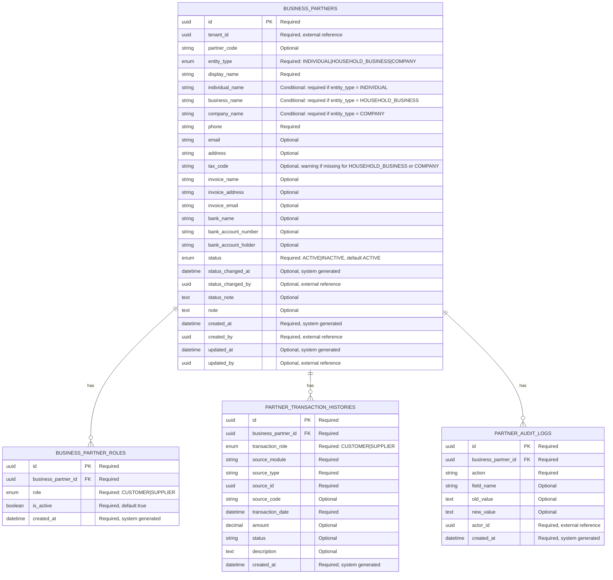

# TH-03 — Domain model

> Bounded context: **partner** (`modules/partner/`). Schema Postgres: `partner`.
> Skill: [ddd-domain-modeling](../../../../.cursor/skills/ddd-domain-modeling/SKILL.md)



## Lifecycle

```text
[nháp form] → Register → active
            → Update profile / đổi role
            → deactivate → reactivate
            → delete nếu chưa phát sinh giao dịch
```

## Aggregate

| Aggregate | Folder | Ghi chú |
| --------- | ------ | ------- |
| `BusinessPartner` | `domain/lib/src/business_partner/` | Aggregate chính của bounded context partner. Quản lý hồ sơ đối tác, loại chủ thể, vai trò và trạng thái sử dụng. |

## Database tables

| Table | Ghi chú |
| ----- | ------- |
| `business_partners` | Bảng trung tâm, lưu hồ sơ gốc của khách hàng/NCC. |
| `business_partner_roles` | Lưu vai trò của đối tác: customer, supplier. Một đối tác có thể có cả hai vai trò. |
| `partner_transaction_histories` | Read model/projection để xem lịch sử giao dịch của đối tác. Không phải dữ liệu giao dịch gốc. |
| `partner_audit_logs` | Ghi nhận thay đổi quan trọng của hồ sơ đối tác, vai trò, trạng thái và thao tác xóa/bị chặn xóa. |

## Value objects

| VO | Mô tả |
| -- | ----- |
| `PartnerRole` | `customer`, `supplier`. Một đối tác có thể có nhiều role thông qua `business_partner_roles`. |
| `EntityType` | `individual`, `household_business`, `company`. Dùng để phân biệt cá nhân, hộ kinh doanh và công ty. |
| `PartnerName` | Required, không được rỗng hoặc chỉ gồm whitespace. |
| `PhoneNumber` | Bắt buộc khi ghi nhận đối tác. Sai định dạng thì chặn lưu; trùng thì cảnh báo theo tenant. |
| `Email` | Optional. Nếu nhập thì validate format; trùng thì cảnh báo theo tenant. |
| `TaxCode` | Optional. Nếu nhập thì validate format; trùng thì cảnh báo theo tenant. Với `household_business` hoặc `company`, thiếu MST thì cảnh báo nhưng không chặn lưu. |
| `Address` | Optional. Địa chỉ liên hệ của đối tác. |
| `InvoiceProfile` | Tên/địa chỉ/email dùng cho hóa đơn. Có thể default từ hồ sơ đối tác nếu người dùng không nhập riêng. |
| `BankAccount` | Optional. Gồm tên ngân hàng, số tài khoản và chủ tài khoản. |
| `PartnerStatus` | `active`, `inactive`. Không có trạng thái `deleted`. |

## Commands

| Command | Epic/US | Ghi chú |
| ------- | ------- | ------- |
| `RegisterPartnerCommand` | Epic-01/US-02 | Ghi nhận hồ sơ đối tác mới. Mặc định status là `active`. |
| `UpdatePartnerProfileCommand` | Epic-01/US-03 | Cập nhật thông tin hồ sơ đối tác. |
| `ChangePartnerRoleCommand` | Epic-01/US-03 | Thay đổi vai trò customer/supplier của đối tác. |
| `DeactivatePartnerCommand` | Epic-02/US-01 | Chuyển đối tác từ `active` sang `inactive`. |
| `ReactivatePartnerCommand` | Epic-02/US-01 | Chuyển đối tác từ `inactive` sang `active`. |
| `DeletePartnerCommand` | Epic-02/US-02 | Chỉ cho phép xóa nếu đối tác chưa phát sinh giao dịch. Nếu đã phát sinh giao dịch thì reject command. |

## Queries

| Query | Epic/US | Ghi chú |
| ----- | ------- | ------- |
| `SearchPartnersQuery` | Epic-01/US-01 | Tìm kiếm danh sách đối tác theo tên, SĐT, email, MST, role, entity type và trạng thái. |
| `GetPartnerDetailQuery` | Epic-01/US-04 | Xem chi tiết hồ sơ đối tác. |
| `GetPartnerTransactionHistoryQuery` | Epic-03/US-01 | Xem lịch sử giao dịch từ projection/read model `partner_transaction_histories`. Không fan-out trực tiếp sang sales/inventory/accounting khi query. |

## Domain events

| Event | Khi |
| ----- | --- |
| `PartnerRegistered` | Sau khi ghi nhận đối tác thành công. |
| `PartnerProfileUpdated` | Sau khi cập nhật hồ sơ đối tác. |
| `PartnerRoleChanged` | Sau khi thay đổi role của đối tác. |
| `PartnerDeactivated` | Sau khi chuyển đối tác sang inactive. |
| `PartnerReactivated` | Sau khi kích hoạt lại đối tác. |
| `PartnerDeleted` | Sau khi xóa đối tác khỏi database vì chưa phát sinh giao dịch. |
| `PartnerDeleteRejected` | Khi yêu cầu xóa bị chặn do đối tác đã phát sinh giao dịch. |

## Integration events — publish

| Type | Khi |
| ---- | --- |
| `partner.partner.registered` | Register |
| `partner.partner.profile_updated` | Update profile |
| `partner.partner.role_changed` | Đổi role |
| `partner.partner.deactivated` | Deactivate |
| `partner.partner.reactivated` | Reactivate |
| `partner.partner.deleted` | Xóa khỏi database khi chưa phát sinh giao dịch |
| `partner.partner.delete_rejected` | Yêu cầu xóa bị chặn do đã phát sinh giao dịch |

## Integration events — consume

| Source | Event | Mục đích |
| ------ | ----- | -------- |
| sales | `sales.order.checked_out` | Cập nhật projection lịch sử giao dịch của đối tác với vai trò customer. |
| inventory | `inventory.inbound.recorded` | Cập nhật projection lịch sử giao dịch của đối tác với vai trò supplier. |
| accounting | `accounting.receivable.created` | Cập nhật projection lịch sử công nợ phải thu liên quan đến đối tác. |
| accounting | `accounting.payable.created` | Cập nhật projection lịch sử công nợ phải trả liên quan đến đối tác. |

## Data rules

| Rule ID | Rule |
| ------- | ---- |
| DR-01 | Mỗi đối tác phải có `display_name`, `phone`, `entity_type`, `status` và ít nhất một role. |
| DR-02 | `entity_type` chỉ gồm `individual`, `household_business`, `company`. |
| DR-03 | Nếu `entity_type = individual`, thông tin chính là tên cá nhân. |
| DR-04 | Nếu `entity_type = household_business`, thông tin chính là tên hộ kinh doanh. |
| DR-05 | Nếu `entity_type = company`, thông tin chính là tên công ty. |
| DR-06 | `phone` bắt buộc; sai định dạng thì chặn lưu; trùng thì cảnh báo theo tenant. |
| DR-07 | `email` không bắt buộc; nếu nhập thì validate format; trùng thì cảnh báo theo tenant. |
| DR-08 | `tax_code` không bắt buộc; nếu nhập thì validate format; trùng thì cảnh báo theo tenant. |
| DR-09 | Nếu `entity_type = household_business` hoặc `company` nhưng thiếu `tax_code`, hệ thống cảnh báo nhưng không chặn lưu. |
| DR-10 | Đối tác mới mặc định có status `active`. |
| DR-11 | Đối tác `inactive` vẫn xem được hồ sơ và lịch sử, nhưng không được chọn cho giao dịch mới. |
| DR-12 | Chỉ xóa đối tác nếu chưa phát sinh dữ liệu nghiệp vụ. |
| DR-13 | Nếu đối tác đã phát sinh dữ liệu nghiệp vụ, không cho xóa, chỉ cho chuyển sang `inactive`. |
| DR-14 | Tạo, cập nhật, đổi role, đổi trạng thái, xóa hoặc bị chặn xóa đều cần ghi audit log. |
| DR-15 | `partner_transaction_histories` là projection/read model, không thuộc aggregate `BusinessPartner`. |

## Constraints & indexes

| Type | Target | Rule |
| ---- | ------ | ---- |
| Primary key | `business_partners.id` | Khóa chính hồ sơ đối tác. |
| Primary key | `business_partner_roles.id` | Khóa chính vai trò đối tác. |
| Primary key | `partner_transaction_histories.id` | Khóa chính lịch sử giao dịch. |
| Primary key | `partner_audit_logs.id` | Khóa chính audit log. |
| Foreign key | `business_partner_roles.business_partner_id` | Tham chiếu `business_partners.id`. |
| Foreign key | `partner_transaction_histories.business_partner_id` | Tham chiếu `business_partners.id`. |
| Foreign key | `partner_audit_logs.business_partner_id` | Tham chiếu `business_partners.id`. |
| Unique | `business_partner_roles.business_partner_id + role` | Không cho trùng cùng một vai trò trên một đối tác. |
| Index | `business_partners.tenant_id` | Lọc dữ liệu theo tenant. |
| Index | `business_partners.display_name` | Tìm kiếm theo tên. |
| Index | `business_partners.phone` | Tìm kiếm và cảnh báo trùng SĐT. |
| Index | `business_partners.email` | Tìm kiếm và cảnh báo trùng email. |
| Index | `business_partners.tax_code` | Tìm kiếm và cảnh báo trùng MST. |
| Index | `business_partners.status` | Lọc theo trạng thái. |
| Index | `business_partners.entity_type` | Lọc theo cá nhân, hộ kinh doanh hoặc công ty. |
| Index | `partner_transaction_histories.business_partner_id` | Tải lịch sử theo đối tác. |
| Index | `partner_transaction_histories.transaction_date` | Sắp xếp/lọc lịch sử theo thời gian. |
| Index | `partner_audit_logs.business_partner_id` | Tải log theo đối tác. |
| Check | `business_partners.entity_type` | Chỉ nhận `individual`, `household_business`, `company`. |
| Check | `business_partners.status` | Chỉ nhận `active`, `inactive`. |
| Check | `business_partner_roles.role` | Chỉ nhận `customer`, `supplier`. |

## Anti-patterns

- God aggregate gộp transaction history vào `BusinessPartner`.
- Dùng `deleted` như một trạng thái nghiệp vụ của đối tác.
- Gọi là soft delete nhưng thực tế vẫn giữ bản ghi trong database.
- Tách cứng `Customer` và `Supplier` thành hai aggregate riêng khi cùng một đối tác có thể có cả hai vai trò.
- Dup-check chỉ ở UI. Cần có RPC/query tenant-scoped để kiểm tra trùng SĐT, email, MST.
- Query-time fan-out sang sales/inventory/accounting cho lịch sử. Nên dùng inbox projection/read model.
- Cho phép xóa đối tác đã phát sinh giao dịch.
