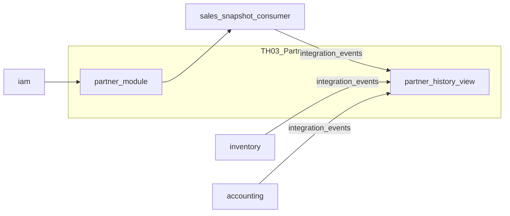

# TH-03 — Module map

## Bảng module

| Module | Vai trò | Owner / Supporting | Package | Trạng thái |
| ------ | ------- | ------------------ | ------- | ---------- |
| partner | Hồ sơ Partner, contact, transform, trạng thái, history read model | **Owner** | `modules/partner/` | rebuild in progress — CONTRACT + S1 FE done; BE/E2E còn todo |
| iam | Auth, tenant, RBAC | Supporting | `modules/iam/` | golden / codegen |
| sales | Snapshot KH; publish order events | Supporting | `modules/sales/` | skeleton |
| inventory | Publish inbound events | Supporting | `modules/inventory/` | skeleton |
| accounting | Publish receivable/payable events | Supporting | `modules/accounting/` | skeleton |

## Sơ đồ phụ thuộc



## Public contracts — integration events (publish)

Package: `modules/partner/integration_events/` (chưa tạo).

Xem [01-domain-model.md](01-domain-model.md) cho danh sách event types.

## Snapshot DTOs (cho module khác)

| DTO | Consumer |
| --- | -------- |
| `CustomerSnapshot` | sales |
| `SupplierSnapshot` | inventory |

## Permissions

Constants: `PartnerPermissions` trong `modules/partner/domain/` — `@RequiresPermission` + codegen `partner_access_metadata.g.dart`.

| Permission code | Gherkin label (ví dụ) | Epic/US |
| --------------- | --------------------- | ------- |
| `partner.view` | Xem danh sách đối tác | EP-01/US-01 |
| `partner.detail.view` | Xem hồ sơ chi tiết | EP-01/US-04 |
| `partner.create` | Tạo đối tác mới | EP-01/US-02 |
| `partner.update` | Chỉnh sửa hồ sơ | EP-01/US-03 |
| `partner.contact.manage` | Quản lý người liên hệ tổ chức | EP-01/US-05 |
| `partner.transform` | Chuyển Cá nhân thành Tổ chức | EP-01/US-06 |
| `partner.status.manage` | Ngừng hoạt động / kích hoạt lại | EP-02/US-01 |
| `partner.delete` | Xóa mềm hồ sơ | EP-02/US-02 |
| `partner.history.view` | Xem lịch sử làm việc | EP-01/US-07 |

## Ranh giới

- Partner **không** tạo đơn bán, phiếu nhập, hóa đơn, thu/trả công nợ
- Quick-create từ luồng khác: gọi `CreatePartnerCommand` qua `IPartnerModule`
- Lịch sử: partner **chỉ đọc** projection; mutation thuộc module nguồn
- Merge hồ sơ trùng: **out of scope** Phase 1 (warn-only)
- Organization → Person transform: **không hỗ trợ**

## Messaging

Schema `partner`: outbox/inbox/internal_commands — [messaging_schema.md](../../../operations/messaging_schema.md). Wiring worker sẽ đăng ký lại khi rebuild infrastructure slice S9.

## Presentation layout (dự kiến)

Dual path — pages trong ERP shell, dialog/widget tái dùng trong module presentation:

```text
apps/erp/lib/features/partner/presentation/
  pages/          — route screens (thin composition, ≤ 500 dòng)
  widgets/        — widget chỉ dùng trong feature partner (ERP shell)

modules/partner/presentation/
  lib/src/
    bloc/           — PartnerListCubit, PartnerCreateCubit, ...
    widgets/        — dialogs, forms, contact list, history tab, ...
```

**Import rule:** `apps/erp` → `vet45_partner_presentation`; module presentation **không** import `apps/erp`.

Skill: [.cursor/skills/presentation-layer/SKILL.md](../../../../.cursor/skills/presentation-layer/SKILL.md)
