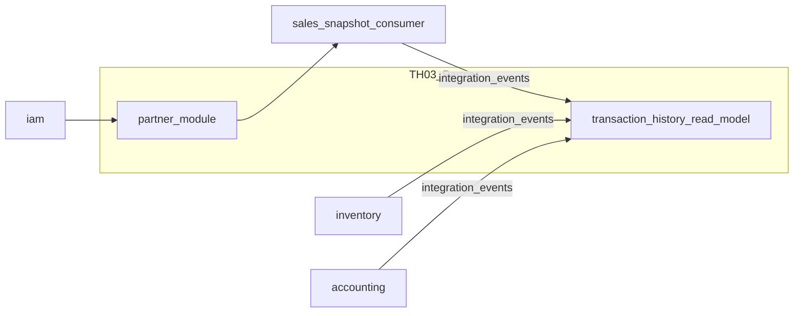

# TH-03 — Module map

## Bảng module

| Module | Vai trò | Owner / Supporting | Package | Trạng thái |
| ------ | ------- | ------------------ | ------- | ---------- |
| partner | Hồ sơ, trạng thái, lịch sử read model | **Owner** | `modules/partner/` | skeleton |
| iam | Auth, tenant, RBAC | Supporting | `modules/iam/` | skeleton |
| sales | Snapshot KH; publish order events | Supporting | `modules/sales/` | skeleton |
| inventory | Publish inbound events | Supporting | `modules/inventory/` | skeleton |
| accounting | Publish receivable events | Supporting | `modules/accounting/` | skeleton |

## Sơ đồ phụ thuộc

## Public contracts — integration events (publish)

Package: `modules/partner/integration_events/`

Xem [01-domain-model.md](01-domain-model.md) cho danh sách event types.

## Snapshot DTOs (cho module khác)

| DTO | Consumer |
| --- | -------- |
| `CustomerSnapshot` | sales |
| `SupplierSnapshot` | inventory |

## Permissions (planned)

| Permission code | Gherkin label (ví dụ) | Epic/US |
| --------------- | --------------------- | ------- |
| `partner.view` | Xem danh sách đối tác | Epic-01/US-01 |
| `partner.create` | Ghi nhận đối tác mới | Epic-01/US-02 |
| `partner.update` | Chỉnh sửa hồ sơ | Epic-01/US-03 |
| `partner.view_detail` | Xem chi tiết đối tác | Epic-01/US-04 |
| `partner.manage_status` | Quản lý trạng thái đối tác | Epic-02/US-01 |
| `partner.delete` | Xóa hồ sơ đối tác | Epic-02/US-02 |
| `partner.view_transaction_history` | Xem lịch sử làm việc đối tác | Epic-03/US-01 |

## Ranh giới

- Partner **không** tạo đơn bán, phiếu nhập, hóa đơn, thu/trả công nợ
- Quick-create từ luồng khác: out of scope Epic-01/US-02 — module gọi dùng `RegisterPartnerCommand` qua facade
- Lịch sử giao dịch: partner **chỉ đọc** projection; mutation thuộc module nguồn

## Messaging

Schema `partner`: outbox/inbox/internal_commands — [messaging_schema.md](../../../operations/messaging_schema.md).
