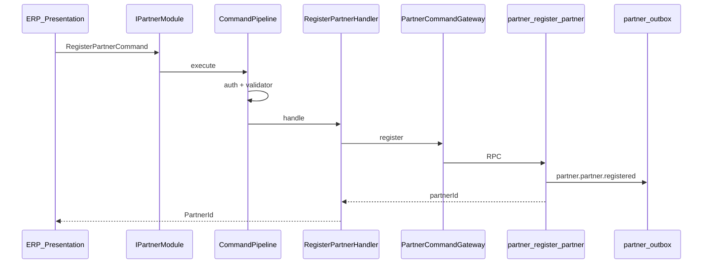
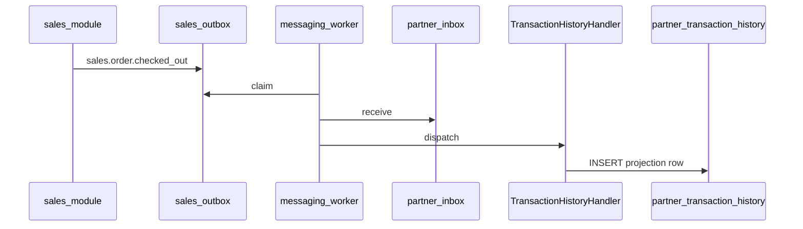

# TH-03 — Architecture & flows

Tuân theo [05-layered-module-structure.md](../../../architecture/05-layered-module-structure.md) và [02-architecture-style.md](../../../architecture/02-architecture-style.md) (CQRS, RPC-first).

## Luồng ghi nhận đối tác (Epic-01/US-02)



## Luồng tra cứu (Epic-01/US-01, US-04)

```text
UI → IPartnerModule.executeQueryAsync(SearchPartnersQuery | GetPartnerDetailQuery)
  → QueryBus → Handler
  → IPartnerReadGateway → partner.v_* views
  → DTO
```

## Dup-check (Epic-01/US-02 FR-5)

```text
1. Optional pre-check: partner.check_duplicate (read, tenant-scoped)
2. UI cảnh báo, user confirm
3. RegisterPartnerCommand kèm confirmDuplicate=true
4. RPC validate tenant-scoped (defense in depth)
```

## Điểm commit

| Bước | RPC |
| ---- | --- |
| Ghi nhận mới | `partner.register_partner` |
| Cập nhật | `partner.update_partner` |
| Đổi trạng thái | `partner.deactivate_partner` / `partner.reactivate_partner` |
| Xóa mềm | `partner.delete_partner` |

## Epic-03 — Read model lịch sử (inbox projection)



**Không** query-time fan-out sang `sales.orders` từ partner module.

`TransactionHistoryHandler` = consumer handler ở **application layer** (`IIntegrationEventNotificationHandler`, `application/lib/src/integration_events/`). Nó map integration event → `RecordPartnerTransactionHistoryCommand` và **enqueue** qua `ICommandScheduler` (không execute trực tiếp). Worker drain `partner_inbox` rồi `partner.internal_commands` bằng `ProcessInboxCommand` / `ProcessInternalCommandsCommand` (`IRecurringCommand`) — claim → `CommandsExecutor` → `CommandBus` pipeline. Contract RPC schema `partner` giữ claim-token; wiring dispatcher do codegen (`cqrs_integration_event_registry`).

## Read vs write

| | Cơ chế |
| - | ------ |
| Writes | Command → Gateway → RPC (+ outbox same txn) |
| Reads | Query → Read gateway → `partner.v_*` views |
| History | Query → `partner.v_partner_transaction_history` |

## Liên kết

- [07-integration-and-messaging.md](../../../architecture/07-integration-and-messaging.md)
- [09-application-commands.md](../../../architecture/09-application-commands.md)
