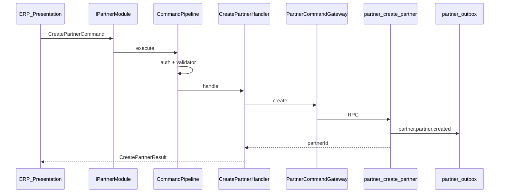
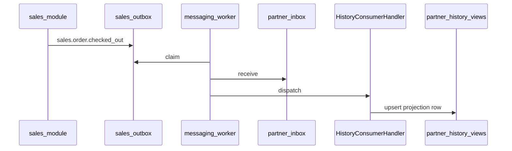

# TH-03 — Architecture & flows

Tuân theo [05-layered-module-structure.md](../../../architecture/05-layered-module-structure.md) và [02-architecture-style.md](../../../architecture/02-architecture-style.md) (CQRS, RPC-first).

**Reboot 2026-07-07:** Code partner cũ đã gỡ. Flows dưới đây là **target** cho rebuild — mirror golden [modules/iam/](../../../../modules/iam/README.md).

## Luồng tạo Partner (EP-01/US-02, CMD-03)



**Person vs Organization:** command payload chứa `partnerType` + `personProfile` hoặc `organizationProfile` + `roles[]`.

## Luồng tra cứu (EP-01/US-01, US-04)

```text
UI → IPartnerModule.executeQueryAsync(SearchPartnersQuery | GetPartnerDetailQuery)
  → QueryBus → Handler
  → IPartnerReadGateway → partner.v_* views
  → DTO (+ available_actions cho detail)
```

## Dup-check (EP-01/US-02, US-03)

```text
1. Pre-check: partner.check_duplicate (read, tenant-scoped)
2. UI cảnh báo DUPLICATE_WARNING, user confirm
3. CreatePartnerCommand / UpdatePartnerProfileCommand kèm confirmDuplicate=true
4. RPC validate tenant-scoped (defense in depth)
```

## Transform Person → Organization (EP-01/US-06, CMD-08)

```text
1. UI xác nhận transform (permission partner.transform)
2. TransformPersonToOrganizationCommand(partnerId, organizationProfile, ...)
3. RPC: đổi partner_type, tạo organization_profile, giữ partner_id/roles/status
4. Person profile cũ → OrganizationContact is_primary=true
5. Action log action_type=transform
```

## Organization contacts (EP-01/US-05, CMD-05..07)

```text
Add: tạo Person Partner mới HOẶC link Person có sẵn → OrganizationContact
Update: contact_role, is_primary (enforce max 1 primary)
Remove: xóa OrganizationContact row; Person Partner vẫn tồn tại
```

## Điểm commit (RPC target — draft SQL)

| Bước | RPC |
| ---- | --- |
| Tạo mới | `partner.create_partner` |
| Cập nhật | `partner.update_partner` |
| Add contact | `partner.add_organization_contact` |
| Update contact | `partner.update_organization_contact` |
| Remove contact | `partner.remove_organization_contact` |
| Transform | `partner.transform_to_organization` |
| Ngừng / kích hoạt | `partner.deactivate_partner` / `partner.reactivate_partner` |
| Xóa mềm | `partner.soft_delete_partner` |
| Eligibility | `partner.check_delete_eligibility` |
| Dup check | `partner.check_duplicate` |
| Search / detail / history | `partner.search_partners` / `partner.get_partner_detail` / `partner.get_partner_history` |

Draft SQL: `supabase/migrations/_drafts/partner_v2_*.sql` — tạo khi slice BE bắt đầu.

## EP-01/US-07 — Read model lịch sử (inbox projection)



**Không** query-time fan-out sang `sales.orders` từ partner module.

Consumer handler ở **application layer** (`IIntegrationEventNotificationHandler`) → map event → `RecordPartnerHistoryCommand` → enqueue qua `ICommandScheduler`. Worker drain inbox + internal_commands.

**E2E blocked** cho đến khi sales/inventory/accounting publish events end-to-end.

## Read vs write

| | Cơ chế |
| - | ------ |
| Writes | Command → Gateway → RPC (+ outbox same txn) |
| Reads | Query → Read gateway → `partner.v_*` views |
| History | Query → `partner.v_partner_history` |
| Action log | Append trong RPC mutation txn |

## Liên kết

- [07-integration-and-messaging.md](../../../architecture/07-integration-and-messaging.md)
- [09-application-commands.md](../../../architecture/09-application-commands.md)
