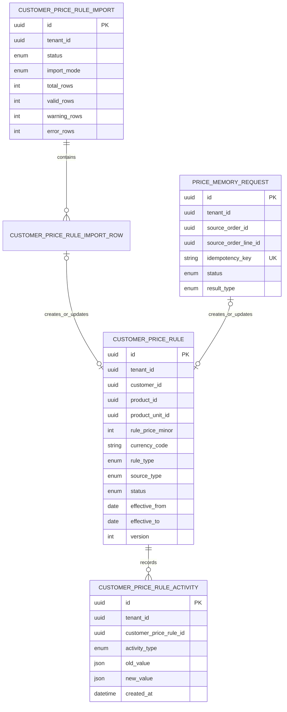
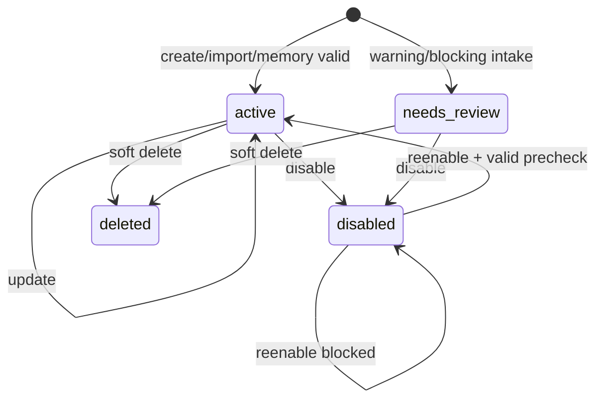

# TH-04 EP02 — Domain model

> Bounded context mục tiêu: **pricing** (`modules/pricing/` — greenfield). Postgres schema mục tiêu: `pricing`.
> Product source: [Theme-4-pricing-promotions.md](../Theme-4-pricing-promotions.md) §§2–3.

## Aggregate map



### Aggregate roots

| Root | Owns | Command boundary |
| ---- | ---- | ---------------- |
| `CustomerPriceRule` | Identity, price, effectivity, status, source trace, version | create/update/disable/reenable |
| `CustomerPriceRuleImport` | Batch lifecycle and import rows | start/confirm/cancel import |
| `PriceMemoryRequest` / `RememberedPriceRequest` | Idempotency and processing outcome | save remembered price |

`CustomerPriceRuleActivity` là append-only projection/audit record được ghi cùng transaction của mutation, không expose update/delete command.

### Read-projection derived status

S2/S3 không thay đổi aggregate state machine. Working-list (S2) và detail (S3) tính status theo business date với precedence cố định: deleted bị loại / `NOT_FOUND`; persisted `disabled`; blocking review/codes thành `needs_review`; `effective_to < business_date` thành `expired`; `effective_from > business_date` thành `not_yet_effective`; còn lại là `applying`. Hai biên ngày hiệu lực đều inclusive.

### Detail projection / reference health (S3)

- Detail giữ Pricing-owned stored labels để archived references vẫn explainable.
- Live health/list/floor enrichment chỉ qua Partner/Catalog internal provider functions; missing/inactive reference → warning issue codes, không ẩn rule; provider technical failure → `SYSTEM_ERROR`.
- Live enrichment không cập nhật persisted status, validation snapshot, version, activity, hay S2 list projection.
- Source-trace identifiers (import/order/memory request) yêu cầu `view_history`; floor amount yêu cầu `override_floor_price`.

### Update behavior (S5)

S5 update reconstitutes the current aggregate, preserves identity/source,
uses expected version, treats normalized mutable equality as no-op, keeps
disabled disabled, and normalizes fixed needs_review to active.

`CustomerPriceRule.reconstitute` rebuilds the aggregate from persisted state without raising `CustomerPriceRuleCreatedDomainEvent`. `updateMutableFields` enforces `RuleCurrencyMustNotChangeRule` and `RuleCandidateMustBeCommittableRule` before mutating; a normalized no-op (same price/period/note) makes no change, bumps no version, and raises no event. A meaningful update increments `version` exactly once and raises exactly one `CustomerPriceRuleUpdatedDomainEvent(ruleId, previousVersion, newVersion)`. `disabled` status is left untouched by an update; any other persisted status (including a fixed `needs_review`) normalizes to `active`.

### Disable behavior (S6)

`CustomerPriceRule.disable()` allows only `active` or `needs_review` → `disabled`. A real transition increments `version` exactly once and raises exactly one `CustomerPriceRuleDisabledDomainEvent(ruleId, previousVersion, newVersion)`. Calling `disable()` when already `disabled` is a no-op (no version bump, no event). Persisted `deleted` (or any other status) is invalid for disable. Commit-time audit fields (`disabled_at` / `disabled_by` / `disabled_reason`) and the single `disabled` activity row are owned by the authoritative RPC in the same transaction — Dart domain mirrors the lifecycle invariant for tests only.

### Soft-delete behavior (BR-09)

`CustomerPriceRule.softDelete({required DateTime deletedAt})` allows only `active` or `needs_review` → `deleted`, sets `deletedAt`, increments `version` once, and raises exactly one `CustomerPriceRuleDeletedDomainEvent(ruleId, previousVersion, newVersion)`. Replay on already-`deleted` is idempotent (no version bump, no second event). `disabled` cannot be soft-deleted (`CustomerPriceRuleCanBeDeletedRule`). Reconstitution enforces `status == deleted` ↔ `deletedAt != null`. Search/detail hide deleted; history may still load by ID with `view_history`. Soft-delete UI is out of scope for this delivery — Domain/Application/Infrastructure/SQL only.

### Overlap policy (BR-07 / CPR-INV-06)

`CustomerPriceRuleOverlapPolicy` conflicts only when same tenant/customer/product/product-unit, both rules are `active` with `deletedAt == null`, and closed intervals overlap (`EffectivePeriod.overlaps`). Update/reenable/import exclude the current rule id. Manual create/update and reenable retain their own replacement policy via `_auto_disable_overlapping_customer_price_rules` (reason `AUTO_REPLACED_BY_RULE`). Import is stricter: preview surfaces `DUPLICATE_ACTIVE_RULE` as a blocking row error, confirm rechecks under the rule-key lock, skips only the conflicting row, and never auto-disables the existing active rule. DB exclusion constraint on active non-deleted intervals is the final guard (draft `014`).

### Eligibility policy (BR-08 / CPR-INV-08)

`CustomerPriceRuleEligibilityPolicy.isApplicable(rule, businessDate)` is true only when: `active`, `deletedAt == null`, `effectiveFrom <= businessDate <= effectiveTo` (`effectiveTo == null` = open-ended), `blockingCodes` empty and validation not `blocked`. Below-floor **warning** remains applicable when policy already allowed override. Pricing exposes `ResolveApplicableCustomerPriceRuleQuery` / RPC `resolve_applicable_customer_price_rule` — returns at most one applicable rule or `SYSTEM_ERROR` if integrity finds more than one. No Sales integration and no order-price snapshot in this delivery.

## Value objects

| Value object | Invariant |
| ------------ | --------- |
| `Money` | integer minor units, amount > 0, currency explicit |
| `EffectivePeriod` | from required; to null hoặc from <= to; overlap dùng closed interval |
| `CustomerPriceRuleKey` | tenant + customer + product + product unit |
| `RuleSource` | type + required trace IDs theo source |
| `RuleValidationOutcome` | valid/warning/blocked/needsReview + stable codes |
| `ExpectedVersion` | mutation chỉ commit khi version khớp |

## CustomerPriceRule invariants

| ID | Invariant |
| -- | --------- |
| CPR-INV-01 | Tenant/customer/product/unit/price/type/source/status/from không null. |
| CPR-INV-02 | Active rule không có deleted timestamp. |
| CPR-INV-03 | `excel_import` source có import ID và ưu tiên import-row ID. |
| CPR-INV-04 | `sales_order` source có order ID và ưu tiên order-line/request ID. |
| CPR-INV-05 | Manual source có actor. |
| CPR-INV-06 | Sau mỗi commit chỉ còn tối đa một active interval overlap cho cùng key; rule mới/update/reenable/import sẽ auto-disable mọi active overlap cũ trong cùng transaction; DB exclusion constraint bảo vệ lớp cuối. |
| CPR-INV-07 | Important mutation ghi activity trong cùng commit. |
| CPR-INV-08 | Disabled/deleted/blocked rule không eligible cho order mới. |
| CPR-INV-09 | Chỉ `disabled` rule được reenable; blocked precheck outcome không commit. |
| CPR-INV-10 | Precheck token là fingerprint stateless; không phải authorization credential. |

## Reenable fingerprint invariant

Token HMAC-SHA-256 derive từ canonical JSON (`pricing-reenable-s7-v1`) gồm tenant, actor, rule identity/version/status/key/price/currency/effectivity, business date, live reference eligibility, list/floor amounts, override permission, và sorted outcome codes. HMAC key chỉ tồn tại trong server-side Vault nên hidden floor không thể bị dò bằng hash offline. Display-name changes không ảnh hưởng token; actor, eligibility fields, floor/list, permission, rule values/version/status, và outcome codes có ảnh hưởng.

Domain: `CustomerPriceRuleCanBeReenabledRule`, `CustomerPriceRule.reenable(RuleValidationOutcome)`, `CustomerPriceRuleReenabledDomainEvent`.

## State model



`expired` không phải persisted transition; nó được derive từ `effective_to` và business date.

## Duplicate interval policy

Hai interval overlap khi:

```text
existing.from <= candidate.to_or_infinity
AND candidate.from <= existing.to_or_infinity
```

Chỉ xét non-deleted active rules trong cùng tenant/key. Khi update/reenable, loại chính rule hiện tại khỏi candidate set. Kiểm tra UI/precheck chỉ hỗ trợ UX; RPC là điểm quyết định cuối và sẽ auto-disable toàn bộ active overlaps còn lại theo lock key trước khi commit rule mới.

## Floor-price policy

Pricing nhận `ProductPriceBandSnapshot` từ Catalog port:

```text
productId, productUnitId, sellableStatus,
listPriceMinor?, floorPriceMinor?, currency, snapshotVersion
```

- Không có floor → `not_checked` hoặc `normal` theo contract, không tự suy đoán 0.
- Below floor + block policy → `BELOW_FLOOR_BLOCKED`.
- Below floor + warning policy → cần acknowledgement; nếu policy yêu cầu override, actor phải có override permission.
- Lưu snapshot/check outcome phục vụ audit; Catalog vẫn là source of truth.

## Import aggregate

Batch transition:

```text
uploaded → validating → ready_to_import → importing → completed|completed_with_errors
uploaded|ready_to_import → canceled
processing failure → failed
```

Row transition:

```text
parsed → valid|warning|error → imported|skipped|failed
```

Confirm chỉ xử lý valid/warning rows được policy cho phép, revalidate references/duplicate/floor tại commit và không apply row đã terminal.

**S8 BE baseline 2026-07-16 / explicit-unit corrective 2026-07-23:** domain aggregate `CustomerPriceRuleImport` + row lifecycle tests; application contracts/validators/handlers; infrastructure XLSX codec + `ExcelCustomerPriceRuleImportFileAdapter`, RPC mapper/gateway, draft SQL (`010`/`013`/`003`/`016_pricing_customer_price_rule_import_explicit_unit.sql`). Template V1 rows carry exact `product_id` + `product_unit_id` UUIDs; Catalog resolves the selected active unit (base or conversion) via the 3-uuid overload — no default-to-base-unit for new V1 rows.

## Memory request aggregate

Statuses: `received`, `processed`, `blocked`, `failed`, `skipped`.

| Rule | Enforcement |
| ---- | ----------- |
| Idempotency | Unique tenant + idempotency key; same payload returns stored outcome. |
| Payload conflict | Same key/different normalized payload → `IDEMPOTENCY_CONFLICT`. |
| Manual protection | Existing active manual rule is never auto-overwritten by default. |
| Anonymous customer | Skip/block; never synthesize a customer. |
| Source integrity | Order/order-line IDs remain opaque Sales identifiers. |

## Snapshots / external ports

| Port | Snapshot | Purpose |
| ---- | -------- | ------- |
| `ICustomerSnapshotPort` | `CustomerSnapshot` | Exists, tenant, transactional status, display label |
| `IProductPriceBandSnapshotPort` | `ProductPriceBandSnapshot` | Product/unit relationship, sellable/default unit, list/floor price |
| `IExecutionContext` | tenant/actor/permissions/business context | Access and audit |

No aggregate holds a Partner or Catalog entity object.

## Domain events

`CustomerPriceRuleCreated`, `CustomerPriceRuleUpdated`, `CustomerPriceRuleDisabled`, `CustomerPriceRuleReenabled`, `CustomerPriceRuleMarkedNeedsReview`, `CustomerPriceRuleImportCompleted`, `RememberedPriceSaved`.

S1 giữ `CustomerPriceRuleCreatedDomainEvent` là internal domain event và không tạo outbox/integration event. Quyết định public event cho các slice sau vẫn là slice-level decision. Activity creation luôn bắt buộc ngay cả khi không publish public event.
