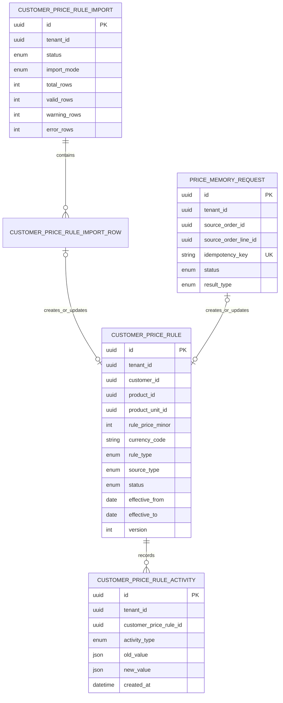
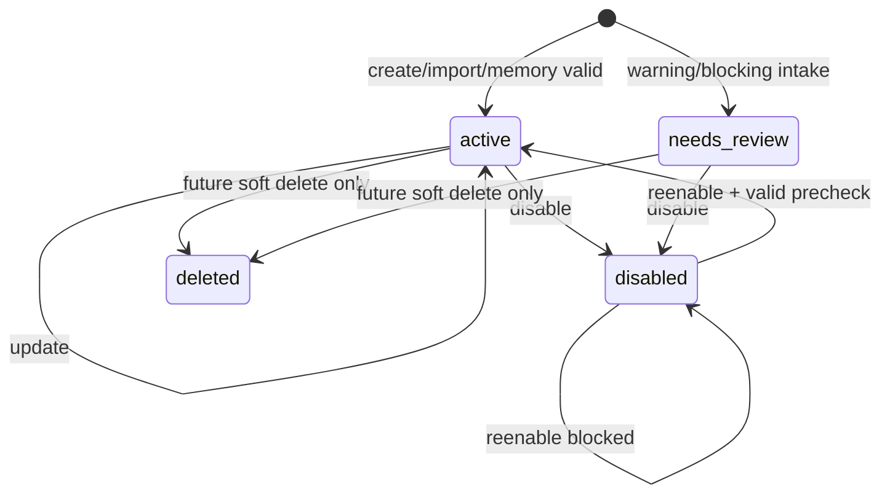

# TH-04 EP02 — Domain model

> Bounded context mục tiêu: **pricing** (`modules/pricing/` — greenfield). Postgres schema mục tiêu: `pricing`.
> Product source: [Theme-4-pricing-promotions.md](../Theme-4-pricing-promotions.md) §§2–3.

## Aggregate map



### Aggregate roots

| Root | Owns | Command boundary |
| ---- | ---- | ---------------- |
| `CustomerPriceRule` | Identity, price, effectivity, status, source trace, version | create/update/disable/reenable |
| `CustomerPriceRuleImport` | Batch lifecycle and import rows | start/confirm/cancel import |
| `PriceMemoryRequest` | Idempotency and processing outcome | save remembered price |

`CustomerPriceRuleActivity` là append-only projection/audit record được ghi cùng transaction của mutation, không expose update/delete command.

## Value objects

| Value object | Invariant |
| ------------ | --------- |
| `Money` | integer minor units, amount > 0, currency explicit |
| `EffectivePeriod` | from required; to null hoặc from <= to; overlap dùng closed interval |
| `CustomerPriceRuleKey` | tenant + customer + product + product unit |
| `RuleSource` | type + required trace IDs theo source |
| `RuleValidationOutcome` | valid/warning/blocked/needsReview + stable codes |
| `ExpectedVersion` | mutation chỉ commit khi version khớp |

## CustomerPriceRule invariants

| ID | Invariant |
| -- | --------- |
| CPR-INV-01 | Tenant/customer/product/unit/price/type/source/status/from không null. |
| CPR-INV-02 | Active rule không có deleted timestamp. |
| CPR-INV-03 | `excel_import` source có import ID và ưu tiên import-row ID. |
| CPR-INV-04 | `sales_order` source có order ID và ưu tiên order-line/request ID. |
| CPR-INV-05 | Manual source có actor. |
| CPR-INV-06 | Active intervals cùng key không overlap. |
| CPR-INV-07 | Important mutation ghi activity trong cùng commit. |
| CPR-INV-08 | Disabled/deleted/blocked rule không eligible cho order mới. |

## State model



`expired` không phải persisted transition; nó được derive từ `effective_to` và business date.

## Duplicate interval policy

Hai interval overlap khi:

```text
existing.from <= candidate.to_or_infinity
AND candidate.from <= existing.to_or_infinity
```

Chỉ xét non-deleted active rules trong cùng tenant/key. Khi update/reenable, loại chính rule hiện tại khỏi candidate set. Kiểm tra UI/precheck chỉ hỗ trợ UX; RPC là điểm quyết định cuối.

## Floor-price policy

Pricing nhận `ProductPriceBandSnapshot` từ Catalog port:

```text
productId, productUnitId, sellableStatus,
listPriceMinor?, floorPriceMinor?, currency, snapshotVersion
```

- Không có floor → `not_checked` hoặc `normal` theo contract, không tự suy đoán 0.
- Below floor + block policy → `BELOW_FLOOR_BLOCKED`.
- Below floor + warning policy → cần acknowledgement; nếu policy yêu cầu override, actor phải có override permission.
- Lưu snapshot/check outcome phục vụ audit; Catalog vẫn là source of truth.

## Import aggregate

Batch transition:

```text
uploaded → validating → ready_to_import → importing → completed|completed_with_errors
uploaded|ready_to_import → canceled
processing failure → failed
```

Row transition:

```text
parsed → valid|warning|error → imported|skipped|failed
```

Confirm chỉ xử lý valid/warning rows được policy cho phép, revalidate references/duplicate/floor tại commit và không apply row đã terminal.

## Memory request aggregate

Statuses: `received`, `processed`, `blocked`, `failed`, `skipped`.

| Rule | Enforcement |
| ---- | ----------- |
| Idempotency | Unique tenant + idempotency key; same payload returns stored outcome. |
| Payload conflict | Same key/different normalized payload → `IDEMPOTENCY_CONFLICT`. |
| Manual protection | Existing active manual rule is never auto-overwritten by default. |
| Anonymous customer | Skip/block; never synthesize a customer. |
| Source integrity | Order/order-line IDs remain opaque Sales identifiers. |

## Snapshots / external ports

| Port | Snapshot | Purpose |
| ---- | -------- | ------- |
| `ICustomerSnapshotPort` | `CustomerSnapshot` | Exists, tenant, transactional status, display label |
| `IProductPriceBandSnapshotPort` | `ProductPriceBandSnapshot` | Product/unit relationship, sellable/default unit, list/floor price |
| `IExecutionContext` | tenant/actor/permissions/business context | Access and audit |

No aggregate holds a Partner or Catalog entity object.

## Domain events (internal/public decision later)

`CustomerPriceRuleCreated`, `CustomerPriceRuleUpdated`, `CustomerPriceRuleDisabled`, `CustomerPriceRuleReenabled`, `CustomerPriceRuleMarkedNeedsReview`, `CustomerPriceRuleImportCompleted`, `RememberedPriceSaved`.

Whether these become outbox integration events is a slice-level decision. Activity creation is mandatory even when no public event is published.

