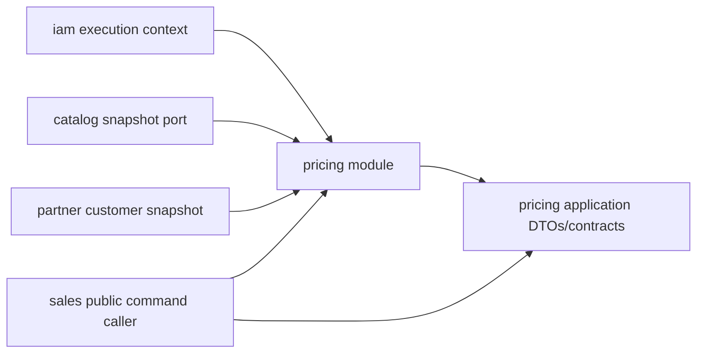

# TH-04 EP02 — Module map

## Modules

| Module | Role | Ownership | Status |
| ------ | ---- | --------- | ------ |
| `pricing` | Customer price rules, imports, memory requests, activity history | **Owner** | future greenfield `modules/pricing/` |
| `iam` | Execution context, tenant, actor, RBAC | Supporting | golden module |
| `catalog` | Product/selling-unit/list-floor snapshot | Supporting/provider | greenfield |
| `partner` | Customer snapshot | Supporting/provider | TH-03 rebuild |
| `sales` | Publishes remembered-price request; future consumer of applicable rule | Supporting/consumer | skeleton |

## Dependency direction



Arrows represent contract/data flow, không phải Dart infrastructure imports. Pricing application defines required ports; infrastructure implements adapters. Pricing domain imports only shared domain primitives.

## Future package layout

```text
modules/pricing/
├── domain/
│   └── lib/src/              # aggregates, value objects, policies, permissions
├── application/
│   └── lib/src/              # commands, queries, DTOs, handlers, ports, IPricingModule
├── infrastructure/
│   └── lib/src/              # RPC gateways, startup, generated handler/access metadata
└── presentation/
    └── lib/src/              # reusable cubits/widgets; no direct Supabase
```

Tên facade chuẩn khi implement: `IPricingModule`.

## Permissions

Constants future: `PricingPermissions` trong pricing domain.

| Permission | Stories |
| ---------- | ------- |
| `pricing.customer_price_rule.view` | US-01, US-03 |
| `pricing.customer_price_rule.create` | US-02, US-04 |
| `pricing.customer_price_rule.update` | US-06 |
| `pricing.customer_price_rule.disable` | US-07 |
| `pricing.customer_price_rule.reenable` | US-08 |
| `pricing.customer_price_rule.override_floor_price` | US-04/05/06/08 conditional |
| `pricing.customer_price_rule.import` | US-02, US-05 |
| `pricing.customer_price_rule.save_memory` | US-09 |
| `pricing.customer_price_rule.view_history` | US-10 |

Deferred: `delete`, `export_history`.

## Public contracts

| Contract | Direction | Stability |
| -------- | --------- | --------- |
| `SaveRememberedPriceFromOrderCommand` | Sales → Pricing | public application contract; S9 |
| Applicable-rule query | Sales/Pricing engine ← Pricing | deferred until EP04/EP05 scope |
| `CustomerSnapshot` port | Pricing → Partner provider | minimum fields only |
| `ProductPriceBandSnapshot` port | Pricing → Catalog provider | minimum fields only |

## Presentation target

```text
apps/erp/lib/features/pricing/presentation/
  pages/       # thin route composition, ≤ 500 lines
  widgets/     # feature-specific widgets/dialogs

modules/pricing/presentation/lib/src/
  cubit/
  widgets/     # reusable, framework boundary per presentation skill
```

No inline `AlertDialog` in `*_page.dart`; separate dialog/sheet widget and cover in design-system example catalog when required.

## Hard boundaries

- Pricing never writes catalog, partner or sales tables.
- Sales never writes pricing persistence directly.
- UI only calls `IPricingModule` through `IModuleMediator` with `IExecutionContext`.
- Snapshot labels do not become cross-context source of truth.

