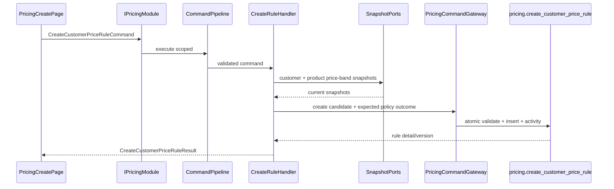
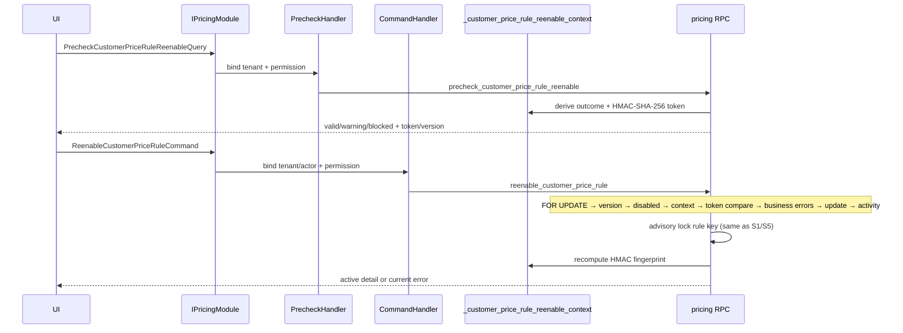
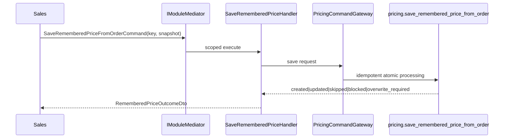

# TH-04 EP02 — Architecture & flows

Target follows CQRS/RPC-first architecture. Module is greenfield; all RPC names below are draft contract targets.

## Required execution path

```text
ERP UI → IExecutionContext → IPricingModule / IModuleMediator
  → ScopedCommandExecutor → CommandBus/QueryBus
  → DefaultCommandPipeline (access → validate → log → handler)
  → application port → infrastructure RPC gateway → pricing.* RPC
```

## S1 — Create manual rule



Snapshot precheck cannot guarantee commit. RPC rechecks tenant/references/overlap/floor policy in the authoritative transaction. **DOC_AHEAD_OF_CODE:** on active overlap without `acknowledgeOverwrite`, return `OVERWRITE_REQUIRED` (no mutation); with acknowledge, soft-delete overlapping actives then insert.

## S2/S3 — Read list and detail

```text
UI → SearchCustomerPriceRulesQuery | GetCustomerPriceRuleDetailQuery
  → Pricing query access guard (bind tenant + generated permission metadata)
  → ScopedCommandExecutor → QueryBus → query handler → IPricingReadGateway
  → pricing search/detail RPC
  → DTO with snapshot labels, derived status, available actions
```

Queries receive tenant from execution context, never trust a caller-supplied tenant ID.

- **S2 search** reads only Pricing-owned snapshots and uses an opaque seek cursor over `updated_at DESC, id DESC`; it does not join Partner/Catalog private tables. Floor amount is never exposed on the list.
- **S3 detail** keeps stored snapshot labels for archived explainability, then enriches reference health and current compatible list/floor through Partner/Catalog internal provider functions only. Live enrichment does not mutate persisted rule status, validation snapshot, version, activity, or the S2 list projection. Detail does not embed activity history rows; `history` is a navigation capability for S10.
- RPC remains the authoritative tenant/view gate; deleted/cross-tenant IDs map to `NOT_FOUND`.

## S5 — Update

```text
1. UI loads detail(version=N).
2. Submit mutable fields + expectedVersion=N.
3. Handler loads advisory context via pricing.get_customer_price_rule_update_context
   (read-only precheck: permission, payload shape, version, status, references, floor, duplicate).
4. Handler reconstitutes the aggregate, checks expected version locally, computes no-op via
   hasSameMutableValues, then always calls the authoritative gateway regardless of no-op/warning.
5. RPC pricing.update_customer_price_rule locks/current-checks rule; version mismatch → STATE_CHANGED;
   status outside active/needs_review/disabled → INVALID_STATUS.
6. RPC rechecks overlap/floor/reference. Without `acknowledgeOverwrite`, overlapping actives → `OVERWRITE_REQUIRED` (no write). With acknowledge: soft-delete overlapping actives under the rule-key lock, update rule + version, append activity (skipped on no-op; include overwrite activity when soft-deletes ran).
```

The advisory RPC (`pricing.get_customer_price_rule_update_context`) is UX-only: it recomputes the same checks for early UI feedback but **never authorizes a commit**. The authoritative RPC (`pricing.update_customer_price_rule`) always re-derives and re-checks tenant/permission, version, status, references, duplicate interval and floor policy itself under a row lock before writing — a stale or bypassed advisory call cannot skip the authoritative recheck.

## S6 — Disable

```text
1. UI confirms disable (optional reason) + expectedVersion=N from detail.
2. Handler validates payload, binds tenant/actor from execution context, then calls
   the command gateway once — no advisory/precheck query, no Partner/Catalog
   provider call, no floor check, no duplicate-interval check.
3. RPC pricing.disable_customer_price_rule locks the tenant-scoped non-deleted row:
   missing/deleted/cross-tenant → NOT_FOUND
   already disabled → return current detail (no write, no activity, no version check)
   version mismatch on active/needs_review → STATE_CHANGED
   status outside active/needs_review/disabled → INVALID_STATUS
4. Real transition: status=disabled, version=N+1, set disabled_at/by/reason,
   append exactly one 'disabled' activity, return current disabled detail.
```

There is no S6 precheck RPC and no advisory context port. The single authoritative RPC owns permission recheck (`auth.uid()`), row lock, idempotent already-disabled short-circuit, optimistic versioning, audit metadata, and activity in one transaction.

## S7 — Reenable

Token là bằng chứng staleness (advisory), không phải authorization. Commit RPC luôn reload live context và so khớp fingerprint trước khi map business errors.



Ordering commit: row lock → version → disabled status → rule-key advisory lock → canonical context → optional token stale check → reference/floor/expired mapping → if overlap and not acknowledged → `OVERWRITE_REQUIRED`; if acknowledged → soft-delete overlapping actives → active transition + one `reenabled` activity (+ overwrite activities).

## S8 — Excel import

V1 stores normalized row cells and trace metadata only — **no workbook bytes in PostgreSQL**. Parser/template live in Pricing infrastructure behind `ICustomerPriceRuleImportFilePort`; Partner/Catalog resolution stays provider-owned (`partner._get_customer_snapshot_for_pricing`, `catalog._resolve_product_unit_for_pricing_import`). Pricing SQL never reads Partner/Catalog tables directly.

```text
Template query → file port (V1 XLSX bytes)

Start command
  → validator (5 MiB, .xlsx)
  → file port parse → CustomerPriceRuleImportParseResult
  → import gateway → pricing.create_customer_price_rule_import(parse_result jsonb)
  → persisted batch + preview rows (ready_to_import even with row errors)

Get query
  → import gateway → pricing.get_customer_price_rule_import
  → batch summary + keyset rows (row_number asc, id asc)

Confirm command
  → FOR UPDATE batch
  → terminal completed|completed_with_errors → replay (isReplay=true) before version check
  → reject when warning rows exist and acknowledgement=false
  → process valid/warning rows in row_number,id order with advisory rule-key lock
  → rows with `duplicate_rule_overwrite_required` require `acknowledgeOverwrite` (batch or per-row) then soft-delete overlapping actives before create/update
  → skip preview-error rows; per-row business failure → failed (no exception swallow)
  → completed only when failed/skipped are zero, else completed_with_errors

Cancel command
  → FOR UPDATE batch; ready_to_import → canceled; same-version retry on already canceled
```

No async worker or background import in V1; large files are bounded (5 MiB, 2,000 rows).

## S9 — Remembered price from Sales



E2E is blocked until Sales publisher/confirmation flow exists. Pricing contract, handler, RPC draft and fake-based tests are not blocked.

Authoritative RPC transaction order (target docs): auth/permission → scalar validation → SHA-256 canonical payload hash → memory idempotency advisory lock → same-key replay → request insert → anonymous short-circuit → rule-key advisory lock → Partner/Catalog providers → if active overlap without acknowledge → `overwrite_required` (no mutation); with `acknowledgeOverwrite` → soft-delete overlapping actives → create/update remembered rule. **DOC_AHEAD_OF_CODE:** current code may still emit `MANUAL_RULE_PROTECTED` / `DUPLICATE_ACTIVE_RULE`.

## S10 — History

```text
UI → GetCustomerPriceRuleHistoryQuery
  → read gateway → pricing.get_customer_price_rule_history
  → cursor-paged immutable ActivityDto list
```

## Commit points

| Use case | Atomic responsibilities |
| -------- | ----------------------- |
| create/update | tenant/access, reference, overlap (overwrite-confirm → soft-delete), floor, rule write, activity |
| disable/reenable | version/status, reenable validations, overwrite-confirm if needed, transition, activity |
| import confirm | batch/row idempotency, per-row validation, overwrite soft-deletes, rule/activity, counters |
| memory save | idempotency payload check, overwrite-confirm (any source), rule/request/activity |

## Error mapping

Domain/application errors remain typed codes. Infrastructure maps RPC error payloads; presentation maps them to field/banner/dialog states. Never parse human-readable DB messages to make business decisions.

## SQL discipline

When a BE slice begins, draft only under `supabase/migrations/_drafts/` and list RPC names in [07-api-contracts.md](07-api-contracts.md). A draft is not assumed applied; handler/gateway tests use fakes/in-memory doubles until the environment provides the RPC.
