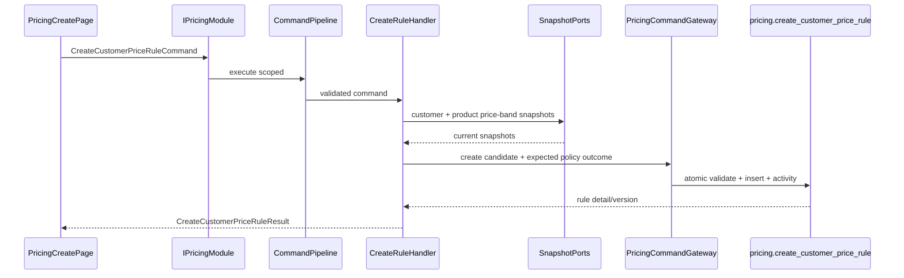
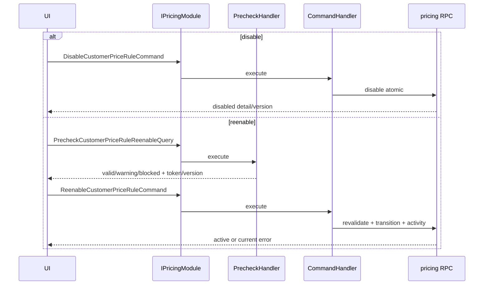
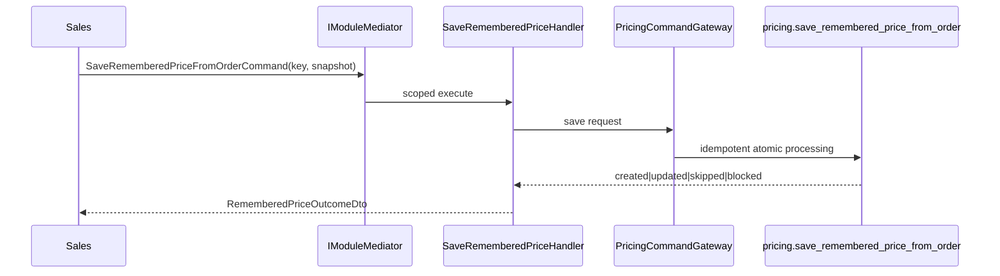

# TH-04 EP02 — Architecture & flows

Target follows CQRS/RPC-first architecture. Module is greenfield; all RPC names below are draft contract targets.

## Required execution path

```text
ERP UI → IExecutionContext → IPricingModule / IModuleMediator
  → ScopedCommandExecutor → CommandBus/QueryBus
  → DefaultCommandPipeline (access → validate → log → handler)
  → application port → infrastructure RPC gateway → pricing.* RPC
```

## S1 — Create manual rule



Snapshot precheck cannot guarantee commit. RPC rechecks tenant/references/duplicate/floor policy in the authoritative transaction.

## S2/S3 — Read list and detail

```text
UI → SearchCustomerPriceRulesQuery | GetCustomerPriceRuleDetailQuery
  → query handler → IPricingReadGateway
  → pricing search/detail RPC or tenant-scoped views
  → DTO with snapshot labels, derived status, available actions
```

Queries receive tenant from execution context, never trust a caller-supplied tenant ID.

## S5 — Update

```text
1. UI loads detail(version=N).
2. Submit mutable fields + expectedVersion=N.
3. Handler validates shape and gets current snapshots.
4. RPC locks/current-checks rule; version mismatch → STATE_CHANGED.
5. RPC rechecks overlap/floor/reference, updates rule + version, appends activity.
```

## S6/S7 — Disable / reenable



## S8 — Excel import

```text
Start command
  → store batch + parse normalized rows
  → resolve customer/product/unit through ports
  → validate and persist preview outcomes

Get query
  → batch summary + paged row previews

Confirm command
  → lock batch
  → for each importable row: re-resolve/revalidate at commit
  → atomic row outcome + rule/activity; update counters
  → completed | completed_with_errors
```

Large-file/background execution is a later implementation choice. Contract states lifecycle and outcomes, not transport/storage technology.

## S9 — Remembered price from Sales



E2E is blocked until Sales publisher/confirmation flow exists. Pricing contract, handler, RPC draft and fake-based tests are not blocked.

## S10 — History

```text
UI → GetCustomerPriceRuleHistoryQuery
  → read gateway → pricing.get_customer_price_rule_history
  → cursor-paged immutable ActivityDto list
```

## Commit points

| Use case | Atomic responsibilities |
| -------- | ----------------------- |
| create/update | tenant/access, reference, duplicate, floor, rule write, activity |
| disable/reenable | version/status, reenable validations, transition, activity |
| import confirm | batch/row idempotency, per-row validation, rule/activity, counters |
| memory save | idempotency payload check, manual protection, rule/request/activity |

## Error mapping

Domain/application errors remain typed codes. Infrastructure maps RPC error payloads; presentation maps them to field/banner/dialog states. Never parse human-readable DB messages to make business decisions.

## SQL discipline

When a BE slice begins, draft only under `supabase/migrations/_drafts/` and list RPC names in [07-api-contracts.md](07-api-contracts.md). A draft is not assumed applied; handler/gateway tests use fakes/in-memory doubles until the environment provides the RPC.

