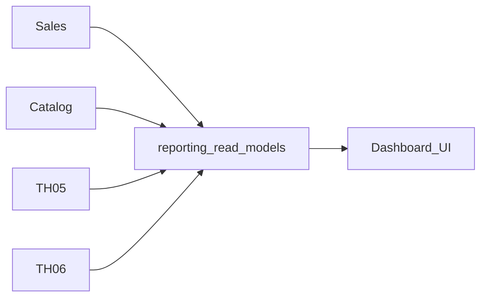

# TH-09 — Module map

| Module | Vai trò | Owner / Supporting | Trạng thái |
| ------ | ------- | ------------------ | ---------- |
| Reporting* | Read models, queries | **Owner** | planned |
| Mọi module nghiệp vụ | Publish events / views | Supporting | — |

Permission: `report.view` (đã seed IAM catalogue).
