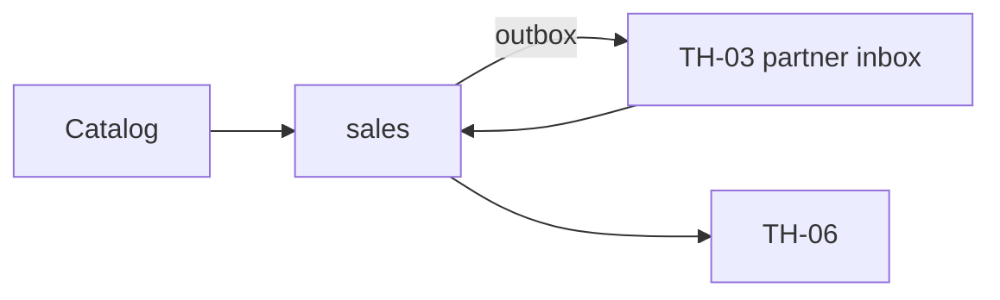

# TH-04 — Module map

| Module | Vai trò | Owner / Supporting | Trạng thái |
| ------ | ------- | ------------------ | ---------- |
| sales | Sales order aggregate | **Owner** | planned (skeleton) |
| catalog | Product/price read | Supporting | planned |
| partner | Customer snapshot | Supporting | in_progress |
| inventory | Stock check/reserve | Supporting | planned |
| iam | Permissions | Supporting | in_progress |

Messaging: mutation RPC enqueue `sales.order.checked_out` (planned) — worker relay → `partner.receive_integration_event`.
