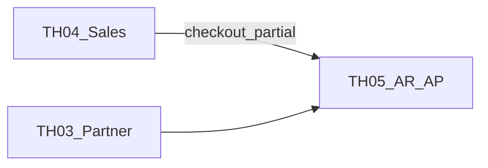

# TH-05 — Module map

| Module | Vai trò | Owner / Supporting | Package | Trạng thái |
| ------ | ------- | ------------------ | ------- | ---------- |
| AccountsReceivable* | Công nợ phải thu | **Owner** (dự kiến) | chưa có | planned |
| AccountsPayable* | Công nợ phải trả | **Owner** (dự kiến) | chưa có | planned |
| Sales | Phát sinh nợ khi checkout | Supporting | `sales/` | in_progress |
| Partner | Đối tượng công nợ | Supporting | `partner/` | planned |
| Payments* | Thu/chi tiền | Supporting | chưa có | planned |

## Events (dự kiến)

- Consume: `SalesOrderCheckedOut` với payment status
- Publish: `ReceivableRecorded`, `PaymentCollected`

* = tên module có thể đổi khi ADR.
