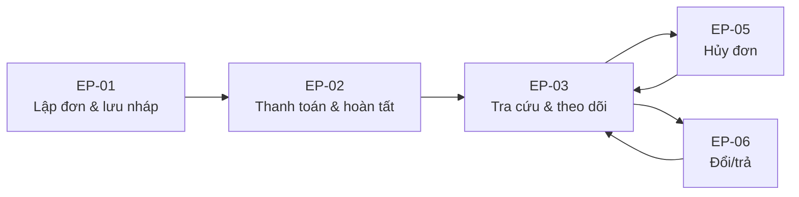

# TH-05 — Tổng quan Đơn hàng

Tài liệu rút gọn để định tuyến agent. Nội dung nghiệp vụ đầy đủ và canonical nằm tại [Theme-5-sales-orders.md](Theme-5-sales-orders.md).

## Purpose

TH-05 là lớp giao dịch trung tâm của Mosaic Retail: lập đơn tại quầy, lưu nháp, checkout, ghi nhận settlement, tạo phiếu bán hàng, tra cứu và xử lý sau bán. Giao dịch phải có lifecycle rõ, commercial snapshot bất biến, audit, idempotency và khả năng recovery khi kết quả downstream chưa chắc chắn.

## Trong phạm vi

- Working state, đơn nháp, chọn khách hàng, sản phẩm, đơn vị và pricing preview.
- Checkout validation, SalesOrder chính thức và commercial snapshot.
- Thanh toán tiền mặt/chuyển khoản, trả thiếu, refund/void và receivable handoff.
- Receipt nội bộ, danh sách, chi tiết, timeline; integration status **deferred stub** (`notRequired`).
- Hủy đơn, đổi/trả và quyết toán chênh lệch. (Điều chỉnh ghi chú sau bán / EP-04: **superseded** — out of scope.)
- Lifecycle outbox facts cho Pricing/Inventory/Receivable/E-invoice/Reporting consumers (reactive — owners consume later).

## Ngoài phạm vi

- Master data Product/ProductUnit/Partner và pricing engine.
- Inventory ledger, receivable ledger, accounting posting và cost layer.
- Phát hành/ký số/điều chỉnh hóa đơn điện tử.
- Payment gateway, bank reconciliation tự động, loyalty và RMA phức tạp.
- Workflow phê duyệt nhiều cấp và báo cáo quản trị chuyên sâu.

## Domain map

| Domain | Type | Ownership |
| --- | --- | --- |
| Sales Order Lifecycle | Core | Working state, draft, checkout attempt, SalesOrder và commercial snapshot |
| Sales Settlement | Supporting | Settlement, payment/refund transaction, outstanding và receivable requirement |
| Post-sale Operations | Supporting | Cancellation, return/exchange và impact intent (adjustment / EP-04 superseded) |
| Sales Order Inquiry & Documents | Read/supporting | List/detail/timeline projections, receipt và distribution activity |

## Cross-theme boundary

| Theme/context | Sở hữu | TH-05 sử dụng |
| --- | --- | --- |
| TH-01 IAM/Store | tenant, store, actor, permission | synchronous execution context và actor/store snapshot |
| TH-02 Catalog | Product, ProductUnit, sellability | live validation và immutable snapshot |
| TH-03 Partner | customer master data | customer reference/snapshot và credit eligibility |
| TH-04 Pricing | pricing/promotion rules | preview, final validation, commit/reverse và snapshot |
| TH-06 Receivable | receivable ledger | lifecycle facts; owner consumes asynchronously |
| TH-07 Inventory | availability, movement, costing | sync precheck ports; durable work via facts |
| TH-08 E-invoice | invoice lifecycle | transaction input và post-sale policy validation |
| TH-10 Reporting | report projections | public integration events, non-blocking |

## Epic flow

EP-04 (ghi chú đơn sau bán) **superseded** — không còn trong flow deliver.

## Invariants xuyên suốt

- `SalesOrder` và `SalesOrderLine` không bị sửa như draft sau checkout.
- Payment, return, order lifecycle, lock và integration status là các dimension độc lập.
- Mutation cross-module chỉ qua public contract/event; không update bảng owner khác.
- Command nhạy cảm bắt buộc idempotent; lifecycle outbox facts cùng transaction với business commit (không Sales-owned impact/command enqueue).
- Money dùng integer minor units; không dùng `double`.

