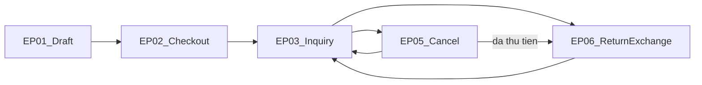
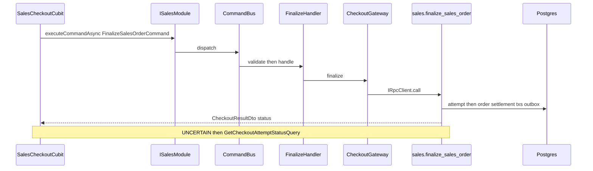
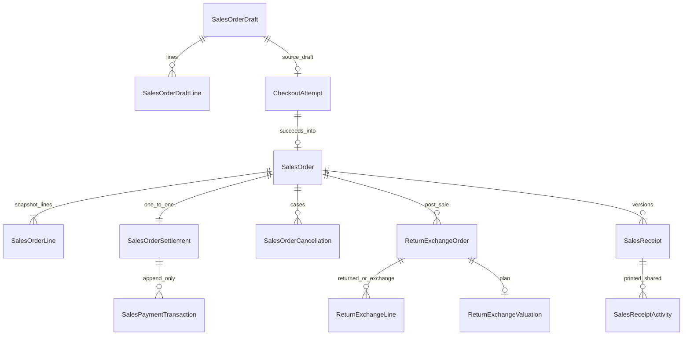
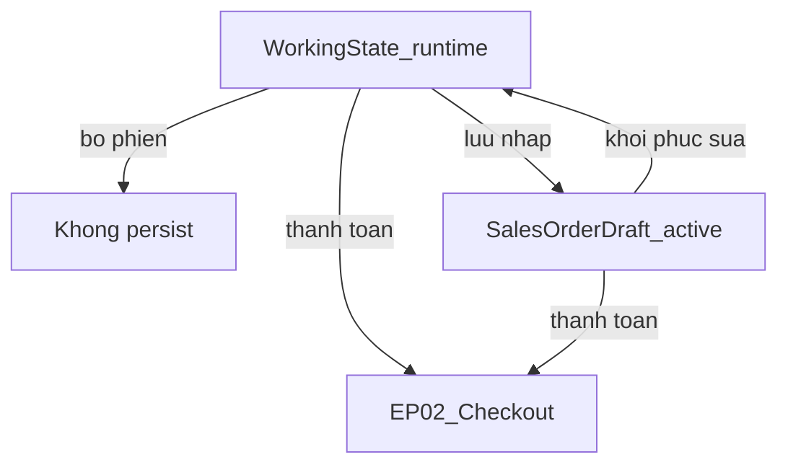
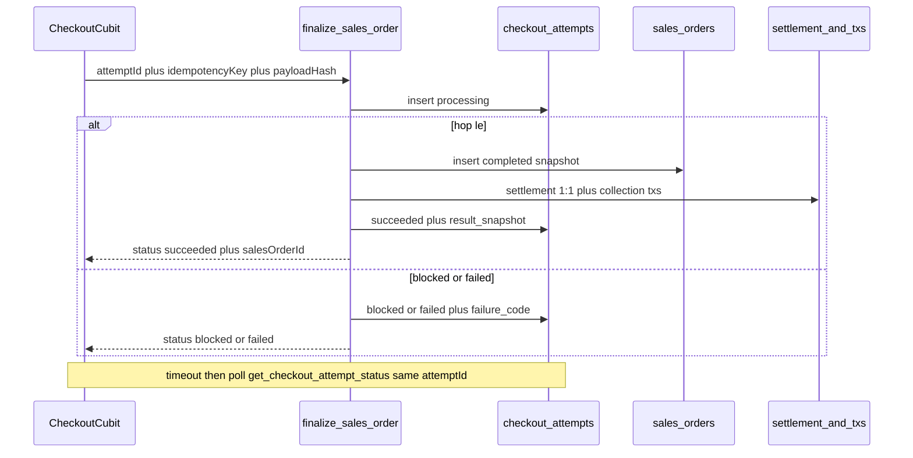
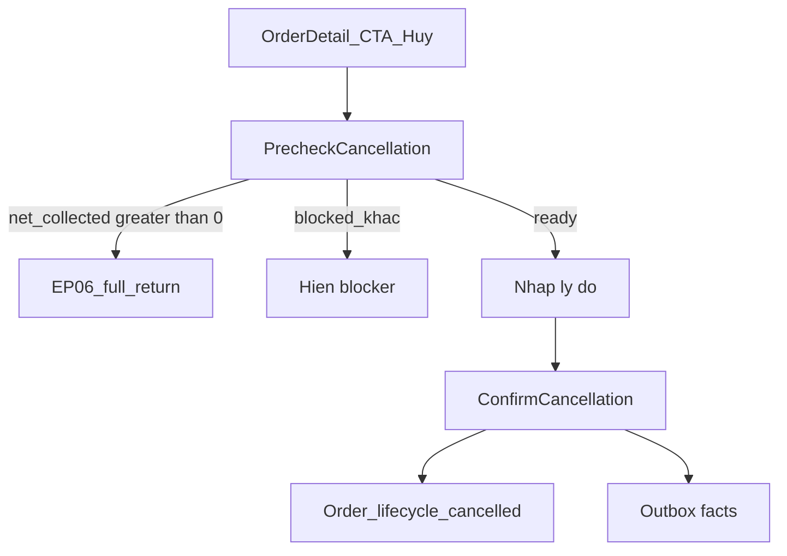
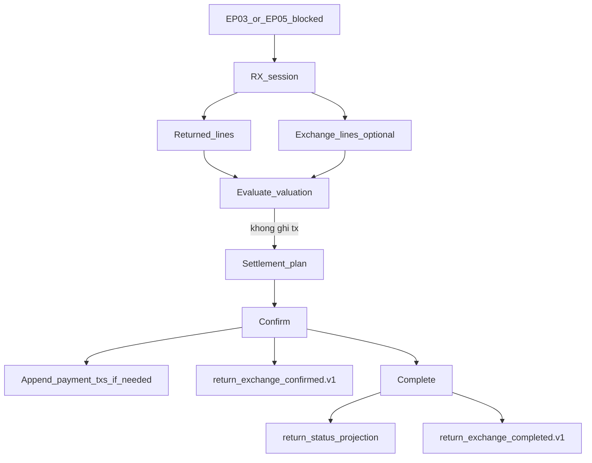

# TH-05 — Luồng nghiệp vụ và kỹ thuật (TEMPORARY)

> **Temporary. Không dùng làm source of truth cho review, harness, hay implement.**
>
> Canonical:
> - [Theme-5-sales-orders.md](Theme-5-sales-orders.md)
> - [harness/01-domain-model.md](harness/01-domain-model.md)
> - [harness/07-api-contracts.md](harness/07-api-contracts.md)
> - [harness/04-slice-roadmap.md](harness/04-slice-roadmap.md)
>
> File này mô tả **implementation hiện hữu** (`modules/sales`, `apps/erp/lib/features/sales`, RPC `sales.*`). README theme có thể còn nói “skeleton / RPC unimplemented” — bỏ qua status đó khi đọc file này.
>
> EP-04 (chỉnh ghi chú sau bán / S22) **superseded / out of scope**.

---

## 1. Bản đồ theme

TH-05 là lớp giao dịch bán tại quầy: lập đơn → checkout → tra cứu → hủy / đổi-trả. `SalesOrder` và commercial snapshot **bất biến** sau checkout. Payment, return, lock, lifecycle, integration là các dimension **tách nhau**.

### Module tham gia

| Module / context | Vai trò |
| --- | --- |
| `sales` | Owner: draft, checkout, order, settlement, cancellation, return/exchange, receipt |
| `iam` | Tenant, store, actor, permission |
| `catalog` | Product / unit / sellability — snapshot lúc checkout |
| `partner` | Customer snapshot / eligibility |
| `pricing` | Preview + final validation |
| TH-06 Receivable | Ledger công nợ — consume Sales **facts** async |
| TH-07 Inventory | Precheck tồn sync; movement durable qua facts |
| TH-08 E-invoice | Policy blocker; không phát hành HĐ trong Sales |

### Invariant

- Money = integer **minor units**. Không dùng `double`.
- Outbox / `integration_events` chỉ mang **fact đã xảy ra**. Không enqueue `*.requested` / apply/retry trên outbox.
- Cross-module không update bảng owner khác.
- Command nhạy cảm bắt buộc idempotency key + payload hash.
- Read model **không** là input authoritative cho mutation.



---

## 2. Xương kỹ thuật

Mọi mutation/query UI đi cùng một pipeline. Không gọi Supabase trực tiếp từ page.

```text
UI cubit
  → ISalesModule (IModuleMediator)
  → ScopedCommandExecutor → CommandBus / QueryBus
  → DefaultCommandPipeline (validate → log → handler)
  → port / gateway
  → IRpcClient.call('sales.<rpc>')
  → Postgres RPC (security definer) ghi bảng + outbox
```

Wiring: [`SalesStartup`](../../../modules/sales/infrastructure/lib/src/configuration/sales_startup.dart) đăng ký `CommandBus`, `QueryBus`, data-access gateways, `SalesMediationModule` (generated handlers), rồi trả `SalesModule`.

Facade:

```dart
abstract interface class ISalesModule implements IModuleMediator {
  static const contractVersion = 'th05-v1';
}
```

Ví dụ checkout — cubit giữ attempt, gọi module, không gọi RPC:

```dart
final result = await salesModule.executeCommandAsync<CheckoutResultDto>(
  envelope.command,
);
```

Nếu mất tín hiệu (`UNCERTAIN_RESULT` hoặc exception không phân loại), cubit **không** tạo command mới — poll `GetCheckoutAttemptStatusQuery` bằng cùng `checkoutAttemptId`.



### Aggregate ↔ bảng

| Aggregate | Folder domain | Bảng |
| --- | --- | --- |
| `SalesOrderDraft` | `domain/.../sales_order_draft/` | `sales.sales_order_drafts`, `sales_order_draft_lines` |
| CheckoutAttempt (process, không phải aggregate) | — | `sales.checkout_attempts` |
| `SalesOrder` | `domain/.../sales_order/` | `sales.sales_orders`, `sales_order_lines` |
| `SalesOrderSettlement` | `domain/.../sales_order_settlement/` | `sales.sales_order_settlements`, `sales_payment_transactions` |
| `SalesOrderCancellation` | `domain/.../sales_order_cancellation/` | `sales.sales_order_cancellations` |
| `ReturnExchangeOrder` | `domain/.../return_exchange_order/` | `return_exchange_orders`, `return_exchange_lines`, `return_exchange_valuations` |
| `SalesReceipt` | `domain/.../sales_receipt/` | `sales.sales_receipts`, `sales_receipt_activities` |

Kỹ thuật đi kèm: `sales.idempotency_records`, `sales.sales_order_number_counters`, `sales.outbox_messages`.

### Command / query (application)

| Aggregate | Commands | Queries |
| --- | --- | --- |
| Draft | `Save` / `Update` / `Cancel` sales order draft | `ListSalesOrderDrafts`, `GetSalesOrderDraftForRestore` |
| Order / checkout | `FinalizeSalesOrder`, `CancelSalesOrder` | `PrecheckSalesOrderCheckout`, `GetCheckoutAttemptStatus`, `GetSalesOrder`, list/search, detail, timeline, `GetAvailablePostSaleActions` |
| Settlement | `InitializeSalesOrderSettlement`, `RecordSalesPayment`, `RecordSalesRefund` | `GetSalesOrderSettlement`, `GetSalesOrderPaymentSummary`, `GetSalesOrderPaymentTransactions` |
| Receipt | `GenerateSalesReceipt`, printed / shared / archive | `GetSalesReceipt` |
| Cancellation | `ConfirmSalesOrderCancellation` | precheck, get, list reasons |
| Return/exchange | start / update / cancel / confirm / complete | precheck, returnable lines, detail, form policy, evaluate pricing, return summary |

RPC public tương ứng nằm trong migrations `20260827`/`20260830` `005`–`014` (cùng bộ, bản `20260830` mới hơn). Helper nội bộ (`_begin_sales_idempotency`, `_recompute_sales_settlement`, …) không grant cho `authenticated`.

---

## 3. ER và ownership

`SalesOrderWorkingState` **không persist**. Bỏ phiên = không tạo business record.



Ownership:

| Domain | Sở hữu | Không sở hữu |
| --- | --- | --- |
| Sales Order Lifecycle | draft, checkout attempt, order, commercial snapshot | pricing engine, inventory ledger, receivable ledger |
| Sales Settlement | settlement summary, payment/refund/void txs, outstanding | sổ kế toán |
| Post-sale | cancellation case, return/exchange | snapshot gốc, ledger owner |
| Inquiry & documents | receipt, list/detail/timeline projections | authoritative mutation |

Quy ước:

- `checkout_attempts` **không phải chứng từ bán**. Một attempt tạo **tối đa một** `sales_orders` (`checkout_attempt_id` unique).
- Settlement **1:1** với order.
- Transaction **append-only**. Không sửa/xóa payment gốc. Void/refund = dòng mới.
- Không có bảng `sales_order_transaction`. Tên thật: `sales.sales_payment_transactions`.

---

## 4. EP-01 — Lập đơn và lưu nháp

### Nghiệp vụ

1. Mở đơn mới → working state (tenant / store / actor).
2. Mặc định khách lẻ, hoặc chọn / tạo nhanh Partner.
3. Tìm / quét sản phẩm, chọn đơn vị, số lượng.
4. Pricing preview (TH-04). Preview **không** phải giá chính thức.
5. (Tuỳ chọn) nhớ giá / giá riêng — owner là Pricing, không phải Sales.
6. **Lưu nháp** → `SalesOrderDraft(active)` **hoặc** **Thanh toán** → EP-02.
7. Sau này: mở draft → sửa → lưu lại / checkout.

Blocker / rule:

- Working state không auto-persist.
- Draft cần ≥ 1 dòng hợp lệ. Draft terminal (`converted` / `cancelled` / `expired`) không được sửa.
- Save draft **không** tạo `SalesOrder`, payment, inventory, receipt.
- Đổi cửa hàng khi đã có data: lưu draft hoặc xác nhận discard.

### Commit

| Hành động | Persist |
| --- | --- |
| Bỏ phiên | Không |
| Save / update draft | `sales_order_drafts` + `sales_order_draft_lines` (+ `preview_snapshot` tham khảo) |
| Cancel draft | status terminal |

### Kỹ thuật

| UI | Command / query | RPC |
| --- | --- | --- |
| `SalesComposeCubit` / `sales_order_compose_page` | save / update draft | `sales.save_sales_order_draft`, `sales.update_sales_order_draft` |
| `SalesDraftListCubit` / `sales_draft_list_page` | list / restore / cancel | `list_sales_order_drafts`, `get_sales_order_draft_for_restore`, `cancel_sales_order_draft` |

Update dùng `expected version`. Stale → `STALE_VERSION`.



---

## 5. EP-02 — Thanh toán và hoàn tất

Đây là **commit point** tạo chứng từ bán.

### Nghiệp vụ

1. Vào Thanh toán từ working state hoặc draft.
2. Xem tổng phải trả và payment status dự kiến.
3. Nhập payment intent: tiền mặt / chuyển khoản thủ công (amount > 0, tổng ≤ phải trả).
4. Nếu còn thiếu: customer **định danh** + ngày hẹn. Khách lẻ không được để outstanding.
5. `PrecheckSalesOrderCheckout` — advisory (ready / warning / blocked).
6. Xử lý blocker (giá đổi, sản phẩm không bán, tồn, thiếu buyer, thiếu due date).
7. Xác nhận → `FinalizeSalesOrder` (idempotent, một `CheckoutAttempt`).
8. Thành công: order + lines + snapshot + settlement + txs + fact `sales_order_finalized.v1`. Draft nguồn → `converted`.
9. Màn kết quả → xem / in / share receipt (receipt có thể sau commit).

Downstream pending **không** rollback order đã `succeeded`. Sales không chờ Receivable/Inventory accept.

### Kỹ thuật — hai lớp chống trùng

| | `idempotency_records` | `checkout_attempts` |
| --- | --- | --- |
| Vai trò | Cổng chống trùng generic | Nhật ký **một lần bấm Thanh toán** |
| Client hỏi | Không | `get_checkout_attempt_status` |
| Liên kết đơn | `result_id` kỹ thuật | FK 1:1 khi succeeded |

RPC `sales.finalize_sales_order` insert attempt **trước** khi ghi order:

```sql
-- Persist recoverable attempt BEFORE business writes.
insert into sales.checkout_attempts(
  id, tenant_id, source_draft_id, store_id, requested_by_user_id,
  idempotency_key, payload_hash, request_snapshot, status, correlation_id, received_at
) values (
  p_command_id, ..., 'processing', ...
);
```

Sau đó (cùng transaction): lock draft nếu có → validate lines/snapshot/payments → insert `sales_orders` + lines → settlement → payment txs `source_context = 'checkout'` → outbox `sales_order_finalized.v1` → convert draft → attempt `succeeded`.

Client factory: [`sales_checkout_attempt_factory.dart`](../../../apps/erp/lib/features/sales/presentation/support/sales_checkout_attempt_factory.dart) tạo `attemptId` = command id, `idempotencyKey = checkout:<attemptId>`, hash payload.



Status attempt: `received` / `validating` / `processing` / `succeeded` / `blocked` / `failed` / `uncertain`. RPC hiện insert thẳng `processing`. `uncertain` là trạng thái recovery phía client khi response không về — **cấm** submit key mới.

Stable errors thường gặp: `CHECKOUT_BLOCKED`, `STALE_VERSION`, `IDEMPOTENCY_CONFLICT`, `OVERPAYMENT` (paid > total), `RECEIVABLE_DUE_DATE_REQUIRED`, `UNCERTAIN_RESULT`.

UI: `SalesCheckoutCubit` + `sales_checkout_page` → `SalesTransactionResultCubit` / `sales_transaction_result_page`.

---

## 6. Settlement và payment transaction

Aggregate `SalesOrderSettlement` tách khỏi lifecycle đơn. Payment status không gộp vào `lifecycle_status`.

### Cột settlement

| Cột | Ý nghĩa |
| --- | --- |
| `original_payable_amount_minor` | Phải thu lúc checkout |
| `post_sale_adjustment_amount_minor` | Có cột + constraint; checkout luôn ghi `0`. Chưa có RPC cập nhật (EP-04 superseded) |
| `current_payable_amount_minor` | `original + post_sale_adjustment` |
| `collected_amount_minor` | Σ inflow `confirmed` |
| `refunded_amount_minor` | Σ outflow `confirmed` |
| `net_collected_amount_minor` | `collected − refunded` |
| `outstanding_amount_minor` | `max(current_payable − net, 0)` |
| `payment_status` | `unpaid` / `partially_paid` / `paid` / `partially_refunded` / `refunded` |

Transaction:

- `transaction_type`: `collection` | `refund` | `reversal`
- `direction`: `inflow` | `outflow`
- `status`: `pending` | `confirmed` | `failed` | `voided`
- `source_context`: `checkout` | `additional_collection` | `receivable_collection` | `return_exchange` | `cancellation` | `manual_correction`
- `related_transaction_id` khi refund/void
- `idempotency_key` unique theo tenant

### Pattern mutation

1. `SELECT settlement FOR UPDATE`
2. `INSERT` transaction mới
3. `sales._recompute_sales_settlement`
4. Publish fact (+ `sales_settlement_changed.v1`)

Recompute (SQL) cộng theo **direction**, không theo type:

```text
collected = sum(inflow confirmed)
refunded  = sum(outflow confirmed)
net       = collected - refunded
outstanding = max(current_payable - net, 0)
version++
```

Khi nào tạo:

| Thời điểm | Việc |
| --- | --- |
| Finalize checkout | Tạo settlement + collection txs ban đầu |
| `record_sales_payment` | Append collection; không vượt outstanding |
| `record_sales_refund` | Append refund; không vượt `net_collected` |
| `void_sales_payment` | Append reversal chiều ngược; **không rewrite** số tiền gốc |
| `settle_return_exchange_difference` | Append collection/refund `source_context = return_exchange` |

### Domain Dart vs SQL void

Domain [`SalesOrderSettlement.voidPayment`](../../../modules/sales/domain/lib/src/sales_order_settlement/sales_order_settlement.dart) đánh `voided` trên dòng gốc rồi thêm `voidMarker`. SQL **không** đổi status gốc — chỉ thêm `reversal` confirmed. Defense-in-depth nằm ở SQL.

Hệ quả: void collection full-paid trên DB có thể ra `payment_status = refunded` (inflow + outflow cùng số). Dart in-memory sau void ra `unpaid` vì collection gốc không còn counted.

Calculator Dart ([`SettlementSummaryCalculator`](../../../modules/sales/domain/lib/src/shared/settlement_summary_calculator.dart)) cộng collection/refund **confirmed**, không cộng `voidMarker`.

Rule:

- Amount > 0.
- Walk-in / thiếu customer không được để outstanding.
- Refund không vượt số đã thu confirmed.

Đọc UI: `GetSalesOrderSettlementQuery` / `GetSalesOrderPaymentSummaryQuery` / `GetSalesOrderPaymentTransactionsQuery` — không load aggregate.

---

## 7. EP-03 — Tra cứu và theo dõi

### Nghiệp vụ

1. Danh sách `SalesOrder` (không list working state, draft, attempt chưa tạo đơn).
2. Search / filter (mã, khách, thời gian, lifecycle, payment, return).
3. Chi tiết: snapshot gốc, lines, totals.
4. Settlement / transactions / outstanding.
5. Timeline sau bán.
6. Xem lại / in / share receipt.
7. Integration status hiện **stub** `notRequired` (S20 deferred — chờ TH-06/07/08).
8. CTA **Hủy** → EP-05 hoặc **Đổi/trả** → EP-06. Hiển thị CTA ≠ đủ điều kiện; epic đích precheck lại.
9. Không còn action chỉnh ghi chú (EP-04).

Read-only đối với order/settlement. Print/share chỉ append `sales_receipt_activities`.

### Kỹ thuật

| UI | Query / command | RPC |
| --- | --- | --- |
| `SalesOrderListCubit` | `ListSalesOrders` / `SearchSalesOrders` | `list_sales_orders`, `search_sales_orders` |
| `SalesOrderDetailCubit` | detail, payment summary, timeline, available actions | `get_sales_order_detail`, `get_sales_order_payment_summary`, `get_sales_order_timeline`, `get_available_post_sale_actions` |
| Slip / receipt preview | `GetSalesReceipt` / `GenerateSalesReceipt` | `get_sales_receipt`, `generate_sales_receipt`, `record_sales_receipt_activity` |

Receipt sinh từ snapshot đã commit, không từ working state. Status receipt: `generated` / `superseded` / `archived`.

---

## 8. EP-05 — Hủy đơn sau bán

### Nghiệp vụ

Hủy **toàn bộ** đơn **chưa có tiền thực thu ròng** (`net_confirmed_collection = 0`). Đã thu tiền → **không** hủy kiêm hoàn — chuyển EP-06 (trả và hoàn).

1. Từ EP-03 chọn Hủy.
2. `PrecheckSalesOrderCancellation` (order version, settlement version, lock, return, e-invoice policy).
3. Nếu `net_confirmed_collection > 0` → blocker + CTA full return EP-06. Dừng.
4. Nếu ready: nhập lý do.
5. Confirm idempotent → `SalesOrderCancellation` confirmed.
6. Nội bộ chuyển order lifecycle `cancelled`. Snapshot / lines / payment history **không** bị ghi đè hay xóa.
7. Facts cho owner consume (inventory reverse, receivable, pricing, reporting).
8. Chi tiết đơn: `cancelled`. Không mở cancel/return mới.

Hard blocks:

- Chỉ order `completed`. Đã `cancelled` → không tạo case mới.
- Return `confirmed` / `processing` / `completed` chặn hủy. Draft return phải hủy trước.
- Version order/settlement conflict → `STALE_VERSION`.

### Kỹ thuật

| UI | Symbol | RPC |
| --- | --- | --- |
| Cancel flow từ detail | `PrecheckSalesOrderCancellationQuery` | `precheck_sales_order_cancellation` |
| | `ListSalesOrderCancellationReasonsQuery` | `list_sales_order_cancellation_reasons` |
| | `ConfirmSalesOrderCancellationCommand` | `confirm_sales_order_cancellation` |
| Kết quả | `GetSalesOrderCancellationQuery` | `get_sales_order_cancellation` |

Confirm (migration `20260904001`) cùng transaction:

- Ghi case cancellation.
- Order → `lifecycle_status = cancelled`.
- Outbox: `sales_order_cancellation_confirmed.v1`, `sales_order_cancelled.v1`, `sales_reporting_cancellation_recorded.v1`.
- **Không** insert `sales_payment_transactions` refund.



---

## 9. EP-06 — Đổi / trả và quyết toán chênh lệch

### Nghiệp vụ

Từ đơn gốc `completed`: ghi nhận hàng trả (và tuỳ chọn hàng đổi), định giá, thu thêm / hoàn / cấn trừ công nợ. **Không** bán mới chỉ bằng dòng exchange. Order gốc **vẫn `completed`** kể cả full return. `fully_returned` ≠ `cancelled` — không emit `SalesOrderCancelled`.

1. Mở từ EP-03 (`standard`) hoặc từ EP-05 blocked (`full_return_from_cancel_attempt`).
2. Precheck + returnable quantities (SL còn trả, trừ return đã confirm/processing).
3. Chọn hàng trả — tham chiếu line gốc hoặc exchange line đã confirm (ADR-9 XOR).
4. (Tuỳ chọn) hàng đổi — product/unit/giá/tồn **hiện hành**, không dùng giá snapshot gốc.
5. Valuation: `net_difference = exchange_value − return_value`.
6. Plan: `collect` / `refund` / `receivable_offset` / `mixed` / `none`.
7. Evaluate **không** ghi payment.
8. Confirm → order return/exchange confirmed + txs settlement nếu có chênh lệch.
9. Complete → status `completed` + projection `return_status` (`none` / `partially_returned` / `fully_returned`).
10. Không sửa `sales_order_lines` gốc.

Phase 1: phiên user = working state. Technical draft chỉ recovery trong phiên — không có “danh sách phiếu nháp” như EP-01.

Blocker:

- Order `cancelled` hoặc cancellation confirmed/processing/completed = hard block.
- ≥ 1 dòng `returned`. SL ≤ remaining returnable.
- Khách lẻ: không tạo / đảo receivable.
- Collect/refund không vượt capacity plan và `net_confirmed_collection` (refund).

### Kỹ thuật

| UI | Symbol | RPC |
| --- | --- | --- |
| `SalesReturnExchangeSessionCubit` | start / update / cancel | `start_return_exchange`, `update_return_exchange`, `cancel_return_exchange` |
| | form policy, returnable, detail | `get_return_exchange_form_policy`, `get_returnable_order_lines`, `get_return_exchange_detail` |
| Valuation | `EvaluateReturnPricingImpactQuery` | `evaluate_return_exchange_valuation` |
| `SalesReturnExchangeSettlementCubit` | record payment/refund qua settlement gateway | `settle_return_exchange_difference` |
| Confirm / complete | `ConfirmReturnExchangeCommand` / `CompleteReturnExchangeCommand` | `confirm_return_exchange`, `complete_return_exchange` |

Transaction đổi/trả: `source_context = 'return_exchange'`, `source_type = return_exchange_order`, code `RXC-` / `RXR-`, rồi `_recompute_sales_settlement`.

Facts: `return_exchange_confirmed.v1`, `return_exchange_completed.v1`.

Sign convention (binding):

```text
net_difference_minor = exchange_value_minor - return_value_minor
  > 0  → khach tra them / receivable create
  < 0  → hoan tien / receivable reverse
  = 0  → can bang, khong ghi tx tien
```



Cancel phiên (`CancelReturnExchangeCommand`) bỏ session / technical draft — **không** đụng order gốc hay settlement.

---

## 10. Integration — facts only

Sales publish lifecycle facts trên `sales.outbox_messages` **cùng transaction** business commit. Không chờ owner accept. Không Sales-owned `*_impact_requests` / `integration_commands` trên path hiện tại (Model B deferred — artifact cũ không copy).

Facts đang publish:

| Fact | Khi |
| --- | --- |
| `sales_order_finalized.v1` | Checkout succeeded |
| `sales_payment_recorded.v1` | Collection append |
| `sales_refund_recorded.v1` | Refund append |
| `sales_payment_voided.v1` | Reversal append |
| `sales_settlement_changed.v1` | Sau payment/refund/void |
| `sales_order_cancellation_confirmed.v1` | Confirm hủy |
| `sales_order_cancelled.v1` | Order lifecycle cancelled |
| `sales_reporting_cancellation_recorded.v1` | Reporting projection |
| `return_exchange_confirmed.v1` | Confirm đổi/trả |
| `return_exchange_completed.v1` | Complete đổi/trả |

Package `modules/sales/integration_events` hiện là stub barrel — chưa có Dart IE class. Tên fact nằm trong RPC SQL.

Consumer tương lai: owner module `IIntegrationEventNotificationHandler` → internal command → ledger. Failure downstream không rollback Sales.

`GetOrderIntegrationStatus` trả `notRequired` cho đến khi có thin projection từ TH-06/07/08.

---

## 11. Map UI ↔ epic

Presentation thuộc app, không nằm trong `modules/sales/presentation`. Typed routes: `apps/erp/lib/features/sales/presentation/navigation/`.

| Epic | Cubit | Page |
| --- | --- | --- |
| EP-01 | `SalesComposeCubit`, `SalesDraftListCubit`, `SalesCustomerPickerCubit` | `sales_order_compose_page`, `sales_draft_list_page` |
| EP-02 | `SalesCheckoutCubit`, `SalesTransactionResultCubit` | `sales_checkout_page`, `sales_transaction_result_page` |
| EP-02/03 receipt | (detail / result) | `sales_receipt_preview_page`, `sales_order_slip_preview_page`, `sales_slip_preview_page` |
| EP-03 | `SalesOrderListCubit`, `SalesOrderDetailCubit` | `sales_order_list_page`, `sales_order_detail_page` |
| EP-05 | từ detail (cancel flow) | entry từ `sales_order_detail_page` |
| EP-06 | `SalesReturnExchangeSessionCubit`, `SalesReturnExchangeSettlementCubit`, `SalesReturnExchangeDetailCubit` | `sales_return_exchange_create_page`, `sales_return_exchange_settlement_page`, `sales_return_exchange_detail_page`, `sales_return_exchange_result_page` |

---

## 12. Phụ lục

### Không nhầm bảng

| Tên đúng | Không phải |
| --- | --- |
| `sales.sales_order_settlements` | `sales_order_settlement` (thiếu `s`, schema `sales`) |
| `sales.sales_payment_transactions` | `sales_order_transaction` / `sales_order_transactions` |
| `sales.checkout_attempts` | `checkout_attempt` — process record, không phải chứng từ |
| `sales.idempotency_records` | không thay attempt; generic replay gate |

### Permission codes (`SalesPermissions`)

- Draft: `sales.draft.create` / `.update` / `.delete` / `.restore`
- Checkout: `sales.checkout.create`
- Order: `sales.order.view` / `.history.view` / `.lock` / `.unlock` / `.cancel`
- Payment: `sales.payment.view` / `.record` / `.void` / `.refund` ; `sales.settlement.reconcile`
- Receipt: `sales.receipt.view` / `.generate` / `.print` / `.share` / `.archive`
- Return: `sales.return_exchange.create` / `.update` / `.cancel` / `.confirm` / `.complete` / `.view`

### Stable errors (nhánh UI hay gặp)

`PERMISSION_DENIED`, `DATA_SCOPE_DENIED`, `CONTEXT_INVALID`, `STALE_VERSION`, `IDEMPOTENCY_CONFLICT`, `CHECKOUT_BLOCKED`, `CHECKOUT_ATTEMPT_NOT_FOUND`, `UNCERTAIN_RESULT`, `OVERPAYMENT_NOT_ALLOWED`, `REFUND_EXCEEDS_COLLECTED`, `ALREADY_VOIDED`, `RECEIVABLE_DUE_DATE_REQUIRED`, `RETURN_EXCHANGE_BLOCKED`, `CANCELLATION_BLOCKED`.

Branch theo `code`, không theo `message`.

### State dimensions — không gộp

| Dimension | Owner |
| --- | --- |
| Order lifecycle (`completed` / `cancelled`) | `sales_orders.lifecycle_status` |
| Lock | `sales_orders.lock_status` |
| Payment | `sales_order_settlements.payment_status` |
| Return | `sales_order_return_status_projections.return_status` |
| Integration | stub `notRequired` — không phải cột order |

### RPC surface (public) theo concern

- Draft: `save|update|cancel_sales_order_draft`, `list_sales_order_drafts`, `get_sales_order_draft_for_restore`
- Checkout: `precheck_sales_order_checkout`, `finalize_sales_order`, `get_checkout_attempt_status`
- Settlement: `record_sales_payment`, `record_sales_refund`, `void_sales_payment`
- Inquiry / receipt: `list|search_sales_orders`, `get_sales_order`, `get_sales_order_detail`, `get_sales_order_timeline`, `get_sales_order_settlement`, `get_sales_order_payment_summary`, `get_sales_order_payment_transactions`, `get_sales_order_return_summary`, `get_order_integration_status`, `generate_sales_receipt`, `get_sales_receipt`, `record_sales_receipt_activity`
- Post-sale entry / cancel: `get_available_post_sale_actions`, `precheck_sales_order_cancellation`, `confirm_sales_order_cancellation`, `get_sales_order_cancellation`, `list_sales_order_cancellation_reasons`
- Return/exchange: `precheck_return_exchange`, `start|update|cancel_return_exchange`, `get_returnable_order_lines`, `get_return_exchange_detail`, `get_return_exchange_form_policy`, `evaluate_return_exchange_valuation`, `settle_return_exchange_difference`, `confirm_return_exchange`, `complete_return_exchange`

Schema bootstrap: [`supabase/migrations/20260827005_sales_rebuild_schema.sql`](../../../supabase/migrations/20260827005_sales_rebuild_schema.sql) (và bản `20260830005`).
