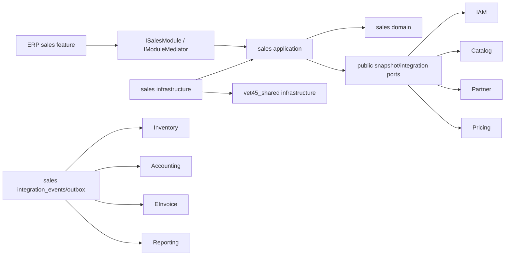

# TH-05 — Module map

## Module ownership

| Module/context | Vai trò | Owner/supporting | Repo state |
| --- | --- | --- | --- |
| `sales` | 4 Sales domains, CQRS facade, snapshots, outbox/impact records | **Owner V1** | skeleton |
| `iam` | execution context, tenant/store/actor, RBAC | Supporting | golden |
| `catalog` | Product/ProductUnit/sellability snapshot | Supporting | implementation hiện hữu |
| `partner` | customer snapshot, quick-create public contract | Supporting | implementation hiện hữu |
| `pricing` | preview/final pricing, promotion, remembered price | Supporting | implementation hiện hữu |
| `accounting` | TH-06 receivable ledger | Supporting/external owner | skeleton |
| `inventory` | TH-07 availability/movement/costing | Supporting/external owner | skeleton |
| E-invoice | TH-08 invoice lifecycle | Planned external owner | chưa có module |
| Reporting | TH-10 projections | Planned consumer | `dashboard` không phải sales owner |

V1 không tạo thêm module settlement/returns. Ranh giới aggregate trong [01-domain-model.md](01-domain-model.md) vẫn bắt buộc.

## Dependency direction



- Application không import infrastructure.
- Sales không import domain/repository nội bộ module khác.
- Cross-module synchronous call dùng application/public facade hoặc port adapter.
- Durable cross-module mutation dùng integration event/command qua outbox/inbox.

## Target package layout

```text
modules/sales/
  domain/               aggregates, rules, policies, domain events
  application/          commands, queries, DTOs, ports, ISalesModule
  infrastructure/       gateways, RPC mappers, startup/codegen wiring
  integration_events/   public versioned event contracts
  presentation/         reusable cubits/widgets/dialogs

apps/erp/lib/features/sales/
  presentation/pages/   thin route composition
  presentation/widgets/ ERP-shell-only widgets
```

Golden wiring: `modules/iam/`. `modules/sales/` hiện tại không phải reference.

## Public synchronous contracts

| Provider | Sales consumes |
| --- | --- |
| IAM | `IExecutionContext`, membership/permission/data-scope decision |
| Catalog | product/unit snapshot, barcode lookup, sellability |
| Partner | customer snapshot, eligibility, quick-create handoff |
| Pricing | preview, final validation, commit/reverse, return impact, remembered price |
| Inventory | conditional availability/reservation decision |
| E-invoice | post-sale legal-policy validation |

Không query-time fan-out cho order list/detail; inquiry đọc projection thuộc Sales.

## Durable contracts

| Owner | Sales issues/publishes | Consistency |
| --- | --- | --- |
| Inventory | sale commit/reversal, returned inventory, exchange impact | conditional blocking for no-negative-stock; durable otherwise |
| Accounting/Receivable | post/adjust/reverse/offset/reconcile | eligibility blocking; ledger posting eventual |
| E-invoice | issue/adjust/replace/cancel request | eventual; policy precheck blocking |
| Reporting | versioned Sales events | eventual, non-blocking |
| Partner | sales finalized/history event | eventual |

## Permissions

Future constants live in `SalesPermissions` under `modules/sales/domain/`; application annotations never hardcode strings.

| Group | Codes từ canonical |
| --- | --- |
| Draft/checkout | `sales.draft.create`, `.update`, `.delete`, `.restore`; `sales.checkout.create` |
| Order/inquiry | `sales.order.view`, `.history.view`, `.lock`, `.unlock`; `sales.integration.view_sync_status` |
| Payment | `sales.payment.view`, `.record`, `.void`, `.refund`; `sales.settlement.reconcile` |
| Cancellation | `sales.order.cancel` |
| Return/exchange | `sales.return_exchange.create`, `.update`, `.confirm`, `.complete`, `.cancel`, `.view` — Phase 1 không expose user draft list/restore |
| Receipt | `sales.receipt.view`, `.generate`, `.print`, `.share`, `.archive` |

Exact constant catalog freeze cùng contract slice.

## Hard boundaries

- Sales owns transaction snapshot, không sở hữu Product/Partner/Pricing master data.
- Sales Settlement không đồng nghĩa bank/payment gateway hoặc receivable ledger.
- Post-sale aggregate không sửa SalesOrder/SalesOrderLine trực tiếp.
- Receipt không phải E-invoice và không là source để tính lại doanh thu/kho/công nợ.
- Reporting/read models không được làm authoritative write input.
- Planned context không được giả định đã có module/package/RPC.

