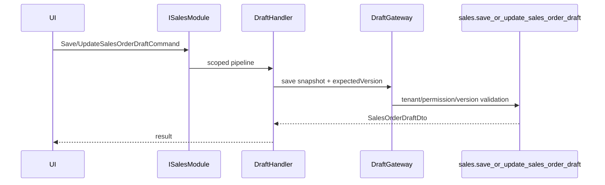
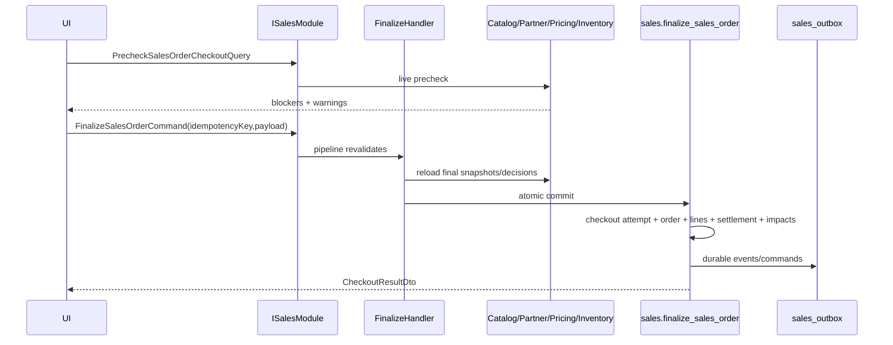
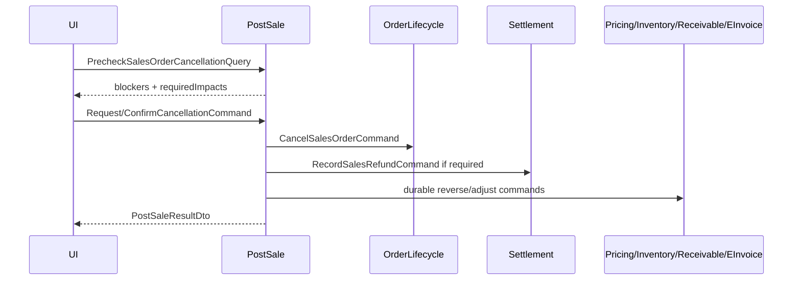

# TH-05 — Architecture & flows

Tuân theo [Mosaic Retail architecture](../../../architecture/README.md) và [01-domain-model.md](01-domain-model.md). RPC names ở đây là target catalog, chưa phải schema đã apply.

## Required execution path

```text
UI → IExecutionContext → ISalesModule/IModuleMediator
  → ScopedCommandExecutor → CommandBus/QueryBus
  → DefaultCommandPipeline (permission → validate → log → handler)
  → application port/gateway → sales.* RPC
```

Write RPC thực hiện auth/tenant/version/idempotency defense-in-depth; UI không ghi PostgREST trực tiếp.

## S01 — Runtime working state

```text
ERP route + IExecutionContext
  → validate tenant/store/actor/shift context
  → create SalesOrderWorkingState in presentation/application runtime
  → no RPC, no draft/order/payment/impact/outbox record
```

Rời working state có dữ liệu: save draft hoặc explicit discard. S01 không có persisted command.

## EP-01 — Save/restore draft



Restore đọc draft rồi revalidate live Product/Partner/Pricing; không âm thầm rewrite persisted snapshot.

## EP-02 — Checkout commit và uncertain recovery



Success boundary:

- Order/lines/commercial snapshot committed.
- Initial settlement/payment records committed.
- Required impact/outbox records durably stored.
- Retry same key+payload returns same result; same key+different payload returns conflict.

Timeout/uncertain: UI gọi `GetCheckoutResultQuery(storeId, idempotencyKey)` qua `sales.get_checkout_result`, không tự gửi key mới. Không tìm thấy record chưa chứng minh checkout thất bại: transaction có thể chưa commit. Poll có giới hạn; retry giữ nguyên key/payload. Precheck bị chặn trước finalize được hiển thị trực tiếp, không tra cứu DB. Không persist bảng attempt.

## Sales Settlement

```text
RecordSalesPaymentCommand / RecordSalesRefundCommand
  → load settlement + source transaction
  → validate amount/refundable/idempotency
  → append SalesPaymentTransaction
  → recompute SettlementSummary
  → create/adjust/clear ReceivableImpactRequest when required
  → outbox same transaction
```

Không update/xóa payment transaction gốc. Payment status tính từ authoritative transactions.

## EP-03 — Inquiry

```text
UI → List/Search/Get*Query
  → QueryBus → ISalesReadGateway
  → sales-owned list/detail/timeline/payment/return/integration views
  → DTO + availableActions
```

Read model eventual nhưng không query-time fan-out sang bảng module khác và không dùng làm authoritative mutation input.

## EP-04 — Order note adjustment (Phase 1) — **superseded**

> Out of scope. Implementation removed. Historical flow (do not deliver):

```text
~~PrecheckOrderAdjustmentQuery~~ → ~~ApplyOrderAdjustmentCommand~~ → ~~OrderAdjustment~~ / timeline
```

Không còn trong post-sale entry (chỉ EP-05 hủy + EP-06 đổi/trả).

## EP-05 — Cancellation



Confirmed/processing/completed return-exchange là hard blocker. Cancellation không hard-delete order.

## EP-06 — Return/exchange

```text
StartReturnExchangeCommand(sourceOrderId)
  → original snapshot + returnable lines; mở session working state
  → technical draft chỉ recovery trong phiên (không user draft list)
Session navigation SG-10 ↔ SG-11
  → giữ working state; discard confirmation “Bỏ thay đổi?”
CancelReturnExchangeCommand / discard
  → xóa working state; cancel technical draft; release reservation
ConfirmReturnExchangeCommand(idempotencyKey)
  → revalidate + valuation + durable inventory/receivable/e-invoice impacts
  → Settlement owner records collection/refund
CompleteReturnExchangeCommand
  → terminal result + projection/event
```

Phase 1 **không** có CTA “Lưu và đóng”, danh sách phiếu nháp, hay entry point restore draft do user quản lý.

Cancellation confirmed/processing/completed chặn return/exchange.

## Commit-point catalog

| Operation | Target RPC | Transaction responsibility |
| --- | --- | --- |
| Save/update/cancel draft | `sales.save_sales_order_draft`, `sales.update_sales_order_draft`, `sales.cancel_sales_order_draft` | draft + version/audit |
| Finalize checkout | `sales.finalize_sales_order` | attempt + order/lines + settlement + impacts/outbox |
| Record payment/refund/void | `sales.record_sales_payment`, `sales.record_sales_refund`, `sales.void_sales_payment` | transaction + summary + impact/outbox |
| Adjustment (note) | `sales.precheck_order_adjustment`, `sales.apply_order_adjustment`, `sales.get_order_adjustment_history` | adjustment append-only + note projection/timeline |
| Cancellation | `sales.request_sales_order_cancellation`, `sales.confirm_sales_order_cancellation` | cancellation + lifecycle/settlement intents + impacts/outbox |
| Return/exchange | `sales.start_return_exchange`, `sales.update_return_exchange`, `sales.confirm_return_exchange`, `sales.complete_return_exchange` | return aggregate + valuation + impacts/outbox; **single-phase (2026-08-17):** `confirm_return_exchange` finalizes to `completed` and writes the return-status projection itself (impacts still emitted `pending` for downstream owners; `complete_return_exchange` retained but unreachable in the normal flow) |
| Receipt activity | `sales.generate_sales_receipt`, `sales.record_sales_receipt_activity` | receipt/version/activity |
| Inquiry | `sales.list_sales_orders`, `sales.get_sales_order_detail`, `sales.get_sales_order_timeline` | read only |

RPC target đã `frozen` ở mức documentation contract trong [07-api-contracts.md](07-api-contracts.md), nhưng vẫn `contract-only / unimplemented`; chưa có SQL draft/applied hoặc gateway.

## Consistency matrix

| Interaction | Consistency |
| --- | --- |
| Tenant/store/permission, product/unit, final pricing | synchronous blocking |
| Inventory when negative stock forbidden | blocking decision before success |
| Order/lines/settlement/impact/outbox | atomic local transaction |
| Receivable ledger posting | eventual after durable eligibility/impact |
| E-invoice issuance | eventual; legal-policy precheck blocking |
| Reporting/partner history | eventual, non-blocking |
| Read projections | eventual, traceable to authoritative source/version |

## Idempotency/correlation envelope

Sensitive commands: finalize, payment, void, refund, cancellation confirm, return confirm/complete, downstream impacts.

Required metadata:

```text
command/event id
idempotency key + payload hash
correlation id + causation id
tenant id
source type/id/version
issued/occurred at
```

Suggested downstream key:

```text
{tenant_id}:{source_type}:{source_id}:{impact_type}:{source_version}
```

## Failure taxonomy

| Family | Examples | Handling |
| --- | --- | --- |
| Validation | invalid amount/quantity/context | deterministic reject |
| Permission/scope | no membership/store access | fail closed |
| Conflict | stale version, same key different payload | reload/review |
| Business blocker | pricing/inventory/return/e-invoice policy | show blocker, no commit |
| Technical failed | RPC/adapter failure before commit | safe retry same key |
| Uncertain | client timeout after request accepted | query attempt/status |
| Downstream rejected | impact accepted locally, external reject | reconciliation workflow |

## SQL discipline

- Khi BE slice bắt đầu, SQL chỉ vào `supabase/migrations/_drafts/sales_<intent>.sql`.
- Không tạo timestamped migration hoặc sửa `REGISTRY.yaml` trong normal slice.
- `-- Touches:` phải đúng khi promote theo yêu cầu riêng.
- Không dùng `supabase db reset` để giả định draft đã apply.
