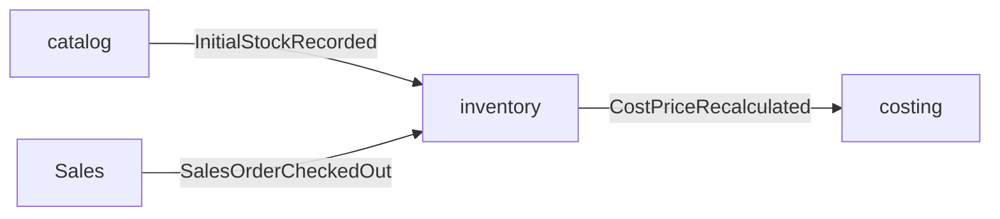

# TH-06 — Module map

| Module | Vai trò | Owner / Supporting | Package | Trạng thái |
| ------ | ------- | ------------------ | ------- | ---------- |
| Inventory | Tồn, movement | **Owner** | `inventory/` (events stub) | planned |
| Costing | Giá vốn | **Owner** | `costing/` (events stub) | planned |
| Catalog | Product id, initial stock event | Supporting | `catalog/` | in_progress |
| Sales | Xuất kho khi bán | Consumer/Trigger | `sales/` | in_progress |

## Events hiện có (stub packages)

- `modules/inventory/integration_events`
- `modules/costing/integration_events`
- Catalog handlers: `initial_stock_recorded`, `available_stock_changed`, `cost_price_recalculated`
