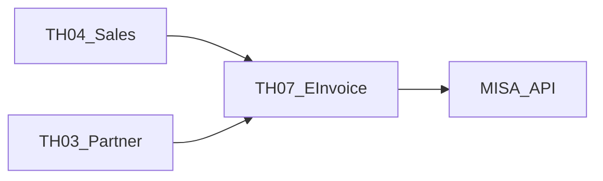

# TH-07 — Module map

| Module | Vai trò | Owner / Supporting | Trạng thái |
| ------ | ------- | ------------------ | ---------- |
| Invoicing / EInvoice* | HĐĐT lifecycle | **Owner** (dự kiến) | planned |
| Sales | Nguồn dữ liệu đơn | Supporting | in_progress |
| Partner | Buyer tax info snapshot | Supporting | planned |
| Tax* | Thuế suất | Supporting | planned |

## Playbooks

- `docs/ai-playbooks/vet45_e_invoice_testing_playbook.md` (nếu có trong repo)
