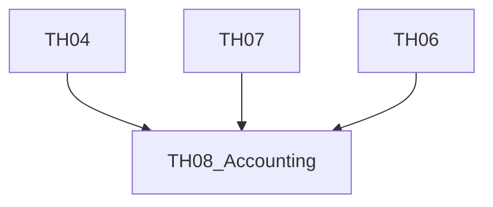

# TH-08 — Module map

| Module | Vai trò | Owner / Supporting | Trạng thái |
| ------ | ------- | ------------------ | ---------- |
| Accounting* | Sổ, bút toán | **Owner** | planned |
| Tax* | Kê khai, tờ khai | **Owner** | planned |
| Sales, Invoicing, Inventory | Nguồn số liệu | Supporting | — |

