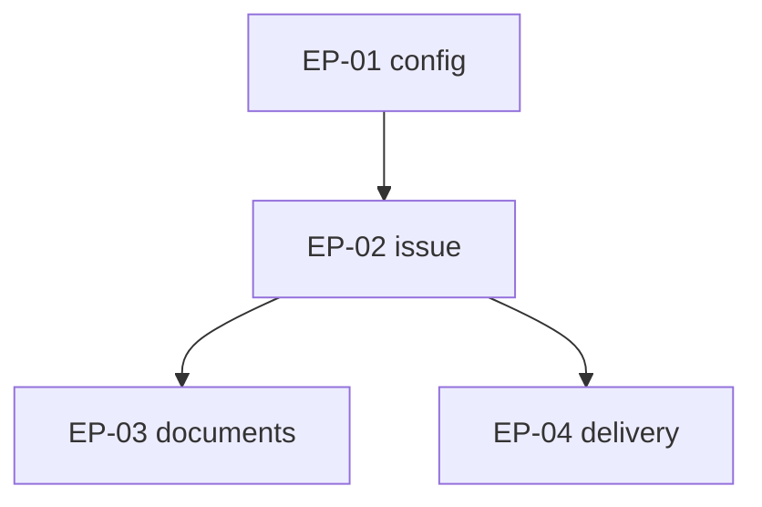

# TH-08 — OVERVIEWS (business scope)

Canonical: [Theme-8-e-invoice.md](Theme-8-e-invoice.md) (§1 Theme overview, §5.1 Epic map).

## Mục đích

Theme 08 giúp người dùng thiết lập, phát hành, theo dõi và gửi hóa đơn điện tử cho các đơn hàng đã **Hoàn tất** trên VET45.

Bảo đảm chính:

- Hóa đơn lập từ SalesOrder + dữ liệu người mua hiệu lực (`BuyerInvoiceSnapshot` là nền; Theme 03 chỉ completion có kiểm soát trước khi khóa).
- Bên bán lấy từ hồ sơ pháp lý hiện hành Theme 01 tại thời điểm bắt đầu phát hành.
- Kết quả phát hành theo phản hồi **MISA meInvoice**; hồ sơ đã phát hành bất biến.
- Bản xem trước / chính thức, XML, PDF lấy từ provider — VET45 không tự dựng tài liệu pháp lý thay thế.
- Điểm vào: Kết quả bán hàng hoặc Chi tiết đơn hàng (không có danh sách / màn hồ sơ HĐĐT độc lập trong MVP).

## Trong phạm vi (MVP)

- Kết nối / cấu hình phát hành meInvoice; policy phát hành & gửi tự động.
- Preview, phát hành thủ công/tự động, chống trùng, reconcile / recovery finalization nội bộ.
- Hồ sơ authoritative, mở bản xem chính thức, tải XML/PDF, theo dõi trạng thái provider.
- Gửi / gửi lại email qua capability provider; trạng thái gửi độc lập với kết quả phát hành.
- Action / status contract cho Theme 05 hiển thị trên màn đơn hàng nguồn.

Trạng thái phát hành hiển thị: Chưa phát hành | Đang xử lý | Đã phát hành | Phát hành lỗi.

Trạng thái gửi email hiển thị: Chưa gửi | Đang gửi | Đã gửi | Gửi lỗi (+ cảnh báo phụ khi resend sau lần đã gửi thành công).

## Ngoài phạm vi

- Phát hành không có đơn / đơn chưa Hoàn tất; điều chỉnh / thay thế / hủy HĐĐT trong VET45.
- Nhiều provider hoặc nhiều connection/config mặc định đồng thời.
- Danh sách / màn hồ sơ HĐĐT riêng; tự dựng PDF/XML pháp lý.
- Hạch toán / kê khai thuế (Theme kế toán); đăng ký mẫu với CQT; chia sẻ Zalo/Messenger.
- Chi tiết đầy đủ: [Theme-8-e-invoice.md](Theme-8-e-invoice.md) §1.4.

## Cross-theme

| Theme / hệ thống | Theme 08 làm |
| ---------------- | ------------ |
| TH-01 Tổ chức & người dùng | Đọc hồ sơ pháp lý, snapshot bên bán |
| TH-03 Đối tác | Resolve completion field bắt buộc còn thiếu (trước khi khóa) |
| TH-05 Đơn hàng | Nguồn SalesOrder / BuyerInvoiceSnapshot; hiển thị status + actions |
| MISA meInvoice | Request, lưu kết quả, lấy viewer/XML/PDF/email |
| TH-09 kế toán thuế (catalog) | Cung cấp HĐ đã phát hành + lineage (không sở hữu sổ) |

## Epic map

| Epic | Folder | Primary domain | Outcome |
| ---- | ------ | -------------- | ------- |
| EP-01 | [Epic-01-provider-connection-config/](Epic-01-provider-connection-config/) | Invoice Configuration | Kết nối NCC + cấu hình / policy / readiness |
| EP-02 | [Epic-02-issue-from-sales-order/](Epic-02-issue-from-sales-order/) | Invoice Issuance | Phát hành đúng một HĐ gốc từ đơn Hoàn tất |
| EP-03 | [Epic-03-issued-invoice-documents/](Epic-03-issued-invoice-documents/) | Electronic Invoice | Hồ sơ authoritative + viewer/XML/PDF + status |
| EP-04 | [Epic-04-send-resend-einvoice/](Epic-04-send-resend-einvoice/) | Invoice Delivery | Gửi / gửi lại email; kết quả theo ý định gửi |

Phase 1 provider: **MISA meInvoice** (tên Epic/US không khóa vendor).

## Quy tắc xuyên Epic (rút gọn)

- Một SalesOrder ≤ một InvoiceIssuance ORIGINAL và ≤ một ElectronicInvoice gốc (MVP).
- Preview/readiness không tạo IssuanceAttempt / ElectronicInvoice / InvoiceDelivery.
- Snapshots bất biến trong lifecycle; timeout ≠ thất bại.
- Provider success + local finalization chưa xong → chỉ recovery nội bộ, không gọi lại publish đã thành công.
- Chi tiết: canonical §5.1.

## Kiến trúc đã chốt (runtime)

Xem [harness/03-architecture-and-flows.md](harness/03-architecture-and-flows.md): chỉ messaging worker gọi MISA; credential per tenant; token cache theo `tenantId`.
