# Theme 8: Hóa đơn điện tử

# 1\. Theme overview

## 1\.1 Purpose

Theme 08 giúp người dùng thiết lập, phát hành, theo dõi và gửi hóa đơn điện tử cho các đơn hàng đã Hoàn tất trên Mosaic Retail\.

Theme bảo đảm:

- Hóa đơn được lập từ dữ liệu giao dịch của SalesOrder và thông tin người mua hiệu lực cho đơn hàng; `BuyerInvoiceSnapshot` đã lưu theo đơn hàng là dữ liệu nền, Theme 08 chỉ được bổ sung có kiểm soát các thông tin bắt buộc còn thiếu từ Theme 03 trước khi dữ liệu người mua lần đầu đủ điều kiện phát hành\.

- Thông tin bên bán được lấy từ hồ sơ pháp lý hiện hành của Tổ chức tại thời điểm bắt đầu phát hành\.

- Kết quả phát hành được ghi nhận đúng theo phản hồi của MISA meInvoice\.

- Dữ liệu và kết quả của hóa đơn đã phát hành được lưu bất biến để truy vết độc lập với dữ liệu hiện hành\.

- Bản xem trước, bản xem chính thức, XML và PDF được lấy từ MISA meInvoice; Mosaic Retail không tự dựng một tài liệu pháp lý thay thế từ dữ liệu đã lưu\.

- XML, PDF và trạng thái gửi email được quản lý riêng, không làm thay đổi kết quả phát hành\.

- Người dùng thực hiện nghiệp vụ hóa đơn từ Kết quả bán hàng hoặc Chi tiết đơn hàng của đơn hàng nguồn\.

Theme 08 không quản lý hồ sơ pháp lý riêng, không quản lý nhiều chủ thể phát hành, không cung cấp danh sách hóa đơn điện tử độc lập và không cung cấp màn hồ sơ hóa đơn điện tử riêng trong MVP\.

## 1\.2 Business context

Đơn hàng và hóa đơn điện tử là hai chứng từ có trách nhiệm nghiệp vụ riêng:

- Theme 05 sở hữu đơn hàng, dòng hàng, giá, chiết khấu, thuế, thanh toán, thông tin xuất hóa đơn đã lưu theo đơn hàng và trạng thái Hoàn tất\.

- Theme 08 kiểm tra điều kiện, yêu cầu MISA meInvoice tạo bản xem trước, phát hành hóa đơn, lưu hồ sơ authoritative phục vụ audit và đối soát, lấy bản xem hoặc tài liệu chính thức từ MISA meInvoice và gửi hóa đơn qua email\.

**Bên bán**

Trong Phase 1:

- Mỗi tenant có tối đa một hồ sơ pháp lý hiện hành do Theme 01 quản lý\.

- Theme 08 sử dụng hồ sơ này làm nguồn thông tin bên bán tại thời điểm bắt đầu phát hành\.

- Theme 08 không tạo `InvoiceIssuer` riêng\.

- Theme 08 không ánh xạ cửa hàng, điểm bán hoặc đơn vị tổ chức với chủ thể phát hành\.

Thông tin bên bán được kiểm tra lại trước mỗi lần phát hành và được lưu bất biến trong dữ liệu của lần phát hành đó\.

Thay đổi hồ sơ pháp lý sau khi lần phát hành bắt đầu không cập nhật ngược dữ liệu đã lưu hoặc hóa đơn đã phát hành\.

**Bên mua**

Theme 03 sở hữu hồ sơ hiện hành của Khách cá nhân và Khách tổ chức\.

Khi đơn hàng phát sinh, Theme 05 lưu `BuyerInvoiceSnapshot` theo SalesOrder và giữ `buyer_partner_id` khi người mua có hồ sơ đối tác\. `BuyerInvoiceSnapshot` là dữ liệu nền của người mua cho nghiệp vụ hóa đơn của đơn hàng đó\.

Thông tin người mua được xác định như sau:

- Khách lẻ: sử dụng nội dung “Bán cho người tiêu dùng”\.

- Khách cá nhân: sử dụng thông tin xuất hóa đơn đã lưu theo đơn hàng\.

- Khách tổ chức: sử dụng tên tổ chức, địa chỉ, mã số thuế và các thông tin xuất hóa đơn đã lưu theo đơn hàng hoặc được Theme 08 bổ sung có kiểm soát khi dữ liệu bắt buộc còn thiếu\.

Theme 08 xác định dữ liệu người mua hiệu lực theo nguyên tắc:

- Giá trị đã tồn tại trong `BuyerInvoiceSnapshot` luôn được ưu tiên và không bị Theme 08 thay thế bằng dữ liệu hiện hành của Theme 03\.

- Nếu `BuyerInvoiceSnapshot` đã đủ các thông tin người mua bắt buộc để phát hành, Theme 08 không resolve Theme 03 để làm mới, so sánh hoặc cập nhật thông tin người mua cho SalesOrder đó\.

- Nếu `BuyerInvoiceSnapshot` còn thiếu thông tin người mua bắt buộc và SalesOrder có `buyer_partner_id`, Theme 08 được phép resolve hồ sơ hiện hành của đúng đối tác tại Theme 03 chỉ để hoàn thiện tập field bắt buộc vốn còn thiếu trong `BuyerInvoiceSnapshot`\.

- Việc resolve có thể được thực hiện lại trong thời gian dữ liệu người mua vẫn chưa đủ điều kiện phát hành\. Trong thời gian này, Theme 08 chỉ được cập nhật phần dữ liệu thuộc tập field cần completion; các giá trị gốc đã có trong `BuyerInvoiceSnapshot` không được thay thế\.

- Kết quả completion được Theme 08 lưu theo SalesOrder và phiên bản dữ liệu nguồn\. Khi dữ liệu người mua lần đầu đủ điều kiện phát hành, kết quả completion được khóa\.

- Sau khi completion đã khóa, mọi thay đổi tiếp theo của hồ sơ Theme 03 không được tự động resolve, refresh, thay thế hoặc tạo cảnh báo chênh lệch cho dữ liệu người mua của SalesOrder đó, kể cả khi hóa đơn chưa được phát hành\.

- Khi bắt đầu `IssuanceAttempt`, Theme 08 sử dụng `BuyerInvoiceSnapshot` kết hợp với completion đã khóa để hình thành dữ liệu người mua thực tế của attempt; từ thời điểm đó `AttemptSnapshot` bất biến\.

- Khách cá nhân hoặc Khách tổ chức không được tự chuyển thành Khách lẻ khi thiếu dữ liệu\.

- Đối với Khách tổ chức, mã số thuế là thông tin bắt buộc để phát hành hóa đơn điện tử\. Nếu sau bước completion vẫn thiếu mã số thuế, SalesOrder không đủ điều kiện phát hành và Theme 08 không được tạo `IssuanceAttempt` hoặc gửi yêu cầu phát hành đến MISA meInvoice\.

- Việc thiếu mã số thuế của Khách tổ chức không tự động cấm người dùng thực hiện thao tác Kiểm tra \& xem trước; preview vẫn tuân theo capability và validation của provider, nhưng không làm thay đổi kết luận rằng hóa đơn chưa đủ điều kiện phát hành\.

- Phase hiện tại không cảnh báo chỉ vì hồ sơ hiện hành của Theme 03 khác dữ liệu người mua đã được cố định cho SalesOrder\.

**Dữ liệu giao dịch**

Theme 08 không tự tính lại hoặc thay đổi:

- Dòng hàng hóa, dịch vụ\.

- Số lượng\.

- Đơn giá\.

- Chiết khấu\.

- Thuế\.

- Làm tròn\.

- Tổng tiền\.

Dữ liệu gửi sang MISA meInvoice phải giữ nguyên ý nghĩa và giá trị thương mại do Theme 05 xác lập\.

**Provider và cấu hình**

Trong Phase 1:

- MISA meInvoice là nhà cung cấp hóa đơn điện tử duy nhất được tích hợp\.

- Mỗi tenant có tối đa một kết nối MISA meInvoice đang hoạt động\.

- Mỗi tenant có tối đa một cấu hình phát hành mặc định đang hoạt động\.

Một tenant được coi là sẵn sàng về cấu hình khi:

- Có hồ sơ pháp lý hiện hành đủ thông tin bắt buộc\.

- Có kết nối MISA meInvoice hợp lệ\.

- Có cấu hình phát hành mặc định được đồng bộ từ MISA meInvoice và còn khả dụng\.

- Phương thức ký phù hợp với cách phát hành được sử dụng\.

- Không sử dụng việc đối chiếu thông tin đơn vị phát hành tại MISA meInvoice làm blocker nếu integration contract không cung cấp đủ dữ liệu định danh để xác minh một cách authoritative\.

**Kết quả phát hành**

Hóa đơn chỉ được coi là đã phát hành khi:

- MISA meInvoice xác nhận phát hành thành công\.

- Mosaic Retail hoàn tất ghi nhận hồ sơ hóa đơn chính thức\.

Lỗi phát hành:

- Không thay đổi trạng thái Hoàn tất của đơn hàng\.

- Không làm thay đổi dữ liệu thương mại của đơn hàng\.

- Không được tự suy ra từ timeout hoặc mất phản hồi\.

**Điểm vào nghiệp vụ**

Hai điểm vào trực tiếp của nghiệp vụ hóa đơn điện tử gồm:

- Kết quả bán hàng sau khi tạo đơn hàng thành công\.

- Chi tiết đơn hàng\.

- Danh sách đơn hàng có thể dẫn người dùng tới Chi tiết đơn hàng nhưng không sở hữu row hoặc action hóa đơn điện tử riêng\.

- Deep link chỉ được sử dụng khi có đủ ngữ cảnh đơn hàng, tenant và quyền truy cập; deep link không tạo thêm một màn hồ sơ hóa đơn độc lập\.

- Người dùng xem trạng thái và mở Bottom Sheet hóa đơn điện tử từ đúng màn nguồn\.

- Trước khi phát hành, Bottom Sheet cung cấp các hành động phát hành, kiểm tra và xem trước, hoặc gửi hóa đơn khi đủ điều kiện\.

- Sau khi phát hành, Bottom Sheet cho phép mở trực tiếp hóa đơn chính thức từ MISA meInvoice, lấy tài liệu XML/PDF hoặc gửi hóa đơn qua email\.

- Khi đóng viewer, file exporter hoặc Bottom Sheet, người dùng quay lại đúng màn nguồn đã khởi tạo thao tác\.

## 1\.3 In scope

Theme 08 bao gồm:

- Đọc hồ sơ pháp lý hiện hành của Tổ chức từ Theme 01\.

- Kiểm tra thông tin bên bán có đủ điều kiện phát hành hay không\.

- Kết nối, kiểm tra, kết nối lại và ngắt kết nối MISA meInvoice\.

- Đồng bộ các cấu hình phát hành mà MISA meInvoice cho phép sử dụng\.

- Lựa chọn một cấu hình phát hành mặc định cho tenant\.

- Thiết lập phát hành tự động\.

- Thiết lập gửi email tự động sau khi phát hành thành công\.

- Kiểm tra điều kiện phát hành của đơn hàng đã Hoàn tất\.

- Yêu cầu MISA meInvoice tạo bản xem trước nội dung hóa đơn dự kiến\.

- Mở bản xem trước bằng viewer phù hợp; bản xem trước không phải hóa đơn chính thức và không làm phát sinh hóa đơn\.

- Sử dụng `BuyerInvoiceSnapshot` đã lưu theo SalesOrder làm dữ liệu nền của người mua\.

- Resolve hồ sơ hiện hành của đúng `buyer_partner_id` tại Theme 03 khi `BuyerInvoiceSnapshot` còn thiếu thông tin bắt buộc, chỉ để hoàn thiện các field bắt buộc còn thiếu cho tới khi dữ liệu người mua lần đầu đủ điều kiện phát hành\.

- Lưu và khóa kết quả completion của người mua khi lần đầu đủ điều kiện; sau thời điểm đó không tự động resolve hoặc refresh lại từ Theme 03\.

- Chặn phát hành khi dữ liệu người mua vẫn thiếu thông tin bắt buộc sau completion; đối với Khách tổ chức, thiếu mã số thuế là blocker phát hành\.

- Cho phép Kiểm tra \& xem trước trong trường hợp Khách tổ chức thiếu mã số thuế khi capability preview cho phép, nhưng không cho bắt đầu phát hành\.

- Lưu lineage của dữ liệu completion để truy được SalesOrder, đối tác nguồn và dữ liệu thực tế đã được sử dụng\.

- Lưu dữ liệu bên bán, dữ liệu người mua hiệu lực, lineage của dữ liệu nguồn, giao dịch, cấu hình và chính sách được sử dụng cho từng lần phát hành\.

- Phát hành thủ công từ Kết quả bán hàng hoặc Chi tiết đơn hàng qua MISA meInvoice\.

- Phát hành tự động khi chính sách, cấu hình và phương thức ký cho phép\.

- Ngăn tạo yêu cầu hoặc hóa đơn trùng khi thao tác hoặc sự kiện được gửi lặp\.

- Xử lý kết quả thành công, thất bại xác định hoặc chưa xác định\.

- Kiểm tra lại kết quả với MISA meInvoice khi cần\.

- Phục hồi trường hợp MISA meInvoice đã phát hành thành công nhưng Mosaic Retail chưa hoàn tất ghi nhận\.

- Lưu ElectronicInvoice, InvoiceSnapshot và các dữ liệu bất biến của hóa đơn đã phát hành để phục vụ audit, đối soát, projection và khôi phục\.

- Mở trực tiếp hóa đơn chính thức do MISA meInvoice cung cấp từ Kết quả bán hàng hoặc Chi tiết đơn hàng\.

- Yêu cầu lấy và lưu tài liệu XML hoặc PDF do MISA meInvoice cung cấp\.

- Chuyển bản xem hóa đơn hoặc tài liệu cho viewer, file exporter hoặc khả năng phù hợp của hệ điều hành; Mosaic Retail không tự dựng lại tài liệu pháp lý\.

- Theo dõi trạng thái gần nhất được quan sát tại MISA meInvoice\.

- Gửi tự động, gửi thủ công và gửi lại hóa đơn qua email bằng khả năng do MISA meInvoice hỗ trợ\.

- Lưu email thực tế được sử dụng cho từng lần gửi\.

- Lưu riêng từng ý định gửi và lịch sử kết quả gửi để phục vụ truy vết\.

- Cung cấp trạng thái và action contract để Theme 05 hiển thị nghiệp vụ hóa đơn điện tử tại Kết quả bán hàng và Chi tiết đơn hàng\.

- Lưu lịch sử xử lý và dữ liệu phục vụ audit, kiểm tra hoặc đối soát\.

**Trong MVP:**

- Một đơn hàng có tối đa một hóa đơn gốc\.

- Một yêu cầu phát hành lỗi hoặc chưa xác định được kết quả không được coi là hóa đơn đã hình thành\.

- Một hóa đơn đã phát hành có thể được gửi qua email nhiều lần theo các ý định gửi riêng biệt\.

- Việc xác lập kết quả phát hành bất thường được xử lý bởi hệ thống và phản ánh qua trạng thái trên đơn hàng; không có màn xử lý hoặc reconciliation riêng cho người dùng cuối\.

- Việc lưu hồ sơ authoritative không đồng nghĩa Mosaic Retail phải cung cấp một màn hồ sơ hóa đơn riêng\.

- Người dùng thực hiện các hành động hóa đơn điện tử từ Kết quả bán hàng hoặc Chi tiết đơn hàng\.

**Trạng thái phát hành hiển thị**

|Trạng thái|Ý nghĩa|
|---|---|
|Chưa phát hành|Chưa có hóa đơn và không có quá trình phát hành đang xử lý|
|Đang xử lý|Hệ thống đang chuẩn bị, gửi yêu cầu, chờ kết quả, kiểm tra lại hoặc hoàn tất ghi nhận|
|Đã phát hành|MISA meInvoice đã xác nhận thành công và Mosaic Retail đã ghi nhận hóa đơn|
|Phát hành lỗi|Lần phát hành gần nhất thất bại xác định và không còn quá trình đang xử lý|

**Trạng thái gửi email hiển thị**

|Trạng thái|Ý nghĩa|
|---|---|
|Chưa gửi|Chưa từng có lần gửi email thành công|
|Đang gửi|Chưa từng gửi thành công và có một lần gửi đang được xử lý hoặc cần xác lập kết quả|
|Đã gửi|Đã có ít nhất một lần gửi được xác nhận thành công|
|Gửi lỗi|Chưa từng gửi thành công và lần gửi gần nhất thất bại xác định|

Nếu hóa đơn đã từng được gửi thành công nhưng một lần gửi lại sau đó đang xử lý, thất bại hoặc chưa rõ kết quả:

- Trạng thái chính vẫn là Đã gửi\.

- Hệ thống hiển thị cảnh báo phụ cho lần gửi lại\.

## 1\.4 Out of scope

Theme 08 không bao gồm:

- Phát hành hóa đơn không có đơn hàng nguồn\.

- Phát hành hóa đơn từ đơn hàng chưa Hoàn tất\.

- Sửa trực tiếp hóa đơn đã phát hành\.

- Lập hóa đơn điều chỉnh\.

- Lập hóa đơn thay thế\.

- Hủy hoặc xử lý sai sót hóa đơn điện tử trong Mosaic Retail\.

- Xử lý tác động hóa đơn do hủy đơn, đổi hàng hoặc trả hàng\.

- Phát hành một phần đơn hàng\.

- Tách một đơn hàng thành nhiều hóa đơn gốc\.

- Gộp nhiều đơn hàng thành một hóa đơn\.

- Quản lý nhiều hồ sơ pháp lý hoặc nhiều chủ thể phát hành trong một tenant\.

- Ánh xạ cửa hàng, điểm bán hoặc đơn vị tổ chức với chủ thể phát hành\.

- Tích hợp nhà cung cấp khác ngoài MISA meInvoice\.

- Sử dụng đồng thời nhiều kết nối đang hoạt động\.

- Sử dụng đồng thời nhiều cấu hình phát hành mặc định\.

- Danh sách hóa đơn điện tử độc lập với danh sách đơn hàng\.

- Màn hồ sơ hoặc màn chi tiết hóa đơn điện tử riêng do Mosaic Retail dựng lại từ InvoiceSnapshot\.

- Tự dựng bản PDF, XML hoặc một bản hóa đơn pháp lý thay thế cho tài liệu do MISA meInvoice cung cấp\.

- PDF viewer, XML viewer, file browser hoặc giao diện chọn nơi lưu do Mosaic Retail tự xây dựng khi hệ điều hành đã sở hữu khả năng tương ứng\.

- Màn chi tiết xử lý, recovery queue hoặc case\-management UI cho quá trình xác lập kết quả phát hành bất thường trong MVP\.

- Hiển thị các bước retry, polling, callback, reconciliation hoặc ghi nhận nội bộ như các trạng thái nghiệp vụ ngang hàng dành cho người dùng cuối\.

- Dùng hồ sơ hiện hành của Theme 03 để thay thế giá trị đã tồn tại trong `BuyerInvoiceSnapshot`\.

- Tiếp tục tự động resolve, refresh hoặc đồng bộ thông tin người mua từ Theme 03 sau khi dữ liệu người mua của SalesOrder đã lần đầu đủ điều kiện phát hành và completion đã khóa\.

- Cảnh báo người dùng khi hồ sơ hiện hành của Theme 03 khác thông tin xuất hóa đơn đã lưu theo đơn hàng\.

- Chia sẻ hóa đơn qua Zalo, Messenger, hệ điều hành hoặc ứng dụng khác\.

- Đăng ký, mua hoặc kích hoạt dịch vụ hóa đơn điện tử\.

- Thực hiện thủ tục đăng ký mẫu, ký hiệu hoặc sử dụng hóa đơn với cơ quan thuế\.

- Hạch toán, lập sổ, kê khai hoặc quản lý nghĩa vụ thuế\.

- Quản lý hồ sơ gốc của Tổ chức, đối tác, đơn hàng, sản phẩm, thanh toán hoặc quyền người dùng\.

## 1\.5 Cross\-theme boundaries

\| Theme 03 — Đối tác giao dịch \| Quản lý hồ sơ hiện hành của Khách cá nhân và Khách tổ chức \| Chỉ resolve đúng đối tác để hoàn thiện các thông tin người mua bắt buộc còn thiếu khi completion của SalesOrder chưa khóa; không thay thế giá trị đã có trong BuyerInvoiceSnapshot và không resolve lại sau khi dữ liệu người mua lần đầu đủ điều kiện phát hành \|

|**Theme / hệ thống**|**Trách nhiệm ngoài Theme 08**|**Trách nhiệm của Theme 08**|
|---|---|---|
|Theme 01<br>— Tổ chức \& người dùng|Quản lý tenant, hồ sơ pháp lý hiện hành, người dùng, quyền và phạm vi dữ liệu|Đọc hồ sơ pháp lý, kiểm tra thông tin bên bán và lưu snapshot bên bán khi bắt đầu phát hành|
|Theme 03<br>— Đối tác giao dịch|Quản lý hồ sơ hiện hành của Khách cá nhân và Khách tổ chức |Chỉ resolve đúng đối tác để hoàn thiện các thông tin người mua bắt buộc còn thiếu khi completion của SalesOrder chưa khóa; không thay thế giá trị đã có trong BuyerInvoiceSnapshot và không resolve lại sau khi dữ liệu người mua lần đầu đủ điều kiện phát hành|
|Theme 05<br>— Đơn hàng|Quản lý đơn hàng, dòng hàng, giá trị giao dịch, thanh toán, thông tin xuất hóa đơn theo đơn hàng, trạng thái Hoàn tất, Kết quả bán hàng và Chi tiết đơn hàng|Sử dụng SalesOrder và BuyerInvoiceSnapshot làm dữ liệu nguồn; gắn completion của Theme 08 với đúng SalesOrder/version; cung cấp trạng thái và action contract để Theme 05 hiển thị; không cập nhật ngược dữ liệu thương mại hoặc BuyerInvoiceSnapshot|
|MISA meInvoice|Quản lý tài khoản dịch vụ, cấu hình khả dụng, ký, phát hành, bản xem trước, bản xem chính thức, XML/PDF, gửi email và trao đổi với cơ quan thuế|Quản lý kết nối và request; gửi dữ liệu hợp lệ; lưu kết quả, định danh và hồ sơ authoritative; lấy bản xem hoặc tài liệu khi người dùng yêu cầu|
|Theme 09<br>— Kế toán thuế|Hạch toán, lập sổ, kê khai và quản lý nghĩa vụ thuế|Cung cấp hóa đơn đã phát hành và dữ liệu truy vết|
|Theme 11<br>— Cảnh báo \& kiểm soát rủi ro|Quản lý cảnh báo và công việc cần xử lý|Cung cấp lỗi, sai lệch và trạng thái cần theo dõi|
|Hệ điều hành thiết bị|Cung cấp viewer phù hợp, giao diện lưu tệp, bàn phím email và các khả năng hệ thống được ứng dụng gọi|Chuẩn bị URL hoặc tệp an toàn, chuyển giao cho khả năng hệ điều hành và giữ đúng context quay lại màn nguồn|

Theme 08 không cập nhật ngược:

- Hồ sơ pháp lý của Tổ chức\.

- Hồ sơ đối tác\.

- Thông tin xuất hóa đơn đã lưu theo đơn hàng\.

- Đơn hàng và giá trị giao dịch\.

Theme 05 chỉ hiển thị trạng thái và thông tin tóm tắt do Theme 08 cung cấp\. Theme 05 không được thay đổi nội dung, tài liệu hoặc trạng thái chính thức của hóa đơn\.

## 1\.6 Users \& roles

|**Vai trò**|**Mức độ tham gia**|
|---|---|
|Chủ cửa hàng|Kết nối MISA meInvoice, lựa chọn cấu hình phát hành, thiết lập chính sách tự động và kiểm tra mức độ sẵn sàng|
|Kế toán|Kiểm tra hóa đơn, tải XML/PDF, theo dõi các trường hợp bất thường và hỗ trợ đối soát khi cần; không phải người bắt buộc tham gia vào luồng phát hành hằng ngày<br>\(Xem trước, phát hành, theo dõi kết quả, thử lại, xem hóa đơn, tải XML/PDF, gửi và gửi lại qua email\)|
|Nhân viên bán hàng|Ghi nhận thông tin xuất hóa đơn khi bán hàng; theo dõi trạng thái; phát hành thủ công khi không sử dụng tự động hoặc khi cần xử lý lại; xem, tải, gửi và gửi lại hóa đơn cho khách hàng nếu được cấp quyền|

Quyền thực tế được kiểm soát theo permission và phạm vi dữ liệu của Theme 01\. Vai trò trong bảng chỉ mô tả nhu cầu nghiệp vụ phổ biến và không tự cấp quyền\.

## 1\.7 Cross references

### 1\.7\.1 Related themes

|**Theme**|**Quan hệ**|
|---|---|
|Theme 01<br>— Tổ chức \& người dùng|Cung cấp tenant, hồ sơ pháp lý hiện hành, người dùng, quyền và phạm vi dữ liệu|
|Theme 03<br>— Đối tác giao dịch|Cung cấp hồ sơ hiện hành của đối tác; Theme 08 chỉ sử dụng có kiểm soát để hoàn thiện field bắt buộc còn thiếu trước khi buyer data lần đầu đủ điều kiện phát hành|
|Theme 05<br>— Đơn hàng|Cung cấp giao dịch nguồn, BuyerInvoiceSnapshot, buyer\_partner\_id, phiên bản SalesOrder và điểm vào chính của nghiệp vụ hóa đơn|
|Theme 09<br>— Kế toán thuế|Sử dụng hóa đơn đã phát hành và dữ liệu truy vết|
|Theme 11<br>— Cảnh báo \& kiểm soát rủi ro|Sử dụng lỗi, sai lệch và trạng thái cần theo dõi|

### 1\.7\.2 Related journeys

|**Journey**|**Relevance**|
|---|---|
|Business setup|Hoàn thiện hồ sơ pháp lý, kết nối MISA meInvoice và thiết lập cấu hình|
|Data onboarding|Hình thành dữ liệu Tổ chức, đối tác, đơn hàng và thông tin xuất hóa đơn theo đơn hàng|
|Order\-to\-cash|Từ đơn hàng Hoàn tất đến xem trước, phát hành, mở hóa đơn chính thức và gửi hóa đơn cho người mua|
|Management \& control|Theo dõi trạng thái, xác lập kết quả, bảo toàn hồ sơ authoritative, lấy tài liệu, xem lịch sử gửi và phục vụ audit hoặc đối soát|

### 1\.7\.3 Related capability layers

|**Capability layer**|**Relevance**|
|---|---|
|Lớp vận hành|Xem trước, phát hành, xem, tải xuống, gửi và gửi lại hóa đơn|
|Lớp tuân thủ|Kiểm tra cấu hình, lưu dữ liệu tại thời điểm phát hành và bảo toàn hồ sơ|
|Lớp quản trị|Theo dõi trạng thái, lịch sử xử lý và dữ liệu kiểm tra|
|Lớp kiểm soát|Permission, điều kiện phát hành, chống trùng và xử lý lỗi|
|Lớp hệ thống|Tích hợp MISA meInvoice, retry kỹ thuật, kiểm tra kết quả và audit|

### 1\.7\.4 Related AA/CAA

Product Vision hiện chưa định nghĩa AA hoặc CAA riêng cho việc phát hành, gửi hoặc xử lý lỗi hóa đơn điện tử\. Theme 08 không tự tạo mã mới\.

|**AA ID**|**AA name**|**Is CAA**|**Relevance**|
|---|---|---|---|
|AA\-O08|Ghi nhận yêu cầu hoặc thông tin xuất hóa đơn|No|Ghi nhận nhu cầu hoặc dữ liệu xuất hóa đơn trong quá trình bán hàng|

# 2\. Customer journey

## 2\.1 Journey model

### **2\.2\.1 Source data và snapshot**

- Theme 01 là nguồn hồ sơ pháp lý hiện hành của bên bán\.

- Theme 05 là nguồn authoritative của SalesOrder, dòng hàng, giá trị giao dịch, `BuyerInvoiceSnapshot`, `buyer_partner_id` và phiên bản dữ liệu đơn hàng\.

- `BuyerInvoiceSnapshot` là dữ liệu nền của người mua cho SalesOrder và luôn có precedence cao hơn hồ sơ hiện hành của Theme 03\.

- Theme 03 sở hữu hồ sơ hiện hành của đối tác và chỉ được Theme 08 sử dụng như nguồn completion khi `BuyerInvoiceSnapshot` còn thiếu thông tin người mua bắt buộc\.

- Theme 08 không được dùng Theme 03 để thay thế bất kỳ giá trị nào đã tồn tại trong `BuyerInvoiceSnapshot`\.

- Khi dữ liệu người mua chưa đủ điều kiện phát hành, Theme 08 được phép resolve đúng `buyer_partner_id` tại Theme 03 để hoàn thiện tập field bắt buộc còn thiếu và đánh giá lại buyer data readiness\.

- Kết quả completion được lưu theo SalesOrder và phiên bản dữ liệu nguồn\. Trong thời gian completion chưa khóa, Theme 08 có thể resolve lại tập field cần completion khi có một evaluation hợp lệ\.

- Khi dữ liệu người mua lần đầu đủ điều kiện phát hành, completion phải được khóa\. Sau thời điểm đó, thay đổi Theme 03 không được tự động refresh, resolve, thay thế hoặc tạo cảnh báo chênh lệch cho SalesOrder đó\.

- Nếu `BuyerInvoiceSnapshot` đã đủ điều kiện ngay từ đầu thì không cần tạo completion và Theme 08 không đọc Theme 03 cho mục đích làm mới dữ liệu người mua\.

- Khách cá nhân hoặc Khách tổ chức không được tự chuyển thành Khách lẻ\.

- Đối với Khách tổ chức, mã số thuế là điều kiện bắt buộc để phát hành\. Thiếu mã số thuế sau completion làm issuance readiness là `NOT_READY`\.

- Việc thiếu mã số thuế của Khách tổ chức có thể vẫn cho phép Kiểm tra \& xem trước theo preview capability hiện hành, nhưng không cho phép bắt đầu `IssuanceAttempt`\.

- Dữ liệu phải được kiểm tra lại khi bắt đầu phát hành, kể cả khi người dùng vừa xem trước\.

- Khi bắt đầu phát hành, Theme 08 tạo dữ liệu người mua hiệu lực từ `BuyerInvoiceSnapshot` và completion đã khóa, sau đó sao chép vào `AttemptSnapshot`\.

- `AttemptSnapshot` không đọc lại dữ liệu nguồn sau khi attempt bắt đầu\.

- `InvoiceSnapshot` được hình thành từ successful `AttemptSnapshot` và kết quả provider; snapshot này bất biến\.

- `AttemptSnapshot` và `InvoiceSnapshot` phải giữ đủ source reference và lineage để sau này có thể xác định dữ liệu nào đã được sử dụng và hỗ trợ khả năng phát hiện thay đổi nguồn cho nghiệp vụ điều chỉnh hoặc thay thế trong tương lai\.

- Việc bảo toàn lineage không đồng nghĩa Phase hiện tại tự động phát hiện chênh lệch, lập hóa đơn điều chỉnh hoặc lập hóa đơn thay thế\.

- Bản hóa đơn chính thức mà người dùng xem phải được lấy từ MISA meInvoice hoặc nguồn chính thức của provider; Mosaic Retail không tự dựng một bản hóa đơn pháp lý thay thế từ `InvoiceSnapshot`\.

### 2\.1\.2 Journey catalog

|Group|CJ|Journey|Journey type|
|---|---|---|---|
|A — Thiết lập|CJ\-01|Thiết lập và duy trì khả năng phát hành hóa đơn điện tử|USER\_LED|
|B — Chuẩn bị phát hành|CJ\-02|Kiểm tra điều kiện và xem trước hóa đơn từ đơn hàng|USER\_LED|
|C — Phát hành|CJ\-03|Phát hành thủ công hóa đơn từ đơn hàng Hoàn tất|USER\_LED|
|C — Phát hành|CJ\-04|Tự động phát hành hóa đơn khi đơn hàng đủ điều kiện|EVENT\_DRIVEN|
|D — Khôi phục phát hành|CJ\-05|Kiểm tra và xác lập kết quả phát hành bất thường|RECOVERY\_CONTROL|
|E — Sau phát hành|CJ\-06|Xem hồ sơ và tài liệu hóa đơn đã phát hành|USER\_LED|
|F — Gửi cho người mua|CJ\-07|Gửi, gửi lại và theo dõi kết quả gửi hóa đơn qua email|USER\_LED / EVENT\_DRIVEN|

### 2\.1\.3 End\-to\-end journey map

**Sơ đồ hành trình nghiệp vụ tổng thể**

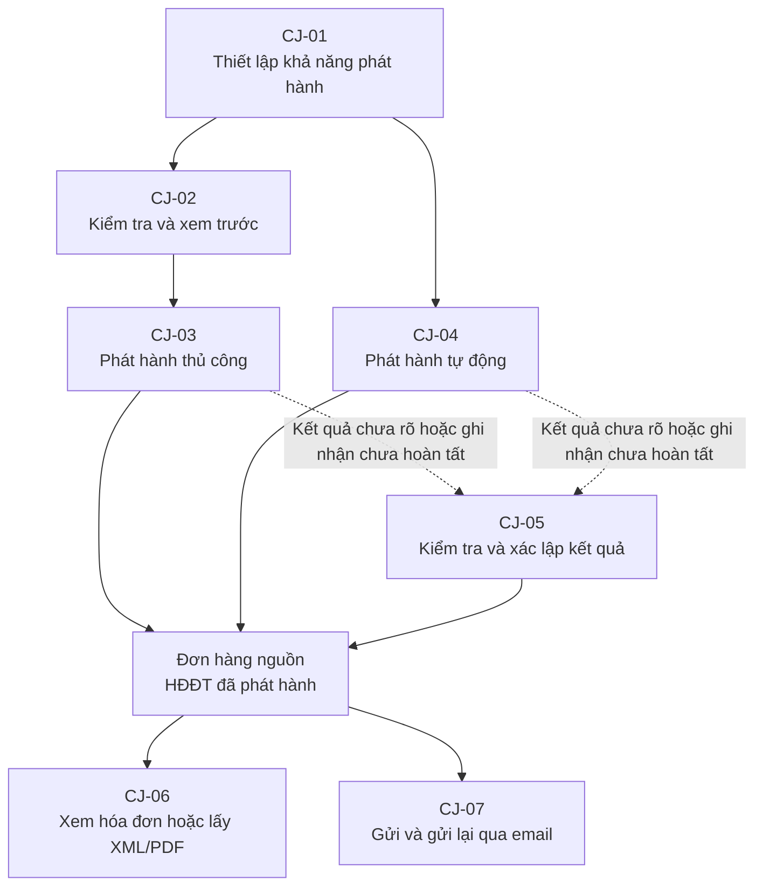

### 2\.1\.4 UX bridge

|CJ|Primary touchpoint|User context|UX outcome|
|---|---|---|---|
|CJ\-01|Thiết lập → Hóa đơn điện tử|Chuẩn bị tenant sử dụng hóa đơn điện tử|Biết tenant đã sẵn sàng hay còn thiếu điều kiện nào|
|CJ\-02|Kết quả bán hàng hoặc Chi tiết đơn hàng|Chuẩn bị phát hành cho một đơn hàng|Thấy nội dung dự kiến, cảnh báo và blocker|
|CJ\-03|Bottom Sheet xác nhận phát hành|Chủ động phát hành hóa đơn|Nhận phản hồi rõ về kết quả hoặc trạng thái Đang xử lý trên màn nguồn|
|CJ\-04|Trạng thái HĐĐT trên đơn hàng|Hệ thống tự phát hành theo chính sách|Theo dõi được trạng thái mà không phải mở một màn xử lý riêng|
|CJ\-05|Row HĐĐT tại Kết quả bán hàng hoặc Chi tiết đơn hàng|Kết quả chưa rõ hoặc ghi nhận chưa hoàn tất|Biết hệ thống đang tiếp tục xử lý, không phát hành lại và không phải thực hiện thao tác kỹ thuật|
|CJ\-06|Bottom Sheet HĐĐT sau phát hành|Cần xem hóa đơn chính thức hoặc lưu XML/PDF|Mở đúng bản chính thức từ MISA meInvoice hoặc lưu đúng tài liệu do provider cung cấp|
|CJ\-07|Bottom Sheet HĐĐT sau phát hành|Cần gửi hoặc gửi lại hóa đơn cho người mua|Xác nhận email, gửi hóa đơn và xem lịch sử từng lần gửi|

## 2\.2 Cross\-journey contracts

### 2\.2\.1 Source data và snapshot

- Theme 01 là nguồn hồ sơ pháp lý hiện hành của bên bán\.

- Theme 05 là nguồn chính thức của đơn hàng, dòng hàng, giá trị giao dịch và thông tin xuất hóa đơn của người mua đã lưu theo đơn hàng\.

- Theme 03 sở hữu hồ sơ hiện hành của đối tác nhưng không phải nguồn được Theme 08 đọc lại khi phát hành\.

- Theme 08 không làm mới thông tin người mua từ Theme 03 khi xem trước, phát hành, thử lại hoặc đối soát\.

- Phase hiện tại không cảnh báo khi hồ sơ Theme 03 khác thông tin người mua đã lưu theo đơn hàng\.

- Khách tổ chức thiếu mã số thuế chỉ nhận cảnh báo và vẫn có thể phát hành\.

- Khách cá nhân hoặc Khách tổ chức không được tự chuyển thành Khách lẻ\.

- Theme 08 không tự sửa dữ liệu nguồn để làm cho hóa đơn đủ điều kiện phát hành\.

- Dữ liệu phải được kiểm tra lại khi bắt đầu phát hành, kể cả khi người dùng vừa xem trước\.

- Dữ liệu thực tế được sử dụng cho một lần phát hành phải được lưu trước khi gửi yêu cầu đến MISA meInvoice\.

- Dữ liệu nguồn thay đổi sau khi lần phát hành bắt đầu không làm thay đổi dữ liệu của lần phát hành đó\.

- ElectronicInvoice và InvoiceSnapshot phải được lưu bất biến để phục vụ audit, đối soát, projection và khôi phục, kể cả khi dữ liệu nguồn hiện hành đã thay đổi hoặc không còn truy cập được\.

- Bản hóa đơn chính thức mà người dùng xem phải được lấy từ MISA meInvoice hoặc nguồn chính thức do provider cung cấp; Mosaic Retail không tự dựng một bản hóa đơn pháp lý thay thế từ InvoiceSnapshot\.

### 2\.2\.2 Issuance control

- Chỉ SalesOrder đã Hoàn tất mới được phát hành hóa đơn\.

- Một SalesOrder có tối đa một hóa đơn gốc trong MVP\.

- Không bắt đầu phát hành mới khi SalesOrder đã có hóa đơn hoặc đang có operation phát hành chưa kết thúc\.

- Thao tác hoặc sự kiện lặp không được tạo yêu cầu phát hành trùng\.

- `IssuanceReadiness = NOT_READY` khi còn ít nhất một blocker về cấu hình, dữ liệu giao dịch hoặc dữ liệu người mua\.

- Khách tổ chức thiếu mã số thuế là blocker phát hành, không phải warning\.

- Warning thực sự không chặn vẫn không ngăn phát hành thủ công hoặc tự động\.

- Preview có thể được phép trong một số trường hợp issuance chưa READY, bao gồm trường hợp Khách tổ chức còn thiếu mã số thuế, nếu preview capability cho phép; preview không làm thay đổi blocker phát hành\.

- Trước khi tạo `IssuanceAttempt`, hệ thống phải bảo đảm dữ liệu người mua hiệu lực đã đủ điều kiện và completion, nếu có, đã được khóa\.

- Khi completion đã khóa, phát hành thủ công, phát hành tự động hoặc phát hành lại không được re\-resolve Theme 03 để lấy dữ liệu người mua mới\.

- Lỗi xác định có thể cho phép phát hành lại sau khi kiểm tra lại điều kiện\.

- Timeout, mất phản hồi hoặc kết quả không đầy đủ không được tự coi là Phát hành lỗi\.

- Khi chưa xác định MISA meInvoice đã phát hành hay chưa, hệ thống phải khóa phát hành lại\.

- Nếu MISA meInvoice đã thành công nhưng Mosaic Retail chưa hoàn tất ghi nhận, hệ thống chỉ tiếp tục ghi nhận nội bộ\.

### 2\.2\.3 Navigation và trạng thái hiển thị

Kết quả bán hàng và Chi tiết đơn hàng là hai điểm vào trực tiếp của nghiệp vụ hóa đơn điện tử\.

Danh sách đơn hàng có thể dẫn người dùng tới Chi tiết đơn hàng nhưng không sở hữu row hoặc action hóa đơn điện tử riêng\.

Theme 08 không có màn danh sách hóa đơn điện tử độc lập trong MVP\.

Row hóa đơn điện tử trên hai màn nguồn hiển thị một trong bốn trạng thái:

- Chưa phát hành\.

- Đang xử lý\.

- Đã phát hành\.

- Phát hành lỗi\.

Các bước chuẩn bị, gửi request, chờ callback, kiểm tra kết quả, reconciliation và hoàn tất ghi nhận chỉ là chi tiết nội bộ của trạng thái Đang xử lý, không được hiển thị như các trạng thái nghiệp vụ ngang hàng\.

Khi trạng thái là Chưa phát hành hoặc Phát hành lỗi và không có operation đang xử lý, Bottom Sheet hóa đơn điện tử cung cấp:

- Phát hành hóa đơn điện tử\.

- Kiểm tra \& xem trước\.

- Gửi hóa đơn cho khách ở trạng thái không khả dụng\.

Khi trạng thái là Đã phát hành, Bottom Sheet hóa đơn điện tử cung cấp:

- Xem hóa đơn điện tử\.

- Tài liệu XML \& PDF\.

- Gửi hóa đơn cho khách\.

Xem hóa đơn điện tử mở trực tiếp bản chính thức từ MISA meInvoice hoặc viewer phù hợp, không mở một màn hồ sơ do Mosaic Retail dựng lại\.

Khi trạng thái là Đang xử lý, người dùng không được bắt đầu một lần phát hành cạnh tranh hoặc thực hiện thao tác retry kỹ thuật\.

Đóng viewer, file exporter hoặc Bottom Sheet phải đưa người dùng về đúng Kết quả bán hàng hoặc Chi tiết đơn hàng đã khởi tạo thao tác\.

Deep link chỉ được chấp nhận khi có đủ tenant, đơn hàng, hóa đơn và quyền truy cập; deep link không tạo thêm một màn hồ sơ hóa đơn độc lập\.

Trạng thái phát hành, trạng thái tài liệu và trạng thái gửi email phải được quản lý và hiển thị tách biệt\.

### 2\.2\.4 Document và delivery

Bản xem chính thức, XML và PDF phải do MISA meInvoice hoặc nguồn chính thức của provider cung cấp\.

Mosaic Retail kiểm tra quyền, định danh hóa đơn và trạng thái operation trước khi yêu cầu hoặc chuyển giao bản xem và tài liệu\.

Mosaic Retail không tự dựng bản hóa đơn pháp lý, PDF, XML viewer hoặc file browser để thay thế tài liệu và khả năng hệ thống đã có\.

Khi người dùng chọn Xem hóa đơn điện tử, Mosaic Retail lấy bản xem chính thức và chuyển sang MISA meInvoice hoặc viewer phù hợp\.

Khi người dùng chọn Tài liệu XML \& PDF, Mosaic Retail cho phép lựa chọn:

- Lưu bản PDF\.

- Lưu tệp XML\.

Sau khi chuẩn bị được tài liệu, Mosaic Retail chuyển tệp sang file exporter của hệ điều hành\.

Nội dung CTA và helper text không thay đổi trong trạng thái loading; hệ thống chỉ khóa thao tác tương ứng và hiển thị spinner\.

XML và PDF có operation riêng; xử lý một loại tài liệu không được tạo operation hoặc khóa không cần thiết đối với loại còn lại\.

Tài liệu chưa sẵn sàng, lấy thất bại hoặc không mở được không làm thay đổi trạng thái Đã phát hành\.

Chỉ hóa đơn đã phát hành mới được gửi qua email\.

Mỗi lần gửi hoặc gửi lại là một delivery intent riêng\.

Retry kỹ thuật của cùng một delivery intent không được trình bày như một lần gửi lại mới\.

Email nhập khi gửi chỉ áp dụng cho delivery hiện tại, không cập nhật hồ sơ đối tác, thông tin xuất hóa đơn trên đơn hàng hoặc InvoiceSnapshot\.

Email thực tế của mỗi delivery intent phải được lưu riêng\.

Lịch sử gửi chỉ xuất hiện khi đã có ít nhất một delivery intent và phải giữ riêng kết quả, email, thời điểm cùng chủ thể khởi tạo của từng lần\.

Lỗi gửi email không thay đổi nội dung hoặc trạng thái phát hành\.

Nếu đã từng gửi thành công, lỗi, trạng thái đang xử lý hoặc kết quả chưa rõ của lần gửi lại chỉ tạo thông tin phụ và không làm mất trạng thái chính Đã gửi\.

## 2\.3 Detailed customer journeys

### 2\.3\.1 CJ\-01 — Thiết lập và duy trì khả năng phát hành hóa đơn điện tử

#### 2\.3\.1\.1 Purpose \& user context

CJ\-01 giúp Chủ cửa hàng hoặc người được phân quyền thiết lập các điều kiện để tenant phát hành hóa đơn qua MISA meInvoice\.

Thông tin bên bán được đọc từ hồ sơ pháp lý hiện hành của Theme 01\. Người dùng không tạo hoặc quản lý chủ thể phát hành riêng trong Theme 08\.

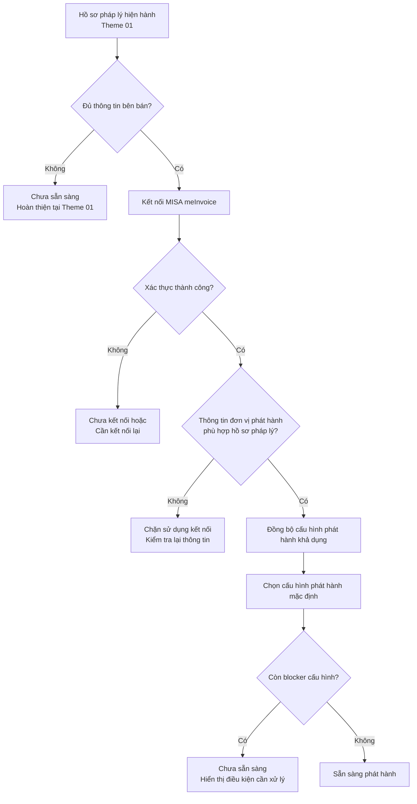


#### 2\.3\.1\.2 Actors, trigger \& entry conditions

|**Thành phần**|**Nội dung**|
|---|---|
|Primary actor|Chủ cửa hàng hoặc người có quyền thiết lập hóa đơn điện tử|
|Supporting actor|Theme 01; MISA meInvoice|
|Trigger|Thiết lập lần đầu, thay đổi kết nối, thay đổi cấu hình hoặc kiểm tra lại readiness|
|Entry point|Thiết lập → Hóa đơn điện tử|
|Preconditions|Tenant hợp lệ; người dùng có quyền; có hồ sơ pháp lý hiện hành|
|Completion condition|Kết nối và cấu hình hợp lệ hoặc hệ thống hiển thị rõ điều kiện còn thiếu|

#### 2\.3\.1\.3 Main flow

- Người dùng mở Thiết lập hóa đơn điện tử\.

- Hệ thống hiển thị hồ sơ pháp lý hiện hành ở chế độ chỉ đọc\.

- Người dùng kết nối với MISA meInvoice\.

- Hệ thống xác thực kết nối và đối chiếu thông tin đơn vị phát hành\.

- Hệ thống đồng bộ cấu hình phát hành khả dụng\.

- Người dùng chọn cấu hình phát hành mặc định\.

- Người dùng thiết lập phát hành tự động và gửi email tự động\.

- Hệ thống đánh giá mức độ sẵn sàng và hiển thị hành động cần thực hiện\.

#### 2\.3\.1\.4 Decisions \& business rules

- Mỗi tenant có tối đa một kết nối đang hoạt động\.

- Mỗi tenant có tối đa một cấu hình mặc định đang hoạt động\.

- Chỉ ghi nhận kết nối hợp lệ khi MISA meInvoice xác thực thành công\.

- Thông tin đơn vị phát hành phải phù hợp với hồ sơ pháp lý hiện hành\.

- Chỉ được chọn cấu hình MISA meInvoice xác nhận có thể sử dụng\.

- Phát hành tự động chỉ được bật khi cấu hình và phương thức ký cho phép\.

- Gửi email tự động chỉ được bật khi provider hỗ trợ gửi email\.

- Thông tin xác thực nhạy cảm không được hiển thị lại nguyên bản\.

- Thay đổi hồ sơ pháp lý có thể làm cấu hình cần kiểm tra lại\.

- Ngắt kết nối không xóa hóa đơn hoặc lịch sử đã phát sinh\.

#### 2\.3\.1\.5 UX states \& touchpoints

|**Trạng thái**|**Ý nghĩa**|**Hành động chính**|
|---|---|---|
|Chưa kết nối|Chưa có kết nối hợp lệ|Kết nối|
|Đã kết nối|Kết nối có thể được sử dụng|Kiểm tra lại|
|Cần kiểm tra lại|Kết nối hoặc hồ sơ pháp lý cần xác minh|Kiểm tra lại|
|Cần kết nối lại|Thông tin xác thực không còn sử dụng được|Kết nối lại|
|Chưa sẵn sàng|Còn blocker bắt buộc|Xử lý blocker|
|Sẵn sàng|Đủ điều kiện sử dụng cấu hình|Đi đến đơn hàng|

#### 2\.3\.1\.6 Exceptions, recovery \& controls

- MISA meInvoice không phản hồi: không ghi nhận kết nối thành công\.

- Thông tin xác thực sai: không thay thế kết nối cũ còn hợp lệ\.

- Đơn vị phát hành không khớp: chặn sử dụng kết nối cho lần phát hành mới\.

- Cấu hình mặc định không còn khả dụng: yêu cầu chọn lại\.

- Kiểm tra thất bại do lỗi tạm thời: không tự kết luận credential đã sai\.

- Mọi thay đổi cấu hình phải được ghi lịch sử\.

#### 2\.3\.1\.7 Outcome \& handoffs

|**Outcome**|**Handoff**|
|---|---|
|Tenant sẵn sàng|CJ\-02 hoặc CJ\-04|
|Kết nối chưa hợp lệ|Tiếp tục CJ\-01|
|Chưa có cấu hình hợp lệ|Tiếp tục CJ\-01|
|Hồ sơ pháp lý chưa đủ|Theme 01|
|Phát hành tự động được bật|CJ\-04 khi đơn hàng đủ điều kiện|

### 2\.3\.2 CJ\-02 — Kiểm tra điều kiện và xem trước hóa đơn từ đơn hàng

#### 2\.3\.2\.1 Purpose \& user context

CJ\-02 giúp người dùng biết một SalesOrder đã đủ điều kiện phát hành hay chưa và nội dung nào dự kiến được sử dụng\.

Khi dữ liệu người mua còn thiếu thông tin bắt buộc, readiness evaluation có thể sử dụng controlled completion từ Theme 03 trước khi kết luận\. `BuyerInvoiceSnapshot` vẫn là dữ liệu nền và mọi giá trị đã có trong snapshot không được thay thế\.

Xem trước không tạo hóa đơn, không sinh số hóa đơn, không tạo `IssuanceAttempt` và không khóa dữ liệu phát hành\.

#### 2\.3\.2\.2 Actors, trigger \& entry conditions

|**Thành phần**|**Nội dung**|
|---|---|
|Primary actor|Kế toán, Chủ cửa hàng hoặc Nhân viên bán hàng có quyền|
|Supporting actor|Theme 01; Theme 03; Theme 05; MISA meInvoice|
|Trigger|Người dùng chọn Xem trước hoặc Phát hành hóa đơn từ đơn hàng|
|Entry point|Kết quả bán hàng hoặc Chi tiết đơn hàng|
|Preconditions|Đơn hàng thuộc tenant và phạm vi người dùng được phép truy cập|
|Completion condition|Hệ thống trả kết quả sẵn sàng, cảnh báo hoặc blocker|

#### 2\.3\.2\.3 Main flow

- Hệ thống kiểm tra quyền và trạng thái SalesOrder\.

- Hệ thống lấy thông tin bên bán hiện hành từ Theme 01\.

- Hệ thống lấy `BuyerInvoiceSnapshot`, `buyer_partner_id`, phiên bản SalesOrder, dòng hàng và giá trị giao dịch từ Theme 05\.

- Hệ thống đánh giá các thông tin người mua bắt buộc còn thiếu\.

- Nếu buyer data chưa đủ điều kiện, completion chưa khóa và có `buyer_partner_id`, Theme 08 resolve hồ sơ hiện hành của đúng đối tác tại Theme 03 cho tập field bắt buộc cần completion\.

- Hệ thống hình thành `EffectiveBuyerInvoiceData` từ `BuyerInvoiceSnapshot` và completion\.

- Nếu `EffectiveBuyerInvoiceData` lần đầu đủ điều kiện về phía người mua, Theme 08 khóa completion\.

- Hệ thống kiểm tra connection và EffectiveIssuanceConfiguration\.

- Hệ thống xác định warning và blocker\.

- Nếu preview được phép, hệ thống xây dựng canonical preview request và yêu cầu MISA meInvoice tạo bản xem trước\.

- Hệ thống hiển thị hoặc mở bản xem trước cùng warning và blocker tương ứng\.

- Chỉ khi toàn bộ issuance readiness cho phép, người dùng mới có thể chuyển sang xác nhận phát hành\.

#### 2\.3\.2\.4 Decisions \& business rules

- Chỉ SalesOrder Hoàn tất mới đủ điều kiện phát hành\.

- SalesOrder đã có ElectronicInvoice không được phát hành thêm hóa đơn gốc\.

- SalesOrder đang có operation phát hành chưa kết thúc không được phát hành mới\.

- Theme 08 không tự thay đổi dữ liệu thương mại\.

- `BuyerInvoiceSnapshot` có precedence cao hơn Theme 03\.

- Theme 08 chỉ resolve Theme 03 khi còn thiếu thông tin người mua bắt buộc và completion của SalesOrder/version hiện hành chưa khóa\.

- Theme 08 không dùng Theme 03 để thay thế field đã tồn tại trong `BuyerInvoiceSnapshot`\.

- Khi buyer data lần đầu đủ điều kiện, completion được khóa và mọi thay đổi Theme 03 sau đó không làm thay đổi dữ liệu người mua hiệu lực\.

- Khách cá nhân hoặc Khách tổ chức không được tự chuyển thành Khách lẻ\.

- Khách tổ chức thiếu mã số thuế sau completion có issuance blocker `BUYER_TAX_CODE_REQUIRED`\.

- `BUYER_TAX_CODE_REQUIRED` không tự động cấm thao tác Kiểm tra \& xem trước nếu provider preview capability cho phép, nhưng luôn chặn phát hành\.

- Nếu còn thiếu field người mua bắt buộc khác mà preview không thể biểu diễn hợp lệ, hệ thống không gửi preview request\.

- Xem trước sử dụng hồ sơ hiện hành của bên bán và `EffectiveBuyerInvoiceData` của SalesOrder\.

- Xem trước không tạo `AttemptSnapshot`\.

- Điều kiện authoritative phải được kiểm tra lại khi bắt đầu phát hành\.

#### 2\.3\.2\.5 UX states \& touchpoints

|Trạng thái|Nội dung hiển thị|Hành động|
|---|---|---|
|Sẵn sàng|Nội dung dự kiến và cấu hình áp dụng|Phát hành hóa đơn|
|Sẵn sàng có cảnh báo|Nội dung dự kiến và warning không chặn|Xem cảnh báo và tiếp tục|
|Chưa sẵn sàng — có thể preview|Blocker phát hành nhưng dữ liệu vẫn đủ để preview, bao gồm thiếu MST của Khách tổ chức|Kiểm tra \& xem trước; không cho Phát hành|
|Chưa sẵn sàng — không thể preview|Blocker làm dữ liệu preview không hợp lệ|Đi đến nơi xử lý|
|Không tải được dữ liệu|Lỗi tải hoặc lỗi tích hợp|Thử lại|
|Đang xử lý|SalesOrder đang có operation phát hành|Theo dõi trạng thái|

Nội dung xem trước phải có nhãn: **“Nội dung dự kiến — Chưa phải hóa đơn chính thức”**\.

#### 2\.3\.2\.6 Exceptions, recovery \& controls

- SalesOrder thay đổi trước khi hoàn tất evaluation: bỏ kết quả cũ và đánh giá lại theo phiên bản mới\.

- Theme 01 hoặc Theme 05 tạm thời không phản hồi: không dùng dữ liệu suy đoán\.

- Theme 03 tạm thời không phản hồi trong khi completion vẫn cần thiết: giữ buyer data chưa đủ điều kiện; không tự điền dữ liệu suy đoán\.

- Theme 03 thay đổi trong khi completion còn mở: lần evaluation hợp lệ tiếp theo có thể resolve lại tập field cần completion\.

- Theme 03 thay đổi sau khi completion đã khóa: bỏ qua đối với pre\-issuance buyer completion\.

- Dữ liệu thương mại không đối chiếu được: chặn phát hành và không tạo preview không hợp lệ\.

- Khách tổ chức vẫn thiếu mã số thuế sau completion: giữ blocker phát hành; preview chỉ tiếp tục khi provider capability cho phép\.

- Cấu hình thay đổi sau khi xem trước: kiểm tra lại khi bắt đầu phát hành\.

#### 2\.3\.2\.7 Outcome \& handoffs

|Outcome|Handoff|
|---|---|
|Sẵn sàng|CJ\-03|
|Sẵn sàng có warning không chặn|CJ\-03|
|Thiếu cấu hình|CJ\-01|
|Buyer completion còn thiếu dữ liệu|Giữ SalesOrder Chưa phát hành; re\-evaluate khi có dữ liệu hoặc evaluation mới|
|Thông tin xuất hóa đơn cần được sửa bằng nghiệp vụ của đơn hàng|Theme 05|
|Dữ liệu đơn hàng chưa hợp lệ|Theme 05|
|Đơn hàng đang được xử lý|CJ\-05|


### 2\.3\.3 CJ\-03 — Phát hành thủ công hóa đơn từ đơn hàng Hoàn tất

#### 2\.3\.3\.1 Purpose \& user context

CJ\-03 cho phép người dùng xác nhận phát hành hóa đơn từ một đơn hàng Hoàn tất\.

Dữ liệu phải được kiểm tra lại và lưu bất biến trước khi gửi yêu cầu\.

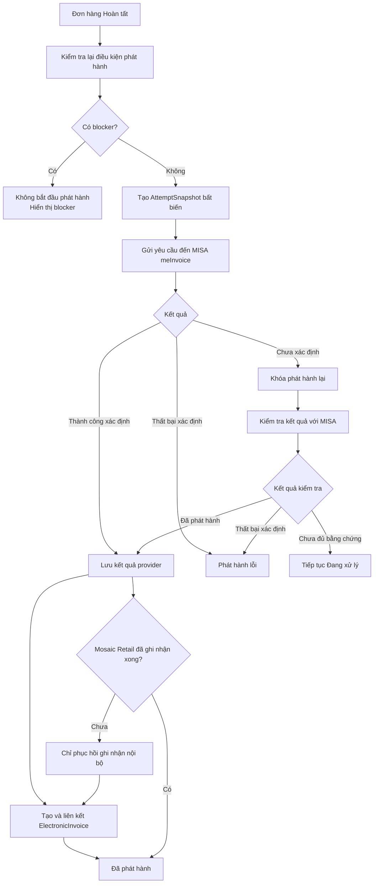

#### 2\.3\.3\.2 Actors, trigger \& entry conditions

|**Thành phần**|**Nội dung**|
|---|---|
|Primary actor|Người dùng có quyền phát hành hóa đơn|
|Supporting actor|Theme 01; Theme 05; MISA meInvoice|
|Trigger|Người dùng xác nhận Phát hành hóa đơn|
|Preconditions|Đơn hàng Hoàn tất; không có blocker; không có hóa đơn hoặc quá trình cạnh tranh|
|Completion condition|Kết quả được xác lập hoặc chuyển sang kiểm tra có kiểm soát|

#### 2\.3\.3\.3 Main flow

- Người dùng xác nhận phát hành từ SalesOrder context\.

- Hệ thống kiểm tra lại permission, SalesOrder, seller data, buyer data, configuration và operation lock\.

- Nếu buyer completion còn mở, hệ thống thực hiện controlled resolve cho tập field bắt buộc còn thiếu và đánh giá lại `EffectiveBuyerInvoiceData`\.

- Nếu buyer data vẫn chưa đủ điều kiện, hệ thống không tạo `IssuanceAttempt` và trả blocker tương ứng\.

- Nếu buyer data lần đầu đủ điều kiện, completion được khóa trước khi dữ liệu buyer được sử dụng cho attempt\.

- Hệ thống tạo hoặc lấy `InvoiceIssuance` ORIGINAL\.

- Hệ thống tạo `IssuanceAttempt` và lưu `AttemptSnapshot` bất biến, trong đó buyer snapshot được sao chép từ `EffectiveBuyerInvoiceData`\.

- Hệ thống xây dựng `CanonicalInvoiceModel` từ `AttemptSnapshot`\.

- Hệ thống gửi yêu cầu đến MISA meInvoice\.

- Hệ thống ghi nhận thành công, thất bại xác định hoặc kết quả chưa rõ\.

- Khi provider thành công, Mosaic Retail hoàn tất ElectronicInvoice và InvoiceSnapshot\.

- Theme 05 nhận projection trạng thái mới\.

#### 2\.3\.3\.4 Decisions \& business rules

- Một SalesOrder chỉ có tối đa một operation phát hành đang hoạt động\.

- Yêu cầu lặp không tạo thêm lần phát hành\.

- `BuyerInvoiceSnapshot` là dữ liệu nền của người mua\.

- Theme 03 chỉ được resolve khi buyer completion còn mở và còn thiếu field bắt buộc\.

- `IssuanceAttempt` chỉ được tạo khi buyer data đã đủ điều kiện và completion, nếu có, đã khóa\.

- Khách tổ chức thiếu mã số thuế là blocker phát hành\.

- Buyer snapshot của attempt được sao chép từ `EffectiveBuyerInvoiceData`, không phải từ hồ sơ Theme 03 hiện hành\.

- Sau khi completion đã khóa, Theme 03 không được resolve lại trước phát hành, phát hành lại hoặc trong technical retry\.

- Dữ liệu đã lưu cho attempt không thay đổi theo dữ liệu nguồn mới\.

- Warning không chặn thực sự vẫn cho phép phát hành\.

- Hóa đơn chỉ hình thành sau khi provider thành công và Mosaic Retail hoàn tất ghi nhận\.

- Kết quả chưa rõ không tự chuyển thành Phát hành lỗi\.

#### 2\.3\.3\.5 UX states \& touchpoints

|Trạng thái|Ý nghĩa|Hành động|
|---|---|---|
|Xác nhận|Người dùng kiểm tra thông tin và cấu hình áp dụng trước side effect|Xác nhận phát hành|
|Đang xử lý|Hệ thống đang chuẩn bị, gửi, chờ kết quả, kiểm tra lại hoặc hoàn tất ghi nhận|Không cho phát hành lại|
|Đã phát hành|MISA meInvoice đã xác nhận thành công và Mosaic Retail đã hoàn tất ghi nhận|Mở Bottom Sheet HĐĐT sau phát hành|
|Phát hành lỗi|Có thất bại xác định và không còn operation đang xử lý|Xử lý nguyên nhân hoặc kiểm tra lại điều kiện phát hành|


Kết quả chưa rõ hoặc đang hoàn tất ghi nhận vẫn hiển thị là Đang xử lý\.

Không tạo trạng thái Cần kiểm tra kết quả ngang hàng với bốn trạng thái phát hành chính\.

Không cung cấp CTA kiểm tra kỹ thuật, retry provider hoặc nhập kết quả thủ công cho người dùng thông thường\.

#### 2\.3\.3\.6 Exceptions, recovery \& controls

- SalesOrder thay đổi sau preview: bỏ readiness cũ và kiểm tra lại phiên bản authoritative\.

- Buyer completion còn mở nhưng Theme 03 không thể resolve: không tạo `IssuanceAttempt`\.

- Buyer completion đã khóa nhưng Theme 03 không khả dụng hoặc đã thay đổi: không ảnh hưởng dữ liệu người mua dùng để phát hành\.

- Không lưu được completion cần khóa hoặc `AttemptSnapshot`: không gọi provider\.

- Provider từ chối xác định: ghi nhận Phát hành lỗi\.

- Mất phản hồi sau khi gửi: khóa phát hành lại và chuyển CJ\-05\.

- Provider thành công nhưng ghi nhận nội bộ chưa xong: chuyển CJ\-05\.

- Kết quả trùng hoặc đến muộn không tạo hóa đơn thứ hai\.

#### 2\.3\.3\.7 Outcome \& handoffs

|**Outcome**|**Handoff**|
|---|---|
|Đã phát hành|CJ\-06 và CJ\-07 nếu gửi tự động|
|Phát hành lỗi|CJ\-02 hoặc thử lại CJ\-03|
|Chưa xác định kết quả|CJ\-05|
|Đang hoàn tất ghi nhận|CJ\-05|
|Điều kiện không còn hợp lệ|CJ\-02|

### 2\.3\.4 CJ\-04 — Tự động phát hành hóa đơn khi đơn hàng đủ điều kiện

#### 2\.3\.4\.1 Purpose \& user context

CJ\-04 tự động phát hành khi đơn hàng và cấu hình đáp ứng chính sách\.

Luồng tự động sử dụng cùng readiness, snapshot, phát hành và recovery như CJ\-03\.

#### 2\.3\.4\.2 Actors, trigger \& entry conditions

|**Thành phần**|**Nội dung**|
|---|---|
|Primary actor|Hệ thống theo chính sách đã thiết lập|
|Supporting actor|Theme 05; Theme 03; Theme 01; MISA meInvoice |
|Trigger|Đơn hàng Hoàn tất và thuộc phạm vi chính sách tự động|
|Preconditions|Chính sách đang bật; cấu hình hợp lệ; phương thức ký được hỗ trợ|
|Completion condition|Hóa đơn được phát hành hoặc quá trình dừng an toàn với lý do rõ ràng|

#### 2\.3\.4\.3 Main flow

- Hệ thống nhận trigger SalesOrder Hoàn tất hoặc một tín hiệu hợp lệ yêu cầu re\-evaluate automatic issuance\.

- Hệ thống kiểm tra AutomationPolicy hiện hành\.

- Hệ thống kiểm tra SalesOrder, cấu hình và buyer data\.

- Nếu buyer data còn thiếu field bắt buộc và completion chưa khóa, Theme 08 resolve đúng `buyer_partner_id` tại Theme 03 cho tập field cần completion\.

- Hệ thống xây dựng `EffectiveBuyerInvoiceData` và đánh giá lại buyer data readiness\.

- Nếu buyer data vẫn chưa đủ điều kiện, hệ thống không tạo `IssuanceAttempt`, giữ blocker và completion ở trạng thái mở\.

- Khi buyer data lần đầu đủ điều kiện, hệ thống khóa completion\.

- Hệ thống kiểm tra lại policy, configuration readiness và các blocker còn lại\.

- Nếu toàn bộ điều kiện cho phép, hệ thống tạo `InvoiceIssuance`, `IssuanceAttempt` và `AttemptSnapshot`\.

- Hệ thống thực hiện cùng provider flow và result handling như CJ\-03\.

- Khi thành công, hệ thống cập nhật projection và kích hoạt auto\-send nếu policy cho phép\.

#### 2\.3\.4\.4 Decisions \& business rules

- Trigger hoặc re\-evaluation lặp không tạo process hoặc attempt trùng\.

- Phát hành tự động không bỏ qua blocker\.

- Khách tổ chức thiếu mã số thuế là blocker phát hành tự động\.

- Warning không chặn thực sự vẫn cho phép automatic issuance tiếp tục\.

- `BuyerInvoiceSnapshot` có precedence cao hơn Theme 03\.

- Theme 03 chỉ được resolve khi buyer completion còn mở và buyer data còn thiếu thông tin bắt buộc\.

- Khi buyer data lần đầu đủ điều kiện, completion được khóa\.

- Sau khi completion đã khóa, thay đổi Theme 03 không kích hoạt refresh buyer data hoặc thay đổi dữ liệu dùng cho automatic issuance\.

- Một thay đổi Theme 03 chỉ có thể kích hoạt re\-evaluation đối với SalesOrder có completion còn mở và đúng `buyer_partner_id`\.

- Policy và configuration phải được kiểm tra lại trước khi attempt thực sự bắt đầu\.

- Policy áp dụng được lưu vào `AttemptSnapshot`\.

- Thay đổi policy sau khi attempt bắt đầu không ảnh hưởng attempt đang xử lý\.

- Không retry provider vô hạn khi thiếu dữ liệu hoặc cấu hình; trường hợp chưa đủ điều kiện dừng trước provider call và chờ evaluation hợp lệ tiếp theo\.

#### 2\.3\.4\.5 UX states \& touchpoints

|**Trạng thái nội bộ**|**Hiển thị trên đơn hàng**|
|---|---|
|Đang chuẩn bị|Đang xử lý|
|Có blocker|Chưa phát hành kèm hành động xử lý|
|Đã gửi yêu cầu|Đang xử lý|
|Đã phát hành|Đã phát hành|
|Lỗi xác định|Phát hành lỗi|
|Kết quả chưa rõ|Đang xử lý kèm cảnh báo|

#### 2\.3\.4\.6 Exceptions, recovery \& controls

- Trigger được gửi lại: tiếp tục process hiện có\.

- Policy bị tắt trước khi attempt bắt đầu: không tạo attempt\.

- Buyer completion còn mở và Theme 03 tạm thời không đọc được: retry kỹ thuật theo policy trước provider call; không tự suy đoán buyer data\.

- Relevant buyer data thay đổi tại Theme 03 khi completion còn mở: cho phép re\-evaluate idempotent\.

- Buyer data thay đổi tại Theme 03 sau khi completion đã khóa: không re\-resolve cho SalesOrder đó\.

- Dữ liệu nguồn hoặc configuration tạm thời không tải được: retry theo giới hạn trước provider call\.

- Mất phản hồi sau provider call hoặc local finalization chưa hoàn tất: chuyển CJ\-05\.

#### 2\.3\.4\.7 Outcome \& handoffs

|Outcome|Handoff|
|---|---|
|Đã phát hành|CJ\-06 và CJ\-07 nếu gửi tự động|
|Phát hành lỗi|CJ\-02 hoặc CJ\-03|
|Chưa xác định kết quả|CJ\-05|
|Thiếu cấu hình|CJ\-01|
|Buyer completion còn mở|Giữ Chưa phát hành; re\-evaluate khi có tín hiệu hợp lệ|
|Thông tin đơn hàng cần sửa bằng nghiệp vụ nguồn|Theme 05|
|Chính sách không còn áp dụng|Không phát hành tự động|

### 2\.3\.5 CJ\-05 — Kiểm tra và xác lập kết quả phát hành bất thường

#### 2\.3\.5\.1 Purpose \& user context

CJ\-05 xử lý các trường hợp:

- Mosaic Retail đã gửi yêu cầu phát hành nhưng chưa xác định MISA meInvoice đã phát hành hóa đơn hay chưa\.

- MISA meInvoice đã phát hành thành công nhưng Mosaic Retail chưa hoàn tất ghi nhận ElectronicInvoice hoặc InvoiceSnapshot\.

- Response, callback hoặc kết quả kiểm tra đến trễ, thiếu dữ liệu hoặc không thống nhất\.

Mục tiêu là để hệ thống tự động xác lập đúng kết quả, hoàn tất ghi nhận khi provider đã thành công và ngăn tạo yêu cầu phát hành trùng\.

CJ\-05 là hành trình xử lý của hệ thống\.

Người dùng chỉ quan sát trạng thái Đang xử lý tại Kết quả bán hàng hoặc Chi tiết đơn hàng; CJ\-05 không có màn xử lý riêng trong MVP\.

**Sơ đồ kiểm tra và xác lập kết quả phát hành**

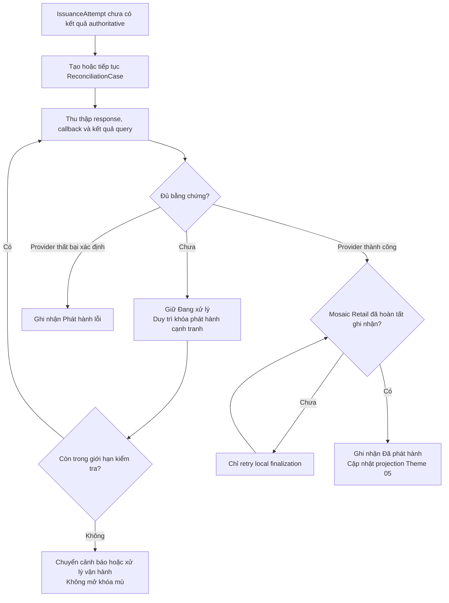


#### 2\.3\.5\.2 Actors, trigger \& entry conditions

|Thành phần|Nội dung|
|---|---|
|Primary actor|Hệ thống|
|Supporting actor|MISA meInvoice; Theme 05; Theme 11 hoặc bộ phận vận hành khi cần|
|Trigger|Mất phản hồi sau provider call; kết quả chưa đầy đủ; callback đến trễ; provider success nhưng local finalization chưa hoàn tất|
|Entry point|Tự động từ CJ\-03 hoặc CJ\-04; không có entry độc lập trong navigation|
|Preconditions|Có IssuanceAttempt hoặc bằng chứng phát hành cần xác lập; operation cạnh tranh đang bị khóa|
|Completion condition|Xác lập thành công, thất bại xác định hoặc chuyển xử lý vận hành có kiểm soát|


#### 2\.3\.5\.3 Main flow

- Hệ thống tạo hoặc tiếp tục ReconciliationCase cho IssuanceAttempt hiện hành\.

- Hệ thống tổng hợp response, callback, provider reference và kết quả query\.

- Hệ thống đối chiếu bằng chứng với AttemptSnapshot và idempotency identity\.

- Khi chưa đủ bằng chứng, hệ thống tiếp tục kiểm tra theo policy và giữ trạng thái Đang xử lý trên đơn hàng\.

- Khi xác định provider chưa tạo hóa đơn, hệ thống ghi nhận thất bại xác định và gỡ khóa theo rule\.

- Khi xác định provider đã phát hành, hệ thống tạo hoặc hoàn tất ElectronicInvoice và InvoiceSnapshot\.

- Hệ thống cập nhật projection để Theme 05 hiển thị Đã phát hành hoặc Phát hành lỗi\.

- Nếu vượt giới hạn kiểm tra mà vẫn không đủ bằng chứng, hệ thống chuyển cảnh báo hoặc xử lý vận hành và tiếp tục khóa operation cạnh tranh\.

#### 2\.3\.5\.4 Decisions \& business rules

- Timeout hoặc mất phản hồi không được tự coi là Phát hành lỗi\.

- Kết quả chưa rõ không được cho phép phát hành lại\.

- Response, callback và query result phải được áp dụng idempotent\.

- Kết quả thành công đã được xác lập không được bị ghi đè bởi kết quả thất bại đến muộn\.

- Có nhiều kết quả có khả năng tương ứng với cùng attempt thì không được tự chọn một kết quả\.

- Provider reference hoặc dữ liệu đối chiếu không phù hợp AttemptSnapshot thì không được tự áp dụng\.

- Provider đã thành công nhưng local finalization thất bại thì chỉ retry ghi nhận nội bộ, không gọi phát hành lại\.

- ElectronicInvoice đã tồn tại thì sử dụng bản ghi hiện có, không tạo hóa đơn thứ hai\.

- Projection Theme 05 có thể được dựng lại từ authoritative state, không gọi lại MISA meInvoice để phát hành\.

- Mọi evidence, lần kiểm tra và thay đổi trạng thái phải được ghi lịch sử\.

- CJ\-05 không cung cấp manual result entry, override duplicate\-risk hoặc CTA retry kỹ thuật cho người dùng thông thường\.

#### 2\.3\.5\.5 UX states \& touchpoints


|Trạng thái hệ thống|Hiển thị tại màn nguồn|Hành động người dùng|
|---|---|---|
|Đang chờ hoặc đang kiểm tra kết quả|Đang xử lý|Không phát hành lại|
|Provider thành công, đang hoàn tất ghi nhận|Đang xử lý|Không phát hành lại|
|Đã xác lập thành công và hoàn tất ghi nhận|Đã phát hành|Mở Bottom Sheet HĐĐT sau phát hành|
|Đã xác lập thất bại|Phát hành lỗi|Xử lý nguyên nhân hoặc bắt đầu lại từ CJ\-02/CJ\-03|
|Chưa thể xác định sau giới hạn tự động|Đang xử lý; cảnh báo vận hành được tạo ngoài luồng người dùng thông thường|Không phát hành lại|


Người dùng không xem raw evidence, callback, retry count, provider payload hoặc các bước reconciliation nội bộ\.

#### 2\.3\.5\.6 Exceptions, recovery \& controls

- MISA meInvoice tạm thời không phản hồi: giữ trạng thái hiện hành và áp dụng backoff\.

- Callback đến khi query đang chạy: áp dụng kết quả theo cơ chế idempotent\.

- Kết quả thất bại đến sau khi attempt đã thành công: lưu evidence nhưng không chuyển ngược trạng thái\.

- Ghi ElectronicInvoice hoặc InvoiceSnapshot thất bại sau provider success: chỉ retry local finalization\.

- Cập nhật projection thất bại: dựng lại projection từ authoritative state\.

- Không tìm được kết quả duy nhất: chuyển xử lý vận hành hoặc cảnh báo Theme 11\.

- Người dùng rời ứng dụng, refresh hoặc mở lại đơn hàng không được tạo request phát hành mới\.

#### 2\.3\.5\.7 Outcome \& handoffs


|Outcome|Handoff|
|---|---|
|Xác nhận đã phát hành và hoàn tất ghi nhận|Cập nhật màn nguồn thành Đã phát hành; cho phép CJ\-06 và CJ\-07|
|Xác nhận request không tạo hóa đơn|Cập nhật Phát hành lỗi; quay CJ\-02 hoặc CJ\-03 khi đủ điều kiện|
|Provider thành công nhưng Mosaic Retail chưa hoàn tất ghi nhận|Tiếp tục CJ\-05 cho đến khi local finalization hoàn tất|
|Chưa đủ bằng chứng và còn trong giới hạn kiểm tra|Hệ thống tự động tiếp tục CJ\-05|
|Không thể xác định sau giới hạn kiểm tra|Chuyển cảnh báo hoặc xử lý vận hành; tiếp tục khóa phát hành cạnh tranh|
|Phát hiện ElectronicInvoice đã tồn tại|Sử dụng bản ghi hiện có, cập nhật màn nguồn thành Đã phát hành và không tạo hóa đơn mới|

### 2\.3\.6 CJ\-06 — Xem hồ sơ và tài liệu hóa đơn đã phát hành

#### 2\.3\.6\.1 Purpose \& user context

CJ\-06 cho phép người dùng từ đơn hàng nguồn:

- Mở bản hóa đơn chính thức do MISA meInvoice cung cấp\.

- Lưu bản PDF hoặc tệp XML chính thức\.

ElectronicInvoice và InvoiceSnapshot vẫn được Mosaic Retail lưu làm hồ sơ authoritative phục vụ audit, đối soát, projection và khôi phục\.

Việc lưu hồ sơ authoritative không đồng nghĩa Mosaic Retail phải dựng một màn hồ sơ hóa đơn pháp lý riêng trong MVP\.

**Sơ đồ xem hóa đơn và lấy tài liệu**

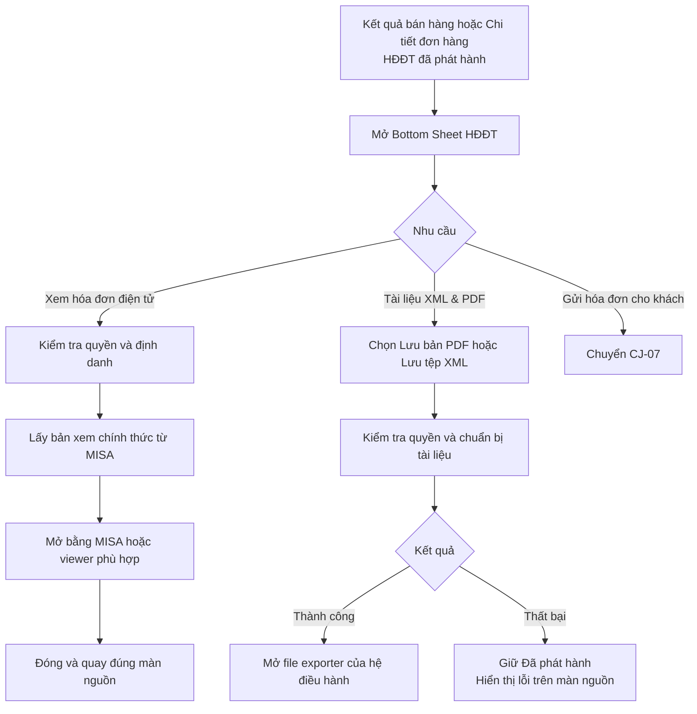


#### 2\.3\.6\.2 Actors, trigger \& entry conditions


|Thành phần|Nội dung|
|---|---|
|Primary actor|Người dùng có quyền xem hóa đơn hoặc lấy tài liệu|
|Supporting actor|Theme 05; MISA meInvoice; hệ điều hành thiết bị|
|Trigger|Người dùng mở row Hóa đơn điện tử của đơn hàng đã phát hành|
|Entry point|Kết quả bán hàng hoặc Chi tiết đơn hàng|
|Preconditions|ElectronicInvoice đã được ghi nhận; đúng tenant, data scope và permission|
|Completion condition|Bản hóa đơn chính thức được mở, tài liệu được chuyển cho file exporter hoặc lỗi được phản hồi mà không thay đổi trạng thái phát hành|


#### 2\.3\.6\.3 Main flow

- Người dùng mở row Hóa đơn điện tử tại Kết quả bán hàng hoặc Chi tiết đơn hàng\.

- Hệ thống hiển thị Bottom Sheet HĐĐT sau phát hành\.

- Khi chọn Xem hóa đơn điện tử, hệ thống kiểm tra quyền và định danh ElectronicInvoice\.

- Hệ thống yêu cầu hoặc resolve bản xem chính thức từ MISA meInvoice\.

- Hệ thống chuyển bản xem sang MISA meInvoice hoặc viewer phù hợp\.

- Khi người dùng đóng viewer, hệ thống quay lại đúng màn nguồn\.

- Khi chọn Tài liệu XML \& PDF, hệ thống hiển thị lựa chọn Lưu bản PDF hoặc Lưu tệp XML\.

- Sau khi người dùng chọn loại tài liệu, hệ thống kiểm tra quyền và chuẩn bị tệp chính thức\.

- Trong thời gian xử lý, CTA giữ nguyên nội dung, bị khóa và hiển thị spinner\.

- Khi tệp sẵn sàng, hệ thống chuyển sang file exporter của hệ điều hành\.

- Nếu mở hoặc lấy tài liệu thất bại, hệ thống hiển thị lỗi trên màn nguồn và giữ trạng thái Đã phát hành\.

- Khi người dùng chọn Gửi hóa đơn cho khách, hệ thống chuyển CJ\-07\.

#### 2\.3\.6\.4 Decisions \& business rules

- Chỉ ElectronicInvoice đã được ghi nhận authoritative mới được mở hoặc lấy tài liệu\.

- Bản hóa đơn chính thức, XML và PDF phải do MISA meInvoice hoặc nguồn chính thức của provider cung cấp\.

- Mosaic Retail không tự dựng bản hóa đơn pháp lý từ InvoiceSnapshot\.

- InvoiceSnapshot vẫn phải được bảo toàn để audit và đối soát\.

- Mở bản hóa đơn không tạo IssuanceAttempt hoặc document operation không cần thiết\.

- Chọn PDF chỉ tạo hoặc tiếp tục operation PDF; chọn XML chỉ tạo hoặc tiếp tục operation XML\.

- Retry kỹ thuật của document operation không tạo hóa đơn mới\.

- Lỗi viewer, file exporter hoặc retrieval không làm thay đổi trạng thái Đã phát hành\.

- Không cung cấp sửa, hủy, điều chỉnh hoặc thay thế hóa đơn trong MVP\.

#### 2\.3\.6\.5 UX states \& touchpoints


|Touchpoint hoặc trạng thái|Nội dung|Hành động|
|---|---|---|
|Bottom Sheet sau phát hành|Xem hóa đơn điện tử; Tài liệu XML \& PDF; Gửi hóa đơn cho khách|Chọn nhu cầu|
|Đang mở hóa đơn|Giữ nguyên CTA Xem hóa đơn điện tử và helper|Không thao tác lặp|
|Chọn tài liệu|Lưu bản PDF; Lưu tệp XML|Chọn một loại tài liệu|
|Đang chuẩn bị PDF|Giữ nguyên CTA Lưu bản PDF và helper|Không thao tác lặp trên PDF|
|Đang chuẩn bị XML|Giữ nguyên CTA Lưu tệp XML và helper|Không thao tác lặp trên XML|
|Mở hoặc lấy thất bại|Toast hoặc feedback trên đúng màn nguồn|Thử lại bằng action tương ứng khi phù hợp|
|Hoàn tất xem hoặc lưu|Quay đúng Kết quả bán hàng hoặc Chi tiết đơn hàng|Tiếp tục làm việc trên đơn hàng|


#### 2\.3\.6\.6 Exceptions, recovery \& controls

- Không resolve được ElectronicInvoice: không mở bản xem hoặc tài liệu\.

- MISA meInvoice tạm thời không phản hồi: giữ trạng thái Đã phát hành và phản hồi lỗi thao tác\.

- Bản xem không mở được: không thay bằng bản do Mosaic Retail dựng từ snapshot\.

- PDF hoặc XML chưa sẵn sàng: tiếp tục operation có kiểm soát hoặc báo chưa thể chuẩn bị\.

- File exporter bị hủy: quay màn nguồn, không coi là lỗi phát hành hoặc lỗi tài liệu authoritative\.

- Người dùng rời ứng dụng rồi quay lại: resolve operation hiện hành trước khi cho tạo operation mới\.

- Truy cập ngoài tenant, data scope hoặc permission: từ chối mà không làm lộ tài liệu\.

#### 2\.3\.6\.7 Outcome \& handoffs


|Outcome|Handoff|
|---|---|
|Mở được bản hóa đơn chính thức|Viewer phù hợp; đóng viewer quay đúng màn nguồn|
|Chuẩn bị được PDF hoặc XML|File exporter của hệ điều hành; đóng exporter quay đúng màn nguồn|
|Cần gửi hóa đơn|CJ\-07|
|Mở hoặc lấy tài liệu thất bại|Giữ màn nguồn và trạng thái Đã phát hành|
|Không có quyền|Kết thúc thao tác với phản hồi bị chặn|

### 2\.3\.7 CJ\-07 — Gửi, gửi lại và theo dõi kết quả gửi hóa đơn qua email

#### 2\.3\.7\.1 Purpose \& user context

CJ\-07 giúp người dùng hoặc hệ thống gửi hóa đơn đã phát hành qua email bằng khả năng do MISA meInvoice hỗ trợ\.

Journey bao gồm gửi tự động, gửi thủ công, gửi lại, lưu lịch sử từng delivery intent và xác lập kết quả gửi\.

**Sơ đồ gửi và gửi lại hóa đơn**

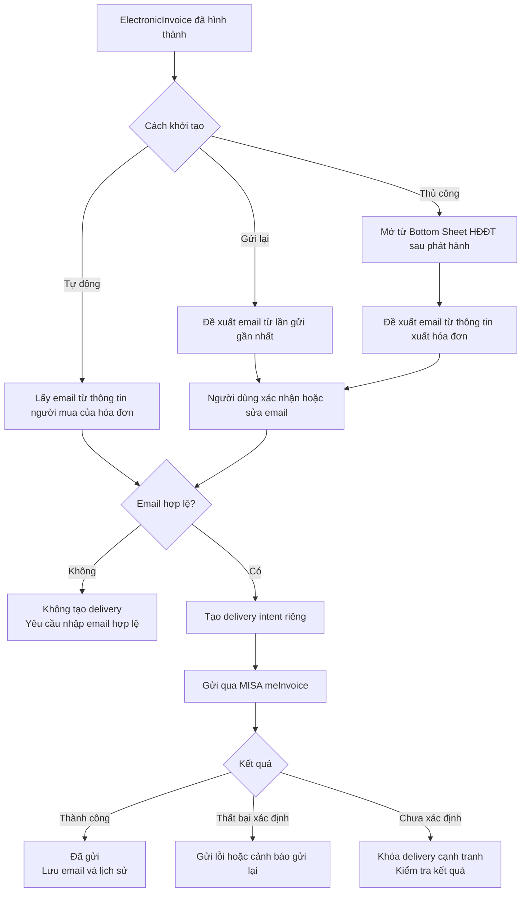


#### 2\.3\.7\.2 Actors, trigger \& entry conditions


|Thành phần|Nội dung|
|---|---|
|Primary actor|Người dùng có quyền gửi hóa đơn hoặc hệ thống theo chính sách gửi tự động|
|Supporting actor|Theme 05; MISA meInvoice|
|Trigger|Người dùng chọn Gửi hóa đơn cho khách; chọn Gửi lại; hoặc auto\-send được kích hoạt sau phát hành thành công|
|Entry point|Bottom Sheet HĐĐT sau phát hành; auto\-send không có entry UI|
|Preconditions|ElectronicInvoice đã tồn tại; đúng tenant và permission; không có delivery cạnh tranh chưa xác lập|
|Completion condition|Delivery được xác lập thành công, thất bại hoặc tiếp tục kiểm tra có kiểm soát|


#### 2\.3\.7\.3 Main flow

- Với gửi thủ công, người dùng mở Gửi hóa đơn cho khách từ Bottom Sheet HĐĐT sau phát hành\.

- Hệ thống đề xuất email từ thông tin xuất hóa đơn đã lưu theo đơn hàng khi có\.

- Nếu chưa có email, field để trống và người dùng nhập email\.

- Với gửi lại, hệ thống đề xuất email từ lần gửi gần nhất\.

- Email có thể được sửa trước khi gửi và chỉ áp dụng cho delivery hiện tại\.

- Hệ thống kiểm tra định dạng email, quyền và delivery lock\.

- Khi hợp lệ, hệ thống tạo một InvoiceDelivery riêng và gửi qua MISA meInvoice\.

- Trong trạng thái loading, field bị khóa, CTA giữ nguyên nhãn Gửi hóa đơn và helper email không thay đổi\.

- Hệ thống ghi nhận thành công, thất bại xác định hoặc kết quả chưa rõ\.

- Khi đã có ít nhất một delivery intent, người dùng có thể mở Lịch sử gửi\.

- Lịch sử hiển thị riêng kết quả, email, thời điểm và chủ thể khởi tạo của từng delivery\.

- Đóng Bottom Sheet hoặc quay từ lịch sử phải trở về đúng Kết quả bán hàng hoặc Chi tiết đơn hàng đã khởi tạo thao tác\.

#### 2\.3\.7\.4 Decisions \& business rules

- Chỉ hóa đơn đã phát hành mới được gửi\.

- Mỗi lần gửi, auto\-send hoặc gửi lại tạo một business delivery riêng\.

- Retry kỹ thuật tiếp tục trong cùng business delivery\.

- Email nhập khi gửi không cập nhật hồ sơ Theme 03, thông tin xuất hóa đơn trên đơn hàng hoặc InvoiceSnapshot\.

- Email thực tế được gửi phải được lưu trong InvoiceDelivery\.

- Yêu cầu lặp không tạo delivery trùng\.

- Không bắt đầu delivery cạnh tranh khi kết quả hiện tại chưa được xác lập\.

- Nếu auto\-send không có email hợp lệ, không tạo delivery và giữ trạng thái Chưa gửi\.

- Nếu đã từng gửi thành công, lần gửi lại đang xử lý, thất bại hoặc chưa rõ không làm mất trạng thái chính Đã gửi\.

- Lịch sử delivery là bất biến; gửi lại không ghi đè lần gửi trước\.

- Việc provider xác nhận đã gửi không được suy diễn thành người nhận đã mở hoặc đọc email\.

#### 2\.3\.7\.5 UX states \& touchpoints


|Trạng thái|Ý nghĩa|Hành động|
|---|---|---|
|Chưa gửi|Chưa từng có delivery thành công|Gửi hóa đơn|
|Đang gửi|Chưa từng gửi thành công và có delivery đang xử lý|Không gửi cạnh tranh|
|Đã gửi|Đã có ít nhất một delivery thành công|Gửi lại; xem lịch sử khi có|
|Gửi lỗi|Chưa từng gửi thành công và delivery gần nhất thất bại xác định|Gửi lại|
|Kết quả chưa rõ|Chưa từng gửi thành công và delivery hiện tại cần xác lập|Không gửi cạnh tranh|


Nếu đã từng gửi thành công:

- Lần gửi lại đang xử lý: trạng thái chính vẫn là Đã gửi; hiển thị thông tin phụ Đang gửi lại\.

- Lần gửi lại thất bại: trạng thái chính vẫn là Đã gửi; hiển thị thông tin phụ Lần gửi lại thất bại\.

- Lần gửi lại chưa rõ: trạng thái chính vẫn là Đã gửi; hiển thị thông tin phụ Lần gửi lại đang được kiểm tra\.

Helper email trong các trạng thái bình thường và loading là: **Email chỉ áp dụng cho lần gửi này\.**

Khi email không hợp lệ, helper tạm thời được thay bằng: **Email không đúng định dạng\.**

#### 2\.3\.7\.6 Exceptions, recovery \& controls

- Email không hợp lệ: không tạo delivery\.

- Provider từ chối xác định: ghi nhận thất bại xác định\.

- Mất phản hồi sau khi gửi: không tự gửi lại; chuyển kiểm tra kết quả\.

- Hệ thống dừng trước provider call: tiếp tục cùng delivery khi retry\.

- Provider thành công nhưng Mosaic Retail chưa lưu xong: chỉ hoàn tất ghi nhận nội bộ\.

- Hai người dùng cùng gửi: chỉ một delivery hợp lệ được tạo; operation còn lại bị chặn\.

- Người dùng đóng Bottom Sheet trong khi gửi: operation tiếp tục server\-side và được resolve khi mở lại\.

- Email trong lịch sử, log và read model phải được bảo vệ theo permission\.

- Lỗi gửi không làm thay đổi nội dung, tài liệu hoặc trạng thái phát hành\.

#### 2\.3\.7\.7 Outcome \& handoffs


|Outcome|Handoff|
|---|---|
|Đã gửi|Cập nhật trạng thái gửi trên đơn hàng nguồn; cho phép xem lịch sử|
|Gửi lỗi|Giữ đơn hàng nguồn; cho phép Gửi lại khi đủ điều kiện|
|Chưa xác định|Tiếp tục xác lập trong CJ\-07 và khóa delivery cạnh tranh|
|Gửi lại thành công|Thêm delivery mới vào lịch sử; trạng thái chính Đã gửi|
|Gửi lại thất bại hoặc chưa rõ|Giữ trạng thái chính Đã gửi và hiển thị thông tin phụ|
|Đóng Bottom Sheet hoặc lịch sử|Quay đúng Kết quả bán hàng hoặc Chi tiết đơn hàng đã khởi tạo thao tác|

# 3\. Domain foundation

## 3\.1 Domain map

### 3\.1\.1 Overview

Theme 08 gồm bốn business domain và một nhóm Cross\-cutting Foundations\.

|**Domain / foundation**|**Type**|**Trách nhiệm cốt lõi**|
|---|---|---|
|Invoice Configuration|Supporting Domain|Quản lý kết nối MISA meInvoice, cấu hình phát hành, chính sách tự động và readiness|
|Invoice Issuance|Core Domain<br>|Quản lý buyer completion trước phát hành, readiness, đóng băng dữ liệu, phát hành và xác lập kết quả|
|Electronic Invoice|Supporting Domain|Quản lý hồ sơ authoritative, nội dung bất biến, định danh provider, quyền truy cập bản xem chính thức và tài liệu hóa đơn|
|Invoice Delivery|Supporting Domain|Quản lý gửi tự động, gửi thủ công, gửi lại và kết quả gửi|
|Cross\-cutting Foundations|Shared Foundation|Cung cấp tích hợp provider, chống trùng, đối soát, recovery, audit và read layer|

Nguyên tắc phân chia:

- Invoice Issuance là Core Domain vì sở hữu quyết định bắt đầu và xác lập kết quả phát hành\.

- Invoice Configuration chỉ sở hữu cấu hình Theme 08, không sở hữu hồ sơ pháp lý\.

- Electronic Invoice chỉ hình thành sau provider success và authoritative commit\.

- Invoice Delivery có lifecycle độc lập với phát hành\.

- Theme 08 không sở hữu Tenant, hồ sơ pháp lý, hồ sơ đối tác, SalesOrder hoặc dữ liệu thương mại nguồn\.

- Theme 08 không có `InvoiceIssuer`, `IssuerUnitAssignment` hoặc danh sách hóa đơn độc lập\.

### 3\.1\.2 Domain tree

```Plain Text

Theme 08 — Electronic Invoice
├── Invoice Configuration — Supporting Domain
│   ├── Aggregate Root — ProviderConnection
│   │   └── Embedded Structure — ProviderCapabilitiesSnapshot
│   ├── Aggregate Root — IssuanceProfile
│   ├── Aggregate Root — AutomationPolicy
│   └── Read Model — ConfigurationReadiness
├── Invoice Issuance — Core Domain
│   ├── Process Entity — BuyerInvoiceCompletion
│   ├── Aggregate Root — InvoiceIssuance
│   │   └── Process Entity — IssuanceAttempt
│   │       └── Embedded Structure — AttemptSnapshot
│   ├── Runtime Structure — EffectiveBuyerInvoiceData
│   ├── Runtime Structure — CanonicalInvoiceModel
│   └── Read Model — IssuanceReadiness
├── Electronic Invoice — Supporting Domain
│   └── Aggregate Root — ElectronicInvoice
│       ├── Embedded Structure — InvoiceSnapshot
│       ├── Child Entity — InvoiceDocument
│       └── Owned History — ProviderObservationRecord
├── Invoice Delivery — Supporting Domain
│   └── Aggregate Root — InvoiceDelivery
│       ├── Embedded Structure — DeliveryRecipientSnapshot
│       └── Process Entity — DeliveryAttempt
└── Cross-cutting Foundations — Shared Foundation
    ├── Provider Integration
    ├── Duplicate Prevention
    ├── Result Reconciliation
    │   └── Process Entity — ReconciliationCase
    ├── Internal Finalization Recovery
    ├── Automatic Trigger Orchestration
    ├── Audit & Security
    └── Read Layer
```

## 3\.2 Domain model overview

### 3\.2\.1 Business flow

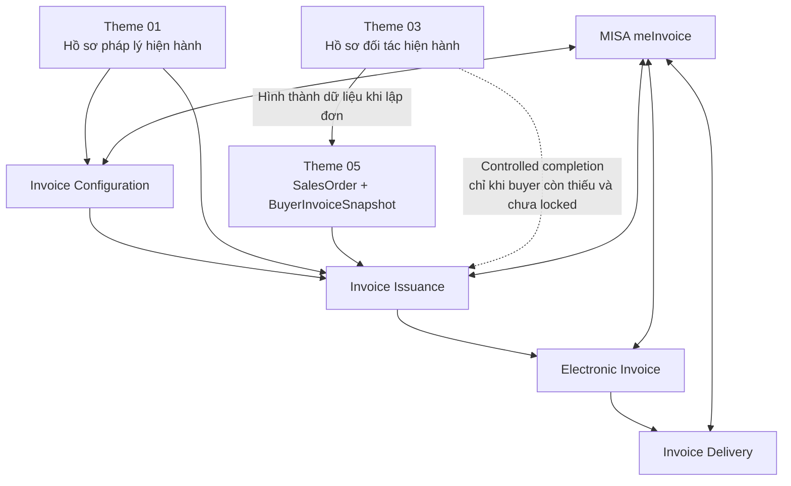

Handoff chính:

- Theme 05 cung cấp SalesOrder, `BuyerInvoiceSnapshot`, `buyer_partner_id`, phiên bản đơn hàng và dữ liệu thương mại cho Invoice Issuance\.

- `BuyerInvoiceSnapshot` là dữ liệu buyer nền và luôn có precedence cao hơn hồ sơ Theme 03\. 

- Theme 03 chỉ tham gia trực tiếp vào Theme 08 khi buyer data còn thiếu thông tin bắt buộc và `BuyerInvoiceCompletion` của SalesOrder/version hiện hành chưa khóa\. 

- Invoice Issuance có thể resolve Theme 03 để hình thành hoặc cập nhật phần completion cho tập field còn thiếu\. 

- Khi buyer data lần đầu đủ điều kiện, `BuyerInvoiceCompletion` được khóa và Theme 03 rời khỏi pre\-issuance data path của SalesOrder đó\. 

- Invoice Configuration cung cấp connection, profile, policy và configuration readiness\. 

- Invoice Issuance sử dụng seller data hiện hành, `BuyerInvoiceSnapshot`, completion đã khóa và dữ liệu thương mại để tạo `AttemptSnapshot`\. 

- Electronic Invoice hình thành từ successful attempt và sở hữu hồ sơ authoritative của hóa đơn\.

- Bản xem chính thức, XML và PDF được resolve từ MISA meInvoice dựa trên định danh của ElectronicInvoice\.

- Invoice Delivery chỉ bắt đầu sau khi ElectronicInvoice hình thành\.

- Luồng thủ công và tự động sử dụng cùng source\-data invariant\.

### 3\.2\.2 Domain–aggregate relationships and creation rules


|Domain owner|Aggregate root|Thành phần thuộc aggregate|Quan hệ ngoài aggregate|Quy tắc tạo|
|---|---|---|---|---|
|Invoice Configuration|ProviderConnection|ProviderCapabilitiesSnapshot|Tham chiếu tenant sở hữu cấu hình|Tạo khi kết nối MISA meInvoice được xác thực thành công|
|Invoice Configuration|ProviderConnection|ProviderCapabilitiesSnapshot, ProviderTemplate|Tham chiếu tenant sở hữu cấu hình|ProviderConnection được tạo khi kết nối MISA meInvoice được xác thực thành công; ProviderTemplate được ghi nhận hoặc cập nhật từ dữ liệu MISA meInvoice hoặc adapter xác nhận|
|Invoice Configuration|SigningConfiguration|Không có entity con trong phạm vi hiện tại|Tham chiếu tenant và ProviderConnection cùng tenant|Được ghi nhận từ hình thức ký hoặc chế độ không ký mà adapter xác nhận Mosaic Retail có thể hỗ trợ|
|Invoice Configuration|EffectiveIssuanceConfiguration|Không có entity con trong phạm vi hiện tại|Tham chiếu đúng một ProviderTemplate và một SigningConfiguration cùng tenant và provider context|Được tạo hoặc cập nhật khi người dùng lưu tổ hợp mặc định và adapter xác nhận tổ hợp tương thích|
|Invoice Configuration|AutomationPolicy|Không có entity con|Tham chiếu tenant và capability của cấu hình phát hành hiệu lực|Được tạo hoặc cập nhật khi người dùng lưu chính sách phát hành hoặc gửi tự động|
|Invoice Issuance|InvoiceIssuance|IssuanceAttempt; AttemptSnapshot thuộc IssuanceAttempt|Tham chiếu đúng một SalesOrder; IssuanceAttempt tham chiếu ProviderConnection và IssuanceProfile thực tế được sử dụng|Tạo khi lần phát hành đầu tiên thực sự bắt đầu|
|Electronic Invoice|ElectronicInvoice|InvoiceSnapshot, InvoiceDocument, ProviderObservationRecord|Tham chiếu InvoiceIssuance, successful IssuanceAttempt và SalesOrder nguồn|Chỉ tạo khi MISA meInvoice xác nhận phát hành thành công và Mosaic Retail hoàn tất authoritative local commit|
|Invoice Delivery|InvoiceDelivery|DeliveryRecipientSnapshot, DeliveryAttempt|Tham chiếu đúng một ElectronicInvoice|Tạo cho mỗi business intent gửi hoặc gửi lại hóa đơn|

```Markdown
`BuyerInvoiceCompletion` là persisted process entity thuộc Invoice Issuance domain nhưng có thể tồn tại trước `InvoiceIssuance`, vì completion được hình thành trong readiness stage trước khi một business issuance thực sự bắt đầu.
Quy tắc của `BuyerInvoiceCompletion`:
1. Gắn với đúng một tenant, SalesOrder, SalesOrder version và `buyer_partner_id`.
2. Chỉ được tạo khi `BuyerInvoiceSnapshot` còn thiếu ít nhất một thông tin người mua bắt buộc có thể completion từ Theme 03.
3. Không tồn tại hoặc không cần được tạo nếu `BuyerInvoiceSnapshot` đã đủ buyer data ngay từ đầu.
4. Trong trạng thái `OPEN`, record chỉ được dùng cho tập field bắt buộc còn thiếu trong `BuyerInvoiceSnapshot`.
5. Khi `EffectiveBuyerInvoiceData` lần đầu đủ buyer data requirements, record chuyển `LOCKED`.
6. `LOCKED` là terminal state; resolved values không được thay đổi do Theme 03 thay đổi sau đó.
```

ReconciliationCase là process entity thuộc Cross\-cutting Foundations, trong capability Result Reconciliation; không phải aggregate root nghiệp vụ\. Mỗi ReconciliationCase tham chiếu đúng một target cần xác lập và chỉ sở hữu process state, evidence cùng lịch sử kiểm tra\. Kết quả cuối cùng phải được chuyển về domain owner của target để áp dụng vào authoritative state\.

**Cardinality**

- Một tenant có tối đa một ProviderConnection đang hoạt động\.

- Một tenant có tối đa một IssuanceProfile mặc định đang hoạt động\.

- Một tenant có một AutomationPolicy hiện hành\.

- Một SalesOrder có tối đa một InvoiceIssuance loại ORIGINAL\.

- Một InvoiceIssuance có nhiều IssuanceAttempt nối tiếp nhưng tối đa một attempt đang hoạt động\.

- Một InvoiceIssuance có tối đa một ElectronicInvoice gốc\.

- Một ElectronicInvoice có nhiều InvoiceDocument, ProviderObservationRecord và InvoiceDelivery\.

- Một InvoiceDelivery có nhiều DeliveryAttempt nhưng tối đa một attempt đang hoạt động\.

- Một target có tối đa một ReconciliationCase đang hoạt động cho cùng mục đích\.

- Một SalesOrder version có tối đa một `BuyerInvoiceCompletion` hiện hành\.

- Một `BuyerInvoiceCompletion` tham chiếu đúng một `buyer_partner_id`\.

- Một SalesOrder có thể có completion history cho các SalesOrder version khác nhau nếu Theme 05 hợp lệ thay đổi dữ liệu nguồn trước phát hành\.

**Quy tắc tạo**

- Preview và readiness không tạo InvoiceIssuance hoặc IssuanceAttempt\.

- Kết quả thất bại xác định hoặc chưa xác định không tạo ElectronicInvoice\.

- Phát hành lại sau thất bại xác định tạo IssuanceAttempt và AttemptSnapshot mới\.

- Retry kỹ thuật không tạo business aggregate mới; phát hành tiếp tục trong cùng IssuanceAttempt, gửi tiếp tục trong cùng InvoiceDelivery\.

- Gửi lại là một business intent mới và tạo InvoiceDelivery mới\.

- Khi kết quả chưa xác định, hệ thống tự động tạo hoặc tiếp tục ReconciliationCase và không gửi yêu cầu phát hành cạnh tranh\.

- Yêu cầu lặp cùng identity không tạo aggregate root, process entity hoặc business attempt mới\.

- Readiness và preview không tạo `InvoiceIssuance` hoặc `IssuanceAttempt`, nhưng được phép tạo hoặc cập nhật `BuyerInvoiceCompletion`\.

- Khóa `BuyerInvoiceCompletion` không đồng nghĩa đã bắt đầu phát hành\.

- `IssuanceAttempt` không được tạo khi buyer completion cần thiết vẫn chưa đạt trạng thái `LOCKED`\.

### 3\.2\.3 Aggregate ownership boundaries

- Mỗi aggregate root có đúng một domain owner được xác định tại mục 3\.2\.2\.

- Domain owner là nơi duy nhất được tạo aggregate root, thay đổi authoritative state, kiểm tra invariant và phát domain event của aggregate\.

- Entity con, process entity, owned history và embedded structure chỉ được thay đổi thông qua aggregate root hoặc domain owner tương ứng\.

- Aggregate hoặc domain khác chỉ được tham chiếu dữ liệu, gửi command, nhận event hoặc duy trì projection; không được direct\-update entity thuộc owner khác\.

- Aggregate reference và external reference không tạo quyền ownership đối với entity được tham chiếu\.

- ReconciliationCase chỉ sở hữu trạng thái quá trình, evidence và lịch sử xác lập kết quả; không sở hữu authoritative result của IssuanceAttempt, ElectronicInvoice, InvoiceDocument hoặc DeliveryAttempt\.

- Khi reconciliation có đủ bằng chứng, domain owner của target chịu trách nhiệm kiểm tra invariant và áp dụng business result cuối cùng\.

- Read model và projection chỉ phục vụ truy vấn, có thể được xây dựng lại từ authoritative entities và không được ghi ngược vào aggregate\.

- Cross\-cutting Foundations cung cấp cơ chế tích hợp, chống trùng, reconciliation, recovery, audit và read layer nhưng không sở hữu kết quả phát hành hoặc kết quả gửi cuối cùng\.

- Theme 08 không cập nhật authoritative entity thuộc Theme 01, Theme 03, Theme 05 hoặc MISA meInvoice\.

|External owner|Dữ liệu authoritative|Cách Theme 08 sử dụng|
|---|---|---|
|Theme 01|Tenant, hồ sơ pháp lý hiện hành, người dùng, permission và data scope|Kiểm tra phạm vi, quyền và lưu seller snapshot khi bắt đầu phát hành|
|Theme 03|Hồ sơ hiện hành của đối tác|Controlled resolve đúng `buyer_partner_id` khi BuyerInvoiceCompletion còn OPEN; không thay thế field có sẵn trong BuyerInvoiceSnapshot và không resolve lại sau LOCKED|
|Theme 05|SalesOrder, dữ liệu thương mại, BuyerInvoiceSnapshot, buyer\_partner\_id và SalesOrder version|Sử dụng làm giao dịch nguồn và base buyer data; completion của Theme 08 được version\-bound; không cập nhật ngược|
|MISA meInvoice|Tài khoản dịch vụ, cấu hình khả dụng, kết quả xử lý, định danh, XML, PDF và kết quả gửi|Gửi request, chuẩn hóa response, lưu reference, snapshot, tài liệu và evidence cần thiết|

### 3\.2\.4 Snapshot and data mapping model

Theme 08 sử dụng năm lớp dữ liệu liên quan đến buyer và issuance:

|Lớp dữ liệu|Mục đích|Tính chất|
|---|---|---|
|BuyerInvoiceSnapshot|Dữ liệu người mua nền của SalesOrder|Authoritative tại Theme 05; Theme 08 chỉ đọc|
|BuyerInvoiceCompletion|Bổ sung field buyer bắt buộc còn thiếu|Persisted tại Theme 08; OPEN trước readiness, immutable sau LOCKED|
|EffectiveBuyerInvoiceData|Dữ liệu buyer hiệu lực dùng cho readiness/preview/issuance|Runtime, được merge từ base snapshot và completion|
|AttemptSnapshot|Lưu dữ liệu thực tế của một IssuanceAttempt|Bất biến từ khi attempt bắt đầu|
|InvoiceSnapshot|Lưu nội dung chính thức và lineage của ElectronicInvoice|Bất biến sau authoritative registration|


**BuyerInvoiceSnapshot**

- Được Theme 05 hình thành theo SalesOrder\.

- Mọi field đã có giá trị trong snapshot có precedence tuyệt đối trước Theme 03\.

- Theme 08 không cập nhật ngược snapshot\.

    

**BuyerInvoiceCompletion**

- Chỉ tồn tại khi buyer base snapshot thiếu thông tin bắt buộc và có nguồn Theme 03 có thể resolve\.

- Tập field eligible cho completion được xác định từ các field bắt buộc còn thiếu trong `BuyerInvoiceSnapshot`\.

- Trong trạng thái `OPEN`, Theme 08 có thể resolve hồ sơ hiện hành của đúng `buyer_partner_id` để cập nhật resolved values thuộc tập field eligible\.

- Completion không được ghi vào field đã có trong `BuyerInvoiceSnapshot`\.

- Khi `EffectiveBuyerInvoiceData` lần đầu đáp ứng đầy đủ buyer requirements cho issuance, completion chuyển `LOCKED`\.

- Sau `LOCKED`, resolved values bất biến và Theme 03 không còn được resolve cho pre\-issuance buyer data của SalesOrder/version đó\.

- Completion phải giữ SalesOrder version, partner lineage và source revision/timestamp khi khả dụng\.

    

**EffectiveBuyerInvoiceData**

Được xác định theo precedence:

```Plain Text
Nếu BuyerInvoiceSnapshot.field có giá trị
→ dùng BuyerInvoiceSnapshot.field

Nếu BuyerInvoiceSnapshot.field thiếu
và field thuộc completion eligible set
và BuyerInvoiceCompletion có resolved value
→ dùng BuyerInvoiceCompletion.field

Nếu field bắt buộc vẫn không có giá trị
→ buyer data chưa đủ điều kiện phát hành
```

### 3\.2\.5 State dimensions

|**State dimension**|**Trạng thái**|**Owner**|
|---|---|---|
|Provider connection|`DISCONNECTED`, `CONNECTED`, `CHECK_REQUIRED`, `RECONNECT_REQUIRED`|Invoice Configuration|
|Configuration readiness|`NOT_READY`, `READY_WITH_WARNINGS`, `READY`|Invoice Configuration|
|Issuance readiness|`NOT_READY`, `READY_WITH_WARNINGS`, `READY`|Invoice Issuance<br>|
|Issuance attempt|`PREPARING`, `SUBMITTED`, `WAITING_RESULT`, `RECONCILING`, `SUCCEEDED`, `FAILED`|Invoice Issuance|
|Internal finalization|`PENDING`, `COMPLETED`, `UNRESOLVED`|Invoice Issuance|
|Invoice document|`PENDING`, `AVAILABLE`, `FAILED`, `CHECK_REQUIRED`|Electronic Invoice|
|Delivery|`PROCESSING`, `SUCCEEDED`, `FAILED`, `UNKNOWN`|Invoice Delivery|
|Delivery attempt|`QUEUED`, `SUBMITTED`, `SUCCEEDED`, `FAILED`, `UNKNOWN`|Invoice Delivery|
|Reconciliation case|`PENDING`, `RESOLVED`, `UNRESOLVED` (kèm chuyển tiếp `UNRESOLVED -> RESOLVED` khi nhận callback terminal hợp lệ)|Cross-cutting Foundations|

`READY_WITH_WARNINGS` được phép tiếp tục phát hành\. `NOT_READY` có ít nhất một blocker\.

**Chuyển trạng thái ReconciliationCase:**
- `PENDING -> RESOLVED`: Khi poll hoặc callback xác lập kết quả thành công hoặc thất bại xác định.
- `PENDING -> UNRESOLVED`: Khi hoàn tất chu kỳ 5 lần poll tự động ([30s, 2m, 10m, 30m, 2h]) mà kết quả vẫn không xác định.
- `UNRESOLVED -> RESOLVED` (*Contract Amendment*): Chỉ khi có callback terminal đã xác thực và correlate đúng danh tính từ nhà cung cấp đến muộn; tuyệt đối không tái phát hành (republish).
- Callback đến sau khi attempt đã đạt trạng thái terminal hoặc case đã `RESOLVED` được xử lý idempotent/no-op, không đảo ngược kết quả.

Issuance display state:

- Chưa phát hành\.

- Đang xử lý\.

- Đã phát hành\.

- Phát hành lỗi\.

Delivery display state:

- Chưa gửi\.

- Đang gửi\.

- Đã gửi\.

- Gửi lỗi\.

Display state được suy ra từ authoritative entities; không phải lifecycle độc lập\.

### 3\.2\.6 Cross\-domain contracts and reliability invariants

**Contract với Theme 01**

- Theme 08 đọc hồ sơ pháp lý hiện hành khi preview và bắt đầu phát hành\.

- Seller snapshot được lưu trước provider call\.

- Thay đổi hồ sơ pháp lý sau khi attempt bắt đầu không cập nhật ngược attempt hoặc invoice\.

**Contract với Theme 03**

- Theme 03 sở hữu hồ sơ hiện hành của đối tác\.

- Theme 03 không phải nguồn mặc định của buyer data khi phát hành\.

- Theme 08 chỉ được resolve Theme 03 cho đúng `buyer_partner_id` khi `BuyerInvoiceSnapshot` còn thiếu thông tin bắt buộc và `BuyerInvoiceCompletion` của SalesOrder/version hiện hành chưa khóa\.

- Theme 08 không được dùng Theme 03 để thay thế field đã tồn tại trong `BuyerInvoiceSnapshot`\.

- Sau khi buyer completion đã khóa, mọi thay đổi Theme 03 không được tự động refresh, resolve hoặc cảnh báo chênh lệch cho dữ liệu buyer của SalesOrder đó\.

    

**Contract với Theme 05**

- Theme 05 cung cấp SalesOrder, dữ liệu thương mại, `BuyerInvoiceSnapshot`, `buyer_partner_id` và SalesOrder version\.

- Chỉ SalesOrder Hoàn tất mới được phát hành\.

- Theme 08 không sửa SalesOrder hoặc `BuyerInvoiceSnapshot`\.

- Nếu Theme 05 thay đổi SalesOrder thông qua một nghiệp vụ authoritative và SalesOrder version thay đổi trước issuance, readiness của version cũ không được tái sử dụng\.

- Theme 05 nhận projection trạng thái và action availability để hiển thị row hóa đơn điện tử tại Kết quả bán hàng và Chi tiết đơn hàng\.

- Theme 05 không sở hữu ElectronicInvoice, InvoiceSnapshot, tài liệu hoặc kết quả gửi email\.

    

**Contract với MISA meInvoice**

- MISA meInvoice là nguồn cung cấp bản xem trước, bản xem chính thức, XML, PDF và khả năng gửi email trong Phase 1\.

- Theme 08 sử dụng định danh provider đã lưu trong ElectronicInvoice để resolve bản xem và tài liệu\.

- Kết quả trả về phải được kiểm tra tenant, invoice identity, loại tài liệu và operation identity trước khi sử dụng\.

- URL, token hoặc resource dùng để mở bản xem hoặc tải tài liệu chỉ là dữ liệu truy cập tạm thời\.

- Không dùng InvoiceSnapshot để tạo bản PDF, XML hoặc bản hóa đơn pháp lý thay thế khi provider không trả được tài liệu\.

    

**Invariant 1 — Buyer snapshot precedence**

- `BuyerInvoiceSnapshot` là base snapshot của người mua cho SalesOrder\.

- Field đã tồn tại trong `BuyerInvoiceSnapshot` không được Theme 08 tự động thay thế bằng hồ sơ hiện hành của Theme 03\.

- Nếu base snapshot đã đủ buyer data requirements, Theme 08 không resolve Theme 03 cho mục đích làm mới dữ liệu người mua\.

- Thay đổi Theme 03 không tạo warning chênh lệch chỉ vì khác dữ liệu đã cố định cho SalesOrder\.

    

**Invariant 2 — Controlled completion until first buyer readiness**

- Nếu `BuyerInvoiceSnapshot` thiếu một hoặc nhiều field người mua bắt buộc, Theme 08 được phép resolve hồ sơ hiện hành của đúng `buyer_partner_id` tại Theme 03\.

- Resolve chỉ áp dụng cho tập field bắt buộc còn thiếu trong base snapshot\.

- Trong khi buyer data chưa đủ điều kiện và completion còn `OPEN`, Theme 08 có thể re\-resolve tập field completion khi có một evaluation hợp lệ\.

- Khi `EffectiveBuyerInvoiceData` lần đầu đủ buyer data requirements, `BuyerInvoiceCompletion` phải chuyển `LOCKED`\.

- `LOCKED` là terminal state đối với SalesOrder/version đó\.

- Sau `LOCKED`, mọi thay đổi tiếp theo tại Theme 03 không được tự động resolve, refresh hoặc cập nhật buyer data của SalesOrder, kể cả khi hóa đơn chưa được phát hành\.

- Khách tổ chức thiếu mã số thuế sau completion có blocker phát hành và không được tạo IssuanceAttempt\.

- Việc thiếu mã số thuế có thể vẫn cho phép preview theo preview capability nhưng không làm issuance readiness thành READY\.

    

**Invariant 3 — Immutable issuance data and future lineage**

- Khi `IssuanceAttempt` bắt đầu, Theme 08 sao chép `EffectiveBuyerInvoiceData` đã đủ điều kiện vào `AttemptSnapshot`\.

- AttemptSnapshot bất biến trong toàn bộ lifecycle của attempt và technical retry\.

- Successful AttemptSnapshot cùng kết quả provider hình thành InvoiceSnapshot bất biến\.

- AttemptSnapshot và InvoiceSnapshot phải giữ đủ source reference, SalesOrder version, buyer partner lineage và completion lineage để xác định dữ liệu thực tế đã được sử dụng\.

- Thay đổi Theme 01, Theme 03 hoặc Theme 05 sau đó không cập nhật các snapshot đã hình thành\.

- Lineage được bảo toàn để future capability có thể phát hiện thay đổi liên quan phục vụ điều chỉnh hoặc thay thế; Phase hiện tại không triển khai nghiệp vụ đó\.

    

**Contract giữa các domain**

- Invoice Configuration cung cấp configuration readiness cho Invoice Issuance\.

- Invoice Issuance phải recheck authoritative state trước khi tạo attempt\.

- Chỉ kết quả thành công được chuyển sang đăng ký ElectronicInvoice\.

- Chỉ ElectronicInvoice đã hình thành mới được gửi email\.

    

**Reliability invariants**

- Một SalesOrder có tối đa một hóa đơn gốc\.

- Một operation có nguy cơ tạo trùng phải có identity ổn định\.

- Yêu cầu lặp trả về operation hiện có\.

- Retry kỹ thuật giữ nguyên AttemptSnapshot, payload và business intent\.

- Timeout không tự đồng nghĩa thất bại\.

- Kết quả chưa rõ phải khóa operation cạnh tranh\.

- Provider success không được gọi lại do lỗi local finalization\.

- Kết quả trùng hoặc sai thứ tự không làm trạng thái chuyển ngược\.

- Không giữ database transaction mở trong provider call\.

## 3\.3 Domains

### 3\.3\.1 Invoice Configuration

**Purpose**

Quản lý điều kiện cấu hình để tenant phát hành và gửi hóa đơn qua MISA meInvoice\.

**Ownership**

Sở hữu:

- ProviderConnection\.

- IssuanceProfile\.

- AutomationPolicy\.

- ConfigurationReadiness\.

Không sở hữu:

- Hồ sơ pháp lý hiện hành\.

- Dữ liệu đơn hàng và người mua\.

- Quá trình hoặc kết quả phát hành\.

**Lifecycle**

```Plain Text
Chưa kết nối
→ Đã kết nối
→ Có profile mặc định hợp lệ
→ Sẵn sàng

Khi kết nối, hồ sơ pháp lý hoặc profile cần xác minh:
Sẵn sàng
→ Cần kiểm tra lại hoặc Chưa sẵn sàng
```

**Domain\-specific invariants**

- Một tenant có tối đa một connection đang hoạt động\.

- Một tenant có tối đa một default profile đang hoạt động\.

- Chỉ ghi nhận connection sau khi provider xác thực\.

- Provider identity phải phù hợp hồ sơ pháp lý hiện hành\.

- Không tự chọn profile thay thế\.

- Auto\-issue và auto\-send là hai policy độc lập\.

- Thay đổi cấu hình chỉ áp dụng cho operation bắt đầu sau thay đổi\.

**Commands**

- `ConnectInvoiceProvider`: thiết lập kết nối MISA meInvoice\.

- `CheckInvoiceProviderConnection`: kiểm tra lại kết nối và provider identity\.

- `ReconnectInvoiceProvider`: thay credential không còn hợp lệ\.

- `DisconnectInvoiceProvider`: ngừng sử dụng connection cho operation mới\.

- `SynchronizeIssuanceProfiles`: đồng bộ profile khả dụng\.

- `SelectDefaultIssuanceProfile`: chọn default profile\.

- `UpdateAutomationPolicy`: cập nhật auto\-issue và auto\-send\.

**Queries**

- `GetInvoiceConfiguration`: lấy cấu hình hiện hành\.

- `GetProviderConnectionStatus`: lấy trạng thái kết nối\.

- `ListAvailableIssuanceProfiles`: lấy profile khả dụng\.

- `GetDefaultIssuanceProfile`: lấy default profile\.

- `GetAutomationPolicy`: lấy policy hiện hành\.

- `EvaluateConfigurationReadiness`: đánh giá readiness\.

**Domain events**

- `InvoiceProviderConnected`\.

- `InvoiceProviderConnectionChanged`\.

- `IssuanceProfilesSynchronized`\.

- `DefaultIssuanceProfileChanged`\.

- `AutomationPolicyChanged`\.

- `ConfigurationReadinessChanged`\.

### 3\.3\.2 Invoice Issuance

**Purpose**

Quản lý controlled buyer completion, readiness, snapshot, attempt và kết quả phát hành từ SalesOrder\.

**Ownership**

Sở hữu:

- BuyerInvoiceCompletion\.

- InvoiceIssuance\.

- IssuanceAttempt\.

- AttemptSnapshot\.

- EffectiveBuyerInvoiceData ở mức runtime\.

- CanonicalInvoiceModel\.

- IssuanceReadiness\.

- Provider result và internal finalization state\.

Không sở hữu:

- SalesOrder hoặc BuyerInvoiceSnapshot\.

- Hồ sơ pháp lý hiện hành\.

- Hồ sơ đối tác hiện hành tại Theme 03\.

- ProviderConnection, IssuanceProfile hoặc AutomationPolicy\.

- ElectronicInvoice sau khi đăng ký\.

**Lifecycle**

```Plain Text
Chưa phát hành
→ Đang xử lý
├── Đã phát hành
└── Phát hành lỗi
```


**Domain\-specific invariants**

- Chỉ SalesOrder Hoàn tất mới được bắt đầu issuance\.

- Một SalesOrder có tối đa một InvoiceIssuance ORIGINAL\.

- Một InvoiceIssuance có tối đa một attempt đang hoạt động\.

- Preview không tạo InvoiceIssuance hoặc IssuanceAttempt\.

- Readiness có thể tạo hoặc cập nhật BuyerInvoiceCompletion khi buyer data chưa đủ\.

- `BuyerInvoiceSnapshot` luôn có precedence trước Theme 03\.

- Theme 03 chỉ được resolve trong thời gian BuyerInvoiceCompletion còn OPEN\.

- BuyerInvoiceCompletion phải LOCKED khi buyer data lần đầu đủ điều kiện\.

- Khách tổ chức thiếu mã số thuế là blocker phát hành\.

- Không tạo IssuanceAttempt nếu buyer data chưa đủ điều kiện\.

- Mỗi attempt có đúng một AttemptSnapshot bất biến\.

- Buyer data trong AttemptSnapshot được lấy từ EffectiveBuyerInvoiceData\.

- Sau khi BuyerInvoiceCompletion LOCKED, manual issuance, automatic issuance và retry nghiệp vụ không re\-resolve Theme 03\.

- Manual và automatic issuance dùng cùng source\-data rules\.

- Retry nghiệp vụ tạo attempt mới\.

- Retry kỹ thuật giữ nguyên attempt và snapshot\.

- Unknown result không cho phép phát hành mới\.

- Provider success chỉ được local\-finalize, không gọi lại provider\.

**Commands**

- `StartManualInvoiceIssuance`: bắt đầu phát hành theo xác nhận người dùng\.

- `StartAutomaticInvoiceIssuance`: bắt đầu phát hành theo policy\.

- `RetryInvoiceIssuance`: bắt đầu attempt mới sau thất bại xác định\.

- `ApplyProviderIssuanceResult`: áp dụng kết quả provider\.

- `ReconcileInvoiceIssuanceResult`: xác lập kết quả chưa rõ\.

- `CompleteInvoiceFinalization`: hoàn tất authoritative local commit\.

- ResolveBuyerInvoiceCompletion: resolve các field buyer bắt buộc còn thiếu khi completion còn OPEN\.

- LockBuyerInvoiceCompletion: khóa completion khi buyer data lần đầu đủ điều kiện\.

**Queries**

- `EvaluateIssuanceReadiness`: đánh giá readiness của đơn hàng\.

- `GetInvoicePreview`: tạo nội dung dự kiến\.

- `GetInvoiceIssuanceByOrder`: lấy issuance theo đơn hàng\.

- `GetIssuanceDisplayState`: lấy trạng thái hiển thị\.

- `GetIssuanceAttemptHistory`: lấy lịch sử attempt\.

- `GetIssuanceFailureDetail`: lấy lỗi phát hành\.

- GetEffectiveBuyerInvoiceData: resolve dữ liệu buyer hiệu lực từ BuyerInvoiceSnapshot và BuyerInvoiceCompletion\.

**Domain events**

- `InvoiceIssuanceStarted`\.

- `InvoiceIssuanceResultUnknown`\.

- `InvoiceIssuanceFailed`\.

- `InvoiceIssuanceSucceeded`\.

- `InvoiceIssuanceReconciled`\.

- `InvoiceFinalizationCompleted`\.

- BuyerInvoiceCompletionLocked\.

### 3\.3\.3 Electronic Invoice

**Purpose**

Quản lý hồ sơ authoritative của hóa đơn đã phát hành, nội dung bất biến, định danh provider, quyền truy cập bản xem chính thức và tài liệu do MISA meInvoice cung cấp\.

**Ownership**

Sở hữu:

- ElectronicInvoice\.

- InvoiceSnapshot\.

- InvoiceDocument\.

- ProviderObservationRecord\.

Không sở hữu:

- Dữ liệu nguồn hiện hành\.

- Quá trình phát hành trước thành công\.

- Quá trình gửi email\.

**Lifecycle**

```Plain Text
InvoiceIssuanceSucceeded
→ Đăng ký ElectronicInvoice
→ Lưu InvoiceSnapshot
→ Liên kết SalesOrder
→ Lấy XML/PDF
```

**Domain\-specific invariants**

- Một successful attempt chỉ tạo tối đa một ElectronicInvoice\.

- ElectronicInvoice chỉ hình thành sau provider success và authoritative local commit\.

- InvoiceSnapshot bất biến\.

- ElectronicInvoice phải giữ đủ định danh provider để resolve bản xem chính thức và tài liệu liên quan\.

- Không dựng lại nội dung lịch sử từ hồ sơ pháp lý, đối tác, đơn hàng hoặc cấu hình hiện hành\.

- InvoiceSnapshot được dùng cho audit, đối soát, lineage, projection và recovery; không mặc nhiên là tài liệu pháp lý để hiển thị cho người dùng\.

- Bản xem chính thức, XML và PDF phải do MISA meInvoice hoặc nguồn chính thức của provider cung cấp\.

- URL, access token hoặc resource tạm thời để mở bản xem không phải authoritative state và không được lưu như credential có thể tái sử dụng lâu dài\.

- Lỗi lấy hoặc mở bản xem không làm mất trạng thái Đã phát hành\.

- Lỗi tài liệu không làm mất trạng thái Đã phát hành\.

- Provider observation không tự sửa InvoiceSnapshot\.

- Không hỗ trợ sửa, điều chỉnh, thay thế hoặc hủy trong MVP\.

- InvoiceSnapshot phải giữ SalesOrder reference/version, successful attempt reference, buyer partner lineage và BuyerInvoiceCompletion lineage khi có, đủ để future capability có thể xác định nguồn dữ liệu đã sử dụng mà không cập nhật lại InvoiceSnapshot\.

**Commands**

- `RegisterElectronicInvoice`: đăng ký hóa đơn từ successful attempt\.

- `RequestInvoiceDocument`: yêu cầu lấy XML hoặc PDF\.

- `ApplyInvoiceDocumentResult`: ghi nhận kết quả tài liệu\.

- `RefreshProviderObservation`: kiểm tra trạng thái gần nhất tại provider\.

- `RecordProviderObservation`: ghi nhận kết quả quan sát\.

**Queries**

- GetElectronicInvoiceByOrder: lấy ElectronicInvoice theo SalesOrder\.

- GetElectronicInvoiceDetail: lấy metadata, định danh provider và InvoiceSnapshot phục vụ audit, đối soát hoặc xử lý nội bộ; không mặc định là contract của màn hóa đơn chính thức\.

- GetOfficialInvoiceViewAccess: kiểm tra quyền, resolve và trả thông tin truy cập tạm thời tới bản hóa đơn chính thức do MISA meInvoice cung cấp\.

- ListInvoiceDocuments: lấy danh sách tài liệu của một ElectronicInvoice\.

- GetInvoiceDocument: lấy XML hoặc PDF đã sẵn sàng hoặc bắt đầu operation chuẩn bị tài liệu tương ứng\.

- GetLatestProviderObservation: lấy observation gần nhất\.

**Domain events**

- `ElectronicInvoiceRegistered`\.

- `InvoiceDocumentAvailable`\.

- `InvoiceDocumentRetrievalFailed`\.

- `InvoiceDocumentCheckRequired`\.

- `InvoiceProviderObservationChanged`\.

### 3\.3\.4 Invoice Delivery

**Purpose**

Quản lý business delivery và technical attempt khi gửi hóa đơn qua email\.

**Ownership**

Sở hữu:

- InvoiceDelivery\.

- DeliveryAttempt\.

- DeliveryRecipientSnapshot\.

- Delivery result và DeliveryDisplayState\.

Không sở hữu:

- Nội dung hóa đơn\.

- Hồ sơ đối tác hiện hành\.

- Kết quả phát hành\.

- ProviderConnection\.

**Lifecycle**

```Plain Text
InvoiceDelivery
→ Đang xử lý
├── Đã gửi
├── Gửi lỗi
└── Cần xác lập kết quả
```

**Domain\-specific invariants**

- Chỉ ElectronicInvoice đã hình thành mới được gửi\.

- Mỗi InvoiceDelivery đại diện một business intent\.

- Initial send và resend tạo các InvoiceDelivery riêng\.

- Retry kỹ thuật tiếp tục trong cùng InvoiceDelivery, tối đa ba technical attempt; sau `UNKNOWN` không enqueue thêm lần gửi email\.

- Recipient snapshot bất biến trong một delivery\.

- Email nhập khi gửi không cập nhật dữ liệu nguồn\.

- Delivery `PROCESSING` khóa business delivery cạnh tranh; `UNKNOWN` không khóa manual resend và không phải retryable failure\.

- Delivery lỗi không thay đổi issuance result\.

- Successful history không bị mất do resend thất bại; prior success giữ display chính `Đã gửi` và vấn đề sau lộ qua secondary attention\.

- Reconciliation delivery là capability\-aware: nếu `supports_delivery_result_observation = false` (MISA hiện tại), check đầu tiên ghi `DELIVERY_RESULT_OBSERVATION_UNSUPPORTED`, chuyển case `UNRESOLVED` và emit attention — không gọi API invoice/status như evidence gửi email\.

- Manual send không nhận `deliveryKind` từ client; `INITIAL_SEND` / `RESEND` do server suy ra\.

**Commands**

- `StartManualInvoiceDelivery`: bắt đầu gửi thủ công\.

- `StartAutomaticInvoiceDelivery`: bắt đầu gửi tự động\.

- `ResendElectronicInvoice`: tạo business delivery gửi lại\.

- `ApplyProviderDeliveryResult`: áp dụng kết quả provider\.

- `ReconcileInvoiceDeliveryResult`: xác lập kết quả chưa rõ\.

**Queries**

- `GetInvoiceDeliverySummary`: lấy trạng thái gửi tổng hợp\.

- `GetInvoiceDeliveryHistory`: lấy lịch sử delivery\.

- `GetInvoiceDeliveryDetail`: lấy recipient và kết quả một delivery\.

- `GetSuggestedDeliveryEmail`: lấy email đề xuất\.

- `CheckActiveDeliveryLock`: kiểm tra delivery đang xử lý\.

**Domain events**

- `InvoiceDeliveryStarted`\.

- `InvoiceEmailSent`\.

- `InvoiceEmailDeliveryFailed`\.

- `InvoiceEmailDeliveryResultUnknown`\.

- `InvoiceDeliveryReconciled`\.

## 3\.4 Cross\-cutting foundations

**Provider Integration**

- Tách domain khỏi endpoint, credential và schema riêng của MISA meInvoice\.

- Ánh xạ CanonicalInvoiceModel sang provider schema khi xem trước và phát hành\.

- Chuẩn hóa kết quả xem trước, phát hành, mở bản chính thức, lấy XML/PDF và gửi email\.

- Resolve bản xem chính thức và tài liệu bằng định danh provider đã được lưu trong ElectronicInvoice\.

- Chỉ trả URL, token hoặc resource truy cập tạm thời sau khi đã kiểm tra tenant, permission, invoice identity và loại operation\.

- Không dùng InvoiceSnapshot để tự dựng bản hóa đơn pháp lý, XML hoặc PDF thay thế\.

- Chuẩn hóa thành công, thất bại xác định và unknown result\.

- Chỉ sử dụng capability đã được xác minh\.

- Không thay đổi business meaning của dữ liệu hóa đơn\.

**Duplicate Prevention**

- Áp dụng idempotency cho phát hành, đăng ký hóa đơn, lấy tài liệu và gửi email\.

- Chống double\-click, event trùng, callback trùng và worker chạy lại\.

- Idempotency nội bộ không được coi là bằng chứng provider chưa tạo side effect\.

**Result Reconciliation**

- Xử lý operation đã hoặc có thể đã tới provider nhưng chưa có kết quả tin cậy\.

- Giữ bằng chứng và khóa operation cạnh tranh\.

- Chuyển kết quả đã xác minh về domain owner\.

- Không tự suy diễn kết quả\.

**Internal Finalization Recovery**

- Phục hồi trường hợp provider thành công nhưng local commit chưa hoàn tất\.

- Chỉ retry bước nội bộ\.

- Không gọi lại operation provider đã thành công\.

**Automatic Trigger Orchestration**

- Tiếp nhận trigger SalesOrder Hoàn tất từ Theme 05\.

- Cho phép re\-evaluate automatic issuance khi một SalesOrder có BuyerInvoiceCompletion còn OPEN nhận được tín hiệu dữ liệu buyer liên quan đã thay đổi hoặc khi một readiness evaluation hợp lệ khác được kích hoạt\.

- Tín hiệu thay đổi Theme 03 chỉ được dùng để kích hoạt evaluation; không trực tiếp ghi dữ liệu vào attempt hoặc invoice\.

- Sau khi BuyerInvoiceCompletion LOCKED, tín hiệu Theme 03 tiếp theo của buyer đó không được làm mới buyer data cho SalesOrder\.

- Tiếp nhận trigger auto\-send sau ElectronicInvoiceRegistered\.

- Chống trigger và re\-evaluation trùng\.

- Không tạo attempt khi còn blocker\.

- Luồng tự động tuân thủ cùng invariant với thủ công\.

**Audit \& Security**

- Kiểm tra tenant, permission và data scope tại backend\.

- Ghi actor, action, target, result và correlation cho thao tác quan trọng\.

- Không log credential, token hoặc dữ liệu nhạy cảm có thể sử dụng lại\.

**Read Layer**

- Tổng hợp trạng thái cấu hình, phát hành, tài liệu và delivery\.

- Cung cấp projection trạng thái và action availability cho Kết quả bán hàng và Chi tiết đơn hàng của Theme 05\.

- Projection có thể chứa định danh và thông tin tóm tắt cần thiết để điều hướng nhưng không chứa hoặc thay thế bản hóa đơn pháp lý chính thức\.

- Cung cấp read model phục vụ audit, đối soát và hỗ trợ từ ElectronicInvoice cùng InvoiceSnapshot khi có quyền phù hợp\.

- Không cung cấp danh sách hóa đơn độc lập trong MVP\.

- Không dùng projection làm authoritative state\.

**Event boundary**

- Domain events chỉ biểu diễn business fact đã xảy ra\.

- Callback received, retry tick, polling tick, token refreshed, worker started và projection rebuild là technical signals\.

- Event payload chi tiết được xác định tại Data \& entities khi cần\.

# 4\. Data \& entities

## 4\.1 Relationship model

Phần này mô tả mô hình dữ liệu logic của Theme 08\.

Thiết kế vật lý có thể thay đổi tại System Architecture hoặc Technical Design nhưng phải bảo toàn:

- Ownership\.

- Lifecycle\.

- Tenant isolation\.

- Uniqueness\.

- Snapshot immutability\.

- Idempotency\.

- Các invariant đã định nghĩa tại Phần 3\.

Tenant là ranh giới dữ liệu cao nhất\. Không có quan hệ cấu hình, phát hành, hóa đơn, delivery hoặc reconciliation xuyên tenant\.

### 4\.1\.1 Relationship types

|**Relationship type**|**Ý nghĩa**|
|---|---|
|Owned child|Entity thuộc lifecycle của aggregate owner|
|Aggregate reference|Aggregate tham chiếu aggregate khác nhưng không sở hữu lifecycle của aggregate được tham chiếu|
|External reference|Tham chiếu entity do Theme hoặc nền tảng khác sở hữu|
|Embedded structure|Cấu trúc được lưu trong entity sở hữu và không có lifecycle độc lập|
|Owned history|Record append\-only thuộc aggregate owner|
|Process target reference|Process record tham chiếu target nhưng không sở hữu business result cuối cùng|

### 4\.1\.2 Logical relationships

|**Source**|**Target**|**Relationship**|**Cardinality và ý nghĩa**|
|---|---|---|---|
|Tenant|ProviderConnection|External reference<br>|Một tenant có nhiều connection theo lịch sử, tối đa một connection đang hoạt động|
|Tenant|IssuanceProfile|External reference|Một tenant có nhiều profile, tối đa một default profile đang hoạt động|
|ProviderConnection|IssuanceProfile|Aggregate reference|Mỗi profile dùng đúng một connection cùng tenant|
|Tenant|AutomationPolicy|External reference|Một tenant có một policy hiện hành|
|SalesOrder — Theme 05|InvoiceIssuance|External reference|Một SalesOrder có tối đa một issuance ORIGINAL|
|InvoiceIssuance|IssuanceAttempt|Owned child|Một issuance có nhiều attempt nối tiếp|
|IssuanceAttempt|AttemptSnapshot|Embedded structure|Mỗi attempt có đúng một snapshot bất biến|
|IssuanceAttempt|ProviderConnection|Aggregate reference|Tham chiếu connection thực tế đã sử dụng|
|IssuanceAttempt|IssuanceProfile|Aggregate reference|Tham chiếu profile thực tế đã sử dụng|
|InvoiceIssuance|ElectronicInvoice|Aggregate reference|Một issuance có tối đa một invoice gốc|
|Successful IssuanceAttempt|ElectronicInvoice|Aggregate reference|Invoice truy được về đúng successful attempt|
|ElectronicInvoice|InvoiceSnapshot|Embedded structure|Mỗi invoice có đúng một snapshot bất biến|
|ElectronicInvoice|InvoiceDocument|Owned child|Một invoice có nhiều tài liệu theo loại và phiên bản|
|ElectronicInvoice|ProviderObservationRecord|Owned history|Một invoice có nhiều observation append\-only|
|ElectronicInvoice|InvoiceDelivery|Aggregate reference|Một invoice có nhiều business delivery|
|InvoiceDelivery|DeliveryRecipientSnapshot|Embedded structure|Mỗi delivery có đúng một recipient snapshot|
|InvoiceDelivery|DeliveryAttempt|Owned child|Một delivery có nhiều technical attempt|
|ReconciliationCase|Target nghiệp vụ|Process target reference<br>|Target là IssuanceAttempt, ElectronicInvoice, InvoiceDocument hoặc DeliveryAttempt|
|SalesOrder — Theme 05|BuyerInvoiceCompletion |External reference|Một SalesOrder version có tối đa một completion hiện hành; record chỉ tồn tại khi buyer base snapshot cần completion|
|Partner — Theme 03|BuyerInvoiceCompletion |External reference|Một partner có thể là nguồn controlled completion cho nhiều SalesOrder; chỉ được resolve khi completion còn OPEN|

### 4\.1\.3 Modeling principles

- Mọi persisted entity và process record phải có `tenant_id`\.

- External reference không tạo quyền cập nhật entity nguồn\.

- Theme 08 giữ `buyer_partner_id` như external reference để phục vụ controlled completion và lineage; reference này không tạo ownership đối với Partner\.

- `BuyerInvoiceSnapshot` của SalesOrder là base buyer data và luôn có precedence trước Theme 03\.

- Theme 03 chỉ được resolve khi buyer base snapshot thiếu field bắt buộc và BuyerInvoiceCompletion còn OPEN\.

- BuyerInvoiceCompletion được gắn với SalesOrder version để không áp dụng completion của dữ liệu nguồn cũ cho phiên bản SalesOrder mới\.

- Buyer data dùng khi bắt đầu issuance phải là `EffectiveBuyerInvoiceData`\.

- Sau khi BuyerInvoiceCompletion LOCKED, Theme 03 chỉ còn giá trị lineage/future comparison và không còn là nguồn pre\-issuance refresh\.

- Seller data được lấy từ hồ sơ pháp lý hiện hành và snapshot khi attempt bắt đầu\.

- Reference phục vụ lineage; snapshot bảo toàn dữ liệu thực tế\.

- Mỗi invoice line phải giữ `source_sales_order_line_id` khi có nguồn tương ứng\.

- InvoiceSnapshot phải đủ để hiển thị hóa đơn không cần đọc lại dữ liệu nguồn\.

- Readiness, display state và projection không được ghi ngược authoritative entity\.

## 4\.2 Entity relationship diagrams

### 4\.2\.1 Invoice Configuration

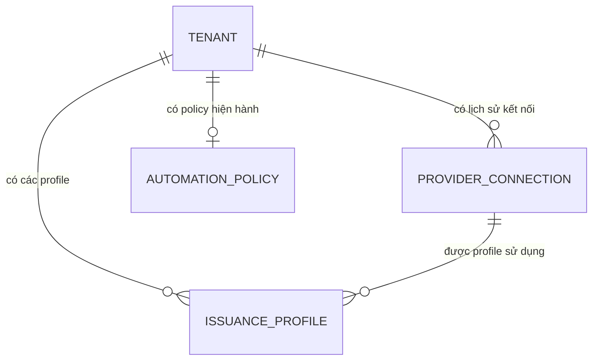

### 4\.2\.2 Invoice Issuance, Electronic Invoice and Delivery

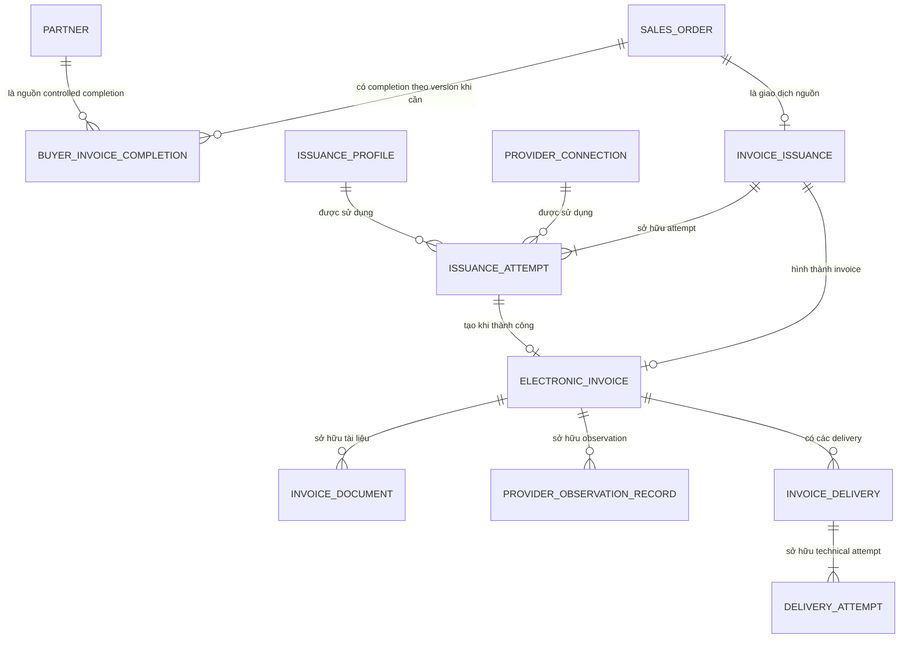

`BuyerInvoiceSnapshot`, `AttemptSnapshot`, `InvoiceSnapshot` và `DeliveryRecipientSnapshot` là snapshot/embedded structure nên không được biểu diễn như bảng độc lập\.
`EffectiveBuyerInvoiceData` là runtime structure nên không được biểu diễn như persisted entity\.

### 4\.2\.3 Provider Reconciliation

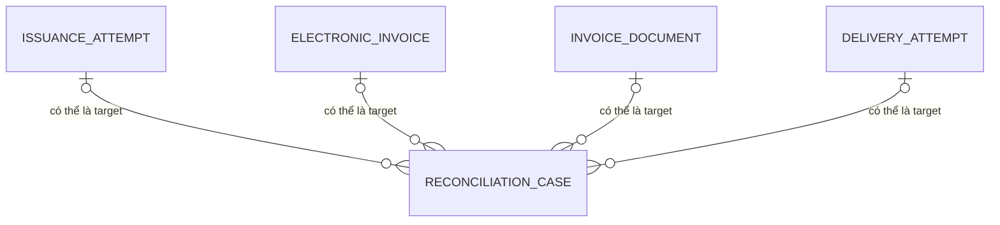

Mỗi ReconciliationCase chỉ tham chiếu đúng một target\.

## 4\.3 Entity catalog

### 4\.3\.1 Catalog principles

Entity catalog phân biệt:

- Persisted business entity\.

- Persisted process entity\.

- Embedded structure\.

- Runtime structure\.

- External reference\.

- Shared technical record\.

Snapshot, value object, enum và read model không được trình bày như aggregate độc lập\.

### 4\.3\.2 Persisted entities and process records

**4\.3\.2 Persisted entities and process records**

Theme 08 gồm 12 persisted entities và process records, phân bổ trong bốn business domain và Cross\-cutting Foundations\.


|Ownership|Số lượng|
|---|---|
|Invoice Configuration|3|
|Invoice Issuance|3|
|Electronic Invoice|3|
|Invoice Delivery|2|
|Cross\-cutting Foundations|1|
|Tổng|12|


|Scope|Logical entity|Suggested storage|Ownership|Purpose|
|---|---|---|---|---|
|Aggregate root|ProviderConnection|provider\_connections|Invoice Configuration|Quản lý kết nối MISA meInvoice|
|Aggregate root|IssuanceProfile|issuance\_profiles|Invoice Configuration|Quản lý cấu hình phát hành khả dụng|
|Aggregate root|AutomationPolicy|invoice\_automation\_policies|Invoice Configuration|Quản lý auto\-issue và auto\-send|
|Process entity|BuyerInvoiceCompletion|buyer\_invoice\_completions|Invoice Issuance|Bảo toàn controlled completion của buyer trước lần đầu đủ điều kiện|
|Aggregate root|InvoiceIssuance|invoice\_issuances|Invoice Issuance|Quản lý phát hành gắn với SalesOrder|
|Process entity|IssuanceAttempt|issuance\_attempts|Invoice Issuance|Ghi nhận từng business attempt|
|Aggregate root|ElectronicInvoice|electronic\_invoices|Electronic Invoice|Quản lý hóa đơn chính thức|
|Child entity|InvoiceDocument|invoice\_documents|Electronic Invoice|Quản lý XML/PDF|
|Owned history|ProviderObservationRecord|invoice\_provider\_observations|Electronic Invoice|Lưu observation từ provider|
|Aggregate root|InvoiceDelivery|invoice\_deliveries|Invoice Delivery|Quản lý một business delivery|
|Process entity|DeliveryAttempt|delivery\_attempts|Invoice Delivery|Ghi nhận technical attempt|
|Process entity|ReconciliationCase|invoice\_reconciliation\_cases|Cross\-cutting Foundations|Điều phối Result Reconciliation để xác lập kết quả chưa rõ|


`BuyerInvoiceCompletion` không phải invoice snapshot và không tạo business issuance\. Entity này tồn tại để bảo toàn dữ liệu completion trước attempt và chuyển sang immutable state khi buyer data lần đầu đủ điều kiện\.

`ReconciliationCase` chỉ sở hữu process state, evidence và lịch sử kiểm tra; business result cuối cùng vẫn thuộc domain owner của target\.

### 4\.3\.3 Embedded and runtime structures

|**Structure**|**Owner**|**Type**|**Purpose**|
|---|---|---|---|
|ProviderCapabilitiesSnapshot|ProviderConnection|Embedded, replaceable<br>|Lưu capability provider gần nhất|
|AttemptSnapshot|IssuanceAttempt|Embedded, immutable|Lưu dữ liệu thực tế của attempt|
|InvoiceSnapshot|ElectronicInvoice|Embedded, immutable|Lưu nội dung chính thức của invoice|
|DeliveryRecipientSnapshot|InvoiceDelivery|Embedded, immutable|Lưu recipient của business delivery|
|CanonicalInvoiceModel|Invoice Issuance|Runtime|Mô hình trung gian độc lập provider|
|ProviderIssuanceResult|IssuanceAttempt|Embedded result|Kết quả phát hành chuẩn hóa|
|ProviderDeliveryResult|InvoiceDelivery / DeliveryAttempt|Embedded result|Kết quả gửi chuẩn hóa|
|EffectiveBuyerInvoiceData |Invoice Issuance|Runtime |Merge BuyerInvoiceSnapshot với BuyerInvoiceCompletion theo precedence để đánh giá readiness, preview và tạo AttemptSnapshot|

### 4\.3\.4 External references and runtime dependencies

|**Reference**|**Owner**|**Usage**|
|---|---|---|
|`tenant_id`|Theme 01|Tenant isolation|
|`actor_id`|Theme 01|Audit và permission context|
|`legal_profile_reference`|Theme 01|Lineage của seller snapshot|
|`sales_order_id`|Theme 05|Giao dịch nguồn|
|`sales_order_version`|Theme 05|Kiểm soát dữ liệu dùng để phát hành|
|`source_sales_order_line_id`|Theme 05|Lineage từng invoice line|
|`buyer_partner_id`|Theme 03 qua Theme 05|Resolve đúng partner khi controlled completion còn OPEN; giữ lineage sau LOCKED và trong snapshot|

MISA meInvoice là runtime dependency ngoài bounded context\.

### 4\.3\.5 Shared foundations and read layer

|**Shared record**|**Purpose**|
|---|---|
|ProviderInteractionRecord|Truy vết request, response, callback và provider query|
|IdempotencyRecord|Chống xử lý trùng và phát hiện key conflict|
|InboxMessage|Deduplicate event hoặc callback nhận vào|
|OutboxMessage|Bảo đảm event được publish sau local commit|
|AutomaticTriggerProcessRecord|Bảo toàn quá trình chuẩn bị auto\-issue trước khi tạo attempt|
|AuditLog|Truy vết command và process quan trọng|
|OrderInvoiceProjection|Cung cấp trạng thái và thông tin tóm tắt cho Theme 05|

Shared record không phải nguồn business state authoritative\.

## 4\.4 Entity fields

### 4\.4\.1 Field conventions

Trừ khi được ghi chú khác, persisted entity có:

- `id`: UUID\.

- `tenant_id`: UUID, bắt buộc\.

- `created_at`: timestamptz\.

- `updated_at`: timestamptz\.

- `version`: bigint phục vụ optimistic concurrency\.

Quy ước:

- Thời gian lưu UTC\.

- Enum lưu bằng mã ổn định\.

- Credential không lưu dạng có thể đọc lại trực tiếp\.

- Snapshot có `schema_version`\.

- History record là append\-only\.

- External reference xuyên Theme không bắt buộc là physical foreign key\.

- Không hard\-delete invoice, attempt, delivery, reconciliation hoặc audit history\.

### 4\.4\.2 Invoice Configuration entities

#### `provider_connections`

Quản lý kết nối MISA meInvoice của tenant\.

|**Field**|**Type**|**Required**|**Purpose**|
|---|---|---|---|
|`provider_code`|varchar\(50\)|Yes|`MISA_MEINVOICE` trong Phase 1|
|`status`|enum|Yes<br>|`DISCONNECTED`, `CONNECTED`, `CHECK_REQUIRED`, `RECONNECT_REQUIRED`|
|`credential_reference`|varchar\(255\)|Conditional|Tham chiếu secret store|
|`provider_account_reference`|varchar\(255\)|No|Định danh tài khoản provider|
|`provider_organization_reference`|varchar\(255\)|No|Định danh đơn vị tại provider|
|`provider_identity_snapshot`|jsonb|No|Thông tin đơn vị provider dùng để đối chiếu|
|`verified_legal_profile_hash`|varchar\(128\)|No|Fingerprint hồ sơ pháp lý lần xác minh gần nhất|
|`capabilities_schema_version`|integer|No|Phiên bản capabilities snapshot|
|`capabilities_snapshot`|jsonb|No|Capability provider gần nhất|
|`connected_at`|timestamptz|No|Thời điểm kết nối thành công|
|`last_checked_at`|timestamptz|No|Thời điểm kiểm tra gần nhất|
|`last_error_code`|varchar\(100\)|No|Lỗi chuẩn hóa gần nhất|
|`last_error_message`|text|No|Thông tin lỗi an toàn|
|`connected_by_actor_id`|uuid|No|Người thiết lập kết nối|

Constraints:

- Tối đa một record `CONNECTED` trong tenant\.

- Credential cũ còn hợp lệ không bị ghi đè khi kết nối mới thất bại\.

- `provider_identity_snapshot` không thay thế seller snapshot của attempt\.

#### `issuance_profiles`

Quản lý tổ hợp cấu hình phát hành provider cho phép sử dụng\.

|**Field**|**Type**|**Required**|**Purpose**|
|---|---|---|---|
|`provider_connection_id`|uuid|Yes|Connection cùng tenant|
|`provider_profile_reference`|varchar\(255\)|Yes|Định danh profile tại provider|
|`invoice_legal_type`|varchar\(100\)|Yes|Loại hóa đơn pháp lý|
|`origination_channel`|varchar\(100\)|Yes|Hình thức khởi tạo|
|`tax_authority_code_mode`|varchar\(100\)|Yes|Chế độ mã cơ quan thuế|
|`template_code`|varchar\(100\)|Yes|Mẫu hóa đơn|
|`series`|varchar\(100\)|Yes|Ký hiệu|
|`signing_method`|varchar\(100\)|Yes|Phương thức ký|
|`status`|enum|Yes|`ACTIVE`, `INACTIVE`, `INVALID`|
|`is_default`|boolean|Yes|Profile mặc định|
|`provider_capability_version`|varchar\(100\)|No|Capability version đã xác minh|
|`last_synchronized_at`|timestamptz|Yes|Thời điểm đồng bộ gần nhất|

Constraints:

- `provider_profile_reference` duy nhất trong connection\.

- Tối đa một profile `ACTIVE` và `is_default = true` trong tenant\.

- Không tự thay default profile khi profile hiện tại invalid\.

#### `invoice_automation_policies`

Quản lý chính sách tự động của tenant\.

|**Field**|**Type**|**Required**|**Purpose**|
|---|---|---|---|
|`auto_issue_enabled`|boolean|Yes|Cho phép auto\-issue|
|`auto_send_enabled`|boolean|Yes|Cho phép auto\-send|
|`auto_send_recipient_source`|enum|Yes|`CURRENT_PARTNER_PROFILE_WITH_ORDER_FALLBACK`|
|`policy_version`|integer|Yes|Phiên bản policy|
|`updated_by_actor_id`|uuid|No|Người cập nhật|

Constraints:

- Một record hiện hành trong tenant\.

- `auto_send_enabled` không đồng nghĩa mọi invoice đều có email hợp lệ\.

- Policy được copy vào AttemptSnapshot khi auto\-issue bắt đầu\.

### 4\.4\.3 Invoice Issuance entities

**`buyer_invoice_completions`**

Bảo toàn controlled completion của dữ liệu người mua trước khi một SalesOrder lần đầu đủ buyer data requirements để phát hành\.

|Field|Type|Required|Purpose|
|---|---|---|---|
|sales\_order\_id|uuid|Yes|SalesOrder nguồn|
|sales\_order\_version|varchar\(100\)|Yes|Phiên bản BuyerInvoiceSnapshot/SalesOrder mà completion áp dụng|
|buyer\_partner\_id|uuid|Yes|Partner nguồn tại Theme 03|
|status|enum|Yes|OPEN, LOCKED|
|eligible\_fields|jsonb|Yes|Tập field bắt buộc thiếu trong BuyerInvoiceSnapshot được phép completion|
|resolved\_values|jsonb|Yes|Giá trị completion hiện hành cho eligible fields|
|source\_partner\_revision|varchar\(100\)|No|Revision/version Theme 03 của lần resolve gần nhất khi available|
|source\_partner\_updated\_at|timestamptz|No|Source timestamp khi provider Theme 03 cung cấp|
|last\_resolved\_at|timestamptz|No|Thời điểm resolve gần nhất|
|locked\_at|timestamptz|No|Thời điểm buyer data lần đầu đủ điều kiện|


Constraints:

- Unique `(tenant_id, sales_order_id, sales_order_version)`\.

- `eligible_fields` chỉ được chứa field bắt buộc thiếu trong `BuyerInvoiceSnapshot` của SalesOrder version tương ứng\.

- `resolved_values` không được dùng để override field đã có trong `BuyerInvoiceSnapshot`\.

- Record chỉ được resolve từ đúng `buyer_partner_id`\.

- Khi status = `OPEN`, resolved values có thể được cập nhật bởi một controlled resolve hợp lệ\.

- Chuyển sang `LOCKED` chỉ khi `EffectiveBuyerInvoiceData` lần đầu đáp ứng buyer data requirements\.

- Khi status = `LOCKED`, `eligible_fields`, `resolved_values`, source lineage và `locked_at` bất biến\.

- Theme 03 thay đổi sau `LOCKED` không được cập nhật record\.

- Completion của SalesOrder version cũ không được áp dụng cho SalesOrder version mới\.

- Không hard\-delete record đã được tham chiếu bởi IssuanceAttempt hoặc InvoiceSnapshot\.

#### `invoice_issuances`

Quản lý quá trình phát hành gốc của một SalesOrder\.

|**Field**|**Type**|**Required**|**Purpose**|
|---|---|---|---|
|`sales_order_id`|uuid|Yes|SalesOrder nguồn|
|`issuance_type`|enum|Yes|`ORIGINAL` trong MVP|
|`settled_result`|enum|No|`ISSUED`, `FAILED`; null khi chưa xác lập|
|`successful_attempt_id`|uuid|No|Attempt provider xác nhận thành công|
|`electronic_invoice_id`|uuid|No|ElectronicInvoice đã hình thành|
|`last_attempt_id`|uuid|No|Attempt gần nhất|
|`initiated_at`|timestamptz|Yes|Thời điểm bắt đầu lần đầu|
|`created_by_actor_type`|enum|Yes|`USER`, `SYSTEM`|
|`created_by_actor_id`|uuid|No|Actor khi có|

Constraints:

- Unique `(tenant_id, sales_order_id, issuance_type)`\.

- `settled_result = ISSUED` chỉ khi có successful attempt\.

- Display state được suy ra, không được dùng làm authoritative result\.

#### `issuance_attempts`

Ghi nhận từng business attempt phát hành\.

|**Field**|**Type**|**Required**|**Purpose**|
|---|---|---|---|
|`invoice_issuance_id`|uuid|Yes|Aggregate owner|
|`attempt_no`|integer|Yes|Số thứ tự attempt|
|`trigger_type`|enum|Yes|`MANUAL`, `AUTOMATIC`|
|`status`|enum|Yes|`PREPARING`, `SUBMITTED`, `WAITING_RESULT`, `RECONCILING`, `SUCCEEDED`, `FAILED`|
|`provider_connection_id`|uuid|Yes|Connection đã resolve|
|`issuance_profile_id`|uuid|Yes|Profile đã resolve|
|`idempotency_key`|varchar\(150\)|Yes|Khóa chống yêu cầu trùng|
|`intent_hash`|varchar\(128\)|Yes|Hash của business intent|
|`snapshot_schema_version`|integer|Yes|Phiên bản AttemptSnapshot|
|`attempt_snapshot`|jsonb|Yes|Dữ liệu bất biến của attempt|
|`canonical_model_version`|varchar\(100\)|Yes|Phiên bản mapping|
|`canonical_payload_hash`|varchar\(128\)|Yes|Hash dữ liệu chuẩn|
|`provider_interaction_reference`|varchar\(255\)|No|Interaction chính|
|`provider_request_reference`|varchar\(255\)|No|Request reference tại provider|
|`provider_invoice_reference`|varchar\(255\)|No|Invoice reference khi có|
|`provider_result_code`|varchar\(100\)|No|Mã kết quả provider|
|`provider_result_message`|text|No|Thông tin kết quả|
|`failure_code`|varchar\(100\)|No|Mã lỗi chuẩn hóa|
|`failure_message`|text|No|Mô tả lỗi|
|`internal_finalization_state`|enum|Yes|`PENDING`, `COMPLETED`, `UNRESOLVED`|
|`started_at`|timestamptz|Yes|Thời điểm bắt đầu|
|`submitted_at`|timestamptz|No|Thời điểm gọi provider|
|`provider_confirmed_at`|timestamptz|No|Thời điểm provider xác nhận|
|`completed_at`|timestamptz|No|Thời điểm attempt kết thúc|
|`initiated_by_actor_type`|enum|Yes|`USER`, `SYSTEM`|
|`initiated_by_actor_id`|uuid|No|Actor khi có|

Constraints:

- Unique `(invoice_issuance_id, attempt_no)`\.

- Unique `(tenant_id, idempotency_key)` trong operation scope\.

- Tối đa một attempt ở trạng thái chưa kết thúc trong một issuance\.

- `attempt_snapshot` bất biến sau khi status rời `PREPARING`\.

- `FAILED` chỉ dùng khi có thất bại xác định\.

- `SUCCEEDED` không tự đồng nghĩa Mosaic Retail đã hoàn tất ElectronicInvoice\.

### 4\.4\.4 Electronic Invoice entities

#### `electronic_invoices`

Quản lý hồ sơ hóa đơn chính thức\.

|**Field**|**Type**|**Required**|**Purpose**|
|---|---|---|---|
|`invoice_issuance_id`|uuid|Yes|Issuance nguồn|
|`successful_attempt_id`|uuid|Yes<br>|Successful attempt|
|`sales_order_id`|uuid|Yes|SalesOrder nguồn|
|`provider_connection_id`|uuid|Yes|Connection đã sử dụng|
|`provider_invoice_reference`|varchar\(255\)|Yes|Định danh invoice tại provider|
|`invoice_number`|varchar\(100\)|Yes|Số hóa đơn|
|`template_code`|varchar\(100\)|Yes|Mẫu|
|`series`|varchar\(100\)|Yes|Ký hiệu|
|`issued_at`|timestamptz|Yes|Thời điểm phát hành|
|`lookup_code`|varchar\(255\)|No|Mã tra cứu|
|`tax_authority_code`|varchar\(255\)|No|Mã cơ quan thuế khi có|
|`tax_authority_result`|jsonb|No|Kết quả cơ quan thuế|
|`snapshot_schema_version`|integer|Yes|Phiên bản InvoiceSnapshot|
|`invoice_snapshot`|jsonb|Yes|Nội dung chính thức bất biến|
|`latest_provider_state_code`|varchar\(100\)|No|Trạng thái provider quan sát gần nhất|
|`last_provider_observed_at`|timestamptz|No|Thời điểm observation gần nhất|

Constraints:

- Unique `(tenant_id, invoice_issuance_id)`\.

- Unique `(tenant_id, sales_order_id)` cho invoice ORIGINAL\.

- Unique provider invoice reference trong connection\.

- `invoice_snapshot` bất biến\.

- Không hard\-delete\.

#### `invoice_documents`

Quản lý XML và PDF do provider cung cấp\.

|**Field**|**Type**|**Required**|**Purpose**|
|---|---|---|---|
|`electronic_invoice_id`|uuid|Yes|Invoice owner|
|`document_type`|enum|Yes|`XML`, `PDF`|
|`document_version`|integer|Yes|Phiên bản tài liệu|
|`status`|enum|Yes|`PENDING`, `AVAILABLE`, `FAILED`, `CHECK_REQUIRED`|
|`provider_document_reference`|varchar\(255\)|No|Định danh provider|
|`storage_reference`|varchar\(500\)|No|Vị trí lưu nội bộ|
|`content_type`|varchar\(100\)|No|MIME type|
|`file_name`|varchar\(255\)|No|Tên file|
|`file_size`|bigint|No|Kích thước|
|`checksum`|varchar\(128\)|No|Kiểm tra toàn vẹn|
|`requested_at`|timestamptz|No|Thời điểm yêu cầu|
|`available_at`|timestamptz|No|Thời điểm sẵn sàng|
|`failure_code`|varchar\(100\)|No|Mã lỗi|
|`failure_message`|text|No|Thông tin lỗi|
|`provider_interaction_reference`|varchar\(255\)|No|Interaction liên quan|

Constraints:

- Unique `(electronic_invoice_id, document_type, document_version)`\.

- Tài liệu `AVAILABLE` phải có storage reference và checksum\.

- Lỗi tài liệu không sửa ElectronicInvoice\.

#### `invoice_provider_observations`

Lưu trạng thái được quan sát từ provider\.

|**Field**|**Type**|**Required**|**Purpose**|
|---|---|---|---|
|`electronic_invoice_id`|uuid|Yes<br>|Invoice owner|
|`provider_state_code`|varchar\(100\)|Yes|Mã trạng thái provider|
|`provider_state_description`|text|No|Mô tả an toàn|
|`provider_reference`|varchar\(255\)|No|Tham chiếu provider|
|`observed_at`|timestamptz|Yes|Thời điểm quan sát|
|`deduplication_key`|varchar\(255\)|Yes|Khóa chống ghi trùng|
|`details_snapshot`|jsonb|No|Bằng chứng quan sát|
|`provider_interaction_reference`|varchar\(255\)|No|Interaction liên quan|
|`created_at`|timestamptz|Yes|Thời điểm ghi nhận|

Constraints:

- Append\-only\.

- Unique `deduplication_key` trong tenant\.

- Observation không tự sửa InvoiceSnapshot\.

- Không tạo action điều chỉnh, thay thế hoặc hủy trong MVP\.

### 4\.4\.5 Invoice Delivery entities

#### `invoice_deliveries`

Đại diện một business intent gửi hoặc gửi lại\.

|**Field**|**Type**|**Required**|**Purpose**|
|---|---|---|---|
|`electronic_invoice_id`|uuid|Yes<br>|Invoice được gửi<br>|
|`delivery_no`|integer|Yes|Số thứ tự business delivery|
|`delivery_intent`|enum|Yes|`INITIAL_SEND`, `RESEND`|
|`trigger_type`|enum|Yes|`MANUAL`, `AUTOMATIC`|
|`channel`|enum|Yes|`EMAIL`|
|`status`|enum|Yes|`PROCESSING`, `SUCCEEDED`, `FAILED`, `UNKNOWN`|
|`recipient_snapshot_schema_version`|integer|Yes|Phiên bản recipient snapshot|
|`recipient_snapshot`|jsonb|Yes|Email thực tế của delivery|
|`idempotency_key`|varchar\(150\)|Yes|Khóa chống delivery trùng|
|`intent_hash`|varchar\(128\)|Yes|Hash business intent|
|`provider_delivery_reference`|varchar\(255\)|No|Định danh delivery tại provider|
|`provider_result_code`|varchar\(100\)|No|Mã kết quả|
|`provider_result_message`|text|No|Thông tin kết quả|
|`failure_code`|varchar\(100\)|No|Mã lỗi chuẩn hóa|
|`failure_message`|text|No|Thông tin lỗi|
|`started_at`|timestamptz|Yes|Thời điểm bắt đầu|
|`completed_at`|timestamptz|No|Thời điểm kết thúc|
|`initiated_by_actor_type`|enum|Yes|`USER`, `SYSTEM`|
|`initiated_by_actor_id`|uuid|No|Actor khi có|

Constraints:

- Unique `(electronic_invoice_id, delivery_no)`\.

- Unique idempotency key trong delivery operation scope\.

- Recipient snapshot bất biến\.

- Không tạo delivery khi auto\-send thiếu email hợp lệ\.

- Không có nhiều delivery cạnh tranh khi delivery hiện tại `PROCESSING`\.

#### `delivery_attempts`

Ghi nhận từng technical attempt của một InvoiceDelivery\.

|**Field**|**Type**|**Required**|**Purpose**|
|---|---|---|---|
|`invoice_delivery_id`|uuid|Yes|Delivery owner|
|`attempt_no`|integer|Yes|Số thứ tự technical attempt|
|`status`|enum|Yes|`QUEUED`, `SUBMITTED`, `SUCCEEDED`, `FAILED`, `UNKNOWN`|
|`provider_connection_id`|uuid|Yes|Connection đã sử dụng|
|`provider_interaction_reference`|varchar\(255\)|No|Interaction chính|
|`provider_request_reference`|varchar\(255\)|No|Request reference|
|`provider_result_code`|varchar\(100\)|No|Mã kết quả|
|`provider_result_message`|text|No|Thông tin kết quả|
|`failure_code`|varchar\(100\)|No|Mã lỗi|
|`failure_message`|text|No|Thông tin lỗi|
|`queued_at`|timestamptz|Yes|Thời điểm đưa vào xử lý|
|`submitted_at`|timestamptz|No|Thời điểm gọi provider|
|`completed_at`|timestamptz|No|Thời điểm kết thúc|

Constraints:

- Unique `(invoice_delivery_id, attempt_no)`\.

- Tối đa một technical attempt đang hoạt động (`QUEUED` hoặc `SUBMITTED`)\.

- Technical retry không thay recipient hoặc business intent; tối đa ba attempt / delivery\.

- Delivery status được áp dụng từ kết quả attempt đủ tin cậy\.

- `provider_result_message` / `failure_message` chỉ chứa safe text Mosaic Retail allow\-listed; không copy body/exception/credential nhà cung cấp\.

### 4\.4\.6 Provider Reconciliation entity

#### `invoice_reconciliation_cases`

Quản lý quá trình xác lập kết quả chưa rõ\.

|**Field**|**Type**|**Required**|**Purpose**|
|---|---|---|---|
|`target_type`|enum|Yes<br>|`ISSUANCE_ATTEMPT`, `ELECTRONIC_INVOICE`, `INVOICE_DOCUMENT`, `DELIVERY_ATTEMPT`|
|`target_id`|uuid|Yes|Target cần kiểm tra|
|`reconciliation_purpose`|enum|Yes|`DETERMINE_RESULT`, `VERIFY_DOCUMENT`, `SYNC_PROVIDER_STATE`, `VERIFY_DELIVERY`|
|`provider_connection_id`|uuid|Yes|Connection sử dụng|
|`provider_reference`|varchar\(255\)|No|Provider reference khi có|
|`idempotency_key`|varchar\(150\)|No|Identity operation nguồn|
|`reason_code`|varchar\(100\)|Yes|Lý do mở case|
|`status`|enum|Yes|`PENDING`, `RESOLVED`, `UNRESOLVED`|
|`attempt_count`|integer|Yes|Số lần kiểm tra|
|`next_check_at`|timestamptz|No|Lần kiểm tra tiếp theo|
|`last_checked_at`|timestamptz|No|Lần kiểm tra gần nhất|
|`latest_provider_interaction_reference`|varchar\(255\)|No|Interaction gần nhất|
|`resolved_at`|timestamptz|No|Thời điểm kết thúc|
|`resolution_code`|varchar\(100\)|No|Kết luận chuẩn hóa|
|`resolution_snapshot`|jsonb|No|Bằng chứng và kết quả|
|`last_error_code`|varchar\(100\)|No|Lỗi gần nhất|
|`last_error_message`|text|No|Thông tin lỗi|
|`correlation_id`|varchar\(100\)|Yes|Correlation xuyên process|
|`opened_by_actor_type`|enum|Yes|`USER`, `SYSTEM`, `PROVIDER`|
|`opened_by_actor_id`|uuid|No|Actor khi có|

Constraints:

- Mỗi case tham chiếu đúng một target\.

- Một target có tối đa một case đang hoạt động cho cùng purpose\.

- ReconciliationCase chỉ sở hữu process state và evidence\.

- Domain owner của target áp dụng business result cuối cùng\.

- Chu kỳ poll tự động gồm 5 lần kiểm tra với các khoảng lùi cố định: `30s`, `2m`, `10m`, `30m`, `2h`. Lần kiểm tra thứ 5 không xác định sẽ chuyển case sang `UNRESOLVED` và dừng poll tự động nhưng vẫn giữ business lock.

- Chuyển tiếp `UNRESOLVED -> RESOLVED` chỉ diễn ra khi callback terminal hợp lệ từ nhà cung cấp đến muộn và xác thực thành công. Callback không xác định hoặc không hợp lệ không làm thay đổi trạng thái `UNRESOLVED`.

### 4\.4\.7 Embedded structures

#### ProviderCapabilitiesSnapshot

|**Component**|**Required**|**Purpose**|
|---|---|---|
|`supported_operations`|Yes|Operation provider hỗ trợ|
|`supported_invoice_legal_types`|Yes|Loại hóa đơn được hỗ trợ|
|`supported_origination_channels`|Yes|Hình thức khởi tạo|
|`supported_tax_authority_code_modes`|Yes|Chế độ mã|
|`templates_and_series`|Yes|Mẫu và ký hiệu|
|`supported_signing_methods`|Yes|Phương thức ký|
|`captured_at`|Yes|Thời điểm đồng bộ|
|`schema_version`|Yes|Phiên bản cấu trúc|

**AttemptSnapshot**

|Component|Required|Purpose|
|---|---|---|
|source\_order|Yes|SalesOrder reference, version và trạng thái|
|seller|Yes|Seller snapshot từ Theme 01|
|buyer|Yes|EffectiveBuyerInvoiceData của attempt (sau controlled completion merge khi có)|
|buyer\_lineage|Yes|`buyerPartnerId`, `buyerInvoiceCompletionId`, `buyerInvoiceSnapshotSourceVersion`, và `buyerInvoiceSnapshot` = Theme\-05 base snapshot **không** bị merge; tách biệt khỏi `buyer` hiệu lực|
|invoice\_context|Yes|Loại hóa đơn, mẫu, ký hiệu, chế độ mã và signing method|
|lines|Yes|Dòng hàng và source line reference|
|totals|Yes|Tiền hàng, chiết khấu, thuế, làm tròn và thanh toán|
|payment\_information|No|Thông tin thanh toán cần thể hiện|
|automation\_policy|Yes|Policy áp dụng|
|readiness\_result|Yes|Readiness, warning và blocker|
|mapping\_schema\_version|Yes|Phiên bản canonical mapping|


Buyer component phải bảo toàn:

- Buyer type\.

- Tên người mua hoặc tổ chức\.

- Địa chỉ\.

- Mã số thuế khi buyer type yêu cầu\.

- Email nếu thuộc dữ liệu buyer hiệu lực của SalesOrder\.

- Các thông tin xuất hóa đơn khác được sử dụng thực tế\.

    

Buyer lineage phải bảo toàn:

- SalesOrder và SalesOrder version\.

- `buyerPartnerId` khi có\.

- `buyerInvoiceSnapshot` = bản sao không đổi của Theme\-05 `BuyerInvoiceSnapshot` (source\-owned `p_buyer_snapshot` / `buyer_snapshot`), chụp **trước** mọi completion merge; không suy ra từ `buyer` hiệu lực hay hồ sơ Partner hiện hành\.

- `buyerInvoiceCompletionId` khi có\.

- `buyerInvoiceSnapshotSourceVersion`\.

    

AttemptSnapshot chỉ được tạo sau khi buyer data đủ điều kiện và không resolve Theme 03 sau thời điểm được tạo\.

#### InvoiceSnapshot

|**Component**|**Required**|**Purpose**|
|---|---|---|
|`source_references`|Yes|Issuance, SalesOrder, SalesOrder version, successful attempt và buyer completion lineage khi có|
|`seller`|Yes|Seller chính thức|
|`buyer`|Yes|Buyer chính thức|
|`invoice_identity`|Yes|Số, ngày, mẫu, ký hiệu và provider reference|
|`invoice_context`|Yes|Loại hóa đơn và chế độ phát hành|
|`lines`|Yes|Dòng hàng chính thức|
|`totals`|Yes|Tổng tiền, chiết khấu và thuế|
|`payment_information`|No|Phương thức thanh toán|
|`tax_authority_result`|Conditional|Mã hoặc kết quả cơ quan thuế|
|`provider_result`|Yes|Kết quả provider|
|`mapping_schema_version`|Yes|Phiên bản canonical mapping|

InvoiceSnapshot phải bảo toàn buyer lineage từ successful AttemptSnapshot\. Lineage phục vụ audit, đối soát và future change detection; nó không cho phép cập nhật InvoiceSnapshot theo dữ liệu nguồn hiện hành\.

#### DeliveryRecipientSnapshot

|**Attribute**|**Required**|**Purpose**|
|---|---|---|
|`to_recipients`|Yes|Email nhận chính|
|`cc_recipients`|No|Email nhận bản sao|
|`recipient_name`|No|Tên người nhận|
|`recipient_source`|Yes|`INVOICE_SNAPSHOT`, `LAST_DELIVERY`, `USER_INPUT`|
|`message_reference`|No|Tham chiếu template hoặc nội dung gửi|
|`schema_version`|Yes|Phiên bản cấu trúc|

### 4\.4\.8 Shared foundation contracts

|**Shared record**|**Contract tối thiểu**|**Purpose**|
|---|---|---|
|ProviderInteractionRecord|One row per outbound provider-call attempt or inbound callback; immutable start fields; finalize-once outcome; UUID correlation; no request/response body or credentials|Truy vết tương tác provider (không chứa S2 preview state)|
|InvoicePreviewOperation|S2 technical preview operation: viewer_ref, allow-listed preview_payload, 15-minute expiry|Preview handoff tách khỏi interaction audit|
|IdempotencyRecord|Tenant, operation scope, key, intent hash, status, result reference|Chống trùng và key conflict|
|InboxMessage|Consumer, message ID, tenant, type, received time, processing result|Deduplicate inbound message|
|OutboxMessage|Tenant, aggregate reference, event type, payload reference, publish status, timestamps|Publish event sau local commit|
|AutomaticTriggerProcessRecord|Tenant, SalesOrder, SalesOrder version, trigger key, process status, retry count, next retry, blocker, BuyerInvoiceCompletion reference khi có, lock, timestamps|Bảo toàn auto\-issue preparation và re\-evaluation trước khi tạo attempt|
|AuditLog|Tenant, actor, action, target, result, correlation, occurred time|Truy vết command và process|
|OrderInvoiceProjection|SalesOrder, invoice reference, invoice number, issuance state, document availability, delivery state, attention flags, updated time|Hiển thị tại Theme 05|

AutomaticTriggerProcessRecord có thể tiếp tục ở pre\-attempt state khi buyer completion còn OPEN\. Relevant Theme 03 change hoặc readiness evaluation mới chỉ được tiếp tục process hiện có; không tạo một business issuance mới chỉ vì có source\-change signal\.

Internal Finalization Recovery không có aggregate riêng trong Phase 1; state nằm trên IssuanceAttempt\.

Shared foundation record và projection không phải nguồn authoritative\. Mất projection hoặc integration trace không được dẫn đến phát hành lại hoặc gửi lại\.

# 5\. Epics

## 5\.1 Epic map

Theme 08 được phân rã thành bốn Epic theo các outcome nghiệp vụ chính: kết nối và thiết lập cấu hình phát hành, phát hành hóa đơn từ đơn hàng, quản lý hồ sơ authoritative và cung cấp bản hóa đơn hoặc tài liệu chính thức, và gửi hóa đơn cho người nhận\.

Hồ sơ pháp lý hiện hành của Tổ chức do Theme 01 sở hữu là dữ liệu đầu vào xuyên suốt Theme 08, không tạo thành một Epic nghiệp vụ riêng\. Theme 08 chỉ đọc hồ sơ hiện hành, kiểm tra khả năng sử dụng làm thông tin bên bán và lưu snapshot bất biến khi bắt đầu phát hành\.

Nghiệp vụ hóa đơn không tạo danh sách hóa đơn điện tử hoặc màn hồ sơ hóa đơn độc lập trong MVP\. Người dùng thực hiện các hành động hóa đơn từ Kết quả bán hàng hoặc Chi tiết đơn hàng\.

Tên Epic, User Story, domain và capability không phụ thuộc vào một nhà cung cấp cụ thể\. Trong Phase 1, nhà cung cấp được tích hợp là MISA meInvoice\.

Các capability xuyên Epic như Provider Integration, Duplicate Prevention, Result Reconciliation, Internal Finalization Recovery, Automatic Trigger Orchestration, Audit \& Security và Read Layer được triển khai trong Epic sở hữu outcome nghiệp vụ tương ứng, không tạo thành Epic nghiệp vụ độc lập\.

|Epic ID|Epic name|Primary domain|Business outcome|
|---|---|---|---|
|EP\-01|Kết nối nhà cung cấp và thiết lập cấu hình phát hành|Invoice Configuration|Chuẩn bị kết nối, mẫu hóa đơn, hình thức ký hoặc chế độ không ký và chính sách tự động hợp lệ để tenant sẵn sàng phát hành|
|EP\-02|Phát hành hóa đơn điện tử từ đơn hàng|Invoice Issuance|Phát hành đúng một hóa đơn gốc từ đơn hàng Hoàn tất và kiểm soát đầy đủ kết quả phát hành|
|EP\-03|Hồ sơ và tài liệu hóa đơn đã phát hành|Electronic Invoice|Bảo toàn hồ sơ authoritative, mở bản hóa đơn chính thức và lấy XML/PDF từ ngữ cảnh đơn hàng nguồn|
|EP\-04|Gửi và gửi lại hóa đơn điện tử|Invoice Delivery|Gửi hóa đơn qua email và quản lý độc lập kết quả của từng ý định gửi|


**Sơ đồ phụ thuộc Epic**

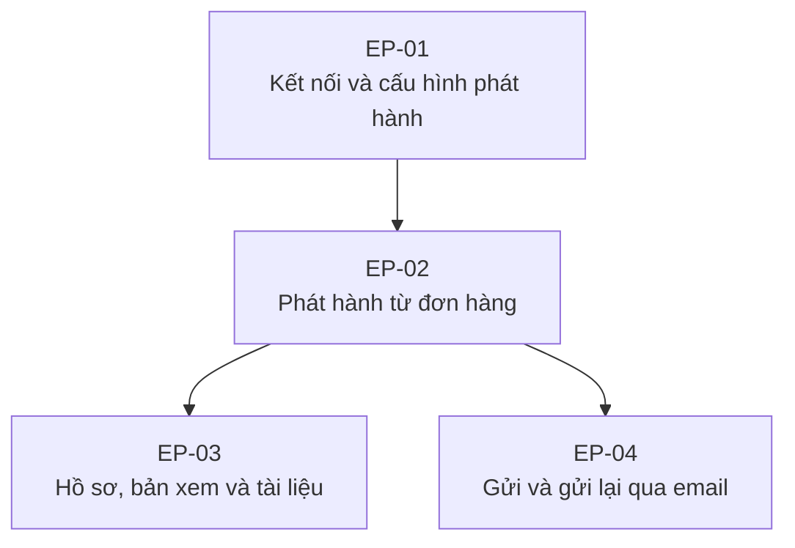


EP\-01 chuẩn bị điều kiện cấu hình cho phát hành\. Hồ sơ pháp lý hiện hành của Theme 01 được kiểm tra trong EP\-01 và được kiểm tra lại tại thời điểm bắt đầu phát hành trong EP\-02, nhưng không thuộc quyền sở hữu của Theme 08\.

EP\-03 và EP\-04 chỉ bắt đầu khi ElectronicInvoice đã được hình thành từ EP\-02\. Lỗi mở bản xem, lỗi lấy tài liệu hoặc lỗi gửi email không làm thay đổi kết quả Đã phát hành của hóa đơn\.

**Các quy tắc xuyên Epic**

- Một SalesOrder có tối đa một InvoiceIssuance loại ORIGINAL và tối đa một ElectronicInvoice gốc trong MVP\.

- Preview và readiness không tạo InvoiceIssuance, IssuanceAttempt, ElectronicInvoice hoặc InvoiceDelivery\.

- Readiness được phép tạo hoặc cập nhật BuyerInvoiceCompletion khi dữ liệu người mua bắt buộc còn thiếu\.

- Seller snapshot được lấy từ hồ sơ pháp lý hiện hành của Theme 01 tại thời điểm bắt đầu IssuanceAttempt\.

- `BuyerInvoiceSnapshot` là base buyer data của SalesOrder và luôn có precedence trước Theme 03\.

- Theme 08 chỉ resolve Theme 03 khi buyer data còn thiếu field bắt buộc và BuyerInvoiceCompletion chưa khóa\.

- Khi buyer data lần đầu đủ điều kiện phát hành về phía người mua, BuyerInvoiceCompletion được khóa; mọi thay đổi Theme 03 sau đó không tự động refresh hoặc thay thế buyer data của SalesOrder\.

- Buyer snapshot của IssuanceAttempt được sao chép từ EffectiveBuyerInvoiceData đã đủ điều kiện\.

- Khách tổ chức thiếu mã số thuế là blocker phát hành\. Preview có thể vẫn được thực hiện theo preview capability hiện hành nhưng không cho bắt đầu IssuanceAttempt\.

- AttemptSnapshot, InvoiceSnapshot và DeliveryRecipientSnapshot bất biến trong lifecycle tương ứng\.

- AttemptSnapshot và InvoiceSnapshot giữ đủ source reference và buyer lineage để future capability có thể xác định dữ liệu đã sử dụng; Phase hiện tại không triển khai điều chỉnh hoặc thay thế\.

- Timeout, mất phản hồi hoặc phản hồi không đầy đủ không tự đồng nghĩa operation đã thất bại\.

- Kết quả chưa xác định phải khóa operation cạnh tranh cho đến khi được xác lập\.

- Provider success nhưng local finalization chưa hoàn tất chỉ được phục hồi bước nội bộ, không được gọi lại operation đã thành công tại provider\.

- Theme 05 sở hữu hai màn nguồn và chỉ sử dụng projection cùng action contract; Theme 05 không thay đổi authoritative state của hóa đơn\.

- ElectronicInvoice và InvoiceSnapshot được bảo toàn cho audit, đối soát, lineage, projection và recovery\.

- Bản xem chính thức, XML và PDF phải được lấy từ MISA meInvoice hoặc nguồn chính thức do provider cung cấp\.

- Theme 08 không cung cấp danh sách hóa đơn điện tử độc lập trong MVP\.

## 5\.2 EP\-01 — Kết nối nhà cung cấp và thiết lập cấu hình phát hành

### 5\.2\.1 Overview

EP\-01 cho phép tenant kết nối với nhà cung cấp hóa đơn điện tử, đồng bộ mẫu hóa đơn được phép sử dụng, thiết lập hình thức ký hoặc chế độ không ký phù hợp và hình thành một EffectiveIssuanceConfiguration mặc định cho các lần phát hành mới\.

Thông tin bên bán không được tạo hoặc quản lý riêng trong Theme 08\. Theme 08 đọc hồ sơ pháp lý hiện hành của Tổ chức từ Theme 01 và hiển thị ở chế độ chỉ đọc\.

Trong Phase 1, nhà cung cấp được tích hợp là MISA meInvoice và mỗi tenant có tối đa một ProviderConnection đang hoạt động\.

ProviderTemplate và SigningConfiguration là hai cấu hình độc lập:

- ProviderTemplate xác định mẫu hóa đơn, mẫu số, ký hiệu, chế độ có mã hoặc không mã, hình thức hóa đơn và trạng thái khả dụng\.

- SigningConfiguration xác định cách ký hoặc chế độ không ký mà Mosaic Retail được phép sử dụng khi gọi provider\.

- EffectiveIssuanceConfiguration là tổ hợp hợp lệ giữa một ProviderTemplate đang khả dụng và một SigningConfiguration tương thích\.

EP\-01 xác định mức sẵn sàng của cấu hình nhưng không kiểm tra trạng thái đơn hàng, dữ liệu người mua hoặc nội dung giao dịch cụ thể\. Các điều kiện đó thuộc EP\-02\.

### 5\.2\.2 Business context

Để phát hành hóa đơn điện tử từ Mosaic Retail, tenant phải có hồ sơ pháp lý hiện hành đủ dữ liệu bắt buộc, ProviderConnection hợp lệ, ProviderTemplate mặc định còn khả dụng và SigningConfiguration tương thích với hình thức hóa đơn cùng cách phát hành\.

API kết nối MISA meInvoice sử dụng AppID của ứng dụng tích hợp, mã số thuế, tài khoản và mật khẩu để lấy token\. AppID và token thuộc integration backend, không phải field người dùng tự nhập hoặc tự quản lý trên giao diện Mosaic Retail\.

MISA có thể cho phép đơn vị cấu hình nhiều hình thức ký\. Trong MVP, Mosaic Retail chỉ sử dụng một SigningConfiguration mặc định đang hoạt động cho mỗi tenant để bảo đảm lần phát hành có execution contract xác định\.

Hình thức ký trong domain không được đồng nhất trực tiếp với một label UI hoặc một raw `SignType`\. Adapter chịu trách nhiệm ánh xạ SigningConfiguration sang giá trị provider khi phát hành\.


|Hình thức nghiệp vụ|Mapping MISA|Hỗ trợ Phase 1|Contract|
|---|---|---|---|
|Ký qua HSM|`SignType=2`|Có|Người dùng chọn Ký qua HSM; adapter resolve wire `SignType=2` từ SigningConfiguration đã đóng băng trước dispatch; không fallback và không mở `SignType=3` (V2 gạch bỏ)|
|Ký qua USB hoặc tệp chứng thư|`SignType=1`|Không hỗ trợ trên mobile MVP|Yêu cầu công cụ ký local và bước ký ngoài backend; không được dùng để kết luận tenant sẵn sàng phát hành từ ứng dụng mobile|
|Ký từ xa MISA eSign|Chưa có mapping riêng được xác minh trong tài liệu integration công khai|Chờ xác minh|Không hiển thị thành lựa chọn khả dụng cho đến khi adapter có contract xác thực, ký và xử lý xác nhận rõ ràng|
|Không ký số — Hóa đơn từ máy tính tiền|`SignType=5`|Có điều kiện|Chỉ khả dụng khi ProviderTemplate được provider xác nhận là hóa đơn từ máy tính tiền; đây là chế độ phát hành không ký, không phải một chứng thư ký số|
|Không ký số — Vé điện tử không mã|`SignType=4`|Ngoài phạm vi|Không áp dụng cho phạm vi hóa đơn điện tử của Theme 08|
|HSM bất đồng bộ / MTT async|`SignType=3` / `SignType=6`|Không hỗ trợ|Tài liệu MISA AIO V2 (16/09/2026) gạch bỏ; không tự mở lại khi chưa có xác nhận văn bản mới từ MISA|


Ký qua HSM được coi là có khả năng xử lý server\-side\. Phát hành tự động chỉ được bật khi SigningConfiguration không yêu cầu thao tác local hoặc xác nhận tương tác trên từng hóa đơn\.

Không ký số — Hóa đơn từ máy tính tiền chỉ được chọn khi loại template và capability tương ứng đã được MISA xác nhận\. Không được chọn chế độ này cho hóa đơn thông thường\.

Hồ sơ pháp lý, credential, capability, template hoặc SigningConfiguration có thể thay đổi ngoài Mosaic Retail\. Readiness phải được đánh giá từ dữ liệu hiện hành và được kiểm tra lại trước khi bắt đầu mỗi lần phát hành\.

Thay đổi hồ sơ pháp lý, connection, template mặc định, SigningConfiguration hoặc AutomationPolicy chỉ áp dụng cho operation bắt đầu sau thay đổi\. Attempt đã bắt đầu và hóa đơn đã hình thành tiếp tục sử dụng snapshot đã lưu\.

EP\-01 cung cấp đầu vào cho:

- EP\-02 xác định EffectiveIssuanceConfiguration và policy áp dụng cho một IssuanceAttempt\.

- EP\-03 sử dụng connection cùng provider identity để lấy bản xem và tài liệu\.

- EP\-04 sử dụng capability gửi email của provider\.

### 5\.2\.3 In scope

EP\-01 bao gồm:

- Hiển thị hồ sơ pháp lý hiện hành của Tổ chức ở chế độ chỉ đọc\.

- Kiểm tra thông tin bên bán có đủ điều kiện cấu hình hay không\.

- Kết nối tenant với MISA meInvoice bằng credential người dùng được phép cung cấp\.

- Kiểm tra lại, kết nối lại hoặc ngắt kết nối\.

- Quản lý AppID, token và refresh hoặc cấp lại token trong backend integration\.

- Đồng bộ ProviderTemplate và capability được MISA meInvoice cho phép\.

- Lựa chọn một ProviderTemplate mặc định\.

- Thiết lập một SigningConfiguration mặc định thuộc phạm vi Mosaic Retail hỗ trợ\.

- Kiểm tra tương thích giữa ProviderTemplate, SigningConfiguration và cách phát hành\.

- Hình thành EffectiveIssuanceConfiguration\.

- Thiết lập phát hành tự động\.

- Thiết lập gửi email tự động sau khi phát hành thành công\.

- Kiểm tra mức sẵn sàng của cấu hình phát hành\.

- Cung cấp blocker, warning và hành động xử lý tương ứng\.

### 5\.2\.4 Out of scope

EP\-01 không bao gồm:

- Tạo hoặc chỉnh sửa hồ sơ pháp lý của Tổ chức\.

- Quản lý nhiều hồ sơ pháp lý hoặc nhiều chủ thể phát hành trong một tenant\.

- Ánh xạ cửa hàng, điểm bán, kho hoặc đơn vị tổ chức với chủ thể phát hành\.

- Đăng ký mới, mua, kích hoạt hoặc gia hạn dịch vụ hóa đơn điện tử hoặc chữ ký số\.

- Tạo mẫu hóa đơn, ký hiệu, chứng thư số, tài khoản HSM hoặc tài khoản eSign tại nhà cung cấp\.

- Yêu cầu người dùng nhập AppID hoặc quản lý access token trên giao diện\.

- Hỗ trợ ký USB hoặc tệp chứng thư trực tiếp từ ứng dụng mobile trong MVP\.

- Coi MISA eSign là capability đã hỗ trợ khi adapter chưa có integration contract được xác minh\.

- Sử dụng đồng thời nhiều ProviderConnection đang hoạt động\.

- Sử dụng đồng thời nhiều EffectiveIssuanceConfiguration mặc định\.

- Cho người dùng tự nhập mẫu số, ký hiệu hoặc raw `SignType`\.

- Tự ghép ProviderTemplate và SigningConfiguration không được capability hiện hành xác nhận\.

- Tự chuyển sang template hoặc hình thức ký khác khi cấu hình hiện hành không còn sử dụng được\.

- Kiểm tra dữ liệu người mua, dòng hàng, thuế hoặc tổng tiền của một SalesOrder cụ thể\.

- Xem trước, phát hành, mở bản chính thức, lấy tài liệu hoặc gửi hóa đơn\.

- Thực hiện thủ tục đăng ký sử dụng hóa đơn với cơ quan thuế\.

### 5\.2\.5 Entry points

- Thiết lập → Hóa đơn điện tử\.

- Luồng thiết lập hóa đơn điện tử lần đầu\.

- Cảnh báo tenant chưa sẵn sàng phát hành\.

- Cảnh báo connection cần kiểm tra hoặc kết nối lại\.

- Cảnh báo ProviderTemplate mặc định không còn khả dụng\.

- Cảnh báo chưa có SigningConfiguration hoặc hình thức ký không tương thích\.

- Kết quả kiểm tra điều kiện phát hành → Xử lý cấu hình\.

- Deep link đến khu vực thiết lập có tenant context và permission hợp lệ\.

EP\-01 gồm bốn User Story:

- US\-01 — Kết nối và duy trì kết nối nhà cung cấp hóa đơn điện tử\.

- US\-02 — Thiết lập cấu hình phát hành mặc định\.

- US\-03 — Thiết lập chính sách phát hành và gửi tự động\.

- US\-04 — Kiểm tra mức sẵn sàng của cấu hình phát hành\.

### 5\.2\.6 US\-01 — Kết nối và duy trì kết nối nhà cung cấp hóa đơn điện tử

**Business context**

Tenant cần có một connection được nhà cung cấp xác thực và gắn đúng với thông tin pháp lý của Tổ chức\.

Connection chỉ được coi là hoàn tất khi Mosaic Retail xác thực thành công tài khoản, xác nhận thông tin đơn vị phát hành phù hợp với hồ sơ pháp lý hiện hành và đồng bộ được dữ liệu capability tối thiểu cần thiết\.

Thông tin xác thực có thể hết hiệu lực hoặc bị thu hồi\. Mosaic Retail phải phân biệt trường hợp cần kiểm tra lại với trường hợp bắt buộc phải cung cấp lại thông tin kết nối\.

**User story statement**

Là chủ cửa hàng hoặc người được phân quyền quản lý cấu hình hóa đơn điện tử,

Tôi muốn kết nối và duy trì kết nối với nhà cung cấp hóa đơn điện tử,

Để tenant có thể sử dụng các dịch vụ phát hành, tra cứu tài liệu và gửi hóa đơn được nhà cung cấp hỗ trợ\.

**Functional requirements**

- FR\-01\. Hiển thị hồ sơ pháp lý hiện hành của Tổ chức ở chế độ chỉ đọc\.

- FR\-02\. Xem trạng thái connection và kết quả kiểm tra gần nhất\.

- FR\-03\. Thiết lập connection khi tenant chưa có connection đang hoạt động\.

- FR\-04\. Xác thực tài khoản và đối chiếu thông tin đơn vị phát hành với hồ sơ pháp lý\.

- FR\-05\. Đồng bộ capability và cấu hình được nhà cung cấp cho phép\.

- FR\-06\. Kiểm tra lại connection khi có thay đổi hoặc cảnh báo\.

- FR\-07\. Kết nối lại khi thông tin xác thực không còn sử dụng được\.

- FR\-08\. Ngắt connection để không sử dụng cho operation mới\.

**Business rules**

- BR\-01\. Chỉ người dùng có permission quản lý cấu hình hóa đơn điện tử trong tenant hiện tại mới được thiết lập, kiểm tra, kết nối lại hoặc ngắt connection\.

- BR\-02\. Trong Phase 1, mỗi tenant có tối đa một ProviderConnection đang hoạt động\.

- BR\-03\. Nhà cung cấp được triển khai trong Phase 1 là MISA meInvoice; domain phải lưu provider code và không phụ thuộc trực tiếp vào endpoint hoặc trạng thái riêng của nhà cung cấp\.

- BR\-04\. Tenant chỉ được bắt đầu kết nối khi có hồ sơ pháp lý hiện hành với tối thiểu tên pháp lý, mã số thuế và địa chỉ theo yêu cầu của nhà cung cấp\.

- BR\-05\. Connection chỉ chuyển sang Đã kết nối sau khi tài khoản được xác thực, thông tin đơn vị phát hành phù hợp với hồ sơ pháp lý và capability bắt buộc được đồng bộ\.

- BR\-06\. Thông tin đơn vị phát hành tại nhà cung cấp không phù hợp với hồ sơ pháp lý là blocker; hệ thống không được ghi nhận connection là có thể sử dụng\.

- BR\-07\. Trạng thái connection gồm Chưa kết nối, Đã kết nối, Cần kiểm tra lại và Cần kết nối lại\.

- BR\-08\. Lỗi nhà cung cấp tạm thời không phản hồi không tự đồng nghĩa thông tin xác thực đã hết hiệu lực\.

- BR\-09\. Khi cập nhật thông tin kết nối hiện có, cấu hình mới chỉ thay thế cấu hình cũ sau khi xác thực thành công\.

- BR\-10\. Ngắt connection không xóa hóa đơn, snapshot, tài liệu, delivery hoặc lịch sử đã phát sinh\.

- BR\-11\. Thông tin xác thực, token hoặc secret không được hiển thị lại nguyên bản sau khi lưu\.

- BR\-12\. Thay đổi hồ sơ pháp lý có thể làm connection chuyển sang Cần kiểm tra lại nhưng không cập nhật ngược dữ liệu lịch sử\.

**Edge cases**

- EC\-01\. Thông tin xác thực sai hoặc bị nhà cung cấp từ chối: không ghi nhận connection mới và không thay thế connection cũ còn hợp lệ\.

- EC\-02\. Xác thực thành công nhưng thông tin đơn vị phát hành không phù hợp: dừng quá trình và không ghi nhận connection là có thể sử dụng\.

- EC\-03\. Xác thực thành công nhưng không đồng bộ được capability bắt buộc: connection chưa được chuyển sang Đã kết nối\.

- EC\-04\. Nhà cung cấp tạm thời không phản hồi: giữ trạng thái connection trước đó và ghi nhận kết quả kiểm tra tạm thời\.

- EC\-05\. Người dùng gửi lại cùng yêu cầu sau khi lần trước đã thành công: trả lại kết quả hiện có, không tạo connection trùng\.

- EC\-06\. Hồ sơ pháp lý thay đổi trong lúc thao tác: backend đọc lại phiên bản hiện hành trước khi xác nhận connection\.

- EC\-07\. Hai người dùng cập nhật connection gần như đồng thời: yêu cầu sử dụng phiên bản cũ bị từ chối\.

**User interface**

- UI\-01\. Màn hình hiển thị nhà cung cấp, hồ sơ pháp lý, trạng thái connection, thời điểm kiểm tra gần nhất và kết quả gần nhất\.

- UI\-02\. Hồ sơ pháp lý chỉ đọc và có hành động điều hướng sang Theme 01 khi cần bổ sung\.

- UI\-03\. Khi Chưa kết nối, primary action là “Kết nối”\.

- UI\-04\. Khi Cần kiểm tra lại, primary action là “Kiểm tra lại”\.

- UI\-05\. Khi Cần kết nối lại, primary action là “Kết nối lại”\.

- UI\-06\. “Ngắt kết nối” là destructive action và yêu cầu xác nhận\.

- UI\-07\. Giao diện phải phân biệt lỗi xác thực, thông tin pháp lý không phù hợp, lỗi đồng bộ và lỗi nhà cung cấp tạm thời\.

- UI\-08\. Credential đã lưu chỉ hiển thị dạng được che\.

**Non\-functional requirements**

- NFR\-01\. Credential và token phải được lưu bằng cơ chế bảo mật chuyên trách, không lưu trong payload nghiệp vụ có thể đọc lại\.

- NFR\-02\. Mọi command phải kiểm tra tenant, permission và connection ownership tại backend\.

- NFR\-03\. Thiết lập, kiểm tra, kết nối lại và ngắt connection phải được audit\.

- NFR\-04\. Request và response lưu để truy vết phải được loại bỏ hoặc che dữ liệu bí mật\.

- NFR\-05\. Yêu cầu kết nối phải có idempotency identity ổn định\.

- NFR\-06\. Không giữ database transaction mở trong khi gọi nhà cung cấp\.

- NFR\-07\. Không ghi nhận Đã kết nối nếu authoritative local commit chưa hoàn tất đầy đủ\.

**Acceptance criteria**

- AC\-01\. Người dùng có quyền có thể kết nối tenant với nhà cung cấp được hỗ trợ\.

- AC\-02\. Connection chỉ được xác nhận khi tài khoản hợp lệ và thông tin đơn vị phát hành phù hợp hồ sơ pháp lý\.

- AC\-03\. Tenant không có đồng thời nhiều connection đang hoạt động\.

- AC\-04\. Hệ thống phân biệt Cần kiểm tra lại và Cần kết nối lại\.

- AC\-05\. Thông tin kết nối mới không hợp lệ không thay thế connection cũ hợp lệ\.

- AC\-06\. Ngắt connection không làm mất dữ liệu lịch sử\.

- AC\-07\. Credential không được hiển thị lại hoặc ghi log dạng rõ\.

**Scenarios**

```Gherkin
Background:
 Given người dùng đã đăng nhập hệ thống
 And người dùng đang làm việc trong một tenant hợp lệ
 And người dùng có quyền quản lý cấu hình hóa đơn điện tử

Scenario: SC-01 - Mở màn hình kết nối nhà cung cấp
 Given tenant có hồ sơ pháp lý hiện hành
 When người dùng mở màn hình "Hóa đơn điện tử"
 Then hệ thống hiển thị hồ sơ pháp lý ở chế độ chỉ đọc
 And hệ thống hiển thị nhà cung cấp được hỗ trợ và trạng thái connection hiện tại

Scenario: SC-02 - Kết nối thành công với nhà cung cấp
 Given hồ sơ pháp lý có đủ thông tin bắt buộc
 And tài khoản nhà cung cấp cho phép phát hành theo thông tin pháp lý của tenant
 When người dùng xác nhận kết nối
 Then hệ thống xác thực thành công tài khoản nhà cung cấp
 And hệ thống lưu ProviderConnection trong tenant hiện tại
 And trạng thái connection là "Đã kết nối"

Scenario: SC-03 - Không kết nối khi thông tin đơn vị phát hành không phù hợp
 Given tài khoản nhà cung cấp được xác thực thành công
 And thông tin đơn vị phát hành không phù hợp hồ sơ pháp lý hiện hành
 When người dùng xác nhận kết nối
 Then hệ thống không ghi nhận connection là có thể sử dụng
 And hệ thống hiển thị blocker thông tin đơn vị phát hành không phù hợp

Scenario: SC-04 - Giữ connection cũ khi thông tin cập nhật không hợp lệ
 Given tenant đang có connection hợp lệ
 And thông tin kết nối mới không được nhà cung cấp xác thực
 When người dùng xác nhận cập nhật connection
 Then hệ thống từ chối áp dụng thông tin mới
 And hệ thống giữ nguyên connection cũ hợp lệ

Scenario: SC-05 - Kiểm tra lại connection
 Given connection đang ở trạng thái "Cần kiểm tra lại"
 When người dùng chọn "Kiểm tra lại"
 Then hệ thống xác minh lại tài khoản và thông tin đơn vị phát hành
 And hệ thống cập nhật trạng thái connection theo kết quả thực tế

Scenario: SC-06 - Kết nối lại khi credential không còn hợp lệ
 Given connection đang ở trạng thái "Cần kết nối lại"
 And người dùng đã cung cấp credential mới hợp lệ
 When người dùng xác nhận kết nối lại
 Then hệ thống xác thực lại nhà cung cấp
 And hệ thống cập nhật connection sang "Đã kết nối"

Scenario: SC-07 - Ngắt connection
 Given tenant đang có connection ở trạng thái khác "Chưa kết nối"
 When người dùng xác nhận ngắt kết nối
 Then hệ thống chuyển connection sang "Chưa kết nối"
 And connection không được dùng cho operation mới
 And dữ liệu hóa đơn và lịch sử đã phát sinh được giữ nguyên
```


**References**

- Domain: Invoice Configuration\.

- Dữ liệu chính: ProviderConnection, ProviderCapabilitiesSnapshot\.

- Dữ liệu nguồn: hồ sơ pháp lý hiện hành — Theme 01\.

- Nhà cung cấp Phase 1: MISA meInvoice\.

- Foundation: Provider Integration, Duplicate Prevention, Audit \& Security\.

### 5\.2\.7 US\-02 — Thiết lập cấu hình phát hành mặc định

**Business context**

Sau khi ProviderConnection được xác nhận, MISA meInvoice có thể cho phép tenant sử dụng nhiều mẫu, mẫu số, ký hiệu, hình thức hóa đơn và cách ký khác nhau\.

ProviderTemplate không mặc nhiên chứa SigningConfiguration\. Mosaic Retail phải quản lý hai nguồn cấu hình độc lập và chỉ hình thành EffectiveIssuanceConfiguration khi tổ hợp hiện hành được adapter xác nhận tương thích\.

Trong MVP, tenant lựa chọn một ProviderTemplate mặc định và một SigningConfiguration mặc định\. Người dùng không nhập raw `SignType`, không tự ghép mẫu số hoặc ký hiệu và không lựa chọn giữa HSM đồng bộ hoặc bất đồng bộ\.

**User story statement**

Là Chủ cửa hàng hoặc người có quyền quản lý cấu hình hóa đơn

Tôi muốn chọn mẫu hóa đơn cùng hình thức ký hoặc chế độ không ký được Mosaic Retail hỗ trợ

Để tenant có một cấu hình phát hành mặc định rõ ràng và có thể kiểm tra readiness


**Functional requirements**

- FR\-01\. Đồng bộ danh sách ProviderTemplate đang khả dụng từ MISA meInvoice\.

- FR\-02\. Hiển thị tên mẫu, mẫu số, ký hiệu, chế độ mã, hình thức hóa đơn và trạng thái của từng ProviderTemplate\.

- FR\-03\. Hiển thị các SigningConfiguration thuộc phạm vi Mosaic Retail hỗ trợ và tương thích với tenant\.

- FR\-04\. Cho phép chọn một ProviderTemplate và một SigningConfiguration làm mặc định\.

- FR\-05\. Kiểm tra tương thích trước khi lưu EffectiveIssuanceConfiguration\.

- FR\-06\. Ghi nhận template hoặc signing configuration không còn khả dụng\.

- FR\-07\. Theo dõi thời điểm, kết quả đồng bộ và phiên bản cấu hình gần nhất\.

- FR\-08\. Cung cấp EffectiveIssuanceConfiguration cho readiness, preview và issuance\.

**Business rules**

- BR\-01\. ProviderTemplate chỉ được hình thành từ dữ liệu MISA meInvoice trả về hoặc adapter xác nhận\.

- BR\-02\. Mẫu số và ký hiệu không được nhập tay hoặc tự ghép\.

- BR\-03\. SigningConfiguration được quản lý riêng với ProviderTemplate\.

- BR\-04\. Người dùng chỉ chọn label nghiệp vụ; raw `SignType` do adapter ánh xạ khi thực hiện operation\.

- BR\-05\. Trong mobile MVP, Ký qua HSM là hình thức ký số được hỗ trợ cho hóa đơn thông thường\.

- BR\-06\. Adapter ánh xạ Ký qua HSM thành `SignType=2` duy nhất trong scope hiện tại; không dùng `SignType=3`\. MTT bắt buộc `SignType=5`\.

- BR\-07\. Ký qua USB hoặc tệp chứng thư không được coi là khả dụng trong mobile MVP\.

- BR\-08\. MISA eSign không được coi là khả dụng cho đến khi integration contract được xác minh và adapter công bố capability tương ứng\.

- BR\-09\. Không ký số — Hóa đơn từ máy tính tiền chỉ hợp lệ khi ProviderTemplate được xác nhận là hóa đơn từ máy tính tiền\.

- BR\-10\. `SignType=4` không được sử dụng vì vé điện tử không mã nằm ngoài phạm vi Theme 08\.

- BR\-11\. Mỗi tenant có tối đa một EffectiveIssuanceConfiguration mặc định đang hoạt động\.

- BR\-12\. Chỉ tổ hợp template và signing đang khả dụng, tương thích mới được lưu làm mặc định\.

- BR\-13\. Hệ thống không tự chọn cấu hình thay thế khi template hoặc signing configuration hiện hành mất hiệu lực\.

- BR\-14\. Thay đổi cấu hình mặc định chỉ áp dụng cho IssuanceAttempt bắt đầu sau thay đổi\.

**Edge cases**

- EC\-01\. MISA không trả ProviderTemplate khả dụng: tenant chưa sẵn sàng\.

- EC\-02\. Template mặc định biến mất sau đồng bộ: giữ dữ liệu truy vết, đánh dấu không còn khả dụng và không tự chọn template khác\.

- EC\-03\. Tenant đang dùng ký USB hoặc tệp chứng thư tại MISA: Mosaic Retail hiển thị hình thức này không được hỗ trợ trên mobile và không đánh giá Sẵn sàng\.

- EC\-04\. Tenant đang dùng MISA eSign nhưng adapter chưa xác minh capability: không cho lưu làm SigningConfiguration mặc định\.

- EC\-05\. Người dùng chọn Không ký số cho hóa đơn không phải hóa đơn từ máy tính tiền: từ chối lưu\.

- EC\-06\. Hai người dùng cập nhật cấu hình đồng thời: yêu cầu dùng phiên bản cũ bị từ chối\.

- EC\-07\. Đồng bộ bị lỗi giữa chừng: giữ nguyên bộ dữ liệu đã commit trước đó\.

**User interface**

- UI\-01\. Màn cấu hình hiển thị ProviderTemplate và Hình thức ký số thành hai nhóm dữ liệu riêng\.

- UI\-02\. Field Hình thức ký số chỉ hiển thị các lựa chọn hợp lệ theo capability hiện hành\.

- UI\-03\. Với HSM, label hiển thị là “Ký qua HSM”; không hiển thị lựa chọn “HSM đồng bộ” hoặc “HSM bất đồng bộ”\.

- UI\-04\. Với hóa đơn từ máy tính tiền, lựa chọn có label “Không ký số — Hóa đơn từ máy tính tiền”\.

- UI\-05\. USB/tệp chứng thư hoặc MISA eSign chưa hỗ trợ được hiển thị dưới dạng blocker khi phát hiện từ cấu hình hiện hành; không hiển thị như lựa chọn có thể lưu\.

- UI\-06\. Không có field nhập raw `SignType`, mẫu số hoặc ký hiệu\.

- UI\-07\. Khi không có tổ hợp hợp lệ, giao diện hiển thị blocker cụ thể thay vì tự chọn cấu hình khác\.

- UI\-08\. Primary action là “Lưu cấu hình mặc định”\.

**Non\-functional requirements**

- NFR\-01\. Đồng bộ ProviderTemplate phải idempotent và chống tạo dữ liệu trùng\.

- NFR\-02\. Việc thay đổi cấu hình mặc định phải atomic và có optimistic concurrency control\.

- NFR\-03\. SigningConfiguration phải lưu method, provider mapping, compatibility, automatic\-support, version và thời điểm kiểm tra gần nhất\.

- NFR\-04\. Raw secret, PIN, token hoặc credential ký không được lưu trong EffectiveIssuanceConfiguration hoặc audit payload\.

- NFR\-05\. Mỗi lần đồng bộ phải lưu provider, thời điểm, kết quả và phiên bản capability\.

- NFR\-06\. Snapshot cấu hình đã dùng trong attempt cũ không được cập nhật ngược\.

- NFR\-07\. Mọi thay đổi cấu hình mặc định phải được audit\.

**Acceptance criteria**

- AC\-01\. Người dùng xem được các ProviderTemplate do MISA meInvoice xác nhận\.

- AC\-02\. Người dùng chỉ lựa chọn được SigningConfiguration thuộc phạm vi Mosaic Retail hỗ trợ\.

- AC\-03\. HSM được trình bày thành một lựa chọn nghiệp vụ; adapter chịu trách nhiệm resolve `SignType=2` bất biến trước dispatch \(không fallback, không `SignType=3`\)\.

- AC\-04\. USB hoặc tệp chứng thư không làm tenant mobile được đánh giá Sẵn sàng\.

- AC\-05\. MISA eSign không được chọn khi capability adapter chưa được xác minh\.

- AC\-06\. Không ký số chỉ được lưu cho ProviderTemplate hóa đơn từ máy tính tiền\.

- AC\-07\. Mỗi tenant có tối đa một EffectiveIssuanceConfiguration mặc định đang hoạt động\.

- AC\-08\. Hệ thống không tự chọn cấu hình thay thế khi cấu hình hiện hành mất hiệu lực\.

- AC\-09\. Thay đổi cấu hình không ảnh hưởng IssuanceAttempt đã bắt đầu\.

**Scenarios**


```Gherkin
Background:
 Given người dùng đã đăng nhập hệ thống
 And người dùng có quyền quản lý cấu hình hóa đơn điện tử
 And tenant có ProviderConnection MISA meInvoice hợp lệ

Scenario: SC-01 - Lưu cấu hình mặc định ký qua HSM
 Given MISA đã cung cấp một ProviderTemplate đang khả dụng
 And tenant có SigningConfiguration "Ký qua HSM" đang khả dụng
 When người dùng lưu template và hình thức ký làm cấu hình mặc định
 Then hệ thống tạo EffectiveIssuanceConfiguration hợp lệ
 And hệ thống không yêu cầu người dùng chọn HSM đồng bộ hoặc bất đồng bộ

Scenario: SC-02 - Không cho nhập mẫu số và ký hiệu thủ công
 Given người dùng đang mở cấu hình phát hành mặc định
 When người dùng xem thông tin ProviderTemplate
 Then mẫu số và ký hiệu chỉ được hiển thị từ dữ liệu MISA đã đồng bộ
 And hệ thống không cung cấp field nhập thủ công

Scenario: SC-03 - Chặn hình thức ký USB trên mobile MVP
 Given cấu hình tại MISA đang sử dụng USB hoặc tệp chứng thư
 When người dùng kiểm tra cấu hình phát hành
 Then hệ thống đánh dấu hình thức ký chưa được Mosaic Retail mobile hỗ trợ
 And hệ thống không cho lưu cấu hình này thành EffectiveIssuanceConfiguration sẵn sàng

Scenario: SC-04 - Chặn MISA eSign khi adapter chưa được xác minh
 Given tenant có tài khoản MISA eSign
 And adapter chưa công bố capability ký eSign được hỗ trợ
 When người dùng mở lựa chọn hình thức ký
 Then hệ thống không hiển thị MISA eSign như một lựa chọn có thể lưu
 And hệ thống hiển thị trạng thái cần xác minh tích hợp

Scenario: SC-05 - Cho phép không ký số với hóa đơn từ máy tính tiền
 Given ProviderTemplate được MISA xác nhận là hóa đơn từ máy tính tiền
 When người dùng chọn "Không ký số — Hóa đơn từ máy tính tiền"
 Then hệ thống cho phép lưu EffectiveIssuanceConfiguration
 And adapter ánh xạ chế độ phát hành tương ứng khi tạo operation

Scenario: SC-06 - Chặn không ký số với hóa đơn thông thường
 Given ProviderTemplate không phải hóa đơn từ máy tính tiền
 When người dùng chọn chế độ không ký số
 Then hệ thống không lưu EffectiveIssuanceConfiguration
 And hệ thống hiển thị lỗi hình thức ký không tương thích với template

Scenario: SC-07 - Không tự thay cấu hình đã mất hiệu lực
 Given EffectiveIssuanceConfiguration hiện hành sử dụng một ProviderTemplate không còn khả dụng
 When hệ thống hoàn tất đồng bộ cấu hình từ MISA
 Then hệ thống đánh dấu cấu hình mặc định không còn hợp lệ
 And hệ thống không tự chọn template hoặc SigningConfiguration khác
```


**References**

- Domain: Invoice Configuration\.

- Dữ liệu chính: ProviderTemplate, SigningConfiguration, EffectiveIssuanceConfiguration, ProviderCapabilitiesSnapshot\.

- Dependency: ProviderConnection\.

- Provider mapping Phase 1: MISA meInvoice `SignType`\.

- Downstream: Invoice Issuance\.

### 5\.2\.8 US\-03 — Thiết lập chính sách phát hành và gửi tự động

**Business context**

Tenant có thể lựa chọn phát hành thủ công hoặc tự động\. Tenant cũng có thể tự động gửi email sau khi hóa đơn được phát hành thành công\.

Phát hành tự động và gửi tự động là hai chính sách độc lập\. Gửi tự động có thể áp dụng sau một lần phát hành thủ công hoặc tự động nếu policy đang bật và hóa đơn có email hợp lệ\.

Việc bật chính sách không cho phép hệ thống bỏ qua readiness, blocker hoặc giới hạn của phương thức ký\.

**User story statement**

Là chủ cửa hàng hoặc người được phân quyền quản lý cấu hình hóa đơn điện tử,

Tôi muốn thiết lập chính sách phát hành và gửi tự động,

Để giảm thao tác thủ công nhưng vẫn bảo đảm hóa đơn chỉ được xử lý khi đủ điều kiện\.

**Functional requirements**

- FR\-01\. Xem trạng thái hiện hành của phát hành tự động\.

- FR\-02\. Bật hoặc tắt phát hành tự động\.

- FR\-03\. Xem trạng thái hiện hành của gửi email tự động\.

- FR\-04\. Bật hoặc tắt gửi email tự động\.

- FR\-05\. Kiểm tra EffectiveIssuanceConfiguration, capability và khả năng xử lý không cần thao tác tương tác trên từng hóa đơn trước khi cho phép bật phát hành tự động\.

- FR\-06\. Lưu phiên bản policy áp dụng cho mỗi operation\.

- FR\-07\. Hiển thị blocker khi policy không thể sử dụng\.

**Business rules**

- BR\-01\. Phát hành tự động và gửi tự động là hai thuộc tính độc lập của AutomationPolicy\.

- BR\-02\. Chỉ người dùng có permission quản lý cấu hình mới được thay đổi policy\.

- BR\-03\. Phát hành tự động chỉ được bật khi connection, EffectiveIssuanceConfiguration và SigningConfiguration đều đang khả dụng\.

- BR\-04\. Ký qua HSM hoặc Không ký số — Hóa đơn từ máy tính tiền có thể hỗ trợ phát hành tự động khi adapter xác nhận capability tương ứng\.

- BR\-05\. USB hoặc tệp chứng thư không hỗ trợ phát hành tự động trong mobile MVP vì yêu cầu bước ký local\.

- BR\-06\. MISA eSign không hỗ trợ phát hành tự động cho đến khi adapter xác minh được luồng ký không yêu cầu xác nhận tương tác trên từng hóa đơn\.

- BR\-07\. Gửi tự động chỉ được bật khi nhà cung cấp hỗ trợ gửi hóa đơn qua email\.

- BR\-08\. Bật policy không bảo đảm mọi đơn hàng sẽ được xử lý; mỗi trigger vẫn phải kiểm tra readiness\.

- BR\-09\. Warning không chặn vẫn cho phép operation tự động tiếp tục; blocker bắt buộc phải dừng trước khi gọi nhà cung cấp\.

- BR\-10\. Policy được lưu trong AttemptSnapshot hoặc process context khi operation bắt đầu\.

- BR\-11\. Thay đổi policy không cập nhật attempt hoặc delivery đã bắt đầu\.

- BR\-12\. Nếu điều kiện cấu hình không còn hợp lệ, operation tự động phải bị chặn và hiển thị lý do\.

- BR\-13\. Gửi tự động không có email hợp lệ không tạo InvoiceDelivery\.

**Edge cases**

- EC\-01\. SigningConfiguration yêu cầu công cụ local, PIN, OTP hoặc xác nhận tương tác trên từng hóa đơn: không cho bật phát hành tự động\.

- EC\-02\. Nhà cung cấp ngừng hỗ trợ gửi email: gửi tự động không được sử dụng cho trigger mới\.

- EC\-03\. Policy bị tắt trước khi trigger được xử lý: không bắt đầu operation tự động\.

- EC\-04\. Hai người dùng cập nhật policy đồng thời: yêu cầu dùng phiên bản cũ bị từ chối\.

- EC\-05\. Policy thay đổi khi attempt đang xử lý: attempt tiếp tục theo snapshot đã lưu\.

- EC\-06\. Connection chuyển sang Cần kết nối lại sau khi policy được bật: trigger mới bị chặn\.

- EC\-07\. Trigger gửi tự động được nhận nhiều lần: không tạo nhiều delivery cho cùng business intent\.

**User interface**

- UI\-01\. Phát hành tự động và gửi tự động được hiển thị thành hai thiết lập riêng\.

- UI\-02\. Mỗi thiết lập có mô tả rõ điều kiện và tác động\.

- UI\-03\. Control bị disable khi capability không hỗ trợ và hiển thị lý do\.

- UI\-04\. Cảnh báo phải phân biệt policy đang bật với tenant hiện chưa sẵn sàng\.

- UI\-05\. Sau khi lưu thành công, giao diện hiển thị thời điểm và người cập nhật gần nhất\.

- UI\-06\. Màn hình có một primary action “Lưu thiết lập”\.

**Non\-functional requirements**

- NFR\-01\. Cập nhật policy phải atomic và có optimistic concurrency control\.

- NFR\-02\. Mọi thay đổi policy phải được audit\.

- NFR\-03\. Event hoặc worker xử lý tự động phải đọc policy authoritative trước khi bắt đầu operation\.

- NFR\-04\. Trigger lặp phải được deduplicate\.

- NFR\-05\. Policy snapshot phải đủ để truy vết vì sao operation được tự động bắt đầu\.

- NFR\-06\. Policy phải được kiểm soát theo tenant tại backend\.

**Acceptance criteria**

- AC\-01\. Người dùng có quyền xem và cập nhật hai policy độc lập\.

- AC\-02\. Không thể bật phát hành tự động khi SigningConfiguration không hỗ trợ xử lý server\-side không giám sát\.

- AC\-03\. Không thể bật gửi tự động khi nhà cung cấp không hỗ trợ gửi email\.

- AC\-04\. Policy mới chỉ áp dụng cho operation bắt đầu sau khi lưu\.

- AC\-05\. Trigger tự động vẫn phải kiểm tra readiness\.

- AC\-06\. Gửi tự động không có email hợp lệ không tạo delivery\.

- AC\-07\. Trigger lặp không tạo operation trùng\.

**Scenarios**

```Gherkin
Background:
 Given người dùng đã đăng nhập hệ thống
 And người dùng đang làm việc trong một tenant hợp lệ
 And người dùng có quyền quản lý chính sách hóa đơn điện tử

Scenario: SC-01 - Bật phát hành tự động
 Given tenant có connection và profile mặc định hợp lệ
 And phương thức ký hỗ trợ xử lý tự động
 When người dùng lưu thiết lập bật phát hành tự động
 Then hệ thống cập nhật AutomationPolicy
 And các trigger mới được phép đánh giá để phát hành tự động

Scenario: SC-02 - Không bật phát hành tự động khi phương thức ký không tương thích
 Given profile mặc định sử dụng phương thức ký cần thao tác thủ công
 When người dùng lưu thiết lập bật phát hành tự động
 Then hệ thống từ chối bật chính sách
 And hệ thống hiển thị blocker phương thức ký không hỗ trợ tự động

Scenario: SC-03 - Bật gửi email tự động
 Given nhà cung cấp hỗ trợ gửi hóa đơn qua email
 When người dùng lưu thiết lập bật gửi email tự động
 Then hệ thống cập nhật AutomationPolicy
 And hóa đơn hình thành sau đó được đánh giá để gửi tự động

Scenario: SC-04 - Không bật gửi tự động khi nhà cung cấp không hỗ trợ
 Given nhà cung cấp không hỗ trợ gửi hóa đơn qua email
 When người dùng lưu thiết lập bật gửi email tự động
 Then hệ thống từ chối bật chính sách
 And hệ thống hiển thị lý do nhà cung cấp không hỗ trợ

Scenario: SC-05 - Giữ nguyên policy snapshot của attempt đang xử lý
 Given một IssuanceAttempt đã bắt đầu khi phát hành tự động đang bật
 When người dùng lưu thiết lập tắt phát hành tự động
 Then hệ thống áp dụng thay đổi cho trigger mới
 And attempt đang xử lý tiếp tục theo policy snapshot đã lưu

Scenario: SC-06 - Chặn trigger mới khi cấu hình không còn sẵn sàng
 Given phát hành tự động đang bật
 And connection hiện tại cần kết nối lại
 When hệ thống xử lý trigger đơn hàng Hoàn tất
 Then hệ thống không tạo IssuanceAttempt
 And hệ thống ghi nhận blocker cấu hình cho đơn hàng

Scenario: SC-07 - Không tạo gửi tự động khi hóa đơn không có email hợp lệ
 Given gửi tự động đang bật
 And hóa đơn đã được phát hành thành công
 And thông tin xuất hóa đơn theo đơn hàng không có email hợp lệ
 When hệ thống đánh giá trigger gửi tự động
 Then hệ thống không tạo InvoiceDelivery
 And hệ thống hiển thị trạng thái "Chưa gửi"
```

**References**

- Domain: Invoice Configuration\.

- Dữ liệu chính: AutomationPolicy\.

- Dependency: ProviderConnection, IssuanceProfile, ProviderCapabilitiesSnapshot\.

- Downstream: Automatic Trigger Orchestration, Invoice Issuance, Invoice Delivery\.

### 5\.2\.9 US\-04 — Kiểm tra mức sẵn sàng của cấu hình phát hành

**Business context**

Việc đã có hồ sơ pháp lý hoặc đã kết nối nhà cung cấp chưa đủ để kết luận tenant có thể phát hành hóa đơn\.

Trước khi xem trước hoặc bắt đầu phát hành, hệ thống phải kiểm tra hồ sơ pháp lý hiện hành, ProviderConnection, ProviderTemplate mặc định, SigningConfiguration, EffectiveIssuanceConfiguration và capability tương ứng\.

Kết quả phải chỉ rõ cấu hình đã Sẵn sàng, Sẵn sàng có cảnh báo hay Chưa sẵn sàng, đồng thời nêu cụ thể điều kiện nào chưa đáp ứng\.

US này chỉ đánh giá cấu hình\. Trạng thái đơn hàng, dữ liệu người mua, dòng hàng, thuế và tổng tiền được kiểm tra tại EP\-02\.

**User story statement**

Là người dùng chuẩn bị phát hành hóa đơn hoặc người quản lý cấu hình,

Tôi muốn biết cấu hình phát hành đã sẵn sàng hay chưa và thiếu điều kiện nào,

Để tôi xử lý đúng nguyên nhân trước khi bắt đầu phát hành\.

**Functional requirements**

- FR\-01\. Kiểm tra hồ sơ pháp lý hiện hành của Tổ chức\.

- FR\-02\. Kiểm tra trạng thái ProviderConnection\.

- FR\-03\. Kiểm tra ProviderTemplate mặc định còn khả dụng\.

- FR\-04\. Kiểm tra SigningConfiguration và khả năng ánh xạ sang provider operation\.

- FR\-05\. Kiểm tra tương thích giữa template, hình thức hóa đơn, cách ký hoặc chế độ không ký\.

- FR\-06\. Kiểm tra khả năng phát hành tự động khi readiness được yêu cầu cho luồng tự động\.

- FR\-07\. Trả kết quả Sẵn sàng, Sẵn sàng có cảnh báo hoặc Chưa sẵn sàng\.

- FR\-08\. Trả danh sách warning, blocker và owner action\.

- FR\-09\. Kiểm tra lại authoritative state tại thời điểm bắt đầu IssuanceAttempt\.

**Business rules**

- BR\-01\. Kết quả Chưa sẵn sàng được trả khi có ít nhất một blocker bắt buộc\.

- BR\-02\. Kết quả Sẵn sàng có cảnh báo được trả khi không có blocker nhưng còn warning không chặn\.

- BR\-03\. Kết quả Sẵn sàng được trả khi không có blocker hoặc warning cần người dùng lưu ý\.

- BR\-04\. Hồ sơ pháp lý thiếu thông tin bên bán bắt buộc là blocker\.

- BR\-05\. ProviderConnection không ở trạng thái Đã kết nối là blocker\.

- BR\-06\. Không có ProviderTemplate mặc định đang khả dụng là blocker\.

- BR\-07\. Không có SigningConfiguration hoặc signing không tương thích với template là blocker\.

- BR\-08\. Ký USB hoặc tệp chứng thư là blocker đối với mobile MVP\.

- BR\-09\. MISA eSign là blocker khi adapter chưa xác minh capability\.

- BR\-10\. Không ký số chỉ hợp lệ cho ProviderTemplate hóa đơn từ máy tính tiền\.

- BR\-11\. Khi kiểm tra phát hành thủ công, việc phát hành tự động đang tắt không phải blocker\.

- BR\-12\. Khi kiểm tra phát hành tự động, policy phải đang bật và signing phải hỗ trợ xử lý không giám sát\.

- BR\-13\. Chính sách gửi tự động và email người nhận không quyết định mức sẵn sàng phát hành\.

- BR\-14\. Readiness phải sử dụng dữ liệu hiện hành; kết quả đã hiển thị trước đó không thay thế kiểm tra authoritative khi bắt đầu attempt\.

- BR\-15\. ConfigurationReadiness không bảo đảm một SalesOrder cụ thể đủ điều kiện phát hành\.

**Edge cases**

- EC\-01\. Theme 01 tạm thời không cung cấp hồ sơ pháp lý: không suy đoán kết quả Sẵn sàng\.

- EC\-02\. Nhà cung cấp tạm thời không phản hồi khi kiểm tra: không tự kết luận credential sai hoặc connection hợp lệ\.

- EC\-03\. Profile mặc định vừa bị nhà cung cấp ngừng hỗ trợ: kết quả Chưa sẵn sàng\.

- EC\-04\. Hồ sơ pháp lý thay đổi nhưng connection chưa được kiểm tra lại: kết quả Chưa sẵn sàng và yêu cầu kiểm tra lại\.

- EC\-05\. Có nhiều blocker cùng lúc: trả đầy đủ danh sách, không chỉ trả blocker đầu tiên\.

- EC\-06\. Dữ liệu thay đổi sau khi readiness được hiển thị: kiểm tra lại trước khi bắt đầu attempt\.

- EC\-07\. Dependency gặp lỗi và không thể xác định dữ liệu authoritative: không trả Sẵn sàng\.

**User interface**

- UI\-01\. Khu vực đầu trang hiển thị rõ một trong ba mức readiness\.

- UI\-02\. Hồ sơ pháp lý, nhà cung cấp và profile mặc định được hiển thị trong kết quả kiểm tra\.

- UI\-03\. Blocker và warning được tách thành các nhóm riêng\.

- UI\-04\. Mỗi blocker có mô tả nguyên nhân và hành động điều hướng phù hợp\.

- UI\-05\. Hồ sơ pháp lý có hành động “Cập nhật tại Tổ chức”\.

- UI\-06\. Connection có hành động “Kết nối”, “Kiểm tra lại” hoặc “Kết nối lại”\.

- UI\-07\. Profile có hành động “Đồng bộ cấu hình” hoặc “Chọn cấu hình”\.

- UI\-08\. Khi Sẵn sàng, giao diện cung cấp hành động điều hướng đến đơn hàng\.

**Non\-functional requirements**

- NFR\-01\. Readiness evaluation phải kiểm tra tenant và permission\.

- NFR\-02\. Kết quả phải xác định được thời điểm hoặc phiên bản của dữ liệu đầu vào quan trọng\.

- NFR\-03\. Lỗi từ một dependency không được bị diễn giải thành Sẵn sàng\.

- NFR\-04\. Readiness projection có thể được cache nhưng command phát hành phải kiểm tra authoritative lại\.

- NFR\-05\. Cùng một tập dữ liệu đầu vào phải cho kết quả nhất quán và giải thích được\.

- NFR\-06\. Việc kiểm tra không tạo hoặc cập nhật connection, profile, attempt hoặc hóa đơn\.

- NFR\-07\. Mã blocker và warning phải ổn định để UI, log và test automation đối chiếu\.

**Acceptance criteria**

- AC\-01\. Hệ thống phân loại đúng ba mức readiness\.

- AC\-02\. Mọi blocker đều có nguyên nhân rõ ràng và hành động xử lý khi có\.

- AC\-03\. Warning không chặn người dùng tiếp tục\.

- AC\-04\. Thay đổi hồ sơ pháp lý hoặc cấu hình làm readiness được đánh giá lại\.

- AC\-05\. Phát hành thủ công không bị chặn chỉ vì phát hành tự động đang tắt\.

- AC\-06\. Thiếu email người nhận không làm cấu hình phát hành trở thành Chưa sẵn sàng\.

- AC\-07\. Readiness không thay thế kiểm tra theo SalesOrder\.

**Scenarios**

```Gherkin
Background:
 Given người dùng đã đăng nhập hệ thống
 And người dùng đang làm việc trong một tenant hợp lệ
 And người dùng có quyền thực hiện nghiệp vụ hóa đơn điện tử

Scenario: SC-01 - Cấu hình sẵn sàng cho phát hành thủ công
 Given hồ sơ pháp lý có đủ thông tin bắt buộc
 And connection và profile mặc định đang hợp lệ
 And phương thức ký hỗ trợ phát hành thủ công
 When hệ thống kiểm tra mức sẵn sàng của cấu hình
 Then kết quả là "Sẵn sàng"
 And hệ thống trả về connection và profile được áp dụng

Scenario: SC-02 - Chưa sẵn sàng do hồ sơ pháp lý thiếu thông tin
 Given hồ sơ pháp lý thiếu thông tin bên bán bắt buộc
 When hệ thống kiểm tra mức sẵn sàng của cấu hình
 Then kết quả là "Chưa sẵn sàng"
 And hệ thống trả blocker cần cập nhật hồ sơ pháp lý tại Theme 01

Scenario: SC-03 - Chưa sẵn sàng do thông tin đơn vị phát hành không phù hợp
 Given connection đã xác thực tài khoản
 And thông tin đơn vị phát hành không phù hợp hồ sơ pháp lý hiện hành
 When hệ thống kiểm tra mức sẵn sàng của cấu hình
 Then kết quả là "Chưa sẵn sàng"
 And hệ thống trả blocker cần kiểm tra lại connection

Scenario: SC-04 - Chưa sẵn sàng do không có profile mặc định hợp lệ
 Given tenant không có profile mặc định đang hoạt động
 When hệ thống kiểm tra mức sẵn sàng của cấu hình
 Then kết quả là "Chưa sẵn sàng"
 And hệ thống yêu cầu đồng bộ hoặc chọn profile

Scenario: SC-05 - Phát hành thủ công khi tự động đang tắt
 Given cấu hình đáp ứng phát hành thủ công
 And chính sách phát hành tự động đang tắt
 When hệ thống kiểm tra cho phát hành thủ công
 Then chính sách tự động không được ghi nhận là blocker
 And kết quả được xác định theo các điều kiện cấu hình còn lại

Scenario: SC-06 - Chưa sẵn sàng cho phát hành tự động
 Given cấu hình đáp ứng phát hành thủ công
 And chính sách phát hành tự động đang tắt
 When hệ thống kiểm tra cho phát hành tự động
 Then kết quả là "Chưa sẵn sàng"
 And hệ thống trả blocker "Chưa bật phát hành tự động"

Scenario: SC-07 - Yêu cầu kiểm tra lại sau khi hồ sơ pháp lý thay đổi
 Given tenant từng có kết quả cấu hình sẵn sàng
 And hồ sơ pháp lý đã thay đổi sau lần kiểm tra connection gần nhất
 When hệ thống kiểm tra mức sẵn sàng của cấu hình
 Then hệ thống không sử dụng kết quả sẵn sàng cũ
 And hệ thống trả blocker cần kiểm tra lại connection

Scenario: SC-08 - Kiểm tra lại trước khi tạo attempt
 Given kết quả kiểm tra trước đó là "Sẵn sàng"
 And cấu hình đã thay đổi sau thời điểm kiểm tra
 When người dùng bắt đầu phát hành hóa đơn
 Then hệ thống kiểm tra lại cấu hình hiện hành
 And hệ thống chỉ tạo IssuanceAttempt khi kết quả mới vẫn cho phép
```

**References**

- Domain: Invoice Configuration\.

- Kết quả nghiệp vụ: ConfigurationReadiness\.

- Giá trị: READY, READY\_WITH\_WARNINGS, NOT\_READY\.

- Dữ liệu đầu vào: hồ sơ pháp lý hiện hành, ProviderConnection, ProviderCapabilitiesSnapshot, IssuanceProfile, AutomationPolicy\.

- Downstream: IssuanceReadiness và IssuanceAttempt — EP\-02\.

## 5\.3 EP\-02 — Phát hành hóa đơn điện tử từ đơn hàng

### 5\.3\.1 Overview

EP\-02 quản lý toàn bộ quá trình phát hành hóa đơn điện tử gốc từ SalesOrder của Theme 05, từ kiểm tra điều kiện, yêu cầu bản xem trước, xác nhận phát hành, lưu snapshot, gửi yêu cầu đến provider, tiếp nhận kết quả đến hoàn tất ghi nhận hoặc xác lập kết quả bất thường\.

Chỉ SalesOrder đã Hoàn tất mới được phát hành\. Trong MVP, một SalesOrder có tối đa một hóa đơn gốc; không hỗ trợ phát hành một phần, tách một đơn thành nhiều hóa đơn gốc hoặc gộp nhiều đơn hàng thành một hóa đơn\.

Phát hành thủ công và phát hành tự động sử dụng cùng readiness, snapshot, CanonicalInvoiceModel, duplicate prevention và result\-handling invariant\.

Một yêu cầu phát hành chỉ trở thành hóa đơn điện tử chính thức sau khi MISA meInvoice xác nhận thành công và Mosaic Retail hoàn tất authoritative local commit\.

Kết quả phát hành và quá trình xác lập kết quả được phản ánh trên Kết quả bán hàng hoặc Chi tiết đơn hàng; không có màn xử lý reconciliation độc lập trong MVP\.

### 5\.3\.2 Business context

Theme 05 sở hữu SalesOrder, dòng hàng, giá, chiết khấu, thuế, làm tròn, thanh toán, `BuyerInvoiceSnapshot`, `buyer_partner_id` và phiên bản dữ liệu đơn hàng\.

Theme 08 đọc hồ sơ pháp lý hiện hành từ Theme 01 để xác định bên bán\.

Đối với bên mua, `BuyerInvoiceSnapshot` là base data\. Nếu snapshot đã đủ buyer data requirements, Theme 08 không đọc Theme 03 để làm mới thông tin người mua\. Nếu snapshot thiếu field bắt buộc và completion chưa khóa, Theme 08 được resolve đúng `buyer_partner_id` tại Theme 03 để hoàn thiện phần dữ liệu còn thiếu\.

Khi buyer data lần đầu đủ điều kiện, completion được khóa\. Sau thời điểm đó, Theme 03 không còn được tự động resolve cho SalesOrder/version đó\.

Đối với Khách tổ chức, mã số thuế là thông tin bắt buộc để phát hành\. Thiếu mã số thuế sau completion là issuance blocker\. Preview có thể vẫn được yêu cầu nếu preview capability cho phép\.

Dòng hàng, số lượng, đơn giá, chiết khấu, thuế, làm tròn và tổng tiền phải giữ nguyên ý nghĩa do Theme 05 xác lập\. Provider Adapter chỉ chuyển CanonicalInvoiceModel sang schema của MISA meInvoice, không được tự tính lại hoặc thay đổi giá trị thương mại\.

Theo quyết định BA ngày 16/09/2026, phạm vi sản phẩm hiện tại áp dụng chính sách **`KCT-only`**: Product, Catalog, Sales và UI không có luồng cấu hình thuế\. Theme 08 là boundary duy nhất gán `VATRateName=KCT` và tiền thuế 0 trên canonical khi nguồn Sales tuân thủ invariant \(mọi `taxAmountMinor=0`, `totals.taxMinor=0`, tax snapshot null hoặc rỗng\)\. Dữ liệu thuế ngoài contract bị chặn bằng `UNSUPPORTED_TAX_DATA` trước preview/publish\. Thay đổi chính sách chỉ sau quyết định sản phẩm/BA mới và plan riêng — không có trigger tự gỡ hard-code\.

Bản xem trước phải do MISA meInvoice hoặc capability chính thức của provider tạo từ dữ liệu dự kiến\. Mosaic Retail không dựng một bản hóa đơn preview thay thế bằng UI riêng\.

AttemptSnapshot phải được lưu bất biến trước khi gọi phát hành\. Buyer trong AttemptSnapshot được lấy từ EffectiveBuyerInvoiceData đã đủ điều kiện và completion đã khóa khi completion cần thiết\.

Mọi retry kỹ thuật của cùng attempt phải sử dụng lại snapshot và payload đã tạo\.

Kết quả phát hành được phân biệt thành thành công, thất bại xác định và chưa xác định\. Timeout hoặc mất phản hồi không tự được coi là thất bại\.

### 5\.3\.3 In scope

EP\-02 bao gồm:

- Kiểm tra IssuanceReadiness của SalesOrder\.

- Xác định buyer data requirements từ BuyerInvoiceSnapshot và ngữ cảnh phát hành\.

- Tạo, cập nhật và khóa BuyerInvoiceCompletion theo controlled completion invariant\.

- Hình thành EffectiveBuyerInvoiceData cho readiness, preview và issuance\.

- Chặn phát hành Khách tổ chức khi vẫn thiếu mã số thuế\.

- Xây dựng dữ liệu dự kiến và yêu cầu MISA meInvoice tạo bản xem trước\.

- Mở bản xem trước bằng MISA hoặc viewer phù hợp\.

- Phát hành thủ công từ Kết quả bán hàng hoặc Chi tiết đơn hàng\.

- Phát hành tự động theo AutomationPolicy\.

- Tạo InvoiceIssuance và IssuanceAttempt\.

- Lưu AttemptSnapshot bất biến\.

- Xây dựng CanonicalInvoiceModel\.

- Gửi yêu cầu phát hành đến provider\.

- Áp dụng kết quả thành công, thất bại xác định hoặc chưa xác định\.

- Hoàn tất ghi nhận ElectronicInvoice và InvoiceSnapshot\.

- Phục hồi local finalization\.

- Phát hành mới sau thất bại xác định\.

- Reconciliation tự động khi chưa đủ bằng chứng kết luận\.

- Cập nhật projection và action availability cho Theme 05\.

### 5\.3\.4 Out of scope

EP\-02 không bao gồm:

- Tạo, chỉnh sửa hoặc hoàn tất SalesOrder\.

- Chỉnh sửa BuyerInvoiceSnapshot\.

- Dùng Theme 03 để thay thế field đã tồn tại trong BuyerInvoiceSnapshot hoặc tự động làm mới buyer data sau khi BuyerInvoiceCompletion đã khóa\.

- Thay đổi hồ sơ pháp lý của Tổ chức\.

- Thiết lập connection, ProviderTemplate, SigningConfiguration hoặc AutomationPolicy\.

- Tự điều chỉnh dòng hàng, giá, chiết khấu, thuế, làm tròn hoặc tổng tiền\.

- Tự dựng bản preview pháp lý thay cho MISA meInvoice\.

- Phát hành một phần đơn hàng\.

- Tách hoặc gộp hóa đơn gốc\.

- Màn reconciliation, case detail hoặc technical retry dành cho người dùng cuối\.

- Quản lý XML hoặc PDF sau khi hóa đơn hình thành\.

- Gửi email cho người mua\.

- Điều chỉnh, thay thế hoặc hủy hóa đơn\.

- Hạch toán hoặc kê khai thuế\.

### 5\.3\.5 Entry points

- Kết quả bán hàng → row Hóa đơn điện tử\.

- Chi tiết đơn hàng → row Hóa đơn điện tử\.

- Bottom Sheet HĐĐT trước phát hành → Phát hành hóa đơn điện tử\.

- Bottom Sheet HĐĐT trước phát hành → Kiểm tra \& xem trước\.

- Sự kiện SalesOrder chuyển sang Hoàn tất\.

- Background reconciliation hoặc local finalization recovery\.

Không có entry người dùng riêng cho “Kiểm tra kết quả”, “Chi tiết xử lý” hoặc “Thử lại kỹ thuật”\.

EP\-02 gồm năm User Story:

- US\-01 — Kiểm tra điều kiện và xem trước hóa đơn\.

- US\-02 — Phát hành hóa đơn thủ công\.

- US\-03 — Phát hành hóa đơn tự động\.

- US\-04 — Xác lập kết quả và hoàn tất ghi nhận hóa đơn\.

- US\-05 — Phát hành lại sau thất bại xác định\.

### 5\.3\.6 US\-01 — Kiểm tra điều kiện và xem trước hóa đơn

**Business context**

Trước khi phát hành, người dùng cần biết SalesOrder đã đủ điều kiện hay chưa và xem nội dung mà MISA meInvoice dự kiến sử dụng\.

Preview không tạo InvoiceIssuance, IssuanceAttempt, số hóa đơn hoặc khóa issuance data\. Điều kiện phải được kiểm tra lại khi người dùng thực sự bắt đầu phát hành\.

Seller data dùng cho preview được đọc từ hồ sơ pháp lý hiện hành của Theme 01\.

Buyer data dùng cho preview được hình thành từ BuyerInvoiceSnapshot của Theme 05 và BuyerInvoiceCompletion của Theme 08 khi base snapshot còn thiếu field bắt buộc\. Theme 03 chỉ được resolve trong controlled completion khi completion chưa khóa\.

Khách tổ chức thiếu mã số thuế sau completion có issuance blocker nhưng vẫn có thể xem preview khi provider capability cho phép\.

Mosaic Retail xây dựng canonical preview request và yêu cầu MISA meInvoice tạo bản xem trước\. Mosaic Retail không tự dựng một màn hóa đơn pháp lý từ dữ liệu canonical\.

**User story statement**

Là Kế toán, Chủ cửa hàng hoặc Nhân viên bán hàng có quyền
Tôi muốn kiểm tra điều kiện và mở bản xem trước hóa đơn từ SalesOrder

Đểbiết dữ liệu dự kiến có phù hợp trước khi xác nhận phát hành


**Functional requirements**

- FR\-01\. Kiểm tra tenant, data scope, permission và trạng thái SalesOrder\.

- FR\-02\. Kiểm tra SalesOrder đã có hóa đơn hoặc operation phát hành đang hoạt động hay chưa\.

- FR\-03\. Đọc hồ sơ pháp lý hiện hành từ Theme 01\.

- FR\-04\. Đọc `BuyerInvoiceSnapshot`, `buyer_partner_id`, SalesOrder version và dữ liệu giao dịch từ Theme 05; khi buyer data còn thiếu field bắt buộc và completion chưa khóa, thực hiện controlled completion từ Theme 03 và hình thành `EffectiveBuyerInvoiceData`\.

- BR\-05\. Buyer data có base là `BuyerInvoiceSnapshot`; Theme 08 chỉ resolve đúng `buyer_partner_id` tại Theme 03 cho các field bắt buộc còn thiếu khi BuyerInvoiceCompletion chưa khóa và không được thay thế field đã tồn tại trong base snapshot\.

- FR\-06\. Kiểm tra dữ liệu thương mại có thể ánh xạ sang CanonicalInvoiceModel hay không\.

- FR\-07\. Xây dựng canonical preview request\.

- BR\-08\. Khách tổ chức thiếu mã số thuế sau controlled completion có blocker `BUYER_TAX_CODE_REQUIRED`; blocker này ngăn phát hành nhưng không tự động ngăn preview khi preview capability cho phép\.

- FR\-09\. Mở bản xem trước bằng MISA meInvoice hoặc viewer phù hợp\.

- FR\-10\. Trả IssuanceReadiness gồm Sẵn sàng, Sẵn sàng có cảnh báo hoặc Chưa sẵn sàng\.

- BR\-11\. Khi `EffectiveBuyerInvoiceData` lần đầu đủ buyer data requirements, BuyerInvoiceCompletion phải được khóa\. 

- BR\-12\. Sau khi BuyerInvoiceCompletion đã khóa, Theme 08 không tự động resolve, refresh hoặc cảnh báo chênh lệch do Theme 03 thay đổi\. 

- BR\-13\. BuyerInvoiceCompletion và readiness phải gắn với SalesOrder version; dữ liệu của version cũ không được tái sử dụng nếu Theme 05 authoritative thay đổi SalesOrder version\.

**Business rules**

- BR\-01\. Chỉ SalesOrder Hoàn tất thuộc tenant và data scope hiện tại mới có thể Sẵn sàng\.

- BR\-02\. SalesOrder đã có ElectronicInvoice không được phát hành thêm hóa đơn gốc\.

- BR\-03\. SalesOrder có IssuanceAttempt đang hoạt động hoặc ReconciliationCase đang khóa không được bắt đầu phát hành mới\.

- BR\-04\. Seller data lấy từ hồ sơ pháp lý hiện hành của Theme 01 tại thời điểm preview\.

- BR\-05\. Buyer data lấy từ BuyerInvoiceSnapshot của SalesOrder; Theme 08 không đọc lại Theme 03\.

- BR\-06\. Khách lẻ sử dụng nội dung “Bán cho người tiêu dùng”\.

- BR\-07\. Khách cá nhân hoặc Khách tổ chức không được tự chuyển thành Khách lẻ khi thiếu dữ liệu\.

- BR\-08\. Khách tổ chức thiếu mã số thuế là warning và không chặn phát hành\.

- BR\-09\. Dòng hàng, giá, chiết khấu, thuế, làm tròn và tổng tiền phải giữ nguyên ý nghĩa do Theme 05 xác lập\.

- BR\-10\. Preview không tạo InvoiceIssuance, IssuanceAttempt, AttemptSnapshot hoặc ElectronicInvoice\.

- BR\-11\. Bản xem trước phải do MISA meInvoice hoặc nguồn chính thức của provider tạo\.

- BR\-12\. Mosaic Retail không tự dựng bản preview pháp lý thay thế khi provider không trả được bản xem\.

- BR\-13\. Bản xem trước phải thể hiện đây chưa phải hóa đơn chính thức\.

- BR\-14\. Kết quả preview không thay thế kiểm tra authoritative khi bắt đầu IssuanceAttempt\.

**Edge cases**

- EC\-01\. SalesOrder thay đổi phiên bản trong lúc chuẩn bị preview: bỏ kết quả cũ và đánh giá lại\.

- EC\-02\. Theme 01 hoặc Theme 05 không phản hồi: không sử dụng dữ liệu suy đoán\.

- Sau controlled completion vẫn thiếu thông tin người mua bắt buộc: IssuanceReadiness là Chưa sẵn sàng\. Nếu phần còn thiếu chỉ gồm mã số thuế của Khách tổ chức và provider preview capability cho phép, hệ thống vẫn có thể yêu cầu preview nhưng không cho phát hành\.

- EC\-04\. Dữ liệu thương mại không ánh xạ được: không gửi preview request\.

- EC\-05\. EffectiveIssuanceConfiguration không tương thích: trả blocker, không tự thay đổi dữ liệu\.

- EC\-06\. MISA meInvoice không tạo được preview: giữ SalesOrder Chưa phát hành và phản hồi lỗi thao tác\.

- EC\-07\. Cấu hình thay đổi sau khi preview đã mở: kiểm tra lại khi bắt đầu phát hành\.

- EC\-08\. Projection báo Chưa phát hành nhưng authoritative entity đã có hóa đơn: sử dụng authoritative state\.

- EC\-09\. Theme 03 không phản hồi trong khi BuyerInvoiceCompletion còn cần resolve: không suy đoán dữ liệu; giữ buyer data chưa đủ điều kiện\.

**User interface**

- UI\-01\. Người dùng mở action từ Kết quả bán hàng hoặc Chi tiết đơn hàng\.

- UI\-02\. Bottom Sheet trước phát hành có action “Kiểm tra \& xem trước”\.

- UI\-03\. Khi đang chuẩn bị preview, CTA giữ nguyên title và helper, bị khóa và hiển thị spinner trailing\.

- UI\-04\. Preview được mở bằng MISA meInvoice hoặc viewer phù hợp; không có màn preview do Mosaic Retail dựng\.

- UI\-05\. Warning và blocker được trình bày trước khi gửi request preview khi có thể xác định\.

- UI\-06\. Blocker thiếu mã số thuế của Khách tổ chức không disable action “Kiểm tra \& xem trước” khi preview capability cho phép, nhưng action phát hành không khả dụng cho đến khi blocker được giải quyết\.

- UI\-07\. Đóng viewer quay đúng Kết quả bán hàng hoặc Chi tiết đơn hàng đã khởi tạo thao tác\.

- UI\-08\. Lỗi tạo preview được phản hồi trên đúng màn nguồn và không làm thay đổi trạng thái phát hành\.

**Non\-functional requirements**

- NFR\-01\. Readiness phải đọc authoritative state của SalesOrder, connection và EffectiveIssuanceConfiguration\.

- NFR\-02\. Preview không được lưu thành hồ sơ hóa đơn chính thức\.

- NFR\-03\. Preview request phải có correlation ID nhưng không tạo business issuance identity\.

- NFR\-04\. Truy cập phải kiểm tra tenant, permission và data scope tại backend\.

- NFR\-05\. Preview payload không được dùng làm AttemptSnapshot nếu không được kiểm tra lại trong command phát hành\.

- NFR\-06\. URL hoặc token mở preview phải có thời hạn ngắn và không được ghi log đầy đủ\.

- NFR\-07\. Việc xem preview không được thay đổi SalesOrder hoặc dữ liệu Theme khác\.

- NFR\-08\. BuyerInvoiceCompletion phải được version\-bound, cập nhật idempotent trong trạng thái OPEN và không được thay đổi sau LOCKED\.

**Acceptance criteria**

- AC\-01\. Người dùng có quyền kiểm tra được một SalesOrder Hoàn tất thuộc phạm vi\.

- AC\-02\. Preview sử dụng hồ sơ pháp lý hiện hành, dữ liệu thương mại của SalesOrder và EffectiveBuyerInvoiceData được hình thành đúng source\-precedence rule\.

- AC\-03\. Preview được tạo bởi MISA meInvoice hoặc nguồn chính thức của provider\.

- AC\-04\. Khách tổ chức thiếu mã số thuế sau completion vẫn có thể preview khi capability cho phép nhưng không đủ điều kiện phát hành\.

- AC\-05\. SalesOrder chưa Hoàn tất, đã có hóa đơn hoặc có operation cạnh tranh bị chặn\.

- AC\-06\. Preview không tạo dữ liệu phát hành\.

- AC\-07\. Loading giữ nguyên nội dung CTA và chỉ thay interaction state\.

- AC\-08\. Đóng viewer quay đúng màn nguồn\.

- AC\-09\. Hệ thống kiểm tra lại dữ liệu khi người dùng bắt đầu phát hành\.

- AC\-10\. Khi buyer data lần đầu đủ điều kiện, completion được khóa và thay đổi Theme 03 sau đó không làm đổi dữ liệu buyer của SalesOrder\.

**Scenarios**


```Gherkin
Background:
 Given người dùng đã đăng nhập hệ thống
 And người dùng có quyền xem nghiệp vụ hóa đơn của SalesOrder
 And SalesOrder thuộc tenant và data scope hiện hành
Scenario: SC-01 - Mở bản xem trước khi dữ liệu đã đủ điều kiện
 Given SalesOrder đã Hoàn tất và chưa có ElectronicInvoice
 And SalesOrder không có operation phát hành đang hoạt động
 And buyer data đã đủ điều kiện
 When người dùng chọn "Kiểm tra & xem trước"
 Then hệ thống kiểm tra readiness của SalesOrder
 And hệ thống yêu cầu MISA meInvoice tạo bản xem trước
 And hệ thống mở bản xem bằng viewer phù hợp
Scenario: SC-02 - Giữ nguyên CTA khi đang chuẩn bị preview
 Given request tạo bản xem trước đang được xử lý
 When người dùng quan sát Bottom Sheet Hóa đơn điện tử
 Then CTA vẫn có nhãn "Kiểm tra & xem trước"
 And CTA bị khóa và hiển thị spinner
Scenario: SC-03 - Cho xem trước nhưng chặn phát hành khi Khách tổ chức thiếu mã số thuế
 Given BuyerInvoiceSnapshot của Khách tổ chức chưa có mã số thuế
 And BuyerInvoiceCompletion chưa resolve được mã số thuế từ Theme 03
 And các điều kiện preview khác đều hợp lệ
 When người dùng chọn "Kiểm tra & xem trước"
 Then hệ thống trả blocker phát hành "BUYER_TAX_CODE_REQUIRED"
 And hệ thống vẫn yêu cầu bản xem trước khi provider capability cho phép
 And hệ thống không cho phép bắt đầu phát hành
Scenario: SC-04 - Hoàn thiện buyer data từ Theme 03 khi completion còn mở
 Given BuyerInvoiceSnapshot còn thiếu thông tin người mua bắt buộc
 And BuyerInvoiceCompletion đang OPEN
 And hồ sơ đúng buyer_partner_id tại Theme 03 hiện đã có đủ thông tin cần completion
 When hệ thống đánh giá lại buyer data
 Then hệ thống resolve các field được phép completion
 And EffectiveBuyerInvoiceData trở thành đủ điều kiện
 And BuyerInvoiceCompletion chuyển LOCKED
Scenario: SC-05 - Không làm mới buyer data sau khi completion đã khóa
 Given BuyerInvoiceCompletion của SalesOrder đã LOCKED
 And hồ sơ cùng buyer_partner_id tại Theme 03 đã thay đổi sau thời điểm khóa
 When hệ thống đánh giá lại readiness của SalesOrder
 Then hệ thống sử dụng BuyerInvoiceSnapshot và BuyerInvoiceCompletion đã khóa
 And hệ thống không resolve dữ liệu Theme 03 mới để thay thế buyer data
Scenario: SC-06 - Không tạo preview khi SalesOrder chưa Hoàn tất
 Given SalesOrder chưa ở trạng thái Hoàn tất
 When người dùng chọn "Kiểm tra & xem trước"
 Then hệ thống không gửi preview request đến MISA meInvoice
 And hệ thống hiển thị blocker trạng thái đơn hàng
Scenario: SC-07 - Không dựng preview thay thế khi MISA lỗi
 Given dữ liệu SalesOrder và cấu hình đều hợp lệ
 And MISA meInvoice không thể tạo bản xem trước
 When hệ thống nhận kết quả lỗi preview
 Then hệ thống giữ trạng thái hóa đơn là "Chưa phát hành"
 And hệ thống không dựng bản hóa đơn thay thế từ dữ liệu Mosaic Retail
Scenario: SC-08 - Quay đúng màn nguồn sau khi đóng viewer
 Given người dùng đã mở preview từ Kết quả bán hàng
 When người dùng đóng viewer
 Then hệ thống quay lại Kết quả bán hàng của đúng SalesOrder
 And hệ thống không tự bắt đầu phát hành
Scenario: SC-09 - Không dùng readiness cũ khi SalesOrder thay đổi
 Given người dùng đã xem preview
 And SalesOrder version đã thay đổi sau thời điểm preview
 When người dùng chọn phát hành hóa đơn
 Then hệ thống kiểm tra lại dữ liệu authoritative của SalesOrder version mới
 And hệ thống không sử dụng preview hoặc completion của version cũ làm AttemptSnapshot
```


**References**

- Domain: Invoice Issuance\.

- Dữ liệu tạm thời: IssuanceReadiness, canonical preview request, provider preview access\.

- Dữ liệu nguồn: hồ sơ pháp lý hiện hành — Theme 01; SalesOrder và BuyerInvoiceSnapshot — Theme 05\.

- Dependency: ConfigurationReadiness — EP\-01\.

- Provider: MISA meInvoice preview capability\.

### 5\.3\.7 US\-02 — Phát hành hóa đơn thủ công

**Business context**

Phát hành thủ công bắt đầu khi người dùng xác nhận phát hành từ preview hoặc khu vực hóa đơn của một SalesOrder Hoàn tất\.

Hệ thống phải kiểm tra lại toàn bộ điều kiện authoritative, tạo InvoiceIssuance nếu đây là lần phát hành đầu tiên, tạo IssuanceAttempt, lưu AttemptSnapshot và CanonicalInvoiceModel trước khi gọi nhà cung cấp\.

Double\-click, gửi lại request hoặc mở đồng thời từ nhiều entry point không được tạo nhiều attempt cạnh tranh hoặc nhiều hóa đơn\.

Buyer data phải được xác lập theo source\-precedence invariant trước khi IssuanceAttempt được tạo\. Nếu BuyerInvoiceCompletion còn OPEN, command phát hành được phép thực hiện controlled completion và đánh giá lại buyer data; chỉ khi buyer data đủ điều kiện và completion đã khóa mới được tạo attempt\.

**User story statement**

Là kế toán hoặc người dùng có quyền phát hành hóa đơn,

Tôi muốn xác nhận phát hành hóa đơn từ một đơn hàng Hoàn tất,

Để hóa đơn được gửi đến nhà cung cấp bằng dữ liệu đã được kiểm tra và bảo toàn\.

**Functional requirements**

- FR\-01\. Tiếp nhận yêu cầu phát hành thủ công từ SalesOrder context\.

- FR\-02\. Kiểm tra lại permission, data scope, SalesOrder, configuration readiness, buyer completion và issuance readiness; nếu completion còn OPEN, resolve các field buyer bắt buộc còn thiếu trước khi quyết định tạo attempt\.

- FR\-03\. Tạo hoặc lấy InvoiceIssuance ORIGINAL theo SalesOrder\.

- FR\-04\. Tạo một IssuanceAttempt mới khi được phép\.

- FR\-05\. Lưu AttemptSnapshot trước khi gọi nhà cung cấp\.

- FR\-06\. Xây dựng CanonicalInvoiceModel từ AttemptSnapshot\.

- FR\-07\. Gửi yêu cầu phát hành với idempotency identity ổn định\.

- FR\-08\. Chuyển giao kết quả cho quy trình xác lập và local finalization\.

**Business rules**

- BR\-01\. Chỉ người dùng có permission phát hành trong phạm vi SalesOrder mới được bắt đầu phát hành thủ công\.

- BR\-02\. Backend phải kiểm tra lại SalesOrder đang Hoàn tất, chưa có ElectronicInvoice và không có operation cạnh tranh\.

- BR\-03\. Một SalesOrder có tối đa một InvoiceIssuance ORIGINAL\.

- BR\-04\. Một InvoiceIssuance có tối đa một IssuanceAttempt đang hoạt động\.

- BR\-05\. AttemptSnapshot phải được lưu thành công trước provider call\.

- BR\-06\. Seller snapshot lấy từ hồ sơ pháp lý hiện hành tại thời điểm bắt đầu attempt\.

- BR\-07\. Buyer snapshot của attempt được sao chép từ `EffectiveBuyerInvoiceData`\. Nếu `BuyerInvoiceSnapshot` đã đủ buyer data requirements thì `EffectiveBuyerInvoiceData` chính là dữ liệu từ snapshot đó; nếu cần completion thì `BuyerInvoiceCompletion` phải được `LOCKED` trước khi tạo `IssuanceAttempt`\.

- BR\-08\. CanonicalInvoiceModel chỉ được xây dựng từ AttemptSnapshot và không đọc lại dữ liệu nguồn sau khi attempt bắt đầu\.

- BR\-09\. Yêu cầu lặp với cùng business identity phải trả về operation hiện có, không tạo attempt mới\.

- BR\-10\. Sau khi provider call có thể đã xảy ra, timeout hoặc mất phản hồi phải chuyển attempt sang trạng thái cần xác lập, không tự đánh dấu thất bại\.

- BR\-11\. Lỗi phát hành không thay đổi trạng thái Hoàn tất hoặc dữ liệu thương mại của SalesOrder\.

- BR\-12\. Khi warning không chặn tồn tại, người dùng vẫn được phép xác nhận phát hành\.

- BR\-13\. Theme 08 chỉ được resolve hồ sơ hiện hành của đúng `buyer_partner_id` tại Theme 03 khi `BuyerInvoiceSnapshot` còn thiếu field người mua bắt buộc và `BuyerInvoiceCompletion` của SalesOrder version hiện hành còn `OPEN`; giá trị đã tồn tại trong `BuyerInvoiceSnapshot` không được thay thế\. 

- BR\-14\. Nếu buyer data vẫn chưa đủ điều kiện sau controlled completion, hệ thống không được tạo `IssuanceAttempt` hoặc gọi provider\. Đối với Khách tổ chức, thiếu mã số thuế là blocker `BUYER_TAX_CODE_REQUIRED`\.

- BR\-15\. Sau khi `BuyerInvoiceCompletion` đã `LOCKED`, mọi thay đổi tiếp theo của hồ sơ Theme 03 không được tự động resolve, refresh hoặc thay đổi buyer data dùng cho SalesOrder version đó\.

**Edge cases**

- EC\-01\. SalesOrder thay đổi giữa preview và confirmation: kiểm tra lại và từ chối dữ liệu cũ\.

- EC\-02\. Hai người dùng cùng xác nhận phát hành: chỉ một attempt được bắt đầu\.

- EC\-03\. Client gửi lại request sau khi không nhận response: trả operation hiện có theo idempotency identity\.

- EC\-04\. Không lưu được AttemptSnapshot: không gọi nhà cung cấp\.

- EC\-05\. Connection hoặc profile mất hiệu lực tại thời điểm confirmation: không tạo attempt hoạt động\.

- EC\-06\. Provider call timeout sau khi request đã được gửi: chuyển sang kết quả chưa xác định\.

- EC\-07\. Provider từ chối trước khi tạo side effect: ghi nhận thất bại xác định\.

- EC\-08\. Buyer data còn thiếu field bắt buộc nhưng Theme 03 không thể resolve tại thời điểm confirmation: không tạo `IssuanceAttempt`, giữ blocker hiện hành và không suy đoán hoặc tự điền dữ liệu\.

**User interface**

- UI\-01\. Confirmation Sheet hiển thị SalesOrder, người mua, tổng tiền, mẫu số, ký hiệu, hình thức ký hoặc chế độ không ký và warning hiện có\.

- UI\-02\. Primary action là “Phát hành hóa đơn điện tử”\.

- UI\-03\. Secondary action đóng Sheet và không tạo IssuanceAttempt\.

- UI\-04\. Sau khi xác nhận, Sheet đóng và row HĐĐT trên màn nguồn chuyển sang Đang xử lý\.

- UI\-05\. Double\-click hoặc request lặp không tạo operation mới\.

- UI\-06\. Lỗi validation trước provider call hiển thị blocker và không hiển thị như lỗi provider\.

- UI\-07\. Kết quả chưa xác định tiếp tục hiển thị Đang xử lý; không mở route xử lý riêng\.

**Non\-functional requirements**

- NFR\-01\. Command bắt đầu phát hành phải atomic đối với việc khóa `BuyerInvoiceCompletion` khi cần, tạo hoặc lấy `InvoiceIssuance`, tạo `IssuanceAttempt`, lưu `AttemptSnapshot` và idempotency record\.

- NFR\-02\. Không giữ database transaction mở trong provider call\.

- NFR\-03\. AttemptSnapshot và payload hash phải phục vụ truy vết và chống thay đổi ngoài ý muốn\.

- NFR\-04\. Mọi command phải kiểm tra tenant, permission, data scope và aggregate version\.

- NFR\-05\. Yêu cầu provider phải có correlation ID và idempotency identity ổn định\.

- NFR\-06\. Credential và token không được ghi vào attempt hoặc audit payload\.

- NFR\-07\. Trạng thái projection phải được cập nhật bằng cơ chế đáng tin cậy sau commit\.

- NFR\-08\. `AttemptSnapshot` phải giữ lineage đủ để xác định `SalesOrder`, SalesOrder version, `buyer_partner_id` và `BuyerInvoiceCompletion` đã được sử dụng khi có\.

**Acceptance criteria**

- AC\-01\. Người dùng có quyền phát hành được hóa đơn từ SalesOrder Hoàn tất đủ điều kiện\.

- AC\-02\. AttemptSnapshot được lưu trước khi gọi nhà cung cấp\.

- AC\-03\. Seller snapshot được lấy từ hồ sơ pháp lý hiện hành; buyer snapshot được lấy từ `EffectiveBuyerInvoiceData` theo đúng source\-precedence và completion rule\. 

- AC\-04\. Double\-click hoặc request lặp không tạo attempt trùng\.

- AC\-05\. Cấu hình hoặc SalesOrder không còn hợp lệ tại confirmation làm yêu cầu bị chặn\.

- AC\-06\. Timeout sau khi gửi request không bị ghi nhận sai là thất bại xác định\.

- AC\-07\. Lỗi phát hành không thay đổi SalesOrder\.

- AC\-08\. Buyer data chưa đủ điều kiện sau controlled completion làm yêu cầu phát hành bị chặn trước khi tạo `IssuanceAttempt`\.

- AC\-09\. Sau khi `BuyerInvoiceCompletion` đã `LOCKED`, thay đổi Theme 03 không làm thay đổi buyer data của lần phát hành\.

**Scenarios**

```Gherkin
Background:
 Given người dùng đã đăng nhập hệ thống
 And người dùng đang làm việc trong một tenant hợp lệ
 And người dùng có quyền phát hành hóa đơn điện tử

Scenario: SC-01 - Bắt đầu phát hành thủ công khi đủ điều kiện
 Given SalesOrder đang ở trạng thái "Hoàn tất"
 And readiness hiện hành cho phép phát hành
 And SalesOrder chưa có ElectronicInvoice
 And SalesOrder không có IssuanceAttempt đang hoạt động
 When người dùng xác nhận phát hành hóa đơn
 Then hệ thống tạo hoặc lấy InvoiceIssuance ORIGINAL của SalesOrder
 And hệ thống tạo IssuanceAttempt
 And hệ thống lưu AttemptSnapshot trước khi gọi nhà cung cấp

Scenario: SC-02 - Lưu dữ liệu bên bán tại thời điểm bắt đầu
 Given hồ sơ pháp lý hiện hành có đủ thông tin bắt buộc
 When người dùng xác nhận phát hành hóa đơn
 Then hệ thống lưu seller snapshot từ hồ sơ pháp lý hiện hành
 And thay đổi hồ sơ pháp lý sau đó không cập nhật snapshot của attempt

Scenario: SC-03 - Sử dụng BuyerInvoiceSnapshot khi buyer data đã đủ ngay từ đơn hàng
 Given BuyerInvoiceSnapshot đã đủ buyer data requirements
 When người dùng xác nhận phát hành hóa đơn
 Then hệ thống sao chép buyer data từ BuyerInvoiceSnapshot vào AttemptSnapshot
 And hệ thống không resolve Theme 03 để làm mới thông tin người mua

Scenario: SC-04 - Hoàn thiện buyer data trước khi phát hành
 Given BuyerInvoiceSnapshot còn thiếu thông tin người mua bắt buộc
 And BuyerInvoiceCompletion đang "OPEN"
 And hồ sơ đúng buyer_partner_id tại Theme 03 hiện có đủ dữ liệu cần completion
 When người dùng xác nhận phát hành hóa đơn
 Then hệ thống resolve các field được phép completion
 And EffectiveBuyerInvoiceData trở thành đủ điều kiện
 And hệ thống chuyển BuyerInvoiceCompletion sang "LOCKED"
 And hệ thống tạo AttemptSnapshot từ EffectiveBuyerInvoiceData

Scenario: SC-05 - Chặn phát hành khi Khách tổ chức vẫn thiếu mã số thuế
 Given người mua là Khách tổ chức
 And mã số thuế vẫn thiếu sau controlled completion
 When người dùng xác nhận phát hành hóa đơn
 Then hệ thống không tạo IssuanceAttempt
 And hệ thống không gửi yêu cầu phát hành đến nhà cung cấp
 And hệ thống trả blocker "BUYER_TAX_CODE_REQUIRED"

Scenario: SC-06 - Không làm mới buyer data sau khi completion đã khóa
 Given BuyerInvoiceCompletion của SalesOrder đã "LOCKED"
 And hồ sơ cùng buyer_partner_id tại Theme 03 đã thay đổi sau thời điểm khóa
 When người dùng xác nhận phát hành hóa đơn
 Then hệ thống sử dụng EffectiveBuyerInvoiceData đã khóa
 And hệ thống không resolve Theme 03 để thay thế buyer data
 And hệ thống tạo AttemptSnapshot từ dữ liệu đã cố định nếu các điều kiện khác đều hợp lệ

Scenario: SC-07 - Chặn khi SalesOrder thay đổi sau preview
 Given người dùng đã xem preview từ một SalesOrder version cũ
 And SalesOrder đã thay đổi trước confirmation
 When người dùng xác nhận phát hành hóa đơn
 Then hệ thống không bắt đầu attempt từ dữ liệu cũ
 And hệ thống kiểm tra lại SalesOrder version hiện hành

Scenario: SC-08 - Chống phát hành trùng khi xác nhận lặp
 Given yêu cầu phát hành trước đó đã tạo một IssuanceAttempt
 When client gửi lại cùng yêu cầu phát hành
 Then hệ thống trả về IssuanceAttempt hiện có
 And hệ thống không tạo attempt mới

Scenario: SC-09 - Không gọi nhà cung cấp khi không lưu được snapshot
 Given hệ thống không thể lưu đầy đủ AttemptSnapshot
 When người dùng xác nhận phát hành hóa đơn
 Then hệ thống không gửi yêu cầu đến nhà cung cấp
 And hệ thống không ghi nhận attempt đã được gửi

Scenario: SC-10 - Ghi nhận kết quả chưa xác định khi provider call timeout
 Given request phát hành đã được gửi đến nhà cung cấp
 And hệ thống không nhận được kết quả tin cậy
 When hệ thống xử lý timeout
 Then attempt chuyển sang trạng thái cần xác lập kết quả
 And hệ thống không ghi nhận "Phát hành lỗi"

Scenario: SC-11 - Giữ nguyên đơn hàng khi nhà cung cấp từ chối
 Given nhà cung cấp trả thất bại xác định cho request phát hành
 When hệ thống áp dụng kết quả phát hành
 Then attempt được ghi nhận thất bại
 And trạng thái "Hoàn tất" và dữ liệu thương mại của SalesOrder không thay đổi
```

**References**

- Domain: Invoice Issuance\.

- Dữ liệu chính: BuyerInvoiceCompletion, EffectiveBuyerInvoiceData, InvoiceIssuance, IssuanceAttempt, AttemptSnapshot, CanonicalInvoiceModel\.

- Command: StartManualInvoiceIssuance\.

- Foundation: Provider Integration, Duplicate Prevention, Result Reconciliation\.

### 5\.3\.8 US\-03 — Phát hành hóa đơn tự động

**Business context**

Khi `AutomationPolicy` bật phát hành tự động, hệ thống có thể bắt đầu phát hành sau khi nhận trigger SalesOrder chuyển sang Hoàn tất\.

Luồng tự động không được bỏ qua readiness, snapshot, buyer completion hoặc duplicate prevention\. Trigger chỉ là tín hiệu yêu cầu hệ thống đánh giá; trigger không phải lệnh bắt buộc phải tạo attempt\.

Nếu `BuyerInvoiceSnapshot` đã đủ buyer data requirements, luồng tự động sử dụng dữ liệu đó và không resolve Theme 03 để làm mới thông tin người mua\.

Nếu buyer data còn thiếu thông tin bắt buộc và `BuyerInvoiceCompletion` đang `OPEN`, Theme 08 được resolve đúng `buyer_partner_id` tại Theme 03 cho tập field còn thiếu\. Nếu vẫn chưa đủ điều kiện, hệ thống không tạo `IssuanceAttempt` và giữ completion ở trạng thái `OPEN`\.

Một tín hiệu thay đổi hồ sơ đối tác liên quan hoặc một readiness evaluation hợp lệ sau đó có thể làm Theme 08 đánh giá lại completion đang `OPEN`\. Khi buyer data lần đầu đủ điều kiện, completion được chuyển sang `LOCKED`\.

Sau khi `BuyerInvoiceCompletion` đã `LOCKED`, mọi thay đổi tiếp theo tại Theme 03 không được làm mới buyer data hoặc kích hoạt lại controlled completion cho SalesOrder version đó\.

Nếu cấu hình, dữ liệu giao dịch, buyer data hoặc phương thức ký không đáp ứng, hệ thống không tạo `IssuanceAttempt` và phải lưu blocker để người dùng theo dõi từ đơn hàng nguồn\.

**User story statement**

Là chủ cửa hàng đã bật phát hành tự động,

Tôi muốn hệ thống tự động phát hành hóa đơn khi đơn hàng đủ điều kiện,

Để giảm thao tác thủ công mà vẫn bảo đảm cùng quy tắc kiểm soát như phát hành thủ công\.

**Functional requirements**

- FR\-01\. Tiếp nhận trigger SalesOrder chuyển sang Hoàn tất\.

- FR\-02\. Chống xử lý trùng cùng trigger hoặc cùng SalesOrder\.

- FR\-03\. Đọc AutomationPolicy authoritative\.

- FR\-04\. Kiểm tra configuration readiness, BuyerInvoiceCompletion, EffectiveBuyerInvoiceData và issuance readiness; nếu completion còn `OPEN`, resolve các field buyer bắt buộc còn thiếu trước khi quyết định tạo attempt\.

- FR\-05\. Tạo InvoiceIssuance, IssuanceAttempt và AttemptSnapshot khi đủ điều kiện\.

- FR\-06\. Xây dựng CanonicalInvoiceModel và gửi yêu cầu đến nhà cung cấp\.

- FR\-07\. Ghi nhận blocker và giữ pre\-attempt process có thể được re\-evaluate khi chưa thể bắt đầu tự động\.

- FR\-08\. Cập nhật projection để người dùng theo dõi từ SalesOrder\.

- FR\-09\. Tiếp nhận tín hiệu dữ liệu buyer liên quan thay đổi hoặc readiness trigger hợp lệ để re\-evaluate SalesOrder có BuyerInvoiceCompletion còn `OPEN`\.

**Business rules**

- BR\-01\. Trigger chỉ được xem xét khi SalesOrder đã Hoàn tất\.

- BR\-02\. Phát hành tự động chỉ bắt đầu khi AutomationPolicy đang bật tại thời điểm hệ thống chấp nhận operation\.

- BR\-03\. Connection, profile mặc định và phương thức ký phải hỗ trợ xử lý tự động\.

- BR\-04\. Luồng tự động sử dụng cùng readiness và AttemptSnapshot rule với luồng thủ công\.

- BR\-05\. Warning không chặn vẫn cho phép tự động bắt đầu attempt\.

- BR\-06\. Blocker làm hệ thống không tạo IssuanceAttempt\.

- BR\-07\. Một SalesOrder chỉ có tối đa một InvoiceIssuance ORIGINAL dù nhận nhiều trigger\.

- BR\-08\. Trigger lặp hoặc worker chạy lại phải trả về process hiện có hoặc kết quả không cần xử lý\.

- BR\-09\. Policy thay đổi sau khi attempt bắt đầu không thay đổi policy snapshot của attempt đó\.

- BR\-10\. Tự động phát hành thất bại không làm thay đổi trạng thái Hoàn tất của SalesOrder\.

- BR\-11\. Khi tự động bị chặn, người dùng vẫn có thể xử lý blocker và phát hành thủ công sau đó\.

- BR\-12\. `BuyerInvoiceSnapshot` có precedence cao hơn hồ sơ hiện hành của Theme 03; Theme 03 chỉ được resolve cho các field bắt buộc còn thiếu khi `BuyerInvoiceCompletion` còn `OPEN`\.

- BR\-13\. Relevant source\-change signal chỉ được re\-evaluate SalesOrder có `BuyerInvoiceCompletion` còn `OPEN` và đúng `buyer_partner_id`; tín hiệu không trực tiếp ghi dữ liệu vào attempt hoặc invoice\.

- BR\-14\. Khi `EffectiveBuyerInvoiceData` lần đầu đủ buyer data requirements, `BuyerInvoiceCompletion` phải chuyển sang `LOCKED` trước khi automatic issuance tạo attempt\.

- BR\-15\. Sau khi `BuyerInvoiceCompletion` đã `LOCKED`, thay đổi Theme 03 không được refresh buyer data hoặc tạo automatic issuance process mới chỉ từ thay đổi hồ sơ đó\.

- BR\-16\. Khách tổ chức thiếu mã số thuế sau controlled completion có blocker `BUYER_TAX_CODE_REQUIRED` và không được bắt đầu automatic issuance\.

**Edge cases**

- EC\-01\. Trigger đến trước khi transaction Hoàn tất của Theme 05 có thể đọc được: retry technical trigger, không tạo dữ liệu nửa vời\.

- EC\-02\. Trigger được gửi nhiều lần: chỉ một InvoiceIssuance ORIGINAL được tạo\.

- EC\-03\. Policy bị tắt trước khi worker bắt đầu: không tạo attempt\.

- EC\-04\. Cấu hình mất hiệu lực sau trigger nhưng trước khi tạo attempt: ghi nhận blocker\.

- EC\-05\. SalesOrder đã có hóa đơn: bỏ qua trigger\.

- EC\-06\. Attempt thủ công đã bắt đầu trước worker tự động: worker không tạo attempt cạnh tranh\.

- EC\-07\. Worker lỗi sau khi tạo attempt nhưng trước provider call: tiếp tục từ process hiện có, không tạo attempt mới\.

- EC\-08\. Theme 03 chưa có đủ dữ liệu khi completion đang `OPEN`: giữ blocker và chờ evaluation hợp lệ tiếp theo, không retry provider\.

- EC\-09\. Tín hiệu thay đổi hồ sơ Theme 03 được gửi lặp khi completion còn `OPEN`: re\-evaluation phải idempotent và không tạo process cạnh tranh\.

- EC\-10\. Hồ sơ Theme 03 thay đổi sau khi completion đã `LOCKED`: không re\-resolve buyer data của SalesOrder đó\.

**User interface**

- UI\-01\. SalesOrder hiển thị trạng thái Đang xử lý khi automatic attempt đã bắt đầu\.

- UI\-02\. Khi tự động bị chặn trước attempt, màn nguồn hiển thị blocker hoặc action xử lý phù hợp; blocker do thiếu buyer data phải chỉ rõ dữ liệu khách hàng cần được hoàn thiện tại owner tương ứng\.

- UI\-03\. Người dùng không mở Confirmation Sheet cho phát hành tự động\.

- UI\-04\. Warning không chặn được lưu trong process context nhưng không yêu cầu một màn chi tiết xử lý\.

- UI\-05\. Khi policy đang tắt, giao diện không mô tả SalesOrder là chờ phát hành tự động\.

- UI\-06\. Kết quả thành công hoặc thất bại được phản ánh tại row HĐĐT trên đúng màn nguồn\.

**Non\-functional requirements**

- NFR\-01\. Automatic Trigger Orchestration phải xử lý theo at\-least\-once mà không tạo business effect trùng\.

- NFR\-02\. Trigger phải có source identity và SalesOrder reference ổn định\.

- NFR\-03\. Worker phải kiểm tra authoritative state thay vì tin hoàn toàn vào payload trigger\.

- NFR\-04\. Tạo attempt và idempotency record phải atomic\.

- NFR\-05\. Lỗi technical trước provider call phải được retry trong cùng process\.

- NFR\-06\. Lịch sử phải ghi rõ attempt được bắt đầu tự động\.

- NFR\-07\. Projection update phải chịu được event trùng hoặc sai thứ tự\.

- NFR\-08\. Re\-evaluation do buyer source change phải idempotent, kiểm tra SalesOrder authoritative hiện hành và tiếp tục process hiện có thay vì tạo process cạnh tranh\.

- NFR\-09\. BuyerInvoiceCompletion phải được gắn với SalesOrder version và không được re\-resolve sau `LOCKED`\.

**Acceptance criteria**

- AC\-01\. SalesOrder Hoàn tất đủ điều kiện được tự động bắt đầu phát hành khi policy đang bật\.

- AC\-02\. Trigger không tạo attempt khi có blocker\.

- AC\-03\. Trigger lặp không tạo InvoiceIssuance hoặc attempt trùng\.

- AC\-04\. Luồng tự động sử dụng cùng snapshot và provider handling với luồng thủ công\.

- AC\-05\. Policy được đọc lại trước khi bắt đầu operation\.

- AC\-06\. Attempt cạnh tranh làm trigger tự động không tạo process mới\.

- AC\-07\. Người dùng theo dõi được blocker và kết quả từ SalesOrder\.

- AC\-08\. SalesOrder bị chặn do thiếu buyer data có thể được tự động đánh giá lại khi completion còn `OPEN` và dữ liệu nguồn liên quan được bổ sung\.

- AC\-09\. Khi buyer data lần đầu đủ điều kiện, completion được khóa trước khi tạo automatic attempt\.

- AC\-10\. Thay đổi Theme 03 sau khi completion đã khóa không làm thay đổi buyer data hoặc tạo automatic process mới\.

**Scenarios**

```Gherkin
Background:
 Given tenant có AutomationPolicy bật phát hành tự động
 And phương thức ký hỗ trợ xử lý tự động

Scenario: SC-01 - Tự động bắt đầu phát hành đơn hàng đủ điều kiện
 Given SalesOrder vừa chuyển sang trạng thái "Hoàn tất"
 And configuration readiness và issuance readiness đều cho phép
 When hệ thống xử lý trigger hoàn tất đơn hàng
 Then hệ thống tạo InvoiceIssuance và IssuanceAttempt nếu chưa tồn tại
 And hệ thống lưu AttemptSnapshot trước khi gọi nhà cung cấp

Scenario: SC-02 - Không tạo attempt khi buyer data còn thiếu
 Given SalesOrder vừa chuyển sang trạng thái "Hoàn tất"
 And BuyerInvoiceSnapshot còn thiếu thông tin người mua bắt buộc
 And BuyerInvoiceCompletion chưa thể làm buyer data đủ điều kiện
 When hệ thống xử lý trigger hoàn tất đơn hàng
 Then hệ thống không tạo IssuanceAttempt
 And hệ thống giữ BuyerInvoiceCompletion ở trạng thái "OPEN"
 And hệ thống ghi nhận blocker tại SalesOrder

Scenario: SC-03 - Vẫn phát hành tự động khi chỉ có warning không chặn
 Given SalesOrder vừa chuyển sang trạng thái "Hoàn tất"
 And readiness là "Sẵn sàng có cảnh báo"
 When hệ thống xử lý trigger hoàn tất đơn hàng
 Then hệ thống bắt đầu IssuanceAttempt
 And hệ thống lưu warning trong AttemptSnapshot

Scenario: SC-04 - Tiếp tục phát hành tự động khi buyer data được bổ sung đủ
 Given BuyerInvoiceCompletion đang "OPEN"
 And hồ sơ đúng buyer_partner_id tại Theme 03 hiện có đủ dữ liệu còn thiếu
 And policy và configuration vẫn hợp lệ
 When hệ thống re-evaluate automatic issuance
 Then hệ thống resolve các field được phép completion
 And hệ thống chuyển BuyerInvoiceCompletion sang "LOCKED"
 And hệ thống tạo IssuanceAttempt nếu không còn blocker

Scenario: SC-05 - Không tự động phát hành Khách tổ chức khi vẫn thiếu mã số thuế
 Given người mua là Khách tổ chức
 And mã số thuế vẫn thiếu sau controlled completion
 When hệ thống re-evaluate automatic issuance
 Then hệ thống giữ blocker "BUYER_TAX_CODE_REQUIRED"
 And hệ thống không tạo IssuanceAttempt
 And hệ thống không gọi nhà cung cấp

Scenario: SC-06 - Không làm mới buyer data sau khi completion đã khóa
 Given BuyerInvoiceCompletion đã "LOCKED"
 And hồ sơ người mua tại Theme 03 đã thay đổi sau thời điểm khóa
 When hệ thống nhận tín hiệu thay đổi hồ sơ đối tác
 Then hệ thống không cập nhật buyer data của SalesOrder
 And hệ thống không re-resolve BuyerInvoiceCompletion
 And hệ thống không tạo automatic issuance process mới chỉ từ tín hiệu này

Scenario: SC-07 - Không bắt đầu khi policy đã bị tắt
 Given trigger được tạo khi phát hành tự động đang bật
 And policy đã bị tắt trước khi operation bắt đầu
 When hệ thống xử lý trigger hoàn tất đơn hàng
 Then hệ thống không tạo IssuanceAttempt
 And hệ thống không gọi nhà cung cấp

Scenario: SC-08 - Chống xử lý trùng trigger
 Given trigger trước đó đã tạo hoặc đang giữ automatic process cho SalesOrder
 When hệ thống xử lý lại cùng trigger
 Then hệ thống nhận diện process hoặc operation hiện có
 And hệ thống không tạo InvoiceIssuance hoặc IssuanceAttempt trùng

Scenario: SC-09 - Không cạnh tranh với phát hành thủ công
 Given người dùng đã bắt đầu một IssuanceAttempt thủ công cho SalesOrder
 When hệ thống xử lý trigger phát hành tự động
 Then hệ thống không tạo IssuanceAttempt mới
 And hệ thống tiếp tục theo dõi attempt đang hoạt động

Scenario: SC-10 - Bỏ qua trigger khi đơn hàng đã có hóa đơn
 Given SalesOrder đã có ElectronicInvoice gốc
 When hệ thống xử lý trigger phát hành tự động
 Then hệ thống không tạo operation phát hành mới
 And trạng thái hóa đơn của SalesOrder vẫn là "Đã phát hành"
```

**References**

- Domain: Invoice Issuance\.

- Command: StartAutomaticInvoiceIssuance\.

- Trigger nguồn: SalesOrder chuyển sang Hoàn tất — Theme 05\.

- Foundation: Automatic Trigger Orchestration, Duplicate Prevention\.

### 5\.3\.9 US\-04 — Xác lập kết quả và hoàn tất ghi nhận hóa đơn

**Business context**

Sau khi request được gửi, nhà cung cấp có thể trả kết quả đồng bộ, callback bất đồng bộ hoặc kết quả được lấy qua polling và reconciliation\.

Hóa đơn chỉ được coi là Đã phát hành khi nhà cung cấp xác nhận thành công và Mosaic Retail hoàn tất authoritative local commit gồm ghi nhận kết quả attempt, đăng ký ElectronicInvoice, lưu InvoiceSnapshot và liên kết với SalesOrder\.

Nếu nhà cung cấp đã thành công nhưng local finalization chưa hoàn tất, hệ thống phải phục hồi bước nội bộ và không được gọi lại request phát hành\.

**User story statement**

Là người dùng theo dõi quá trình phát hành,

Tôi muốn hệ thống xác lập đúng kết quả và hoàn tất hồ sơ hóa đơn,

Để trạng thái hiển thị phản ánh đúng kết quả tại nhà cung cấp và không tạo hóa đơn trùng\.

**Functional requirements**

- FR\-01\. Tiếp nhận kết quả từ response, callback, polling hoặc reconciliation\.

- FR\-02\. Chuẩn hóa kết quả thành thành công, thất bại xác định hoặc chưa xác định\.

- FR\-03\. Kiểm tra correlation, provider reference và attempt target\.

- FR\-04\. Áp dụng kết quả vào IssuanceAttempt theo state transition hợp lệ\.

- FR\-05\. Đăng ký ElectronicInvoice từ successful attempt\.

- FR\-06\. Lưu InvoiceSnapshot bất biến từ successful AttemptSnapshot và bảo toàn source reference, SalesOrder version, buyer partner lineage cùng BuyerInvoiceCompletion lineage khi có\.

- FR\-07\. Hoàn tất internal finalization và cập nhật projection\.

- FR\-08\. Phục hồi local finalization khi provider đã thành công\.

**Business rules**

- BR\-01\. Kết quả chỉ được áp dụng cho đúng tenant, InvoiceIssuance và IssuanceAttempt\.

- BR\-02\. Callback hoặc response trùng không tạo thêm ElectronicInvoice\.

- BR\-03\. Kết quả sai thứ tự không được làm trạng thái đã thành công chuyển ngược\.

- BR\-04\. Thất bại xác định chỉ được ghi nhận khi có bằng chứng nhà cung cấp từ chối hoặc xác nhận không tạo hóa đơn\.

- BR\-05\. Timeout, mất callback hoặc phản hồi không đầy đủ phải được ghi nhận là chưa xác định\.

- BR\-06\. ElectronicInvoice chỉ được tạo từ IssuanceAttempt thành công\.

- BR\-07\. Một successful attempt chỉ tạo tối đa một ElectronicInvoice\.

- BR\-08\. InvoiceSnapshot được hình thành từ AttemptSnapshot thành công và kết quả nhà cung cấp; buyer data không được resolve lại từ Theme 03 trong local finalization\.

- BR\-09\. Trạng thái Đã phát hành chỉ được hiển thị khi internal finalization là COMPLETED\.

- BR\-10\. Khi provider success nhưng local finalization PENDING hoặc UNRESOLVED, hệ thống chỉ retry bước nội bộ\.

- BR\-11\. Lỗi lấy XML, PDF hoặc gửi email không làm thay đổi kết quả Đã phát hành\.

- BR\-12\. Kết quả phát hành không cập nhật ngược SalesOrder hoặc BuyerInvoiceSnapshot\.

- BR\-13\. InvoiceSnapshot phải bảo toàn lineage của dữ liệu thực tế đã được sử dụng, bao gồm SalesOrder reference/version, successful attempt, buyer\_partner\_id và BuyerInvoiceCompletion reference khi có\.

**Edge cases**

- EC\-01\. Callback thành công đến trước response timeout: áp dụng thành công và bỏ qua kết quả timeout đến sau\.

- EC\-02\. Callback thành công được gửi nhiều lần: chỉ một ElectronicInvoice được tạo\.

- EC\-03\. Callback không xác định được attempt: lưu integration evidence và chuyển xử lý kiểm tra, không tự tạo hóa đơn\.

- EC\-04\. Provider success nhưng ghi InvoiceSnapshot thất bại: giữ internal finalization chưa hoàn tất và retry nội bộ\.

- EC\-05\. Kết quả thất bại đến sau khi attempt đã thành công: không chuyển ngược trạng thái\.

- EC\-06\. Provider trả cùng định danh hóa đơn cho operation khác: chuyển reconciliation và khóa operation cạnh tranh\.

- EC\-07\. Projection cập nhật thất bại: không gọi lại nhà cung cấp hoặc tạo lại ElectronicInvoice\.

**User interface**

- UI\-01\. Trạng thái hiển thị gồm Chưa phát hành, Đang xử lý, Đã phát hành hoặc Phát hành lỗi\.

- UI\-02\. PREPARING, SUBMITTED, WAITING\_RESULT, RECONCILING và local finalization chưa hoàn tất đều hiển thị Đang xử lý\.

- UI\-03\. Chỉ thất bại xác định và không còn process hoạt động mới hiển thị Phát hành lỗi\.

- UI\-04\. Khi kết quả chưa rõ hoặc local finalization chưa hoàn tất, giao diện không hiển thị action phát hành lại hoặc action kiểm tra kỹ thuật\.

- UI\-05\. Sau khi hoàn tất thành công, row trên màn nguồn chuyển sang Đã phát hành\.

- UI\-06\. Người dùng mở row Đã phát hành để sử dụng Bottom Sheet gồm Xem hóa đơn điện tử, Tài liệu XML \& PDF và Gửi hóa đơn cho khách\.

- UI\-07\. Không có màn reconciliation hoặc màn kết quả phát hành độc lập trong MVP\.

**Non\-functional requirements**

- NFR\-01\. ApplyProviderIssuanceResult phải idempotent\.

- NFR\-02\. Đăng ký ElectronicInvoice và InvoiceSnapshot phải bảo đảm exactly\-once business effect\.

- NFR\-03\. Domain event sau finalization phải được phát bằng cơ chế transactionally reliable\.

- NFR\-04\. Callback phải được xác thực nguồn và chống replay theo contract nhà cung cấp\.

- NFR\-05\. Raw callback phải được redact dữ liệu bí mật trước khi lưu\.

- NFR\-06\. Recovery worker phải chỉ retry local finalization khi có bằng chứng provider success\.

- NFR\-07\. Projection có thể được rebuild từ authoritative entities\.

**Acceptance criteria**

- AC\-01\. Kết quả từ các kênh khác nhau được chuẩn hóa và áp dụng vào đúng attempt\.

- AC\-02\. Callback hoặc response trùng không tạo hóa đơn trùng\.

- AC\-03\. Timeout không bị ghi nhận sai là thất bại xác định\.

- AC\-04\. ElectronicInvoice chỉ hình thành từ attempt thành công\.

- AC\-05\. Đã phát hành chỉ hiển thị sau khi local finalization hoàn tất\.

- AC\-06\. Provider success nhưng local finalization lỗi được phục hồi mà không gọi lại request phát hành\.

- AC\-07\. Kết quả sai thứ tự không làm trạng thái chuyển ngược\.

- AC\-08\. InvoiceSnapshot giữ đúng buyer lineage từ successful AttemptSnapshot và không đọc lại Theme 03 khi finalization\.

**Scenarios**

```Gherkin
Background:
 Given một IssuanceAttempt đã được gửi đến nhà cung cấp
 
Scenario: SC-01 - Hoàn tất phát hành từ kết quả thành công
 Given nhà cung cấp xác nhận phát hành thành công
 When hệ thống áp dụng kết quả phát hành
 Then hệ thống ghi nhận IssuanceAttempt thành công
 And hệ thống đăng ký một ElectronicInvoice
 And hệ thống lưu InvoiceSnapshot bất biến
 And InvoiceSnapshot giữ source reference và buyer lineage từ AttemptSnapshot
 And trạng thái hiển thị là "Đã phát hành" sau khi finalization hoàn tất
 
Scenario: SC-02 - Ghi nhận thất bại
 Given nhà cung cấp xác nhận request bị từ chối và không tạo hóa đơn
 When hệ thống áp dụng kết quả phát hành
 Then IssuanceAttempt chuyển sang "Thất bại"
 And trạng thái hiển thị là "Phát hành lỗi"
 And SalesOrder không thay đổi
 
Scenario: SC-03 - Ghi nhận kết quả chưa xác định
 Given request có thể đã đến nhà cung cấp
 And hệ thống không có bằng chứng thành công hoặc thất bại
 When hệ thống xử lý kết quả không đầy đủ
 Then IssuanceAttempt chuyển sang trạng thái cần xác lập
 And trạng thái hiển thị là "Đang xử lý"
 
Scenario: SC-04 - Không tạo hóa đơn trùng từ callback lặp
 Given callback thành công trước đó đã tạo ElectronicInvoice
 When hệ thống nhận lại cùng callback thành công
 Then hệ thống trả lại kết quả đã áp dụng
 And hệ thống không tạo ElectronicInvoice hoặc InvoiceSnapshot mới
 
Scenario: SC-05 - Không chuyển ngược trạng thái từ kết quả đến muộn
 Given IssuanceAttempt đã thành công và ElectronicInvoice đã hình thành
 When hệ thống nhận một kết quả thất bại đến muộn
 Then hệ thống giữ nguyên kết quả thành công
 And hệ thống lưu bằng chứng sai thứ tự để truy vết
 
Scenario: SC-06 - Phục hồi local finalization
 Given nhà cung cấp đã xác nhận thành công
 And internal finalization chưa hoàn tất
 When hệ thống chạy recovery cho attempt
 Then hệ thống tiếp tục đăng ký hoặc hoàn tất dữ liệu nội bộ còn thiếu
 And hệ thống không gửi lại request phát hành đến nhà cung cấp
 
Scenario: SC-07 - Giữ kết quả phát hành khi projection cập nhật lỗi
 Given ElectronicInvoice và InvoiceSnapshot đã được commit thành công
 And projection cho Theme 05 chưa được cập nhật
 When hệ thống xử lý lại projection event
 Then hệ thống cập nhật projection từ authoritative state
 And hệ thống không tạo lại ElectronicInvoice
```

**References**

- Domain: Invoice Issuance và Electronic Invoice\.

- Commands: ApplyProviderIssuanceResult, CompleteInvoiceFinalization, RegisterElectronicInvoice\.

- Dữ liệu chính: IssuanceAttempt, ElectronicInvoice, InvoiceSnapshot\.

- Foundation: Result Reconciliation, Internal Finalization Recovery, Read Layer\.

### 5\.3\.10 US\-05 — Phát hành lại sau thất bại xác định

**Business context**

Sau khi một lần phát hành thất bại xác định, người dùng có thể tiếp tục phát hành hóa đơn nếu SalesOrder vẫn đủ điều kiện và chưa có ElectronicInvoice\.

Hệ thống không tạo một hành động riêng như “Thử lại”\. Khu vực hóa đơn tiếp tục sử dụng action thống nhất “Phát hành HĐĐT”, đồng thời hiển thị thông báo lỗi của lần phát hành gần nhất để người dùng biết nguyên nhân và xử lý khi cần\.

Nếu kết quả của request trước chưa thể xác định, hệ thống phải tự động kiểm tra với nhà cung cấp\. Trong thời gian kiểm tra, người dùng không được phát hành lại và không cần thực hiện action “Kiểm tra kết quả”\.

Mỗi lần phát hành mới sau thất bại xác định tạo một IssuanceAttempt và AttemptSnapshot mới\. Retry kỹ thuật do lỗi truyền tải hoặc worker tiếp tục trong cùng attempt và giữ nguyên snapshot\.

**User story statement**

Là kế toán hoặc người dùng có quyền phát hành hóa đơn,

Tôi muốn tiếp tục sử dụng action “Phát hành HĐĐT” sau khi lần phát hành trước thất bại,

Để tôi có thể phát hành lại sau khi xem thông báo lỗi mà không phải sử dụng một luồng hoặc hành động riêng\.

**Functional requirements**

- FR\-01\. Hiển thị trạng thái Phát hành lỗi và thông báo lỗi của IssuanceAttempt gần nhất khi kết quả thất bại đã được xác định\.

- FR\-02\. Tiếp tục hiển thị action “Phát hành HĐĐT” khi người dùng có quyền, không có operation đang khóa và SalesOrder chưa có ElectronicInvoice\.

- FR\-03\. Kiểm tra lại permission, data scope, SalesOrder, configuration readiness và issuance readiness khi người dùng chọn “Phát hành HĐĐT”\.

- FR\-04\. Tạo IssuanceAttempt và AttemptSnapshot mới khi lần phát hành trước đã thất bại xác định và authoritative state của SalesOrder version hiện hành vẫn đủ điều kiện; buyer snapshot phải lấy từ EffectiveBuyerInvoiceData tương ứng với version đó\.

- FR\-05\. Giữ nguyên toàn bộ attempt và snapshot trước đó để truy vết\.

- FR\-06\. Tự động bắt đầu hoặc tiếp tục reconciliation khi kết quả phát hành chưa xác định\.

- FR\-07\. Tự động cập nhật trạng thái SalesOrder sau khi reconciliation xác nhận Đã phát hành, Không phát hành hoặc Chưa thể xác định\.

- FR\-08\. Ngăn phát hành cạnh tranh trong toàn bộ thời gian kết quả trước đang được xác lập\.

- FR\-09\. Kiểm tra BuyerInvoiceCompletion theo SalesOrder version hiện hành; không tái sử dụng completion của version cũ cho version mới\.

**Business rules**

- BR\-01\. Chỉ IssuanceAttempt thất bại xác định mới cho phép bắt đầu một lần phát hành mới\.

- BR\-02\. Action dành cho người dùng sau thất bại vẫn có nhãn “Phát hành HĐĐT”; hệ thống không sử dụng action “Thử lại”\.

- BR\-03\. Thông báo lỗi phải được hiển thị riêng với action phát hành để người dùng biết nguyên nhân của lần thất bại gần nhất\.

- BR\-04\. Khi người dùng chọn “Phát hành HĐĐT” sau thất bại xác định, hệ thống phải kiểm tra lại toàn bộ điều kiện authoritative\.

- BR\-05\. Lần phát hành mới sau thất bại xác định tạo IssuanceAttempt và AttemptSnapshot mới từ seller/configuration authoritative hiện hành, SalesOrder version hiện hành và EffectiveBuyerInvoiceData tương ứng\.

- BR\-06\. Attempt cũ và AttemptSnapshot cũ phải được giữ nguyên và không được cập nhật bằng dữ liệu của lần phát hành mới\.

- BR\-07\. Kết quả chưa xác định không cho phép bắt đầu IssuanceAttempt mới\.

- BR\-08\. Khi kết quả chưa xác định, hệ thống phải tự động tạo hoặc tiếp tục ReconciliationCase; người dùng không phải khởi tạo việc kiểm tra\.

- BR\-09\. Nếu reconciliation xác nhận request trước đã phát hành thành công, hệ thống áp dụng kết quả thành công và hoàn tất local finalization mà không gửi lại request phát hành\.

- BR\-10\. Nếu reconciliation xác nhận request trước không tạo hóa đơn, attempt được kết luận thất bại xác định và action “Phát hành HĐĐT” được cung cấp lại khi readiness hiện hành cho phép\.

- BR\-11\. Nếu chưa đủ bằng chứng kết luận, reconciliation tiếp tục PENDING hoặc chuyển UNRESOLVED theo policy và operation phát hành mới vẫn bị khóa\.

- BR\-12\. Retry kỹ thuật giữ nguyên IssuanceAttempt, AttemptSnapshot, CanonicalInvoiceModel và idempotency identity\.

- BR\-13\. Yêu cầu lặp cùng business identity phải trả về attempt hiện có, không tạo attempt mới\.

- BR\-14\. SalesOrder đã có ElectronicInvoice trong lúc chuẩn bị phát hành lại làm operation mới bị chặn\.

- BR\-15\. Thất bại phát hành không thay đổi trạng thái Hoàn tất hoặc dữ liệu thương mại của SalesOrder\.

- BR\-16\. Nếu SalesOrder version không thay đổi và BuyerInvoiceCompletion đã `LOCKED`, lần phát hành mới không được re\-resolve Theme 03 để làm mới buyer data\.

- BR\-17\. Nếu SalesOrder version đã thay đổi bằng nghiệp vụ authoritative của Theme 05, BuyerInvoiceCompletion của version cũ không được tái sử dụng; version mới phải được đánh giá lại theo source\-precedence và completion rule trước khi tạo attempt\.

**Edge cases**

- EC\-01\. Người dùng chọn “Phát hành HĐĐT” nhiều lần liên tiếp: chỉ một IssuanceAttempt mới được tạo\.

- EC\-02\. SalesOrder hoặc configuration thay đổi sau lần phát hành lỗi: lần phát hành mới kiểm tra lại authoritative state; nếu SalesOrder version thay đổi thì completion của version cũ không được áp dụng cho version mới\.

- EC\-03\. Connection hoặc profile không còn hợp lệ: không tạo IssuanceAttempt mới và hiển thị blocker hiện hành\.

- EC\-04\. Callback thành công đến trong khi reconciliation đang chạy: áp dụng kết quả thành công và đóng ReconciliationCase\.

- EC\-05\. Nhà cung cấp xác nhận hóa đơn đã tồn tại từ attempt trước: không gửi lại request và hoàn tất ghi nhận hóa đơn hiện có\.

- EC\-06\. Reconciliation chưa đủ bằng chứng sau một lần kiểm tra: tiếp tục xử lý tự động, không mở action phát hành mới\.

- EC\-07\. Reconciliation chuyển UNRESOLVED: hiển thị trạng thái cần hỗ trợ xử lý, không cung cấp action kỹ thuật cho người dùng thông thường\. Nếu sau đó nhận được callback terminal hợp lệ và xác thực đúng từ nhà cung cấp, case chuyển sang RESOLVED và hoàn tất kết quả mà không tái phát hành\.

- EC\-08\. SalesOrder đã có ElectronicInvoice trước khi người dùng xác nhận phát hành lại: từ chối tạo attempt và điều hướng đến hồ sơ hóa đơn hiện có\.

- EC\-09\. Chỉ hồ sơ Theme 03 thay đổi sau thất bại trong khi SalesOrder version và BuyerInvoiceCompletion đã `LOCKED` không làm thay đổi buyer data của lần phát hành mới\.

**User interface**

- UI\-01\. Khi lần phát hành gần nhất thất bại xác định, row hóa đơn hiển thị Phát hành lỗi\.

- UI\-02\. Feedback lỗi được trình bày dễ hiểu trên màn nguồn hoặc trong flow phát hành phù hợp\.

- UI\-03\. Action dành cho người dùng vẫn là “Phát hành hóa đơn điện tử”, không đổi thành “Thử lại”\.

- UI\-04\. Chọn action sau thất bại sử dụng cùng Confirmation Sheet của phát hành thủ công\.

- UI\-05\. Khi kết quả trước chưa xác định, row tiếp tục hiển thị Đang xử lý\.

- UI\-06\. Trong thời gian reconciliation đang hoạt động, action phát hành mới không khả dụng\.

- UI\-07\. Khi reconciliation xác nhận request trước không tạo hóa đơn, row chuyển sang Phát hành lỗi và action phát hành được cung cấp lại khi readiness cho phép\.

- UI\-08\. Khi reconciliation xác nhận đã phát hành, row chuyển sang Đã phát hành\.

- UI\-09\. Không hiển thị lịch sử technical attempt, evidence hoặc retry count trong UI người dùng thông thường\.

- UI\-10\. Trường hợp cần hỗ trợ vận hành không tạo thêm Screen Group hoặc CTA kiểm tra kỹ thuật\.

**Non\-functional requirements**

- NFR\-01\. Command bắt đầu phát hành sau thất bại phải có idempotency identity ổn định cho business attempt mới\.

- NFR\-02\. Việc tạo IssuanceAttempt, AttemptSnapshot và idempotency record phải bảo đảm atomicity\.

- NFR\-03\. Automatic reconciliation phải tự động chạy theo policy, có giới hạn số lần kiểm tra và backoff phù hợp\.

- NFR\-04\. Reconciliation phải lưu evidence, số lần kiểm tra, thời điểm kiểm tra gần nhất và thời điểm kiểm tra tiếp theo\.

- NFR\-05\. Lock phải ngăn attempt cạnh tranh trong toàn bộ thời gian kết quả trước chưa được xác định\.

- NFR\-06\. Callback và polling đồng thời phải áp dụng kết quả idempotent và không tạo ElectronicInvoice trùng\.

- NFR\-07\. Retry kỹ thuật phải có giới hạn, backoff và tiếp tục trong cùng attempt\.

- NFR\-08\. Projection phải tự động cập nhật khi trạng thái reconciliation hoặc attempt thay đổi\.

- NFR\-09\. Mọi thao tác phát hành lại, kết quả reconciliation và thay đổi trạng thái phải được audit\.

- NFR\-10\. BuyerInvoiceCompletion phải được version\-bound; command phát hành mới phải từ chối completion không thuộc SalesOrder version authoritative hiện hành\.

**Acceptance criteria**

- AC\-01\. Sau thất bại xác định, giao diện hiển thị thông báo lỗi và action “Phát hành HĐĐT”\.

- AC\-02\. Hệ thống không hiển thị action “Thử lại” hoặc “Kiểm tra kết quả” cho người dùng thông thường\.

- AC\-03\. Người dùng chọn “Phát hành HĐĐT” sau thất bại xác định làm hệ thống kiểm tra lại readiness trước khi tạo attempt mới\.

- AC\-04\. Lần phát hành mới tạo IssuanceAttempt và AttemptSnapshot mới nhưng giữ nguyên toàn bộ lịch sử cũ và sử dụng buyer data đúng với SalesOrder version hiện hành\.

- AC\-05\. Double\-click hoặc request lặp không tạo attempt trùng\.

- AC\-06\. Kết quả chưa xác định tự động bắt đầu hoặc tiếp tục reconciliation và khóa phát hành mới\.

- AC\-07\. Reconciliation xác nhận thành công làm hệ thống hoàn tất hóa đơn mà không gửi lại request phát hành\.

- AC\-08\. Reconciliation xác nhận không phát hành làm hệ thống hiển thị Phát hành lỗi và cung cấp lại action “Phát hành HĐĐT”\.

- AC\-09\. Khi chưa thể xác định kết quả, hệ thống tiếp tục khóa operation cạnh tranh và không yêu cầu người dùng tự kiểm tra\.

- AC\-10\. SalesOrder đã có ElectronicInvoice không thể tạo thêm IssuanceAttempt phát hành hóa đơn gốc\.

- AC\-11\. Theme 03 thay đổi sau khi BuyerInvoiceCompletion của cùng SalesOrder version đã `LOCKED` không làm buyer data của lần phát hành mới thay đổi\.

- AC\-12\. SalesOrder version mới không sử dụng BuyerInvoiceCompletion của version cũ\.

**Scenarios**

```Gherkin
Background:
 Given người dùng đã đăng nhập hệ thống
 And người dùng đang làm việc trong một tenant hợp lệ
 And người dùng có quyền phát hành hóa đơn điện tử

Scenario: SC-01 - Hiển thị action phát hành sau thất bại
 Given IssuanceAttempt gần nhất đã thất bại
 And SalesOrder chưa có ElectronicInvoice
 And không có operation phát hành đang khóa
 When người dùng mở khu vực hóa đơn của SalesOrder
 Then hệ thống hiển thị trạng thái "Phát hành lỗi"
 And hệ thống hiển thị thông báo lỗi của lần phát hành gần nhất
 And hệ thống hiển thị action "Phát hành HĐĐT"

Scenario: SC-02 - Phát hành lại bằng action phát hành hiện hành
 Given IssuanceAttempt gần nhất đã thất bại xác định
 And SalesOrder version hiện hành vẫn đủ điều kiện phát hành
 When người dùng chọn "Phát hành HĐĐT"
 Then hệ thống kiểm tra lại readiness hiện hành
 And hệ thống tạo một IssuanceAttempt mới
 And hệ thống tạo AttemptSnapshot mới từ seller, configuration, SalesOrder và EffectiveBuyerInvoiceData của version hiện hành
 And hệ thống giữ nguyên attempt và snapshot cũ

Scenario: SC-03 - Hiển thị blocker hiện hành khi không còn đủ điều kiện
 Given IssuanceAttempt gần nhất đã thất bại xác định
 And cấu hình hoặc SalesOrder hiện tại không còn đủ điều kiện phát hành
 When người dùng chọn "Phát hành HĐĐT"
 Then hệ thống không tạo IssuanceAttempt mới
 And hệ thống hiển thị blocker hiện hành để người dùng xử lý

Scenario: SC-04 - Chống tạo attempt trùng khi xác nhận lặp
 Given yêu cầu phát hành sau thất bại đã tạo một IssuanceAttempt mới
 When client gửi lại cùng yêu cầu phát hành
 Then hệ thống trả về IssuanceAttempt hiện có
 And hệ thống không tạo attempt hoặc snapshot mới

Scenario: SC-05 - Tự động kiểm tra kết quả chưa xác định
 Given request phát hành trước có thể đã đến nhà cung cấp
 And hệ thống chưa có đủ bằng chứng thành công hoặc thất bại
 When IssuanceAttempt chuyển sang trạng thái cần xác lập kết quả
 Then hệ thống tự động tạo hoặc tiếp tục ReconciliationCase
 And hệ thống hiển thị trạng thái "Đang kiểm tra kết quả phát hành"
 And hệ thống không hiển thị action "Kiểm tra kết quả"
 And hệ thống không cho tạo IssuanceAttempt mới

Scenario: SC-06 - Tự động hoàn tất khi request trước đã phát hành
 Given ReconciliationCase đang hoạt động
 And nhà cung cấp xác nhận request trước đã phát hành thành công
 When hệ thống áp dụng kết quả reconciliation
 Then hệ thống hoàn tất attempt theo kết quả thành công
 And hệ thống đăng ký ElectronicInvoice nếu chưa có
 And hệ thống không gửi lại request phát hành
 And trạng thái hiển thị là "Đã phát hành"

Scenario: SC-07 - Cung cấp lại action phát hành khi request trước không tạo hóa đơn
 Given ReconciliationCase đang hoạt động
 And nhà cung cấp xác nhận request trước không tạo hóa đơn
 When hệ thống áp dụng kết quả reconciliation
 Then hệ thống kết luận attempt thất bại xác định
 And hệ thống đóng khóa reconciliation
 And hệ thống hiển thị trạng thái "Phát hành lỗi"
 And hệ thống hiển thị action "Phát hành HĐĐT" khi readiness hiện hành cho phép

Scenario: SC-08 - Tiếp tục khóa khi chưa đủ bằng chứng
 Given ReconciliationCase đang hoạt động
 And lần kiểm tra hiện tại chưa đủ bằng chứng kết luận
 When hệ thống ghi nhận kết quả kiểm tra
 Then ReconciliationCase tiếp tục ở trạng thái "Đang xử lý"
 And hệ thống tiếp tục tự động kiểm tra theo policy
 And hệ thống không hiển thị action phát hành mới

Scenario: SC-09 - Chuyển sang cần hỗ trợ khi không thể xác định
 Given ReconciliationCase đã hết phạm vi tự động kiểm tra theo policy
 And hệ thống vẫn chưa có đủ bằng chứng kết luận
 When hệ thống kết thúc chu kỳ reconciliation tự động
 Then ReconciliationCase chuyển sang "Chưa thể xác định"
 And hệ thống tiếp tục khóa operation phát hành cạnh tranh
 And hệ thống hiển thị thông báo cần hỗ trợ xử lý
 And hệ thống không hiển thị action kiểm tra kỹ thuật

Scenario: SC-10 - Không phát hành lại khi đơn hàng đã có hóa đơn
 Given IssuanceAttempt cũ đã thất bại
 And SalesOrder hiện đã có ElectronicInvoice
 When người dùng chọn "Phát hành HĐĐT"
 Then hệ thống từ chối tạo IssuanceAttempt mới
 And hệ thống cập nhật row hóa đơn thành "Đã phát hành"
 And người dùng có thể mở Bottom Sheet HĐĐT sau phát hành từ màn nguồn
 
 Scenario: SC-11 - Không làm mới buyer data từ Theme 03 khi phát hành lại cùng SalesOrder version
 Given IssuanceAttempt gần nhất đã thất bại xác định
 And SalesOrder version không thay đổi
 And BuyerInvoiceCompletion của SalesOrder version đó đã "LOCKED"
 And hồ sơ người mua tại Theme 03 đã thay đổi sau thời điểm khóa
 When người dùng chọn "Phát hành HĐĐT"
 Then hệ thống sử dụng EffectiveBuyerInvoiceData đã khóa cho attempt mới
 And hệ thống không resolve Theme 03 để thay thế buyer data
 And hệ thống giữ nguyên AttemptSnapshot của lần phát hành cũ

Scenario: SC-12 - Không dùng completion cũ khi SalesOrder version đã thay đổi
 Given IssuanceAttempt gần nhất đã thất bại xác định
 And Theme 05 đã tạo một SalesOrder version mới hợp lệ
 And BuyerInvoiceCompletion hiện có thuộc SalesOrder version cũ
 When người dùng chọn "Phát hành HĐĐT"
 Then hệ thống không sử dụng BuyerInvoiceCompletion của version cũ
 And hệ thống đánh giá buyer data theo SalesOrder version hiện hành
 And hệ thống chỉ tạo IssuanceAttempt mới khi version hiện hành đủ điều kiện
```

**References**

- Domain: Invoice Issuance\.

- Command người dùng: StartManualInvoiceIssuance\.

- Dữ liệu chính: IssuanceAttempt, AttemptSnapshot, ReconciliationCase\.

- Automatic reconciliation và áp dụng kết quả: US\-04 — Xác lập kết quả và hoàn tất ghi nhận hóa đơn\.

- Foundation: Result Reconciliation, Duplicate Prevention, Read Layer\.

## 5\.4 EP\-03 — Hồ sơ và tài liệu hóa đơn đã phát hành

### 5\.4\.1 Overview

EP\-03 quản lý hồ sơ authoritative của hóa đơn sau khi MISA meInvoice xác nhận phát hành thành công và Mosaic Retail hoàn tất authoritative local commit\.

ElectronicInvoice và InvoiceSnapshot bảo toàn định danh, nội dung lịch sử và source lineage của dữ liệu thực tế đã được sử dụng, phục vụ audit, đối soát, projection, recovery và khả năng mở rộng các nghiệp vụ xử lý hóa đơn sau phát hành trong tương lai\.

Người dùng mở nghiệp vụ hóa đơn từ Kết quả bán hàng hoặc Chi tiết đơn hàng\. Khi chọn Xem hóa đơn điện tử, Mosaic Retail resolve bản chính thức từ MISA meInvoice và mở bằng MISA hoặc viewer phù hợp\.

EP\-03 quản lý định danh hóa đơn, quyền truy cập bản xem chính thức, XML, PDF và trạng thái gần nhất được quan sát tại provider\. EP\-03 không sửa nội dung đã phát hành và không xử lý điều chỉnh, thay thế hoặc hủy hóa đơn\.

### 5\.4\.2 Business context

### 5\.4\.2 Business context

Hồ sơ hiện hành của Tổ chức, người mua, sản phẩm, SalesOrder hoặc dữ liệu sau bán có thể thay đổi sau khi hóa đơn được phát hành\. `InvoiceSnapshot` phải giữ nguyên dữ liệu thực tế đã được sử dụng khi phát hành và không được cập nhật theo dữ liệu hiện hành\.

`InvoiceSnapshot` phải đồng thời giữ đủ source reference và lineage để xác định SalesOrder, SalesOrder version, successful IssuanceAttempt, buyer\_partner\_id và BuyerInvoiceCompletion đã được sử dụng khi có\. Lineage này không làm snapshot trở thành dữ liệu mutable; mục đích là bảo đảm hệ thống có thể truy vết và trong future capability có thể đối chiếu các thay đổi nguồn có khả năng ảnh hưởng đến hóa đơn đã phát hành\.

Phase hiện tại chưa triển khai việc chủ động phát hiện, đánh giá tác động hoặc phân loại thay đổi sau phát hành thành hóa đơn điều chỉnh, hóa đơn thay thế hoặc một phương án xử lý sai sót khác\. Việc bảo toàn lineage trong EP\-03 chỉ chuẩn bị data foundation cho khả năng đó\.

Bản hóa đơn người dùng xem phải là bản chính thức do MISA meInvoice hoặc nguồn chính thức của provider cung cấp\. Mosaic Retail không tự dựng một bản hóa đơn pháp lý thay thế từ InvoiceSnapshot\.

XML và PDF là tài liệu do provider cung cấp\. Việc lấy hoặc lưu tài liệu có lifecycle độc lập với trạng thái phát hành\.

ProviderObservationRecord lưu kết quả quan sát tại provider phục vụ audit và đối soát\. Provider observation là một loại dữ liệu khác với việc so sánh thay đổi của Theme 01, Theme 03 hoặc Theme 05 và không tự kích hoạt nghiệp vụ điều chỉnh hoặc thay thế\.

### 5\.4\.3 In scope

EP\-03 bao gồm:

- Resolve ElectronicInvoice từ SalesOrder nguồn\.

- Bảo toàn ElectronicInvoice và InvoiceSnapshot\.

- Kiểm tra tenant, data scope và permission trước khi truy cập\.

- Resolve bản hóa đơn chính thức từ MISA meInvoice\.

- Mở bản hóa đơn chính thức bằng MISA hoặc viewer phù hợp\.

- Yêu cầu lấy PDF hoặc XML\.

- Theo dõi operation riêng cho từng loại tài liệu\.

- Chuyển tệp hợp lệ sang file exporter của hệ điều hành\.

- Lưu provider reference, checksum và metadata tài liệu khi cần\.

- Lưu ProviderObservationRecord theo dạng append\-only\.

- Cung cấp projection trạng thái và action availability cho Theme 05\.

- Lưu lịch sử phục vụ audit và đối soát\.

- Bảo toàn source reference và lineage của dữ liệu thực tế đã được sử dụng trong InvoiceSnapshot để phục vụ audit, đối soát và khả năng mở rộng future change detection\.

### 5\.4\.4 Out of scope

EP\-03 không bao gồm:

- Danh sách hóa đơn điện tử độc lập\.

- Màn hồ sơ hóa đơn chính thức do Mosaic Retail dựng từ InvoiceSnapshot\.

- Phát hành hóa đơn\.

- Sửa trực tiếp nội dung hóa đơn\.

- Lập hóa đơn điều chỉnh hoặc thay thế\.

- Hủy hoặc xử lý sai sót hóa đơn trong Mosaic Retail\.

- Tự thay đổi InvoiceSnapshot theo observation mới\.

- Tạo bản hóa đơn, XML hoặc PDF tại Mosaic Retail\.

- PDF viewer, XML viewer hoặc file browser riêng của Mosaic Retail\.

- Sửa nội dung XML hoặc PDF do provider trả về\.

- Gửi hoặc gửi lại hóa đơn qua email\.

- Hạch toán, ghi sổ hoặc kê khai thuế\.

- Chủ động so sánh dữ liệu hiện hành của Theme 01, Theme 03 hoặc Theme 05 với InvoiceSnapshot sau phát hành\.

- Tự động xác định một thay đổi sau phát hành có yêu cầu lập hóa đơn điều chỉnh, thay thế, hủy hoặc xử lý sai sót hay không\.

### 5\.4\.5 Entry points

- Kết quả bán hàng → row Hóa đơn điện tử đã phát hành\.

- Chi tiết đơn hàng → row Hóa đơn điện tử đã phát hành\.

- Bottom Sheet HĐĐT sau phát hành → Xem hóa đơn điện tử\.

- Bottom Sheet HĐĐT sau phát hành → Tài liệu XML \& PDF\.

- Deep link hợp lệ resolve về SalesOrder nguồn và đúng tenant, data scope, permission\.

EP\-03 gồm ba User Story:

- US\-01 — Xem hồ sơ và nội dung hóa đơn đã phát hành\.

- US\-02 — Xem và tải tài liệu hóa đơn\.

- US\-03 — Theo dõi trạng thái gần nhất tại nhà cung cấp\.

### 5\.4\.6 US\-01 — Xem hồ sơ và nội dung hóa đơn đã phát hành

**Business context**

Người dùng cần mở bản hóa đơn chính thức đã phát hành để xem nội dung và định danh pháp lý\.

Mosaic Retail sử dụng ElectronicInvoice để kiểm tra quyền, định danh provider và resolve quyền truy cập tạm thời\. Nội dung hiển thị cho người dùng đến từ MISA meInvoice hoặc nguồn chính thức của provider, không được dựng từ InvoiceSnapshot\.

InvoiceSnapshot vẫn phải được bảo toàn cho audit, đối soát và recovery kể cả khi bản xem tạm thời không mở được\.

**User story statement**


|Là|Tôi muốn|Để|
|---|---|---|
|Kế toán, nhân viên bán hàng hoặc người dùng có quyền xem hóa đơn|mở bản hóa đơn chính thức từ SalesOrder nguồn|kiểm tra đúng tài liệu đã được MISA meInvoice phát hành|


**Functional requirements**

- FR\-01\. Hiển thị trạng thái Đã phát hành tại row HĐĐT trên hai màn nguồn\.

- FR\-02\. Resolve ElectronicInvoice theo SalesOrder thuộc phạm vi người dùng\.

- FR\-03\. Kiểm tra quyền xem hóa đơn tại thời điểm người dùng thực hiện action\.

- FR\-04\. Sử dụng provider identity của ElectronicInvoice để yêu cầu hoặc resolve bản xem chính thức\.

- FR\-05\. Cấp URL, token hoặc resource truy cập tạm thời sau khi kiểm tra quyền\.

- FR\-06\. Mở bản xem bằng MISA meInvoice hoặc viewer phù hợp\.

- FR\-07\. Quay lại đúng màn nguồn khi viewer đóng\.

- FR\-08\. Ghi nhận lỗi truy cập mà không thay đổi trạng thái phát hành\.

**Business rules**

- BR\-01\. Chỉ ElectronicInvoice đã được ghi nhận authoritative mới được mở\.

- BR\-02\. Một SalesOrder có tối đa một ElectronicInvoice gốc trong MVP\.

- BR\-03\. Bản xem chính thức phải do MISA meInvoice hoặc nguồn chính thức của provider cung cấp\.

- BR\-04\. Mosaic Retail không tự dựng bản hóa đơn pháp lý từ InvoiceSnapshot\.

- BR\-05\. InvoiceSnapshot không được cập nhật từ dữ liệu hiện hành\.

- BR\-06\. Người dùng phải có quyền xem SalesOrder nguồn và quyền xem hóa đơn\.

- BR\-07\. Deep link phải resolve đúng tenant, SalesOrder và ElectronicInvoice\.

- BR\-08\. URL, token hoặc resource truy cập phải có thời hạn ngắn và không được coi là authoritative state\.

- BR\-09\. Mở bản xem không tạo InvoiceDocument hoặc document operation nếu provider không yêu cầu\.

- BR\-10\. Lỗi mở bản xem không làm thay đổi trạng thái Đã phát hành\.

**Edge cases**

- EC\-01\. Projection báo Đã phát hành nhưng ElectronicInvoice chưa đọc được: không mở viewer và không dựng dữ liệu từ SalesOrder\.

- EC\-02\. Deep link trỏ ngoài tenant hoặc data scope: không tiết lộ sự tồn tại của hóa đơn\.

- EC\-03\. Provider success nhưng local finalization chưa hoàn tất: giữ Đang xử lý và không mở bản chính thức\.

- EC\-04\. MISA không trả bản xem: giữ Đã phát hành và phản hồi lỗi thao tác\.

- EC\-05\. Token truy cập hết hạn trước khi viewer mở: resolve token mới sau khi kiểm tra lại quyền\.

- EC\-06\. Quyền bị thu hồi trong lúc chuẩn bị bản xem: backend từ chối cấp resource\.

- EC\-07\. Người dùng đóng viewer: không tạo side effect khác\.

**User interface**

- UI\-01\. Người dùng mở row HĐĐT tại Kết quả bán hàng hoặc Chi tiết đơn hàng\.

- UI\-02\. Bottom Sheet sau phát hành có action “Xem hóa đơn điện tử”\.

- UI\-03\. Loading giữ nguyên title “Xem hóa đơn điện tử” và helper “Mở hóa đơn chính thức từ MISA”; action bị khóa và hiển thị spinner\.

- UI\-04\. Không có màn hồ sơ hoặc viewer do Mosaic Retail tự dựng\.

- UI\-05\. Đóng viewer quay lại đúng màn nguồn\.

- UI\-06\. Lỗi mở được phản hồi tại màn nguồn hoặc owner surface phù hợp\.

- UI\-07\. Lỗi mở không thay đổi trạng thái Đã phát hành\.

**Non\-functional requirements**

- NFR\-01\. Query phải kiểm tra tenant, SalesOrder scope và permission tại backend\.

- NFR\-02\. Provider resource phải được truyền qua kênh bảo mật\.

- NFR\-03\. URL hoặc token tạm thời phải có thời hạn ngắn và không được ghi log đầy đủ\.

- NFR\-04\. InvoiceSnapshot và source lineage phải được bảo toàn độc lập với khả năng mở viewer hoặc trạng thái hồ sơ nguồn hiện hành\.

- NFR\-05\. Provider credential không được gửi xuống client\.

- NFR\-06\. Operation resolve access phải có correlation ID\.

- NFR\-07\. Deep link không được tiết lộ dữ liệu ngoài phạm vi\.

**Acceptance criteria**

- AC\-01\. Người dùng có quyền mở được bản hóa đơn chính thức từ một trong hai màn nguồn\.

- AC\-02\. Bản xem được lấy từ MISA meInvoice hoặc nguồn chính thức của provider\.

- AC\-03\. Mosaic Retail không dựng bản hóa đơn thay thế từ InvoiceSnapshot\.

- AC\-04\. Loading giữ nguyên nội dung action\.

- AC\-05\. Đóng viewer quay đúng màn nguồn\.

- AC\-06\. Người dùng ngoài phạm vi không nhận được resource truy cập\.

- AC\-07\. Lỗi mở không làm thay đổi trạng thái Đã phát hành\.

**Scenarios**


```Gherkin
Background:
 Given người dùng đã đăng nhập hệ thống
 And người dùng có quyền xem SalesOrder và hóa đơn liên quan
 And ElectronicInvoice thuộc tenant và data scope hiện hành

Scenario: SC-01 - Mở hóa đơn chính thức từ Chi tiết đơn hàng
 Given ElectronicInvoice đã được ghi nhận authoritative
 When người dùng chọn "Xem hóa đơn điện tử"
 Then hệ thống resolve bản xem chính thức từ MISA meInvoice
 And hệ thống mở bản xem bằng viewer phù hợp

Scenario: SC-02 - Giữ nguyên nội dung action khi đang mở hóa đơn
 Given hệ thống đang resolve quyền truy cập bản hóa đơn
 When người dùng quan sát Bottom Sheet Hóa đơn điện tử
 Then action vẫn có nhãn "Xem hóa đơn điện tử"
 And action bị khóa và hiển thị spinner

Scenario: SC-03 - Không dựng bản xem từ InvoiceSnapshot khi MISA lỗi
 Given ElectronicInvoice và InvoiceSnapshot đã tồn tại
 And MISA meInvoice không trả được bản xem chính thức
 When hệ thống nhận kết quả lỗi
 Then hệ thống không dựng bản hóa đơn từ InvoiceSnapshot
 And trạng thái phát hành vẫn là "Đã phát hành"

Scenario: SC-04 - Chặn truy cập ngoài data scope
 Given ElectronicInvoice gắn với SalesOrder ngoài phạm vi người dùng
 When người dùng mở deep link đến hóa đơn
 Then hệ thống không cấp URL hoặc resource truy cập
 And hệ thống không tiết lộ nội dung hóa đơn

Scenario: SC-05 - Không mở hóa đơn khi finalization chưa hoàn tất
 Given provider đã phát hành thành công
 And Mosaic Retail chưa hoàn tất ElectronicInvoice và InvoiceSnapshot
 When người dùng chọn row Hóa đơn điện tử
 Then hệ thống tiếp tục hiển thị "Đang xử lý"
 And hệ thống không mở bản hóa đơn chính thức

Scenario: SC-06 - Quay đúng màn nguồn sau khi đóng viewer
 Given người dùng đã mở hóa đơn từ Kết quả bán hàng
 When người dùng đóng viewer
 Then hệ thống quay lại Kết quả bán hàng của đúng SalesOrder
 And hệ thống không mở thêm màn hồ sơ hóa đơn
```


**References**

- Domain: Electronic Invoice\.

- Dữ liệu chính: ElectronicInvoice, InvoiceSnapshot\.

- Provider access: official invoice view resource\.

- Entry context: SalesOrder — Theme 05\.

### 5\.4\.7 US\-02 — Xem và tải tài liệu hóa đơn

**Business context**

XML và PDF là tài liệu chính thức do MISA meInvoice cung cấp cho hóa đơn đã phát hành\.

Người dùng bắt đầu từ Bottom Sheet HĐĐT sau phát hành, chọn Tài liệu XML \& PDF rồi chọn Lưu bản PDF hoặc Lưu tệp XML\.

Mosaic Retail kiểm tra quyền, chuẩn bị tài liệu và chuyển tệp sang file exporter của hệ điều hành\. Mosaic Retail không cung cấp PDF viewer, XML viewer hoặc file browser riêng trong MVP\.

**User story statement**


|Là|Tôi muốn|Để|
|---|---|---|
|Kế toán hoặc người dùng có quyền truy cập tài liệu|lưu PDF hoặc XML chính thức của hóa đơn đã phát hành|lưu trữ, đối chiếu hoặc cung cấp tài liệu khi cần|


**Functional requirements**

- FR\-01\. Hiển thị lựa chọn Lưu bản PDF và Lưu tệp XML\.

- FR\-02\. Kiểm tra quyền riêng cho việc lấy tài liệu\.

- FR\-03\. Yêu cầu MISA meInvoice cung cấp đúng loại tài liệu được chọn\.

- FR\-04\. Theo dõi operation riêng cho PDF và XML\.

- FR\-05\. Kiểm tra loại dữ liệu, kích thước, tính toàn vẹn và invoice identity\.

- FR\-06\. Lưu provider reference, checksum và metadata khi cần\.

- FR\-07\. Chuyển tệp hợp lệ sang file exporter của hệ điều hành\.

- FR\-08\. Giữ trạng thái phát hành khi tài liệu chưa sẵn sàng hoặc lấy thất bại\.

**Business rules**

- BR\-01\. Chỉ ElectronicInvoice đã hình thành mới được yêu cầu tài liệu\.

- BR\-02\. XML và PDF phải lấy từ MISA meInvoice hoặc nguồn chính thức của provider\.

- BR\-03\. Mosaic Retail không tự tạo XML hoặc PDF thay thế\.

- BR\-04\. PDF và XML có operation identity độc lập\.

- BR\-05\. Chọn PDF không tạo operation XML và ngược lại\.

- BR\-06\. Retry kỹ thuật tiếp tục trong cùng document operation\.

- BR\-07\. Tài liệu đã sẵn sàng không được thay thế âm thầm bằng nội dung khác cùng version\.

- BR\-08\. Lỗi tài liệu không làm thay đổi trạng thái Đã phát hành\.

- BR\-09\. File chỉ được cấp sau khi kiểm tra lại permission\.

- BR\-10\. URL hoặc token tải không được lưu như URL công khai lâu dài\.

**Edge cases**

- EC\-01\. Tài liệu chưa sẵn sàng: giữ operation và phản hồi chưa thể chuẩn bị\.

- EC\-02\. Provider không hỗ trợ một loại tài liệu: không cho bắt đầu action tương ứng\.

- EC\-03\. Request timeout sau khi có thể đã tạo tài liệu: giữ operation cần xác lập, không tạo request cạnh tranh\.

- EC\-04\. Response hoặc callback lặp: không tạo InvoiceDocument trùng\.

- EC\-05\. Checksum khác với tài liệu cùng version: không chuyển file sang exporter\.

- EC\-06\. File thiếu hoặc sai loại dữ liệu: không coi là thành công\.

- EC\-07\. Người dùng hủy file exporter: operation tài liệu không được coi là lỗi\.

**User interface**

- UI\-01\. Chọn “Tài liệu XML \& PDF” mở Action Sheet gồm “Lưu bản PDF” và “Lưu tệp XML”\.

- UI\-02\. Loading PDF giữ nguyên title và helper của action PDF; chỉ action PDF bị khóa và có spinner\.

- UI\-03\. Loading XML giữ nguyên title và helper của action XML; chỉ action XML bị khóa và có spinner\.

- UI\-04\. Action còn lại không bị thay copy bởi operation đang xử lý\.

- UI\-05\. Khi tệp sẵn sàng, hệ thống mở file exporter của hệ điều hành\.

- UI\-06\. Không có màn PDF hoặc XML riêng của Mosaic Retail\.

- UI\-07\. Đóng exporter quay đúng màn nguồn\.

- UI\-08\. Lỗi được phản hồi trên đúng màn nguồn và giữ trạng thái Đã phát hành\.

**Non\-functional requirements**

- NFR\-01\. Document request phải idempotent\.

- NFR\-02\. Nội dung file phải được kiểm tra trước khi chuyển sang exporter\.

- NFR\-03\. Permission phải được kiểm tra tại thời điểm cấp file\.

- NFR\-04\. Signed URL phải có thời hạn ngắn và không được ghi log đầy đủ\.

- NFR\-05\. File và metadata phải bảo đảm tenant isolation\.

- NFR\-06\. Checksum phải đủ để phát hiện thay đổi ngoài ý muốn\.

- NFR\-07\. Retry hoặc polling phải tuân thủ backoff policy\.

**Acceptance criteria**

- AC\-01\. Người dùng có quyền chọn được PDF hoặc XML từ Bottom Sheet sau phát hành\.

- AC\-02\. Tài liệu được lấy từ MISA meInvoice và không do Mosaic Retail tự tạo\.

- AC\-03\. PDF và XML được xử lý bằng operation độc lập\.

- AC\-04\. Loading giữ nguyên title và helper của action\.

- AC\-05\. Tệp hợp lệ được chuyển sang file exporter của hệ điều hành\.

- AC\-06\. Lỗi tài liệu không làm thay đổi trạng thái Đã phát hành\.

- AC\-07\. Người dùng không có quyền không nhận được file hoặc signed URL\.

**Scenarios**


```Gherkin
Background:
 Given người dùng đã đăng nhập hệ thống
 And người dùng có quyền lấy tài liệu hóa đơn
 And ElectronicInvoice thuộc SalesOrder trong phạm vi người dùng

Scenario: SC-01 - Lưu bản PDF
 Given MISA meInvoice hỗ trợ PDF cho ElectronicInvoice
 When người dùng chọn "Lưu bản PDF"
 Then hệ thống yêu cầu đúng tài liệu PDF
 And hệ thống chuyển file hợp lệ sang file exporter của hệ điều hành

Scenario: SC-02 - Lưu tệp XML
 Given MISA meInvoice hỗ trợ XML cho ElectronicInvoice
 When người dùng chọn "Lưu tệp XML"
 Then hệ thống yêu cầu đúng tài liệu XML
 And hệ thống chuyển file hợp lệ sang file exporter của hệ điều hành

Scenario: SC-03 - Giữ nguyên action PDF khi loading
 Given operation chuẩn bị PDF đang xử lý
 When người dùng quan sát Action Sheet Tài liệu hóa đơn
 Then action vẫn có nhãn "Lưu bản PDF"
 And action PDF bị khóa và hiển thị spinner

Scenario: SC-04 - Không khóa XML khi đang chuẩn bị PDF
 Given operation chuẩn bị PDF đang xử lý
 And không có operation XML cạnh tranh
 When người dùng quan sát Action Sheet Tài liệu hóa đơn
 Then action XML giữ nguyên nội dung
 And hệ thống không chuyển action XML sang trạng thái loading

Scenario: SC-05 - Không thay đổi trạng thái phát hành khi lấy tài liệu lỗi
 Given ElectronicInvoice đang ở trạng thái "Đã phát hành"
 And MISA meInvoice trả lỗi xác định khi lấy PDF
 When hệ thống áp dụng kết quả tài liệu
 Then trạng thái phát hành vẫn là "Đã phát hành"
 And hệ thống phản hồi lỗi trên màn nguồn

Scenario: SC-06 - Không tự tạo tài liệu thay thế
 Given MISA meInvoice không cung cấp được XML
 When người dùng chọn "Lưu tệp XML"
 Then hệ thống không tự tạo XML từ InvoiceSnapshot
 And hệ thống không mở file exporter

Scenario: SC-07 - Hủy file exporter
 Given hệ thống đã chuyển file PDF hợp lệ sang file exporter
 When người dùng hủy thao tác lưu
 Then hệ thống quay lại đúng màn nguồn
 And trạng thái ElectronicInvoice vẫn là "Đã phát hành"
```


**References**

- Domain: Electronic Invoice\.

- Dữ liệu chính: InvoiceDocument\.

- Commands: RequestInvoiceDocument, ApplyInvoiceDocumentResult\.

- System boundary: file exporter của hệ điều hành\.

- Foundation: Provider Integration, Duplicate Prevention\.

### 5\.4\.8 US\-03 — Theo dõi trạng thái gần nhất tại nhà cung cấp

**Business context**

Sau khi hóa đơn được phát hành, provider có thể trả thêm trạng thái hoặc thông tin quan sát phục vụ audit và đối soát\.

Phase hiện tại không xử lý điều chỉnh, thay thế, hủy hoặc sai sót hóa đơn trong Mosaic Retail\. ProviderObservationRecord chỉ ghi nhận fact quan sát và không tự thay đổi InvoiceSnapshot\.

Mobile MVP không có màn hoặc CTA riêng để người dùng thông thường kiểm tra provider observation\. Việc thu thập được thực hiện bởi hệ thống hoặc công cụ hỗ trợ có permission phù hợp\.

**User story statement**


|Là|Tôi muốn|Để|
|---|---|---|
|Hệ thống hoặc người dùng hỗ trợ có quyền kiểm soát|ghi nhận trạng thái gần nhất được quan sát tại provider|có dữ liệu audit và đối soát khi trạng thái provider cần được kiểm tra|


**Functional requirements**

- FR\-01\. Gọi provider theo định danh của ElectronicInvoice khi policy hoặc hỗ trợ vận hành yêu cầu\.

- FR\-02\. Ghi ProviderObservationRecord theo dạng append\-only\.

- FR\-03\. Lưu thời điểm, nguồn, result code và correlation\.

- FR\-04\. Phân biệt observation với trạng thái phát hành authoritative của Mosaic Retail\.

- FR\-05\. Xác định latest observation theo thứ tự tin cậy\.

- FR\-06\. Cung cấp dữ liệu cho Theme 11 hoặc công cụ hỗ trợ khi có sai lệch đáng chú ý\.

- FR\-07\. Không tạo lifecycle điều chỉnh, thay thế hoặc hủy\.

**Business rules**

- BR\-01\. Chỉ ElectronicInvoice đã hình thành mới được kiểm tra provider\.

- BR\-02\. Observation phải tham chiếu đúng provider identity\.

- BR\-03\. ProviderObservationRecord là append\-only\.

- BR\-04\. Observation không sửa InvoiceSnapshot\.

- BR\-05\. Observation không tự thay đổi trạng thái Đã phát hành\.

- BR\-06\. Kết quả cũ đến muộn không được thay latest observation mới hơn\.

- BR\-07\. Trạng thái chưa mapping được phải được lưu có kiểm soát\.

- BR\-08\. Sai lệch không tự khởi tạo nghiệp vụ ngoài phạm vi\.

- BR\-09\. Raw payload phải được redact và permission\-gated\.

**Edge cases**

- EC\-01\. Provider không tìm thấy invoice identity: ghi observation sai lệch, không xóa ElectronicInvoice\.

- EC\-02\. Provider tạm thời không phản hồi: ghi lỗi kiểm tra, không thay đổi trạng thái phát hành\.

- EC\-03\. Kết quả cũ đến sau kết quả mới: lưu lịch sử nhưng không thay latest observation\.

- EC\-04\. Provider identity thiếu: không gửi request\.

- EC\-05\. Observation trả trạng thái chưa nhận diện: lưu raw code đã kiểm soát\.

- EC\-06\. Provider chỉ ra hóa đơn đã được xử lý ngoài Mosaic Retail: gửi dữ liệu sang luồng cảnh báo hoặc hỗ trợ\.

**User interface**

- UI\-01\. Không tạo Screen Group hoặc màn provider observation trong mobile MVP\.

- UI\-02\. Row HĐĐT vẫn sử dụng bốn trạng thái phát hành chính\.

- UI\-03\. Không hiển thị raw provider code, callback, polling hoặc retry count cho người dùng thông thường\.

- UI\-04\. Sai lệch actionable có thể được chuyển thành cảnh báo do Theme 11 hoặc owner surface phù hợp sở hữu\.

- UI\-05\. Lỗi observation không làm row Đã phát hành chuyển trạng thái\.

**Non\-functional requirements**

- NFR\-01\. Request kiểm tra phải có rate limit và backoff\.

- NFR\-02\. Observation phải lưu provider, thời điểm, result code và correlation\.

- NFR\-03\. Raw response phải được redact\.

- NFR\-04\. Latest observation không chỉ được xác định theo thời điểm message đến\.

- NFR\-05\. Query và command phải kiểm tra tenant và permission\.

- NFR\-06\. Event gửi Theme 11 phải được phát bằng cơ chế đáng tin cậy\.

- NFR\-07\. Lỗi projection không làm mất observation authoritative\.

**Acceptance criteria**

- AC\-01\. Hệ thống ghi được observation theo đúng ElectronicInvoice\.

- AC\-02\. Observation mới không thay đổi InvoiceSnapshot\.

- AC\-03\. Lỗi kiểm tra không làm mất trạng thái Đã phát hành\.

- AC\-04\. Kết quả đến sai thứ tự không làm latest observation chuyển ngược\.

- AC\-05\. Raw provider detail không được hiển thị cho người dùng thông thường\.

- AC\-06\. Mobile MVP không tạo màn hoặc CTA provider observation riêng\.

- AC\-07\. Hệ thống không tự khởi tạo nghiệp vụ ngoài phạm vi từ observation\.

**Scenarios**


```Gherkin
Background:
 Given ElectronicInvoice đã được ghi nhận authoritative
 And ElectronicInvoice có provider identity hợp lệ

Scenario: SC-01 - Ghi observation mới
 Given hệ thống có quyền kiểm tra trạng thái provider
 When hệ thống nhận kết quả kiểm tra từ MISA meInvoice
 Then hệ thống tạo ProviderObservationRecord
 And hệ thống giữ nguyên InvoiceSnapshot

Scenario: SC-02 - Không thay đổi trạng thái phát hành khi provider không phản hồi
 Given ElectronicInvoice đang ở trạng thái "Đã phát hành"
 When request kiểm tra provider bị timeout
 Then trạng thái phát hành vẫn là "Đã phát hành"
 And hệ thống ghi nhận lỗi kiểm tra theo policy

Scenario: SC-03 - Không để kết quả cũ thay observation mới
 Given observation B mới hơn observation A đã được ghi nhận
 When hệ thống nhận kết quả A đến muộn
 Then hệ thống có thể lưu A vào lịch sử
 And hệ thống giữ B là latest observation

Scenario: SC-04 - Không tự xóa ElectronicInvoice khi provider không tìm thấy
 Given MISA meInvoice trả kết quả không tìm thấy invoice identity
 When hệ thống áp dụng observation
 Then hệ thống giữ nguyên ElectronicInvoice
 And hệ thống tạo dữ liệu cảnh báo hoặc đối soát

Scenario: SC-05 - Không tạo UI observation riêng
 Given người dùng thông thường mở row Hóa đơn điện tử đã phát hành
 When hệ thống tải projection của SalesOrder
 Then hệ thống hiển thị trạng thái phát hành "Đã phát hành"
 And hệ thống không hiển thị raw provider observation hoặc CTA kiểm tra kỹ thuật

Scenario: SC-06 - Không tự khởi tạo xử lý sai sót
 Given observation chỉ ra trạng thái cần xử lý ngoài phạm vi Theme 08
 When hệ thống ghi nhận observation
 Then hệ thống không tự tạo hóa đơn điều chỉnh, thay thế hoặc hủy
 And hệ thống chuyển dữ liệu sang owner phù hợp khi policy yêu cầu
```


**References**

- Domain: Electronic Invoice\.

- Dữ liệu chính: ProviderObservationRecord\.

- Commands: RefreshProviderObservation, RecordProviderObservation\.

- Downstream: Theme 11 — Cảnh báo \& kiểm soát rủi ro\.

## 5\.5 EP\-04 — Gửi và gửi lại hóa đơn điện tử

### 5\.5\.1 Overview

EP\-04 quản lý việc gửi hóa đơn đã phát hành cho người nhận qua email bằng capability của MISA meInvoice\.

Invoice Delivery có lifecycle độc lập với Invoice Issuance\. Lỗi, timeout hoặc kết quả chưa rõ của delivery không làm thay đổi trạng thái Đã phát hành\.

Mỗi InvoiceDelivery đại diện cho một business intent gửi cụ thể\. Lần gửi đầu tiên, gửi tự động và mỗi lần gửi lại tạo các InvoiceDelivery riêng\. Retry kỹ thuật tiếp tục trong cùng InvoiceDelivery\.

Email thực tế của từng delivery được lưu bất biến\. Email nhập khi gửi không cập nhật Theme 03, BuyerInvoiceSnapshot hoặc InvoiceSnapshot\.

### 5\.5\.2 Business context

Sau khi hóa đơn được phát hành, người dùng mở action Gửi hóa đơn cho khách từ Bottom Sheet HĐĐT sau phát hành\. Nếu đã có delivery trước đó, flow được trình bày là gửi lại và có thể mở lịch sử gửi\.

Một hóa đơn có thể được gửi nhiều lần đến cùng hoặc khác địa chỉ email\. Mỗi intent phải lưu email, thời điểm, actor hoặc process khởi tạo và kết quả\.

Timeout hoặc mất phản hồi không tự đồng nghĩa email chưa được gửi\. Hệ thống phải tự xác lập kết quả và khóa delivery cạnh tranh khi chưa đủ bằng chứng\.

Lịch sử chỉ xuất hiện khi đã có ít nhất một InvoiceDelivery\.

Nếu đã từng gửi thành công nhưng lần gửi lại sau đó thất bại hoặc chưa rõ, prior success vẫn được bảo toàn\.

### 5\.5\.3 In scope

EP\-04 bao gồm:

- Tự động gửi sau khi ElectronicInvoice hình thành\.

- Gửi thủ công từ Bottom Sheet HĐĐT sau phát hành\.

- Gửi lại hóa đơn\.

- Đề xuất email từ BuyerInvoiceSnapshot hoặc delivery gần nhất\.

- Cho phép nhập email khác cho delivery hiện tại\.

- Lưu DeliveryRecipientSnapshot bất biến\.

- Tạo và xử lý DeliveryAttempt\.

- Theo dõi thành công, thất bại xác định hoặc kết quả chưa rõ\.

- Retry kỹ thuật trong cùng business delivery\.

- Reconciliation kết quả gửi khi cần\.

- Hiển thị Send/Resend Sheet\.

- Hiển thị lịch sử khi đã có ít nhất một delivery\.

### 5\.5\.4 Out of scope

EP\-04 không bao gồm:

- Gửi hóa đơn trước khi ElectronicInvoice hình thành\.

- Chia sẻ qua Zalo, Messenger hoặc kênh khác ngoài email\.

- Cập nhật email vào Theme 03\.

- Cập nhật BuyerInvoiceSnapshot hoặc InvoiceSnapshot\.

- CC, BCC hoặc danh sách nhiều người nhận trong MVP\.

- Tự xác minh người nhận đã mở hoặc đọc email\.

- Quản lý mẫu email phức tạp ngoài capability provider\.

- Tự tạo một business resend sau thất bại xác định nếu không có trigger mới\.

- Màn focused status hoặc reconciliation riêng cho delivery trong mobile MVP\.

- Thay đổi trạng thái phát hành do lỗi gửi\.

- Sửa, điều chỉnh, thay thế hoặc hủy hóa đơn\.

### 5\.5\.5 Entry points

- Bottom Sheet HĐĐT sau phát hành → Gửi hóa đơn cho khách\.

- Send Sheet khi chưa có delivery\.

- Resend Sheet khi đã có ít nhất một delivery\.

- Resend Sheet → Xem lịch sử gửi khi đã có lịch sử\.

- ElectronicInvoiceRegistered → gửi tự động khi policy hợp lệ\.

Đóng Send/Resend Sheet hoặc Lịch sử gửi quay lại đúng Kết quả bán hàng hoặc Chi tiết đơn hàng đã khởi tạo thao tác\.

EP\-04 gồm ba User Story:

- US\-01 — Tự động gửi hóa đơn sau khi phát hành\.

- US\-02 — Gửi và gửi lại hóa đơn thủ công\.

- US\-03 — Theo dõi và xác lập kết quả gửi hóa đơn\.

### 5\.5\.6 US\-01 — Tự động gửi hóa đơn sau khi phát hành

**Business context**

Khi gửi tự động được bật, hệ thống đánh giá khả năng gửi ngay sau khi ElectronicInvoice được đăng ký thành công\.

Việc phát hành thành công không đồng nghĩa bắt buộc tạo delivery\. Hệ thống chỉ bắt đầu gửi tự động khi policy đang bật, nhà cung cấp hỗ trợ gửi email và có recipient email hợp lệ theo thứ tự: email hiện hành của Partner → email trong immutable `BuyerInvoiceSnapshot` lineage của invoice\.

Trigger gửi tự động có thể được phát hoặc xử lý nhiều lần\. Duplicate prevention phải bảo đảm cùng một business intent không tạo nhiều InvoiceDelivery\.

**User story statement**

Là chủ cửa hàng đã bật gửi hóa đơn tự động,

Tôi muốn hệ thống tự động gửi hóa đơn sau khi phát hành thành công,

Để người mua nhận được hóa đơn mà không cần thao tác thủ công\.

**Functional requirements**

- FR\-01\. Tiếp nhận trigger ElectronicInvoiceRegistered\.

- FR\-02\. Đọc AutomationPolicy authoritative\.

- FR\-03\. Kiểm tra capability gửi email của nhà cung cấp\.

- FR\-04\. Resolve recipient theo thứ tự: email hóa đơn hiện hành của Partner (source\-owned `partner.get_einvoice_recipient_snapshot`) → email trong `invoice_snapshot.attemptSnapshot.buyer_lineage.buyerInvoiceSnapshot`; không dùng `attemptSnapshot.buyer` (EffectiveBuyerInvoiceData) làm fallback\.

- FR\-05\. Kiểm tra định dạng email\.

- FR\-06\. Tạo InvoiceDelivery và DeliveryRecipientSnapshot khi đủ điều kiện\.

- FR\-07\. Tạo DeliveryAttempt và gửi yêu cầu đến nhà cung cấp\.

- FR\-08\. Cập nhật trạng thái gửi và projection\.

**Business rules**

- BR\-01\. Chỉ ElectronicInvoice đã hình thành mới được đánh giá gửi tự động\.

- BR\-02\. Gửi tự động chỉ bắt đầu khi AutomationPolicy đang bật tại thời điểm operation được chấp nhận\.

- BR\-03\. Nhà cung cấp phải hỗ trợ gửi hóa đơn qua email\.

- BR\-04\. Khi bắt đầu gửi tự động, hệ thống xác định email người nhận từ hồ sơ hiện hành của Partner qua RPC source\-owned `partner.get_einvoice_recipient_snapshot`\.

- BR\-05\. Nếu không có `buyerPartnerId` ổn định hoặc hồ sơ Partner không có email hợp lệ, hệ thống dùng email hợp lệ trong immutable `buyer_lineage.buyerInvoiceSnapshot` (Theme\-05 base đã chụp trong AttemptSnapshot). Không được suy ra từ `attemptSnapshot.buyer` hay refresh SalesOrder/Partner hiện hành. Nếu cả hai nguồn đều thiếu email hợp lệ thì không tạo InvoiceDelivery\.

- BR\-06\. Không có email hoặc email không hợp lệ thì không tạo InvoiceDelivery\.

- BR\-07\. Mỗi ElectronicInvoice chỉ có tối đa một business delivery `INITIAL_SEND` (auto hoặc manual thắng race)\.

- BR\-08\. Trigger lặp hoặc worker chạy lại không tạo delivery trùng\.

- BR\-09\. DeliveryRecipientSnapshot được lưu trước khi gửi và bất biến trong toàn bộ retry kỹ thuật\.

- BR\-10\. Policy thay đổi sau khi delivery bắt đầu không thay đổi delivery hiện có\.

- BR\-11\. Lỗi gửi không làm thay đổi trạng thái Đã phát hành\.

- BR\-12\. Email được resolve tại thời điểm bắt đầu delivery và được lưu vào DeliveryRecipientSnapshot\. Sau khi delivery đã bắt đầu, thay đổi email nguồn không làm thay đổi recipient của delivery đó\.

**Edge cases**

- EC\-01\. ElectronicInvoiceRegistered được phát nhiều lần: chỉ một delivery tự động được tạo\.

- EC\-02\. Policy bị tắt trước khi worker bắt đầu: không tạo delivery\.

- EC\-03\. Email bị thiếu hoặc sai định dạng: không tạo delivery và hiển thị Chưa gửi\.

- EC\-04\. Nhà cung cấp ngừng hỗ trợ gửi email: không tạo delivery mới\.

- EC\-05\. Delivery thủ công đã bắt đầu trước worker tự động: không tạo delivery tự động cạnh tranh cho ý định gửi ban đầu\.

- EC\-06\. Worker lỗi sau khi tạo delivery nhưng trước khi gửi: tiếp tục cùng delivery\.

- EC\-07\. BuyerInvoiceSnapshot thay đổi ngoài Theme 08 sau khi delivery bắt đầu: giữ nguyên recipient snapshot\.

**User interface**

- UI\-01\. Auto\-send không mở Send Sheet và không yêu cầu người dùng xác nhận\.

- UI\-02\. Nếu không có email hợp lệ, hệ thống không tạo delivery; khi người dùng mở action gửi, email field để trống\.

- UI\-03\. Auto\-send không tạo badge hoặc màn trạng thái riêng trên mobile\.

- UI\-04\. Khi người dùng mở flow sau một delivery tự động, Sheet hiển thị đúng email và prior result theo permission\.

- UI\-05\. Lỗi gửi tự động được quản lý riêng với trạng thái phát hành\.

- UI\-06\. Người dùng có quyền có thể gửi thủ công hoặc gửi lại khi không có delivery lock\.

**Non\-functional requirements**

- NFR\-01\. Trigger orchestration phải xử lý at\-least\-once mà không tạo business delivery trùng\.

- NFR\-02\. Delivery và recipient snapshot phải được commit trước provider call\.

- NFR\-03\. Email phải được bảo vệ như dữ liệu cá nhân và hạn chế ghi log\.

- NFR\-04\. Request gửi phải có correlation ID và idempotency identity ổn định\.

- NFR\-05\. Worker phải đọc authoritative policy và ElectronicInvoice state\.

- NFR\-06\. Projection update phải chịu được event trùng và sai thứ tự\.

- NFR\-07\. Audit phải ghi rõ delivery được bắt đầu tự động\.

**Acceptance criteria**

- AC\-01\. Hóa đơn được tự động gửi khi policy, capability và email đều hợp lệ\.

- AC\-02\. Không có email hợp lệ thì không tạo InvoiceDelivery\.

- AC\-03\. Trigger lặp không tạo delivery trùng\.

- AC\-04\. Email thực tế được lưu trong DeliveryRecipientSnapshot\.

- AC\-05\. Policy được kiểm tra lại trước khi operation bắt đầu\.

- AC\-06\. Lỗi gửi không làm thay đổi kết quả phát hành\.

- AC\-07\. Kết quả gửi tự động được bảo toàn trong InvoiceDelivery history và được hiển thị khi người dùng mở Resend Sheet hoặc Lịch sử gửi\.

**Scenarios**

```Gherkin
Background:
 Given ElectronicInvoice đã được đăng ký thành công
 And nhà cung cấp hỗ trợ gửi hóa đơn qua email

Scenario: SC-01 - Tự động gửi hóa đơn khi đủ điều kiện
 Given AutomationPolicy đang bật gửi tự động
 And hồ sơ hiện hành của Partner trong Theme 03 có email hợp lệ
 When hệ thống xử lý trigger hóa đơn đã phát hành
 Then hệ thống tạo InvoiceDelivery tự động
 And hệ thống lưu DeliveryRecipientSnapshot
 And hệ thống tạo DeliveryAttempt để gửi email

Scenario: SC-02 - Không gửi tự động khi policy đã tắt
 Given trigger được tạo khi gửi tự động đang bật
 And policy đã bị tắt trước khi operation bắt đầu
 When hệ thống xử lý trigger hóa đơn đã phát hành
 Then hệ thống không tạo InvoiceDelivery
 And trạng thái gửi chính là "Chưa gửi"

Scenario: SC-03 - Không gửi tự động khi thiếu email
 Given AutomationPolicy đang bật gửi tự động
 And hồ sơ hiện hành của Partner không có email hợp lệ
 And BuyerInvoiceSnapshot không có email hợp lệ
 When hệ thống xử lý trigger hóa đơn đã phát hành
 Then hệ thống không tạo InvoiceDelivery
 And hệ thống hiển thị hành động gửi thủ công

Scenario: SC-04 - Không gửi tự động khi email không hợp lệ
 Given AutomationPolicy đang bật gửi tự động
 And BuyerInvoiceSnapshot có email sai định dạng
 When hệ thống xử lý trigger hóa đơn đã phát hành
 Then hệ thống không tạo InvoiceDelivery
 And hệ thống ghi nhận lý do email không hợp lệ

Scenario: SC-05 - Chống tạo delivery trùng từ trigger lặp
 Given trigger trước đó đã tạo InvoiceDelivery tự động
 When hệ thống xử lý lại cùng trigger
 Then hệ thống nhận diện delivery hiện có
 And hệ thống không tạo InvoiceDelivery hoặc DeliveryAttempt trùng

Scenario: SC-06 - Giữ nguyên email trong delivery đang xử lý
 Given automatic delivery đã lưu DeliveryRecipientSnapshot
 And email hiện hành của Partner thay đổi sau khi delivery đã bắt đầu
 When hệ thống tiếp tục retry kỹ thuật của delivery
 Then hệ thống tiếp tục sử dụng email đã lưu trong recipient snapshot
 And hệ thống không đọc lại email mới từ dữ liệu nguồn

Scenario: SC-07 - Giữ trạng thái phát hành khi gửi tự động lỗi
 Given ElectronicInvoice đang ở trạng thái "Đã phát hành"
 And nhà cung cấp trả lỗi gửi xác định
 When hệ thống áp dụng kết quả delivery
 Then trạng thái gửi được cập nhật theo kết quả lỗi
 And trạng thái phát hành vẫn là "Đã phát hành"
```

**References**

- Domain: Invoice Delivery\.

- Commands: StartAutomaticInvoiceDelivery\.

- Dữ liệu chính: InvoiceDelivery, DeliveryAttempt, DeliveryRecipientSnapshot\.

- Trigger nguồn: ElectronicInvoiceRegistered\.

- Foundation: Automatic Trigger Orchestration, Duplicate Prevention\.

### 5\.5\.7 US\-02 — Gửi và gửi lại hóa đơn thủ công

**Business context**

Người dùng gửi hóa đơn thủ công từ Bottom Sheet HĐĐT sau phát hành\.

Nếu chưa có InvoiceDelivery, hệ thống mở Send Sheet và ưu tiên đề xuất email hiện hành từ hồ sơ Partner trong Theme 03\. Nếu hồ sơ Partner không có email hợp lệ, hệ thống đề xuất email của InvoiceDelivery thành công gần nhất thuộc cùng Partner trong tenant hiện tại\. Nếu không có nguồn phù hợp, email để trống để người dùng nhập\.

Nếu đã có delivery của hóa đơn hiện tại, hệ thống mở Resend Sheet và đề xuất email từ lần gửi gần nhất của chính hóa đơn đó\.

Email người dùng xác nhận chỉ áp dụng cho delivery hiện tại và được lưu trong DeliveryRecipientSnapshot\. Theme 08 không cập nhật email vào Theme 03, BuyerInvoiceSnapshot hoặc InvoiceSnapshot\. Lịch sử gửi chỉ xuất hiện sau khi đã có ít nhất một InvoiceDelivery\.

**User story statement**


|Là|Tôi muốn|Để|
|---|---|---|
|Người dùng có quyền gửi hóa đơn|xác nhận hoặc nhập email rồi gửi hoặc gửi lại hóa đơn|người mua nhận được hóa đơn qua đúng địa chỉ email của lần gửi hiện tại|


**Functional requirements**

- FR\-01\. Mở Send Sheet khi chưa có delivery\.

- FR\-02\. Mở Resend Sheet khi đã có ít nhất một delivery\.

- FR\-03\. Đề xuất email hiện hành từ hồ sơ Partner trong Theme 03 cho lần gửi đầu khi có\.

- FR\-04\. Đề xuất email từ delivery gần nhất cho lần gửi lại\.

- FR\-05\. Cho phép nhập hoặc sửa một email cho delivery hiện tại\.

- FR\-06\. Kiểm tra định dạng email\.

- FR\-07\. Tạo InvoiceDelivery và DeliveryRecipientSnapshot khi người dùng xác nhận\.

- FR\-08\. Tạo DeliveryAttempt và gửi qua MISA meInvoice\.

- FR\-09\. Khóa field và CTA trong thời gian submit\.

- FR\-10\. Hiển thị link Xem lịch sử gửi khi đã có ít nhất một delivery\.

- FR\-11\. Khi gửi thủ công lần đầu và hồ sơ Partner không có email hợp lệ, hệ thống tìm email của InvoiceDelivery thành công gần nhất thuộc cùng Partner trong tenant hiện tại để đề xuất\.

- FR\-12\. Hiển thị rõ nguồn của email đề xuất là hồ sơ khách hàng hoặc lần gửi thành công gần nhất của cùng khách hàng\.

**Business rules**

- BR\-01\. Chỉ ElectronicInvoice đã hình thành mới được gửi\.

- BR\-02\. Người dùng phải có permission gửi và quyền truy cập SalesOrder nguồn\.

- BR\-03\. Email phải hợp lệ trước khi tạo InvoiceDelivery\.

- BR\-04\. Email nhập khi gửi chỉ áp dụng cho delivery hiện tại\.

- BR\-05\. Theme 08 không cập nhật email vào Theme 03, BuyerInvoiceSnapshot hoặc InvoiceSnapshot\.

- BR\-06\. Mỗi lần gửi hoặc gửi lại tạo InvoiceDelivery riêng\.

- BR\-07\. Retry kỹ thuật không tạo InvoiceDelivery mới\.

- BR\-08\. DeliveryRecipientSnapshot bất biến sau khi delivery bắt đầu\.

- BR\-09\. Không bắt đầu delivery cạnh tranh khi delivery hiện hành chưa được xác lập\.

- BR\-10\. Yêu cầu lặp cùng business identity trả về delivery hiện có\.

- BR\-11\. Gửi lại thất bại không xóa prior success\.

- BR\-12\. Lịch sử delivery là append\-only\.

- BR\-13\. Thứ tự ưu tiên email cho lần gửi thủ công đầu tiên là email hiện hành trong hồ sơ Partner tại Theme 03, sau đó mới đến email của InvoiceDelivery thành công gần nhất thuộc cùng Partner\.

- BR\-14\. Email lịch sử chỉ được tra cứu khi người mua có Partner reference ổn định và dữ liệu thuộc cùng tenant\.

- BR\-15\. Chỉ sử dụng email từ InvoiceDelivery đã được xác nhận thành công; không sử dụng email từ delivery thất bại, đang xử lý hoặc chưa xác định kết quả\.

- BR\-16\. Email lịch sử của cùng Partner chỉ dùng làm đề xuất trên Send Sheet; người dùng phải được phép kiểm tra và sửa trước khi xác nhận gửi\.

- BR\-17\. Gửi tự động chỉ sử dụng email hợp lệ hiện hành trong hồ sơ Partner tại Theme 03 và không sử dụng email lịch sử của delivery khác\.

- BR\-18\. Việc đề xuất email lịch sử không cập nhật Theme 03, BuyerInvoiceSnapshot, InvoiceSnapshot hoặc dữ liệu của delivery trước đó\.

- BR\-19\. Email được xác nhận khi bắt đầu delivery phải được lưu vào DeliveryRecipientSnapshot; thay đổi email nguồn sau đó không làm thay đổi delivery đang xử lý hoặc technical retry của delivery đó\.

**Edge cases**

- EC\-01\. Email sai định dạng: không tạo delivery\.

- EC\-02\. Người dùng xác nhận nhiều lần: chỉ một delivery được tạo\.

- EC\-03\. Quyền bị thu hồi trước confirmation: backend từ chối\.

- EC\-04\. ElectronicInvoice không còn đọc được: không gửi\.

- EC\-05\. Có delivery đang cần xác lập: không tạo delivery mới\.

- EC\-06\. Provider không còn hỗ trợ gửi email: không tạo delivery\.

- EC\-07\. Người dùng gửi lại đến email khác: tạo delivery mới với recipient snapshot mới\.

- EC\-08\. Người dùng đóng Sheet trước submit: không tạo delivery\.

- EC\-09\. Người dùng đóng Sheet sau accepted request: operation tiếp tục server\-side\.

- EC\-10\. Người mua là Khách lẻ hoặc không có Partner reference ổn định: không tra cứu hồ sơ Theme 03 hoặc lịch sử của khách hàng khác và để trống email\.

- EC\-11\. Có nhiều delivery thành công của cùng Partner: đề xuất email của delivery thành công gần nhất theo thời điểm nghiệp vụ\.

- EC\-12\. Hồ sơ Partner có email hợp lệ khác với email lịch sử gần nhất: ưu tiên email hiện hành trong hồ sơ Partner\.

**User interface**

- UI\-01\. Sheet hiển thị email người nhận và một primary action\.

- UI\-02\. Helper bình thường và loading luôn là “Email chỉ áp dụng cho lần gửi này\.”

- UI\-03\. Khi email không hợp lệ, helper tạm thời là “Email không đúng định dạng\.”

- UI\-04\. Khi email hợp lệ trở lại, helper quay về nội dung bình thường\.

- UI\-05\. Loading giữ nguyên giá trị email, helper và nhãn “Gửi hóa đơn”; field bị khóa và button có spinner\.

- UI\-06\. Không hiển thị CC, BCC hoặc checkbox lưu email vào hồ sơ đối tác\.

- UI\-07\. Resend Sheet có link “Xem lịch sử gửi” khi đã có ít nhất một delivery\.

- UI\-08\. Không thêm action lịch sử vào Bottom Sheet HĐĐT sau phát hành\.

- UI\-09\. Đóng Sheet hoặc Lịch sử gửi quay đúng màn nguồn\.

- UI\-10\. Khi email được đề xuất từ hồ sơ Partner, hiển thị nguồn “Hồ sơ khách hàng”\.

- UI\-11\. Khi email được đề xuất từ lịch sử cùng Partner, hiển thị nguồn “Email đã dùng gần nhất cho khách hàng này”\.

- UI\-12\. Nội dung nguồn đề xuất không thay thế helper “Email chỉ áp dụng cho lần gửi này\.”

**Non\-functional requirements**

- NFR\-01\. Tạo delivery, recipient snapshot và idempotency record phải atomic\.

- NFR\-02\. Không giữ database transaction mở trong provider call\.

- NFR\-03\. Email phải được mask trong log và chỉ hiển thị đầy đủ theo permission\.

- NFR\-04\. Command phải kiểm tra tenant, SalesOrder scope, permission và invoice ownership\.

- NFR\-05\. Request gửi phải có idempotency identity và correlation ID\.

- NFR\-06\. Delivery history phải append\-only\.

- NFR\-07\. Audit phải ghi actor, recipient và result theo policy bảo vệ dữ liệu\.

**Acceptance criteria**

- AC\-01\. Người dùng có quyền gửi được ElectronicInvoice đến email hợp lệ\.

- AC\-02\. Email nhập chỉ áp dụng cho delivery hiện tại\.

- AC\-03\. Email không cập nhật Theme 03, BuyerInvoiceSnapshot hoặc InvoiceSnapshot\.

- AC\-04\. Mỗi lần gửi lại tạo InvoiceDelivery riêng\.

- AC\-05\. Double\-click không tạo delivery trùng\.

- AC\-06\. Loading giữ nguyên email, helper và CTA copy\.

- AC\-07\. Delivery chưa xác định chặn operation cạnh tranh\.

- AC\-08\. Lịch sử chỉ xuất hiện sau khi đã có ít nhất một delivery\.

- AC\-09\. Gửi lại thất bại không xóa prior success\.

**Scenarios**


```Gherkin
Background:
 Given người dùng đã đăng nhập hệ thống
 And người dùng có quyền gửi hóa đơn
 And ElectronicInvoice thuộc SalesOrder trong phạm vi người dùng

Scenario: SC-01 - Gửi hóa đơn với email từ hồ sơ khách hàng
 Given hóa đơn chưa có InvoiceDelivery
 And người mua có Partner reference thuộc tenant hiện tại
 And hồ sơ hiện hành của Partner có email hợp lệ
 When người dùng xác nhận "Gửi hóa đơn"
 Then hệ thống tạo InvoiceDelivery với email được hiển thị
 And hệ thống lưu email vào DeliveryRecipientSnapshot
 And hệ thống gửi request qua MISA meInvoice

Scenario: SC-02 - Nhập email khi chưa có email đề xuất
 Given hóa đơn chưa có InvoiceDelivery
 And hồ sơ Partner không có email hợp lệ hoặc người mua không có Partner reference ổn định
 And không có InvoiceDelivery thành công trước đó của cùng Partner
 When người dùng nhập email hợp lệ và xác nhận gửi
 Then hệ thống tạo DeliveryRecipientSnapshot từ email người dùng nhập
 And hệ thống không cập nhật hồ sơ Partner

Scenario: SC-03 - Chặn email không hợp lệ
 Given người dùng đã nhập email sai định dạng
 When người dùng xác nhận gửi hóa đơn
 Then hệ thống không tạo InvoiceDelivery
 And helper hiển thị "Email không đúng định dạng."

Scenario: SC-04 - Giữ helper ổn định khi loading
 Given email hợp lệ đã được xác nhận
 And delivery request đang được xử lý
 When người dùng quan sát Send Sheet
 Then email field bị khóa
 And helper vẫn là "Email chỉ áp dụng cho lần gửi này."
 And button vẫn có nhãn "Gửi hóa đơn"

Scenario: SC-05 - Gửi lại đến email khác
 Given hóa đơn đã có một delivery trước đó
 When người dùng nhập email khác và xác nhận gửi lại
 Then hệ thống tạo InvoiceDelivery mới
 And delivery trước đó không bị thay đổi

Scenario: SC-06 - Hiển thị lịch sử trong Resend Sheet
 Given hóa đơn đã có ít nhất một InvoiceDelivery
 When người dùng mở action "Gửi hóa đơn cho khách"
 Then hệ thống mở Resend Sheet
 And hệ thống hiển thị link "Xem lịch sử gửi"

Scenario: SC-07 - Không tạo delivery khi đóng Sheet trước submit
 Given Send Sheet đang mở và người dùng chưa xác nhận
 When người dùng đóng Sheet
 Then hệ thống không tạo InvoiceDelivery
 And hệ thống quay lại đúng màn nguồn

Scenario: SC-08 - Chặn delivery cạnh tranh
 Given một InvoiceDelivery đang có kết quả chưa xác định
 When người dùng xác nhận gửi hoặc gửi lại
 Then hệ thống không tạo InvoiceDelivery mới
 And hệ thống giữ operation hiện hành để tiếp tục xác lập
 
 Scenario: SC-09 - Đề xuất email đã gửi thành công gần nhất của cùng khách hàng
 Given ElectronicInvoice hiện tại chưa có InvoiceDelivery
 And hồ sơ hiện hành của Partner không có email hợp lệ
 And người mua có Partner reference thuộc tenant hiện tại
 And một hóa đơn trước của cùng Partner có InvoiceDelivery được xác nhận thành công đến email "ketoan@abc.vn"
 When người dùng mở Send Sheet
 Then hệ thống điền sẵn email "ketoan@abc.vn"
 And hệ thống hiển thị nguồn "Email đã dùng gần nhất cho khách hàng này"
 And hệ thống chưa tạo InvoiceDelivery

Scenario: SC-10 - Ưu tiên email hiện hành của hồ sơ khách hàng hơn email lịch sử
 Given ElectronicInvoice hiện tại chưa có InvoiceDelivery
 And hồ sơ hiện hành của Partner có email hợp lệ "hoadonmoi@abc.vn"
 And delivery thành công gần nhất của cùng Partner sử dụng email "ketoancu@abc.vn"
 When người dùng mở Send Sheet
 Then hệ thống điền sẵn email "hoadonmoi@abc.vn"
 And hệ thống hiển thị nguồn "Hồ sơ khách hàng"
 And hệ thống không thay thế bằng email lịch sử

Scenario: SC-11 - Không đề xuất email khi không xác định được cùng khách hàng
 Given ElectronicInvoice hiện tại chưa có InvoiceDelivery
 And người mua không có Partner reference ổn định
 When người dùng mở Send Sheet
 Then hệ thống để trống email người nhận
 And hệ thống không tra cứu hồ sơ hoặc delivery của khách hàng khác
 And hệ thống chưa tạo InvoiceDelivery
```


**References**

- Domain: Invoice Delivery\.

- Commands: StartManualInvoiceDelivery, ResendElectronicInvoice\.

- Dữ liệu chính: InvoiceDelivery, DeliveryAttempt, DeliveryRecipientSnapshot\.

- Dữ liệu đề xuất cho lần gửi đầu: email hiện hành trong hồ sơ Partner — Theme 03; DeliveryRecipientSnapshot của InvoiceDelivery thành công gần nhất thuộc cùng Partner trong tenant hiện tại là nguồn dự phòng\.

- Dữ liệu đề xuất cho lần gửi lại: DeliveryRecipientSnapshot của InvoiceDelivery gần nhất thuộc chính ElectronicInvoice hiện tại\.

- UI/UX: SG\-07\.

### 5\.5\.8 US\-03 — Theo dõi và xác lập kết quả gửi hóa đơn

**Business context**

Nhà cung cấp có thể trả kết quả gửi đồng bộ, callback bất đồng bộ hoặc kết quả được kiểm tra sau\.

Kết quả delivery được phân biệt thành thành công, thất bại xác định và chưa xác định\. Timeout hoặc mất phản hồi không tự chứng minh email chưa được gửi\.

Trạng thái gửi tổng hợp phải giữ lịch sử thành công\. Nếu hóa đơn từng được gửi thành công nhưng lần gửi lại mới nhất thất bại hoặc chưa rõ, trạng thái chính vẫn là Đã gửi và có cảnh báo phụ cho lần gửi lại\.

**User story statement**

Là kế toán hoặc người dùng theo dõi hóa đơn,

Tôi muốn xem và xác lập kết quả của từng lần gửi,

Để biết hóa đơn đã được gửi thành công hay cần xử lý thêm\.

**Functional requirements**

- FR\-01\. Tiếp nhận kết quả từ response, callback hoặc reconciliation\.

- FR\-02\. Áp dụng kết quả vào đúng InvoiceDelivery và DeliveryAttempt\.

- FR\-03\. Phân biệt thành công, thất bại xác định và chưa xác định\.

- FR\-04\. Tính DeliveryDisplayState từ authoritative delivery history\.

- FR\-05\. Lưu riêng từng delivery, recipient, actor, thời điểm và kết quả\.

- FR\-06\. Tự động tiếp tục xác lập delivery chưa xác định\.

- FR\-07\. Ngăn delivery cạnh tranh trong thời gian chưa xác lập\.

- FR\-08\. Cung cấp lịch sử gửi khi đã có ít nhất một InvoiceDelivery\.

**Business rules**

- BR\-01\. Kết quả chỉ được áp dụng cho đúng tenant, ElectronicInvoice, InvoiceDelivery và DeliveryAttempt\.

- BR\-02\. Callback hoặc response trùng không tạo kết quả hoặc attempt trùng\.

- BR\-03\. Thành công được ghi nhận khi nhà cung cấp xác nhận operation gửi thành công theo contract\.

- BR\-04\. Thất bại xác định chỉ được ghi nhận khi nhà cung cấp xác nhận request bị từ chối hoặc không gửi\.

- BR\-05\. Timeout, mất callback hoặc phản hồi không đầy đủ được ghi nhận là chưa xác định (`UNKNOWN`) và atomically mở/reuse case `PENDING` `VERIFY_DELIVERY`\.

- BR\-06\. Delivery `PROCESSING` khóa operation gửi cạnh tranh\. `UNKNOWN` không auto\-retry; người dùng có quyền gửi có thể tạo resend thủ công\. Delivery `UNKNOWN` cũ giữ nguyên trong history\.

- BR\-07\. Retry kỹ thuật tiếp tục trong cùng InvoiceDelivery, dùng DeliveryRecipientSnapshot đã lưu, tối đa ba technical attempt\.

- BR\-08\. Gửi lại nghiệp vụ sau thất bại xác định tạo InvoiceDelivery mới\.

- BR\-09\. Trạng thái Chưa gửi áp dụng khi chưa từng có delivery thành công và không có delivery đang xử lý\.

- BR\-10\. Trạng thái Đang gửi áp dụng khi chưa từng gửi thành công và có delivery đang xử lý hoặc cần xác lập\.

- BR\-11\. Trạng thái Đã gửi áp dụng khi đã có ít nhất một delivery thành công\.

- BR\-12\. Trạng thái Gửi lỗi áp dụng khi chưa từng gửi thành công và delivery gần nhất thất bại xác định\.

- BR\-13\. Nếu đã từng gửi thành công, delivery gửi lại thất bại hoặc chưa xác định chỉ tạo cảnh báo phụ (`hasSecondaryAttention`); display chính vẫn Đã gửi\.

- BR\-14\. Kết quả delivery không thay đổi kết quả phát hành\.

- BR\-15\. Reconciliation delivery là capability\-aware: `supports_delivery_result_observation = true` chạy typed observation theo lịch `[30s, 2m, 10m, 30m, 2h]`; `= false` (MISA hiện tại) thì check đầu tiên ghi `DELIVERY_RESULT_OBSERVATION_UNSUPPORTED`, chuyển `UNRESOLVED`, clear `next_check_at`, emit attention — không dùng `/invoice/status` hay API invoice/document làm evidence gửi email\.

- BR\-16\. Evidence kết quả là typed (`DeliveryResultEvidence` / `DeliveryResultKind`); không persist raw provider payload trên command/public contract\.

- BR\-17\. Projection event `einvoice.delivery.result_recorded` mang safe payload: `salesOrderId`, `deliveryId`, `deliveryStatus`, `deliveryDisplayState`, `deliveryVersion`, `hasSecondaryAttention`\.

**Edge cases**

- EC\-01\. Callback thành công đến sau timeout: áp dụng thành công và đóng reconciliation nếu có\.

- EC\-02\. Callback thành công được gửi nhiều lần: chỉ ghi nhận một kết quả thành công\.

- EC\-03\. Kết quả thất bại đến sau khi delivery đã thành công: không chuyển ngược trạng thái\.

- EC\-04\. Callback không xác định được delivery: lưu evidence và chuyển kiểm tra, không tự tạo delivery\.

- EC\-05\. Reconciliation không đủ bằng chứng (observation undetermined hoặc unsupported): giữ khóa / chuyển `UNRESOLVED` theo capability; không tạo delivery mới\.

- EC\-06\. Hóa đơn đã từng gửi thành công nhưng resend thất bại: trạng thái chính vẫn Đã gửi\.

- EC\-07\. Projection cập nhật lỗi: rebuild từ authoritative delivery history\.

- EC\-08\. MISA không hỗ trợ delivery\-result observation: check đầu tiên ghi `DELIVERY_RESULT_OBSERVATION_UNSUPPORTED` và case `UNRESOLVED`\.

- EC\-09\. Evidence terminal authenticated đến muộn cho cùng attempt: có thể chuyển `PENDING`/`UNRESOLVED` → `RESOLVED` mà không gửi lại email\.

**User interface**

- UI\-01\. Mobile MVP không có full\-screen focused status cho delivery chưa xác định\.

- UI\-02\. Khi người dùng đang submit trong Sheet, button giữ nguyên nhãn và hiển thị loading\.

- UI\-03\. Sau khi đã có ít nhất một delivery, Resend Sheet cung cấp link Xem lịch sử gửi\.

- UI\-04\. Lịch sử hiển thị kết quả, email thực tế, thời điểm và actor hoặc Tự động\.

- UI\-05\. Không hiển thị raw provider payload, polling, callback, retry count hoặc thuật ngữ reconciliation\.

- UI\-06\. Nếu đã từng gửi thành công, lần gửi lại thất bại hoặc chưa rõ không xóa prior success\.

- UI\-07\. Trạng thái gửi không thay đổi trạng thái phát hành\.

- UI\-08\. Không thêm CTA “Kiểm tra kết quả gửi” vào Bottom Sheet hoặc màn nguồn trong MVP\.

**Non\-functional requirements**

- NFR\-01\. ApplyProviderDeliveryResult phải idempotent\.

- NFR\-02\. Callback phải được xác thực nguồn và chống replay\.

- NFR\-03\. Reconciliation phải lưu evidence, số lần kiểm tra và thời điểm kiểm tra tiếp theo\.

- NFR\-04\. Lock phải ngăn business delivery cạnh tranh khi kết quả chưa rõ\.

- NFR\-05\. DeliveryDisplayState phải được suy ra từ authoritative delivery history\.

- NFR\-06\. Projection event phải được phát bằng cơ chế transactionally reliable\.

- NFR\-07\. Email và raw response phải được redact theo policy bảo vệ dữ liệu\.

**Acceptance criteria**

- AC\-01\. Hệ thống áp dụng kết quả vào đúng delivery và attempt\.

- AC\-02\. Callback hoặc response trùng không tạo kết quả trùng\.

- AC\-03\. Timeout được ghi nhận là chưa xác định\.

- AC\-04\. Delivery chưa xác định khóa gửi mới\.

- AC\-05\. Reconciliation cập nhật đúng kết quả mà không tạo delivery mới\.

- AC\-06\. Lịch sử gửi thành công được bảo toàn khi gửi lại thất bại hoặc chưa rõ\.

- AC\-07\. Lịch sử hiển thị đúng email, thời điểm, actor và kết quả của từng delivery\.

- AC\-08\. Không có màn hoặc CTA kiểm tra kết quả kỹ thuật trong mobile MVP\.

- AC\-09\. Kết quả delivery không thay đổi trạng thái phát hành\.

**Scenarios**


```Gherkin
Background:
 Given ElectronicInvoice đã được ghi nhận authoritative
 And hệ thống có một InvoiceDelivery hợp lệ

Scenario: SC-01 - Ghi nhận gửi thành công
 Given DeliveryAttempt đang chờ kết quả
 When hệ thống nhận kết quả gửi thành công từ MISA meInvoice
 Then hệ thống ghi InvoiceDelivery thành công
 And hệ thống lưu kết quả vào lịch sử gửi

Scenario: SC-02 - Ghi nhận timeout là chưa xác định
 Given delivery request có thể đã đến MISA meInvoice
 When hệ thống không nhận được kết quả tin cậy
 Then hệ thống giữ kết quả delivery là chưa xác định
 And hệ thống khóa delivery cạnh tranh

Scenario: SC-03 - Không tạo delivery mới khi reconciliation thành công
 Given InvoiceDelivery đang có kết quả chưa xác định
 When hệ thống xác lập được kết quả gửi thành công
 Then hệ thống cập nhật InvoiceDelivery hiện có
 And hệ thống không tạo InvoiceDelivery mới

Scenario: SC-04 - Không ghi đè prior success khi gửi lại lỗi
 Given hóa đơn đã có một InvoiceDelivery thành công
 And delivery gửi lại gần nhất thất bại xác định
 When hệ thống tính trạng thái gửi tổng hợp
 Then prior success vẫn được bảo toàn
 And lịch sử hiển thị riêng delivery gửi lại thất bại

Scenario: SC-05 - Hiển thị lịch sử từng lần gửi
 Given hóa đơn có nhiều InvoiceDelivery
 When người dùng mở "Lịch sử gửi"
 Then hệ thống hiển thị riêng email, thời điểm, actor và kết quả của từng delivery
 And hệ thống không gộp các lần gửi thành một bản ghi

Scenario: SC-06 - Không hiển thị CTA kiểm tra kỹ thuật
 Given InvoiceDelivery đang có kết quả chưa xác định
 When người dùng mở Bottom Sheet Hóa đơn điện tử
 Then hệ thống không hiển thị action "Kiểm tra kết quả gửi"
 And hệ thống tiếp tục xác lập kết quả server-side

Scenario: SC-07 - Không thay đổi trạng thái phát hành
 Given ElectronicInvoice đang ở trạng thái "Đã phát hành"
 When InvoiceDelivery chuyển sang thất bại xác định
 Then trạng thái ElectronicInvoice vẫn là "Đã phát hành"
 And lỗi gửi chỉ được lưu trong delivery lifecycle
```

**References**

- Domain: Invoice Delivery\.

- Commands: ApplyProviderDeliveryResult, ReconcileInvoiceDeliveryResult\.

- Dữ liệu chính: InvoiceDelivery, DeliveryAttempt, ReconciliationCase\.

- Read model: DeliveryDisplayState, InvoiceDeliverySummary\.

- Foundation: Result Reconciliation, Read Layer\.


# 6\. UI/UX Design Specification

## 6\.1 Objective, scope \& design principles

### 6\.1\.1 Objective

Section 6 xác lập UI/UX contract của Theme 08 trên mobile và quy tắc chuyển đổi sang tablet hoặc desktop mà không thay đổi business meaning\.

Section này trả lời:

- Người dùng đi vào nghiệp vụ hóa đơn điện tử từ đâu?

- Trạng thái nào được hiển thị trên màn nguồn và trạng thái nào chỉ thuộc xử lý nội bộ?

- Action nào xuất hiện trước và sau khi hóa đơn được phát hành?

- Khi nào dùng full\-screen, Bottom Sheet, Action Sheet, viewer hệ thống, State Message hoặc toast?

- Surface nào sở hữu loading, error, permission và return context?

- Các Screen Group được tổ chức ra sao sau khi SG\-04 và SG\-05 được loại khỏi UI MVP?

Section 6 không định nghĩa lại lifecycle, invariant, idempotency, validation, permission rule hoặc acceptance criteria đã thuộc Sections 2–5\. UI contract phải tham chiếu đúng domain owner và không biến một process kỹ thuật thành màn hình chỉ vì process đó tồn tại trong backend\.

### 6\.1\.2 Content ownership


|Nội dung|Nơi sở hữu|Cách Section 6 sử dụng|
|---|---|---|
|Actor, trigger, main flow, decision, exception và business outcome|Section 2 — Customer Journey|Ánh xạ thành entry, surface sequence, exit và return context|
|Business state, lifecycle, invariant, lock, idempotency và authoritative result|Section 3 — Domain Foundation|Chuyển thành display state, attention, action availability và feedback|
|Entity identity, snapshot, version và relationship|Section 4 — Data \& Entities|Xác định primary object, context và nguồn dữ liệu của surface|
|Permission, validation, scenario và acceptance criteria|Section 5 — Epics/User Stories|Gate visibility/action và thiết kế form, warning, blocker hoặc error|
|Navigation, display state, component behavior, interaction và responsive transformation|Section 6 — UI/UX|Normative UI contract|
|Layout cuối cùng, spacing cụ thể, component composition, motion và visual polish|Figma/Visual package|Được quyết định trong ranh giới Section 6 và Mosaic Retail Design System|


### 6\.1\.3 Scope

Section 6 bao gồm:

- Shared UX contract về state, precedence, action, lock, loading, feedback, permission và sensitive data\.

- Bảy User Flow ánh xạ với CJ\-01→CJ\-07; CJ\-05 không tạo Screen Group riêng\.

- Information architecture, navigation, return behavior và responsive architecture\.

- Năm Screen Group có UI trong MVP: SG\-01, SG\-02, SG\-03, SG\-06 và SG\-07\.

- UI contract cho row HĐĐT tại Kết quả bán hàng và Chi tiết đơn hàng\.

- Bottom Sheet HĐĐT trước phát hành và sau phát hành\.

- Field contract cho connection, cấu hình phát hành mặc định, hình thức ký và chính sách tự động\.

- Contract mở preview và hóa đơn chính thức từ MISA meInvoice hoặc viewer phù hợp\.

- Contract lấy XML/PDF qua file exporter của hệ điều hành\.

- Contract gửi, gửi lại và xem lịch sử gửi email\.

Section 6 không bao gồm:

- Tạo HĐĐT độc lập khỏi SalesOrder\.

- Danh sách, hub, dashboard hoặc work queue HĐĐT độc lập\.

- Entry Thêm → Hóa đơn điện tử hoặc FAB tạo hóa đơn\.

- Màn reconciliation, case detail hoặc technical retry dành cho người dùng cuối\.

- Màn hồ sơ hóa đơn chính thức do Mosaic Retail dựng từ InvoiceSnapshot\.

- PDF viewer, XML viewer hoặc file browser riêng của Mosaic Retail\.

- Manual result entry hoặc privileged duplicate\-risk override\.

- Phát hành hoặc gửi lại hàng loạt; phát hành một phần; tách hoặc gộp hóa đơn\.

- Điều chỉnh, thay thế hoặc hủy HĐĐT trong Phase 1\.

- Thiết kế mẫu hóa đơn, quản trị provider console hoặc hiển thị raw provider payload\.

- Suy diễn người nhận đã nhận, mở hoặc đọc email khi chỉ có evidence về thao tác gửi\.

- SG\-04 và SG\-05 như Screen Group có UI trong MVP\.

### 6\.1\.4 Design principles

\- **Clear over clever:** dùng label literal và ngôn ngữ nghiệp vụ; không dùng thuật ngữ integration khi người dùng không cần biết\.

\- **Authoritative fact first:** trạng thái đã được domain owner xác lập đứng trước process detail, document state, delivery state hoặc provider observation\.

\- **One primary action:** mỗi focused surface có tối đa một safe primary action\.

\- **Unknown is not failure:** kết quả chưa xác định tiếp tục hiển thị Đang xử lý và giữ lock; không đổi thành lỗi chỉ để mở retry\.

\- **Source\-owner feedback:** loading, blocker, error và transient feedback xuất hiện tại surface sở hữu action hoặc màn nguồn đã khởi tạo action\.

\- **No screen by default:** chỉ tạo full\-screen khi người dùng có mục tiêu đọc, quyết định hoặc thao tác rõ ràng mà row, Sheet, viewer hoặc toast không đáp ứng được\.

\- **Stable loading copy:** loading không thay title, helper hoặc value; chỉ khóa interaction và hiển thị spinner\.

\- **Safe return:** viewer, exporter, Sheet và lịch sử luôn quay lại đúng màn nguồn cùng SalesOrder\.

\- **Independent dimensions:** trạng thái phát hành, tài liệu và gửi email không ghi đè lẫn nhau\.

\- **Sensitive by design:** credential, token, provider payload và email phải được giới hạn theo permission và không hiển thị quá mức cần thiết\.

### 6\.1\.5 Source of truth

Thứ tự ưu tiên khi có khác biệt:

1. Sections 2–5 đã được duyệt và business/domain contract hiện hành\.

2. Figma Theme 08 đã được duyệt cho SG\-01, SG\-02, SG\-03, SG\-06 và SG\-07\.

3. Theme 05 đối với Kết quả bán hàng, Chi tiết đơn hàng và SalesOrder source context\.

4. Mosaic Retail Design System đối với component, token, interaction và accessibility\.

5. Visual annotation hoặc prototype cũ\.

Quy tắc xử lý:

- SG\-04 và SG\-05 trong artifact cũ không còn là UI source of truth\.

- Không renumber SG\-06 và SG\-07 để giữ traceability\.

- ElectronicInvoice, InvoiceSnapshot và ReconciliationCase vẫn tồn tại trong domain dù không có Screen Group riêng\.

- Khi Figma chưa có variant mở danh sách Hình thức ký số, contract tại Section 5 và Section 6 là nguồn để bổ sung visual sau khi tài liệu được duyệt\.

## 6\.2 Shared UX contracts

### 6\.2\.1 State hierarchy \& state budget

Một surface chỉ hiển thị số trạng thái tối thiểu cần thiết để người dùng hiểu tình huống và biết action an toàn tiếp theo\.

Thứ tự ưu tiên:

1. Permission hoặc object access\.

2. Authoritative business result\.

3. Operational lock\.

4. Actionable blocker hoặc warning\.

5. Contextual resource state\.

6. Technical feedback\.

Bốn trạng thái phát hành hiển thị:

- Chưa phát hành\.

- Đang xử lý\.

- Đã phát hành\.

- Phát hành lỗi\.

Không tạo trạng thái hiển thị ngang hàng cho PREPARING, SUBMITTED, WAITING\_RESULT, RECONCILING, callback pending, local finalization hoặc projection lag\. Các trạng thái này được gom vào Đang xử lý\.

Không dùng full\-screen loading để che một authoritative result đã tồn tại\. Ví dụ, đơn hàng đã Hoàn tất vẫn phải giữ kết luận thành công khi một side effect HĐĐT đang xử lý\.

### 6\.2\.2 Issuance display contract


|Authoritative condition|Display state|Row interaction|Action availability|
|---|---|---|---|
|Chưa có ElectronicInvoice và không có operation đang hoạt động|Chưa phát hành|Mở Bottom Sheet trước phát hành|Phát hành; Kiểm tra \& xem trước; Gửi bị disable|
|Có IssuanceAttempt hoặc ReconciliationCase đang khóa|Đang xử lý|Row không khởi tạo operation cạnh tranh|Không phát hành lại; không có CTA kỹ thuật|
|Provider success và authoritative local commit hoàn tất|Đã phát hành|Mở Bottom Sheet sau phát hành|Xem hóa đơn; Tài liệu XML \& PDF; Gửi hóa đơn|
|Lần gần nhất thất bại xác định và không còn operation hoạt động|Phát hành lỗi|Mở lại flow phát hành khi readiness cho phép|Dùng action Phát hành hóa đơn điện tử, không đổi thành Thử lại|
|Projection chưa đồng bộ nhưng authoritative state đã tồn tại|Theo authoritative state|Resolve lại projection|Không dùng projection cũ để tạo side effect|


Quy tắc:

- Timeout hoặc mất phản hồi không hiển thị Phát hành lỗi\.

- Provider success nhưng local finalization chưa hoàn tất vẫn hiển thị Đang xử lý\.

- Đã phát hành không bị thay đổi bởi lỗi viewer, XML, PDF hoặc email\.

- Row HĐĐT không hiển thị raw status code hoặc retry count\.

### 6\.2\.3 Readiness \& preview contract

Readiness gồm:

- Sẵn sàng\.

- Sẵn sàng có cảnh báo\.

- Chưa sẵn sàng\.

Blocker ngăn preview hoặc phát hành khi điều kiện bắt buộc chưa đạt\. Warning không chặn nhưng phải được trình bày trước side effect\.

Khách tổ chức thiếu mã số thuế là warning, không phải blocker\.

Preview contract:

- Preview được tạo bởi MISA meInvoice hoặc capability chính thức của provider\.

- Preview không tạo InvoiceIssuance, IssuanceAttempt, AttemptSnapshot hoặc ElectronicInvoice\.

- Preview phải thể hiện rõ đây chưa phải hóa đơn chính thức\.

- Mosaic Retail không dựng bản preview pháp lý thay thế khi provider không tạo được preview\.

- Đóng viewer quay đúng màn nguồn\.

- Readiness phải được kiểm tra lại khi người dùng xác nhận phát hành\.

Loading preview:

\- Giữ title **Kiểm tra \& xem trước**\.

\- Giữ helper **Kiểm tra và mở bản xem trước từ MISA**\.

- Khóa action đang xử lý\.

- Hiển thị spinner trailing\.

- Không đổi helper thành “Đang chuẩn bị\.\.\.” hoặc thay bằng progress text\.

### 6\.2\.4 Delivery display contract


|Delivery history|Current delivery condition|Primary display|Secondary information|
|---|---|---|---|
|Chưa có delivery thành công|Không có delivery hoạt động|Chưa gửi|Không có|
|Chưa có delivery thành công|Có delivery đang xử lý hoặc chưa xác định|Đang gửi|Không cho gửi cạnh tranh|
|Chưa có delivery thành công|Delivery gần nhất thất bại xác định|Gửi lỗi|Cho phép gửi lại khi đủ điều kiện|
|Đã có ít nhất một delivery thành công|Không phụ thuộc lần gửi lại gần nhất|Đã gửi|Có thể hiển thị lần gửi lại đang xử lý, lỗi hoặc chưa rõ|
|Có ít nhất một InvoiceDelivery|Bất kỳ|Có lịch sử gửi|Link lịch sử chỉ xuất hiện trong Resend Sheet|


Quy tắc:

- Mỗi lần gửi hoặc gửi lại là một business delivery riêng\.

- Retry kỹ thuật không tạo một dòng lịch sử mới\.

- Email nhập chỉ áp dụng cho delivery hiện tại\.

- Email không cập nhật Theme 03, BuyerInvoiceSnapshot hoặc InvoiceSnapshot\.

- Prior success không bị xóa bởi lỗi hoặc unknown của lần gửi lại\.

- Provider xác nhận gửi không đồng nghĩa người nhận đã mở hoặc đọc email\.

### 6\.2\.5 Contextual resource states

Resource state chỉ xuất hiện trong owner surface của resource đó\. Resource failure không thay đổi authoritative issuance state\.

#### 6\.2\.5\.1 Provider connection


|State|Presentation|Primary action|
|---|---|---|
|Chưa kết nối|Status card trung tính; chưa có connection hợp lệ|Kết nối|
|Đã kết nối|Status success restrained; hiển thị metadata không nhạy cảm|Thao tác kết nối|
|Cần kết nối lại|Warning có owner rõ ràng|Kết nối lại|
|Đang kiểm tra|Giữ copy của action đang chạy; khóa interaction|Không thao tác lặp|
|Không tải được|State Message trong SG\-01|Thử tải lại|
|Không có quyền|State Message; không render credential form|Quay lại|


AppID, access token và refresh token không phải field người dùng\.

Người dùng không tự refresh token\. Backend adapter chịu trách nhiệm cấp, lưu, làm mới hoặc lấy lại token theo integration contract\.

Credential đã nhập không được hiển thị lại nguyên bản sau khi kết nối\.

#### 6\.2\.5\.2 Invoice documents


|Resource|Idle action|Loading contract|Success|Failure|
|---|---|---|---|---|
|PDF|Lưu bản PDF|Giữ title và helper; khóa action PDF; spinner trailing|Mở file exporter|Trả feedback về màn nguồn; giữ Đã phát hành|
|XML|Lưu tệp XML|Giữ title và helper; khóa action XML; spinner trailing|Mở file exporter|Trả feedback về màn nguồn; giữ Đã phát hành|


PDF và XML có operation identity độc lập\.

Xử lý PDF không đổi copy hoặc loading state của XML và ngược lại\.

Mở Action Sheet không tự tạo document request\.

Người dùng hủy file exporter không được coi là lỗi tài liệu hoặc lỗi phát hành\.

#### 6\.2\.5\.3 Provider observation

ProviderObservationRecord là dữ liệu audit hoặc đối soát, không tạo status ngang hàng hoặc Screen Group riêng trong mobile MVP\.

Quy tắc presentation:

- Không hiển thị raw provider code, payload, polling, callback hoặc retry count\.

- Observation không làm row Đã phát hành chuyển sang trạng thái khác\.

- Sai lệch actionable được chuyển tới Theme 11 hoặc owner vận hành phù hợp\.

\- Không cung cấp CTA **Kiểm tra trạng thái provider** cho người dùng thông thường\.

### 6\.2\.6 Action semantics \& operational lock

Action phải dùng động từ thể hiện đúng side effect:

\- **Kết nối** tạo hoặc thay thế ProviderConnection\.

\- **Ngắt kết nối** vô hiệu hóa connection sau confirmation\.

\- **Lưu cấu hình mặc định** thay đổi EffectiveIssuanceConfiguration cho operation tương lai\.

\- **Phát hành hóa đơn điện tử** bắt đầu một business issuance\.

\- **Kiểm tra \& xem trước** chỉ đánh giá và mở preview\.

\- **Xem hóa đơn điện tử** resolve và mở bản chính thức\.

\- **Lưu bản PDF** và **Lưu tệp XML** bắt đầu đúng document operation được chọn\.

\- **Gửi hóa đơn** tạo một InvoiceDelivery\.

Không đổi action sau failure từ **Phát hành hóa đơn điện tử** thành **Thử lại** vì đó vẫn là business intent phát hành\.

Operational lock:

- Issuance lock chặn issuance cạnh tranh cho cùng SalesOrder\.

- Document lock áp dụng theo ElectronicInvoice \+ document type\.

- Delivery lock chặn delivery cạnh tranh khi intent hiện hành chưa được xác lập\.

- UI lock chỉ phản ánh domain lock; UI disable không thay thế kiểm tra backend\.

- Đóng Sheet, đưa app vào background hoặc mở lại không tạo request mới\.

### 6\.2\.7 Feedback \& technical states

- Toast chỉ dùng cho feedback command ngắn khi persistent state đã có owner rõ ràng\.

- Toast không được là nguồn duy nhất để người dùng biết operation dài đang xử lý\.

- Blocker dùng khi người dùng phải sửa một điều kiện nghiệp vụ trước khi tiếp tục\.

- Warning dùng khi người dùng có thể tiếp tục nhưng cần nhận biết rủi ro hoặc dữ liệu thiếu\.

- State Message dùng cho permission, initial load failure hoặc object access failure thuộc owner SG\.

- Technical error không được trình bày như business blocker\.

- Retry kỹ thuật không được diễn đạt thành một business action mới\.

- Lỗi viewer, exporter, document hoặc delivery không làm mất trạng thái Đã phát hành\.

- Với SG\-07, kết quả delivery được bảo toàn trong history; mobile MVP không cần các màn full\-screen toast specimen riêng\.

### 6\.2\.8 Permission \& sensitive\-data presentation

Permission được kiểm tra độc lập cho:

- Xem thiết lập\.

- Quản lý connection\.

- Quản lý cấu hình phát hành\.

- Quản lý chính sách tự động\.

- Xem row HĐĐT\.

- Xem preview\.

- Phát hành\.

- Xem hóa đơn chính thức\.

- Lấy PDF/XML\.

- Gửi hóa đơn\.

- Xem lịch sử gửi\.

Quy tắc:

- Không suy ra quyền gửi từ quyền xem hóa đơn\.

- Không suy ra quyền tải tài liệu từ quyền xem row\.

- Credential form chỉ render cho người có manage permission\.

- AppID, access token, refresh token, PIN, OTP và raw provider secret không hiển thị\.

- Email đầy đủ chỉ hiển thị theo permission và context cần thiết\.

- Deep link ngoài tenant hoặc data scope không được làm lộ sự tồn tại của ElectronicInvoice\.

### 6\.2\.9 Copy, time \& accessibility

Copy:

\- Dùng **Hóa đơn điện tử** trong title và row; có thể dùng **HĐĐT** trong annotation nội bộ, không dùng làm label chính nếu không cần\.

\- Row helper thống nhất là **Quản lý hóa đơn**\.

- Loading giữ nguyên title, helper và value\.

\- Helper email bình thường và loading: **Email chỉ áp dụng cho lần gửi này\.**

\- Helper email lỗi: **Email không đúng định dạng\.**

- Không dùng “đang đồng bộ”, “callback”, “reconciliation”, “provider observation” hoặc “local finalization” trong UI người dùng thông thường\.

Time:

- Hiển thị theo timezone của tenant hoặc timezone đã được sản phẩm chuẩn hóa\.

- Lịch sử gửi hiển thị thời điểm đủ để phân biệt từng delivery\.

- Metadata “Cập nhật gần nhất” không được dùng thay cho authoritative business time\.

Accessibility:

- Mobile reference 402×874\.

- Padding ngang chuẩn 16\.

- Touch target tối thiểu 44×44\.

- Tôn trọng safe area; vùng đáy tham chiếu 42\.

- Status không chỉ phân biệt bằng màu\.

- Spinner phải có accessible label\.

- Button disabled phải giữ độ tương phản và ngữ nghĩa đủ rõ\.

- Dynamic Type hoặc text scaling không được làm mất primary action hoặc che helper lỗi\.

## 6\.3 User flows

### 6\.3\.1 Purpose

User Flow mô tả sequence surface và return context\. User Flow không tạo Screen Group mới cho mọi bước xử lý\.

Bảy User Flow tiếp tục ánh xạ CJ\-01→CJ\-07, nhưng:

- UF\-05 dùng trạng thái trên màn nguồn và xử lý server\-side; không có SG\-04\.

- UF\-06 mở bản hóa đơn chính thức trực tiếp hoặc chuyển SG\-06; không có SG\-05\.

### 6\.3\.2 User Flow catalog

|UF|Related CJ|User intent|Surface sequence|Outcome|
|---|---|---|---|---|
|UF\-01|CJ\-01|Thiết lập khả năng phát hành|Thiết lập → SG\-01|Tenant sẵn sàng hoặc biết blocker|
|UF\-02|CJ\-02|Kiểm tra và xem trước|Theme 05 source → SG\-02 → MISA/viewer → source|Preview được mở hoặc blocker được chỉ rõ|
|UF\-03|CJ\-03|Phát hành thủ công|Theme 05 source → SG\-02 → SG\-03 → source|Đang xử lý, Đã phát hành hoặc Phát hành lỗi|
|UF\-04|CJ\-04|Theo dõi phát hành tự động|Theme 05 source → SG\-03 contextual state → source|Trạng thái được phản ánh không cần confirmation|
|UF\-05|CJ\-05|Chờ hệ thống xác lập kết quả|Theme 05 source state ↔ server\-side reconciliation|Row tự cập nhật; không có route recovery|
|UF\-06|CJ\-06|Xem hóa đơn hoặc lấy tài liệu|Theme 05 source → SG\-02 post\-issued Sheet → viewer hoặc SG\-06 → source|Xem bản chính thức hoặc lưu XML/PDF|
|UF\-07|CJ\-07|Gửi, gửi lại hoặc xem lịch sử|Theme 05 source → SG\-02 post\-issued Sheet → SG\-07 → source|Delivery được tạo hoặc history được xem|


### 6\.3\.3 End\-to\-end surface flow

**Sơ đồ User Flow tổng thể**


```Plain Text
flowchart TD
    A["Thiết lập"] --> SG01["SG-01<br/>Thiết lập & readiness"]
    B["Kết quả bán hàng"] --> ROW["Row Hóa đơn điện tử"]
    C["Chi tiết đơn hàng"] --> ROW
    ROW --> ST{"Trạng thái phát hành"}
    ST -- "Chưa phát hành / Phát hành lỗi" --> PRE["SG-02<br/>Bottom Sheet trước phát hành"]
    PRE -- "Kiểm tra & xem trước" --> PV["MISA preview / viewer"]
    PV --> SRC["Quay đúng màn nguồn"]
    PRE -- "Phát hành" --> CONF["SG-03<br/>Confirmation Sheet"]
    CONF --> PROC["SG-03<br/>Row Đang xử lý"]
    PROC -. "Server-side reconciliation" .-> PROC
    PROC -->|Success| POST["SG-02<br/>Bottom Sheet sau phát hành"]
    PROC -->|Failure xác định| FAIL["SG-03<br/>Row Phát hành lỗi"]
    ST -- "Đang xử lý" --> PROC
    ST -- "Đã phát hành" --> POST
    POST -- "Xem hóa đơn điện tử" --> OFFICIAL["MISA / system viewer"]
    OFFICIAL --> SRC
    POST -- "Tài liệu XML & PDF" --> SG06["SG-06<br/>Action Sheet tài liệu"]
    SG06 --> EXPORT["File exporter"]
    EXPORT --> SRC
    POST -- "Gửi hóa đơn cho khách" --> SG07["SG-07<br/>Send / Resend"]
    SG07 --> HIST["SG-07<br/>Lịch sử gửi"]
    SG07 --> SRC
    HIST --> SG07
```


### 6\.3\.4 Flow continuity


|Handoff|Context phải giữ|Không được tự động thực hiện khi return|
|---|---|---|
|SG\-01 → Theme 05 source|Tenant \+ configuration version \+ origin|Chọn hoặc phát hành một SalesOrder|
|Theme 05 source → SG\-02|Tenant \+ SalesOrder \+ source surface \+ permission|Tạo preview, issuance hoặc delivery chỉ vì mở row|
|SG\-02 → MISA preview/viewer|SalesOrder \+ readiness version \+ origin|Phát hành sau khi đóng preview|
|SG\-02 → SG\-03|SalesOrder \+ warning acknowledgement \+ current configuration version|Tái sử dụng readiness cũ mà không revalidate|
|SG\-03 → Theme 05 source|SalesOrder \+ IssuanceAttempt identity \+ source surface|Tạo attempt mới khi return|
|UF\-05 background/reopen|SalesOrder \+ operation identity \+ lock|Submit lại provider request|
|SG\-02 post\-issued → official viewer|SalesOrder \+ ElectronicInvoice \+ source surface|Tạo document hoặc delivery request|
|SG\-02 post\-issued → SG\-06|SalesOrder \+ ElectronicInvoice \+ source surface|Tạo retrieval request chỉ vì mở Action Sheet|
|SG\-02 post\-issued → SG\-07|SalesOrder \+ ElectronicInvoice \+ delivery history \+ source surface|Tạo send/resend intent chỉ vì mở Sheet|
|SG\-07 → Lịch sử gửi|ElectronicInvoice \+ delivery list \+ Sheet state|Tạo delivery mới|
|Theme 08 → Theme 01/05 correction|Tenant \+ SalesOrder \+ source surface \+ blocker code|Tiếp tục side effect; phải re\-evaluate|

## 6\.4 Visual architecture

### 6\.4\.1 Information architecture

Theme 08 có hai nhánh truy cập:

\- **Configuration branch:** Tenant App → Thiết lập → Hóa đơn điện tử → SG\-01\.

\- **Operational branch:** Bán hàng \& Đơn hàng → Kết quả bán hàng hoặc Chi tiết đơn hàng → SG\-02/SG\-03/SG\-06/SG\-07\.

Không có:

- Menu hoặc FAB Hóa đơn điện tử độc lập\.

- Danh sách hóa đơn điện tử\.

- Recovery queue\.

- Màn hồ sơ ElectronicInvoice riêng\.

- Màn technical provider observation\.

SG\-04 và SG\-05 được loại khỏi UI MVP\. Các trách nhiệm domain tương ứng vẫn tồn tại và được trình bày qua:

- Trạng thái Đang xử lý trên màn nguồn\.

- Bottom Sheet HĐĐT sau phát hành\.

- MISA hoặc system viewer\.

- SG\-06 và SG\-07\.

### 6\.4\.2 Surface families


|Surface family|Dùng cho|Interaction rule|
|---|---|---|
|Configuration full screen|Readiness và editor tại SG\-01|Overview trước; editor theo một mục tiêu rõ ràng|

\| Order contextual region \| Row HĐĐT trong Theme 05 \| Một status \+ helper **Quản lý hóa đơn** \+ chevron khi có destination \|

\| Action Sheet \| Menu HĐĐT hoặc tài liệu \| Các action cùng object; không tự tạo side effect khi mở \|

\| Confirmation Sheet \| Xác nhận phát hành hoặc ngắt kết nối \| Một side effect rõ; cancel/close an toàn \|

\| Blocker full screen \| Cấu hình hoặc thông tin đơn hàng chưa đạt \| Một owner action rõ; giữ return context \|

\| Contextual processing state \| Issuance đang xử lý \| Giữ màn nguồn; không có CTA cạnh tranh \|

\| External/system viewer \| Preview hoặc hóa đơn chính thức \| Không dựng viewer Mosaic Retail; đóng quay đúng source \|

\| File exporter \| Lưu XML/PDF \| Hệ điều hành sở hữu destination; cancel không đổi business state \|

\| Send/Resend Sheet \| Nhập hoặc xác nhận email \| Một email; một primary action; helper ổn định \|

\| History full screen \| Danh sách InvoiceDelivery \| Read\-only; từng attempt riêng; back về Resend Sheet \|

\| State Message \| Permission hoặc initial load failure \| Thuộc owner SG; không tạo SG mới \|

\| Toast \| Feedback command ngắn \| Chỉ dùng khi persistent state tồn tại ở nơi khác \|


### 6\.4\.3 Entry \& navigation model


|Entry|Destination|Visibility|
|---|---|---|
|Thiết lập → Hóa đơn điện tử|SG\-01|Có quyền xem thiết lập HĐĐT|
|Kết quả bán hàng → row Hóa đơn điện tử|SG\-02|SalesOrder tạo thành công; row thuộc khu vực Chứng từ \& hóa đơn|
|Chi tiết đơn hàng → row Hóa đơn điện tử|SG\-02|Có quyền xem SalesOrder và HĐĐT|
|Action Phát hành hóa đơn điện tử|SG\-03|Chưa có hóa đơn; không có lock; có permission|
|Event auto\-issuance|SG\-03 contextual state|Policy và capability hợp lệ|
|Action Xem hóa đơn điện tử|MISA/system viewer|ElectronicInvoice authoritative; có quyền xem|
|Action Tài liệu XML \& PDF|SG\-06|ElectronicInvoice authoritative; có quyền tài liệu|
|Action Gửi hóa đơn cho khách|SG\-07|ElectronicInvoice authoritative; có quyền gửi|
|Link Xem lịch sử gửi|SG07\-D01|Đã có ít nhất một InvoiceDelivery và có quyền xem history|
|Deep link|Resolve về SalesOrder source|Đủ tenant, SalesOrder, object identity và permission|


Danh sách đơn hàng không sở hữu row HĐĐT\. Danh sách chỉ dẫn tới Chi tiết đơn hàng\.

### 6\.4\.4 Information hierarchy

#### 6\.4\.4\.1 SalesOrder invoice context

Thứ tự đọc:

1. SalesOrder authoritative status\.

2. Khu vực Chứng từ \& hóa đơn\.

3. Row Hóa đơn điện tử\.

4. Trạng thái phát hành\.

5\. Helper **Quản lý hóa đơn**\.

6. Bottom Sheet action theo trạng thái\.

Row không hiển thị document state, delivery history, provider observation hoặc technical process detail cùng lúc\.

Khi SalesOrder đã Hoàn tất nhưng HĐĐT đang xử lý, success của SalesOrder vẫn là anchor chính\.

#### 6\.4\.4\.2 ElectronicInvoice detail

ElectronicInvoice detail không còn là một full\-screen surface trong mobile MVP\.

Thông tin hierarchy được phân bổ:

1. Row Đã phát hành tại màn nguồn\.

2. Bottom Sheet sau phát hành với ba action\.

3. Bản chính thức trong MISA/system viewer\.

4. Tài liệu trong SG\-06\.

5. Delivery trong SG\-07\.

InvoiceSnapshot không được render thành một màn pháp lý thay thế\.

Metadata ElectronicInvoice chỉ được dùng để resolve quyền, object identity, viewer, document và delivery\.

#### 6\.4\.4\.3 Focused recovery detail

Focused recovery detail không được sử dụng trong mobile MVP\.

Người dùng nhìn thấy:

- Đang xử lý khi chưa có kết quả authoritative\.

- Đã phát hành khi provider success và local commit hoàn tất\.

- Phát hành lỗi khi thất bại xác định và lock đã được giải phóng\.

Người dùng không nhìn thấy:

- ReconciliationCase detail\.

- Evidence summary\.

- Polling, callback hoặc retry count\.

- Manual result entry\.

- Duplicate\-risk override\.

Trường hợp vượt giới hạn xử lý tự động được chuyển tới owner vận hành hoặc Theme 11 mà không tạo SG\-04\.

### 6\.4\.5 Attention architecture

Mức attention:

\- **Neutral:** Chưa phát hành, chưa gửi, chưa kết nối\.

\- **Informational:** Đang xử lý, đang mở viewer, đang chuẩn bị tài liệu, đang gửi\.

\- **Warning:** Thiếu mã số thuế; cần kết nối lại; cấu hình mất hiệu lực; resend failure sau prior success\.

\- **Error:** Phát hành lỗi xác định; email sai định dạng; initial load failure\.

\- **Success:** Sẵn sàng; Đã kết nối; Đã phát hành; Đã gửi\.

Success treatment phải restrained, không phủ màu toàn màn hình\.

Warning không được dùng thay Error và Error không được dùng thay Unknown\.

Attention phải có text label hoặc icon semantics, không chỉ dùng màu\.

### 6\.4\.6 Return contract

- Đóng SG\-01 editor quay về overview SG\-01\.

- Hoàn tất hoặc hủy correction ở Theme 01/05 quay về SalesOrder source rồi re\-evaluate\.

- Đóng preview quay đúng màn nguồn đã mở preview\.

- Đóng Confirmation Sheet không tạo attempt\.

- Sau confirmation, Sheet đóng; operation tiếp tục và row trên màn nguồn phản ánh state\.

- Đóng official viewer quay đúng màn nguồn\.

- Đóng SG\-06 hoặc file exporter quay đúng màn nguồn\.

- Đóng Send/Resend Sheet quay đúng màn nguồn\.

- Back từ Lịch sử gửi quay về Resend Sheet với email và state trước đó\.

- Background/reopen resolve operation hiện hành; không submit lại\.

### 6\.4\.7 Responsive \& Design System contract

Mobile reference:

- Frame 402×874\.

- Padding ngang 16\.

- Touch target tối thiểu 44\.

- Safe bottom tham chiếu 42\.

- Section background dùng `Surface/Subtle`\.

- Semantic color chỉ dùng cho trạng thái có business meaning\.

- Auto Layout, Variables, Text Styles và DS v2 component là bắt buộc\.

Mobile:

- Editor là full\-screen\.

- Action list ngắn dùng Bottom Sheet/Action Sheet\.

- Primary action nằm trong vùng dễ tiếp cận và không bị bàn phím che\.

Tablet:

- Configuration overview và editor có thể chuyển sang master\-detail\.

- Sheet có thể trở thành centered dialog hoặc side panel\.

Desktop:

- Row source có thể ở order detail pane\.

- Editor có thể dùng side panel\.

- History có thể dùng dialog hoặc pane\.

Responsive transformation không được thay:

- State semantics\.

- Action copy\.

- Lock\.

- Permission\.

- Reading order\.

- Return context\.

## 6\.5 Screen groups

### 6\.5\.1 SG map

Screen Group gom các surface có cùng primary object, responsibility và interaction boundary\. Một SG có thể gồm full\-screen route, contextual region, overlay, State Message hoặc transient feedback; mỗi ID không nhất thiết là một navigation route độc lập\.


|SG|Name|Related epic|Related user stories|Screens / states|Notes|
|---|---|---|---|---|---|
|SG\-01|Thiết lập và mức sẵn sàng HĐĐT|EP\-01|EP\-01/US\-01→US\-04|SG01\-D01; D02; D04\-A; D04\-B; D05; D06; O01; O02; S01; S02|Configuration destination; không tạo hóa đơn|
|SG\-02|HĐĐT trên đơn hàng và xem trước|EP\-02, EP\-03|EP\-02/US\-01→US\-02; EP\-03/US\-01|SG02\-R01→R02; O01→O06; D01→D02; T01|Sở hữu row/menu trước và sau phát hành; mở preview và official viewer|
|SG\-03|Xác nhận và theo dõi phát hành|EP\-02|EP\-02/US\-02→US\-05|SG03\-O01\-A→B; O02; R01→R03; T01→T02|Confirmation và issuance presentation trên đúng màn nguồn|
|SG\-04|Loại khỏi UI MVP|EP\-02|EP\-02/US\-04→US\-05|Không có UI<br>|Reconciliation xử lý server\-side; trạng thái phản ánh tại SG\-03|
|SG\-05|Loại khỏi UI MVP|EP\-03|EP\-03/US\-01, US\-03|Không có UI|Xem official invoice trực tiếp; SG\-06/SG\-07 mở từ Bottom Sheet sau phát hành|
|SG\-06|Tài liệu hóa đơn<br>|EP\-03|EP\-03/US\-02|SG06\-O01→O03|Action Sheet XML/PDF; file exporter do hệ điều hành sở hữu|
|SG\-07|Gửi và gửi lại hóa đơn|EP\-04|EP\-04/US\-01→US\-03|SG07\-O01\-A→D; O02; D01|Send/Resend Sheet và lịch sử gửi|


Không renumber SG\-06 và SG\-07\.

Quy ước ID:

- D — Full\-screen route hoặc focused detail\.

- O — Overlay, Bottom Sheet, Action Sheet hoặc dialog\.

- R — Contextual region hoặc component variant trong một screen khác\.

- S — State Message\.

- T — Toast hoặc transient feedback specimen\.

### 6\.5\.2 SG\-01 — Thiết lập và mức sẵn sàng HĐĐT

#### 6\.5\.2\.1 UI contract

|Attribute|Contract|
|---|---|
|Purpose|Cho người có quyền biết tenant đã sẵn sàng phát hành HĐĐT hay chưa và hoàn thiện các điều kiện cấu hình thuộc Theme 08|
|Primary context|Tenant hiện hành|
|Primary objects|Current Legal Profile reference, ProviderConnection, ProviderTemplate, SigningConfiguration, EffectiveIssuanceConfiguration, AutomationPolicy, ConfigurationReadiness|
|Entry|Thiết lập → Hóa đơn điện tử; blocker handoff từ SG\-02|
|Exit|Quay lại origin; đi Theme 01 sửa hồ sơ pháp lý; quay SalesOrder source sau correction|
|Primary status|Configuration readiness|
|Secondary dimensions|Connection, template, signing và automation là các condition độc lập|
|Primary action|Action xử lý blocker ưu tiên hoặc Lưu thiết lập|
|Permission|View configuration độc lập với Manage connection/template/signing/policy|
|Forbidden|Sửa hồ sơ pháp lý; nhập AppID/token; tự nhập mẫu số/ký hiệu/raw SignType; tạo hóa đơn từ thiết lập|

**Information hierarchy**

- Readiness conclusion\.

- Blocker hoặc warning có thể hành động\.

- Hồ sơ pháp lý hiện hành\.

- Kết nối MISA meInvoice\.

- Cấu hình phát hành mặc định\.

- Hình thức ký hoặc chế độ không ký\.

- Chính sách phát hành và gửi tự động\.

- Metadata cập nhật gần nhất\.

**UI elements \& field contract**

|**Element / field group**|**Contract**|
|---|---|
|Readiness summary|Một kết luận Sẵn sàng hoặc Chưa sẵn sàng; hiển thị blocker quan trọng nhất trước|
|Hồ sơ pháp lý|Read\-only; action dẫn sang Theme 01 khi thiếu dữ liệu|
|Connection status|Chưa kết nối, Đã kết nối hoặc Cần kết nối lại|
|Credential form|Mã số thuế, tài khoản và mật khẩu theo integration contract; không có AppID/token/refresh token|
|ProviderTemplate|Select từ dữ liệu MISA đồng bộ; hiển thị tên mẫu, mẫu số và ký hiệu|
|Hình thức ký số|Select theo capability; không nhập raw SignType|
|Ký qua HSM|Lựa chọn hỗ trợ cho hóa đơn thông thường khi capability hợp lệ; UI không tách HSM đồng bộ/bất đồng bộ|
|Không ký số — Hóa đơn từ máy tính tiền|Chỉ xuất hiện khi template tương thích|
|USB/tệp chứng thư|Không khả dụng trong mobile MVP; hiển thị blocker nếu cấu hình hiện hành yêu cầu|
|MISA eSign|Không khả dụng cho đến khi adapter capability được xác minh|
|Phát hành tự động|Switch chỉ enable khi cấu hình và signing hỗ trợ server\-side|
|Gửi email tự động|Switch độc lập; không quyết định readiness phát hành|
|Metadata|Cập nhật gần nhất; không hiển thị secret hoặc token expiry cho người dùng thông thường|

**Behavior**

- Overview ưu tiên readiness; không bắt người dùng mở từng editor để biết thiếu gì\.

- Kết nối MISA dùng action sheet cho thao tác Kiểm tra lại, Kết nối lại hoặc Ngắt kết nối\.

- Ngắt kết nối phải có Confirmation Sheet\.

- Saving configuration chỉ áp dụng cho operation tương lai\.

- Khi form đang submit, primary action giữ nguyên copy và khóa interaction\.

- Variant mở danh sách Hình thức ký số phải được bổ sung vào Figma sau khi Section 5–6 được duyệt\.

#### 6\.5\.2\.2 Screens

|Screen ID|Screen name|Surface type|Primary object / context|States / variants|Primary action|Notes|
|---|---|---|---|---|---|---|
|SG01\-D01|Tổng quan — Chưa sẵn sàng|Full\-screen route|ConfigurationReadiness|Một hoặc nhiều blocker|Xử lý blocker ưu tiên|Overview của SG\-01|
|SG01\-D02|Tổng quan — Sẵn sàng|Full\-screen route|ConfigurationReadiness|Ready|Quản lý thiết lập liên quan|Success restrained|
|SG01\-D04\-A|Kết nối MISA — Chưa kết nối|Full\-screen editor|ProviderConnection|Empty; form; validation|Kết nối|Không có AppID/token|
|SG01\-D04\-B|Kết nối MISA — Đã kết nối|Full\-screen editor|ProviderConnection|Connected; reconnect\-needed|Thao tác kết nối|Credential không hiển thị lại|
|SG01\-D05|Cấu hình phát hành mặc định|Full\-screen editor|ProviderTemplate \+ SigningConfiguration|Loaded; incompatible; stale|Lưu cấu hình mặc định|Select template và signing riêng|
|SG01\-D06|Chính sách tự động|Full\-screen editor|AutomationPolicy|Manual; auto issue; auto send|Lưu thiết lập|Gate theo signing capability|
|SG01\-O01|Xác nhận ngắt kết nối|Confirmation Sheet|ProviderConnection|Standard|Ngắt kết nối|Không xóa lịch sử|
|SG01\-O02|Thao tác kết nối|Action Sheet|ProviderConnection|Connected; reconnect\-needed|Action được chọn|Không thay đổi khi chỉ mở Sheet|
|SG01\-S01|Không có quyền|State Message|Configuration access|Permission denied|Quay lại|Không render form|
|SG01\-S02|Không tải được thiết lập|State Message|Configuration query|Initial load failure|Thử tải lại|Không tự kết luận credential sai|


#### 6\.5\.2\.3 Low\-fi wireframes

**A\. Tổng quan readiness**

```Plain Text
┌──────────────────────────────────┐
│ ‹ Hóa đơn điện tử               │
├──────────────────────────────────┤
│ [Sẵn sàng / Chưa sẵn sàng]      │
│ Mô tả kết luận                   │
├──────────────────────────────────┤
│ Hồ sơ pháp lý                 ›  │
│ Kết nối MISA                  ›  │
│ Cấu hình phát hành            ›  │
│ Chính sách tự động            ›  │
└──────────────────────────────────┘
```


**B\. Cấu hình phát hành mặc định**

```Plain Text
┌──────────────────────────────────┐
│ ‹ Cấu hình phát hành            │
├──────────────────────────────────┤
│ Mẫu hóa đơn                  [∨] │
│ Mẫu số · Ký hiệu                │
│                                  │
│ Hình thức ký số              [∨] │
│ Helper theo capability           │
├──────────────────────────────────┤
│ [Lưu cấu hình mặc định]          │
└──────────────────────────────────┘
```


**C\. Kết nối MISA**

```Plain Text
┌──────────────────────────────────┐
│ ‹ Kết nối MISA                  │
├──────────────────────────────────┤
│ Mã số thuế                      │
│ Tài khoản                       │
│ Mật khẩu                        │
│ Không có AppID hoặc token       │
├──────────────────────────────────┤
│ [Kết nối]                       │
└──────────────────────────────────┘
```


#### 6\.5\.2\.4 Visuals

Status: Implemented trong Figma; variant lựa chọn Hình thức ký số pending bổ sung sau khi tài liệu được duyệt\.

|Visual set|Required frames / variants|Review focus|
|---|---|---|
|V\-SG01\-A|D01; D02|Readiness hierarchy và blocker ownership|
|V\-SG01\-B|D04\-A; D04\-B; O01; O02|Credential safety và connection actions|
|V\-SG01\-C|D05|Template/signing separation; capability\-gated options|
|V\-SG01\-D|D06|Auto\-issuance dependency và switch semantics|
|V\-SG01\-E|S01; S02|Permission\-safe và technical state|

### 6\.5\.3 SG\-02 — HĐĐT trên đơn hàng và xem trước

#### 6\.5\.3\.1 UI contract

|Attribute|Contract|
|---|---|
|Purpose|Cung cấp row HĐĐT trên hai màn nguồn và menu action trước/sau phát hành|
|Primary context|SalesOrder tại Kết quả bán hàng hoặc Chi tiết đơn hàng|
|Primary objects|SalesOrder, IssuanceReadiness, ElectronicInvoice reference|
|Entry|Row Hóa đơn điện tử trên hai màn nguồn|
|Exit|Đúng màn nguồn; SG\-01/Theme 01/Theme 05 correction; MISA/viewer; SG\-03; SG\-06; SG\-07|
|Primary status|Chưa phát hành, Đang xử lý, Đã phát hành hoặc Phát hành lỗi|
|Primary action|Theo action được chọn trong Bottom Sheet|
|Permission|View row, preview, issue, view official, document và send được gate độc lập|
|Forbidden|Row trên danh sách đơn hàng; preview do Mosaic Retail dựng; hồ sơ SG\-05; action kỹ thuật reconciliation|

**Row contract**

- Chỉ có tại Kết quả bán hàng và Chi tiết đơn hàng\.

\- Title: **Hóa đơn điện tử**\.

\- Helper: **Quản lý hóa đơn**\.

- Status ở trailing\.

- Row Đang xử lý không mở operation cạnh tranh\.

**Bottom Sheet trước phát hành**

1. Phát hành hóa đơn điện tử\.

2. Kiểm tra \& xem trước\.

3. Gửi hóa đơn cho khách — disabled\.

**Bottom Sheet sau phát hành**

1. Xem hóa đơn điện tử\.

2. Tài liệu XML \& PDF\.

3. Gửi hóa đơn cho khách\.

**Loading**

\- Preview: chỉ row **Kiểm tra \& xem trước** loading\.

\- Official view: chỉ row **Xem hóa đơn điện tử** loading\.

- Copy và helper giữ nguyên\.

**Blocker**

- Blocker cấu hình dẫn SG\-01 hoặc Theme 01\.

- Blocker thông tin đơn hàng dẫn owner Theme 05\.

- Sau correction phải re\-evaluate, không tự resume side effect\.

#### 6\.5\.3\.2 Screens

|Screen ID|Screen name|Surface type|Context|States / variants|Primary action|Notes|
|---|---|---|---|---|---|---|
|SG02\-R01|Chi tiết đơn hàng — HĐĐT chưa phát hành|Contextual row|SalesOrder detail|Chưa phát hành|Mở Bottom Sheet|Theme 05 owner|
|SG02\-R02|Kết quả bán hàng — HĐĐT chưa phát hành|Contextual row|Sales result|Chưa phát hành|Mở Bottom Sheet|Chỉ sau tạo đơn thành công|
|SG02\-O01|Menu HĐĐT trước phát hành|Action Sheet|Chi tiết đơn hàng|Idle|Chọn action|Ba action|
|SG02\-O02|Đang chuẩn bị bản xem trước|Action Sheet variant|Chi tiết đơn hàng|Preview loading|Không thao tác lặp|Copy ổn định|
|SG02\-O03|Kết quả bán hàng — Menu HĐĐT|Action Sheet|Sales result|Idle|Chọn action|Cùng contract O01|
|SG02\-O04|Kết quả bán hàng — Đang chuẩn bị preview|Action Sheet variant|Sales result|Preview loading|Không thao tác lặp|Cùng contract O02|
|SG02\-D01|Blocker — Thiết lập HĐĐT|Full\-screen result|ConfigurationReadiness|Legal profile; connection; template; signing|Đi owner xử lý|Giữ SalesOrder origin|
|SG02\-D02|Blocker — Thông tin đơn hàng|Full\-screen result|SalesOrder \+ BuyerInvoiceSnapshot|Buyer/order blocker; warning|Sửa thông tin xuất hóa đơn|Theme 08 không sửa trực tiếp|
|SG02\-T01|Không thể tạo bản xem trước|Toast trên source owner|Preview request|Technical failure|Thử lại qua action|Không đổi issuance state|
|SG02\-O05|Menu HĐĐT sau phát hành|Action Sheet|ElectronicInvoice reference|Đã phát hành|Chọn action|Không có SG\-05|
|SG02\-O06|Đang mở hóa đơn từ MISA|Action Sheet variant|ElectronicInvoice reference|Official view loading|Không thao tác lặp|Sau success mở viewer|


#### 6\.5\.3\.3 Low\-fi wireframes

**A\. Row HĐĐT**

```Plain Text
┌──────────────────────────────────┐
│ CHỨNG TỪ & HÓA ĐƠN              │
│ Hóa đơn điện tử   [Trạng thái] › │
│ Quản lý hóa đơn                  │
└──────────────────────────────────┘
```


**B\. Bottom Sheet trước phát hành**

```Plain Text
┌──────────────────────────────────┐
│ Hóa đơn điện tử             ───  │
├──────────────────────────────────┤
│ Phát hành hóa đơn điện tử     ›  │
│ Kiểm tra & xem trước          ›  │
│ Gửi hóa đơn cho khách   Disabled │
└──────────────────────────────────┘
```


**C\. Bottom Sheet sau phát hành**

```Plain Text
┌──────────────────────────────────┐
│ Hóa đơn điện tử             ───  │
├──────────────────────────────────┤
│ Xem hóa đơn điện tử           ›  │
│ Tài liệu XML & PDF            ›  │
│ Gửi hóa đơn cho khách         ›  │
└──────────────────────────────────┘
```


#### 6\.5\.3\.4 Visuals

Status: Implemented trong Figma\.

|Visual set|Required frames / variants|Review focus|
|---|---|---|
|V\-SG02\-A|R01; O01; O02|Chi tiết đơn hàng; action hierarchy; loading copy|
|V\-SG02\-B|R02; O03; O04|Kết quả bán hàng parity|
|V\-SG02\-C|D01; D02|Blocker owner và safe return|
|V\-SG02\-D|T01|Source\-owner technical feedback|
|V\-SG02\-E|O05; O06|Post\-issued direct actions; không có SG\-05|

### 6\.5\.4 SG\-03 — Xác nhận và theo dõi phát hành

#### 6\.5\.4\.1 UI contract

|Attribute|Contract|
|---|---|
|Purpose|Xác nhận một business issuance và phản ánh trạng thái operation trên đúng màn nguồn|
|Primary context|SalesOrder \+ current readiness \+ EffectiveIssuanceConfiguration|
|Primary objects|InvoiceIssuance, IssuanceAttempt, AttemptSnapshot|
|Entry|Action Phát hành hóa đơn điện tử từ SG\-02; automatic trigger không mở confirmation|
|Exit|Đúng Kết quả bán hàng hoặc Chi tiết đơn hàng|
|Primary status|Đang xử lý, Đã phát hành hoặc Phát hành lỗi|
|Primary action|Phát hành hóa đơn điện tử|
|Permission|Issue permission tại confirmation time|
|Forbidden|Route processing riêng; SG\-04; retry kỹ thuật; mở official invoice trước authoritative commit|


**Confirmation Sheet**

- Hiển thị SalesOrder reference, người mua, tổng tiền, mẫu số, ký hiệu và hình thức ký/chế độ không ký\.

- Warning thiếu mã số thuế hiển thị nhưng không disable primary action\.

- Close/cancel không tạo IssuanceAttempt\.

**Processing**

- Sheet đóng sau accepted command\.

- Row trên màn nguồn chuyển Đang xử lý\.

- Không có action phát hành cạnh tranh\.

- App background/reopen resolve operation hiện hành\.

**Result**

- Success cập nhật Đã phát hành; có thể dùng toast transient\.

- Failure xác định cập nhật Phát hành lỗi và feedback dễ hiểu\.

- Unknown tiếp tục Đang xử lý\.

#### 6\.5\.4\.2 Screens

|Screen ID|Screen name|Surface type|Context|States / variants|Primary action|Notes|
|---|---|---|---|---|---|---|
|SG03\-O01\-A|Xác nhận phát hành hóa đơn điện tử|Confirmation Sheet|Chi tiết đơn hàng|Standard|Phát hành hóa đơn điện tử|Một side effect|
|SG03\-O01\-B|Cảnh báo thiếu mã số thuế|Confirmation Sheet variant|Chi tiết đơn hàng|Warning|Phát hành hóa đơn điện tử|Warning không chặn|
|SG03\-R01|Chi tiết đơn hàng — Đang xử lý|Contextual row|IssuanceAttempt|Processing/unknown/finalizing|Không có|Không mở SG\-04|
|SG03\-R02|Chi tiết đơn hàng — Phát hành lỗi|Contextual row \+ feedback|Failed attempt|Failure xác định|Mở lại flow khi sẵn sàng|Action vẫn là Phát hành|
|SG03\-T01|Chi tiết đơn hàng — Phát hành thành công|Toast trên source owner|ElectronicInvoice registered|Success|Không có|Row đã là Đã phát hành|
|SG03\-O02|Kết quả bán hàng — Xác nhận phát hành|Confirmation Sheet|Sales result|Standard/warning|Phát hành hóa đơn điện tử|Cùng business contract|
|SG03\-R03|Kết quả bán hàng — Đang xử lý|Contextual row|IssuanceAttempt|Processing/unknown/finalizing|Không có|Giữ order success|
|SG03\-T02|Kết quả bán hàng — Phát hành thành công|Toast trên source owner|ElectronicInvoice registered|Success|Không có|Không tự mở viewer|


#### 6\.5\.4\.3 Low\-fi wireframes

**A\. Confirmation Sheet**

```Plain Text
┌──────────────────────────────────┐
│ Phát hành hóa đơn điện tử   ───  │
├──────────────────────────────────┤
│ Đơn hàng: ORD-...                │
│ Người mua: ...                   │
│ Tổng tiền: ...                   │
│ Mẫu số · Ký hiệu                 │
│ Hình thức ký                     │
│ [Warning nếu có]                 │
├──────────────────────────────────┤
│ [Phát hành hóa đơn điện tử]      │
│ Hủy                              │
└──────────────────────────────────┘
```


**B\. Row Đang xử lý**

```Plain Text
┌──────────────────────────────────┐
│ Hóa đơn điện tử  [Đang xử lý]    │
│ Quản lý hóa đơn                  │
│ Không có action cạnh tranh       │
└──────────────────────────────────┘
```


#### 6\.5\.4\.4 Visuals

Status: Implemented trong Figma\.

|Visual set|Required frames / variants|Review focus|
|---|---|---|
|V\-SG03\-A|O01\-A; O01\-B|Confirmation hierarchy và warning không chặn|
|V\-SG03\-B|R01; R02; T01|Source\-state ownership tại Chi tiết đơn hàng|
|V\-SG03\-C|O02; R03; T02|Kết quả bán hàng parity|
|V\-SG03\-D|Unknown/finalizing represented as R01/R03|Không tạo SG\-04|

### 6\.5\.7 SG\-06 — Tài liệu hóa đơn

#### 6\.5\.7\.1 UI contract

|Attribute|Contract|
|---|---|
|Purpose|Cho người có quyền chọn và lưu PDF hoặc XML chính thức của ElectronicInvoice|
|Primary context|ElectronicInvoice authoritative \+ SalesOrder source|
|Primary object|InvoiceDocument operation theo document type|
|Entry|Bottom Sheet HĐĐT sau phát hành → Tài liệu XML \& PDF|
|Exit|File exporter hoặc đúng màn nguồn|
|Primary status|Idle hoặc loading theo PDF/XML|
|Primary action|Lưu bản PDF hoặc Lưu tệp XML|
|Permission|Document access và download permission|
|Forbidden|SG\-05 dependency; viewer Mosaic Retail; tự tạo file; tạo request chỉ vì mở Sheet|

**Action contract**

- Action Sheet có đúng hai action dữ liệu: Lưu bản PDF và Lưu tệp XML\.

- Variant component phải phản ánh đúng số lượng action hiển thị\.

- Loading chỉ áp dụng action được chọn\.

- Title và helper giữ nguyên\.

- Tệp sẵn sàng được chuyển file exporter\.

- Error quay về source owner; không có full\-screen document error trong MVP\.

#### 6\.5\.7\.2 Screens

|Screen ID|Screen name|Surface type|Context|States / variants|Primary action|Notes|
|---|---|---|---|---|---|---|
|SG06\-O01|Chọn tài liệu XML/PDF|Action Sheet|ElectronicInvoice|Idle|Chọn PDF hoặc XML|Mở trực tiếp từ post\-issued Sheet|
|SG06\-O02|Đang chuẩn bị bản PDF|Action Sheet variant|PDF operation|Loading PDF|Không thao tác lặp trên PDF|XML giữ copy bình thường|
|SG06\-O03|Đang chuẩn bị tệp XML|Action Sheet variant|XML operation|Loading XML|Không thao tác lặp trên XML|PDF giữ copy bình thường|


#### 6\.5\.7\.3 Low\-fi wireframes

**A\. Action Sheet tài liệu**

```Plain Text
┌──────────────────────────────────┐
│ Tài liệu hóa đơn            ───  │
├──────────────────────────────────┤
│ Lưu bản PDF                    › │
│ Lưu hóa đơn dạng PDF vào thiết bị│
│                                  │
│ Lưu tệp XML                    › │
│ Lưu dữ liệu hóa đơn dạng XML     │
└──────────────────────────────────┘
```

**B\. Loading PDF**

```Plain Text
┌──────────────────────────────────┐
│ Tài liệu hóa đơn            ───  │
├──────────────────────────────────┤
│ Lưu bản PDF                  ◌   │
│ Lưu hóa đơn dạng PDF vào thiết bị│
│                                  │
│ Lưu tệp XML                    › │
│ Lưu dữ liệu hóa đơn dạng XML     │
└──────────────────────────────────┘
```


#### 6\.5\.7\.4 Visuals

Status: Implemented trong Figma\.

|Visual set|Required frames / variants|Review focus|
|---|---|---|
|V\-SG06\-A|O01|Hai action và đúng component count|
|V\-SG06\-B|O02|Stable copy; PDF\-only loading|
|V\-SG06\-C|O03|Stable copy; XML\-only loading|
|V\-SG06\-D|File exporter handoff|Safe return và không thay issuance state|

### 6\.5\.8 SG\-07 — Gửi và gửi lại hóa đơn

#### 6\.5\.8\.1 UI contract

|Attribute|Contract|
|---|---|
|Purpose|Tạo delivery mới, gửi lại và xem lịch sử gửi của ElectronicInvoice|
|Primary context|ElectronicInvoice \+ SalesOrder source \+ delivery history|
|Primary objects|InvoiceDelivery, DeliveryAttempt, DeliveryRecipientSnapshot|
|Entry|Bottom Sheet HĐĐT sau phát hành → Gửi hóa đơn cho khách|
|Exit|Đúng màn nguồn; history back về Resend Sheet|
|Primary status|Form idle, validation error, loading hoặc resend|
|Primary action|Gửi hóa đơn|
|Permission|Send và view history được kiểm tra độc lập|
|Forbidden|CC/BCC; cập nhật Theme 03; checkbox lưu email; full\-screen delivery status; technical check CTA|

**Recipient contract**

- Một email duy nhất\.

- Lần đầu đề xuất từ BuyerInvoiceSnapshot khi có\.

- Gửi lại đề xuất từ delivery gần nhất\.

- Email có thể sửa và chỉ áp dụng cho delivery hiện tại\.

\- Normal/loading helper: **Email chỉ áp dụng cho lần gửi này\.**

\- Error helper: **Email không đúng định dạng\.**

- Valid lại thì helper trở về normal\.

**Loading**

- Giữ email value\.

- Field chuyển disabled\.

\- Button giữ nhãn **Gửi hóa đơn**\.

- Button state Loading\.

- Không thay helper\.

**History**

\- Link **Xem lịch sử gửi** chỉ xuất hiện trong Resend Sheet khi đã có ít nhất một InvoiceDelivery\.

- Không thêm action thứ tư vào Bottom Sheet HĐĐT sau phát hành\.

\- History hiển thị kết quả, email thực tế, thời điểm và actor hoặc **Tự động**\.

- Mỗi delivery là một dòng riêng\.

- Không hiển thị raw MISA detail\.

#### 6\.5\.8\.2 Screens

|Screen ID|Screen name|Surface type|Context|States / variants|Primary action|Notes|
|---|---|---|---|---|---|---|
|SG07\-O01\-A|Gửi hóa đơn — Có email đề xuất|Send Sheet|Chưa có delivery|Filled|Gửi hóa đơn|Email từ BuyerInvoiceSnapshot|
|SG07\-O01\-B|Gửi hóa đơn — Chưa có email|Send Sheet|Chưa có delivery|Empty|Gửi hóa đơn khi hợp lệ|Field blank|
|SG07\-O01\-C|Gửi hóa đơn — Email không hợp lệ|Send Sheet|Draft recipient|Validation error|Không submit|Helper lỗi|
|SG07\-O01\-D|Đang gửi hóa đơn|Send Sheet variant|InvoiceDelivery|Loading|Không thao tác lặp|Value/helper/copy ổn định|
|SG07\-O02|Gửi lại hóa đơn|Resend Sheet|Có delivery history|Filled/editable|Gửi hóa đơn|Có link history|
|SG07\-D01|Lịch sử gửi hóa đơn|Full\-screen route|List InvoiceDelivery|One/many records|Back|Read\-only; newest first theo product convention|

Không tạo các full\-screen success/error state cho delivery trong mobile MVP\. Kết quả authoritative được lưu trong history và phản ánh khi mở lại flow\.

#### 6\.5\.8\.3 Low\-fi wireframes

**A\. Send Sheet**

```Plain Text
┌──────────────────────────────────┐
│ Gửi hóa đơn cho khách       ───  │
├──────────────────────────────────┤
│ Email người nhận                 │
│ [accounting@company.com        ] │
│ Email chỉ áp dụng cho lần gửi này.│
├──────────────────────────────────┤
│ [Gửi hóa đơn]                    │
└──────────────────────────────────┘
```


**B\. Resend Sheet**

```Plain Text
┌──────────────────────────────────┐
│ Gửi lại hóa đơn             ───  │
├──────────────────────────────────┤
│ Email người nhận                 │
│ [accounting@company.com        ] │
│ Email chỉ áp dụng cho lần gửi này.│
│ Xem lịch sử gửi                › │
├──────────────────────────────────┤
│ [Gửi hóa đơn]                    │
└──────────────────────────────────┘
```


**C\. Lịch sử gửi**

```Plain Text
┌──────────────────────────────────┐
│ ‹ Lịch sử gửi hóa đơn           │
├──────────────────────────────────┤
│ Đã gửi                           │
│ accounting@company.com           │
│ 06/08/2026 16:20 · Nguyễn Văn A  │
├──────────────────────────────────┤
│ Gửi lỗi                          │
│ buyer@example.com                │
│ 05/08/2026 09:10 · Tự động       │
└──────────────────────────────────┘
```


#### 6\.5\.8\.4 Visuals

Status: Implemented trong Figma; các toast success/error độc lập trên màn nguồn không thuộc screen inventory cuối\.

|Visual set|Required frames / variants|Review focus|
|---|---|---|
|V\-SG07\-A|O01\-A; O01\-B; O01\-C|Prefill, empty và validation|
|V\-SG07\-B|O01\-D|Stable value/helper/copy khi loading|
|V\-SG07\-C|O02|Resend và conditional history link|
|V\-SG07\-D|D01|Delivery\-level history; recipient/time/actor|
|V\-SG07\-E|Keyboard and safe\-area behavior|CTA không bị che; touch target và return|


