# TH-08 — Domain model (v1)

> Bounded context: **einvoice** (`modules/einvoice/` — **đã implement; schema refactor 2026-09-30 → 10-01, xem [einvoice-schema-refactor](../../../superpowers/specs/einvoice-schema-refactor/README.md)**). Schema Postgres: `einvoice`.
> Product spec: [Theme-8-e-invoice.md](../Theme-8-e-invoice.md) §3–4.
> Analyze: [ddd-domain-modeling](../../../../.cursor/skills/ddd-domain-modeling/SKILL.md) · Implement: [domain-layer](../../../../.cursor/skills/domain-layer/SKILL.md)

**Harness 2026-08-17:** Chốt symbol, schema, state machine và CMD catalog từ canonical §3–4. Contract chi tiết: [07-api-contracts.md](07-api-contracts.md).

**Harness 2026-09-16:** Đóng băng MISA AIO V2 — SignType `2`/`5`, business policy `KCT-only` + invariant `UNSUPPORTED_TAX_DATA`, serialize publish theo `InvSeries`, buyer org bắt buộc địa chỉ. Hardening plan: `docs/superpowers/plans/2026-09-16-th08-misa-contract-production-hardening.md`.

**Harness 2026-10-01:** Schema refactor 21 → 15 bảng. Kiến trúc đích: [00-target-architecture.md](../../../superpowers/specs/einvoice-schema-refactor/00-target-architecture.md).

Theme 08 **không** sở hữu: Tenant, hồ sơ pháp lý, Partner, SalesOrder, dữ liệu thương mại. Không có danh sách HĐĐT độc lập (MVP).

```mermaid
erDiagram
    INVOICE_ISSUANCES ||--o{ ISSUANCE_ATTEMPTS : attempts
    ISSUANCE_ATTEMPTS ||--o| ELECTRONIC_INVOICES : succeeds_to
    ELECTRONIC_INVOICES ||--o| OFFICIAL_INVOICE_VIEWS : view
    ELECTRONIC_INVOICES ||--o{ INVOICE_DOCUMENTS : documents
    ELECTRONIC_INVOICES ||--o{ INVOICE_PROVIDER_OBSERVATIONS : observations
    ELECTRONIC_INVOICES ||--o{ INVOICE_DELIVERIES : deliveries
    INVOICE_RECONCILIATION_CASES }o--|| ISSUANCE_ATTEMPTS : reconciles
    INVOICE_RECONCILIATION_CASES }o--|| INVOICE_DELIVERIES : reconciles

    PROVIDER_CONNECTIONS {
        uuid id PK
        uuid tenant_id FK
        enum status "DISCONNECTED|CONNECTED|CHECK_REQUIRED|RECONNECT_REQUIRED"
        json capabilities_snapshot
        datetime last_verified_at
        int connection_version
        datetime created_at
    }

    TENANT_SETTINGS {
        uuid tenant_id PK
        string default_template_id
        string default_invoice_series
        int profile_version
        boolean auto_issue_enabled
        boolean auto_send_enabled
        int policy_version
    }

    BUYER_INVOICE_COMPLETIONS {
        uuid tenant_id PK
        uuid sales_order_id PK
        string buyer_name
        string buyer_tax_code
        string buyer_email
        string buyer_address
        uuid completed_by_user_id
        datetime completed_at
    }

    INVOICE_PREVIEWS {
        uuid tenant_id PK
        uuid sales_order_id PK
        uuid request_id
        enum status "PENDING|READY|FAILED"
        string viewer_ref
        string failure_code
        datetime expires_at
    }

    INVOICE_ISSUANCES {
        uuid id PK
        uuid tenant_id
        uuid sales_order_id
        enum issuance_type "ORIGINAL"
        datetime created_at
    }

    ISSUANCE_ATTEMPTS {
        uuid id PK
        uuid invoice_issuance_id FK
        int attempt_no
        enum status "PREPARING|SUBMITTED|WAITING_RESULT|RECONCILING|SUCCEEDED|FAILED"
        string invoice_series
        string idempotency_key UK
        json attempt_snapshot
        string failure_code
        enum failure_source "PROVIDER|INTERNAL"
        int retry_count
    }

    ELECTRONIC_INVOICES {
        uuid id PK
        uuid successful_attempt_id FK
        uuid sales_order_id UK
        string provider_invoice_reference
        string invoice_number
        string invoice_series
        datetime issued_at
    }

    OFFICIAL_INVOICE_VIEWS {
        uuid electronic_invoice_id PK
        uuid request_id
        enum status "PENDING|AVAILABLE|FAILED|CHECK_REQUIRED"
        string failure_code
    }

    INVOICE_DOCUMENTS {
        uuid electronic_invoice_id PK
        enum document_type PK "PDF|XML"
        uuid request_id
        enum status "PENDING|AVAILABLE|FAILED|CHECK_REQUIRED"
        string failure_code
    }

    INVOICE_PROVIDER_OBSERVATIONS {
        uuid id PK
        uuid tenant_id
        uuid electronic_invoice_id FK
        string deduplication_key UK
        uuid correlation_id
        datetime observed_at
    }

    INVOICE_DELIVERIES {
        uuid id PK
        uuid electronic_invoice_id FK
        enum delivery_intent "INITIAL_SEND|RESEND"
        enum status "QUEUED|SUBMITTED|SUCCEEDED|FAILED|UNKNOWN"
        int retry_count
        json recipient_snapshot
        enum failure_source "PROVIDER|INTERNAL"
    }

    INVOICE_RECONCILIATION_CASES {
        uuid id PK
        enum target_type "ISSUANCE_ATTEMPT|INVOICE_DELIVERY"
        uuid target_id
        enum status "PENDING|RESOLVED|UNRESOLVED"
        int check_count
    }

    AUTO_ISSUANCE_PROCESSES {
        uuid id PK
        uuid sales_order_id UK
        uuid buyer_partner_id
        enum status "PENDING_REEVALUATION|ATTEMPT_STARTED|SKIPPED"
        string blocker_code
    }

    PUBLISH_SERIES_LEASES {
        uuid tenant_id PK
        string invoice_series PK
        string owner_token
        bigint lease_version
        datetime leased_until
    }
```




## State machines

Canonical §3.2.5. Display state (Issuance / Delivery trên Theme 05) là **projection** — không phải lifecycle độc lập.

### Provider connection


| From                 | To                   | Allowed | Ghi chú                                    |
| -------------------- | -------------------- | ------- | ------------------------------------------ |
| `DISCONNECTED`       | `CONNECTED`          | Yes     | Sau verify + legal match + capability sync |
| `CONNECTED`          | `CHECK_REQUIRED`     | Yes     | Legal profile thay đổi hoặc cảnh báo       |
| `CONNECTED`          | `RECONNECT_REQUIRED` | Yes     | Credential hết hiệu lực                    |
| `CHECK_REQUIRED`     | `CONNECTED`          | Yes     | Re-verify thành công                       |
| `RECONNECT_REQUIRED` | `CONNECTED`          | Yes     | Reconnect thành công                       |
| `CONNECTED`          | `DISCONNECTED`       | Yes     | Admin disconnect                           |
| `*`                  | `DISCONNECTED`       | No      | Không xóa history khi disconnect           |


### Configuration readiness (read model)


| Value                 | Meaning                                                          |
| --------------------- | ---------------------------------------------------------------- |
| `NOT_READY`           | ≥1 blocker (legal, connection, template, signing, compatibility) |
| `READY_WITH_WARNINGS` | Cho phép phát hành thủ công; auto-issue có thể bị chặn           |
| `READY`               | Đủ điều kiện phát hành và auto-issue (nếu policy bật)            |


### Issuance readiness (read model, per SalesOrder)


| Value                 | Meaning                                                                   |
| --------------------- | ------------------------------------------------------------------------- |
| `NOT_READY`           | Blocker: order status, buyer data, config, duplicate, in-progress attempt |
| `READY_WITH_WARNINGS` | Preview/issue thủ công được phép                                          |
| `READY`               | Đủ điều kiện tạo attempt                                                  |


### Issuance attempt

```text
PREPARING --prepare_issuance_publish--> SUBMITTED
  status SUBMITTED is the durable no-republish barrier; does not set submitted_at
SUBMITTED --mark_issuance_provider_call_started immediately before HTTP--> SUBMITTED
  sets submitted_at once
provider accepted/pending --> WAITING_RESULT
replay at SUBMITTED/WAITING_RESULT --> RECONCILING; never publish again
```

| From             | To               | Allowed | Ghi chú                                |
| ---------------- | ---------------- | ------- | -------------------------------------- |
| `PREPARING`      | `SUBMITTED`      | Yes     | Snapshot saved, provider call enqueued |
| `SUBMITTED`      | `WAITING_RESULT` | Yes     | Request accepted                       |
| `WAITING_RESULT` | `SUCCEEDED`      | Yes     | Definite success                       |
| `WAITING_RESULT` | `FAILED`         | Yes     | Definite failure                       |
| `WAITING_RESULT` | `RECONCILING`    | Yes     | Timeout / unknown                      |
| `RECONCILING`    | `SUCCEEDED`      | Yes     | Reconciliation resolved success        |
| `RECONCILING`    | `FAILED`         | Yes     | Reconciliation resolved failure        |
| `RECONCILING`    | `RECONCILING`    | Yes     | Still pending                          |
| `SUCCEEDED`      | `*`              | No      | Terminal                               |
| `FAILED`         | `PREPARING`      | No      | Retry = new attempt                    |


### Internal finalization


| From         | To           | Allowed | Ghi chú                                                  |
| ------------ | ------------ | ------- | -------------------------------------------------------- |
| `PENDING`    | `COMPLETED`  | Yes     | ElectronicInvoice registered locally                     |
| `PENDING`    | `UNRESOLVED` | Yes     | Provider success but local commit failed — recovery only |
| `COMPLETED`  | `*`          | No      | Terminal                                                 |
| `UNRESOLVED` | `COMPLETED`  | Yes     | Internal recovery — **không** gọi lại publish            |

`IssuanceAttempt.providerResultSnapshot` lưu **allow-listed typed success/failure evidence** đã chuẩn hóa. Nó là nguồn recovery khi provider đã xác nhận nhưng local `ElectronicInvoice` commit thất bại; không lưu raw provider payload và không được dùng để publish lại.


### Invoice document


| Value            | Meaning                         |
| ---------------- | ------------------------------- |
| `PENDING`        | Chưa fetch                      |
| `AVAILABLE`      | Metadata + retrieval path known |
| `FAILED`         | Definite fetch failure          |
| `CHECK_REQUIRED` | Unknown / retry needed          |

Official view và PDF/XML đều dùng async resource operation. Request persist operation + enqueue job; query trả trạng thái và chỉ trả URL/token/fileRef khi `AVAILABLE`. Mỗi (hoá đơn, loại tệp) và mỗi hoá đơn (xem chính thức) là **một dòng hiện hành**; yêu cầu mới sinh `request_id` mới và ghi đè dòng; kết quả muộn của yêu cầu cũ bị bỏ qua (S3 — [00-target-architecture.md](../../../superpowers/specs/einvoice-schema-refactor/00-target-architecture.md)).


### Delivery

```text
QUEUED     --prepare_delivery_provider_call (chốt chống gửi trùng)--> SUBMITTED
SUBMITTED  --MISA xác nhận-->                                   SUCCEEDED
SUBMITTED  --MISA từ chối chắc chắn-->                          FAILED
SUBMITTED  --lỗi tạm, chắc chắn chưa gửi, retry_count < 2-->    QUEUED (retry_count + 1)
SUBMITTED  --lỗi tạm ở lần thử cuối-->                          FAILED
SUBMITTED  --kết quả không xác định / dead-letter-->            UNKNOWN (mở hồ sơ đối soát)
QUEUED     --dead-letter (chưa gửi)-->                          FAILED
UNKNOWN    --hồ sơ đối soát có bằng chứng-->                    SUCCEEDED | FAILED
SUCCEEDED  --> *                                                không bao giờ đảo ngược
```

**Trạng thái công khai:** Dart (`DeliveryStatus`), RPC và sự kiện vẫn dùng `PROCESSING` / `SUCCEEDED` / `FAILED` / `UNKNOWN`; SQL `_delivery_public_status` gộp `QUEUED` + `SUBMITTED` → `PROCESSING` (gói 4).

**Invariant delivery (S5 frozen):**

- Tối đa **một** business delivery `INITIAL_SEND` / ElectronicInvoice. Auto và manual race hội tụ về cùng invariant; các lần gửi có chủ đích sau đó là `RESEND`.
- `DeliveryKind` là **server-derived** — client không chọn initial/resend.
- Lần gửi đang chạy (`QUEUED` hoặc `SUBMITTED`; công khai là `PROCESSING`) **khóa** business delivery cạnh tranh. `UNKNOWN` là evidence lịch sử (kết quả chưa xác lập); reconciliation case bắt đầu ở `PENDING` (không phải `UNRESOLVED`), delivery không phải retryable failure, và người dùng có quyền gửi có thể tạo resend thủ công mới. Worker không auto-retry sau `UNKNOWN`.
- Hệ thống tự thử lại tăng `retry_count` trên cùng dòng (0–2, tối đa 3 lần gọi MISA); người dùng gửi lại tạo dòng mới.
- Recipient email/name là snapshot bất biến trên delivery; retry attempt không bao giờ resolve lại hay ghi đè recipient.
- Result trùng lặp / đảo thứ tự là idempotent và không bao giờ đảo ngược success.
- Recipient fallback tự động: current Partner invoice email → `buyer_lineage.buyerInvoiceSnapshot.buyerEmail` trong `issuance_attempts.attempt_snapshot` của lần phát hành thành công (gói 5, Q4 — trước đây đọc sai khoá `email`). `attemptSnapshot.buyer` là `EffectiveBuyerInvoiceData`, **không** thay thế được base snapshot. Không có `buyerPartnerId` ổn định → chỉ còn fallback base snapshot; cấm history tenant-wide / cross-customer.
- Delivery state không mutate issuance status, registration fact, số hóa đơn, mã tra cứu hay official document state.

### Reconciliation case


| From         | To           | Allowed | Ghi chú                                                                                     |
| ------------ | ------------ | ------- | ------------------------------------------------------------------------------------------- |
| `PENDING`    | `RESOLVED`   | Yes     | Poll/callback xác lập kết quả terminal (success hoặc definite failure)                      |
| `PENDING`    | `UNRESOLVED` | Yes     | Hết 5 lần poll ([30s, 2m, 10m, 30m, 2h]) mà kết quả vẫn không xác định; giữ business lock  |
| `UNRESOLVED` | `RESOLVED`   | Yes     | **Contract amendment**: Callback terminal hợp lệ từ provider đến muộn; tuyệt đối không republish |
| `RESOLVED`   | `*`          | No      | Terminal                                                                                    |

**Quy tắc đối soát & Invariant:**
- Lịch poll cố định gồm 5 lần kiểm tra với khoảng lùi: `[30s, 2m, 10m, 30m, 2h]`. Worker claim case theo claim-token và kiểm tra qua `IMeInvoiceClient.getStatus`.
- Bảng `invoice_reconciliation_cases` là nguồn authoritative của lịch đối soát; scheduled internal commands dùng due-time qua `internal_commands.enqueued_at` và có thể tái tạo tự động (idempotent seed/sweeper).
- Invariant race condition: Callback và poll có thể diễn ra đồng thời, nhưng chỉ một transition terminal đầu tiên thắng; bên đến sau nhận lại kết quả đã ghi (idempotent/no-op) và không đảo ngược kết quả.
- Trạng thái `UNRESOLVED` kết thúc chu kỳ poll tự động nhưng không loại bỏ evidence; nếu callback terminal hợp lệ đến muộn, case chuyển `UNRESOLVED -> RESOLVED` và hoàn tất kết quả mà không gọi lại provider.

**Amendment — delivery reconciliation là capability-aware (S5):**

- Delivery case dùng lại chính bảng `invoice_reconciliation_cases` với `target_type = 'INVOICE_DELIVERY'`, `target_id = invoice_deliveries.id`; loại hồ sơ phân biệt bằng `target_type` (bỏ `reconciliation_purpose` — bảng 13). Mỗi lần gửi tối đa một hồ sơ vì `UNKNOWN` là trạng thái cuối (Q2). **Không** tạo bảng case riêng cho delivery.
- Lifecycle delivery case đúng bằng `PENDING -> RESOLVED | UNRESOLVED`, cộng amendment evidence-đến-muộn `UNRESOLVED -> RESOLVED`.
- Nếu `provider_connections.capabilities_snapshot.supports_delivery_result_observation = true`: mỗi check sequence thực hiện đúng một typed observation. Evidence terminal resolve delivery/case; evidence undetermined lên lịch sequence kế theo `[30s, 2m, 10m, 30m, 2h]`, lần thứ 5 undetermined chuyển `UNRESOLVED` + emit attention.
- Nếu `supports_delivery_result_observation = false`: **không** outbound HTTP. Check đầu tiên ghi safe code `DELIVERY_RESULT_OBSERVATION_UNSUPPORTED`, chuyển case sang `UNRESOLVED`, clear `next_check_at`, emit attention.
- **MISA hiện tại luôn `supports_delivery_result_observation = false`.** Không bao giờ suy ra kết quả gửi email từ trạng thái phát hành invoice: `getStatus` không phải delivery-status API và không được gọi từ delivery reconciliation; `/invoice/status` hay API invoice/document khác cũng không phải evidence gửi email.
- Sau `UNKNOWN` tuyệt đối không enqueue thêm một lần gửi email nào nữa.


### Display projections (Theme 05)

**Issuance display:** Chưa phát hành | Đang xử lý | Đã phát hành | Phát hành lỗi.

**Delivery display:** Chưa gửi | Đang gửi | Đã gửi | Gửi lỗi (+ phụ khi resend sau đã gửi thành công).

## Aggregates


| Aggregate / process      | Folder                               | Application folder                                        | Ghi chú                                      |
| ------------------------ | ------------------------------------ | --------------------------------------------------------- | -------------------------------------------- |
| `ProviderConnection`     | `domain/lib/src/provider_connection/` | `application/lib/src/configuration/commands/`, `queries/` | AR — một connection hoạt động / tenant (MVP) |
| `IssuanceProfile`        | `domain/lib/src/issuance_profile/`    | `application/lib/src/configuration/`                      | AR — template + signing default. Lưu chung bảng `tenant_settings` (S1); lớp domain Dart chưa dùng ở application/infrastructure — Q5 |
| `AutomationPolicy`       | `domain/lib/src/automation_policy/`   | `application/lib/src/configuration/`                      | AR — auto-issue / auto-send. Lưu chung bảng `tenant_settings` (S1); lớp domain Dart chưa dùng ở application/infrastructure — Q5 |
| `BuyerInvoiceCompletion` | `domain/lib/src/issuance/`           | `application/lib/src/issuance/`                           | Dữ liệu người mua bổ sung cho một đơn (không vòng đời) — bảng 8 |
| `InvoiceIssuance`        | `domain/lib/src/issuance/`           | `application/lib/src/issuance/`                           | AR — một ORIGINAL / SalesOrder               |
| `IssuanceAttempt`        | `domain/lib/src/issuance/`           | `application/lib/src/issuance/`                           | Process — attempt + AttemptSnapshot          |
| `ElectronicInvoice`      | `domain/lib/src/electronic_invoice/` | `application/lib/src/electronic_invoice/`                 | AR — authoritative invoice                   |
| `InvoiceDocument`        | `domain/lib/src/electronic_invoice/` | `application/lib/src/electronic_invoice/`                 | Child — một dòng hiện hành / (hoá đơn, loại tệp) — S3 |
| `InvoiceDelivery`        | `domain/lib/src/delivery/`           | `application/lib/src/delivery/`                           | AR — send/resend intent. Một lần gửi = một dòng, tự thử lại = `retry_count` (S5); lớp domain Dart còn máy trạng thái cũ — Q5 |
| `DeliveryAttempt`        | `domain/lib/src/delivery/`           | `application/lib/src/delivery/`                           | **Không còn trong DB** (S5). Lớp Dart còn trong `domain`, không ai dùng — Q5, chờ dọn |
| `ReconciliationCase`     | `domain/lib/src/reconciliation/`     | internal handlers                                         | Process — cross-cutting                      |
| `OrderInvoiceProjection` | — (read model)                       | `application/lib/src/issuance/queries/`                   | Projection cho Theme 05                      |


**Không phải aggregate:** `ConfigurationReadiness`, `IssuanceReadiness`, `ProviderObservationRecord` (append-only history), shared technical records (§4.3.5).

## Database tables


| Table                           | Ghi chú                                      |
| ------------------------------- | -------------------------------------------- |
| `provider_connections`          | Giữ; bỏ `provider_code` — [01](../../../superpowers/specs/einvoice-schema-refactor/01-provider-connections.md) |
| `provider_credentials`          | Giữ; ngắt kết nối xoá dòng tài khoản — [02](../../../superpowers/specs/einvoice-schema-refactor/02-provider-credentials.md) |
| `tenant_settings`               | Gộp `issuance_profiles` + `invoice_automation_policies` (S1) — [03](../../../superpowers/specs/einvoice-schema-refactor/03-tenant-settings.md) |
| `buyer_invoice_completions`     | Dữ liệu người mua bổ sung cho một đơn; bỏ vòng đời — [08](../../../superpowers/specs/einvoice-schema-refactor/08-buyer-invoice-completions.md) |
| `invoice_previews`              | Một dòng / đơn; đổi từ `invoice_preview_operations` (S3) — [09](../../../superpowers/specs/einvoice-schema-refactor/09-invoice-previews.md) |
| `invoice_issuances`             | Neo mỏng 5 cột; trạng thái tính lúc đọc (S4) — [10](../../../superpowers/specs/einvoice-schema-refactor/10-invoice-issuances.md) |
| `issuance_attempts`             | 27 cột (bảng 11) — [11](../../../superpowers/specs/einvoice-schema-refactor/11-issuance-attempts.md) |
| `electronic_invoices`           | Dòng bất biến 11 cột — [12](../../../superpowers/specs/einvoice-schema-refactor/12-electronic-invoices.md) |
| `official_invoice_views`        | Một dòng / hoá đơn; `request_id` thay bộ đếm (S3) — [16](../../../superpowers/specs/einvoice-schema-refactor/16-official-invoice-views.md) |
| `invoice_documents`             | Một dòng / (hoá đơn, loại tệp); gộp operations (S3) — [17-18](../../../superpowers/specs/einvoice-schema-refactor/17-18-invoice-documents.md) |
| `invoice_provider_observations` | Chỉ-ghi-thêm; `correlation_id` thay interaction (gói 2) — [19](../../../superpowers/specs/einvoice-schema-refactor/19-invoice-provider-observations.md) |
| `invoice_deliveries`            | Một lần gửi một dòng; gộp `delivery_attempts` (S5) — [20-21](../../../superpowers/specs/einvoice-schema-refactor/20-21-invoice-deliveries.md) |
| `invoice_reconciliation_cases`  | 26 → 20 cột; `target_type` phân biệt đối tượng — [13](../../../superpowers/specs/einvoice-schema-refactor/13-invoice-reconciliation-cases.md) |
| `auto_issuance_processes`       | Một dòng / đơn; đổi từ `automatic_trigger_process_records` — [14](../../../superpowers/specs/einvoice-schema-refactor/14-auto-issuance-processes.md) |
| `publish_series_leases`         | Khoá theo (tổ chức, ký hiệu); đổi từ `provider_series_dispatch_leases` — [15](../../../superpowers/specs/einvoice-schema-refactor/15-publish-series-leases.md) |


Shared technical (không authoritative business state): `invoice_previews`, `auto_issuance_processes`, `publish_series_leases`, `inbox_messages`, `outbox_messages`, `internal_commands`.

Đã xoá trong refactor: `idempotency_records`, `provider_interaction_records`, `audit_logs`, `invoice_document_operations`, `delivery_attempts`, `issuance_profiles` + `invoice_automation_policies` (gộp) — [00-target-architecture.md](../../../superpowers/specs/einvoice-schema-refactor/00-target-architecture.md). `order_invoice_projections` không tồn tại: projection tính lúc đọc bằng `get_order_invoice_projection`.

### Dấu vết lần gọi MISA (sửa 2026-09-30)

Mỗi lần gọi ghi kết quả vào đúng một dòng nghiệp vụ qua nhóm cột `provider_reference` (hoặc tên tương đương của bảng), `failure_code`, `failure_message`, `failure_source` (`PROVIDER` | `INTERNAL`). Kết quả mập mờ (timeout, lỗi mạng) chỉ ném lỗi để hàng đợi thử lại; hết lượt thì dead-letter handler ghi `INTERNAL`. Bảng nhật ký riêng đã xoá — lý do ở [06-provider-interaction-records.md](../../../superpowers/specs/einvoice-schema-refactor/06-provider-interaction-records.md).

### ProviderCapabilitiesSnapshot.document types

`supported_document_types = ['PDF','XML']` wire values; missing field deserializes to empty set (fail closed before document operation creation).

### Canonical fields: `issuance_attempts` (27 cột)

Theo [11-issuance-attempts.md §2](../../../superpowers/specs/einvoice-schema-refactor/11-issuance-attempts.md): `id`, `tenant_id`, `invoice_issuance_id`, `attempt_no`, `status`, `provider_connection_id`, `version`, `invoice_series`, `idempotency_key`, `intent_hash`, `snapshot_schema_version`, `attempt_snapshot`, `canonical_payload_hash`, `provider_request_reference`, `provider_invoice_reference`, `provider_result_snapshot`, `failure_code`, `failure_message`, `failure_source`, `internal_finalization_state`, `retry_count`, `initiated_by_actor_type`, `initiated_by_actor_id`, `created_at`, `submitted_at`, `provider_confirmed_at`, `completed_at`.

`status = SUBMITTED` vẫn là chốt chặn không phát hành lại. **Sửa 2026-09-30:** thêm `failure_source` (`PROVIDER` | `INTERNAL`) thay cặp `provider_result_code` / `provider_result_message` vốn trùng `failure_code` / `failure_message` — [11-issuance-attempts.md](../../../superpowers/specs/einvoice-schema-refactor/11-issuance-attempts.md). `submitted_at` được ghi một lần duy nhất ngay trước HTTP call qua RPC `mark_issuance_provider_call_started`.

### Embedded `AttemptSnapshot` (11 components)

1. `source_order` (SalesOrder reference, version, status)
2. `seller` (Seller snapshot từ Theme 01)
3. `buyer` (Buyer snapshot từ EffectiveBuyerInvoiceData)
4. `buyer_lineage` (BuyerInvoiceSnapshot source, buyer_partner_id, `buyerCompletedAt` — thời điểm nhập dữ liệu bổ sung, nếu có; bảng 8)
5. `invoice_context` (Loại hóa đơn, mẫu, ký hiệu, tax authority code mode, signing method)
6. `lines` (Dòng hàng và source line references)
7. `totals` (Tiền hàng, chiết khấu, thuế, làm tròn, thanh toán)
8. `payment_information` (Thông tin thanh toán, optional)
9. `automation_policy` (Policy version & flags áp dụng)
10. `readiness_result` (Readiness level, warnings, blockers)
11. `mapping_schema_version` (Phiên bản canonical mapping)

### Shared technical: `AutoIssuanceProcess`

11 cột theo [14-auto-issuance-processes.md](../../../superpowers/specs/einvoice-schema-refactor/14-auto-issuance-processes.md): `id`, `tenant_id`, `sales_order_id`, `sales_order_version`, `buyer_partner_id`, `trigger_key`, `provider_idempotency_key`, `status`, `blocker_code`, `last_evaluated_at`, `created_at`. **Một dòng / đơn.** `buyer_partner_id` để tìm đơn đang chờ theo khách khi hồ sơ khách cập nhật. Sự kiện thứ hai cùng đơn dùng lại dòng cũ.
- Chỉ `sales_order_finalized.v1` được insert dòng này.
- Tín hiệu cập nhật từ Partner (`partner.partner.profile_updated`) hoặc readiness chỉ cập nhật dòng ở trạng thái `PENDING_REEVALUATION` hiện có, tuyệt đối không tạo dòng hoặc business identity mới.

## Value objects & enums


| Symbol                           | Values / mô tả                                                                  |
| -------------------------------- | ------------------------------------------------------------------------------- |
| `ProviderCode`                   | `misaMeinvoice` (Phase 1) (Dart; DB không lưu — bảng 1)                         |
| `ProviderConnectionStatus`       | `disconnected`, `connected`, `checkRequired`, `reconnectRequired`               |
| `ConfigurationReadinessLevel`    | `notReady`, `readyWithWarnings`, `ready`                                        |
| `IssuanceReadinessLevel`         | `notReady`, `readyWithWarnings`, `ready`                                        |
| `BuyerCompletionStatus`          | luôn `locked` (giữ trong contract readiness; bảng 8 bỏ vòng đời)               |
| `IssuanceType`                   | `original` (MVP)                                                                |
| `IssuanceAttemptStatus`          | `preparing`, `submitted`, `waitingResult`, `reconciling`, `succeeded`, `failed` |
| `InternalFinalizationStatus`     | `pending`, `completed`, `unresolved`                                            |
| `InvoiceDocumentStatus`          | `pending`, `available`, `failed`, `checkRequired`                               |
| `InvoiceDocumentType`            | `pdf`, `xml`                                                                    |
| `DeliveryStatus`                 | `processing`, `succeeded`, `failed`, `unknown` — công khai; DB có 5 trạng thái kỹ thuật, xem §Delivery |
| `DeliveryAttemptStatus`          | `queued`, `submitted`, `succeeded`, `failed`, `unknown` — lớp Dart còn trong `domain`, không dùng; DB không còn — Q5 |
| `DeliveryKind`                   | `initial`, `resend` — **server-derived**, không nhận từ client                  |
| `DeliveryTriggerType`            | `automatic`, `manual`                                                           |
| `DeliveryActorType`              | `system`, `user`                                                                |
| `DeliveryRecipientSource`        | `currentPartnerProfile`, `buyerInvoiceSnapshot`, `lastSuccessfulPartnerDelivery`, `lastInvoiceDelivery`, `userInput` |
| `DeliveryResultKind`             | `success`, `definiteFailure`, `retryableFailure`, `undetermined` (application)  |
| `ReconciliationCaseStatus`       | `pending`, `resolved`, `unresolved`                                             |
| `IssuanceDisplayState`           | projection — 4 giá trị hiển thị                                                 |
| `DeliveryDisplayState`           | projection — 4+ giá trị hiển thị                                                |
| `ProviderCapabilitiesSnapshot`   | Embedded, replaceable on sync                                                   |
| `AttemptSnapshot`                | Embedded, immutable after attempt start                                         |
| `InvoiceSnapshot`                | Không còn cột riêng: hoá đơn bất biến + `attempt_snapshot` của lần thành công (bảng 12) |
| `DeliveryRecipientSnapshot`      | Embedded, immutable per delivery                                                |
| `CanonicalInvoiceModel`          | Runtime — provider-neutral payload                                              |
| `EffectiveBuyerInvoiceData`      | Runtime — BuyerInvoiceSnapshot ⊕ completion                                     |
| `ProviderIssuanceResult`         | Embedded result on attempt                                                      |
| `ProviderDeliveryResult`         | Embedded result on delivery                                                     |
| `ProviderTemplateRef`            | Template id, serial, symbol, invoice form                                       |
| `SigningConfigurationRef`        | HSM / MTT mapping                                                               |
| `EffectiveIssuanceConfiguration` | Compatible template + signing combo                                             |


## Commands (CMD catalog → CQRS)


| Command                                  | CMD    | Epic/US        | Ghi chú                                     |
| ---------------------------------------- | ------ | -------------- | ------------------------------------------- |
| `ConnectProviderCommand`                 | CMD-01 | EP-01/US-01    | Thiết lập / cập nhật credential             |
| `VerifyProviderConnectionCommand`        | CMD-02 | EP-01/US-01    | Kiểm tra lại connection                     |
| `ReconnectProviderCommand`               | CMD-03 | EP-01/US-01    | Kết nối lại khi credential invalid          |
| `DisconnectProviderCommand`              | CMD-04 | EP-01/US-01    | Ngắt connection                             |
| `SyncProviderCapabilitiesCommand`        | CMD-05 | EP-01/US-01    | Đồng bộ capability sau connect/verify       |
| `SetDefaultIssuanceConfigurationCommand` | CMD-06 | EP-01/US-02    | Chọn template + signing default             |
| `UpdateAutomationPolicyCommand`          | CMD-07 | EP-01/US-03    | Bật/tắt auto-issue / auto-send              |
| `RequestInvoicePreviewCommand`           | CMD-08 | EP-02/US-01    | Preview — không tạo attempt                 |
| `CompleteBuyerInvoiceDataCommand`        | CMD-09 | EP-02/US-01,02 | Controlled completion → LOCKED              |
| `IssueInvoiceCommand`                    | CMD-10 | EP-02/US-02    | Phát hành thủ công                          |
| `StartAutoIssuanceCommand`               | CMD-11 | EP-02/US-03    | Internal — trigger từ `sales_order_finalized.v1` |
| `ReevaluateAutoIssuanceCommand`          | CMD-11b| EP-02/US-03    | Internal — re-evaluate process PENDING_REEVALUATION từ partner update |
| `RecordIssuanceResultCommand`            | CMD-12 | EP-02/US-04    | Internal/worker — finalize attempt với typed evidence |
| `RetryIssuanceCommand`                   | CMD-13 | EP-02/US-05    | Attempt mới sau definite failure            |
| `OpenReconciliationCaseCommand`          | CMD-14 | EP-02/US-04,05 | Internal — unknown result                   |
| `ResolveReconciliationCaseCommand`       | CMD-15 | EP-02/US-04,05 | Internal — apply reconciled outcome         |
| `RecoverInternalFinalizationCommand`     | CMD-16 | EP-02/US-04    | Internal — provider success, local pending  |
| `RequestOfficialInvoiceViewCommand`      | CMD-17 | EP-03/US-01    | Resolve viewer URL/token                    |
| `RequestInvoiceDocumentCommand`          | CMD-18 | EP-03/US-02    | Fetch PDF hoặc XML                          |
| `RecordProviderObservationCommand`       | CMD-19 | EP-03/US-03    | Internal/worker — append observation        |
| `SendElectronicInvoiceCommand`           | CMD-20 | EP-04/US-02    | Manual send hoặc resend                     |
| `StartAutoDeliveryCommand`               | CMD-21 | EP-04/US-01    | Internal — trigger sau registered           |
| `RecordDeliveryResultCommand`            | CMD-22 | EP-04/US-03    | Internal/worker — finalize delivery         |


## Queries


| Query                               | CMD  | Epic/US        | Ghi chú                                     |
| ----------------------------------- | ---- | -------------- | ------------------------------------------- |
| `GetProviderConnectionScreenQuery`  | Q-01 | EP-01/US-01    | Legal profile read-only + connection status |
| `GetProviderConnectionStatusQuery`  | Q-02 | EP-01/US-01    | **Deprecated** — merged into Q-01 screen query (07 §S1a); không implement symbol riêng |
| `ListProviderTemplatesQuery`        | Q-03 | EP-01/US-02    | Templates từ provider                       |
| `GetIssuanceProfileQuery`           | Q-04 | EP-01/US-02    | Current default config                      |
| `GetAutomationPolicyQuery`          | Q-05 | EP-01/US-03    | Auto flags + policy version                 |
| `GetConfigurationReadinessQuery`    | Q-06 | EP-01/US-04    | Readiness + blockers/warnings               |
| `GetIssuanceReadinessQuery`         | Q-07 | EP-02/US-01    | Per-order readiness                         |
| `GetInvoicePreviewQuery`            | Q-08 | EP-02/US-01    | Preview payload / viewer ref                |
| `GetOrderInvoiceProjectionQuery`    | Q-09 | EP-02/US-02,05 | Status + actions cho Theme 05               |
| `GetIssuanceAttemptStatusQuery`     | Q-10 | EP-02/US-04,05 | Attempt detail + error                      |
| `GetElectronicInvoiceDetailQuery`   | Q-11 | EP-03/US-01    | Invoice profile for view                    |
| `GetInvoiceDocumentsQuery`          | Q-12 | EP-03/US-02    | Document list + retrieval state             |
| `GetLatestProviderObservationQuery` | Q-13 | EP-03/US-03    | Latest observation                          |
| `GetInvoiceDeliveryHistoryQuery`    | Q-14 | EP-04/US-02,03 | Deliveries + display state                  |
| `GetSendInvoiceSheetContextQuery`   | Q-15 | EP-04/US-02    | Suggested email + sheet mode                |


## Domain events


| Event                           | Khi                                       |
| ------------------------------- | ----------------------------------------- |
| `ProviderConnected`             | Connection → CONNECTED                    |
| `ProviderDisconnected`          | Admin disconnect                          |
| `IssuanceConfigurationUpdated`  | Profile default saved                     |
| `AutomationPolicyUpdated`       | Policy version bumped                     |
| `BuyerInvoiceCompletionLocked`  | First-time buyer data ready               |
| `IssuanceAttemptStarted`        | AttemptSnapshot persisted                 |
| `IssuanceAttemptSucceeded`      | Provider + local pre-finalization         |
| `IssuanceAttemptFailed`         | Definite failure                          |
| `IssuanceResultUndetermined`    | Timeout / unknown → reconciling           |
| `ElectronicInvoiceRegistered`   | Local authoritative commit complete       |
| `InternalFinalizationRecovered` | UNRESOLVED → COMPLETED without re-publish |
| `InvoiceDocumentAvailable`      | PDF/XML metadata stored                   |
| `ProviderObservationRecorded`   | New observation appended                  |
| `InvoiceDeliveryStarted`        | Delivery + recipient snapshot             |
| `InvoiceDeliverySucceeded`      | Definite send success                     |
| `InvoiceDeliveryFailed`         | Definite send failure                     |
| `InvoiceDeliveryUndetermined`   | Unknown send result                       |


## Integration events — publish


| Type                                       | Khi                                                                 |
| ------------------------------------------ | ------------------------------------------------------------------- |
| `einvoice.electronic_invoice.registered`   | ElectronicInvoiceRegistered — Theme 05 projection + EP-04 auto-send |
| `einvoice.issuance.failed`                 | Definite issuance failure — Theme 05 projection                     |
| `einvoice.issuance.processing`             | Attempt in progress — Theme 05 projection                           |
| `einvoice.delivery.result_recorded`        | Delivery terminal or updated — payload safe: `salesOrderId`, `deliveryId`, `deliveryStatus`, `deliveryDisplayState`, `deliveryVersion`, `hasSecondaryAttention` |
| `einvoice.delivery.attention_required`     | Chỉ khi delivery reconciliation đạt `UNRESOLVED` — payload: tenant/invoice/SalesOrder/delivery/case id + safe error code |
| `einvoice.configuration.readiness_changed` | Config readiness level changed (optional)                           |


## Integration events — consume


| Source | Event | Payload | Mục đích |
| ------ | ----- | ------- | -------- |
| sales  | `sales_order_finalized.v1`  | tenantId, salesOrderId, salesOrderVersion, occurredAt | Auto-issue trigger (EP-02/US-03) → `SalesOrderFinalizedIntegrationEventHandler` → `StartAutoIssuanceCommand` |
| partner| `partner.partner.profile_updated` | tenantId, partnerId, occurredAt | Tìm process `PENDING_REEVALUATION` đúng buyer và dispatch `ReevaluateAutoIssuanceCommand`; không tạo process mới |
| provider (inbox) | `einvoice.provider.issuance_result_received` | tenantId, attemptId, correlationId, typedEvidence | Finalize attempt (EP-02/US-04) → `RecordIssuanceResultCommand` |
| einvoice (inbox) | `einvoice.electronic_invoice.registered` | tenantId, electronicInvoiceId, salesOrderId, occurredAt | Auto initial delivery (EP-04/US-01) → `StartAutoDeliveryCommand`; business key UUIDv5 `<tenantId>\|<electronicInvoiceId>\|auto_initial`, event id chỉ là `triggerId` traceability |
| iam    | `iam.legal_profile.updated` | tenantId, occurredAt | Mark connection CHECK_REQUIRED (không mutate snapshots) |

**Quy định Stable Identity:**
- Sales completion tạo process với `triggerKey = sales_order_finalized.v1:<eventId>:<salesOrderId>:<sourceVersion>` (`sourceVersion` = canonical `salesOrderVersion` string); provider `RefID` dùng UUIDv5 namespace `514eaf96-eed8-5f7b-9705-4a840c910684` trên chuỗi `<tenantId>|<salesOrderId>|<sourceVersion>`.
- Partner event chỉ dùng `sourceEventId = <eventId>` để dedupe inbox/re-evaluation; nó phải load `processId`, original `triggerKey` và provider idempotency key từ `auto_issuance_processes`, tuyệt đối không suy diễn business identity mới từ Partner event.


## Data rules


| Rule ID | Rule                                                                                                           |
| ------- | -------------------------------------------------------------------------------------------------------------- |
| DR-01   | Một SalesOrder ≤ một `InvoiceIssuance` ORIGINAL và ≤ một `ElectronicInvoice` gốc (MVP)                         |
| DR-02   | Preview / configuration readiness **không** tạo IssuanceAttempt / ElectronicInvoice / InvoiceDelivery          |
| DR-03   | Phase 1: tối đa một `ProviderConnection` hoạt động / tenant                                                    |
| DR-04   | Connection → CONNECTED chỉ sau verify + legal match + mandatory capability sync                                |
| DR-05   | Credential/secret không round-trip về client sau lưu                                                           |
| DR-06   | Disconnect không xóa invoice, snapshot, document, delivery history                                             |
| DR-07   | `BuyerInvoiceSnapshot` precedence > Theme 03 — không overwrite field đã có                                     |
| DR-08   | Theme 03 resolve chỉ khi completion OPEN và field bắt buộc thiếu. **Không còn áp dụng** (bảng 8): `BuyerInvoiceCompletion` không có trạng thái `OPEN`/`LOCKED`; tự lấy dữ liệu hồ sơ khách chưa từng được cài. Ghi dữ liệu bổ sung bị từ chối sau khi đơn đã có hoá đơn / đang phát hành. |
| DR-09   | `BuyerInvoiceCompletion` → LOCKED khi `EffectiveBuyerInvoiceData` lần đầu đủ — terminal cho SalesOrder/version. **Không còn áp dụng** (bảng 8): `BuyerInvoiceCompletion` không có trạng thái `OPEN`/`LOCKED`; tự lấy dữ liệu hồ sơ khách chưa từng được cài. Ghi dữ liệu bổ sung bị từ chối sau khi đơn đã có hoá đơn / đang phát hành. |
| DR-10   | Sau LOCKED, không auto-resolve Theme 03. **Không còn áp dụng** (bảng 8): `BuyerInvoiceCompletion` không có trạng thái `OPEN`/`LOCKED`; tự lấy dữ liệu hồ sơ khách chưa từng được cài. Ghi dữ liệu bổ sung bị từ chối sau khi đơn đã có hoá đơn / đang phát hành. |
| DR-11   | Khách tổ chức thiếu MST → blocker issuance (`BUYER_TAX_CODE_REQUIRED`)                                         |
| DR-11a  | Khách tổ chức có MST thiếu tên pháp lý hoặc địa chỉ → blocker (`BUYER_DATA_INCOMPLETE` / `BUYER_ADDRESS_REQUIRED`); cá nhân không áp nhầm rule org |
| DR-12   | Chỉ SalesOrder Hoàn tất được phát hành                                                                         |
| DR-13   | AttemptSnapshot bất biến sau attempt start; technical retry giữ snapshot                                       |
| DR-14   | Hoá đơn (`electronic_invoices`) bất biến sau đăng ký — không hàm nào update; dữ liệu chụp lúc phát hành nằm ở `attempt_snapshot` (bảng 12) |
| DR-15   | Seller snapshot từ legal profile tại attempt start — không cập nhật ngược                                      |
| DR-16   | Idempotency: cùng business identity → trả operation hiện có. Gửi hoá đơn: cùng khoá + cùng hoá đơn + cùng email là gọi lặp (so trường đã lưu, không băm — gói 4 Q1) |
| DR-17   | Timeout ≠ definite failure; unknown → RECONCILING; chỉ `PROCESSING` khóa operation cạnh tranh               |
| DR-18   | Provider success + local finalization pending → recovery nội bộ, **không** re-publish                          |
| DR-19   | Không giữ DB transaction mở trong provider call                                                                |
| DR-20   | MISA HTTP chỉ từ messaging_worker — không từ Flutter                                                           |
| DR-21   | Token cache keyed by `tenantId` — cấm singleton client mọi tenant                                              |
| DR-22   | Official view / PDF / XML từ provider — không tự dựng tài liệu pháp lý                                         |
| DR-23   | Delivery display state tính từ authoritative delivery history                                                  |
| DR-24   | Resend tạo `InvoiceDelivery` mới với kind `resend` **server-derived** — giữ history cũ                         |
| DR-25   | `OrderInvoiceProjection` là read model — không thuộc aggregate issuance                                        |
| DR-26   | ≤ một business delivery `INITIAL_SEND` / ElectronicInvoice; auto và manual race hội tụ cùng invariant          |
| DR-27   | Delivery `PROCESSING` khóa business delivery khác; `UNKNOWN` không khóa manual resend và không phải retryable failure |
| DR-28   | Success trước đó giữ display chính `sent`; failure/unknown sau đó lộ qua secondary attention                   |
| DR-29   | `attemptSnapshot.buyer_lineage.buyerInvoiceSnapshot` giữ nguyên base snapshot Theme 05 (source-owned `p_buyer_snapshot`), tách khỏi `attemptSnapshot.buyer` effective; giữ `buyerPartnerId`, `buyerCompletedAt`, source version |
| DR-30   | Recipient snapshot bất biến / delivery — technical retry không resolve lại recipient; `retry_count` tối đa 2 (3 lần gọi MISA) |
| DR-31   | Không suy ra kết quả gửi email từ trạng thái phát hành invoice của provider (`getStatus` ≠ delivery status)    |
| DR-32   | Phase 1 SignType wire chỉ `2` (HSM) hoặc `5` (MTT); không `3`/`4`/`6`; không fallback SignType khi canonical thiếu |
| DR-33   | Template/series resolve từ capability hiện hành theo `templateId`/`InvSeries` đã chọn — không fallback template đầu / không bịa series |
| DR-34   | Publish foreground serialize theo `InvSeries` toàn hệ thống (lease DB multi-worker); mutex in-memory không đủ |
| DR-35   | Business policy `KCT-only` Theme 8: canonical `VATRateName=KCT`, VAT amount 0 khi invariant pass (line/total tax = 0, tax snapshot null/rỗng); hard-code chỉ tại `build_canonical_invoice`; vi phạm contract → `UNSUPPORTED_TAX_DATA` |
| DR-36   | Status / reconcile / download / delivery dùng cùng invoice classification suy từ `InvSeries` bất biến trên attempt |
| DR-37   | Người dùng làm lại → thêm dòng mới; hệ thống tự thử lại → tăng bộ đếm trên dòng hiện có (S5). |


## Blocked response codes (presentation boundary)

Base: `NO_PERMISSION`, `NOT_FOUND`, `VALIDATION_ERROR`, `INVALID_STATUS`, `STATE_CHANGED`, `SYSTEM_ERROR`.

TH-08 extensions: `PROVIDER_NOT_CONNECTED`, `PROVIDER_AUTH_FAILED`, `PROVIDER_UNAVAILABLE`, `CONFIG_NOT_READY`, `ISSUANCE_NOT_READY`, `BUYER_DATA_INCOMPLETE`, `BUYER_TAX_CODE_REQUIRED`, `BUYER_ADDRESS_REQUIRED`, `ORDER_NOT_COMPLETED`, `ALREADY_ISSUED`, `OPERATION_IN_PROGRESS`, `RESULT_UNDETERMINED`, `DOCUMENT_UNAVAILABLE`, `DELIVERY_NOT_SUPPORTED`, `TEMPLATE_NOT_AVAILABLE`, `SIGNING_CONFIGURATION_NOT_AVAILABLE`, `UNSUPPORTED_TAX_DATA`.

Chi tiết mapping: [07-api-contracts.md](07-api-contracts.md).

## MISA V2 contract freeze (2026-09-16)

Baseline: tài liệu AIO V2 do BA cung cấp + package `vet45_misa/doc/misa-meinvoice-open-api.md`.

- **SignType:** chỉ `2` (HSM) và `5` (MTT). V2 gạch `3`/`4`/`6` — không tự mở.
- **KCT-only:** mọi dòng `KCT`, VAT = 0 khi invariant pass; `UNSUPPORTED_TAX_DATA` khi nguồn Sales vi phạm contract thuế.
- **Series:** một publish foreground / `InvSeries` trên toàn hệ thống (lease DB).
- **Retry codes:** `InvoiceNumberNotCotinuous`, `InvoiceDuplicated`, `DuplicateInvoiceRefID` — policy riêng, không gộp transport ambiguity.
- **Giữ nguyên:** endpoint set, token cache per-tenant, `RefID` ổn định, preview/view, PDF/XML download, send-email Product envelope.

## Anti-patterns

- ERP client HTTP trực tiếp tới `*.meinvoice.vn`.
- Cross-module import domain/repository (chỉ `integration_events` / published contracts).
- Theme 05 mutate `ElectronicInvoice` / `InvoiceSnapshot` / `BuyerInvoiceSnapshot`.
- Theme 08 overwrite hồ sơ pháp lý / partner authoritative data.
- Singleton `MeInvoiceClient` / token cache không keyed by tenant.
- Preview tạo IssuanceAttempt hoặc ElectronicInvoice.
- Re-publish sau provider success khi local finalization fail.
- God aggregate gộp configuration + issuance + delivery.
- Danh sách HĐĐT độc lập trong MVP.
- Either/Result bên trong command handlers.


## Implement

Code domain: [domain-layer skill](../../../../.cursor/skills/domain-layer/SKILL.md) → `modules/einvoice/domain/lib/src/`.
Commands/handlers: [application-layer](../../../../.cursor/skills/application-layer/SKILL.md).
SQL draft: `supabase/migrations/_drafts/einvoice_*.sql` (BE lane).
Worker: `apps/messaging_worker` + `packages/vet45_misa` — xem [03-architecture-and-flows.md](03-architecture-and-flows.md).
