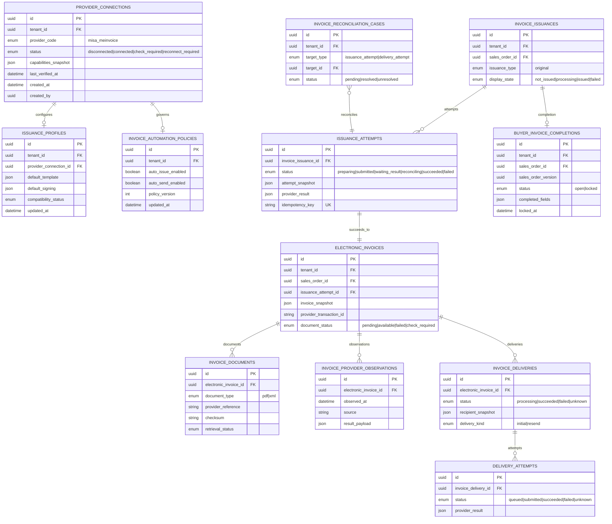

# TH-08 — Domain model (v1)

> Bounded context: **einvoice** (`modules/einvoice/` — **greenfield, chưa implement**). Schema Postgres: `einvoice`.
> Product spec: [Theme-8-e-invoice.md](../Theme-8-e-invoice.md) §3–4.
> Analyze: [ddd-domain-modeling](../../../../.cursor/skills/ddd-domain-modeling/SKILL.md) · Implement: [domain-layer](../../../../.cursor/skills/domain-layer/SKILL.md)

**Harness 2026-08-17:** Chốt symbol, schema, state machine và CMD catalog từ canonical §3–4. Contract chi tiết: [07-api-contracts.md](07-api-contracts.md).

Theme 08 **không** sở hữu: Tenant, hồ sơ pháp lý, Partner, SalesOrder, dữ liệu thương mại. Không có danh sách HĐĐT độc lập (MVP).

## State machines

Canonical §3.2.5. Display state (Issuance / Delivery trên Theme 05) là **projection** — không phải lifecycle độc lập.

### Provider connection

| From                 | To                   | Allowed | Ghi chú                                    |
| -------------------- | -------------------- | ------- | ------------------------------------------ |
| `DISCONNECTED`       | `CONNECTED`          | Yes     | Sau verify + legal match + capability sync |
| `CONNECTED`          | `CHECK_REQUIRED`     | Yes     | Legal profile thay đổi hoặc cảnh báo       |
| `CONNECTED`          | `RECONNECT_REQUIRED` | Yes     | Credential hết hiệu lực                    |
| `CHECK_REQUIRED`     | `CONNECTED`          | Yes     | Re-verify thành công                       |
| `RECONNECT_REQUIRED` | `CONNECTED`          | Yes     | Reconnect thành công                       |
| `CONNECTED`          | `DISCONNECTED`       | Yes     | Admin disconnect                           |
| `*`                  | `DISCONNECTED`       | No      | Không xóa history khi disconnect           |

### Configuration readiness (read model)

| Value                 | Meaning                                                          |
| --------------------- | ---------------------------------------------------------------- |
| `NOT_READY`           | ≥1 blocker (legal, connection, template, signing, compatibility) |
| `READY_WITH_WARNINGS` | Cho phép phát hành thủ công; auto-issue có thể bị chặn           |
| `READY`               | Đủ điều kiện phát hành và auto-issue (nếu policy bật)            |

### Issuance readiness (read model, per SalesOrder)

| Value                 | Meaning                                                                   |
| --------------------- | ------------------------------------------------------------------------- |
| `NOT_READY`           | Blocker: order status, buyer data, config, duplicate, in-progress attempt |
| `READY_WITH_WARNINGS` | Preview/issue thủ công được phép                                          |
| `READY`               | Đủ điều kiện tạo attempt                                                  |

### Issuance attempt

| From             | To               | Allowed | Ghi chú                                |
| ---------------- | ---------------- | ------- | -------------------------------------- |
| `PREPARING`      | `SUBMITTED`      | Yes     | Snapshot saved, provider call enqueued |
| `SUBMITTED`      | `WAITING_RESULT` | Yes     | Request accepted                       |
| `WAITING_RESULT` | `SUCCEEDED`      | Yes     | Definite success                       |
| `WAITING_RESULT` | `FAILED`         | Yes     | Definite failure                       |
| `WAITING_RESULT` | `RECONCILING`    | Yes     | Timeout / unknown                      |
| `RECONCILING`    | `SUCCEEDED`      | Yes     | Reconciliation resolved success        |
| `RECONCILING`    | `FAILED`         | Yes     | Reconciliation resolved failure        |
| `RECONCILING`    | `RECONCILING`    | Yes     | Still pending                          |
| `SUCCEEDED`      | `*`              | No      | Terminal                               |
| `FAILED`         | `PREPARING`      | No      | Retry = new attempt                    |

### Internal finalization

| From         | To           | Allowed | Ghi chú                                                  |
| ------------ | ------------ | ------- | -------------------------------------------------------- |
| `PENDING`    | `COMPLETED`  | Yes     | ElectronicInvoice registered locally                     |
| `PENDING`    | `UNRESOLVED` | Yes     | Provider success but local commit failed — recovery only |
| `COMPLETED`  | `*`          | No      | Terminal                                                 |
| `UNRESOLVED` | `COMPLETED`  | Yes     | Internal recovery — **không** gọi lại publish            |

### Invoice document

| Value            | Meaning                         |
| ---------------- | ------------------------------- |
| `PENDING`        | Chưa fetch                      |
| `AVAILABLE`      | Metadata + retrieval path known |
| `FAILED`         | Definite fetch failure          |
| `CHECK_REQUIRED` | Unknown / retry needed          |

### Delivery & delivery attempt

**InvoiceDelivery:** `PROCESSING` → `SUCCEEDED` | `FAILED` | `UNKNOWN`.

**DeliveryAttempt:** `QUEUED` → `SUBMITTED` → `SUCCEEDED` | `FAILED` | `UNKNOWN`.

### Reconciliation case

| From       | To           | Allowed |
| ---------- | ------------ | ------- |
| `PENDING`  | `RESOLVED`   | Yes     |
| `PENDING`  | `UNRESOLVED` | Yes     |
| `RESOLVED` | `*`          | No      |

### Display projections (Theme 05)

**Issuance display:** Chưa phát hành | Đang xử lý | Đã phát hành | Phát hành lỗi.

**Delivery display:** Chưa gửi | Đang gửi | Đã gửi | Gửi lỗi (+ phụ khi resend sau đã gửi thành công).

## Aggregates

| Aggregate / process      | Folder                               | Application folder                                        | Ghi chú                                      |
| ------------------------ | ------------------------------------ | --------------------------------------------------------- | -------------------------------------------- |
| `ProviderConnection`     | `domain/lib/src/provider_connection/` | `application/lib/src/configuration/commands/`, `queries/` | AR — một connection hoạt động / tenant (MVP) |
| `IssuanceProfile`        | `domain/lib/src/issuance_profile/`    | `application/lib/src/configuration/`                      | AR — template + signing default              |
| `AutomationPolicy`       | `domain/lib/src/automation_policy/`   | `application/lib/src/configuration/`                      | AR — auto-issue / auto-send                  |
| `BuyerInvoiceCompletion` | `domain/lib/src/issuance/`           | `application/lib/src/issuance/`                           | Process — OPEN → LOCKED                      |
| `InvoiceIssuance`        | `domain/lib/src/issuance/`           | `application/lib/src/issuance/`                           | AR — một ORIGINAL / SalesOrder               |
| `IssuanceAttempt`        | `domain/lib/src/issuance/`           | `application/lib/src/issuance/`                           | Process — attempt + AttemptSnapshot          |
| `ElectronicInvoice`      | `domain/lib/src/electronic_invoice/` | `application/lib/src/electronic_invoice/`                 | AR — authoritative invoice                   |
| `InvoiceDocument`        | `domain/lib/src/electronic_invoice/` | `application/lib/src/electronic_invoice/`                 | Child — PDF/XML metadata                     |
| `InvoiceDelivery`        | `domain/lib/src/delivery/`           | `application/lib/src/delivery/`                           | AR — send/resend intent                      |
| `DeliveryAttempt`        | `domain/lib/src/delivery/`           | `application/lib/src/delivery/`                           | Process                                      |
| `ReconciliationCase`     | `domain/lib/src/reconciliation/`     | internal handlers                                         | Process — cross-cutting                      |
| `OrderInvoiceProjection` | — (read model)                       | `application/lib/src/issuance/queries/`                   | Projection cho Theme 05                      |

**Không phải aggregate:** `ConfigurationReadiness`, `IssuanceReadiness`, `ProviderObservationRecord` (append-only history), shared technical records (§4.3.5).

## Database tables

| Table                           | Ghi chú                                      |
| ------------------------------- | -------------------------------------------- |
| `provider_connections`          | Connection + embedded capabilities snapshot  |
| `issuance_profiles`             | Default template/signing per tenant          |
| `invoice_automation_policies`   | Auto-issue / auto-send flags + version       |
| `buyer_invoice_completions`     | Controlled completion per SalesOrder/version |
| `invoice_issuances`             | Issuance root per SalesOrder ORIGINAL        |
| `issuance_attempts`             | Attempt + immutable AttemptSnapshot          |
| `electronic_invoices`           | Authoritative invoice + InvoiceSnapshot      |
| `invoice_documents`             | PDF/XML retrieval metadata                   |
| `invoice_provider_observations` | Append-only provider status history          |
| `invoice_deliveries`            | Business delivery intent                     |
| `delivery_attempts`             | Technical send attempts                      |
| `invoice_reconciliation_cases`  | Result reconciliation process state          |

Shared technical (không authoritative business state): `provider_interaction_records`, `idempotency_records`, `inbox_messages`, `outbox_messages`, `automatic_trigger_process_records`, `audit_logs`, `order_invoice_projections`.

## Value objects & enums

| Symbol                           | Values / mô tả                                                                  |
| -------------------------------- | ------------------------------------------------------------------------------- |
| `ProviderCode`                   | `misaMeinvoice` (Phase 1)                                                       |
| `ProviderConnectionStatus`       | `disconnected`, `connected`, `checkRequired`, `reconnectRequired`               |
| `ConfigurationReadinessLevel`    | `notReady`, `readyWithWarnings`, `ready`                                        |
| `IssuanceReadinessLevel`         | `notReady`, `readyWithWarnings`, `ready`                                        |
| `BuyerCompletionStatus`          | `open`, `locked`                                                                |
| `IssuanceType`                   | `original` (MVP)                                                                |
| `IssuanceAttemptStatus`          | `preparing`, `submitted`, `waitingResult`, `reconciling`, `succeeded`, `failed` |
| `InternalFinalizationStatus`     | `pending`, `completed`, `unresolved`                                            |
| `InvoiceDocumentStatus`          | `pending`, `available`, `failed`, `checkRequired`                               |
| `InvoiceDocumentType`            | `pdf`, `xml`                                                                    |
| `DeliveryStatus`                 | `processing`, `succeeded`, `failed`, `unknown`                                  |
| `DeliveryAttemptStatus`          | `queued`, `submitted`, `succeeded`, `failed`, `unknown`                         |
| `DeliveryKind`                   | `initial`, `resend`                                                             |
| `ReconciliationCaseStatus`       | `pending`, `resolved`, `unresolved`                                             |
| `IssuanceDisplayState`           | projection — 4 giá trị hiển thị                                                 |
| `DeliveryDisplayState`           | projection — 4+ giá trị hiển thị                                                |
| `ProviderCapabilitiesSnapshot`   | Embedded, replaceable on sync                                                   |
| `AttemptSnapshot`                | Embedded, immutable after attempt start                                         |
| `InvoiceSnapshot`                | Embedded, immutable after registration                                          |
| `DeliveryRecipientSnapshot`      | Embedded, immutable per delivery                                                |
| `CanonicalInvoiceModel`          | Runtime — provider-neutral payload                                              |
| `EffectiveBuyerInvoiceData`      | Runtime — BuyerInvoiceSnapshot ⊕ completion                                     |
| `ProviderIssuanceResult`         | Embedded result on attempt                                                      |
| `ProviderDeliveryResult`         | Embedded result on delivery/attempt                                             |
| `ProviderTemplateRef`            | Template id, serial, symbol, invoice form                                       |
| `SigningConfigurationRef`        | HSM / MTT mapping                                                               |
| `EffectiveIssuanceConfiguration` | Compatible template + signing combo                                             |

## Commands (CMD catalog → CQRS)

| Command                                  | CMD    | Epic/US        | Ghi chú                                     |
| ---------------------------------------- | ------ | -------------- | ------------------------------------------- |
| `ConnectProviderCommand`                 | CMD-01 | EP-01/US-01    | Thiết lập / cập nhật credential             |
| `VerifyProviderConnectionCommand`        | CMD-02 | EP-01/US-01    | Kiểm tra lại connection                     |
| `ReconnectProviderCommand`               | CMD-03 | EP-01/US-01    | Kết nối lại khi credential invalid          |
| `DisconnectProviderCommand`              | CMD-04 | EP-01/US-01    | Ngắt connection                             |
| `SyncProviderCapabilitiesCommand`        | CMD-05 | EP-01/US-01    | Đồng bộ capability sau connect/verify       |
| `SetDefaultIssuanceConfigurationCommand` | CMD-06 | EP-01/US-02    | Chọn template + signing default             |
| `UpdateAutomationPolicyCommand`          | CMD-07 | EP-01/US-03    | Bật/tắt auto-issue / auto-send              |
| `RequestInvoicePreviewCommand`           | CMD-08 | EP-02/US-01    | Preview — không tạo attempt                 |
| `CompleteBuyerInvoiceDataCommand`        | CMD-09 | EP-02/US-01,02 | Controlled completion → LOCKED              |
| `IssueInvoiceCommand`                    | CMD-10 | EP-02/US-02    | Phát hành thủ công                          |
| `StartAutoIssuanceCommand`               | CMD-11 | EP-02/US-03    | Internal — trigger từ sales.order.completed |
| `RecordIssuanceResultCommand`            | CMD-12 | EP-02/US-04    | Internal/worker — finalize attempt          |
| `RetryIssuanceCommand`                   | CMD-13 | EP-02/US-05    | Attempt mới sau definite failure            |
| `OpenReconciliationCaseCommand`          | CMD-14 | EP-02/US-04,05 | Internal — unknown result                   |
| `ResolveReconciliationCaseCommand`       | CMD-15 | EP-02/US-04,05 | Internal — apply reconciled outcome         |
| `RecoverInternalFinalizationCommand`     | CMD-16 | EP-02/US-04    | Internal — provider success, local pending  |
| `RequestOfficialInvoiceViewCommand`      | CMD-17 | EP-03/US-01    | Resolve viewer URL/token                    |
| `RequestInvoiceDocumentCommand`          | CMD-18 | EP-03/US-02    | Fetch PDF hoặc XML                          |
| `RecordProviderObservationCommand`       | CMD-19 | EP-03/US-03    | Internal/worker — append observation        |
| `SendElectronicInvoiceCommand`           | CMD-20 | EP-04/US-02    | Manual send hoặc resend                     |
| `StartAutoDeliveryCommand`               | CMD-21 | EP-04/US-01    | Internal — trigger sau registered           |
| `RecordDeliveryResultCommand`            | CMD-22 | EP-04/US-03    | Internal/worker — finalize delivery         |

## Queries

| Query                               | CMD  | Epic/US        | Ghi chú                                     |
| ----------------------------------- | ---- | -------------- | ------------------------------------------- |
| `GetProviderConnectionScreenQuery`  | Q-01 | EP-01/US-01    | Legal profile read-only + connection status |
| `GetProviderConnectionStatusQuery`  | Q-02 | EP-01/US-01    | **Deprecated** — merged into Q-01 screen query (07 §S1a); không implement symbol riêng |
| `ListProviderTemplatesQuery`        | Q-03 | EP-01/US-02    | Templates từ provider                       |
| `GetIssuanceProfileQuery`           | Q-04 | EP-01/US-02    | Current default config                      |
| `GetAutomationPolicyQuery`          | Q-05 | EP-01/US-03    | Auto flags + policy version                 |
| `GetConfigurationReadinessQuery`    | Q-06 | EP-01/US-04    | Readiness + blockers/warnings               |
| `GetIssuanceReadinessQuery`         | Q-07 | EP-02/US-01    | Per-order readiness                         |
| `GetInvoicePreviewQuery`            | Q-08 | EP-02/US-01    | Preview payload / viewer ref                |
| `GetOrderInvoiceProjectionQuery`    | Q-09 | EP-02/US-02,05 | Status + actions cho Theme 05               |
| `GetIssuanceAttemptStatusQuery`     | Q-10 | EP-02/US-04,05 | Attempt detail + error                      |
| `GetElectronicInvoiceDetailQuery`   | Q-11 | EP-03/US-01    | Invoice profile for view                    |
| `GetInvoiceDocumentsQuery`          | Q-12 | EP-03/US-02    | Document list + retrieval state             |
| `GetLatestProviderObservationQuery` | Q-13 | EP-03/US-03    | Latest observation                          |
| `GetInvoiceDeliveryHistoryQuery`    | Q-14 | EP-04/US-02,03 | Deliveries + display state                  |
| `GetSendInvoiceSheetContextQuery`   | Q-15 | EP-04/US-02    | Suggested email + sheet mode                |

## Domain events

| Event                           | Khi                                       |
| ------------------------------- | ----------------------------------------- |
| `ProviderConnected`             | Connection → CONNECTED                    |
| `ProviderDisconnected`          | Admin disconnect                          |
| `IssuanceConfigurationUpdated`  | Profile default saved                     |
| `AutomationPolicyUpdated`       | Policy version bumped                     |
| `BuyerInvoiceCompletionLocked`  | First-time buyer data ready               |
| `IssuanceAttemptStarted`        | AttemptSnapshot persisted                 |
| `IssuanceAttemptSucceeded`      | Provider + local pre-finalization         |
| `IssuanceAttemptFailed`         | Definite failure                          |
| `IssuanceResultUndetermined`    | Timeout / unknown → reconciling           |
| `ElectronicInvoiceRegistered`   | Local authoritative commit complete       |
| `InternalFinalizationRecovered` | UNRESOLVED → COMPLETED without re-publish |
| `InvoiceDocumentAvailable`      | PDF/XML metadata stored                   |
| `ProviderObservationRecorded`   | New observation appended                  |
| `InvoiceDeliveryStarted`        | Delivery + recipient snapshot             |
| `InvoiceDeliverySucceeded`      | Definite send success                     |
| `InvoiceDeliveryFailed`         | Definite send failure                     |
| `InvoiceDeliveryUndetermined`   | Unknown send result                       |

## Integration events — publish

| Type                                       | Khi                                                                 |
| ------------------------------------------ | ------------------------------------------------------------------- |
| `einvoice.electronic_invoice.registered`   | ElectronicInvoiceRegistered — Theme 05 projection + EP-04 auto-send |
| `einvoice.issuance.failed`                 | Definite issuance failure — Theme 05 projection                     |
| `einvoice.issuance.processing`             | Attempt in progress — Theme 05 projection                           |
| `einvoice.delivery.result_recorded`        | Delivery terminal or updated — Theme 05 projection                  |
| `einvoice.configuration.readiness_changed` | Config readiness level changed (optional)                           |

## Integration events — consume

| Source | Event                       | Mục đích                                                |
| ------ | --------------------------- | ------------------------------------------------------- |
| sales  | `sales.order.completed`     | Auto-issue trigger (EP-02/US-03)                        |
| iam    | `iam.legal_profile.updated` | Mark connection CHECK_REQUIRED (không mutate snapshots) |

## Data rules

| Rule ID | Rule                                                                                                           |
| ------- | -------------------------------------------------------------------------------------------------------------- |
| DR-01   | Một SalesOrder ≤ một `InvoiceIssuance` ORIGINAL và ≤ một `ElectronicInvoice` gốc (MVP)                         |
| DR-02   | Preview / configuration readiness **không** tạo IssuanceAttempt / ElectronicInvoice / InvoiceDelivery          |
| DR-03   | Phase 1: tối đa một `ProviderConnection` hoạt động / tenant                                                    |
| DR-04   | Connection → CONNECTED chỉ sau verify + legal match + mandatory capability sync                                |
| DR-05   | Credential/secret không round-trip về client sau lưu                                                           |
| DR-06   | Disconnect không xóa invoice, snapshot, document, delivery history                                             |
| DR-07   | `BuyerInvoiceSnapshot` precedence > Theme 03 — không overwrite field đã có                                     |
| DR-08   | Theme 03 resolve chỉ khi completion OPEN và field bắt buộc thiếu                                               |
| DR-09   | `BuyerInvoiceCompletion` → LOCKED khi `EffectiveBuyerInvoiceData` lần đầu đủ — terminal cho SalesOrder/version |
| DR-10   | Sau LOCKED, không auto-resolve Theme 03                                                                        |
| DR-11   | Khách tổ chức thiếu MST → blocker issuance (`BUYER_TAX_CODE_REQUIRED`)                                         |
| DR-12   | Chỉ SalesOrder Hoàn tất được phát hành                                                                         |
| DR-13   | AttemptSnapshot bất biến sau attempt start; technical retry giữ snapshot                                       |
| DR-14   | InvoiceSnapshot bất biến sau ElectronicInvoice registration                                                    |
| DR-15   | Seller snapshot từ legal profile tại attempt start — không cập nhật ngược                                      |
| DR-16   | Idempotency: cùng business identity → trả operation hiện có                                                    |
| DR-17   | Timeout ≠ definite failure; unknown → RECONCILING, khóa operation cạnh tranh                                   |
| DR-18   | Provider success + local finalization pending → recovery nội bộ, **không** re-publish                          |
| DR-19   | Không giữ DB transaction mở trong provider call                                                                |
| DR-20   | MISA HTTP chỉ từ messaging_worker — không từ Flutter                                                           |
| DR-21   | Token cache keyed by `tenantId` — cấm singleton client mọi tenant                                              |
| DR-22   | Official view / PDF / XML từ provider — không tự dựng tài liệu pháp lý                                         |
| DR-23   | Delivery display state tính từ authoritative delivery history                                                  |
| DR-24   | Resend tạo `InvoiceDelivery` mới với `deliveryKind=resend` — giữ history cũ                                    |
| DR-25   | `OrderInvoiceProjection` là read model — không thuộc aggregate issuance                                        |

## Blocked response codes (presentation boundary)

Base: `NO_PERMISSION`, `NOT_FOUND`, `VALIDATION_ERROR`, `INVALID_STATUS`, `STATE_CHANGED`, `SYSTEM_ERROR`.

TH-08 extensions: `PROVIDER_NOT_CONNECTED`, `PROVIDER_AUTH_FAILED`, `PROVIDER_UNAVAILABLE`, `CONFIG_NOT_READY`, `ISSUANCE_NOT_READY`, `BUYER_DATA_INCOMPLETE`, `BUYER_TAX_CODE_REQUIRED`, `ORDER_NOT_COMPLETED`, `ALREADY_ISSUED`, `OPERATION_IN_PROGRESS`, `RESULT_UNDETERMINED`, `DOCUMENT_UNAVAILABLE`, `DELIVERY_NOT_SUPPORTED`.

Chi tiết mapping: [07-api-contracts.md](07-api-contracts.md).

## Anti-patterns

- ERP client HTTP trực tiếp tới `*.meinvoice.vn`.
- Cross-module import domain/repository (chỉ `integration_events` / published contracts).
- Theme 05 mutate `ElectronicInvoice` / `InvoiceSnapshot` / `BuyerInvoiceSnapshot`.
- Theme 08 overwrite hồ sơ pháp lý / partner authoritative data.
- Singleton `MeInvoiceClient` / token cache không keyed by tenant.
- Preview tạo IssuanceAttempt hoặc ElectronicInvoice.
- Re-publish sau provider success khi local finalization fail.
- God aggregate gộp configuration + issuance + delivery.
- Danh sách HĐĐT độc lập trong MVP.
- Either/Result bên trong command handlers.

## Implement

Code domain: [domain-layer skill](../../../../.cursor/skills/domain-layer/SKILL.md) → `modules/einvoice/domain/lib/src/`.
Commands/handlers: [application-layer](../../../../.cursor/skills/application-layer/SKILL.md).
SQL draft: `supabase/migrations/_drafts/einvoice_*.sql` (BE lane).
Worker: `apps/messaging_worker` + `packages/vet45_misa` — xem [03-architecture-and-flows.md](03-architecture-and-flows.md).