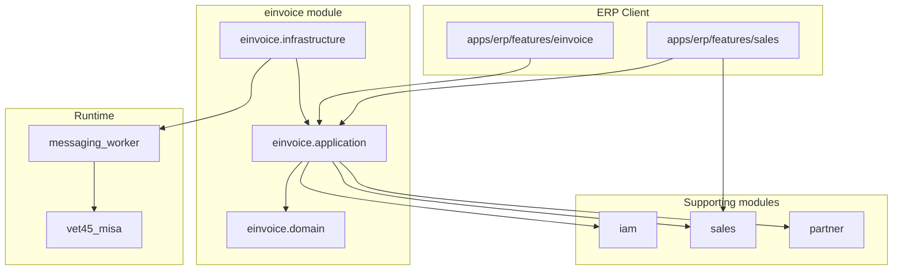

# TH-08 — Module map

Canonical boundaries: [Theme-8-e-invoice.md](../Theme-8-e-invoice.md) §1.5 · domain: [01-domain-model.md](01-domain-model.md).

## Modules

| Module | Vai trò | Package | Status |
| ------ | ------- | ------- | ------ |
| **einvoice** | **Owner** — configuration, issuance, electronic invoice, delivery | `modules/einvoice/` | contract — domain + application + integration_events |
| iam / TH-01 | Supporting — tenant, permission, hồ sơ pháp lý bên bán | `modules/iam/` | golden |
| sales / TH-05 | Supporting — SalesOrder, BuyerInvoiceSnapshot, màn nguồn | `modules/sales/` | scaffold |
| partner / TH-03 | Supporting — resolve completion buyer (trước khóa) | `modules/partner/` | greenfield |
| catalog | Supporting — SKU / thuế lineage qua SalesOrder | `modules/catalog/` | skeleton |
| accounting | Downstream consumer — không trong MVP TH-08 | `modules/accounting/` | skeleton |

Runtime vendor call: **chỉ** `apps/messaging_worker` → `packages/vet45_misa` — xem [03-architecture-and-flows.md](03-architecture-and-flows.md).



## Contract với supporting themes

| Module / theme | Theme 08 đọc | Theme 08 ghi / publish |
| -------------- | ------------ | ---------------------- |
| iam / TH-01 | Hồ sơ pháp lý hiện hành (read); permission check | — |
| sales / TH-05 | SalesOrder, status, `BuyerInvoiceSnapshot`, `buyer_partner_id`, `sales_order_version`, line items | `OrderInvoiceProjection` via integration events |
| partner / TH-03 | Hồ sơ buyer hiện hành **chỉ** khi completion OPEN + field thiếu; recipient email qua public function source-owned `partner.get_einvoice_recipient_snapshot(...)` | — |
| catalog | Lineage SKU/thuế qua SalesOrder snapshot | — |
| messaging_worker | Enqueue/claim jobs | Job results via internal commands; S4: `fetch_official_view`, `download_invoice_document`, `poll_provider_observation`; S5: `send_invoice_email`, `reconcile_invoice_delivery` |

E-invoice **không** query bảng của Partner/Sales. Chỉ gọi public function source-owned: `partner.get_einvoice_recipient_snapshot(...)` và `sales.can_access_sales_order(...)`.

## Snapshot DTO (cross-theme read)

| DTO / reference | Nguồn | Dùng khi |
| --------------- | ----- | -------- |
| `LegalProfileSnapshotDto` | TH-01 via iam query | Connect screen, readiness, seller snapshot at attempt |
| `BuyerInvoiceSnapshotDto` | TH-05 via sales | Preview, readiness, EffectiveBuyerInvoiceData base |
| `SalesOrderContextDto` | TH-05 | Order status, version, commercial lines |
| `PartnerInvoiceProfileDto` | TH-03 via partner | Controlled completion only |
| `legal_profile_reference` | TH-01 lineage id | AttemptSnapshot / InvoiceSnapshot |
| `sales_order_version` | TH-05 | Invalidate stale readiness |
| `buyer_partner_id` | TH-05 | Scope partner resolve |

Theme 08 **không** mutate các DTO nguồn — chỉ đọc và sao chép vào snapshot nội bộ.

## Permissions

Định nghĩa trong `modules/einvoice/domain/lib/src/permissions/einvoice_permissions.dart`:

| Code constant | Mô tả | US chính |
| ------------- | ----- | -------- |
| `EInvoicePermissions.manageConfiguration` | Kết nối NCC, profile, policy, readiness | EP-01 |
| `EInvoicePermissions.issue` | Preview, phát hành, retry | EP-02 |
| `EInvoicePermissions.view` | Xem hóa đơn chính thức, observation | EP-03 |
| `EInvoicePermissions.downloadDocument` | Tải PDF/XML | EP-03/US-02 |
| `EInvoicePermissions.send` | Gửi / gửi lại email | EP-04 |

Hardcode permission string trong UI/handler — luôn dùng constant.

## Integration events

### Publish (einvoice →)

| Event type | Consumer | Mục đích |
| ---------- | -------- | -------- |
| `einvoice.electronic_invoice.registered` | sales (TH-05) | Cập nhật row HĐĐT + actions |
| `einvoice.issuance.failed` | sales | Display state Phát hành lỗi |
| `einvoice.issuance.processing` | sales | Display state Đang xử lý |
| `einvoice.delivery.result_recorded` | sales | Delivery display state — payload safe `salesOrderId`, `deliveryId`, `deliveryStatus`, `deliveryDisplayState`, `deliveryVersion`, `hasSecondaryAttention` |
| `einvoice.delivery.attention_required` | TH-10 alerts (downstream) | Delivery reconciliation đạt `UNRESOLVED` — id + safe error code |
| `einvoice.configuration.readiness_changed` | optional internal | Invalidate config cache |
| `einvoice.provider_observation_attention_required` | TH-10 alerts (downstream) | NOT_FOUND/MISMATCH observation — neutral attention signal |

### Consume (→ einvoice)

| Source | Event type | Payload | Handler mục đích |
| ------ | ---------- | ------- | ---------------- |
| sales | `sales_order_finalized.v1` | tenantId, salesOrderId, salesOrderVersion, occurredAt | `SalesOrderFinalizedIntegrationEventHandler` → `StartAutoIssuanceCommand` (EP-02/US-03) |
| partner | `partner.partner.profile_updated` | tenantId, partnerId, occurredAt | Tìm process `PENDING_REEVALUATION` đúng buyer và dispatch `ReevaluateAutoIssuanceCommand`; không tạo process mới |
| provider (inbox) | `einvoice.provider.issuance_result_received` | tenantId, attemptId, correlationId, typedEvidence | `RecordIssuanceResultCommand` (EP-02/US-04) |
| einvoice (inbox) | `einvoice.electronic_invoice.registered` | tenantId, electronicInvoiceId, salesOrderId, occurredAt | `StartAutoDeliveryCommand` (EP-04/US-01) — một initial delivery / invoice |
| iam | `iam.legal_profile.updated` | tenantId, occurredAt | Mark `ProviderConnection` CHECK_REQUIRED |

**Quy định Stable Identity:**
- Sales completion tạo process với `triggerKey = sales_order_finalized.v1:<eventId>:<salesOrderId>:<sourceVersion>`; provider `RefID` dùng UUIDv5 namespace `514eaf96-eed8-5f7b-9705-4a840c910684` trên `<tenantId>|<salesOrderId>|<sourceVersion>`.
- Partner event chỉ dùng `sourceEventId = <eventId>` để dedupe inbox/re-evaluation; nó phải load `processId`, original `triggerKey` và provider idempotency key từ `AutomaticTriggerProcessRecord`, tuyệt đối không suy diễn business identity mới từ Partner event.

Cross-module: package `einvoice_integration_events` only — không import domain module khác.

## Presentation layout

| Screen group | Epic | Presentation path | Ghi chú |
| ------------ | ---- | ------------------- | ------- |
| SG-01 | EP-01 | `apps/erp/lib/features/einvoice/presentation/pages/einvoice_configuration_overview_page.dart` | Settings — connection + profile + policy |
| SG-02 | EP-02, EP-03 | Embed trong `apps/erp/features/sales/presentation/` (order detail / sales result row) | Row HĐĐT + preview entry |
| SG-03 | EP-02 | `apps/erp/features/sales/presentation/widgets/` (confirmation sheet, progress) | Issue confirm + processing |
| SG-04 | EP-02 | **No UI MVP** | Server-side reconciliation |
| SG-05 | EP-03 | **No UI MVP** | No standalone invoice list |
| SG-06 | EP-03 | Action sheet widget — `invoice_document_action_sheet.dart` | PDF/XML download |
| SG-07 | EP-04 | Send/resend sheet — `invoice_send_sheet.dart` | Manual send + resend |

Module presentation package mirror: `modules/einvoice/presentation/lib/src/` — widgets tách file, page mỏng.

UI index: [APPENDICES.md](../APPENDICES.md) · canonical §6.5.

## Anti-patterns

- ERP client HTTP trực tiếp tới `*.meinvoice.vn`.
- Cross-module import domain/repository (chỉ integration_events / published query ports).
- Theme 05 mutate `ElectronicInvoice` / `InvoiceSnapshot` / `BuyerInvoiceSnapshot`.
- Theme 08 overwrite hồ sơ pháp lý / partner authoritative data.
- Singleton `MeInvoiceClient` trong DI cho mọi tenant.
- Scaffold einvoice copy từ `modules/sales/` — **copy từ `modules/iam/`**.

## Package wiring (khi scaffold S1)

Mirror `modules/iam/`:

```text
modules/einvoice/
  domain/
  application/
  infrastructure/
  integration_events/
  presentation/          # optional — shared widgets
```

- `DataAccessModule` → gateways/repos, RPC clients
- `MediationModule` → `registerGenerated*Handlers` + `DefaultCommandPipeline`
- Codegen: `@CommandHandlerFor`, `@QueryHandlerFor`, access metadata

Chi tiết slice S1: [04-slice-roadmap.md](04-slice-roadmap.md) · contracts: [07-api-contracts.md](07-api-contracts.md).
