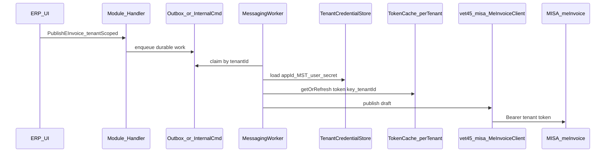
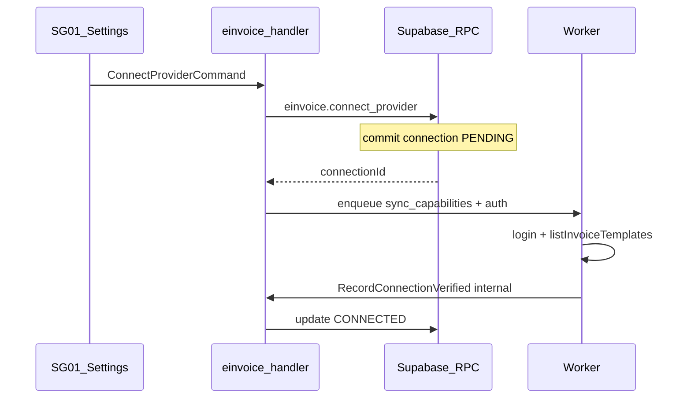
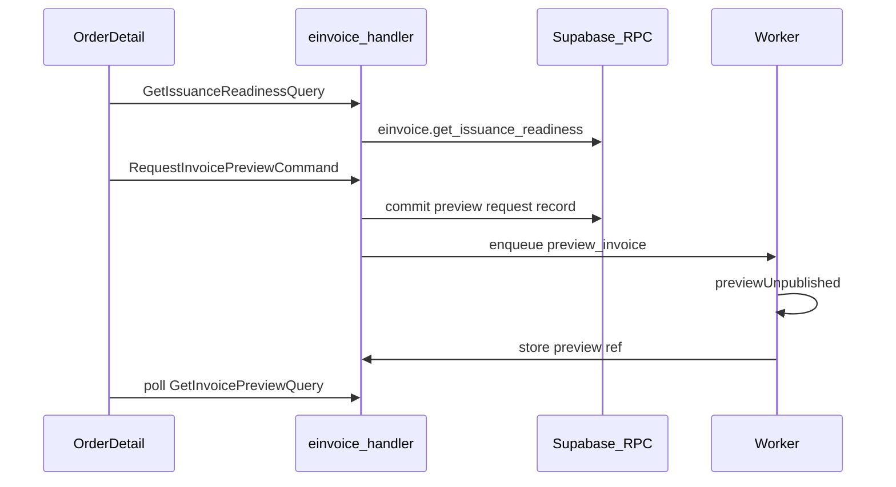
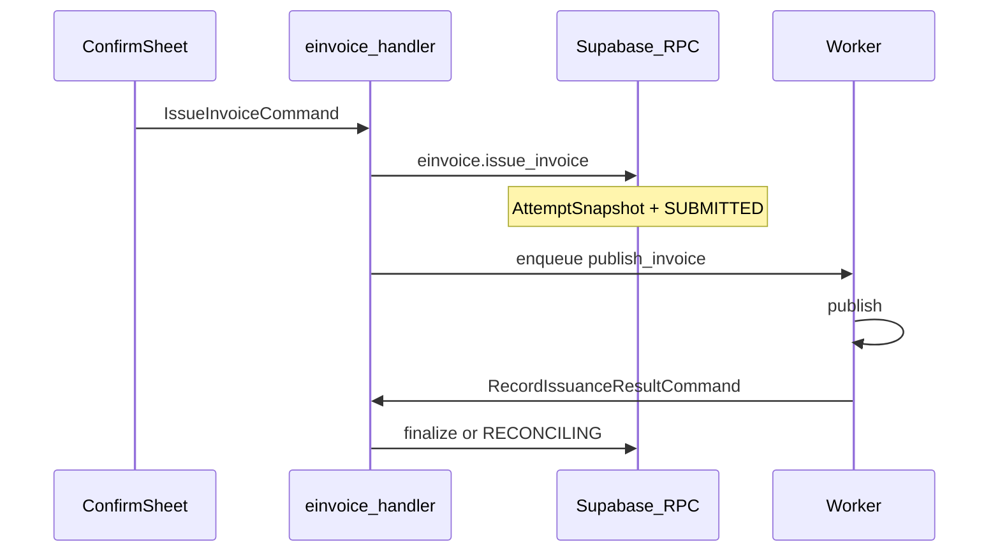
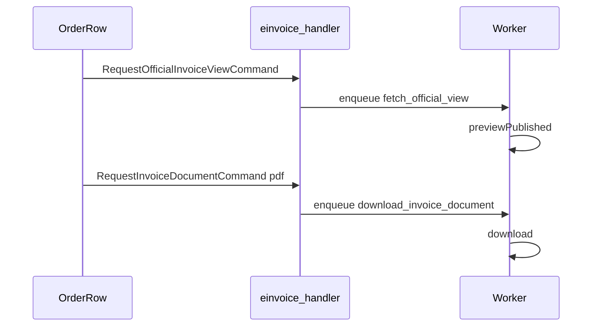

# TH-08 — Architecture & flows: MISA meInvoice multi-tenant

> Tài liệu kiến trúc tích hợp vendor cho Theme 8 (HĐĐT). Dùng khi implement FR; **không** thay SRS/Epic đầy đủ.

**Trạng thái:** planned (docs ingested; package blackbox Phase A đã có).

## 0. SRS flows (product)

Phase 1 provider = **MISA meInvoice** (tên domain/Epic không khóa vendor). Journey / UI index: [APPENDICES.md](../APPENDICES.md).


| SRS                        | Path                                                 |
| -------------------------- | ---------------------------------------------------- |
| Customer journeys CJ-01…07 | [Theme-8-e-invoice.md](../Theme-8-e-invoice.md) §2.3 |
| User flows UF-01…07        | canonical §6.3                                       |
| Screen groups SG-01…07     | canonical §6.5 (SG-04/05 = no UI MVP)                |
| Domain tree                | [01-domain-model.md](01-domain-model.md)             |
| Epic/US                    | [../README.md](../README.md)                         |


Business flow (rút gọn): Theme 01 legal + Theme 05 SalesOrder → Invoice Configuration / Issuance → MISA ↔ Issuance / ElectronicInvoice / Delivery → Theme 05 projection.

## 1. Context & boundary


| Khía cạnh      | Quyết định                                                                                   |
| -------------- | -------------------------------------------------------------------------------------------- |
| Vendor         | MISA **meInvoice đầu ra**                                                                    |
| Blackbox       | `[package:vet45_misa/e_invoice.dart](../../../../packages/vet45_misa/)` — `IMeInvoiceClient` |
| Phase A API    | `listTemplates`, `publish`, `getStatus`, `download`                                          |
| Caller runtime | **Chỉ** `[apps/messaging_worker](../../../../apps/messaging_worker/)`                        |
| ERP / Flutter  | Enqueue command bền; **không** HTTP tới `*.meinvoice.vn`                                     |
| Theme owner    | **TH-08**                                                                                    |


Layer map (bắt buộc):

```text
UI → IExecutionContext (tenant/user) → IModuleMediator
  → command handler (validate / domain)
  → enqueue outbox hoặc internal command (durable)
  → messaging_worker (per tenantId)
  → TenantCredentialStore + TokenCache
  → IMeInvoiceClient (vet45_misa)
  → MISA meInvoice HTTP
```

Module application **không** import wire JSON MISA. Infrastructure (hoặc worker adapter) map DTO Vet45 ↔ client blackbox.

## 2. On-behalf-of tenant

Mỗi lời gọi MISA dùng credential **của tenant đó** (tài khoản meInvoice DN), không dùng một service account toàn hệ thống thay MST khách hàng.




Worker đã tick theo tenant (`TenantDiscoveryClient` / per-tenant module flush). Job HĐĐT phải luôn mang `tenantId` rõ ràng khi claim và khi load credential.

## 3. Credential model (persist)

DN truyền / cấu hình:


| Field           | Nguồn                                                | Persist                                                              |
| --------------- | ---------------------------------------------------- | -------------------------------------------------------------------- |
| `appId`         | Cấu hình tích hợp meInvoice do DN cung cấp           | Có (không public API đọc lại tùy ý)                                  |
| `taxCode` / MST | **Cấu hình pháp lý tenant** (single source of truth) | Tham chiếu; có thể denormalize có kiểm soát khi lưu snapshot kết nối |
| `username`      | Tài khoản meInvoice DN                               | Có                                                                   |
| `password`      | Mật khẩu meInvoice DN                                | Có — **encrypted at rest**                                           |
| `baseUrl`       | Env worker (test/prod) hoặc override per tenant      | Config                                                               |


### Bảo mật

Khớp tinh thần [docs/architecture/08-data-and-security.md](../../../architecture/08-data-and-security.md):

- Bảng/settings owner module HĐĐT (hoặc IAM settings) có `tenant_id`; ghi qua RPC; RLS / deny direct table access từ client.
- Password (và ideally secret blob) mã hóa bằng key **chỉ worker** (hoặc KMS) giải được — **không** trả password về Flutter.
- ERP chỉ thấy trạng thái kết nối: connected / auth_failed / missing_config — không round-trip secret.
- **Cấm** log `password`, Bearer token, raw auth response có credential.


### So với Resend trên worker

Resend dùng **một** `RESEND_API_KEY` env toàn worker. MISA meInvoice **khác**: credential **per tenant** trong DB (encrypted), không đủ chỉ env global `appId`.

## 4. Token cache (per tenant)


### Kết luận

**Cache Bearer là hợp lý** (TTL meInvoice dài, docs ~ngày). Cache **bắt buộc keyed by** `tenantId`. Singleton token / một `MeInvoiceClient` dùng chung mọi tenant = **lỗi bảo mật** (phát hành nhầm MST).

### Hiện tại (single messaging worker)

In-process đủ:

```text
TokenCache: Map<tenantId, { accessToken, expiresAt }>
+ mutex / lock per tenantId  (tránh refresh stampede)
```

Luồng:

1. Miss hoặc gần hết hạn (skew) → login (`appId` + MST + user + password) hoặc refresh.
2. Gặp `TokenExpiredCode` → refresh/re-login **một lần**, retry request.
3. Invalidate khi: đổi password, admin disconnect, refresh thất bại.

Package Phase A (`MeInvoiceAuth`) cache **trên một instance client** gắn một `MeInvoiceConfig`. Worker / factory phải:

- Tạo client **theo tenant** (config từ credential store), **hoặc**
- Inject token store ngoài keyed by `tenantId`

**Cấm** đăng ký một `MeInvoiceClient` singleton trong DI cho mọi tenant.

### Evolution (khi >1 worker replica)

Chuyển shared store (Redis hoặc bảng token encrypted) vẫn keyed by `tenantId`. Không implement trong theme planned hiện tại.

## 5. Worker integration


| Quy tắc       | Chi tiết                                                                                                           |
| ------------- | ------------------------------------------------------------------------------------------------------------------ |
| Ai gọi MISA   | Chỉ `messaging_worker`                                                                                             |
| Scale hôm nay | Single service — in-process token cache OK                                                                         |
| ERP           | Chỉ enqueue; poll/query trạng thái HĐ từ DB Vet45                                                                  |
| Soft-fail     | Thiếu credential tenant → fail job có mã ổn định (tương tự soft-fail Resend thiếu key), không crash tick cả worker |
| Idempotency   | `refId` từ Vet45 khi `publish` (map MISA refid)                                                                    |


Luồng messaging nền: [docs/architecture/07-integration-and-messaging.md](../../../architecture/07-integration-and-messaging.md).

## 6. Ownership & non-goals

**Owner:** TH-08.

**Supporting:** `vet45_misa`, messaging worker, tenant legal profile (MST), module bán hàng/đối tác (nguồn chứng từ — slice sau).

**Ngoài scope tài liệu / theme này (tối thiểu):**

- meInvoice đầu vào
- MISA ACT / ASP / CRM
- Chi tiết UX ký số HSM/USB
- DDL/RPC cụ thể (viết khi slice implement + `_drafts/`)
- Shared token store đa replica


## 7. Liên kết


| Tài nguyên              | Path / URL                                                                                                                                                                                   |
| ----------------------- | -------------------------------------------------------------------------------------------------------------------------------------------------------------------------------------------- |
| Package README          | [packages/vet45_misa/README.md](../../../../packages/vet45_misa/README.md)                                                                                                                   |
| Theme overview          | [../OVERVIEWS.md](../OVERVIEWS.md)                                                                                                                                                           |
| API contracts           | [07-api-contracts.md](07-api-contracts.md)                                                                                                                                                   |
| Slice roadmap           | [04-slice-roadmap.md](04-slice-roadmap.md)                                                                                                                                                   |
| Integration & messaging | [docs/architecture/07-integration-and-messaging.md](../../../architecture/07-integration-and-messaging.md)                                                                                   |
| Data & security         | [docs/architecture/08-data-and-security.md](../../../architecture/08-data-and-security.md)                                                                                                   |
| MISA Open API đầu ra    | [https://www.misa.vn/154989/tai-lieu-open-api-tich-hop-hoa-don-dien-tu-misa-meinvoice-dau-ra/](https://www.misa.vn/154989/tai-lieu-open-api-tich-hop-hoa-don-dien-tu-misa-meinvoice-dau-ra/) |
| Tổng quan meInvoice API | [https://www.misa.vn/154127/tong-quan-open-api-hoa-don-dien-tu-misa-meinvoice/](https://www.misa.vn/154127/tong-quan-open-api-hoa-don-dien-tu-misa-meinvoice/)                               |


## 8. Job catalog

Mọi vendor call qua outbox/internal job — **không giữ DB transaction mở** trong provider call (canonical reliability invariant).

**S1 (EP-01) — dispatch qua `internal_commands` (không job registry riêng):**

- Messaging tables/RPC (`outbox` / `inbox` / `internal_commands` + claim/complete/fail) cài bằng `platform.install_module_messaging('einvoice')` — không DDL messaging riêng. Worker discovery lấy tenant từ `platform.messaging_module_registry` (không patch tay `list_tenants_with_pending_messaging`).
- `ConnectProviderCommand` RPC `einvoice.connect_provider` encrypt credential (`pgcrypto` `pgp_sym_encrypt`, key từ Supabase Vault secret `einvoice_credential_key`) và `einvoice.enqueue_internal_command` (`command_type = einvoice.sync_capabilities`) trong cùng transaction; trả `status = CHECK_REQUIRED`.
- Worker tick: `EinvoiceMessagingModule` → claim `einvoice.internal_commands` → `SyncProviderCapabilitiesCommandHandler` → `TenantMeInvoiceClientFactory` đọc credential qua RPC `einvoice.read_provider_credentials` (service role only) → MISA auth + `listInvoiceTemplates` → `RecordConnectionVerifiedCommand` / RPC `einvoice.record_connection_verified`.
- Password **không** round-trip về client; decrypt chỉ trong RPC worker path (DR-05, BR-11).

| Job type                             | Payload (summary)                        | Idempotency key                                    | IMeInvoiceClient       | Retry                   | Terminal                         |
| ------------------------------------ | ---------------------------------------- | -------------------------------------------------- | ---------------------- | ----------------------- | -------------------------------- |
| `einvoice.sync_capabilities`         | tenantId, connectionId                   | `{tenantId}:sync_cap:{connectionId}:{day}`         | `listInvoiceTemplates` | 3x backoff              | success / fail job               |
| `einvoice.preview_invoice`           | tenantId, salesOrderId, previewRequestId | `{tenantId}:preview:{salesOrderId}:{orderVersion}` | `previewUnpublished`   | 2x                      | success / fail                   |
| `einvoice.publish_invoice`           | tenantId, attemptId, canonicalPayload    | `{tenantId}:publish:{attemptId}`                   | `publish`              | none (poll instead)     | enqueued → poll                  |
| `einvoice.poll_issuance_status`      | tenantId, attemptId, providerRef         | `{tenantId}:poll_issue:{attemptId}:{tick}`         | `getStatus`            | schedule until resolved | SUCCEEDED / FAILED / RECONCILING |
| `einvoice.download_invoice_document` | tenantId, documentId, type               | `{tenantId}:download:{documentId}:{type}`          | `download`             | 3x                      | AVAILABLE / FAILED               |
| `einvoice.fetch_official_view`       | tenantId, invoiceId                      | `{tenantId}:view:{invoiceId}:{hour}`               | `previewPublished`     | 2x                      | URL issued / fail                |
| `einvoice.send_invoice_email`        | tenantId, deliveryAttemptId              | `{tenantId}:send:{deliveryAttemptId}`              | `sendEmail`            | poll on unknown         | SUCCEEDED / FAILED / UNKNOWN     |
| `einvoice.poll_provider_observation` | tenantId, electronicInvoiceId            | `{tenantId}:observe:{invoiceId}:{day}`             | `getStatus`            | schedule                | observation recorded             |


**Commit points (RPC trước enqueue):**

1. Persist AttemptSnapshot / DeliveryRecipientSnapshot locally.
2. Commit transaction (attempt status → SUBMITTED).
3. Enqueue job — worker calls MISA outside transaction.
4. Worker invokes `RecordIssuanceResultCommand` / `RecordDeliveryResultCommand` via internal path.

**Soft-fail:** missing tenant credential → job fails with stable code `PROVIDER_NOT_CONNECTED`; worker tick continues.

## 9. Flow per UF

Index: [APPENDICES.md](../APPENDICES.md) §B.

### UF-01 — Thiết lập khả năng phát hành (CJ-01 → SG-01)




### UF-02 — Kiểm tra và xem trước (CJ-02 → SG-02)




No IssuanceAttempt created (DR-02).

### UF-03 — Phát hành thủ công (CJ-03 → SG-02/03)




### UF-04 — Theo dõi phát hành tự động (CJ-04)

```text
sales.order.completed → inbox → StartAutoIssuanceCommand
  → same path as UF-03 (no dedicated UI)
  → Theme 05 row shows processing via OrderInvoiceProjection
```

Uses `AutomaticTriggerProcessRecord` before attempt creation (duplicate prevention).

### UF-05 — Chờ xác lập kết quả (CJ-05 — server-side)

```text
Timeout/unknown → IssuanceAttempt RECONCILING
  → OpenReconciliationCaseCommand
  → poll_issuance_status job loop
  → ResolveReconciliationCaseCommand OR RecoverInternalFinalizationCommand
```

**No UI MVP (SG-04).** Theme 05 shows "Đang xử lý" until terminal state.

### UF-06 — Xem hóa đơn / tài liệu (CJ-06 → SG-06)




### UF-07 — Gửi / gửi lại email (CJ-07 → SG-07)

```text
Auto: electronic_invoice.registered → StartAutoDeliveryCommand → send_invoice_email job
Manual: SendElectronicInvoiceCommand → delivery snapshot → send job
Result: RecordDeliveryResultCommand → OrderInvoiceProjection delivery display
```


## 10. Reconciliation & finalization recovery


### ReconciliationCase (issuance)


| Trigger                                 | Process                                         |
| --------------------------------------- | ----------------------------------------------- |
| Publish timeout                         | attempt → RECONCILING; open case PENDING        |
| Duplicate/conflicting provider response | case PENDING; correlate by idempotency key      |
| Poll resolves success                   | `RecordIssuanceResultCommand` → SUCCEEDED       |
| Poll resolves failure                   | FAILED — user may RetryIssuance (new attempt)   |
| Unresolved after policy                 | case UNRESOLVED — ops tooling (Theme 11 future) |


Competing operations **locked** while case PENDING (DR-17).

### Internal finalization recovery

```text
Provider publish SUCCESS (confirmed)
  BUT local ElectronicInvoice commit failed
    → InternalFinalizationStatus PENDING/UNRESOLVED
    → RecoverInternalFinalizationCommand
    → register ElectronicInvoice from AttemptSnapshot + provider result
    → **NO** second publish call to MISA
```

`ProviderObservationRecord` and poll jobs are **observation only** — do not override authoritative issuance state (EP-03/US-03 FR-04).

### AutomaticTriggerProcessRecord

Used for auto-issue (UF-04) and auto-send (UF-07):

- Dedupe by `{tenantId}:{salesOrderId}:auto_issue` or `{electronicInvoiceId}:auto_send`
- Stores trigger id from integration event
- Prevents duplicate attempts from replayed inbox messages

## 11. Status feedback (ERP quan sát trạng thái)

Vì ERP không gọi MISA và mọi vendor call chạy nền, UI cần một cơ chế để thấy trạng thái chuyển từ `Đang xử lý` sang terminal. Độ trễ cảm nhận bị chặn bởi **ba chặng độc lập**:

| # | Chặng | Nguồn latency hiện tại |
| - | ----- | ---------------------- |
| 1 | Client quan sát DB | Poll interval của UI |
| 2 | Worker tick | `apps/messaging_worker/lib/worker_tick_policy.dart`: active 3s, idle 15s, max idle 30s |
| 3 | MISA round-trip | Không có webhook — job `einvoice.poll_issuance_status` (§8) pull `getStatus` |

Tối ưu chặng 1 mà bỏ chặng 2–3 sẽ không cải thiện cảm nhận người dùng.

### Quyết định (S2)

**A. State tự báo ngay sau mutation.** Theo commit points ở §8, `IssuanceAttempt` được commit `SUBMITTED` **trước** khi enqueue job, nên `IssueInvoiceResultDto` đã đủ để UI hiện `Đang xử lý` mà không cần chờ vòng quan sát nào. Chỉ transition cuối mới cần poll.

**B. Poll projection qua RPC.** UI gọi `GetOrderInvoiceProjectionQuery` (RPC `einvoice.get_order_invoice_projection`) theo interval, **chỉ khi state chưa terminal**:

| Display state | Poll |
| ------------- | ---- |
| `Đang xử lý` (issuance) / `Đang gửi` (delivery) | 3–5s |
| `Đã phát hành`, `Phát hành lỗi`, `Đã gửi`, `Gửi lỗi` | **dừng hẳn** |

Read model vẫn đi qua RPC trả DTO — không đọc bảng trực tiếp từ client.

**Gap cần xử lý trong S2:** `packages/vet45_async_query` chưa có `refetchInterval` (xem `lib/src/query_options.dart` — chỉ `staleTime`, `gcTime`, `retry`, `refetchOnMount`, `enabled`). Bổ sung `refetchInterval` vào `QueryOptions` / `QueryObserver` để mọi theme có long-running job dùng lại, thay vì mỗi màn tự dựng `Timer.periodic`. `AppLifecycleRefetch` sẵn có lo phần app resume.

### Không dùng (S2)

| Anti-pattern | Lý do |
| ------------ | ----- |
| Long-poll RPC chờ terminal state | Giữ connection, cạn pooler Supabase |
| Flutter gọi thẳng `getStatus` của MISA | Phá boundary §1, leak credential tenant |
| Poll tiếp khi state đã terminal | Burn quota vô ích |
| Đặt worker `tickSecret` trong app client | Secret leak — `/tick` chỉ gọi server-side |

### Hướng tương lai (chưa lên slice)

Ghi lại để không phải phân tích lại, **không** thuộc phạm vi S2:

- **Push signal:** trigger Postgres → `realtime.send()` trên private channel `tenant:{tenantId}:einvoice`, payload **chỉ chứa khóa** (`salesOrderId`, state, version) để `invalidateQueries` rồi refetch DTO qua RPC. Gateway đặt tại `modules/einvoice/infrastructure/lib/src/realtime/` (cùng cấp `rpc/`). Broadcast là at-most-once nên poll vẫn phải giữ làm safety net.
- **Giảm latency chặng 2:** kick `POST /tick` từ server-side (`pg_net` hoặc Edge Function) sau khi enqueue — đây là chỗ `IMessagingFlushPort.flushAfterMutation()` được thiết kế để cắm vào; hoặc hạ `WORKER_TICK_ACTIVE_SECONDS`.

Điều kiện xem xét: sau khi S2 chạy thật và đo được latency từ `SUBMITTED` đến lúc UI thấy terminal state.

