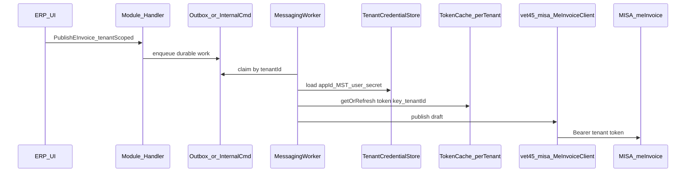

# TH-08 — Architecture & flows: MISA meInvoice multi-tenant

> Tài liệu kiến trúc tích hợp vendor cho Theme 8 (HĐĐT). Dùng khi implement FR; **không** thay SRS/Epic đầy đủ.

**Trạng thái:** planned (doc-only; package blackbox Phase A đã có).

## 1. Context & boundary

| Khía cạnh | Quyết định |
| --------- | ---------- |
| Vendor | MISA **meInvoice đầu ra** |
| Blackbox | [`package:vet45_misa/e_invoice.dart`](../../../../packages/vet45_misa/) — `IMeInvoiceClient` |
| Phase A API | `listTemplates`, `publish`, `getStatus`, `download` |
| Caller runtime | **Chỉ** [`apps/messaging_worker`](../../../../apps/messaging_worker/) |
| ERP / Flutter | Enqueue command bền; **không** HTTP tới `*.meinvoice.vn` |
| Theme owner | **TH-08** |

Layer map (bắt buộc):

```text
UI → IExecutionContext (tenant/user) → IModuleMediator
  → command handler (validate / domain)
  → enqueue outbox hoặc internal command (durable)
  → messaging_worker (per tenantId)
  → TenantCredentialStore + TokenCache
  → IMeInvoiceClient (vet45_misa)
  → MISA meInvoice HTTP
```

Module application **không** import wire JSON MISA. Infrastructure (hoặc worker adapter) map DTO Vet45 ↔ client blackbox.

## 2. On-behalf-of tenant

Mỗi lời gọi MISA dùng credential **của tenant đó** (tài khoản meInvoice DN), không dùng một service account toàn hệ thống thay MST khách hàng.



Worker đã tick theo tenant (`TenantDiscoveryClient` / per-tenant module flush). Job HĐĐT phải luôn mang `tenantId` rõ ràng khi claim và khi load credential.

## 3. Credential model (persist)

DN truyền / cấu hình:

| Field | Nguồn | Persist |
| ----- | ----- | ------- |
| `appId` | Cấu hình tích hợp meInvoice do DN cung cấp | Có (không public API đọc lại tùy ý) |
| `taxCode` / MST | **Cấu hình pháp lý tenant** (single source of truth) | Tham chiếu; có thể denormalize có kiểm soát khi lưu snapshot kết nối |
| `username` | Tài khoản meInvoice DN | Có |
| `password` | Mật khẩu meInvoice DN | Có — **encrypted at rest** |
| `baseUrl` | Env worker (test/prod) hoặc override per tenant | Config |

### Bảo mật

Khớp tinh thần [docs/architecture/08-data-and-security.md](../../../architecture/08-data-and-security.md):

- Bảng/settings owner module HĐĐT (hoặc IAM settings) có `tenant_id`; ghi qua RPC; RLS / deny direct table access từ client.
- Password (và ideally secret blob) mã hóa bằng key **chỉ worker** (hoặc KMS) giải được — **không** trả password về Flutter.
- ERP chỉ thấy trạng thái kết nối: connected / auth_failed / missing_config — không round-trip secret.
- **Cấm** log `password`, Bearer token, raw auth response có credential.

### So với Resend trên worker

Resend dùng **một** `RESEND_API_KEY` env toàn worker. MISA meInvoice **khác**: credential **per tenant** trong DB (encrypted), không đủ chỉ env global `appId`.

## 4. Token cache (per tenant)

### Kết luận

**Cache Bearer là hợp lý** (TTL meInvoice dài, docs ~ngày). Cache **bắt buộc keyed by `tenantId`**. Singleton token / một `MeInvoiceClient` dùng chung mọi tenant = **lỗi bảo mật** (phát hành nhầm MST).

### Hiện tại (single messaging worker)

In-process đủ:

```text
TokenCache: Map<tenantId, { accessToken, expiresAt }>
+ mutex / lock per tenantId  (tránh refresh stampede)
```

Luồng:

1. Miss hoặc gần hết hạn (skew) → login (`appId` + MST + user + password) hoặc refresh.
2. Gặp `TokenExpiredCode` → refresh/re-login **một lần**, retry request.
3. Invalidate khi: đổi password, admin disconnect, refresh thất bại.

Package Phase A (`MeInvoiceAuth`) cache **trên một instance client** gắn một `MeInvoiceConfig`. Worker / factory phải:

- Tạo client **theo tenant** (config từ credential store), **hoặc**
- Inject token store ngoài keyed by `tenantId`

**Cấm** đăng ký một `MeInvoiceClient` singleton trong DI cho mọi tenant.

### Evolution (khi >1 worker replica)

Chuyển shared store (Redis hoặc bảng token encrypted) vẫn keyed by `tenantId`. Không implement trong theme planned hiện tại.

## 5. Worker integration

| Quy tắc | Chi tiết |
| ------- | -------- |
| Ai gọi MISA | Chỉ `messaging_worker` |
| Scale hôm nay | Single service — in-process token cache OK |
| ERP | Chỉ enqueue; poll/query trạng thái HĐ từ DB Vet45 |
| Soft-fail | Thiếu credential tenant → fail job có mã ổn định (tương tự soft-fail Resend thiếu key), không crash tick cả worker |
| Idempotency | `refId` từ Vet45 khi `publish` (map MISA refid) |

Luồng messaging nền: [docs/architecture/07-integration-and-messaging.md](../../../architecture/07-integration-and-messaging.md).

## 6. Ownership & non-goals

**Owner:** TH-08.

**Supporting:** `vet45_misa`, messaging worker, tenant legal profile (MST), module bán hàng/đối tác (nguồn chứng từ — slice sau).

**Ngoài scope tài liệu / theme này (tối thiểu):**

- meInvoice đầu vào
- MISA ACT / ASP / CRM
- Chi tiết UX ký số HSM/USB
- DDL/RPC cụ thể (viết khi slice implement + `_drafts/`)
- Shared token store đa replica

## 7. Liên kết

| Tài nguyên | Path / URL |
| ---------- | ---------- |
| Package README | [packages/vet45_misa/README.md](../../../../packages/vet45_misa/README.md) |
| Theme overview | [../OVERVIEWS.md](../OVERVIEWS.md) |
| Integration & messaging | [docs/architecture/07-integration-and-messaging.md](../../../architecture/07-integration-and-messaging.md) |
| Data & security | [docs/architecture/08-data-and-security.md](../../../architecture/08-data-and-security.md) |
| MISA Open API đầu ra | https://www.misa.vn/154989/tai-lieu-open-api-tich-hop-hoa-don-dien-tu-misa-meinvoice-dau-ra/ |
| Tổng quan meInvoice API | https://www.misa.vn/154127/tong-quan-open-api-hoa-don-dien-tu-misa-meinvoice/ |
