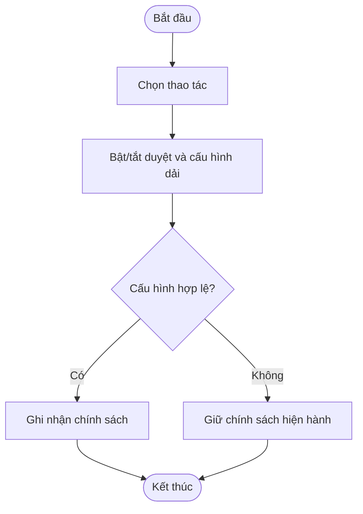

# BJ-01 — Thiết lập chính sách phê duyệt

## 1. Mục tiêu trải nghiệm

Người có quyền của tổ chức thiết lập thao tác nào cần duyệt, các dải giá trị và vai trò duyệt để các hành trình công nợ sử dụng nhất quán mà không hard-code ngưỡng tiền.

## 2. Phạm vi và ranh giới

### 2.1 Bắt đầu khi

Tổ chức cần thiết lập hoặc thay đổi chính sách phê duyệt công nợ.

### 2.2 Kết thúc khi

Cấu hình hợp lệ được ghi nhận và có hiệu lực theo quy tắc cấu hình; hoặc thay đổi bị từ chối vì không hợp lệ mà không làm sai chính sách đang dùng.

### 2.3 Không bao gồm

Không tạo bộ vai trò mới; không duyệt một yêu cầu nghiệp vụ cụ thể; không mở chức năng ngoài giai đoạn 1 chỉ bằng cấu hình.

## 3. Actor

Chủ hộ/Chủ doanh nghiệp là actor cấu hình chính. Một user chỉ có quyền thực hiện nghiệp vụ không mặc nhiên có quyền đổi chính sách.

## 4. Luồng chính

1. Mở chính sách của đúng tổ chức và loại thao tác.
2. Bật/tắt yêu cầu phê duyệt cho thao tác đang được sản phẩm hỗ trợ.
3. Khai báo từ một đến nhiều dải giá trị và vai trò duyệt.
4. Kiểm tra dải không chồng chéo/thiếu phạm vi cần thiết và vai trò hợp lệ.
5. Ghi nhận cấu hình có hiệu lực cho các yêu cầu tạo sau thời điểm áp dụng. Yêu cầu đã gửi duyệt giữ ảnh chụp policy/dải/role tại lúc gửi.
6. Các hành trình sử dụng policy hiện hành; quyền thực hiện vẫn được kiểm tra riêng.

## 5. Bản đồ Trường hợp sử dụng

| UC | Tên | Trigger | Outcome |
|---|---|---|---|
| UC-01-01 | Cập nhật chính sách phê duyệt công nợ | Người có quyền muốn thiết lập/thay đổi policy của tổ chức. | Chính sách hợp lệ được ghi nhận hoặc bị từ chối rõ ràng; không tự phê duyệt yêu cầu nghiệp vụ. |

## 6. Luồng thay thế và ngoại lệ

- Tắt duyệt: không đồng nghĩa mọi user được quyền thực hiện.
- Không có người duyệt khác người lập: không tạo ngoại lệ self-approval.
- Dải giá trị chồng/thiếu hoặc role không hợp lệ: không nhận cấu hình gây mơ hồ.
- Chính sách thay đổi khi có yêu cầu đang chờ: yêu cầu đang chờ giữ ảnh chụp policy tại lúc gửi; không đổi nghĩa hồi tố.
- Bật policy cho chức năng chưa thuộc giai đoạn 1: không làm chức năng đó trở thành khả dụng.
- Cấn trừ 6 triệu: policy xét giá trị 6 triệu; không cộng 6 triệu phải thu và 6 triệu phải trả thành 12 triệu.

## 7. UI Flow và chuyển màn hình

| Điểm tương tác | Hành động | Kết quả liên quan |
|---|---|---|
| Cấu hình tổ chức → Chính sách công nợ | Chọn thao tác | UC-01-01 |
| Chính sách → Dải/role | Thiết lập cấu hình | UC-01-01 |
| Xác nhận → Kết quả | Xem policy đang có hiệu lực | UC-01-01 |

## 8. Handoff / phụ thuộc ngoài Journey

Hệ thống tổ chức/người dùng cung cấp role và permission; BJ-06 và BJ-02 sử dụng policy mặc định cần duyệt; các hành trình khác chỉ dùng approval nếu policy được cấu hình và nghiệp vụ hỗ trợ.

## 9. Outcome cuối

Tổ chức có policy phê duyệt xác định theo thao tác, dải tiền và vai trò mà không thay đổi phạm vi sản phẩm hoặc bỏ kiểm tra quyền nghiệp vụ.

## 10. Truy vết

- [T06-DR-018](../../../01.knowledge/decisions/decision-register.md#t06-dr-018)
- [T06-DR-019](../../../01.knowledge/decisions/decision-register.md#t06-dr-019)
- [T06-DR-020](../../../01.knowledge/decisions/decision-register.md#t06-dr-020)
- [T06-DR-021](../../../01.knowledge/decisions/decision-register.md#t06-dr-021)
- [T06-DR-022](../../../01.knowledge/decisions/decision-register.md#t06-dr-022)
- [T06-DR-023](../../../01.knowledge/decisions/decision-register.md#t06-dr-023)
- [T06-DR-024](../../../01.knowledge/decisions/decision-register.md#t06-dr-024)
- [KB-006](../../../01.knowledge/know-how/KB-006-chinh-sach-phe-duyet.md)
