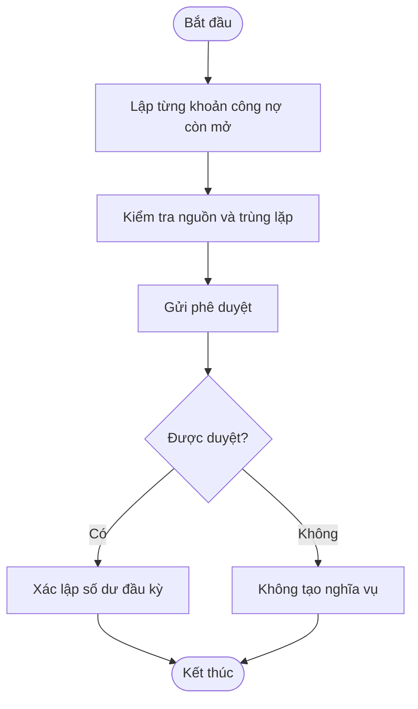

# BJ-02 — Khởi tạo số dư đầu kỳ

## 1. Mục tiêu trải nghiệm

Đưa các khoản công nợ còn mở từ trước thời điểm sử dụng VET45 vào hệ thống theo từng khoản, qua kiểm soát/phê duyệt và không tạo giả giao dịch bán/mua.

## 2. Phạm vi và ranh giới

### 2.1 Bắt đầu khi

Tổ chức cần chuyển công nợ đang tồn tại ngoài VET45 vào hệ thống tại một thời điểm chuyển đổi xác định.

### 2.2 Kết thúc khi

Các khoản đủ điều kiện được phê duyệt và xác lập thành số dư đầu kỳ, hoặc yêu cầu bị từ chối/chưa đủ điều kiện mà chưa làm phát sinh nghĩa vụ mới.

### 2.3 Không bao gồm

Không nhập lại toàn bộ lịch sử bán/mua; không gộp hai chiều thành số ròng; không sửa trực tiếp số dư đã xác lập.

## 3. Actor

Kế toán chuẩn bị/lập số dư đầu kỳ. Người duyệt là user khác có vai trò theo chính sách; Chủ hộ/Chủ doanh nghiệp là actor duyệt điển hình.

## 4. Luồng chính

1. Xác định thời điểm chuyển đổi và nguồn số liệu.
2. Lập từng khoản công nợ còn mở với đối tác, chiều phải thu/phải trả, số tiền, ngày/căn cứ và mô tả/tham chiếu khi có; có thể lập nhiều khoản trong một đợt.
3. Kiểm tra khả năng trùng với dữ liệu sẽ được tiếp nhận từ bán hàng/mua hàng.
4. Gửi yêu cầu theo chính sách phê duyệt; số dư đầu kỳ mặc định cần duyệt.
5. Người khác đủ quyền duyệt hoặc từ chối.
6. Khi được duyệt, xác lập các khoản số dư đầu kỳ với nguồn riêng và đưa vào theo dõi công nợ.

## 5. Bản đồ Trường hợp sử dụng

| UC | Tên | Trigger | Outcome |
|---|---|---|---|
| UC-02-01 | Lập yêu cầu số dư đầu kỳ | Có công nợ còn mở trước thời điểm chuyển. | Có tập khoản công nợ chuẩn bị đủ căn cứ để duyệt hoặc biết rõ dữ liệu chưa đủ. |
| UC-02-02 | Phê duyệt và xác lập số dư đầu kỳ | Yêu cầu đủ điều kiện và đang chờ duyệt. | Các khoản được xác lập với nguồn Opening Balance hoặc bị từ chối mà không tạo nghĩa vụ. |

## 6. Luồng thay thế và ngoại lệ

- Cùng đối tác có cả phải thu và phải trả: giữ hai khoản/chiều; muốn cấn trừ dùng BJ-06.
- Nguồn cũ có giá trị gốc và phần đã trả: chỉ đưa phần còn mở tại thời điểm chuyển vào số dư đầu kỳ.
- Một khoản đồng thời sẽ đến từ bán hàng/mua hàng: không được ghi cả hai; cần ranh giới dữ liệu chuyển đổi trong integration contract.
- Thiếu đối tác/căn cứ: không đủ điều kiện xác lập.
- Sai sau khi xác lập: không sửa trực tiếp; capability điều chỉnh chưa thuộc giai đoạn 1.

## 7. UI Flow và chuyển màn hình

| Điểm tương tác | Hành động | Kết quả liên quan |
|---|---|---|
| Khởi tạo → Danh sách khoản | Nhập nhiều khoản công nợ còn mở | UC-02-01 |
| Yêu cầu → Phê duyệt | Duyệt/từ chối | UC-02-02 |
| Kết quả → Tra cứu | Xem nghĩa vụ Opening Balance đã xác lập | BJ-04 |

Chưa quyết định nhập tay hay nhập tệp; đó là quyết định thiết kế/Trường hợp sử dụng sau nếu cần.

## 8. Handoff / phụ thuộc ngoài Journey

Quản lý đối tác cung cấp Partner ID; bán hàng/mua hàng phối hợp chống trùng quanh thời điểm chuyển; BJ-01 cung cấp chính sách phê duyệt; kế toán nhận dữ liệu cần ghi sổ theo contract.

## 9. Outcome cuối

Các khoản công nợ thực sự còn mở trước khi dùng VET45 được theo dõi với nguồn số dư đầu kỳ rõ và không làm sai lịch sử bán/mua.

## 10. Truy vết

- [T06-DR-023](../../../01.knowledge/decisions/decision-register.md#t06-dr-023)
- [T06-DR-025](../../../01.knowledge/decisions/decision-register.md#t06-dr-025)
- [T06-DR-026](../../../01.knowledge/decisions/decision-register.md#t06-dr-026)
- [KB-007](../../../01.knowledge/know-how/KB-007-so-du-dau-ky.md)
