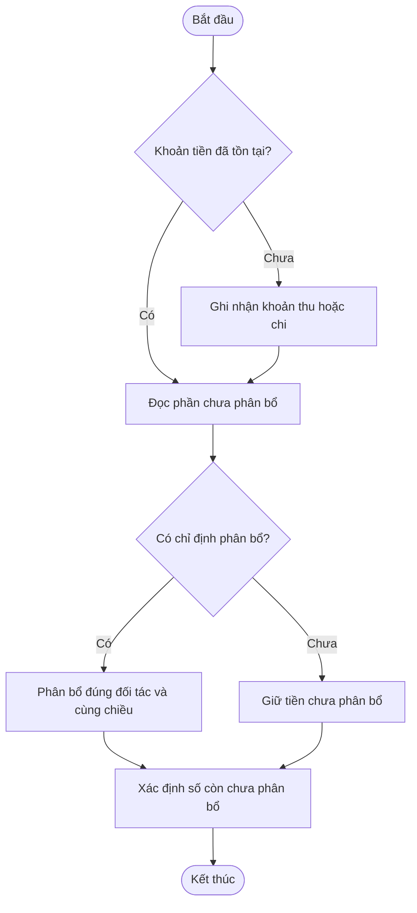

# BJ-03 — Ghi nhận thu, chi và phân bổ thanh toán

## 1. Mục tiêu trải nghiệm

Người dùng ghi nhận tiền thực thu hoặc thực chi, dùng khoản tiền đó để thực hiện đúng các nghĩa vụ cùng chiều và giữ rõ phần chưa phân bổ. Một khoản tiền đã ghi nhận tại nghiệp vụ nguồn không bị tạo lại trong công nợ.

## 2. Phạm vi và ranh giới

### 2.1 Bắt đầu khi

Có khoản tiền thực thu/thực chi cần ghi nhận, hoặc có khoản tiền đã tồn tại nhưng còn số tiền chưa phân bổ cần dùng cho nghĩa vụ phù hợp.

### 2.2 Kết thúc khi

Khoản tiền và các phân bổ có kết quả rõ; số tiền chưa phân bổ còn lại được xác định. Phần chưa có kết quả rõ không làm giảm dư nợ.

### 2.3 Không bao gồm

Không tạo lệnh chuyển tiền ngân hàng; không cấn trừ chéo chiều; không đảo khoản thu/chi hoặc chuyển phân bổ đã chốt sang nghĩa vụ khác.

## 3. Actor

Kế toán là actor chính. Chủ hộ/Chủ doanh nghiệp có thể thao tác khi được phân quyền. Bán hàng chỉ ghi nhận tiền trong luồng bán hàng nếu nghiệp vụ bán cho phép; khoản tiền đó được bàn giao/tham chiếu chứ không nhập lại ở công nợ.

## 4. Luồng chính

1. Xác định khoản thu hoặc khoản chi và đúng đối tác.
2. Nếu khoản tiền chưa được ghi nhận bởi đầu mối có trách nhiệm, ghi nhận khoản tiền; nếu đã tồn tại tại nguồn thì dùng đúng định danh để không tạo trùng.
3. Chọn một hoặc nhiều nghĩa vụ cùng tổ chức, cùng đối tác và cùng chiều: thu → phải thu; chi → phải trả.
4. Chỉ định số tiền phân bổ, không vượt phần chưa phân bổ của khoản tiền và không vượt dư nợ còn lại của từng nghĩa vụ.
5. Xác nhận phân bổ. Khoản tiền và phân bổ có mốc có hiệu lực độc lập.
6. Giữ phần chưa phân bổ để có thể phân bổ tiếp trong chính hành trình này ở thời điểm sau.
7. Xem kết quả và quay lại tra cứu khi cần.

## 5. Bản đồ Trường hợp sử dụng

| UC | Tên | Trigger | Outcome |
|---|---|---|---|
| UC-03-01 | Ghi nhận khoản thu | Có tiền thực thu chưa được ghi nhận bởi đầu mối có trách nhiệm. | Khoản thu có hiệu lực hoặc có kết quả chưa ghi nhận rõ; chưa tự giảm nghĩa vụ. |
| UC-03-02 | Ghi nhận khoản chi | Có tiền thực chi chưa được ghi nhận bởi đầu mối có trách nhiệm. | Khoản chi có hiệu lực hoặc có kết quả chưa ghi nhận rõ; không đồng nghĩa VET45 đã ra lệnh ngân hàng. |
| UC-03-03 | Phân bổ khoản tiền vào nghĩa vụ công nợ | Có khoản tiền còn phần chưa phân bổ và các nghĩa vụ cùng chiều phù hợp. | Các nghĩa vụ giảm theo phân bổ có hiệu lực; phần tiền còn lại vẫn thuộc khoản tiền. |

## 6. Luồng thay thế và ngoại lệ

- Thanh toán một phần, nhiều khoản tiền cho một nghĩa vụ và một khoản tiền cho nhiều nghĩa vụ đều hợp lệ.
- Không xác định được nghĩa vụ: giữ tiền chưa phân bổ, không tự gán theo tuổi nợ hay số tiền.
- Thu muốn dùng cho phải trả hoặc chi muốn dùng cho phải thu: không cho phân bổ; nếu cần triệt tiêu hai chiều thì dùng [BJ-06](BJ-06-can-tru-cong-no.md).
- Khoản tiền đã được ghi nhận tại nguồn: không tạo khoản tiền mới.
- Dư nợ thay đổi trước lúc xác nhận phân bổ: phải kiểm tra lại số còn lại; phần chưa xác nhận không được làm giảm nghĩa vụ.
- Phát hiện sai sau khi đã chốt: giai đoạn 1 không đảo hay phân bổ lại; ghi nhận ngoại lệ theo T06-DR-039 khi liên quan thay đổi nguồn.

## 7. UI Flow và chuyển màn hình

| Điểm tương tác | Hành động | Kết quả liên quan |
|---|---|---|
| Đối tác/nghĩa vụ → Thu tiền | Nhập/chọn khoản thu | UC-03-01 |
| Đối tác/nghĩa vụ → Chi tiền | Nhập/chọn khoản chi | UC-03-02 |
| Khoản tiền → Phân bổ | Chọn nghĩa vụ và số tiền | UC-03-03 |
| Khoản tiền còn chưa phân bổ → Phân bổ tiếp | Dùng tiếp phần còn lại ở thời điểm sau | UC-03-03, không phải phân bổ lại |

Chưa quyết định mã màn hình, phương thức thanh toán chi tiết hoặc anatomy.

## 8. Handoff / phụ thuộc ngoài Journey

Bán hàng/mua hàng bàn giao khoản tiền đã ghi tại nguồn bằng định danh thống nhất; quản lý đối tác cung cấp Partner ID; kế toán nhận sự kiện cần ghi sổ sau khi nghiệp vụ công nợ được ghi nhận; kết nối ngân hàng không phải điều kiện trước.

## 9. Outcome cuối

Biết rõ tiền nào đã được ghi nhận, phần nào đã phân bổ cho nghĩa vụ nào và còn bao nhiêu chưa phân bổ. Không ghi trùng tiền và không triệt tiêu sai chiều nghĩa vụ.

## 10. Truy vết

- [Overview](../../overview/overview.md#ban-do-hanh-trinh)
- [T06-DR-007](../../../01.knowledge/decisions/decision-register.md#t06-dr-007)
- [T06-DR-009](../../../01.knowledge/decisions/decision-register.md#t06-dr-009)
- [T06-DR-010](../../../01.knowledge/decisions/decision-register.md#t06-dr-010)
- [T06-DR-011](../../../01.knowledge/decisions/decision-register.md#t06-dr-011)
- [T06-DR-012](../../../01.knowledge/decisions/decision-register.md#t06-dr-012)
- [T06-DR-013](../../../01.knowledge/decisions/decision-register.md#t06-dr-013)
- [T06-DR-014](../../../01.knowledge/decisions/decision-register.md#t06-dr-014)
- [T06-DR-015](../../../01.knowledge/decisions/decision-register.md#t06-dr-015)
- [T06-DR-023](../../../01.knowledge/decisions/decision-register.md#t06-dr-023)
- [KB-004](../../../01.knowledge/know-how/KB-004-thu-chi-va-phan-bo-thanh-toan.md)
