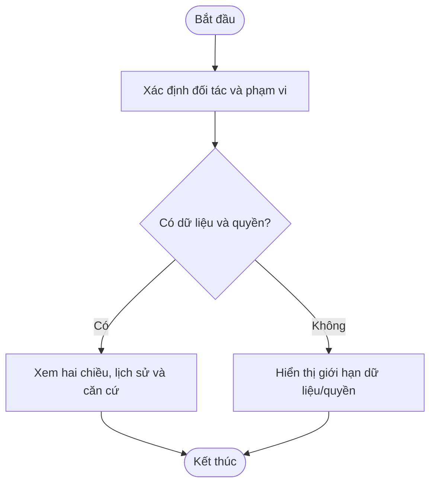

# BJ-04 — Tra cứu tình hình công nợ

## 1. Mục tiêu trải nghiệm

Người dùng hiểu một đối tác còn phải trả cho tổ chức bao nhiêu, tổ chức còn phải trả đối tác bao nhiêu, tiền nào chưa phân bổ và căn cứ của từng con số. Lịch sử nghĩa vụ đã thanh toán đủ vẫn tra cứu được nhưng không làm tăng công nợ còn mở.

## 2. Phạm vi và ranh giới

### 2.1 Bắt đầu khi

Người dùng cần xem tình hình công nợ từ mục Công nợ hoặc một ngữ cảnh được phép liên kết tới đối tác/giao dịch.

### 2.2 Kết thúc khi

Người dùng hiểu số liệu và căn cứ cần xem, hoặc biết rõ dữ liệu/quyền nào đang thiếu. Việc tra cứu không tự thay đổi công nợ.

### 2.3 Không bao gồm

Không tạo/sửa chứng từ nguồn; không cấn trừ; không ghi nhận phản hồi đối chiếu thay cho [BJ-05](BJ-05-doi-chieu-cong-no.md); không quyết định bán chịu.

## 3. Actor

Kế toán và Chủ hộ/Chủ doanh nghiệp là actor chính theo quyền của tổ chức. Bán hàng chỉ xem ngữ cảnh cần thiết nếu được phân quyền. Thủ kho không có quyền công nợ mặc định.

## 4. Luồng chính

1. Xác định đối tác/phạm vi cần tra cứu.
2. Xem riêng phải thu, phải trả, chênh lệch công nợ và tiền chưa phân bổ.
3. Chọn nghĩa vụ để lần về giá trị gốc, nguồn, thanh toán, phân bổ và cấn trừ đã có hiệu lực.
4. Nếu xem dư nợ tín dụng, tính từ các khoản phải thu còn mở.
5. Kết thúc hoặc chuyển sang hành trình xử lý phù hợp mà không tự thực hiện nghiệp vụ.

## 5. Bản đồ Trường hợp sử dụng

| UC | Tên | Trigger | Outcome |
|---|---|---|---|
| UC-04-01 | Tra cứu tình hình công nợ đối tác | Cần biết số còn phải thu, phải trả, chênh lệch hoặc tiền chưa phân bổ. | Có góc nhìn tổng hợp đúng đối tác, không ghi dữ liệu nghiệp vụ. |
| UC-04-02 | Tra cứu căn cứ và lịch sử nghĩa vụ | Cần giải thích một khoản còn mở hoặc đã thực hiện đủ. | Lần được nguồn, giá trị gốc và lịch sử thực hiện nghĩa vụ. |

## 6. Luồng thay thế và ngoại lệ

- Đối tác có cả hai vai trò: giữ cùng mã đối tác và hai chiều nghĩa vụ, không tự cấn trừ.
- Nghĩa vụ đã trả đủ: vẫn xem lịch sử nhưng không tính vào công nợ còn mở.
- Có tiền chưa phân bổ: không tự coi tiền đó đã làm giảm một nghĩa vụ.
- Nguồn thay đổi tạo ngoại lệ cần xử lý: hiển thị trạng thái và căn cứ, không tự sửa số.
- Người dùng muốn xác nhận với đối tác: chuyển [BJ-05](BJ-05-doi-chieu-cong-no.md).

## 7. UI Flow và chuyển màn hình

| Điểm tương tác | Hành động | Kết quả liên quan |
|---|---|---|
| Công nợ → đối tác | Chọn đối tác/phạm vi | UC-04-01 |
| Đối tác → nghĩa vụ | Mở căn cứ/lịch sử | UC-04-02 |
| Ngữ cảnh đang xem → xử lý | Chọn thu/chi, cấn trừ hoặc đối chiếu nếu đủ quyền | Chuyển BJ-03/BJ-06/BJ-05; không tự commit nghiệp vụ |

Chưa có mã màn hình hoặc anatomy; Screen Contract sẽ sở hữu chi tiết này.

## 8. Handoff / phụ thuộc ngoài Journey

Quản lý đối tác cung cấp mã định danh; bán hàng/mua hàng sở hữu chứng từ nguồn; các hành trình ghi dữ liệu cung cấp kết quả để tra cứu; đối chiếu là hành trình riêng.

## 9. Outcome cuối

Người dùng giải thích được tình hình công nợ từ dữ liệu đã có căn cứ hoặc nhận biết rõ giới hạn dữ liệu/quyền. Không có mutation chỉ do tra cứu.

## 10. Truy vết

- [Overview](../../overview/overview.md#ban-do-hanh-trinh)
- [T06-DR-001](../../../01.knowledge/decisions/decision-register.md#t06-dr-001)
- [T06-DR-007](../../../01.knowledge/decisions/decision-register.md#t06-dr-007)
- [T06-DR-013](../../../01.knowledge/decisions/decision-register.md#t06-dr-013)
- [T06-DR-016](../../../01.knowledge/decisions/decision-register.md#t06-dr-016)
- [T06-DR-029](../../../01.knowledge/decisions/decision-register.md#t06-dr-029)
- [T06-DR-034](../../../01.knowledge/decisions/decision-register.md#t06-dr-034)
- [T06-DR-039](../../../01.knowledge/decisions/decision-register.md#t06-dr-039)
- [KB-001](../../../01.knowledge/know-how/KB-001-cong-no-can-ban.md)
- [KB-008](../../../01.knowledge/know-how/KB-008-du-no-tin-dung.md)
