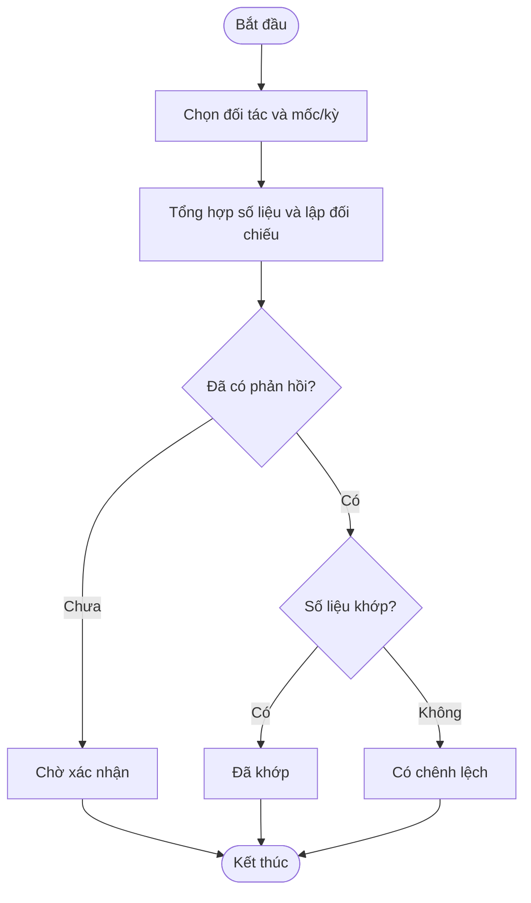

# BJ-05 — Đối chiếu và xác nhận công nợ

## 1. Mục tiêu trải nghiệm

Người phụ trách tổng hợp số liệu công nợ tại một mốc/kỳ, trao đổi với đối tác, ghi nhận phản hồi và biết hai bên đã khớp hay còn chênh lệch mà không tự sửa công nợ.

## 2. Phạm vi và ranh giới

### 2.1 Bắt đầu khi

Tổ chức cần xác nhận số liệu công nợ với một đối tác tại một mốc hoặc kỳ cụ thể.

### 2.2 Kết thúc khi

Lần đối chiếu có một trong các kết quả: `Chờ xác nhận`, `Đã khớp` hoặc `Có chênh lệch`, cùng bằng chứng/phản hồi đã ghi nhận.

### 2.3 Không bao gồm

Không tự điều chỉnh nghĩa vụ theo số đối tác phản hồi; không triển khai workflow tranh chấp nâng cao, cổng đối tác hoặc chữ ký điện tử chuyên biệt ở giai đoạn 1.

## 3. Actor

Kế toán là actor chính. Chủ hộ/Chủ doanh nghiệp có thể xem/thực hiện nếu được phân quyền. Đối tác là bên ngoài cung cấp phản hồi; không mặc định có tài khoản VET45.

## 4. Luồng chính

1. Chọn đối tác và mốc/kỳ đối chiếu.
2. Tổng hợp phải thu, phải trả và căn cứ tại đúng phạm vi đó.
3. Lập bảng/biên bản đối chiếu để trao đổi với đối tác.
4. Ghi nhận phản hồi/số liệu đối tác và bằng chứng nhận được.
5. So sánh cùng phạm vi: nếu khớp → `Đã khớp`; nếu chưa có phản hồi → `Chờ xác nhận`; nếu khác → `Có chênh lệch`.
6. Lưu lịch sử lần đối chiếu. `Có chênh lệch` không tự tạo điều chỉnh công nợ.

## 5. Bản đồ Trường hợp sử dụng

| UC | Tên | Trigger | Outcome |
|---|---|---|---|
| UC-05-01 | Lập đối chiếu công nợ | Cần xác nhận số liệu với đối tác tại một mốc/kỳ. | Có bộ số liệu và bảng/biên bản đối chiếu có thể trao đổi. |
| UC-05-02 | Ghi nhận phản hồi của đối tác | Đã nhận phản hồi hoặc bằng chứng từ đối tác. | Phản hồi và số liệu phía đối tác được lưu đúng lần đối chiếu. |
| UC-05-03 | Ghi nhận kết quả đối chiếu | Có đủ dữ liệu để xác định trạng thái. | Lần đối chiếu ở `Chờ xác nhận`, `Đã khớp` hoặc `Có chênh lệch`; công nợ không tự thay đổi. |

## 6. Luồng thay thế và ngoại lệ

- Đối tác chưa phản hồi: giữ `Chờ xác nhận`, không mặc định đã khớp.
- Đối tác phản hồi số khác: ghi `Có chênh lệch` và bằng chứng, không ghi đè số VET45.
- Công nợ thay đổi sau khi đã lập biên bản: lần đối chiếu vẫn giữ snapshot/mốc đã lập; một lần đối chiếu mới có thể dùng cho mốc khác.
- Thiếu căn cứ hoặc quyền: không kết luận `Đã khớp`.
- Đối chiếu phát hiện vấn đề cần điều chỉnh: chuyển thành nhu cầu xử lý khác; điều chỉnh công nợ chưa thuộc giai đoạn 1.

## 7. UI Flow và chuyển màn hình

| Điểm tương tác | Hành động | Kết quả liên quan |
|---|---|---|
| Đối tác → Đối chiếu | Chọn mốc/kỳ và lập dữ liệu | UC-05-01 |
| Lần đối chiếu → Ghi phản hồi | Nhập số liệu/phản hồi, đính kèm bằng chứng | UC-05-02 |
| Phản hồi → Kết quả | Xác định khớp/chênh lệch/chờ | UC-05-03 |

## 8. Handoff / phụ thuộc ngoài Journey

BJ-04 cung cấp khả năng xem căn cứ; đối tác cung cấp phản hồi ngoài hệ thống; evidence lưu bằng chứng; capability điều chỉnh tương lai chịu trách nhiệm nếu cần thay đổi công nợ sau chênh lệch.

## 9. Outcome cuối

Tổ chức biết lần đối chiếu nào đã khớp, lần nào còn chờ hoặc chênh lệch, cùng căn cứ hai bên; không biến xác nhận của đối tác thành mutation công nợ tự động.

## 10. Truy vết

- [T06-DR-027](../../../01.knowledge/decisions/decision-register.md#t06-dr-027)
- [T06-DR-028](../../../01.knowledge/decisions/decision-register.md#t06-dr-028)
- [T06-DR-032](../../../01.knowledge/decisions/decision-register.md#t06-dr-032)
- [KB-009](../../../01.knowledge/know-how/KB-009-doi-chieu-cong-no.md)
