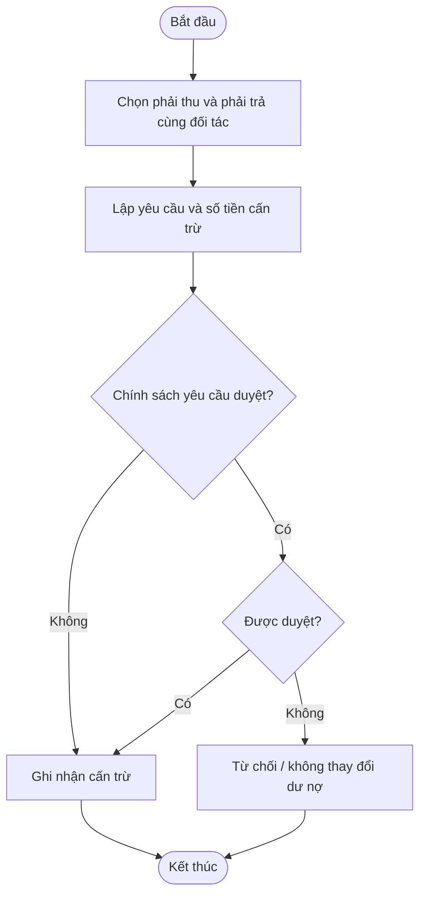

# BJ-06 — Cấn trừ công nợ cùng đối tác

## 1. Mục tiêu trải nghiệm

Người dùng chủ động chọn các khoản phải thu và phải trả của cùng đối tác để cấn trừ một giá trị hợp lệ, qua phê duyệt khi chính sách yêu cầu, và truy vết được kết quả trên từng nghĩa vụ.

## 2. Phạm vi và ranh giới

### 2.1 Bắt đầu khi

Cùng một đối tác trong cùng tổ chức có cả nghĩa vụ phải thu và phải trả còn đủ dư nợ, và người dùng muốn thực hiện cấn trừ.

### 2.2 Kết thúc khi

Yêu cầu bị từ chối/hủy trước khi có hiệu lực, hoặc cấn trừ được ghi nhận thành công và dư nợ hai phía giảm đúng giá trị.

### 2.3 Không bao gồm

Không tự cấn trừ chỉ vì có chênh lệch; không dùng khoản thu/chi làm cấn trừ; không đảo cấn trừ ở giai đoạn 1.

## 3. Actor

Kế toán lập yêu cầu. Người duyệt là user khác có vai trò phù hợp khi chính sách yêu cầu; Chủ hộ/Chủ doanh nghiệp là actor duyệt điển hình. Nếu tổ chức tắt duyệt cho cấn trừ, chặng duyệt được bỏ qua nhưng quyền thực hiện vẫn phải kiểm tra.

## 4. Luồng chính

1. Chọn đối tác và các nghĩa vụ phải thu/phải trả còn mở.
2. Xác định số tiền cấn trừ không vượt khả năng thực hiện của hai phía.
3. Lập yêu cầu cấn trừ; giá trị dùng để chọn dải phê duyệt chính là số tiền cấn trừ, không cộng hai phía.
4. Nếu chính sách yêu cầu, user khác người lập phê duyệt hoặc từ chối.
5. Khi đủ điều kiện, ghi nhận cấn trừ; hai phía giảm cùng một số tiền.
6. Lưu người thực hiện, người duyệt, thời điểm và các nghĩa vụ tham gia.

## 5. Bản đồ Trường hợp sử dụng

| UC | Tên | Trigger | Outcome |
|---|---|---|---|
| UC-06-01 | Lập yêu cầu cấn trừ | Có hai chiều nghĩa vụ cùng đối tác và người dùng muốn cấn trừ. | Yêu cầu có tập nghĩa vụ, số tiền và trạng thái chờ xử lý phù hợp. |
| UC-06-02 | Phê duyệt yêu cầu cấn trừ | Yêu cầu thuộc chính sách cần duyệt. | Yêu cầu được duyệt hoặc từ chối bởi người đủ quyền, không tự duyệt. |
| UC-06-03 | Ghi nhận kết quả cấn trừ | Yêu cầu đã đủ điều kiện thực hiện. | Dư nợ hai phía giảm đúng số tiền và lịch sử cấn trừ được lưu. |

## 6. Luồng thay thế và ngoại lệ

- Không cùng đối tác/tổ chức hoặc sai chiều: không đủ điều kiện cấn trừ.
- Một nghĩa vụ thay đổi dư nợ trước commit: phải kiểm tra lại số tiền; không dùng dữ liệu cũ để ghi quá mức.
- Người lập cũng là người duyệt: từ chối self-approval khi policy yêu cầu duyệt.
- Cấn trừ 6 triệu giữa hai phía: dải phê duyệt xét 6 triệu, không phải 12 triệu.
- Có chênh lệch công nợ nhưng người dùng chưa lập yêu cầu: không có cấn trừ nào xảy ra.

## 7. UI Flow và chuyển màn hình

| Điểm tương tác | Hành động | Kết quả liên quan |
|---|---|---|
| Đối tác → Cấn trừ | Chọn nghĩa vụ hai chiều và số tiền | UC-06-01 |
| Danh sách yêu cầu → Duyệt | Duyệt/từ chối nếu cần | UC-06-02 |
| Yêu cầu đủ điều kiện → Kết quả | Xem số đã cấn trừ và dư nợ mới | UC-06-03 |

## 8. Handoff / phụ thuộc ngoài Journey

Dùng Partner ID từ quản lý đối tác, nghĩa vụ từ công nợ, chính sách từ BJ-01 và bàn giao sự kiện cần hạch toán cho kế toán theo contract tích hợp.

## 9. Outcome cuối

Cấn trừ được ghi nhận có chủ đích, có kiểm soát và không phá lịch sử nghĩa vụ. Nếu không được duyệt hoặc không đủ điều kiện, dư nợ không thay đổi.

## 10. Truy vết

- [T06-DR-016](../../../01.knowledge/decisions/decision-register.md#t06-dr-016)
- [T06-DR-017](../../../01.knowledge/decisions/decision-register.md#t06-dr-017)
- [T06-DR-018](../../../01.knowledge/decisions/decision-register.md#t06-dr-018)
- [T06-DR-022](../../../01.knowledge/decisions/decision-register.md#t06-dr-022)
- [T06-DR-023](../../../01.knowledge/decisions/decision-register.md#t06-dr-023)
- [KB-005](../../../01.knowledge/know-how/KB-005-chenh-lech-va-can-tru-cong-no.md)
- [KB-006](../../../01.knowledge/know-how/KB-006-chinh-sach-phe-duyet.md)
