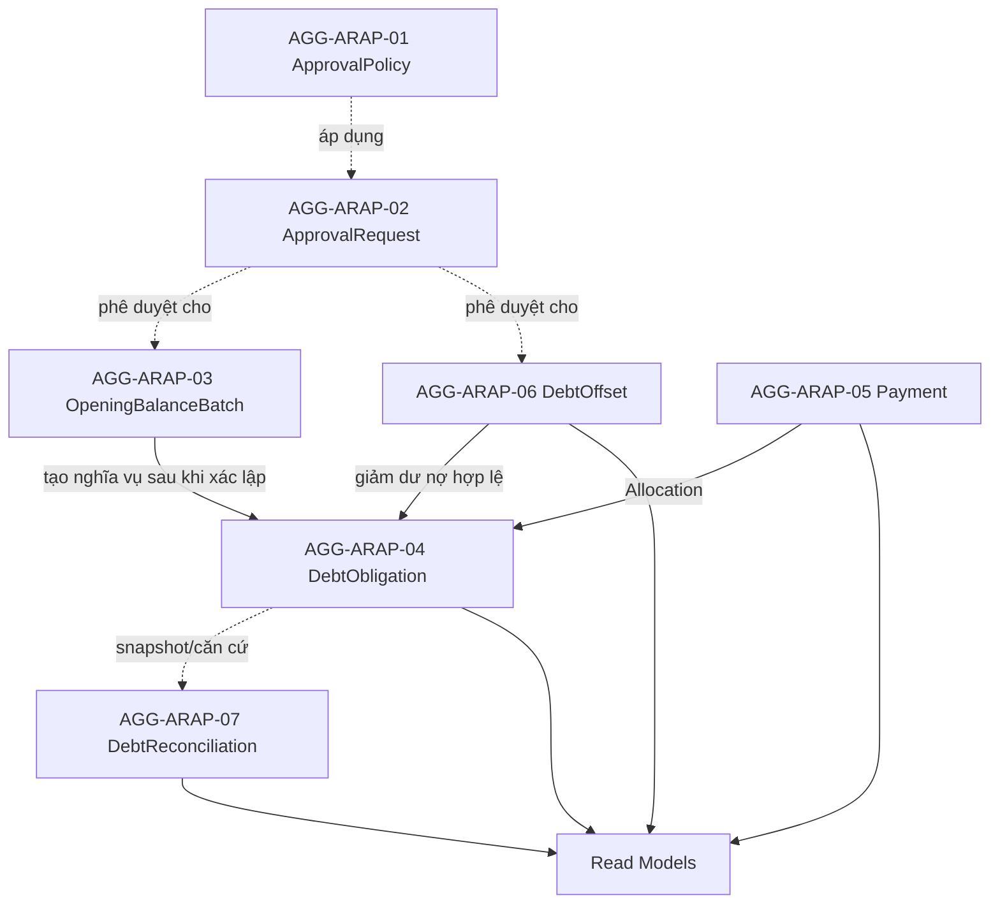
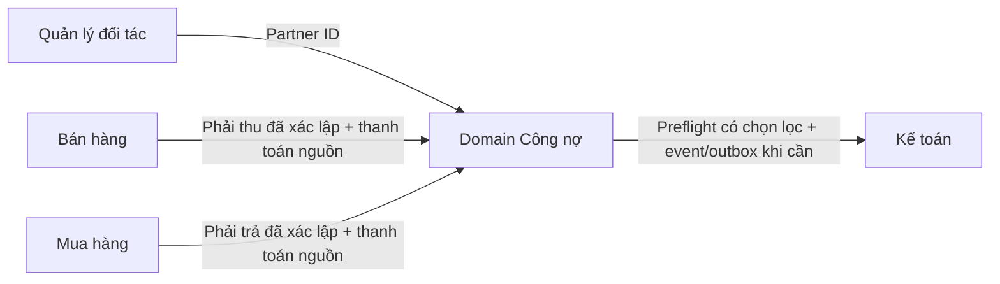

# DOM-ARAP — Công nợ

> Domain boundary đã được khóa ở mức nghiệp vụ: **Công nợ là một Domain duy nhất** trong phạm vi bộ tài liệu này. Capability, Entity và Aggregate bên trong được tổ chức để BA/SA tiếp tục làm rõ; Aggregate candidate chưa phải Architecture Freeze.

## 1. Trách nhiệm

Domain Công nợ chịu trách nhiệm cho sự thật nghiệp vụ về:

- nghĩa vụ phải thu/phải trả sau khi nguồn đã đạt mốc xác lập;
- số tiền thu/chi dùng để thực hiện nghĩa vụ và phần tiền chưa phân bổ;
- phân bổ khoản tiền vào nghĩa vụ đúng đối tác, đúng chiều;
- số dư đầu kỳ của từng khoản công nợ còn mở;
- cấn trừ phải thu/phải trả cùng đối tác;
- đối chiếu và kết quả xác nhận/chênh lệch với đối tác;
- điều phối phê duyệt cho các nghiệp vụ công nợ theo chính sách của tổ chức;
- dữ liệu đọc phục vụ theo dõi tình hình công nợ từ các sự thật nói trên.

Quyết định cách nhìn một Domain duy nhất: [T06-DR-040](../../../01.knowledge/decisions/decision-register.md#t06-dr-040).

## 2. Quyền sở hữu và ranh giới

### 2.1 Domain sở hữu

- [ENT-ARAP-01 — Nghĩa vụ công nợ](../entities/ENT-ARAP-01-nghia-vu-cong-no.md).
- [ENT-ARAP-02 — Khoản thu/chi](../entities/ENT-ARAP-02-khoan-thu-chi.md) và [ENT-ARAP-03 — Phân bổ thanh toán](../entities/ENT-ARAP-03-phan-bo-thanh-toan.md).
- [ENT-ARAP-04 — Chính sách phê duyệt](../entities/ENT-ARAP-04-chinh-sach-phe-duyet.md) và [ENT-ARAP-05 — Yêu cầu phê duyệt](../entities/ENT-ARAP-05-yeu-cau-phe-duyet.md) trong phạm vi điều phối phê duyệt của Công nợ.
- [ENT-ARAP-06 — Đợt số dư đầu kỳ](../entities/ENT-ARAP-06-dot-so-du-dau-ky.md) và [ENT-ARAP-07 — Dòng số dư đầu kỳ](../entities/ENT-ARAP-07-dong-so-du-dau-ky.md).
- [ENT-ARAP-08 — Cấn trừ công nợ](../entities/ENT-ARAP-08-can-tru-cong-no.md) và [ENT-ARAP-09 — Dòng cấn trừ](../entities/ENT-ARAP-09-dong-can-tru.md).
- [ENT-ARAP-10 — Đối chiếu công nợ](../entities/ENT-ARAP-10-doi-chieu-cong-no.md).

### 2.2 Domain không sở hữu

| Khái niệm ngoài ownership | Owner | Cách Công nợ sử dụng |
|---|---|---|
| Đối tác giao dịch | Quản lý đối tác | Tham chiếu bằng `Partner ID`; không tạo Customer/Supplier identity riêng. |
| Chứng từ bán / mốc Hoàn tất bán hàng | Bán hàng | Tiếp nhận nghĩa vụ phải thu đã xác lập và thanh toán/phân bổ nguồn nếu có. |
| Chứng từ mua / hóa đơn nhà cung cấp | Mua hàng | Tiếp nhận nghĩa vụ phải trả đã xác lập và thanh toán/phân bổ nguồn nếu có. |
| Journal, kỳ kế toán, posting | Kế toán | Handoff/tích hợp; Công nợ không tự trở thành sổ kế toán. |
| User/Role canonical | Ngoài Domain Công nợ | Tham chiếu để kiểm tra người thực hiện/người duyệt; không sở hữu danh tính. |

## 3. Khái niệm chính

### 3.1 Capability map

| Capability | Khái niệm trung tâm | Aggregate candidate chính |
|---|---|---|
| Nghĩa vụ và số dư | Debt Obligation, Outstanding | [AGG-ARAP-04](../../../04.architecture/aggregates/AGG-ARAP-04-DebtObligation.md) |
| Thu/chi và phân bổ | Payment, Allocation, Unallocated Amount | [AGG-ARAP-05](../../../04.architecture/aggregates/AGG-ARAP-05-Payment.md) |
| Khởi tạo số dư đầu kỳ | Opening Balance Batch/Line | [AGG-ARAP-03](../../../04.architecture/aggregates/AGG-ARAP-03-OpeningBalanceBatch.md) |
| Cấn trừ | Debt Offset | [AGG-ARAP-06](../../../04.architecture/aggregates/AGG-ARAP-06-DebtOffset.md) |
| Đối chiếu | Debt Reconciliation | [AGG-ARAP-07](../../../04.architecture/aggregates/AGG-ARAP-07-DebtReconciliation.md) |
| Kiểm soát phê duyệt | Approval Policy/Request | [AGG-ARAP-01](../../../04.architecture/aggregates/AGG-ARAP-01-ApprovalPolicy.md), [AGG-ARAP-02](../../../04.architecture/aggregates/AGG-ARAP-02-ApprovalRequest.md) |
| Tra cứu / projection | Partner Debt Position, Open Debt, History | Read model; **không tạo Aggregate riêng chỉ để đọc**. |

### 3.2 Aggregate candidate map

## 4. Lifecycle và trạng thái

Không có một lifecycle chung cho toàn Domain; mỗi Aggregate có lifecycle riêng. Các mốc xuyên Domain phải giữ semantic sau:

- Nghĩa vụ chỉ trở thành công nợ chính thức khi nguồn đạt mốc xác lập tương ứng.
- Khoản thu/chi có hiệu lực khi ghi nhận thành công; phân bổ có hiệu lực độc lập khi phân bổ thành công.
- Cấn trừ chỉ có hiệu lực sau khi đáp ứng phê duyệt cần thiết và được ghi nhận thành công.
- Số dư đầu kỳ sau khi được phê duyệt/xác lập tạo nghĩa vụ công nợ; không sửa trực tiếp như giao dịch nguồn.
- Đối chiếu kết thúc ở kết quả xác nhận/chênh lệch và không tự điều chỉnh nghĩa vụ.
- Khi thay đổi nguồn xung đột với phần đã thực hiện, Domain giữ trạng thái hiện hành và đánh dấu **Cần xử lý** thay vì tự đảo/điều chỉnh.

## 5. Quy tắc và Điều kiện bắt buộc

1. Cùng một đối tác dùng chung `Partner ID` cho cả vai trò khách hàng và nhà cung cấp.
2. Nghĩa vụ có đúng một chiều: phải thu hoặc phải trả.
3. Khoản thu chỉ phân bổ cho phải thu; khoản chi chỉ phân bổ cho phải trả; cùng tổ chức và cùng đối tác.
4. Tổng phân bổ không vượt số tiền chưa phân bổ; phân bổ vào một nghĩa vụ không vượt dư nợ còn lại.
5. Cấn trừ không được suy ra từ chênh lệch công nợ; đây là một nghiệp vụ explicit riêng.
6. Cấn trừ phải cân bằng giá trị thực hiện giữa hai phía và không vượt dư nợ các nghĩa vụ tham gia.
7. Maker không tự duyệt yêu cầu của chính mình khi thao tác cần phê duyệt.
8. Đối chiếu có chênh lệch không tự làm thay đổi công nợ.
9. Giai đoạn 1 dùng một loại tiền tệ; không có quy đổi ngoại tệ.
10. Read model không được trở thành nguồn sự thật thứ hai cho outstanding/payment/allocation.

## 6. Quan hệ với Domain khác

Contract chưa được owning Domain bên ngoài xác nhận vẫn mang trạng thái `PROPOSED_HANDOFF`, theo [T06-DR-035](../../../01.knowledge/decisions/decision-register.md#t06-dr-035)–[T06-DR-038](../../../01.knowledge/decisions/decision-register.md#t06-dr-038).

## 7. Entity liên quan

Danh mục đầy đủ: [Entity Catalog — Công nợ](../entities/ENTITY-CATALOG.md).

Các object cố ý **không** tạo thành owned Entity của Công nợ:

- Customer/Supplier identity riêng biệt thay cho Partner.
- Sales/Purchase source document.
- Accounting Journal/Posting.
- PartnerDebtPosition/OpenDebtList/DebtHistory — đây là projection/read model.

## 8. Quyết định nghiệp vụ chi phối

- Ownership và nguồn: [T06-DR-001](../../../01.knowledge/decisions/decision-register.md#t06-dr-001)–[T06-DR-008](../../../01.knowledge/decisions/decision-register.md#t06-dr-008).
- Thu/chi và phân bổ: [T06-DR-009](../../../01.knowledge/decisions/decision-register.md#t06-dr-009)–[T06-DR-015](../../../01.knowledge/decisions/decision-register.md#t06-dr-015).
- Cấn trừ: [T06-DR-016](../../../01.knowledge/decisions/decision-register.md#t06-dr-016)–[T06-DR-017](../../../01.knowledge/decisions/decision-register.md#t06-dr-017).
- Phê duyệt/quyền: [T06-DR-018](../../../01.knowledge/decisions/decision-register.md#t06-dr-018)–[T06-DR-024](../../../01.knowledge/decisions/decision-register.md#t06-dr-024).
- Số dư đầu kỳ: [T06-DR-025](../../../01.knowledge/decisions/decision-register.md#t06-dr-025)–[T06-DR-026](../../../01.knowledge/decisions/decision-register.md#t06-dr-026).
- Đối chiếu và giới hạn Phase 1: [T06-DR-027](../../../01.knowledge/decisions/decision-register.md#t06-dr-027)–[T06-DR-034](../../../01.knowledge/decisions/decision-register.md#t06-dr-034).
- Integration/Recovery: [T06-DR-035](../../../01.knowledge/decisions/decision-register.md#t06-dr-035)–[T06-DR-039](../../../01.knowledge/decisions/decision-register.md#t06-dr-039).
- Một Domain Công nợ: [T06-DR-040](../../../01.knowledge/decisions/decision-register.md#t06-dr-040).

## 9. Điểm chưa chốt

Các điểm sau thuộc vòng BA/SA hoặc Architecture tiếp theo; tài liệu này không tự chốt:

1. `Payment + Allocation` có giữ nguyên một Aggregate hay tách `Allocation/Settlement` thành Aggregate riêng sau khi phân tích concurrency.
2. Cơ chế consistency/atomicity khi một allocation đồng thời tiêu hao số tiền của Payment và outstanding của DebtObligation.
3. Cơ chế consistency/locking khi DebtOffset tác động nhiều DebtObligation trong cùng một lần thực hiện.
4. Atomicity của finalization một OpeningBalanceBatch nhiều dòng: all-or-nothing hay có recovery theo từng dòng.
5. Tên state/command kỹ thuật, event schema, API, persistence schema và index cụ thể.
