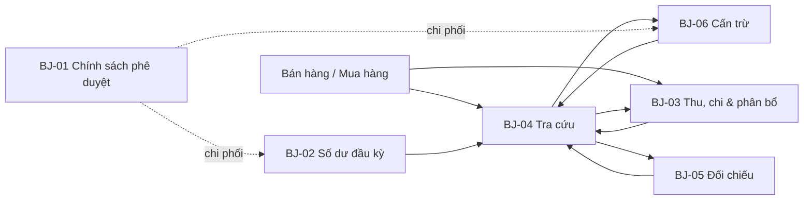
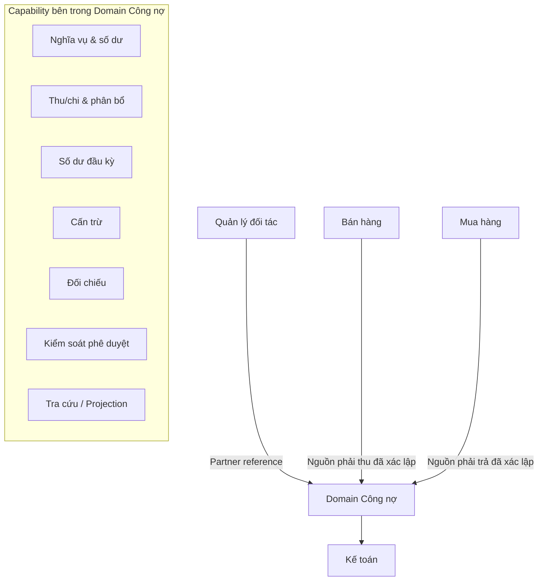

# Tổng quan — Nghiệp vụ công nợ

> **Phiên bản hiện hành:** 2.1.1  
> **Danh mục, mục tiêu và ranh giới của sáu hành trình đã được duyệt.** Bản đồ Trường hợp sử dụng trong từng hành trình là đầu vào cho bước đặc tả tiếp theo và chưa thay thế tài liệu Trường hợp sử dụng hoàn chỉnh.

## 1. Mục tiêu

Giúp tổ chức biết rõ ai đang nợ ai, căn cứ của nghĩa vụ, phần đã thực hiện, phần còn phải xử lý và kết quả xác nhận với đối tác. Công nợ tiếp nhận nghĩa vụ từ bán hàng/mua hàng, theo dõi thu/chi và phân bổ, cấn trừ, đối chiếu, số dư đầu kỳ và chính sách phê duyệt.

Tài liệu này xác định phạm vi, vai trò, ranh giới liên phân hệ và sáu hành trình nghiệp vụ. Nó không sở hữu cấu trúc lưu trữ, giao diện lập trình, thiết kế màn hình hoặc kiến trúc triển khai.

## 2. Phạm vi

### 2.1 Trong phạm vi

- Theo dõi nghĩa vụ phải thu/phải trả của cùng một đối tác giao dịch.
- Tiếp nhận đầy đủ giá trị nghĩa vụ và thanh toán tại nguồn, kể cả giao dịch đã trả đủ.
- Ghi nhận khoản thu, khoản chi, phân bổ thanh toán một phần/nhiều lần và tiền chưa phân bổ.
- Cấn trừ phải thu–phải trả cùng đối tác theo chính sách phê duyệt.
- Đối chiếu và xác nhận công nợ với đối tác, lưu phản hồi và bằng chứng.
- Khởi tạo số dư đầu kỳ theo từng khoản công nợ còn mở.
- Thiết lập chính sách phê duyệt theo tổ chức, dải giá trị và vai trò.
- Tra cứu lịch sử, chênh lệch công nợ và dư nợ tín dụng theo các khoản phải thu còn mở.

### 2.2 Ngoài phạm vi

- Xóa nợ, điều chỉnh công nợ thủ công, đảo kết quả thực hiện nghĩa vụ, đảo khoản thu/chi và phân bổ lại sau chốt.
- Tự động sửa công nợ theo kết quả đối chiếu hoặc workflow tranh chấp nâng cao.
- Nhiều loại tiền tệ, kết nối ngân hàng theo thời gian thực, lãi/phạt chậm trả.
- Tự suy diễn cam kết bán chịu chưa có checkpoint canonical từ bán hàng.
- Tạo/sửa chứng từ bán hàng, mua hàng, đối tác hoặc sổ nhật ký kế toán.

## 3. Actor và vai trò nghiệp vụ

| Vai trò | Trách nhiệm giai đoạn 1 |
|---|---|
| **Kế toán** | Tra cứu; ghi nhận thu/chi; phân bổ; lập cấn trừ; lập số dư đầu kỳ; lập và ghi nhận đối chiếu. |
| **Chủ hộ/Chủ doanh nghiệp** | Tra cứu; phê duyệt; cấu hình chính sách; có thể thực hiện nghiệp vụ khác nếu được phân quyền. |
| **Bán hàng** | Xem ngữ cảnh công nợ cần thiết và ghi nhận tiền trong luồng bán hàng nếu nghiệp vụ bán cho phép; không mặc định có quyền vào toàn bộ công nợ. |
| **Thủ kho** | Không có quyền công nợ mặc định. |
| **Đối tác giao dịch** | Bên ngoài tổ chức, cung cấp phản hồi/xác nhận trong hành trình đối chiếu; không mặc định có tài khoản VET45. |

Quyền thực tế vẫn phải được kiểm tra theo tổ chức; quyền thực hiện, quyền duyệt và quyền cấu hình là ba trách nhiệm khác nhau. Xem [T06-DR-024](../../01.knowledge/decisions/decision-register.md#t06-dr-024).

## 4. Ranh giới với Theme/Domain khác

| Nghiệp vụ bên ngoài | Sở hữu | Bàn giao với công nợ |
|---|---|---|
| Quản lý đối tác | Mã định danh và vai trò đối tác | Cung cấp `Partner ID` dùng chung. |
| Bán hàng | Chứng từ bán, mốc Hoàn tất bán hàng, khoản tiền được ghi nhận trong luồng bán | Bàn giao nghĩa vụ phải thu đã xác lập cùng thanh toán/phân bổ đã có; không ghi trùng. |
| Mua hàng | Chứng từ mua, hóa đơn nhà cung cấp, mốc Nhận hóa đơn nhà cung cấp | Bàn giao nghĩa vụ phải trả đã xác lập cùng thanh toán/phân bổ đã có; không ghi trùng. |
| Kế toán | Sổ nhật ký, kỳ kế toán, ghi sổ | Công nợ kiểm tra trước có chọn lọc khi cần và phát sự kiện sau khi nghiệp vụ được ghi nhận. |
| Đối tác giao dịch | Số liệu/phản hồi của phía đối tác | Được ghi nhận như phản hồi đối chiếu; không tự thay đổi công nợ. |

Các contract chưa được owning domain xác nhận vẫn là `PROPOSED_HANDOFF`; xem [T06-DR-035](../../01.knowledge/decisions/decision-register.md#t06-dr-035)–[T06-DR-038](../../01.knowledge/decisions/decision-register.md#t06-dr-038).

## 5. Business Journey map

| BJ | Hành trình | Mục tiêu đầu-cuối | Trường hợp sử dụng dự kiến |
|---|---|---|---|
| [BJ-01](../behavior/journeys/BJ-01-thiet-lap-chinh-sach-phe-duyet.md) | Thiết lập chính sách phê duyệt | Cấu hình yêu cầu duyệt, dải giá trị và vai trò cho tổ chức. | UC-01-01 |
| [BJ-02](../behavior/journeys/BJ-02-khoi-tao-so-du-dau-ky.md) | Khởi tạo số dư đầu kỳ | Đưa công nợ còn mở trước thời điểm sử dụng VET45 vào hệ thống. | UC-02-01, UC-02-02 |
| [BJ-03](../behavior/journeys/BJ-03-thu-chi-va-phan-bo-thanh-toan.md) | Ghi nhận thu, chi và phân bổ thanh toán | Ghi nhận tiền và dùng tiền đúng nghĩa vụ, giữ phần chưa phân bổ. | UC-03-01, UC-03-02, UC-03-03 |
| [BJ-04](../behavior/journeys/BJ-04-tra-cuu-cong-no.md) | Tra cứu tình hình công nợ | Hiểu số còn phải thu/phải trả, lịch sử và căn cứ. | UC-04-01, UC-04-02 |
| [BJ-05](../behavior/journeys/BJ-05-doi-chieu-cong-no.md) | Đối chiếu và xác nhận công nợ | So sánh số liệu hai bên và lưu kết quả xác nhận/chênh lệch. | UC-05-01, UC-05-02, UC-05-03 |
| [BJ-06](../behavior/journeys/BJ-06-can-tru-cong-no.md) | Cấn trừ công nợ cùng đối tác | Cấn trừ có chủ đích, phê duyệt và truy vết kết quả. | UC-06-01, UC-06-02, UC-06-03 |

Số thứ tự phục vụ định danh và truy vết; không phải trình tự bắt buộc giữa sáu hành trình.

## 6. Domain map

Trong phạm vi tài liệu này chỉ có **một Domain nghiệp vụ chính: Công nợ**. Quyết định này được khóa tại [T06-DR-040](../../01.knowledge/decisions/decision-register.md#t06-dr-040). Các nhóm dưới đây là **capability bên trong Domain**, không phải Domain con.

| Capability trong Domain Công nợ | Trách nhiệm cấp cao |
|---|---|
| **Nghĩa vụ và số dư** | Tiếp nhận nghĩa vụ đã xác lập, giữ nguồn, chiều nghĩa vụ, giá trị gốc, dư nợ và lịch sử thay đổi. |
| **Thu/chi và phân bổ** | Quản lý khoản thu/chi, phần đã phân bổ, phần chưa phân bổ và kết quả làm giảm nghĩa vụ. |
| **Khởi tạo số dư đầu kỳ** | Đưa từng khoản công nợ còn mở tại thời điểm cutover vào hệ thống mà không giả lập giao dịch nguồn. |
| **Cấn trừ** | Cấn trừ có chủ đích giữa phải thu và phải trả cùng đối tác, có phê duyệt và dấu vết. |
| **Đối chiếu** | Chốt phạm vi/mốc đối chiếu, số liệu hai bên, phản hồi, bằng chứng và kết quả khớp/chênh lệch. |
| **Kiểm soát phê duyệt** | Chính sách phê duyệt theo tổ chức, dải giá trị, vai trò và nguyên tắc người lập–người duyệt. |
| **Tra cứu / projection** | Tổng hợp tình hình công nợ, lịch sử, công nợ mở và dư nợ tín dụng từ dữ liệu có căn cứ; không tạo Aggregate chỉ để phục vụ đọc. |

Chi tiết ownership, entity và aggregate candidate xem [DOM-ARAP — Công nợ](../domain/domain-foundation/DOM-ARAP-cong-no.md). Aggregate không được suy ra một-một từ capability hoặc Business Journey; boundary của Aggregate phải dựa trên invariant và consistency requirement.

## 7. Giả định và ràng buộc

- Một loại tiền tệ trong giai đoạn 1.
- Không phụ thuộc kết nối ngân hàng thời gian thực.
- Không tự phát sinh lãi/phạt.
- Bằng chứng và nhật ký nghiệp vụ lưu 10 năm theo quyết định sản phẩm.
- Khoản thu chỉ phân bổ cho phải thu; khoản chi chỉ phân bổ cho phải trả, cùng tổ chức và cùng đối tác.
- Khoản tiền và phân bổ có mốc có hiệu lực độc lập; phần chưa có kết quả rõ không làm giảm dư nợ.
- Cấn trừ và số dư đầu kỳ mặc định cần phê duyệt; đối chiếu không tự điều chỉnh công nợ.
- Dư nợ tín dụng giai đoạn 1 chỉ tính các khoản phải thu còn mở.
- Khi nguồn thay đổi dẫn đến tình trạng không thể áp dụng hợp lệ vì phần đã thực hiện vượt giá trị mới, công nợ ghi nhận trạng thái cần xử lý và không tự đảo/điều chỉnh.

## 8. Tài liệu nguồn

- [Sổ quyết định nghiệp vụ công nợ](../../01.knowledge/decisions/decision-register.md).

- [Bảng thuật ngữ công nợ](../../01.knowledge/glossary/glossary.md).

- [Domain Foundation — Công nợ](../domain/domain-foundation/DOM-ARAP-cong-no.md).

- [Entity Catalog — Công nợ](../domain/entities/ENTITY-CATALOG.md).

- [Aggregate Candidate Catalog — Công nợ](../../04.architecture/aggregates/AGGREGATE-CATALOG.md).

- [KB-001 — Công nợ là gì, ai đang nợ ai?](../../01.knowledge/know-how/KB-001-cong-no-can-ban.md).

- [KB-009 — Đối chiếu công nợ — khi hai bên không nhìn thấy cùng một con số](../../01.knowledge/know-how/KB-009-doi-chieu-cong-no.md).

- Harness Doctrine, Draft v0.10, ngày 18/09/2026 — nguồn nguyên tắc phân lớp và ownership; không gắn cứng nhánh GitLab trong liên kết nội bộ.

- Bộ `theme-template.zip` — nguồn physical template của Theme.
