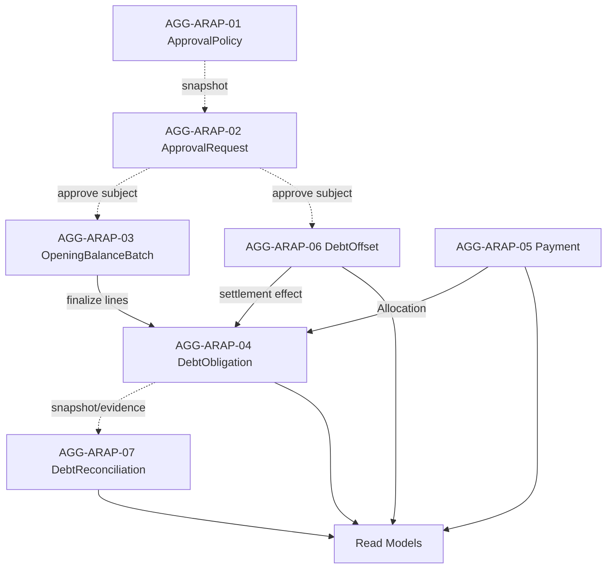

# Aggregate Candidate Catalog — Công nợ

> Các Aggregate dưới đây là **candidate boundary** để BA/SA dùng khi đặc tả BJ/UC và kiến trúc. Chúng không phải DB schema và chưa mang trạng thái Architecture Freeze.

## 1. Danh mục

| ID | Aggregate Root | Consistency responsibility | Mức ổn định |
|---|---|---|---|
| [AGG-ARAP-01](AGG-ARAP-01-ApprovalPolicy.md) | ApprovalPolicy | Cấu hình action/band/role không chồng lấn và resolve được | Khá rõ |
| [AGG-ARAP-02](AGG-ARAP-02-ApprovalRequest.md) | ApprovalRequest | Snapshot policy, maker-checker, một quyết định hợp lệ cho subject/version | Khá rõ |
| [AGG-ARAP-03](AGG-ARAP-03-OpeningBalanceBatch.md) | OpeningBalanceBatch | Tính nhất quán của một đợt cutover và các line trước finalization | Cần chốt atomicity nhiều dòng |
| [AGG-ARAP-04](AGG-ARAP-04-DebtObligation.md) | DebtObligation | Outstanding không âm/không over-settle; source lineage | **Review sâu** |
| [AGG-ARAP-05](AGG-ARAP-05-Payment.md) | Payment | Tổng allocation không vượt amount; unallocated chính xác | **Review sâu** vì Allocation chạm Obligation |
| [AGG-ARAP-06](AGG-ARAP-06-DebtOffset.md) | DebtOffset | Hai phía cân bằng, cùng Partner/Tenant, approval/result | Cần chốt consistency nhiều obligations |
| [AGG-ARAP-07](AGG-ARAP-07-DebtReconciliation.md) | DebtReconciliation | Snapshot/response/result/evidence của một lần đối chiếu | Khá rõ |

## 2. Quan hệ

## 3. Không phải Aggregate

- `PartnerDebtPosition`, `OpenDebtList`, `DebtHistory`, `UnallocatedPaymentList`, `ReconciliationHistory`, `ApprovalInbox` là read model/projection.
- Partner, SourceDocument, User/Role, AccountingPosting là reference ngoài ownership Công nợ.
- Business Journey hoặc capability không tự động tương ứng một Aggregate.

## 4. Hai điểm phải review trước Architecture Freeze

### 4.1 Payment + Allocation ↔ DebtObligation

Payment + Allocation hiện là candidate cùng boundary để bảo vệ capacity của khoản tiền, nhưng Allocation đồng thời chạm DebtObligation. Allocation phải bảo vệ đồng thời:

- không vượt unallocated của Payment;
- không vượt outstanding của DebtObligation;
- không áp dụng hai lần khi retry/concurrency.

Candidate hiện tại đặt Allocation trong Payment Aggregate, nhưng SA phải quyết định consistency mechanism hoặc tách boundary nếu cần.

### 4.2 DebtOffset ↔ nhiều DebtObligation

Một lần cấn trừ có thể tác động nhiều nghĩa vụ hai phía. SA phải chốt optimistic version/locking, transaction hoặc recovery model để không over-settle khi có thao tác đồng thời.
