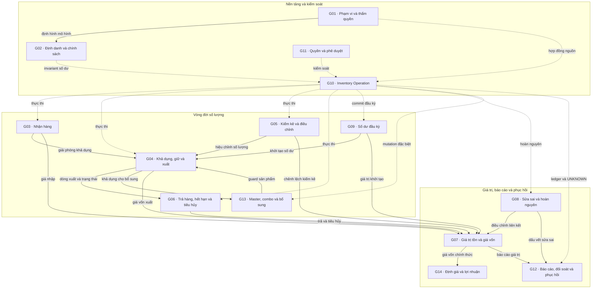

# Kho & giá vốn — Quyết định nghiệp vụ — v4.6.0

> **Phiên bản tài liệu `v4.6.1` — `VALUATION_SEMANTIC_AUTHORITY_CORRECTION`.** Giữ nguyên các quyết định v4.6.0 đã đúng, đánh dấu các assumption bị nâng sai thành quyết định là `SUPERSEDED`, và khóa lại ranh giới authority cho căn cứ giá, tỷ giá, phân bổ BJ13 và policy BJ14.

## 1. Thông tin kiểm soát

| Thuộc tính | Giá trị |
|---|---|
| Theme | Theme 7 — Kho & giá vốn |
| Phiên bản tài liệu | `v4.3.0` |
| Bản trình bày tiền nhiệm | `v4.2.6` |
| Trạng thái tài liệu | `VALUATION_SEMANTIC_V5_AMENDMENT` |
| Loại thay đổi | `VALUATION_SEMANTIC_V5_AMENDMENT / BJ03_BJ13_BJ14` — bổ sung quyết định 185–195 và thay thế rõ các semantic cũ về bootstrap giá vốn |
| Baseline quyết định được trình bày | `T7-BASELINE-FREEZE-v4.0.0` — `FROZEN` |
| Baseline tiền nhiệm | `T7-BASELINE-FREEZE-v3.1.0` — bất biến |
| Ngày đóng băng baseline | `2026-08-22` |
| Ngày cập nhật trình bày | `2026-09-24` |
| Phê duyệt nghiệp vụ | `APPROVED` — Business Owner (baseline `v4.0.0`) |
| Cổng phát hành còn mở | `PENDING` — preview trên GitLab self-hosted |
| Phạm vi | 195 quyết định nghiệp vụ thuộc 14 nhóm khách quan |
| Nguyên tắc hợp nhất | Một thẩm quyền hoặc hiệu lực cuối cùng chỉ có một quyết định cha; chi tiết nhỏ nhưng cần kiểm thử được giữ thành yêu cầu chi tiết |
| Định danh có thẩm quyền | `freeze_id + decision_id`; không dùng ID trần để phân biệt với baseline cũ |
| Dữ liệu gốc | Quyết định nghiệp vụ của baseline `v4.0.0` |

### 1.1 Quy tắc nhận diện và liên kết

- `T7-DR-001…T7-DR-102` giữ nguyên định danh baseline. Quyết định mới dùng `T7-DR-103…` và được đặt trong đúng nhóm nghiệp vụ thay vì di chuyển/đánh lại ID cũ.
- Không phát hành bảng ánh xạ hoặc alias registry cho 207 ID cũ.
- Yêu cầu chi tiết dùng locator logic `T7-DR-nnn#REQ-mm`. Nhãn locator được giữ nguyên; mọi liên kết trong tài liệu active trỏ đến permalink đầy đủ do GitLab sinh từ tiêu đề cụm cha. Không phụ thuộc fragment HTML tự đặt `#gNN` hoặc `#t7-dr-nnn[-req-mm]`.
- `REQ-mm` tăng theo thứ tự nội dung gốc đã được hợp nhất trong từng quyết định; sau khi đóng băng chỉ được thêm locator mới, không đánh lại locator đã phát hành.
- Các quy tắc quản trị, chỉ tiêu phi chức năng và chuẩn nội dung không nhận ID quyết định nghiệp vụ.

## 2. Quy ước trạng thái

| Trạng thái | Ý nghĩa |
|---|---|
| `ACTIVE` | Quyết định hoặc yêu cầu đang có hiệu lực trong Phase 1. |
| `DEFERRED` | Định hướng được giữ cho tương lai nhưng chưa triển khai trong Phase 1. |
| `OUT_OF_SCOPE` | Nghiệp vụ được loại rõ khỏi Phase 1 và phải bị từ chối có cấu trúc. |
| `SUPERSEDED` | Quyết định đã từng có hiệu lực nhưng đã được quyết định mới thay thế; giữ lại để truy vết, không còn dùng làm căn cứ triển khai. |

**Quy tắc vòng đời:** trạng thái của yêu cầu chi tiết độc lập với trạng thái quyết định cha. Yêu cầu `DEFERRED` hoặc `OUT_OF_SCOPE` không trở thành `ACTIVE` chỉ vì quyết định cha đang hoạt động.

## 3. Danh mục quyết định nghiệp vụ

### 3.0 Mục lục nhanh

| Cụm | Tên cụm quyết định | Số quyết định | Số yêu cầu chi tiết |
|---|---|---:|---:|
| [`G01`](#31-g01-ph%E1%BA%A1m-vi-th%E1%BA%A9m-quy%E1%BB%81n-v%C3%A0-m%C3%B4-h%C3%ACnh-c%E1%BB%ADa-h%C3%A0ngkho) | Phạm vi, thẩm quyền và mô hình cửa hàng–kho | 8 | 6 |
| [`G02`](#32-g02-%C4%91%E1%BB%8Bnh-danh-s%E1%BB%91-d%C6%B0-%C4%91%C6%A1n-v%E1%BB%8B-t%C3%ADnh-v%C3%A0-ch%C3%ADnh-s%C3%A1ch-theo-d%C3%B5i) | Định danh số dư, đơn vị tính và chính sách theo dõi | 11 | 11 |
| [`G03`](#33-g03-nh%E1%BA%ADn-h%C3%A0ng-v%C3%A0-x%C3%A1c-nh%E1%BA%ADn-gi%C3%A1-tr%E1%BB%8B) | Nhận hàng và xác nhận giá trị | 23 | 4 |
| [`G04`](#34-g04-kh%E1%BA%A3-d%E1%BB%A5ng-gi%E1%BB%AF-h%C3%A0ng-l%E1%BA%A5y-h%C3%A0ng-v%C3%A0-xu%E1%BA%A5t) | Khả dụng, giữ hàng, lấy hàng và xuất | 25 | 5 |
| [`G05`](#35-g05-ki%E1%BB%83m-k%C3%AA-v%C3%A0-%C4%91i%E1%BB%81u-ch%E1%BB%89nh-t%E1%BB%93n) | Kiểm kê và điều chỉnh tồn | 5 | 3 |
| [`G06`](#36-g06-tr%E1%BA%A3-h%C3%A0ng-tr%E1%BA%A1ng-th%C3%A1i-h%E1%BA%BFt-h%E1%BA%A1n-v%C3%A0-ti%C3%AAu-h%E1%BB%A7y) | Trả hàng, trạng thái, hết hạn và tiêu hủy | 36 | 11 |
| [`G07`](#37-g07-gi%C3%A1-tr%E1%BB%8B-t%E1%BB%93n-gi%C3%A1-v%E1%BB%91n-v%C3%A0-ch%E1%BB%91t-k%E1%BB%B3) | Giá trị tồn, giá vốn và chốt kỳ | 27 | 4 |
| [`G08`](#38-g08-s%E1%BB%ADa-sai-v%C3%A0-ho%C3%A0n-nguy%C3%AAn) | Sửa sai và hoàn nguyên | 3 | 5 |
| [`G09`](#39-g09-s%E1%BB%91-d%C6%B0-%C4%91%E1%BA%A7u-k%E1%BB%B3-v%C3%A0-chuy%E1%BB%83n-%C4%91%E1%BB%95i-ch%C3%ADnh-th%E1%BB%A9c) | Số dư đầu kỳ và Chuyển đổi chính thức | 3 | 9 |
| [`G10`](#310-g10-inventory-operation-t%C3%ADch-h%E1%BB%A3p-ch%E1%BB%91ng-tr%C3%B9ng-v%C3%A0-k%E1%BA%BFt-qu%E1%BA%A3-ch%C6%B0a-x%C3%A1c-%C4%91%E1%BB%8Bnh) | Inventory Operation, tích hợp, chống trùng và kết quả chưa xác định | 8 | 4 |
| [`G11`](#311-g11-quy%E1%BB%81n-ph%C3%AA-duy%E1%BB%87t-v%C3%A0-b%E1%BA%A3o-v%E1%BB%87-d%E1%BB%AF-li%E1%BB%87u) | Quyền, phê duyệt và bảo vệ dữ liệu | 6 | 4 |
| [`G12`](#312-g12-s%E1%BB%95-nghi%E1%BB%87p-v%E1%BB%A5-b%C3%A1o-c%C3%A1o-%C4%91%E1%BB%91i-so%C3%A1t-c%E1%BA%A3nh-b%C3%A1o-v%C3%A0-ph%E1%BB%A5c-h%E1%BB%93i) | Sổ nghiệp vụ, báo cáo, đối soát, cảnh báo và phục hồi | 8 | 7 |
| [`G13`](#313-g13-d%E1%BB%AF-li%E1%BB%87u-ch%E1%BB%A7-combo-b%E1%BB%95-sung-h%C3%A0ng-v%C3%A0-nghi%E1%BB%87p-v%E1%BB%A5-%C4%91%E1%BA%B7c-bi%E1%BB%87t) | Dữ liệu chủ, combo, bổ sung hàng và nghiệp vụ đặc biệt | 6 | 7 |
| [`G14`](#314-g14-chi%E1%BA%BFt-kh%E1%BA%A5u-mua-h%C3%A0ng-%C4%91%E1%BB%8Bnh-gi%C3%A1-b%C3%A1n-v%C3%A0-l%E1%BB%A3i-nhu%E1%BA%ADn) | Chiết khấu mua hàng, định giá bán và lợi nhuận | 5 | 4 |

### 3.0.1 Quan hệ giữa 14 cụm quyết định

Sơ đồ dưới đây biểu diễn quan hệ nghiệp vụ ở cấp cụm. **Mũi tên liền** là luồng số lượng, giá trị hoặc dữ liệu dẫn xuất; **mũi tên nét đứt** là nền tảng thực thi hoặc kiểm soát xuyên suốt. Sơ đồ không thay thế `depends_on` của từng quyết định hoặc các chuỗi hiệu lực cuối cùng tại Mục 4.

## 3.1 G01: Phạm vi, thẩm quyền và mô hình cửa hàng–kho

**Các quyết định**

| Quyết định | Trạng thái | Phụ thuộc (`depends_on`) | Nội dung quyết định | Yêu cầu chi tiết |
|---|---|---|---|---|
| **`T7-DR-001` — Phạm vi kênh bán Phase 1** | `ACTIVE` | — | Phase 1 phục vụ bán lẻ, bán sỉ và hoàn tất đơn trực tuyến. | — |
| **`T7-DR-002` — Ranh giới thẩm quyền Theme 7** | `ACTIVE` | — | Miền kho và giá vốn sở hữu số lượng, khả dụng, trạng thái, hồ sơ lô, sổ biến động số lượng, sổ giá trị và giá vốn tồn kho; không sở hữu chứng từ mua, bán, giá bán hoặc master sản phẩm. Serial chưa thuộc phạm vi Phase 1. | — |
| **`T7-DR-003` — Hợp đồng nguồn và quyền tạo Inventory Operation** | `ACTIVE` | — | Chứng từ nguồn gửi yêu cầu cùng các assertion thuộc thẩm quyền của nguồn như phiên bản chứng từ, bàn giao hoặc chuyển quyền sở hữu; Theme 7 kiểm tra hợp đồng và invariant của mình rồi tạo/thực thi Inventory Operation. Không hệ thống nguồn nào được sửa trực tiếp số dư. | **`T7-DR-003#REQ-01` · `ACTIVE`** — Mọi điều kiện bảo vệ về quyền, phạm vi và nghiệp vụ vẫn do máy chủ kiểm tra; giao diện không thay thế hoặc mở rộng thẩm quyền của máy chủ. |
| **`T7-DR-004` — Topology cửa hàng–kho Phase 1 và khả năng mở rộng** | `ACTIVE` | — | • Phase 1 chỉ có một cửa hàng hoạt động và một kho hoạt động. Nhiều người dùng có thể đồng thời giao dịch trực tuyến từ các địa điểm khác nhau nhưng không tạo thêm cửa hàng; mọi giao dịch được quy về cửa hàng và kho mặc định của tenant.  • Dữ liệu, định danh, hợp đồng và quan hệ cấp quyền vẫn mang `store_id` và `warehouse_id`, đồng thời cho phép mở rộng quan hệ cửa hàng–kho nhiều–nhiều mà không phải đổi nền tảng kiến trúc. | **`T7-DR-004#REQ-01` · `ACTIVE`** — Phase 1 không cho đóng hoặc đổi kho đang hoạt động.  **`T7-DR-004#REQ-02` · `DEFERRED`** — Vòng đời đóng hoặc đổi kho an toàn được để cho giai đoạn tương lai. |
| **`T7-DR-005` — Chuyển kho nội bộ ngoài Phase 1** | `OUT_OF_SCOPE` | — | Phase 1 chưa hỗ trợ chuyển kho nội bộ. API phải từ chối yêu cầu này; không được mô phỏng bằng adjustment. | — |
| **`T7-DR-006` — Định hướng chuyển kho nội bộ** | `DEFERRED` | — | Khi triển khai ở phiên bản sau, hàng rời kho nguồn khi operation gửi hoàn tất, trở thành tồn đang vận chuyển của tenant, không khả dụng ở hai kho; chênh lệch nhận được giữ để xử lý. | — |
| **`T7-DR-007` — Phạm vi và cổng quyền sở hữu hàng hóa** | `ACTIVE` | — | Hàng chưa chuyển quyền sở hữu cho tenant không được nhập Theme 7. Nguồn mua/nhận chịu trách nhiệm assertion về chuyển quyền sở hữu và bằng chứng/phiên bản của assertion; Theme 7 bắt buộc có assertion hợp lệ nhưng không tự phán quyết pháp lý. `VALUATION_PENDING` chỉ dùng cho hàng đã thuộc tenant nhưng chưa chốt giá. | **`T7-DR-007#REQ-01` · `OUT_OF_SCOPE`** — Phase 1 không quản lý hàng ký gửi, hàng giữ hộ hoặc hàng thuộc sở hữu bên thứ ba; không có `CUSTODY_ONLY`. |
| **`T7-DR-008` — Guard và structured rejection cho capability ngoài phạm vi** | `ACTIVE` | — | Nghiệp vụ ngoài Phase 1 phải nằm trong Scope Matrix/Behavioral Contract và bị từ chối bằng lỗi có cấu trúc; không tạo mutation bán phần. | **`T7-DR-008#REQ-01` · `OUT_OF_SCOPE`** — Phase 1 không mở bin/location chi tiết, chuyển kho nội bộ, đóng hoặc đổi kho, custody/ký gửi, chuyển đổi SKU, BOM/sản xuất, serial, POS offline, chuyển đổi `NONE ↔ LOT` khi còn tồn, dự báo bổ sung hàng hoặc đường sửa trực tiếp số dư/trạng thái. Việc bị loại khỏi Phase 1 không thay đổi định hướng dài hạn đã được quy định riêng cho từng capability.  **`T7-DR-008#REQ-02` · `ACTIVE`** — Chức năng tương lai không xuất hiện dưới dạng màn hình vô hiệu hóa, nhánh ẩn hoặc operation giả. Phase 1 chỉ giữ ranh giới mở rộng trong identity, dữ liệu và hợp đồng; yêu cầu ngoài phạm vi bị từ chối có cấu trúc. |

## 3.2 G02: Định danh số dư, đơn vị tính và chính sách theo dõi

**Các quyết định**

| Quyết định | Trạng thái | Phụ thuộc (`depends_on`) | Nội dung quyết định | Yêu cầu chi tiết |
|---|---|---|---|---|
| **`T7-DR-009` — Cấp vị trí quản lý tồn** | `ACTIVE` | — | Phase 1 quản lý vị trí đến cấp kho, không quản lý bin/kệ/vị trí chi tiết. Phân loại tình trạng vật lý/nghiệp vụ của hàng được thực hiện ở cấp kho; trạng thái định giá là một trục độc lập theo mô hình tại [`T7-DR-012`](#32-g02-%C4%91%E1%BB%8Bnh-danh-s%E1%BB%91-d%C6%B0-%C4%91%C6%A1n-v%E1%BB%8B-t%C3%ADnh-v%C3%A0-ch%C3%ADnh-s%C3%A1ch-theo-d%C3%B5i). | — |
| **`T7-DR-010` — Khóa định danh số dư tồn** | `ACTIVE` | — | Một phân vùng lượng tồn được nhận diện bởi tenant + sản phẩm + kho + `physical_state` + `valuation_state`; bổ sung lô khi sản phẩm quản lý theo lô. Nếu hai trục được lưu ở các authority hoặc subledger khác nhau, hợp đồng vẫn phải bảo toàn phép phân hoạch này một cách nguyên tử và không được gộp lượng `VALUATION_PENDING` với lượng đã xác nhận định giá. Hạn dùng là thuộc tính của lô, không phải chiều định danh riêng; serial chưa thuộc Phase 1. | — |
| **`T7-DR-011` — Quy đổi đơn vị và tồn theo đơn vị cơ sở** | `ACTIVE` | — | Giao dịch được phép dùng nhiều đơn vị tính nhưng tồn luôn quy đổi và lưu theo đơn vị cơ sở. Chứng từ giữ lượng giao dịch, lượng cơ sở, tỷ lệ quy đổi và phiên bản tỷ lệ; mở bao gói thành đơn vị lẻ của cùng sản phẩm không tạo movement mới. | **`T7-DR-011#REQ-01` · `ACTIVE`** — Không đổi đơn vị cơ sở sau movement; phải migration có kiểm soát hoặc tạo sản phẩm mới. Hệ số đơn vị phụ có version hiệu lực và lịch sử giữ snapshot cũ. |
| **`T7-DR-012` — Mô hình số lượng và trạng thái tồn** | `ACTIVE` | — | • Mô hình tồn kho có hai trục độc lập: (1) trạng thái vật lý/nghiệp vụ như đủ điều kiện bán, cách ly, hỏng, hết hạn hoặc chờ xử lý; và (2) trạng thái định giá như `VALUATION_PENDING` hoặc `VALUATION_CONFIRMED`. Trạng thái định giá không được ghi đè hoặc thay thế trạng thái vật lý.  • Tồn vật lý, lượng đủ điều kiện bán, lượng giữ và lượng khả dụng là các đại lượng khác nhau. Một lượng chỉ khả dụng khi đồng thời có trạng thái vật lý đủ điều kiện bán, đã được xác nhận định giá và không còn điều kiện chặn khác. Phase 1 không có trạng thái `IN_TRANSIT` vì chưa hỗ trợ chuyển kho. | — |
| **`T7-DR-013` — Chính sách theo dõi sản phẩm** | `ACTIVE` | — | Miền Sản phẩm sở hữu chính sách theo dõi `NONE` hoặc `LOT`; miền kho bắt buộc tuân thủ ở mọi operation. Nếu là `LOT`, cấu hình phụ xác định hạn dùng có bắt buộc hay không. Serial được giữ cho phiên bản tương lai. | **`T7-DR-013#REQ-01` · `ACTIVE`** — Nếu sản phẩm có chính sách `LOT`, thủ kho nhập hoặc quét mã lô do nhà sản xuất/đơn vị đóng gói công bố. Ngày sản xuất được ghi khi có; hạn dùng chỉ bắt buộc khi cấu hình `expiry_required = true`. Sản phẩm `NONE` không nhập lô hoặc hạn dùng.  **`T7-DR-013#REQ-02` · `ACTIVE`** — `expiry_required` chỉ có ý nghĩa khi tracking mode là `LOT`. Nếu mode là `NONE`, giao diện và hợp đồng tự vô hiệu hóa lô, ngày sản xuất và hạn dùng. |
| **`T7-DR-014` — Chuyển đổi chính sách theo dõi** | `ACTIVE` | — | Phase 1 chỉ cho thay đổi `NONE ↔ LOT` khi số lượng vật lý của sản phẩm bằng 0 và không còn reservation/operation mở. Nếu còn tồn, hệ thống chặn; batch chuyển đổi tồn hiện hữu được hoãn sang phiên bản sau. | — |
| **`T7-DR-015` — Danh tính, nguồn và thuộc tính lô** | `ACTIVE` | — | Một lô được định danh bởi tenant + sản phẩm + mã lô và dùng chung thuộc tính sản xuất/hạn trên mọi kho. | **`T7-DR-015#REQ-01` · `ACTIVE`** — Mã lô chính thức là mã do nhà sản xuất hoặc đơn vị đóng gói công bố trên hàng/bao bì. Đơn vị bán hàng ghi nhận hoặc quét mã đó; batch giao hàng của nhà cung cấp và batch nhận nội bộ không thay thế danh tính lô sản xuất.  **`T7-DR-015#REQ-02` · `ACTIVE`** — Nếu sản phẩm bắt buộc quản lý theo lô mà không có mã lô hợp lệ, thao tác nhận hàng phải bị chặn.  **`T7-DR-015#REQ-03` · `OUT_OF_SCOPE`** — Phase 1 không tự sinh lô nội bộ cho đóng gói lại, sản xuất hoặc chuyển đổi SKU. |
| **`T7-DR-016` — Vòng đời hồ sơ lô** | `ACTIVE` | — | Hồ sơ lô chính thức được tạo nguyên tử khi operation đầu tiên phát sinh tồn hoàn tất; dữ liệu nháp không tạo hồ sơ. | **`T7-DR-016#REQ-01` · `ACTIVE`** — Lần nhập sau khai khác thuộc tính lô bị chặn; phải sửa dữ liệu nhập hoặc sửa hồ sơ lô bằng operation có quyền, lý do và lịch sử. |
| **`T7-DR-017` — Ngữ nghĩa và độ chính xác hạn dùng** | `ACTIVE` | — | Giữ độ chính xác ngày gốc; tháng/năm quy về cuối tháng, ngày đầy đủ dùng đúng ngày; hết hạn sau khi kết thúc ngày nghiệp vụ. | — |
| **`T7-DR-018` — Cấu hình cận hạn và hành động** | `ACTIVE` | — | Cận hạn là chỉ báo dẫn xuất; tenant có ngưỡng mặc định, cho phép ghi đè theo sản phẩm để cảnh báo hoặc chặn bán; lượng bị chặn không khả dụng. | **`T7-DR-018#REQ-01` · `ACTIVE`** — Chính sách tồn theo sản phẩm bao gồm ngưỡng tồn/mức mục tiêu và cấu hình cận hạn. Cận hạn dùng mặc định tenant, có thể ghi đè theo sản phẩm bằng số ngày và hành động `WARN` hoặc `BLOCK_SALE`; không tạo hồ sơ cảnh báo có vòng đời. |
| **`T7-DR-019` — Định hướng quản lý serial** | `DEFERRED` | — | Định danh serial theo tenant + sản phẩm + mã serial là định hướng dài hạn, chưa triển khai trong Phase 1. | **`T7-DR-019#REQ-01` · `DEFERRED`** — Quy tắc mỗi serial đại diện một đơn vị và số lượng cơ sở phải khớp số serial được giữ cho phiên bản tương lai.  **`T7-DR-019#REQ-02` · `DEFERRED`** — Gắn serial khi lấy/đóng gói hoặc checkout được giữ cho phiên bản tương lai; Phase 1 không có UI, API hoặc dữ liệu serial.  **`T7-DR-019#REQ-03` · `DEFERRED`** — Tái nhập và nối tiếp lịch sử serial được giữ cho phiên bản tương lai. |

## 3.3 G03: Nhận hàng và xác lập giá trị nhập ban đầu

**Các quyết định**

| Quyết định | Trạng thái | Phụ thuộc (`depends_on`) | Nội dung quyết định | Yêu cầu chi tiết |
|---|---|---|---|---|
| **`T7-DR-020` — Hoàn tất nhận hàng vật lý** | `ACTIVE` | — | Nhập mua tăng tồn vật lý khi thủ kho xác nhận lượng thực nhận và operation nhận hàng hoàn tất. | **`T7-DR-020#REQ-01` · `ACTIVE`** — Operation nhận hàng mua luôn kết thúc lượng đạt với trạng thái định giá `VALUATION_PENDING`, kể cả khi bằng chứng giá đi kèm. Trạng thái định giá này độc lập với trạng thái vật lý/nghiệp vụ của lượng hàng, vì vậy hàng cách ly hoặc hỏng vẫn có thể đồng thời chờ định giá. Xác nhận giá trực tiếp là command độc lập, có idempotency/transaction riêng; chỉ command đó ghi value movement và chuyển trạng thái định giá. |
| **`T7-DR-021` — Xác nhận giá trị và giải phóng khả dụng** | `ACTIVE` | [`T7-DR-020`](#33-g03-nh%E1%BA%ADn-h%C3%A0ng-v%C3%A0-x%C3%A1c-nh%E1%BA%ADn-gi%C3%A1-tr%E1%BB%8B) | Hàng đã thuộc sở hữu tenant nhưng chưa chốt giá trực tiếp được ghi quantity movement vào tồn vật lý, mang trạng thái định giá `VALUATION_PENDING`, có khả dụng bằng 0 và tạo nghĩa vụ định giá; chưa ghi số tiền chính thức vào value ledger. Nghĩa vụ chờ định giá không làm mất hoặc thay đổi trạng thái vật lý/nghiệp vụ của lượng hàng. | **`T7-DR-021#REQ-01` · `ACTIVE`** — “Nhận hàng” và “cho phép bán” là hai mốc riêng: operation nhận làm tăng tồn vật lý; command BJ03 xác lập giá trị nhập ban đầu ghi value movement và chuyển đúng lượng được bao phủ sang `VALUATION_CONFIRMED` trong cùng commit. Chỉ lượng đồng thời có trạng thái vật lý đủ điều kiện bán và không còn điều kiện chặn khác mới trở thành khả dụng; lượng cách ly, hỏng hoặc hết hạn vẫn giữ trạng thái vật lý tương ứng.  **`T7-DR-021#REQ-02` · `ACTIVE`** — Giá trị nhập ban đầu phải được xác lập và ghi value movement trước khi lượng hàng có thể trở thành khả dụng; thành phần đã đủ căn cứ có thể vào BJ03, còn thành phần đến sau đi BJ13.  **`T7-DR-021#REQ-03` · `ACTIVE`** — Sau khi kế toán xác nhận giá trị nhập ban đầu, trạng thái định giá của lượng được bao phủ được xác nhận ngay, không cần một lớp phê duyệt riêng. Chỉ phần đồng thời đủ điều kiện bán mới trở thành khả dụng; phần không bán được tiếp tục giữ trạng thái vật lý hiện hành cho đến khi có operation đổi trạng thái hợp lệ. |
| **`T7-DR-022` — Nhận từng phần và nhận vượt chứng từ** | `ACTIVE` | — | Cho phép nhận từng phần; ghi nhận thiếu/thừa so với đơn mua; phần vượt ngưỡng phải được phê duyệt. | — |
| **`T7-DR-023` — Phạm vi kiểm tra chất lượng khi nhận hàng** | `ACTIVE` | — | Phase 1 không có bước kiểm tra chất lượng nhập hàng riêng; xác nhận của thủ kho là căn cứ nghiệp vụ nhận hàng. | — |
| **`T7-DR-024` — Phân loại số lượng và tác động tồn khi nhận hàng** | `ACTIVE` | — | Bốn phân loại `Đạt / Cách ly / Hỏng / Từ chối` là authoritative user inputs. `Tổng kiểm nhận = Đạt + Cách ly + Hỏng + Từ chối`; `Vào tồn vật lý = Đạt + Cách ly + Hỏng`; `Từ chối` không tạo tồn kho/movement. `Đạt` là phân loại chất lượng, không đồng nghĩa lượng vào tồn vật lý. | — |
| **`T7-DR-025` — Căn cứ xác lập giá trị nhập ban đầu** | `ACTIVE` | — | Giá trị nhập ban đầu phải dựa trên căn cứ có thể truy vết. Nhận theo chứng từ có thể dùng nguồn thương mại do Theme 10 cung cấp; nhập hàng nhanh có thể dùng xác nhận giá của nhà cung cấp hoặc căn cứ trực tiếp do kế toán có thẩm quyền xác lập trong Theme 7. Hóa đơn nhà cung cấp có thể đến trước hoặc sau BJ03 và không phải điều kiện bắt buộc để Quick receipt hoàn tất BJ03. | Nguồn nghiệp vụ và bằng chứng hỗ trợ phải phân biệt rõ; file/email/mã tham chiếu không tự trở thành nguồn có thẩm quyền. |
| **`T7-DR-026` — Khởi tạo giá vốn chính thức từ lần xác nhận giá đầu tiên** | `SUPERSEDED` | — | Quyết định này đã bị thay thế bởi `T7-DR-185` và `T7-DR-194`. BJ03 không tạo `OfficialCostVersion`; giá vốn chính thức chỉ được tạo/cập nhật qua BJ14 theo phương pháp đã cấu hình ở cấp tenant. | Giữ ID để truy vết lịch sử; không dùng làm căn cứ triển khai mới. |
| **`T7-DR-027` — Phê duyệt bắt buộc cho nhập hàng nhanh** | `ACTIVE` | [`T7-DR-007`](#31-g01-ph%E1%BA%A1m-vi-th%E1%BA%A9m-quy%E1%BB%81n-v%C3%A0-m%C3%B4-h%C3%ACnh-c%E1%BB%ADa-h%C3%A0ngkho), [`T7-DR-020`](#33-g03-nh%E1%BA%ADn-h%C3%A0ng-v%C3%A0-x%C3%A1c-nh%E1%BA%ADn-gi%C3%A1-tr%E1%BB%8B), [`T7-DR-074`](#310-g10-inventory-operation-t%C3%ADch-h%E1%BB%A3p-ch%E1%BB%91ng-tr%C3%B9ng-v%C3%A0-k%E1%BA%BFt-qu%E1%BA%A3-ch%C6%B0a-x%C3%A1c-%C4%91%E1%BB%8Bnh), [`T7-DR-078`](#311-g11-quy%E1%BB%81n-ph%C3%AA-duy%E1%BB%87t-v%C3%A0-b%E1%BA%A3o-v%E1%BB%87-d%E1%BB%AF-li%E1%BB%87u), [`T7-DR-079`](#311-g11-quy%E1%BB%81n-ph%C3%AA-duy%E1%BB%87t-v%C3%A0-b%E1%BA%A3o-v%E1%BB%87-d%E1%BB%AF-li%E1%BB%87u), [`T7-DR-081`](#311-g11-quy%E1%BB%81n-ph%C3%AA-duy%E1%BB%87t-v%C3%A0-b%E1%BA%A3o-v%E1%BB%87-d%E1%BB%AF-li%E1%BB%87u), [`T7-DR-082`](#311-g11-quy%E1%BB%81n-ph%C3%AA-duy%E1%BB%87t-v%C3%A0-b%E1%BA%A3o-v%E1%BB%87-d%E1%BB%AF-li%E1%BB%87u) | Nhập hàng nhanh **không có trạng thái `DRAFT` và không duy trì bản nháp**. Dữ liệu trên `SCR-008 → SCR-009 → SCR-084 → SCR-010` chỉ tồn tại trong phiên màn hình; rời luồng, refresh hoặc đóng app thì mất, không persist server và không persist trên máy. Khi người dùng gửi, một command duy nhất mang Supplier, các mục hàng, evidence, ownership context và `idempotencyKey`. **Căn cứ giá/tỷ giá không thuộc payload bắt buộc của BJ02 và không được dùng làm blocker để tạo Quick Receipt.** Nếu command hợp lệ và resolve được người duyệt theo chính sách Quick Receipt, hệ thống tạo `GoodsReceipt` và `ApprovalCase` trong cùng transaction, cấp `receiptId` và trạng thái đầu tiên được persist là `PENDING_APPROVAL`. Quick Receipt không dùng `BC-IO-16`/`API-C-25`, không có bước `createDraft`/`addOrUpdateLine` trước submit. Thiếu approver trả `APPROVER_CONFIGURATION_MISSING` và không tạo receipt; thiếu dòng, UOM, LOT, evidence, ownership hoặc duplicate Product+UOM từ chối toàn lệnh nhưng không dùng mã `DRAFT_*`. **`APPROVAL_PRICE_BASIS_REQUIRED` không áp dụng cho UC-02-02/BJ02.** Căn cứ giá trực tiếp và FX (nếu nguồn ngoại tệ cần quy đổi) thuộc chuỗi định giá BJ03/BJ13, không quyết định việc tạo receipt tại BJ02. Nhập hàng nhanh luôn phải qua phê duyệt và không có nhánh đi thẳng `READY`. Retry/recovery giữ cùng `idempotencyKey`; `receiptId` chỉ xuất hiện khi create-and-submit thành công. | — |
| **`T7-DR-103` — Một nhà cung cấp trên một lần nhận và ranh giới master data** | `ACTIVE` | `T7-DR-020` | Mỗi receipt mua có đúng một Supplier; một Supplier có thể có nhiều receipt. Supplier và Product phải tồn tại trước khi lập/hoàn tất receipt; BJ-02 không tạo mới Supplier, Product hoặc PO/source giả trong quá trình nhận hàng. Nếu master chưa có, nghiệp vụ không được tiếp tục. Với Nhập hàng nhanh trước submit, hệ thống không tạo receipt; dữ liệu chỉ còn trong phiên màn hình hiện tại và mất khi rời luồng/refresh/đóng app. Với luồng theo chứng từ, lifecycle hiện hành của UC-02-01 không thay đổi. | — |
| **`T7-DR-104` — Mục hàng, đơn vị giao dịch và nhiều sản phẩm trong receipt** | `ACTIVE` | `T7-DR-011`, `T7-DR-020` | Một receipt hỗ trợ nhiều mục hàng. Ở mức nghiệp vụ/UI, mỗi mục hàng có đúng một Product + một transaction UOM. Document dùng UOM từ source; Quick tự dùng nếu chỉ có một UOM nhập hợp lệ hoặc cho user chọn khi có nhiều. Cùng Product + UOM khác là các mục riêng; Quick không tạo duplicate cùng Product + cùng UOM. Một mục có thể materialize thành nhiều `InventoryOperationLine` kỹ thuật theo lô/trạng thái nhưng phải giữ cùng receipt-item reference. | — |
| **`T7-DR-105` — Xử lý đầy đủ các mục nguồn khi nhận theo chứng từ** | `ACTIVE` | `T7-DR-022`, `T7-DR-104` | Khi chọn chứng từ, receipt draft phải mang đầy đủ các source items thuộc phạm vi nhận. Trước review, mỗi item phải được ghi actual receipt hoặc xác nhận `Chưa nhận lần này`. Xác nhận chưa nhận có actual=0 và không làm giảm source remainder; các item chưa xử lý không được coi là hoàn tất receipt draft. | — |
| **`T7-DR-116` — Basis kiểm tra nhận vượt chứng từ** | `ACTIVE` | `T7-DR-022`, `T7-DR-024`, `T7-DR-104` | Kiểm tra vượt/tolerance dùng **cumulative accepted physical quantity** sau quy đổi về base UOM (`Đạt + Cách ly + Hỏng`), không dùng riêng lượng `Đạt` và không cộng chéo transaction UOM. Lượng từ chối có thể tham gia đối soát giao nhận nhưng không làm tăng accepted physical. | — |
| **`T7-DR-117` — Authority của lượng còn được nhận từ chứng từ nguồn** | `ACTIVE` | `T7-DR-022`, `T7-DR-104`, `T7-DR-105` | Source domain phải cung cấp `source_line_id`, `source_line_version`, `remaining_receivable_qty`, transaction UOM và conversion snapshot/version. Theme 7 dùng lượng còn được nhận authoritative của source và không tự suy ra từ original ordered quantity hoặc lịch sử receipt cục bộ. | — |
| **`T7-DR-118` — Ownership assertion và chứng từ giao nhận cho nhập hàng nhanh** | `ACTIVE` | `T7-DR-020`, `T7-DR-027`, `T7-DR-079` | Quick Receipt chỉ được gửi khi có structured `ownership_assertion` bởi actor có capability phù hợp và có 1+ **Chứng từ giao nhận** tham chiếu bất biến cùng revision. Approval hoặc file đơn thuần không thay thế ownership assertion. Evidence nghiệp vụ chấp nhận phiếu giao hàng, biên bản bàn giao, vận đơn/chứng từ giao nhận hoặc scan/ảnh rõ nội dung tương ứng; MIME/kích thước/số lượng tệp do Shared Attachment Policy quản lý, không hard-code riêng BJ02. | — |
| **`T7-DR-119` — Ngày nhận là tenant business date** | `ACTIVE` | `T7-DR-020` | `receipt_business_date` do server/tenant business clock xác lập, read-only trong Phase 1; không dùng client clock và không mở date picker để backdate/future-date. Ngày chứng từ nguồn là semantic khác và không được dùng thay ngày nhận. | — |
| **`T7-DR-120` — Precision của HSD/NSX khi nhận hàng** | `ACTIVE` | `T7-DR-017`, `T7-DR-020` | Capture và lưu original precision `DAY/MONTH/YEAR` của HSD/NSX. Precision cao hơn có thể enrich giá trị precision thấp hơn nếu nhất quán và có audit; không downgrade. Giá trị mâu thuẫn phải block để xử lý, không tự overwrite. Normalized date phục vụ rule là contract-only, không được trình bày như ngày nguồn chính xác hơn thực tế. | — |
| **`T7-DR-121` — Capability, thay source và zero-impact của receipt** | `ACTIVE` | `T7-DR-027`, `T7-DR-103`, `T7-DR-105` | Không có Quick capability thì không surface lối vào Quick; blocker tạm thời dùng disabled navigation với lý do. Đổi source sau khi đã có item data phải xác nhận reset draft an toàn; đổi Supplier của Quick phải invalidate/revalidate evidence, ownership và price dependencies. Document Receipt có thể hoàn tất zero-impact và phải nói rõ không có hàng vào tồn; Quick Receipt không được submit nếu accepted physical quantity bằng 0. | — |

| **`T7-DR-185` — BJ03 chỉ xác lập giá trị nhập ban đầu** | `ACTIVE` | `T7-DR-020`, `T7-DR-021` | BJ03 xác lập giá trị ban đầu cho lượng hàng thực tế đã nhận dựa trên căn cứ hợp lệ đang có tại thời điểm xác nhận. Kết quả gồm value movement, provenance và chuyển đúng quantity khỏi `VALUATION_PENDING`; BJ03 **không** tạo hoặc công bố `OfficialCostVersion`. | Sau commit, hệ thống đánh dấu đúng Product + kỳ cần cập nhật giá vốn để BJ14 xử lý. |
| **`T7-DR-186` — Hai nguồn vào BJ03: nhận theo chứng từ và nhập hàng nhanh** | `ACTIVE` | `T7-DR-020`, `T7-DR-025`, `T7-DR-027`, `T7-DR-185` | Nhận theo chứng từ có thể tiêu thụ giá và thành phần thương mại từ Theme 10. Nhập hàng nhanh phải hoàn tất BJ03 ngay cả khi Theme 10 không có dữ liệu; kế toán có quyền phù hợp được lập căn cứ giá trực tiếp trong Theme 7. Không tạo PO hoặc hóa đơn giả chỉ để định giá. | Hóa đơn/nguồn Theme 10 xuất hiện sau vẫn có thể liên kết với Quick receipt; nếu BJ03 đã hoàn tất thì chênh lệch đi BJ13. |
| **`T7-DR-187` — Căn cứ giá trực tiếp phải có nguồn và dấu vết** | `ACTIVE` | `T7-DR-025`, `T7-DR-186` | Căn cứ trực tiếp tối thiểu phải xác định đơn giá mua, tiền tệ ở mức dữ liệu, cách hiểu giá đã/chưa gồm thuế khi có ý nghĩa, nguồn, ngày/hiệu lực nguồn và người xác lập. UI không yêu cầu người dùng nhập/chọn tỷ giá; nếu cần quy đổi, tỷ giá authoritative được xử lý theo `T7-DR-062` và giữ trong provenance kỹ thuật. “Nguồn” là căn cứ nghiệp vụ cụ thể tạo ra đơn giá; file/email/mã tham chiếu là bằng chứng hỗ trợ và không thay thế khái niệm nguồn. | Nếu kế toán tự xác lập khi chưa có nguồn thương mại cấu trúc, lý do phải được lưu; sau confirm căn cứ không được overwrite. |
| **`T7-DR-188` — Phạm vi xác lập giá trị do căn cứ chứng minh, không do người dùng tùy ý chia lượng** | `ACTIVE` | `T7-DR-150`, `T7-DR-153`, `T7-DR-185` | Mặc định toàn bộ lượng thực nhận thuộc cùng căn cứ được xác lập cùng nhau. Partial valuation chỉ hợp lệ khi chính nguồn/căn cứ có phạm vi nhỏ hơn lượng còn chờ giá; UI không cho người dùng tùy ý nhập một số lượng để tạo lát định giá không có căn cứ. | Backend vẫn giữ exact scope theo receipt item/technical line/LOT/state để commit và truy vết; UI trình bày theo mental model của hàng thực nhận. |
| **`T7-DR-189` — Tax treatment đến từ chính sách tenant/giao dịch** | `ACTIVE` | `T7-DR-051`, `T7-DR-185` | Theme 7 không hỏi người dùng VAT đầu vào có được khấu trừ/thu hồi hay không. Theme 7 nhận tax treatment từ chính sách có thẩm quyền và chỉ đưa phần thuế/phí **không được thu hồi** vào giá trị hàng nhập. Phase hiện tại phục vụ hộ kinh doanh nên VAT đầu vào được xử lý là không thu hồi; mô hình phải hỗ trợ tenant được khấu trừ toàn phần hoặc một phần trong tương lai mà không đổi ranh giới BJ03. | Giá đã gồm thuế phải được nhận diện để không cộng thuế lần hai. Theme 2 có thể cung cấp tax classification trong tương lai nhưng không sở hữu quyết định recoverability của từng giao dịch. |
| **`T7-DR-190` — Quyền xử lý xung đột căn cứ theo owner của nguồn** | `ACTIVE` | `T7-DR-151`, `T7-DR-186`, `T7-DR-187` | Mâu thuẫn giữa các nguồn thương mại thuộc Theme 10 phải được Theme 10 giải quyết; Theme 7 không được tự chọn PO hay hóa đơn để bỏ qua trạng thái đang tranh chấp. Với nhiều căn cứ trực tiếp của Quick receipt, kế toán Theme 7 chỉ được chọn nguồn khi policy cho phép và phải lưu phiên bản/ngày nguồn, lý do và nguồn không được chọn. | Không có “source priority” mù dựa trên loại chứng từ; trạng thái, hiệu lực và owner nguồn quyết định khả năng sử dụng. |

## 3.4 G04: Khả dụng, giữ hàng, lấy hàng và xuất

**Các quyết định**

| Quyết định | Trạng thái | Phụ thuộc (`depends_on`) | Nội dung quyết định | Yêu cầu chi tiết |
|---|---|---|---|---|
| **`T7-DR-028` — Giao dịch trực tuyến và chống xuất âm** | `ACTIVE` | — | Mọi giao dịch Phase 1 là trực tuyến và luôn chặn xuất âm; Phase 1 không có ngoại lệ âm tồn. | — |
| **`T7-DR-029` — Khả dụng, giữ hàng và Dữ liệu gốc về lượng giữ** | `ACTIVE` | — | Khả dụng để cam kết bằng tồn vật lý đủ điều kiện bán trừ lượng đã giữ; hàng chờ giá, cách ly, hỏng, hết hạn hoặc bị chặn bán không thuộc lượng đủ điều kiện. | **`T7-DR-029#REQ-01` · `ACTIVE`** — Đơn sỉ/online giữ hàng khi đơn được xác nhận; POS kiểm tra và xuất ngay trong cùng checkout.  **`T7-DR-029#REQ-02` · `ACTIVE`** — Khi giữ chỉ gắn đến sản phẩm + kho; lô được chọn khi lấy/đóng gói hoặc xuất theo FEFO/FIFO.  **`T7-DR-029#REQ-03` · `ACTIVE`** — Lượng giữ có authority ở tenant + sản phẩm + kho, không ở lô/trạng thái. `TransactionalBalance` không sở hữu `reserved_quantity`; một `ReservationBucket` giao dịch được khóa/cập nhật cùng Reservation là nguồn tổng lượng giữ. |
| **`T7-DR-030` — Lựa chọn hàng, phiên bản phân bổ và bàn giao** | `ACTIVE` | — | • Lấy hàng áp dụng FEFO cho hàng có hạn dùng và FIFO cho hàng không có hạn dùng; người đủ quyền được đổi lô nhưng phải để lại lý do và lịch sử. Kết quả lấy hàng được lưu thành `PickAllocation` có chung `allocation_set_id`, `allocation_version`, lô/lượng và dấu vết override; thao tác này chưa làm giảm tồn vật lý.  • Chỉ một phiên bản allocation được `ACTIVE` cho cùng fulfillment, reservation và sản phẩm. Sửa kết quả lấy hàng tạo phiên bản kế nhiệm; bàn giao phải khóa, kiểm tra lại và consume đúng phiên bản hiện hành đúng một lần trước khi ghi xuất. | **`T7-DR-030#REQ-01` · `ACTIVE`** — Với đơn sỉ/online, tồn vật lý giảm khi xác nhận bàn giao cho khách hoặc đơn vị vận chuyển; lấy và đóng gói chỉ thay đổi trạng thái của lượng đã giữ. |
| **`T7-DR-106` — Reservation là xử lý source/system-driven trong Phase 1** | `ACTIVE` | `T7-DR-029` | Tạo, tăng, giảm, release và re-evaluate reservation của BJ-04 được kích hoạt bởi source/version và do hệ thống xử lý theo rule hiện hành. Inventory user không có bước xác nhận “giữ hàng”, “nhả hàng” hoặc “phân bổ lại” mặc định. UI chỉ phản ánh kết quả authoritative và phần thiếu cần source xử lý; nếu sau này có manual intervention thì phải được định nghĩa thành exception use case riêng. | — |
| **`T7-DR-107` — Control mode của pick và handover** | `ACTIVE` | `T7-DR-030`, `T7-DR-078` | Pick/handover thông thường của BJ-05 không mặc định đi approval. Hệ thống đề xuất lô FEFO/FIFO; đổi sang lô khác chỉ cho actor có permission override, lô thay thế phải còn eligible trong cùng kho và lý do là bắt buộc/audited. Xác nhận handover chỉ thực hiện khi hàng đã bàn giao thực tế; đây là mốc giảm physical. Nếu một policy rủi ro riêng trong tương lai yêu cầu approval thì trigger/permission/ngưỡng phải được định nghĩa rõ, không suy ra từ câu “trường hợp đặc biệt”. | — |
| **`T7-DR-110` — Xác minh và xác nhận bàn giao vật lý Phase 1** | `ACTIVE` | `T7-DR-030`, `T7-DR-042`, `T7-DR-107`, `T7-DR-109` | Với BJ-05/BJ-07, trước khi commit handover Theme 7 phải kiểm lại source/version hiện hành, permission + warehouse scope, Product/UOM, LOT nếu có và số lượng thực bàn giao. Người dùng chịu trách nhiệm xác nhận việc **bàn giao vật lý thực tế đã xảy ra**; đây là business assertion cho phép hệ thống commit movement. Với hàng theo LOT, LOT thực bàn giao phải được xác minh. Scan được hỗ trợ khi thiết bị/dữ liệu cho phép nhưng **không bắt buộc trong Phase 1**. | **`T7-DR-110#REQ-01` · `ACTIVE`** — Chỉ sau khi xác nhận bàn giao thực tế và recheck vẫn hợp lệ mới giảm physical/value. Nếu dữ liệu nguồn hoặc lượng khả dụng đã thay đổi thì chặn commit và yêu cầu refresh/review; không blind retry hoặc tự hợp thức hóa dữ liệu cũ. |

| **`T7-DR-122` — Ba fact số lượng của PickAllocation** | `ACTIVE` | `T7-DR-030`, `T7-DR-110` | `PickAllocation` phải phân biệt `allocated_base_quantity` (kế hoạch/version), `picked_base_quantity` (bằng chứng đã lấy cộng dồn) và `consumed_base_quantity` (đã bàn giao/issue cộng dồn). Bàn giao không được làm giảm hoặc viết lại allocated/picked lịch sử. `remaining_picked = picked - consumed` là derived fact. | — |
| **`T7-DR-123` — Partial handover là consumption bất biến** | `ACTIVE` | `T7-DR-122` | Mỗi handover ghi immutable handover lines/evidence và tăng `consumed`; source requested quantity và allocation quantity giữ bất biến. `remaining_to_handover = requested - delivered` được derive từ fact nguồn và các handover đã commit, không dùng một field mutable cho cả yêu cầu ban đầu và số còn lại. | — |
| **`T7-DR-124` — Điều chỉnh vật lý khi đổi/stale LOT** | `ACTIVE` | `T7-DR-030`, `T7-DR-122` | Nếu LOT thay đổi sau khi đã có lượng picked chưa consume, phải có structured physical-correction assertion: old LOT + quantity cần trả, new LOT + quantity cần lấy lại, actor, thời điểm và trạng thái `PENDING/CONFIRMED`. Nhập lại picked quantity không tự động xác nhận rằng điều chỉnh vật lý đã xảy ra. | — |
| **`T7-DR-125` — UNKNOWN handover khóa task khỏi retry** | `ACTIVE` | `T7-DR-082`, `T7-DR-110` | Khi kết quả handover là `UNKNOWN`, fulfillment/task chuyển `Đang xác minh bàn giao`, non-actionable đối với pick/handover, giữ nguyên operation/idempotency identity và handoff BJ-17. Không được tạo lần bàn giao mới cho tới khi finality authoritative được xác minh. | — |
| **`T7-DR-126` — UOM và precision trong pick/handover** | `ACTIVE` | `T7-DR-011`, `T7-DR-030` | Source fulfillment line phải mang transaction UOM + requested quantity, base quantity, conversion snapshot/version và allowed quantity precision/step. UI thao tác theo task/source UOM; guard, reservation consumption và ledger dùng normalized base UOM. | — |
| **`T7-DR-127` — LOT pickable là query candidate, không phải reservation theo LOT** | `ACTIVE` | `T7-DR-029`, `T7-DR-030` | `lot_pickable_quantity` là lượng server tính có thể allocation cho fulfillment hiện tại tại `as_of/version`; đây không phải LOT reservation và không phải guarantee. Save allocation/handover phải revalidate authoritative state. | — |
| **`T7-DR-128` — Partial handover policy thuộc fulfillment source** | `ACTIVE` | `T7-DR-031` | Phase 1 dùng `partial_handover_allowed` ở cấp fulfillment, source-owned và versioned. Theme 7 chỉ thực thi policy hiện hành, không tự suy ra từ line hoặc availability. | — |
| **`T7-DR-129` — HandoverEvidence bất biến** | `ACTIVE` | `T7-DR-110`, `T7-DR-111` | Mỗi handover committed tạo `HandoverEvidence` bất biến gồm handover/operation identity, source/version, warehouse, actor/confirmed_at, allocation set/version và lines Product/UOM/LOT/actual quantity + base normalization. CTA `Xác nhận đã bàn giao` là actor assertion. Phase 1 không bắt buộc ảnh/chữ ký/carrier nếu source không yêu cầu. | — |
| **`T7-DR-130` — Requested immutable, remaining derived** | `ACTIVE` | `T7-DR-123`, `T7-DR-126` | `requested_quantity` của fulfillment line là source fact bất biến trong source version; `delivered_quantity` là cumulative committed handover và `remaining_to_handover` được derive. Không rewrite requested quantity sau partial handover. | — |
| **`T7-DR-031` — Thiếu hàng và tái phân bổ** | `ACTIVE` | — | • Khi xác nhận đơn không đủ khả dụng, đơn yêu cầu giao đủ bị chặn; đơn cho phép giao từng phần giữ lượng đang có và đưa phần thiếu vào chờ hàng.  • Nếu lượng đã giữ không còn đủ điều kiện bán, Theme 7 tự tìm lượng thay thế đủ điều kiện trong cùng kho; nếu vẫn thiếu thì giữ phần thiếu ở trạng thái chờ hàng và phát chỉ báo. | — |
| **`T7-DR-032` — Giải phóng lượng giữ** | `ACTIVE` | — | Lượng giữ được giải phóng khi xuất, đơn hủy/giảm lượng hoặc hết thời hạn giữ do chứng từ nguồn chỉ định. | — |
| **`T7-DR-033` — Tính nguyên tử khi giữ và xuất hàng** | `ACTIVE` | — | Kiểm tra và giữ/xuất phải nguyên tử; với giao dịch trực tuyến, transaction hợp lệ commit trước thắng, transaction sau bị từ chối. | — |
| **`T7-DR-144` — Reservation capability do source khai báo và chỉ áp dụng Advanced Stock** | `ACTIVE` | `T7-DR-029`, `T7-DR-106` | Source gửi `reservation_policy = NONE | ALL_OR_NOTHING | PARTIAL_ALLOWED`; Basic Stock không tạo Theme 7 Reservation. POS hiện tại dùng `NONE`. | `ALL_OR_NOTHING` thiếu thì owner effect bằng 0; `PARTIAL_ALLOWED` giữ phần hợp lệ + shortage. |
| **`T7-DR-145` — Quantity model bảo toàn source UOM và tách current held khỏi consumed** | `ACTIVE` | `T7-DR-029`, `T7-DR-033` | Reservation snapshot transaction UOM/precision/conversion. `reserved_base_quantity` là current held chưa consume/release; `consumed_base_quantity` là committed handover cộng dồn; bucket chỉ cộng current held. | `remaining_required=max(0,requested-consumed)`; `shortage=max(0,remaining_required-reserved)`. |
| **`T7-DR-146` — Priority deterministic khi reservation capacity giảm** | `ACTIVE` | `T7-DR-031` | Phân capacity theo `reservation_priority` → `source_confirmed_at` cũ hơn → stable `source_line_id`. Không dùng update time/DB order. | Capacity tăng trở lại không auto top-up; cần source amend/re-evaluate mới. |
| **`T7-DR-147` — Reservation không sở hữu PickAllocation** | `ACTIVE` | `T7-DR-031`, `T7-DR-128` | Sau khi có active PickAllocation, BJ-04 không release/supersede allocation. Reservation change chỉ phát `allocation_review_required`; BJ-05 revalidate/supersede allocation và physical correction. | Boundary ownership bắt buộc cho UC-04 và UC-05-04. |
| **`T7-DR-148` — Combo reservation dùng ReservationGroup và commit theo số nguyên combo** | `ACTIVE` | `T7-DR-033` | Một combo source line tạo ReservationGroup + child component reservations; all components commit atomically. Partial giữ theo số nguyên combo tối đa, không giữ mảnh. | Product UI ưu tiên source combo line; component detail là contract/audit. |
| **`T7-DR-149` — Reservation UI là current line projection, không global lifecycle screen state** | `ACTIVE` | `T7-DR-106`, `T7-DR-145` | SCR-021 chỉ hiển thị current facts theo source line; không global `FULL/PARTIAL/SHORT/RELEASED/STALE`. STALE được reconcile trước render. | Nếu toàn current hold = 0, chỉ báo “Không còn hàng đang giữ cho đơn này”; lịch sử thuộc audit/history. |
| **`T7-DR-034` — Ranh giới POS offline** | `DEFERRED` | — | Bán POS offline, quy tắc ưu tiên với reservation, định danh thiết bị, sequence, snapshot, dữ liệu theo dõi và các kết quả `OFFLINE_SALE_VARIANCE`/`OFFLINE_CONFLICT` đều được để cho giai đoạn tương lai; Phase 1 không có entity, API hoặc luồng đồng bộ offline. | — |

## 3.5 G05: Kiểm kê và điều chỉnh tồn

**Các quyết định**

| Quyết định | Trạng thái | Phụ thuộc (`depends_on`) | Nội dung quyết định | Yêu cầu chi tiết |
|---|---|---|---|---|
| **`T7-DR-035` — Phạm vi và khóa kiểm kê** | `ACTIVE` | — | Hỗ trợ kiểm kê toàn kho và kiểm kê từng phần theo sản phẩm, nhóm hoặc lô. Khi mở phiên, Theme 7 materialize tập balance key thuộc phạm vi cùng cut-off/ledger sequence; thay đổi master hoặc membership nhóm sau đó không tự đổi phạm vi phiên. | **`T7-DR-035#REQ-01` · `ACTIVE`** — Khi mở phiên kiểm kê, hệ thống lưu cả biểu thức phạm vi bất biến và tập balance key tại cut-off; mọi mutation trên key hiện có **hoặc key mới có thể phát sinh** nhưng thỏa biểu thức phạm vi đều bị chặn cho đến khi phiên hoàn tất hoặc bị hủy. Phase 1 không có bước chờ thiết bị POS offline đồng bộ hoặc xác nhận khóa.  **`T7-DR-035#REQ-02` · `ACTIVE`** — Khóa kiểm kê áp dụng theo biểu thức phạm vi đã chốt cho cả khóa số dư đã tồn tại và khóa số dư có thể phát sinh trong phạm vi đó. |
| **`T7-DR-036` — Kiểm đếm mù và kiểm đếm lại** | `ACTIVE` | — | Người kiểm đếm không thấy số hệ thống trước khi nộp; chỉ sau khi nộp mới hiển thị chênh lệch. | **`T7-DR-036#REQ-01` · `ACTIVE`** — Lần đếm đầu có chênh lệch phải kiểm lại phần chênh lệch trước khi trình xử lý. |
| **`T7-DR-037` — Phê duyệt chênh lệch kiểm kê** | `ACTIVE` | — | Chênh lệch duyệt theo ngưỡng số lượng/giá trị; người kiểm không được duyệt kết quả của mình. | — |
| **`T7-DR-038` — Điều chỉnh tồn sau kiểm kê** | `ACTIVE` | — | Khi kết quả được duyệt, tạo Inventory Adjustment bằng chênh lệch; khi hoàn tất, số dư bằng lượng kiểm kê được duyệt. | — |
| **`T7-DR-039` — Hủy phiên kiểm kê** | `ACTIVE` | — | Người có quyền được hủy phiên kèm lý do; không điều chỉnh tồn, giải phóng khóa và giữ toàn bộ lịch sử. | — |

## 3.6 G06: Trả hàng, trạng thái, hết hạn và tiêu hủy

**Các quyết định**

| Quyết định | Trạng thái | Phụ thuộc (`depends_on`) | Nội dung quyết định | Yêu cầu chi tiết |
|---|---|---|---|---|
| **`T7-DR-040` — Ranh giới hủy bán và nhận hàng khách trả** | `ACTIVE` | — | Đơn bán bị hủy sau bàn giao không tự cộng lại tồn; chỉ Return Operation dựa trên hàng thực nhận mới tăng tồn. | — |
| **`T7-DR-041` — Ghi nhận, định giá và phân loại hàng khách trả** | `ACTIVE` | — | Hàng khách trả tăng tồn vật lý ở trạng thái chờ phân loại, chưa tăng khả dụng. | **`T7-DR-041#REQ-01` · `ACTIVE`** — Sau phân loại, hàng đạt chuyển khả dụng; hàng hỏng/hết hạn giữ ở trạng thái không bán được.  **`T7-DR-041#REQ-02` · `ACTIVE`** — Khi operation **nhận hàng khách trả** hoàn tất và tăng vật lý ở `RETURN_PENDING`, hệ thống đồng thời ghi value movement mới ở kỳ mở hiện tại theo đơn giá đã đối soát của sản phẩm + kỳ xuất gốc; nếu kỳ gốc còn mở và chưa có giá đối soát thì dùng snapshot tại lần xuất. Phân loại sau đó chỉ đổi trạng thái; mọi dòng giữ liên kết kỳ gốc và không sửa hồi tố dòng xuất.  **`T7-DR-041#REQ-03` · `ACTIVE`** — Mốc ghi giá trị hàng khách trả là lúc nhận hàng thực tế vào `RETURN_PENDING`, cùng giao dịch với quantity movement, balance và outbox; không chờ phân loại và không ghi lần hai khi phân loại. |
| **`T7-DR-042` — Vòng đời trả hàng nhà cung cấp** | `ACTIVE` | — | Trả nhà cung cấp giảm tồn vật lý khi kho xác nhận bàn giao cho nhà cung cấp hoặc đơn vị vận chuyển. | **`T7-DR-042#REQ-01` · `ACTIVE`** — Hàng được chấp thuận trả nhà cung cấp nhưng chưa bàn giao chuyển sang trạng thái chờ trả và bị loại khỏi khả dụng. |
| **`T7-DR-109` — Supplier return dùng source authorization, không duyệt thương mại lần hai** | `ACTIVE` | `T7-DR-042`, `T7-DR-054` | BJ-07 chỉ bắt đầu khi Purchase/source đã cung cấp supplier-return intent đủ thẩm quyền. Theme 7 không phê duyệt lại quyết định thương mại có trả nhà cung cấp hay không; Theme 7 chỉ kiểm stock/LOT, quản lý `RTV_PENDING`, tự áp source-version change cho phần chưa bàn giao và xác nhận physical handover. Chỉ một approval khác được thêm nếu có policy Inventory riêng được định nghĩa rõ về trigger/permission/ngưỡng. | — |
| **`T7-DR-043` — Truy vết hàng khách trả về dòng xuất gốc** | `ACTIVE` | — | Hàng khách trả liên kết đơn hàng/dòng hàng; Theme 7 truy đến đúng dòng xuất gốc. | — |
| **`T7-DR-044` — Giới hạn lượng khách trả** | `ACTIVE` | — | Tổng lượng đã nhận trả không được vượt lượng giao thực tế sau khi trừ tất cả lần trả trước; kiểm tra và cộng dồn phải khóa/commit nguyên tử trên dòng giao gốc để hai yêu cầu đồng thời không cùng vượt trần. | — |
| **`T7-DR-045` — Đối chiếu lô khi khách trả** | `ACTIVE` | — | Với sản phẩm theo lô, lô thực nhận khi khách trả phải được đối chiếu với các lô đã xuất; sai lô phải được xử lý bằng ngoại lệ có bằng chứng, không tự hợp thức hóa. Serial chưa thuộc Phase 1. | — |
| **`T7-DR-108` — Control mode của hàng khách trả và ngoại lệ sai lô** | `ACTIVE` | `T7-DR-045`, `T7-DR-078`, `T7-DR-081`, `T7-DR-082` | Hàng khách trả đúng dòng và đúng lô được xử lý theo permission nghiệp vụ thông thường, không approval mặc định. Nếu LOT thực nhận khác LOT đã xuất thì **luôn maker–checker**: maker ghi evidence, approver phải khác maker và còn đủ permission/warehouse scope; approval chỉ cho phép receipt tiếp tục và không tự ghi tồn. Phân loại `RETURN_PENDING` thông thường không approval mặc định; hard invariant như cumulative-return cap hoặc hàng hết hạn không được trở lại sellable không có permission override. | — |
| **`T7-DR-111` — Evidence tối thiểu cho handover và ngoại lệ sai LOT Phase 1** | `ACTIVE` | `T7-DR-045`, `T7-DR-108`, `T7-DR-110` | Handover bình thường của BJ-05/BJ-07 dùng **system-generated immutable evidence + actor confirmation**; Phase 1 không bắt buộc ảnh, chữ ký, tên người nhận hoặc carrier nếu source chưa định nghĩa. Evidence hệ thống tối thiểu gồm actor, thời điểm, source/request, warehouse, Product/UOM, LOT nếu có, số lượng thực bàn giao và version dữ liệu được recheck. Riêng ngoại lệ sai LOT của BJ-06 bắt buộc có **system snapshot + reason code + ít nhất một ảnh nhãn LOT thực nhận** trước khi gửi maker–checker; free-text đơn thuần không đủ. Nếu reason=`Khác` thì mô tả bổ sung là bắt buộc. | **`T7-DR-111#REQ-01` · `ACTIVE`** — Approver của ngoại lệ sai LOT phải thấy tối thiểu LOT đã giao, LOT thực nhận, quantity, reason, evidence image reference và maker trước khi quyết định. Approval không tự ghi tồn; operation phải recheck invariant hiện hành trước khi commit. |

| **`T7-DR-112` — Return line và truy vết multi-LOT Phase 1** | `ACTIVE` | `T7-DR-045`, `T7-DR-048`, `T7-DR-108` | Với hàng theo LOT, bề mặt nhận hàng khách trả phải giữ trace theo **Product + UOM + source LOT allocation**. Nếu cùng Product/UOM đã được giao từ nhiều LOT, UI có thể xuất hiện nhiều return lines của cùng Product, mỗi line gắn một LOT đã giao và trần trả riêng; người dùng ghi actual quantity/actual LOT cho đúng line. Nếu actual LOT khác source LOT của line đó thì đi ngoại lệ maker–checker. Với combo, từng component thực nhận là return line riêng; không tạo tồn combo và toàn request vẫn commit/rollback nguyên tử. | **`T7-DR-112#REQ-01` · `ACTIVE`** — Dữ liệu `LOT đã giao` là read-only source evidence; `LOT thực nhận` chỉ được xác lập sau physical verification của user, không được prefill thành user-confirmed fact. |
| **`T7-DR-113` — Approval case sai LOT theo từng line và khóa snapshot** | `ACTIVE` | `T7-DR-108`, `T7-DR-111`, `T7-DR-112` | Mỗi return line có wrong-LOT tạo **một approval case riêng**. Maker có thể hoàn tất physical verification/evidence cho nhiều lines rồi gửi các ngoại lệ của request vào approval cùng lúc; request chuyển `WAITING` trong maker queue khi còn case `PENDING`. Mỗi case phải khóa immutable snapshot gồm request/source version, line ID, Product/UOM, quantity, source LOT, actual LOT, reason và evidence. Approver luôn mở đúng `approval_case_id`, không tìm pending case toàn cục. | **`T7-DR-113#REQ-01` · `ACTIVE`** — Bất kỳ field thuộc snapshot được duyệt thay đổi thì quyết định cũ mất hiệu lực và line phải được kiểm/gửi duyệt lại. Receipt chỉ commit khi mọi line hợp lệ và tất cả wrong-LOT cases tương ứng đã `APPROVED`; approval không tự ghi tồn. |
| **`T7-DR-114` — Bàn giao trả NCC theo exact source scope** | `ACTIVE` | `T7-DR-042`, `T7-DR-109`, `T7-DR-110`, `T7-DR-111` | Supplier-return handover dùng **exact current source-authorized scope** theo Product + UOM + LOT allocation. Warehouse không tự giảm commercial return quantity, không tự substitute LOT và không tạo arbitrary partial handover. Physical mismatch block commit; Purchase/Supplier Return source phải amendment/new source version. Cùng Product+UOM có thể 1..N LOT allocations; cùng Product khác UOM là item riêng. | **`T7-DR-114#REQ-01` · `ACTIVE`** — Nếu physical reality khác source hiện hành, Theme 7 không commit một phần theo quyết định của kho; chỉ tiếp tục sau khi source owner phát version mới phản ánh scope được phép bàn giao. |
| **`T7-DR-115` — Granular invalidation khi source trả NCC thay đổi** | `ACTIVE` | `T7-DR-042`, `T7-DR-109`, `T7-DR-114` | Source add/change/remove/cancel trước handover chỉ invalidate physical verification của **affected allocations**; unaffected verified evidence được giữ. Source remove/cancel release `RTV_PENDING` system-side; source cancel đóng task, không có manual warehouse restore. Source/version đổi tại final review block commit và quay về preparation. | **`T7-DR-115#REQ-01` · `ACTIVE`** — Delta phải trình bày theo business facts bị đổi; không dùng source-version number như trạng thái nghiệp vụ thay cho nội dung thay đổi. |
| **`T7-DR-131` — Lượng được phép nhận theo return intent hiện hành** | `ACTIVE` | `T7-DR-043`, `T7-DR-044`, `T7-DR-112` | `authorized_return_quantity` của đúng ReturnExchangeLine/source version từ Theme 5 là **upper bound của request hiện tại**. Theme 7 ghi `actual_received_quantity` theo thực tế với `0 ≤ actual_received_quantity ≤ remaining_authorized_quantity`, đồng thời vẫn recheck cumulative cap của dòng giao gốc. Nhận ít hơn lượng được phép là hợp lệ; phần chưa thực nhận tiếp tục thuộc source intent, Theme 7 không tự sửa commercial quantity. | — |
| **`T7-DR-132` — Tình trạng khai báo và phân loại tồn là hai fact khác nhau** | `ACTIVE` | `T7-DR-041`, `T7-DR-131` | `ReturnCondition` từ Theme 5 là **tình trạng khai báo** của commercial return intent, chỉ dùng làm context/evidence. Kết quả kiểm tra vật lý và inventory classification của Theme 7 mới là authoritative cho stock state. Tình trạng khai báo không được prefill hoặc tự quyết `SELLABLE/QUARANTINE/DAMAGED/EXPIRED`; sai khác được phép và phải truy vết. | — |
| **`T7-DR-133` — Resolve LOT thực nhận và thuộc tính LOT mới trước commit** | `ACTIVE` | `T7-DR-045`, `T7-DR-108`, `T7-DR-113` | Nếu LOT thực nhận đã tồn tại, phải resolve đúng `lot_id` và dùng attribute/version authoritative; BJ-06 không ghi đè expiry/manufacture của LOT đã có. Nếu LOT chưa tồn tại, chỉ sau khi nhập mã LOT mới mới thu thập thuộc tính bắt buộc theo Product policy; `expiry_date` bắt buộc khi `expiry_required=true`, manufacture date chỉ optional khi policy cho phép. Snapshot LOT attributes tham gia approval binding. Conflict với LOT hiện hữu là data-integrity blocker và **không thể được approval override**. | — |
| **`T7-DR-134` — Taxonomy lý do wrong-LOT Phase 1 và source-integrity blocker** | `ACTIVE` | `T7-DR-045`, `T7-DR-111`, `T7-DR-133` | Phase 1 dùng `RETURNED_DIFFERENT_LOT` = “Khách trả lô khác lô đã giao” và `OTHER` = “Khác”; `OTHER` bắt buộc mô tả. Khi mismatch đã được xác định, `RETURNED_DIFFERENT_LOT` là default. Source LOT không xác định, lịch sử nguồn mâu thuẫn hoặc source version không hợp lệ là reconciliation/blocker, không phải approvable reason. | — |
| **`T7-DR-135` — ApprovalCase hỗ trợ line exception song song** | `ACTIVE` | `T7-DR-108`, `T7-DR-113`, `T7-DR-134` | Approval dùng shared `ApprovalCase` với `approval_scope = OPERATION | LINE_EXCEPTION`. BJ-06 dùng `LINE_EXCEPTION`, có `subject_line_id` và immutable `subject_snapshot_hash`; một operation có thể có nhiều line cases song song nhưng một line/snapshot chỉ có tối đa một active case. Maker sửa field thuộc snapshot/evidence làm case cũ `SUPERSEDED` và tạo case mới. Reject chỉ từ chối line exception đó, không terminal toàn operation. Request chỉ READY khi mọi current required line case đã APPROVED và hard guards vẫn pass. | — |
| **`T7-DR-136` — Hết hạn là trạng thái dẫn xuất, không phải lượng user tự chia** | `ACTIVE` | `T7-DR-041`, `T7-DR-108`, `T7-DR-133` | `EXPIRED` được **system derive** từ `Lot.expiry_date` và tenant business date. Nếu actual LOT đã expired, toàn bộ pending quantity của line chuyển `EXPIRED`; user không được chia một phần sang Sellable/Quarantine/Damaged. Nếu LOT chưa expired, expired quantity bằng 0 và không phải input. User chỉ phân loại phần không bị expiry rule khóa vào `SELLABLE/QUARANTINE/DAMAGED`. Nếu nhãn thực tế mâu thuẫn master LOT, phải resolve LOT attribute trước, không “chữa” bằng classification. Routine classification Phase 1 không yêu cầu reason/evidence/approval mặc định. | — |
| **`T7-DR-137` — Identity và timestamp của kết quả hàng khách trả** | `ACTIVE` | `T7-DR-041`, `T7-DR-070`, `T7-DR-071` | Phase 1 không tạo thêm business object/mã “phiếu nhận hàng trả” chỉ để hiển thị. Result dùng source return request, source SalesOrder, Product/UOM/LOT, actual received quantity, state và server-authoritative `recorded_at`/`classified_at`; actor chỉ hiển thị khi có giá trị cho quyết định/audit. Internal operation UUID, correlation ID và technical version là contract/audit data, không show mặc định. UNKNOWN giữ cùng operation identity và handoff sang BJ-17, không blind retry. | — |
| **`T7-DR-138` — Supplier-return intake và RTV_PENDING là system-owned** | `ACTIVE` | `T7-DR-003`, `T7-DR-042`, `T7-DR-109`, `T7-DR-115` | Purchase/source phát hành supplier-return intent đã được authorize. Theme 7 tiếp nhận source version, validate invariant và **tự đồng bộ** exact inventory scope vào `RTV_PENDING`; Thủ kho không có CTA “Chuyển trạng thái/Đưa vào chờ trả”. Source add/change/remove/cancel trước handover làm hệ thống cập nhật hoặc release đúng phần pending tương ứng. `BC-IO-10` không sở hữu BJ-07. | — |
| **`T7-DR-139` — Stable source line/allocation identity cho supplier return** | `ACTIVE` | `T7-DR-114`, `T7-DR-115`, `T7-DR-138` | Contract nguồn phải có `source_request_id + source_version → source_line_id → source_allocation_id`. Mỗi allocation snapshot giữ Product, transaction UOM, conversion/precision snapshot, authorized quantity, LOT allocation và source receipt lineage khi có. `source_allocation_id` ổn định khi cùng business subject qua version mới để chỉ invalid affected allocation; unchanged verification/evidence được giữ. | — |
| **`T7-DR-140` — Supplier-return source slice khóa original stock state** | `ACTIVE` | `T7-DR-012`, `T7-DR-042`, `T7-DR-139` | Mỗi source allocation resolve thành `1..N` exact inventory source slices, mỗi slice khóa balance/source stock state, LOT, quantity và balance version trước khi chuyển sang `RTV_PENDING`. Phase 1 materialize slice bằng `InventoryOperationLine` với `source_allocation_id`, `source_balance_id`, `origin_stock_state`. Nếu chỉ có một composition hợp lệ hệ thống tự resolve; nếu có nhiều composition hợp lệ, SCR-037 mới yêu cầu Thủ kho **Xác định nguồn tồn**. Khi source reduce/cancel, hệ thống release đúng original stock state theo slice snapshot. | — |
| **`T7-DR-141` — HandoverEvidence dùng chung và source-agnostic** | `ACTIVE` | `T7-DR-110`, `T7-DR-129`, `T7-DR-139`, `T7-DR-140` | `HandoverEvidence` là evidence dùng chung cho BJ-05/BJ-07: operation, `source_type/source_document_id/source_version`, warehouse, actor/confirmed_at, canonical line evidence và evidence hash là shared facts. Fulfillment/allocation-set context của BJ-05 hoặc supplier-return allocation/source-slice context của BJ-07 là source-specific extension, không phải mandatory shared columns. Phase 1 không bắt ảnh/chữ ký/carrier/recipient cho normal handover nếu source không yêu cầu. | — |
| **`T7-DR-142` — Physical mismatch supplier return là structured observation** | `ACTIVE` | `T7-DR-114`, `T7-DR-115`, `T7-DR-139` | Khi hàng thực tế không khớp source, Kho ghi immutable observation theo allocation với loại `QUANTITY | LOT | ITEM_NOT_FOUND | OTHER`; quantity/LOT thực tế chỉ bắt buộc theo loại, `OTHER` bắt buộc note, actor/time do hệ thống ghi. Observation **không tạo stock effect**, không cho Kho tự substitute LOT/quantity; task chuyển “Chờ cập nhật yêu cầu” để source owner phát version mới. Phase 1 không bắt ảnh cho observation. | — |
| **`T7-DR-143` — Commercial supplier price không chặn physical handover** | `ACTIVE` | `T7-DR-042`, `T7-DR-054`, `T7-DR-110` | Theme 7 authoritative cho quantity issue, official inventory cost và physical/value reduction. Supplier accepted price, debit note, payable reduction và commercial difference thuộc Purchase/Accounting. Thiếu commercial supplier price **không được block actual physical handover**; nếu source có commercial reference thì Theme 7 chỉ pass-through lineage cho accounting handoff. | — |
| **`T7-DR-046` — Hiệu lực hết hạn đối với khả dụng** | `ACTIVE` | — | Hết hạn được xác định trực tiếp từ hạn dùng và ngày nghiệp vụ tenant; lượng hết hạn bị loại khỏi khả dụng ngay, không phụ thuộc việc một tác vụ nền đã chạy hay chưa. Nếu hệ thống materialize trạng thái `EXPIRED`, việc chuyển trạng thái phải qua operation chống trùng và không được sửa trực tiếp. | — |
| **`T7-DR-047` — Số lượng và giá trị khi tiêu hủy** | `ACTIVE` | — | Hàng hỏng/hết hạn chỉ giảm vật lý qua operation tiêu hủy/xử lý có lý do, duyệt theo ngưỡng và xác nhận đã xử lý. | **`T7-DR-047#REQ-01` · `ACTIVE`** — Tiêu hủy hoặc điều chỉnh giảm dùng số lượng bị loại bỏ nhân đơn giá chính thức có hiệu lực tại thời điểm hoàn tất; không suy ra giá riêng theo kho/lô vì giá trị có thẩm quyền chỉ ở tenant + sản phẩm. |
| **`T7-DR-048` — Trả hàng đối với combo ảo** | `ACTIVE` | — | Trả combo ghi đúng thành phần thực nhận và liên kết dòng xuất thành phần; không tạo tồn combo. | **`T7-DR-048#REQ-01` · `ACTIVE`** — Trả combo kiểm trần, lô và giá trị theo từng dòng thành phần đã xuất; chỉ thành phần thực nhận tăng tồn, không tạo tồn combo. Tất cả dòng của một yêu cầu nhận trả vẫn commit hoặc rollback cùng nhau. |
| **`T7-DR-178` — Canonical trạng thái dùng thử là `DEMO`** | `ACTIVE` | `T7-DR-012`, `T7-DR-046` | Canonical business state của hàng dùng thử là `DEMO`; nhãn người dùng là **Dùng thử**. `TRIAL` không phải enum hợp lệ trong contract/runtime mới và không được dùng như alias active. `EXPIRED` không phải destination user-selectable. | Migration/fixture cũ nếu còn `TRIAL` phải map sang `DEMO` trước boundary hiện hành; UI không hiển thị enum kỹ thuật. |
| **`T7-DR-179` — StateTransitionPolicy phải versioned và immutable theo lần submit** | `ACTIVE` | `T7-DR-178` | Ma trận chuyển trạng thái không hard-code rời rạc trong UI/handler. Mỗi lần submit bind đúng `StateTransitionPolicyVersion` bất biến gồm transition allowed, permission, reason/evidence requirement, approval route/level và eligibility effect cùng `policy_hash`. | Policy đổi sau submit làm basis cũ stale; không áp policy mới lên approval/request cũ. |
| **`T7-DR-180` — Partial state change resolve exact valuation source slices** | `ACTIVE` | `T7-DR-010`, `T7-DR-179` | Người dùng có thể nhập partial quantity nhưng **không chọn `valuation_state`**. Server phải resolve exact source balance slices `{balance_id, balance_version, valuation_state, quantity}` trước submit/commit. | Nếu composition không xác định duy nhất, trả `STATE_SOURCE_SLICE_AMBIGUOUS`; không arbitrary split/silent choose một valuation slice. |
| **`T7-DR-181` — `STATE_TRANSFER` bảo toàn valuation axis và book value** | `ACTIVE` | `T7-DR-010`, `T7-DR-180` | Chuyển physical state ghi `STATE_TRANSFER` theo từng exact source slice, giữ nguyên `valuation_state` của slice. State change không tạo `InventoryValueMovement`, không đổi tổng tồn vật lý và không đổi authoritative book value. | Movement row phải lưu `valuation_state_snapshot` để chứng minh không cross valuation axis. |
| **`T7-DR-182` — Hết hạn là system-derived theo business date** | `ACTIVE` | `T7-DR-046`, `T7-DR-179` | `EXPIRED` được suy ra từ `Lot.expiry_date` + tenant business date và loại khỏi eligibility ngay, không phụ thuộc background materialization. Người dùng không có CTA/destination “đánh dấu hết hạn”. | Nếu materialize `EXPIRED`, system-owned operation phải idempotent; sửa expiry để né hết hạn nằm ngoài BJ09 state-change. |
| **`T7-DR-183` — Giảm eligibility phải reconcile reservation atomically** | `ACTIVE` | `T7-DR-029`, `T7-DR-106`, `T7-DR-181` | Khi state change làm eligible quantity giảm, state balances và reservation capacity/reconciliation commit trong cùng transaction. Giữ consumed history; không rewrite active `PickAllocation` im lặng. | Nếu current allocation không còn cover được, phát `allocation_review_required` để BJ05 xử lý; state commit không được để reservation vượt capacity mới. |
| **`T7-DR-184` — Approval bind immutable StateChangeBasis; approve không tự ghi stock** | `ACTIVE` | `T7-DR-079`, `T7-DR-179`, `T7-DR-180`, `T7-DR-183` | Maker submit khóa immutable `StateChangeBasis` gồm exact source slices/version/valuation state, quantity, from/to, policy version/hash, reason/evidence, business date/expiry facts và reservation-impact preview. ApprovalCase bind đúng `basis_hash`; approver chỉ ghi decision. | System executor phải recheck basis ngay trước commit; stale/mismatch trả `STATE_CHANGE_BASIS_STALE`/`APPROVAL_BASIS_MISMATCH`, không dùng approval cũ cho payload mới. |

## 3.7 G07: Giá trị tồn, giá vốn và chốt kỳ

**Các quyết định**

| Quyết định | Trạng thái | Phụ thuộc (`depends_on`) | Nội dung quyết định | Yêu cầu chi tiết |
|---|---|---|---|---|
| **`T7-DR-049` — Phương pháp giá vốn và hai phép tính song song** | `ACTIVE` | — | Hệ thống tính song song bình quân gia quyền liên hoàn và bình quân gia quyền cuối kỳ; tenant chọn một phương pháp nguồn để công bố đơn giá chính thức cho kỳ. | **`T7-DR-049#REQ-01` · `ACTIVE`** — Hai chỉ số bình quân chạy trên cùng movement ledger bất biến; phương pháp không được chọn vẫn được giữ để đối chiếu và không tự ghi sổ. |
| **`T7-DR-050` — Thẩm quyền và cấp độ của giá vốn chính thức** | `ACTIVE` | — | • Đơn giá tồn kho chính thức vừa là đơn giá quản trị vừa là đơn giá ghi sổ áp dụng cho xuất kho, được xác định tại cấp tenant + sản phẩm và giống nhau ở mọi kho.  • Tổng giá trị ghi sổ có thẩm quyền là tổng các value movement. Giữa hai lần đối soát, tổng giá trị chia số lượng có thể khác đơn giá chính thức đang áp dụng mà không tạo ra một phương pháp kế toán thứ hai. | **`T7-DR-050#REQ-01` · `ACTIVE`** — Giá trị ghi sổ có thẩm quyền chỉ tồn tại ở tenant + sản phẩm; giá trị chi tiết theo kho/trạng thái/lô nếu hiển thị phải gắn nhãn quản trị dẫn xuất. |
| **`T7-DR-051` — Xử lý thuế/phí đầu vào trong giá trị hàng và giá vốn** | `ACTIVE` | — | Phần thuế/phí đầu vào **được thu hồi** theo chính sách có thẩm quyền không đi vào giá trị tồn kho; phần **không được thu hồi** được tính vào giá trị hàng nhập và theo lượng hàng liên quan đi vào giá vốn. Theme 7 không tự quyết định recoverability và không hỏi người dùng chọn ở từng lần nhập. | Phase hiện tại của hộ kinh doanh coi VAT đầu vào là không thu hồi; mô hình vẫn phải hỗ trợ tenant được thu hồi toàn phần hoặc một phần trong tương lai. |
| **`T7-DR-052` — Công bố giá vốn và điều chỉnh giá trị** | `ACTIVE` | — | Công bố đơn giá mới tạo version có thời điểm hiệu lực và value-only adjustment bằng đúng phần chênh lệch của tồn hiện hữu trong cùng batch đối soát; không ghi lại toàn bộ giá trị và không sửa chứng từ lịch sử. | **`T7-DR-052#REQ-01` · `ACTIVE`** — Việc công bố giá mới không sửa chứng từ gốc; mọi ảnh hưởng giá trị được ghi bằng valuation adjustment có liên kết. |
| **`T7-DR-053` — Giá vốn bán hàng và đối soát cuối kỳ** | `ACTIVE` | — | Khi bàn giao bán hàng, hệ thống ghi giá vốn ban đầu theo phiên bản giá vốn chính thức đang có hiệu lực. Cuối kỳ có thể ghi điều chỉnh giá vốn liên kết với lượng đã xuất nhưng không chạy lại, sửa hoặc thay thế đơn bán, dòng xuất hay giá vốn ban đầu; giá vốn dự kiến từ kịch bản không được dùng làm giá vốn kế toán. | — |
| **`T7-DR-054` — Giá trị trả nhà cung cấp và bàn giao sang Kế toán** | `ACTIVE` | [`T7-DR-042`](#36-g06-tr%E1%BA%A3-h%C3%A0ng-tr%E1%BA%A1ng-th%C3%A1i-h%E1%BA%BFt-h%E1%BA%A1n-v%C3%A0-ti%C3%AAu-h%E1%BB%A7y) | Theme 7 giảm tồn và giá trị kho theo đơn giá chính thức có hiệu lực, đồng thời gửi giá nhà cung cấp chấp thuận và phần chênh lệch cho Theme Kế toán. Theme Kế toán mới có thẩm quyền giảm công nợ và hạch toán chênh lệch. | — |
| **`T7-DR-055` — Biến động giá trị trong kỳ** | `ACTIVE` | — | BJ03 ghi value movement tăng theo **giá trị nhập ban đầu** của lượng thực nhận; BJ13 ghi các adjustment giá trị phát sinh sau đó. Xuất ghi value movement giảm theo đơn giá chính thức hiện hành. Chênh lệch tạm thời giữa tổng giá trị ledger và đơn giá chính thức đang áp dụng được giữ để BJ14 đối soát, không bị che bằng sửa số dư. | — |
| **`T7-DR-056` — Batch chốt giá vốn cuối kỳ** | `ACTIVE` | — | Chốt cuối kỳ tạo một batch liên kết gồm: điều chỉnh chênh lệch giá vốn của lượng đã xuất, điều chỉnh giá trị tồn cuối kỳ và phiên bản giá vốn chính thức mới. Mỗi thành phần chỉ ghi đúng phần chênh lệch, có liên kết đến nguồn và không sửa đơn bán, operation hoặc movement gốc. | — |
| **`T7-DR-057` — Cập nhật giá vốn ngoài kỳ** | `ACTIVE` | — | Cập nhật giá đột xuất giữa kỳ đối soát đến cut-off, ghi operation điều chỉnh; giá mới áp dụng cho giao dịch sau cut-off. | — |
| **`T7-DR-058` — Điều chỉnh giá trị hàng nhập, chống trùng và tính lại** | `ACTIVE` | — | • BJ13 ghi một **điều chỉnh giá trị hàng nhập** độc lập với công bố giá vốn. Adjustment có thể dương hoặc âm, phải giữ nguồn, revision/provenance, phạm vi và phương pháp phân bổ. Chống trùng theo stable economic source component identity và exact allocation target; source revision không tự tạo một economic component mới (chi tiết tại `T7-DR-157`).  • Khi ghi thành công, exact Product + posting period scope được đánh dấu cần tính lại. Kỳ gốc còn mở có thể ghi tại kỳ gốc; kỳ gốc đã khóa ghi adjustment ở kỳ mở theo policy và giữ liên kết với kỳ gốc (chi tiết tại `T7-DR-163`). | — |
| **`T7-DR-059` — Điều kiện chặn chốt giá vốn** | `ACTIVE` | — | Chặn chốt giá cho phạm vi sản phẩm + kỳ khi còn operation `UNKNOWN`, hàng nhập chưa xác lập giá trị nhập ban đầu, kiểm kê/điều chỉnh/correction chain chưa hoàn tất hoặc hồ sơ đối soát có thể làm sai số lượng hay giá trị của kỳ. Không có blocker POS offline trong Phase 1. | — |
| **`T7-DR-060` — Vòng đời tính, rà soát và công bố giá vốn** | `ACTIVE` | — | Hệ thống tính bản nháp; kế toán có quyền xem, kiểm tra và công bố, không cần phê duyệt lớp hai. | **`T7-DR-060#REQ-01` · `ACTIVE`** — Phase 1 không cho hủy một lần tính giá vốn đã tạo. Run giữ bằng chứng và kết thúc ở `BLOCKED`, `READY_FOR_REVIEW` hoặc `PUBLISHED`; tính lại tạo run mới có liên kết kế nhiệm, không sửa hoặc tái dùng run cũ. |
| **`T7-DR-061` — Mô hình thành phần giá trị đầu vào** | `ACTIVE` | — | Chiết khấu mua, hàng khuyến mại, chi phí mua và true-up được chuẩn hóa thành thành phần giá trị có nguồn, phương pháp phân bổ và kỳ hiệu lực; không thay đổi số lượng nếu không có movement vật lý. | — |
| **`T7-DR-062` — Đồng tiền sổ tồn và xử lý tỷ giá** | `ACTIVE` | — | Sổ tồn và đơn giá chính thức dùng VND; tỷ giá nguồn do Theme Kế toán/chứng từ cung cấp; chênh lệch tỷ giá thanh toán không làm thay đổi giá trị tồn đã ghi. | — |
| **`T7-DR-063` — Định giá chênh lệch thừa thiếu và hàng biếu tặng** | `ACTIVE` | — | Thiếu tồn dùng căn cứ giảm giá trị tại [`T7-DR-047`](#36-g06-tr%E1%BA%A3-h%C3%A0ng-tr%E1%BA%A1ng-th%C3%A1i-h%E1%BA%BFt-h%E1%BA%A1n-v%C3%A0-ti%C3%AAu-h%E1%BB%A7y). Thừa và hàng biếu/tặng chỉ tăng qua operation có nguồn, lý do và căn cứ giá được Theme Kế toán/nguồn có thẩm quyền cung cấp; thiếu căn cứ giá thì áp dụng [`T7-DR-080`](#311-g11-quy%E1%BB%81n-ph%C3%AA-duy%E1%BB%87t-v%C3%A0-b%E1%BA%A3o-v%E1%BB%87-d%E1%BB%AF-li%E1%BB%87u) và giữ operation ở Nháp. Không tự hợp thức hóa bằng sửa số dư. | — |
| **`T7-DR-150` — Phạm vi xác lập giá trị bám receipt item và phạm vi của căn cứ** | `ACTIVE` | `T7-DR-021`, `T7-DR-055`, `T7-DR-188` | `valuation_basis_key` bám một `receipt_item_ref`/nguồn thương mại hoặc căn cứ trực tiếp có thẩm quyền. Backend phải map basis xuống exact technical quantity/LOT/physical-state scope để ghi ledger, nhưng người dùng không tự chia quantity tùy ý. Nhiều technical line từ cùng receipt item có thể dùng chung basis; hai source item độc lập dù cùng Product+UOM không tự động dùng chung giá. | UI trình bày theo dòng hàng thực nhận/căn cứ mà người dùng hiểu; technical scope chỉ xuất hiện khi thật sự cần phân biệt nghiệp vụ. |
| **`T7-DR-151` — DirectCostBasis là căn cứ nội bộ hoàn chỉnh có provenance nhiều thành phần** | `ACTIVE` | `T7-DR-051`, `T7-DR-061`, `T7-DR-062`, `T7-DR-150`, `T7-DR-190` | Server có thể dùng `DirectCostBasis` như mô hình nội bộ để tập hợp giá mua, khoản giảm giá trị mua, chi phí mua đã biết, tax treatment, FX, allocation/rounding và source/version của từng component. Đây không phải thuật ngữ bắt buộc trên UI. Conflict chỉ tồn tại khi các căn cứ hợp lệ dẫn tới giá trị authoritative khác nhau. | Mâu thuẫn thương mại thuộc Theme 10 phải được Theme 10 giải quyết. Với nhiều căn cứ trực tiếp của Quick, Theme 7 chỉ cho người có thẩm quyền chọn căn cứ khi policy cho phép, bắt buộc lưu source version/date, lý do và dấu vết căn cứ không được chọn. |
| **`T7-DR-152` — Giá trị nhập bảo toàn transaction UOM và chuẩn hóa về base UOM cho costing** | `ACTIVE` | `T7-DR-011`, `T7-DR-050`, `T7-DR-150`, `T7-DR-185` | ReceiptValuation lưu transaction UOM/quantity/conversion snapshot, confirmed base quantity, đơn giá ghi nhận theo transaction UOM và giá trị/đơn giá chuẩn hóa theo base UOM để ledger và BJ14 sử dụng. `OfficialCostVersion.unit_cost` vẫn luôn là VND / base UOM nhưng chỉ được tạo/cập nhật bởi BJ14. | UI ưu tiên transaction UOM của dòng hàng thực nhận; không trình bày kết quả BJ03 như “giá vốn chính thức”. |
| **`T7-DR-153` — Allocation và rounding của initial valuation phải deterministic** | `ACTIVE` | `T7-DR-151`, `T7-DR-152`, `T7-DR-188` | Value component được phân bổ deterministic trên phạm vi do căn cứ/source coverage xác định, bằng policy/version và stable scope order. Khi một căn cứ chỉ bao phủ một phần quantity, hệ thống chỉ xác nhận phần được bao phủ và dùng cumulative allocation/rounding để tổng authoritative không phụ thuộc thứ tự xử lý. Người dùng không được tự chia quantity chỉ để thay đổi kết quả phân bổ. | Authoritative write amount là allocated scope value do server trả, không phải client tự nhân unit cost rồi round độc lập. |
| **`T7-DR-154` — Freshness của BJ03 dùng basis hash + scope version, không receipt-wide source version** | `ACTIVE` | `T7-DR-150`, `T7-DR-151`, `T7-DR-153` | Preview trả `valuation_basis_key`, `basis_version`, `basis_hash`, `scope_version` và calculation snapshot/hash. Confirm re-derive/recheck đúng các token selected. Thay đổi một basis chỉ stale scope dùng basis đó; thay đổi availability không làm stale valuation nếu quantity/scope/basis vẫn hợp lệ. | Nếu một selected scope stale, toàn selected-set command reject nguyên tử và không ghi nửa command. |
| **`T7-DR-155` — Bootstrap Official Cost từ BJ03** | `SUPERSEDED` | `T7-DR-026` | Cơ chế bootstrap Official Cost trong command xác lập giá trị ban đầu đã bị loại bỏ. BJ03 chỉ ghi initial inventory value và đánh dấu Product + kỳ cần cập nhật giá vốn; `OfficialCostVersion` chỉ được tạo/cập nhật qua BJ14. | Thay thế bởi `T7-DR-185`, `T7-DR-194`, `T7-DR-195`. |
| **`T7-DR-156` — Direct receipt value dùng receipt business date; component đến sau đi adjustment** | `ACTIVE` | `T7-DR-055`, `T7-DR-058`, `T7-DR-059` | Direct receipt value movement dùng `business_date = receipt_business_date`, `recorded_at = server commit time`, `accounting_period_id` là kỳ chứa receipt business date. Component đã có căn cứ tại preview/commit có thể vào initial basis; component đến sau không rewrite ReceiptValuation đã confirm mà route BJ13/valuation adjustment. | Nếu original period đã khóa do legacy/recovery thì không back-post âm thầm; block/escalate correction/reconciliation. |
| **`T7-DR-157` — Adjustment source component dùng stable economic identity độc lập source revision** | `ACTIVE` | `T7-DR-058`, `T7-DR-061`, `T7-DR-192` | `source_component_key` định danh một thành phần kinh tế ổn định làm tăng hoặc giảm giá trị hàng nhập; source revision chỉ là freshness/provenance. Revision mới của cùng component không tạo một `ValueAdjustmentSource` kinh tế thứ hai. Sau commit, sửa sai số tiền/nội dung đã biết phải đi correction/reconciliation, không bypass dedup bằng version mới. | Natural key của component/allocation không chứa source revision; preview cũ phải stale khi revision đổi. |
| **`T7-DR-158` — Target scope của điều chỉnh giá trị do source/policy có thẩm quyền xác định** | `ACTIVE` | `T7-DR-157` | Preview trả `target_scope_key`, version và hash cùng authoritative membership. Fixed scope không cho user bỏ tùy ý một target; chỉ khi source/policy nói cần judgment mới cho phép chọn subset và phải hash/audit selection. | Target ngoài source lineage bị từ chối; scope change stale toàn preview. |
| **`T7-DR-159` — Allocation target là immutable ValuationExposure** | `ACTIVE` | `T7-DR-150`, `T7-DR-156`, `T7-DR-158` | Điều chỉnh giá trị phân bổ vào `ValuationExposure`, không chỉ receipt line. Exposure snapshot exact initial-valued economic scope: receipt item/technical line, UOM normalization, cumulative initial-valued base quantity/value, ReceiptValuation lineage, receipt business date, original period và posting-period mapping. | Exposure có stable key + version/hash; thay exposure làm preview stale. |
| **`T7-DR-160` — Allocation metric bất biến và rounding không phụ thuộc thứ tự adjustment** | `ACTIVE` | `T7-DR-159` | Allowed method/policy trả metric snapshot/version/hash. Value-based metric dùng giá trị nhập ban đầu trước các adjustment đã ghi; quantity-based metric dùng normalized base quantity theo policy. Rounding residual phân theo stable exposure order, không theo row order UI. | Tổng allocation phải đúng normalized signed source amount; reorder UI/source rows không đổi kết quả. |
| **`T7-DR-161` — Freshness của BJ13 bind toàn ValueAdjustmentBasis và allocation** | `ACTIVE` | `T7-DR-157`, `T7-DR-158`, `T7-DR-159`, `T7-DR-160` | Preview trả `value_adjustment_basis_hash` bao source revision/evidence, signed amount/currency, tax, FX, policy/method, target scope, exposure/metric và period mapping; đồng thời trả `allocation_hash`. Commit re-derive cả hai; bất kỳ selected fact nào đổi thì reject toàn command trước mutation. | Không partial commit khi một target stale. Query timeout chỉ refetch; business UNKNOWN chỉ áp cho mutation finality. |
| **`T7-DR-162` — Mỗi source component có một route INITIAL hoặc ADJUSTMENT** | `ACTIVE` | `T7-DR-156`, `T7-DR-157`, `T7-DR-191` | Khi component lần đầu đủ căn cứ: nếu authoritative target scope chưa có initial valuation thì route `INITIAL` và tham gia BJ03; nếu component chỉ xuất hiện/thay đổi/trở nên hợp lệ sau khi scope đã initial-valued thì route `ADJUSTMENT` qua BJ13. Một economic component không được ghi hai lần vào cả hai route. | Route đã consume không đổi âm thầm. Trường hợp source bao nhiều target ở trạng thái khác nhau phải theo contract scope/policy để tránh double-count; không tự split theo thao tác UI. |
| **`T7-DR-163` — Period ở từng allocation; dirty scope = Product + posting period** | `ACTIVE` | `T7-DR-058`, `T7-DR-059`, `T7-DR-159` | Mỗi exposure allocation giữ `receipt_business_date`, `original_period_id`, `posting_period_id`. Kỳ gốc mở thì ghi tại kỳ gốc; kỳ gốc khóa thì ghi ở kỳ mở theo policy nhưng giữ lineage. Một source component có thể sinh 1..N adjustment batches theo posting period trong cùng atomic command. | Dirty scope cho BJ14 là exact Product + posting period, không Product+UOM; toàn batches/allocations/value movements/dirty scopes commit hoặc rollback cùng nhau. |
| **`T7-DR-164` — Costing dùng một valuation timeline authoritative chung** | `ACTIVE` | `T7-DR-049`, `T7-DR-058`, `T7-DR-163` | Mọi quantity/value fact ảnh hưởng costing mang `valuation_sequence + within_transaction_ordinal`; `CostCalculationRun` khóa `cutoff_valuation_sequence`. Quantity/value ledger cursor riêng chỉ còn là audit/technical cursor, không được dùng để tự suy thứ tự liên ledger. | Hai phương pháp phải chạy trên cùng ordered immutable valuation fact set tới cutoff; một transaction có nhiều fact dùng cùng valuation sequence và ordinal deterministic. |
| **`T7-DR-165` — ProductCostResult là kết quả authoritative theo từng Product** | `ACTIVE` | `T7-DR-164`, `T7-DR-049` | Mỗi Product trong run materialize immutable `ProductCostResult` gồm opening/ending quantity-value, fact range/hash, Moving/Periodic result, locked method, predecessor/proposed Official Cost, target COGS/carrying value, authoritative baseline, incremental deltas, blocker/state và result hash. Run totals chỉ là aggregate. | Publication không được suy adjustment hoặc Official Cost từ global totals; phải dùng đúng ProductCostResult đã recheck hash. |
| **`T7-DR-166` — Successor run chỉ ghi incremental reconciliation delta** | `ACTIVE` | `T7-DR-165`, `T7-DR-058` | COGS delta = target cumulative COGS tại cutoff − authoritative COGS đã ghi tới cùng cutoff; ending-inventory delta = target ending value − authoritative carrying value hiện hành. Baseline bao gồm original issue/receipt value và mọi value adjustment/true-up/correction đã ghi trước đó. | Rerun cùng authoritative facts và cùng baseline phải delta 0; không re-post toàn bộ lịch sử. Publication snapshot predecessor/baseline/input/result lineage. |
| **`T7-DR-167` — Official Cost Phase 1 không backdate trước publication commit** | `ACTIVE` | `T7-DR-050`, `T7-DR-165`, `T7-DR-166` | `OfficialCostVersion.effective_from` cho giao dịch mới không được sớm hơn publication commit. Future-effective hợp lệ nếu publication xảy ra trước mốc; nếu publish muộn hơn mốc dự kiến thì dùng commit time hoặc future time theo policy. | Giao dịch đã xảy ra giữ cost version thực tế đã snapshot; chênh lệch xử lý bằng adjustment, không rewrite lịch sử để giả như cost version mới đã tồn tại. |
| **`T7-DR-168` — Calculation period, posting period và original period là ba fact riêng** | `ACTIVE` | `T7-DR-059`, `T7-DR-163` | `CostCalculationRun` có `run_type = PERIOD_CLOSE | AD_HOC`, `calculation_period_id` và đúng một `posting_period_id`. Original period giữ ở adjustment line. Period-close tính/ghi trong kỳ đang đóng; ad-hoc có thể liên quan kỳ gốc cũ nhưng ghi vào đúng kỳ mở theo policy. | Một run không trộn nhiều posting periods; Official Cost effective time là concept riêng, không suy trực tiếp từ original/calculation period. |
| **`T7-DR-169` — Dirty scope là authoritative versioned input của BJ14** | `ACTIVE` | `T7-DR-163`, `T7-DR-165` | Dirty/ad-hoc run bind `scope_origin`, exact `Product + posting period` snapshot, version/hash và cause IDs. User không được tùy ý bỏ Product khỏi source-owned dirty set. Cause mới trong CALCULATING/READY làm run stale và bắt tạo successor. | Dirty mark chỉ clear sau successful publication đã reconcile đúng cause/version; chạy tính đơn thuần không clear. Period-close scope có thể do user/policy chọn nhưng phải khóa immutable khi tạo run. |
| **`T7-DR-170` — Weighted-average edge cases phải có Product-level result state** | `ACTIVE` | `T7-DR-049`, `T7-DR-165` | Negative normalized quantity là blocker; negative target value là blocker nếu chưa có explicit policy; denominator 0 không chia mà trả `NO_NEW_COST_BASIS`, không tạo Official Cost mới và delta 0. Ending quantity 0 vẫn có thể true-up COGS nếu goods-available basis hợp lệ. | Moving average giữ last valid cycle result khi stock về 0 và bắt đầu basis mới khi có positive inflow; unit cost 0 chỉ hợp lệ khi provenance authoritative thực sự cho ra 0, không dùng 0 để thay dữ liệu thiếu. |
| **`T7-DR-171` — Mở kiểm kê dùng atomic count barrier trước khi chốt cut-off** | `ACTIVE` | `T7-DR-035`, `T7-DR-038` | Mở phiên theo thứ tự: chuẩn hóa frozen scope → acquire scope barrier → serialize/chờ mutation đang chạy trong scope → chốt `cutoff_ledger_sequence` → materialize book snapshot đúng cut-off → persist session/lines/lock nguyên tử. Từ cut-off đến release lock, quantity/state/reservation mutation thuộc frozen scope không được commit sau cut-off. | Open fail không để half-session/orphan lock; UNKNOWN giữ cùng command/session identity và phải đối soát trước retry. |
| **`T7-DR-172` — CountScopeSnapshot là frozen scope canonical** | `ACTIVE` | `T7-DR-035`, `T7-DR-171` | Phiên giữ immutable `CountScopeSnapshot`: toàn kho = warehouse-wide predicate; Product = exact Product set; Group = resolve exact Product set tại open; LOT = exact Product+Lot set. Snapshot giữ normalized predicate, resolved membership, master/source versions cần thiết và `scope_hash`. | Product/Group scope chấp nhận prospective LOT mới của Product đã frozen; LOT scope không tự mở rộng. Master/group thay đổi sau open không đổi membership. |
| **`T7-DR-173` — PhysicalCountKey không chứa valuation state; Phase 1 chặn unresolved valuation** | `ACTIVE` | `T7-DR-021`, `T7-DR-171`, `T7-DR-172` | Count identity vật lý là Warehouse + Product + physical `stock_state` + LOT/non-LOT; mọi book/count/recount/variance chuẩn hóa về base UOM. `valuation_state` không đưa cho người kiểm vì không quan sát vật lý được. | Phase 1 từ chối mở scope nếu một physical key chứa `VALUATION_PENDING` hoặc mixed valuation-state quantity: `COUNT_SCOPE_HAS_UNRESOLVED_VALUATION`; xử lý nghĩa vụ BJ03 trước. |
| **`T7-DR-174` — Count/recount evidence là immutable rounds** | `ACTIVE` | `T7-DR-036`, `T7-DR-037` | Mỗi submit tạo immutable `StockCountSubmission` gồm session, round_no, round_type FIRST/RECOUNT, actor, submitted_at, line observations và payload hash. `StockCountLine` chỉ là current projection tham chiếu first/latest submission, final accepted count và variance. Session snapshot assignment của counter. | `REQUEST_RECOUNT` tạo round mới, không overwrite round cũ; UC actor tách opener, assigned counter, eligible independent approver và authorized canceller. |
| **`T7-DR-175` — ApprovalCase hỗ trợ StockCountSession như approval subject** | `ACTIVE` | `T7-DR-037`, `T7-DR-174` | `ApprovalCase` dùng `subject_type = INVENTORY_OPERATION | STOCK_COUNT_SESSION` và `subject_id`; `operation_id` chỉ bắt buộc cho InventoryOperation. Stock-count approval bind session/scope/cutoff/latest round/variance/risk-value-basis/lock snapshot. Tất cả actor góp count evidence trong snapshot bị loại khỏi approver eligible. | `REQUEST_RECOUNT` là quyết định immutable; case cũ đóng/superseded, case mới liên kết predecessor/successor. Chỉ một active case cho current stock-count snapshot; threshold xác định required level, không tạo chuỗi tuần tự. |
| **`T7-DR-176` — Unexpected physical stock cần complete physical identity và authoritative surplus value basis** | `ACTIVE` | `T7-DR-063`, `T7-DR-172`, `T7-DR-173` | Product phải tồn tại; physical stock state bắt buộc/derive chỉ khi policy có đúng một lựa chọn; tracking LOT resolve LOT hiện có hoặc capture LOT mới theo contract dùng chung, không tạo Product. Surplus book=0/physical>0 chỉ ghi physical fact ở bước count. | Counter không nhập giá; surplus adjustment chỉ được phép khi có `surplus_value_basis` authoritative từ Accounting/source. Thiếu basis giữ `PRICE_BASIS_REQUIRED` hoặc hủy có lý do; không dùng Official Cost hiện hành để hợp thức hóa hàng thừa. |
| **`T7-DR-177` — Approval bind risk/value basis; zero variance hoàn tất không cần approval** | `ACTIVE` | `T7-DR-037`, `T7-DR-047`, `T7-DR-080`, `T7-DR-175`, `T7-DR-176` | Final variance ≠ 0 dựng immutable CountAdjustmentBasis; risk = Σ abs(line amount VND). Shortage bind exact Official Cost version tại submit; surplus bind exact surplus basis. Commit recheck round/scope/cutoff/lock/policy/basis/cost/approver; basis đổi làm approval stale và phải rederive/new case. | First/recount final variance = 0 → complete session + no adjustment + release lock atomically. Chỉ non-zero final variance mới tạo independent approval. Shortage final adjustment dùng Official Cost có hiệu lực tại commit theo contract hiện hành. |

| **`T7-DR-191` — BJ03 và BJ13 tách theo thời điểm căn cứ có hiệu lực** | `ACTIVE` | `T7-DR-156`, `T7-DR-185` | Thành phần giá trị đã đủ căn cứ trước khi xác nhận giá trị ban đầu có thể vào BJ03, kể cả chi phí mua trực tiếp đã biết. Thành phần xuất hiện, thay đổi hoặc chỉ trở nên hợp lệ sau khi BJ03 hoàn tất phải tạo điều chỉnh qua BJ13; không sửa lịch sử BJ03. | Lỗi người dùng nhập sai dữ liệu đã biết không phải “đến muộn”; xử lý theo BJ11/correction. |
| **`T7-DR-192` — BJ13 ghi điều chỉnh giá trị hàng nhập có dấu** | `ACTIVE` | `T7-DR-058`, `T7-DR-061`, `T7-DR-191` | BJ13 xử lý mọi thành phần hợp lệ làm thay đổi giá trị hàng nhập sau initial valuation: có thể dương (vận chuyển, bảo hiểm, thuế/phí không thu hồi, tăng giá) hoặc âm (chiết khấu, giảm giá, credit note, quyền lợi thương mại đã xác lập). Mỗi điều chỉnh giữ nguồn, phạm vi, cách phân bổ, kỳ gốc và kỳ ghi nhận. | Tên “chi phí mua đến muộn” chỉ là trường hợp con và không còn là semantic canonical. |
| **`T7-DR-193` — Quyền lợi thương mại dự kiến chỉ dùng mô phỏng** | `ACTIVE` | `T7-DR-061`, `T7-DR-192` | Chiết khấu/quyền lợi mua hàng dự kiến do Theme 10 cung cấp chỉ được dùng cho mô phỏng giá nhập/giá vốn dự kiến. Chỉ quyền lợi đã phát sinh và có căn cứ hợp lệ mới được ghi vào value ledger qua BJ03 hoặc BJ13. | Dự báo không làm thay đổi tồn, công nợ, giá vốn chính thức hoặc báo cáo kế toán. |
| **`T7-DR-194` — Phương pháp công bố giá vốn là cấu hình cấp tenant** | `ACTIVE` | `T7-DR-049`, `T7-DR-168` | BJ14 không cho người dùng chọn phương pháp giá vốn cho từng lần tính. Hệ thống tính song song bình quân gia quyền liên hoàn và bình quân gia quyền cuối kỳ trên cùng valuation timeline; phương pháp tenant đã cấu hình quyết định kết quả được phép công bố, phương pháp còn lại chỉ dùng đối chiếu. | Thay đổi phương pháp là thay đổi policy cấp tenant có hiệu lực/version riêng, không phải tham số tùy chọn của CostCalculationRun. |
| **`T7-DR-195` — BJ14 là owner duy nhất của Official Cost và phạm vi cập nhật giá vốn** | `ACTIVE` | `T7-DR-164`, `T7-DR-165`, `T7-DR-169`, `T7-DR-185`, `T7-DR-194` | Sau BJ03, BJ13 hoặc correction làm thay đổi valuation, hệ thống đánh dấu exact Product + posting period cần cập nhật. BJ14 tính, rà soát và công bố giá vốn; dirty/ad-hoc scope do hệ thống sở hữu, người dùng không tùy ý bỏ Product. Period-close dùng phạm vi được policy cho phép và khóa snapshot khi tạo run. | Chỉ publication thành công mới tạo/cập nhật `OfficialCostVersion` và clear dirty causes đã được reconcile. |
| **`T7-DR-196` — UI định giá chỉ làm việc với giá trị VND đã chuẩn hóa** | `SUPERSEDED` | `T7-DR-062`, `T7-DR-187`, `T7-DR-192` | Bị thay thế bởi `T7-DR-200`. Phần “không hiển thị/nhập tỷ giá trên UI” được giữ; phần chuyển trách nhiệm chuẩn hóa VND sang owner nguồn và ép direct basis Phase 1 thành VND-only không còn là quyết định canonical. | Giữ ID để truy vết lịch sử v4.6.0. |
| **`T7-DR-197` — Căn cứ giá trực tiếp Phase 1 có nguồn có thẩm quyền, ngày căn cứ và bằng chứng tách biệt** | `SUPERSEDED` | `T7-DR-186`, `T7-DR-187`, `T7-DR-189` | Bị thay thế bởi `T7-DR-201`. Hai enum `SUPPLIER_CONFIRMED_PRICE` / `ACCOUNTING_DIRECT_BASIS` là assumption của prototype v4.6.0, không phải taxonomy nghiệp vụ đã được chốt. | Giữ ID để truy vết lịch sử v4.6.0. |
| **`T7-DR-198` — Công thức và điều kiện hợp lệ của phân bổ BJ13** | `ACTIVE` | `T7-DR-158`, `T7-DR-159`, `T7-DR-160` | Với tập exposure hợp lệ và normalized signed source amount `A`, mỗi target `i` có metric `m_i`; nếu `M = Σm_i > 0` thì `allocation_i = A × m_i / M`, làm tròn VND theo policy và dồn residual cho exposure cuối theo stable exposure order. Phương pháp theo giá trị dùng initial valuation value trước mọi adjustment BJ13. Phương pháp theo lượng chỉ được phép khi source/policy cung cấp quantity metric có cùng dimension/metric-unit và so sánh được trên toàn scope. | Nếu `M <= 0`, hoặc quantity metric không cùng dimension, phương pháp không hợp lệ và preview bị chặn; **không chia đều** và không cộng trực tiếp các quantity khác UOM/dimension. Tổng allocation sau rounding phải đúng `A`. |
| **`T7-DR-199` — Phạm vi chốt kỳ BJ14 do policy cấp tenant cho phép** | `SUPERSEDED` | `T7-DR-169`, `T7-DR-194`, `T7-DR-195` | Bị thay thế bởi `T7-DR-202`. Nguyên tắc policy-owned scope được giữ; catalog `ALL_PRODUCTS` / `DIRTY_PRODUCTS_ONLY` không còn được coi là danh mục Phase 1 canonical. | Giữ ID để truy vết lịch sử v4.6.0. |
| **`T7-DR-200` — Tỷ giá là provenance kỹ thuật, không phải quyết định UI** | `ACTIVE` | `T7-DR-062`, `T7-DR-187`, `T7-DR-192` | BJ03/BJ13 không hiển thị và không yêu cầu người dùng nhập/chọn tỷ giá. Khi nguồn/căn cứ dùng ngoại tệ, currency và tỷ giá authoritative vẫn được xử lý theo owner/contract hiện hành và lưu trong provenance để tính VND; quyết định này **không thay đổi ownership** của FX hay bắt source adapter phải cung cấp sẵn VND. | Thiếu FX authoritative khi thực sự cần quy đổi thì preview ở trạng thái chờ/blocked. UI chỉ hiển thị giá trị nghiệp vụ cần ra quyết định, không hiển thị tỷ giá nếu người dùng không cần thao tác với nó. |
| **`T7-DR-201` — Căn cứ giá trực tiếp không dùng taxonomy nguồn tự sinh và không có default tài chính im lặng** | `ACTIVE` | `T7-DR-186`, `T7-DR-187`, `T7-DR-189`, `T7-DR-200` | Form lập căn cứ trực tiếp ghi **căn cứ giá cụ thể** (ví dụ xác nhận giá/báo giá của nhà cung cấp), ngày/hiệu lực, tiền tệ, đơn giá, cách hiểu đã/chưa gồm thuế và bằng chứng/tham chiếu khi có; không bắt user chọn một “Loại nguồn” taxonomy do Theme 7 tự đặt. `Cách hiểu giá`, tiền tệ và ngày căn cứ phải được user xác nhận hoặc derive từ nguồn authoritative; không tự điền mặc định có thể làm thay đổi giá trị. | Khi form này được dùng vì chưa có nguồn mua cấu trúc, lý do xác lập trực tiếp được lưu. Thuế user cung cấp chỉ là fact trên căn cứ; `T7-DR-189`/tax policy quyết định phần không thu hồi đi vào inventory value. |
| **`T7-DR-202` — Period-close scope do tenant policy cung cấp, prototype fixture không phải authority** | `ACTIVE` | `T7-DR-169`, `T7-DR-194`, `T7-DR-195` | Dirty/ad-hoc run luôn dùng exact scope do hệ thống sở hữu. Với period-close, tenant policy trả tập scope hợp lệ và nhãn trình bày; Theme 7 không hard-code một catalog Phase 1 trong business decision. Nếu policy trả nhiều scope, UI bắt user chọn rõ và **không tự chọn option đầu tiên**; nếu chỉ có một scope thì hiển thị read-only. | Test/prototype có thể dùng fixture `ALL_PRODUCTS`, `DIRTY_PRODUCTS_ONLY` để minh họa nhưng phải đánh là fixture. Costing method cũng đọc từ cùng tenant policy object và không được hard-code ở renderer. |

## 3.8 G08: Sửa sai và hoàn nguyên

**Các quyết định**

| Quyết định | Trạng thái | Phụ thuộc (`depends_on`) | Nội dung quyết định | Yêu cầu chi tiết |
|---|---|---|---|---|
| **`T7-DR-064` — Tính bất biến và chuỗi sửa sai** | `ACTIVE` | — | Operation hoàn tất không được sửa; phải tạo reversal liên kết bản gốc, sau đó tạo operation đúng nếu cần. | **`T7-DR-064#REQ-01` · `ACTIVE`** — Operation gốc, reversal và operation thay thế giữ ID/ngày riêng nhưng cùng thuộc một correction chain có thể truy vết. |
| **`T7-DR-065` — Điều kiện và tính duy nhất của hoàn nguyên** | `ACTIVE` | [`T7-DR-064`](#38-g08-s%E1%BB%ADa-sai-v%C3%A0-ho%C3%A0n-nguy%C3%AAn), [`T7-DR-071`](#310-g10-inventory-operation-t%C3%ADch-h%E1%BB%A3p-ch%E1%BB%91ng-tr%C3%B9ng-v%C3%A0-k%E1%BA%BFt-qu%E1%BA%A3-ch%C6%B0a-x%C3%A1c-%C4%91%E1%BB%8Bnh) | Chặn reversal nếu làm tồn âm hoặc còn operation phụ thuộc chưa được trung hòa. | **`T7-DR-065#REQ-01` · `ACTIVE`** — Mỗi operation gốc chỉ có một reversal có hiệu lực; sửa tiếp bằng đảo reversal hoặc chuỗi correction có liên kết.  **`T7-DR-065#REQ-02` · `ACTIVE`** — Operation `UNKNOWN` không được đảo hoặc thay thế; phải được đối soát về Hoàn tất hoặc Từ chối thực thi trước. |
| **`T7-DR-066` — Sửa sai tài chính qua kỳ khóa** | `ACTIVE` | [`T7-DR-065`](#38-g08-s%E1%BB%ADa-sai-v%C3%A0-ho%C3%A0n-nguy%C3%AAn) | Sai sót thuộc kỳ khóa được sửa trong kỳ mở hiện tại, giữ ngày nghiệp vụ gốc và liên kết operation sai. | **`T7-DR-066#REQ-01` · `ACTIVE`** — Correction lưu cả ngày nghiệp vụ gốc và ngày ghi nhận/hoàn tất thực tế.  **`T7-DR-066#REQ-02` · `ACTIVE`** — Nếu operation gốc đã nằm trong đối soát giá, reversal phải tạo cả ảnh hưởng số lượng/giá trị và valuation adjustment liên kết; không sửa phiên chốt cũ. |

## 3.9 G09: Số dư đầu kỳ và Chuyển đổi chính thức

**Các quyết định**

| Quyết định | Trạng thái | Phụ thuộc (`depends_on`) | Nội dung quyết định | Yêu cầu chi tiết |
|---|---|---|---|---|
| **`T7-DR-067` — Hợp đồng dữ liệu số dư đầu kỳ** | `ACTIVE` | — | Số dư đầu kỳ nhập theo sản phẩm + kho + trạng thái; bổ sung mã lô và hạn dùng khi chính sách `LOT` yêu cầu. Phase 1 không nhập serial. | **`T7-DR-067#REQ-01` · `ACTIVE`** — Nhập số lượng chi tiết theo kho nhưng tổng giá trị ghi sổ có thẩm quyền theo tenant + sản phẩm; hệ thống suy ra đơn giá chính thức khởi tạo. Giá trị theo kho nếu có trong file nguồn chỉ là số kiểm soát dẫn xuất.  **`T7-DR-067#REQ-02` · `ACTIVE`** — Sản phẩm `LOT` không được xác nhận dòng đầu kỳ khi thiếu mã lô; nếu `expiry_required = true` thì đồng thời không được thiếu hạn dùng.  **`T7-DR-067#REQ-03` · `ACTIVE`** — Dòng đầu kỳ phải khớp sản phẩm, kho và đơn vị đã tồn tại; Theme 7 không tự tạo master data.  **`T7-DR-067#REQ-04` · `ACTIVE`** — Chỉ lượng có trạng thái bán được và đủ dữ liệu bắt buộc tăng khả dụng; trạng thái khác chỉ tăng vật lý. |
| **`T7-DR-068` — Chuẩn bị, phê duyệt và commit số dư đầu kỳ** | `ACTIVE` | [`T7-DR-067`](#39-g09-s%E1%BB%91-d%C6%B0-%C4%91%E1%BA%A7u-k%E1%BB%B3-v%C3%A0-chuy%E1%BB%83n-%C4%91%E1%BB%95i-ch%C3%ADnh-th%E1%BB%A9c) | Batch đầu kỳ chỉ tạo tồn chính thức sau kiểm tra và xác nhận; toàn batch commit nguyên tử. | **`T7-DR-068#REQ-01` · `ACTIVE`** — Sau khi batch đầu kỳ xác nhận, không được nhập batch đầu kỳ thứ hai; sửa bằng correction/reversal hoặc adjustment.  **`T7-DR-068#REQ-02` · `ACTIVE`** — Người lập không tự xác nhận batch; người có quyền độc lập kiểm tra và xác nhận.  **`T7-DR-068#REQ-03` · `ACTIVE`** — Nạp file, chuẩn hóa, kiểm tra dòng/tổng kiểm soát và gửi duyệt tạo một batch chuẩn bị có version; chỉ batch đã duyệt mới được commit. Chuẩn bị/duyệt không ghi ledger hoặc mở khóa Chuyển đổi chính thức. |
| **`T7-DR-069` — Chuyển đổi chính thức, đối soát và kích hoạt tồn kho** | `ACTIVE` | [`T7-DR-068`](#39-g09-s%E1%BB%91-d%C6%B0-%C4%91%E1%BA%A7u-k%E1%BB%B3-v%C3%A0-chuy%E1%BB%83n-%C4%91%E1%BB%95i-ch%C3%ADnh-th%E1%BB%A9c) | Chốt một thời điểm Chuyển đổi chính thức; không cho operation thường phát sinh trước khi batch đầu kỳ hoàn tất. | **`T7-DR-069#REQ-01` · `ACTIVE`** — Trước mở khóa phải đối soát số lượng theo từng kho và tổng giá trị có thẩm quyền theo tenant + sản phẩm với số kiểm soát đã duyệt; giá trị theo kho nếu báo cáo chỉ được gắn nhãn dẫn xuất. Sau đó tạo báo cáo migration bất biến.  **`T7-DR-069#REQ-02` · `ACTIVE`** — Trước khi opening batch đầu tiên `COMPLETED` và đối soát đạt, tồn kho ở trạng thái `PREPARING`; chỉ command opening/duyệt/đối soát được phép, mutation thường bị chặn. Commit opening cùng báo cáo kiểm soát chuyển gate sang `ACTIVE` nguyên tử. |

## 3.10 G10: Inventory Operation, tích hợp, chống trùng và kết quả chưa xác định

**Các quyết định**

| Quyết định | Trạng thái | Phụ thuộc (`depends_on`) | Nội dung quyết định | Yêu cầu chi tiết |
|---|---|---|---|---|
| **`T7-DR-070` — Mốc chính thức thay đổi số lượng** | `ACTIVE` | — | Số lượng chính thức chỉ thay đổi khi Inventory Operation hoàn tất; POS trực tuyến có thể hoàn tất xuất kho trong cùng transaction checkout. | — |
| **`T7-DR-071` — Kết quả UNKNOWN và phân giải an toàn** | `ACTIVE` | — | • Timeout không được mặc định là thất bại: operation chuyển `UNKNOWN` và chỉ được phân giải bằng bằng chứng kết quả cuối có thẩm quyền, gắn với cùng operation ID và command identity. Bằng chứng `COMMITTED` đưa operation về Hoàn tất với đúng effects đã commit; bằng chứng xác định `NOT_COMMITTED` hoặc `EXECUTION_REJECTED` đưa operation về Từ chối thực thi với owner effect `NONE`. Từ chối duyệt không phải bằng chứng phân giải một operation đang `UNKNOWN`. Khi bằng chứng chưa đủ, operation phải tiếp tục ở `UNKNOWN`.  • Hệ thống chỉ truy vấn hoặc tiếp tục bằng cùng định danh; không cho sửa tay kết quả, không retry bằng định danh mới khi còn `UNKNOWN` và không được ghi số lượng hoặc giá trị lần hai. | — |
| **`T7-DR-072` — Danh tính operation/command và chống trùng** | `ACTIVE` | — | • `operation_request_id` định danh yêu cầu nguồn tạo operation; `operation_id` định danh hồ sơ; mỗi mutation có `Idempotency-Key` và `CommandReceipt`. Cùng định danh và cùng payload trả cùng kết quả; cùng định danh nhưng payload khác bị chặn.  • Cập nhật bản nháp dùng optimistic version; payload hash chỉ được khóa khi gửi. Kết quả `UNKNOWN` phải được truy vấn hoặc tiếp tục bằng đúng operation ID và command key, không dùng một trường `request_id` nhập nhằng hoặc tạo định danh mới. | — |
| **`T7-DR-073` — Tính nguyên tử và commit finality** | `ACTIVE` | — | Khi hoàn tất, trạng thái operation, movement ledger, số dư, trạng thái tồn, hồ sơ lô, giá trị liên quan và outbox event phải commit trong cùng transaction; lỗi thì rollback toàn bộ. | **`T7-DR-073#REQ-01` · `ACTIVE`** — Operation nhiều dòng là all-or-nothing; muốn xử lý một phần phải tách operation riêng. |
| **`T7-DR-074` — Vòng đời Inventory Operation** | `ACTIVE` | — | Trạng thái operation thống nhất: Nháp → Chờ duyệt → Sẵn sàng → Đang xử lý → Hoàn tất; các nhánh gồm Từ chối duyệt, Từ chối thực thi, `UNKNOWN` và Đã hủy. Reason code giải thích kết quả nhưng không tạo thêm trạng thái operation. | **`T7-DR-074#REQ-01` · `ACTIVE`** — Chỉ sửa khi Nháp; từ gửi duyệt hoặc Sẵn sàng, payload bị khóa. Thay đổi bằng hủy và operation thay thế có liên kết.  **`T7-DR-074#REQ-02` · `ACTIVE`** — Được hủy ở Nháp, Chờ duyệt, Sẵn sàng; Đang xử lý/`UNKNOWN` phải đối soát; Hoàn tất phải reversal.  **`T7-DR-074#REQ-03` · `ACTIVE`** — Từ chối thực thi là kết quả cuối, không ảnh hưởng tồn; retry nghiệp vụ dùng request/operation ID mới và liên kết bản bị từ chối. |
| **`T7-DR-075` — Thứ tự và phiên bản yêu cầu nguồn** | `ACTIVE` | — | Yêu cầu mang phiên bản nguồn tăng dần; từ chối phiên bản cũ hơn. Thay đổi bằng hủy/thay thế có liên kết. | — |
| **`T7-DR-076` — Giao sự kiện đáng tin cậy** | `ACTIVE` | — | Commit thành công không phụ thuộc việc giao event; outbox gửi lại cùng event ID đến khi nhận xác nhận, bên nhận chống trùng; không tự đảo tồn vì lỗi giao event. | — |
| **`T7-DR-077` — Quản lý phiên bản hợp đồng liên miền** | `ACTIVE` | — | API/event có phiên bản; thay đổi additive tương thích ngược, breaking change dùng phiên bản mới và thời gian coexistence. | — |

## 3.11 G11: Quyền, phê duyệt và bảo vệ dữ liệu

**Các quyết định**

| Quyết định | Trạng thái | Phụ thuộc (`depends_on`) | Nội dung quyết định | Yêu cầu chi tiết |
|---|---|---|---|---|
| **`T7-DR-078` — Chính sách duyệt theo operation và rủi ro** | `ACTIVE` | — | Theme 7 sở hữu chính sách duyệt theo loại operation, lý do và mức rủi ro; tenant cấu hình ngưỡng/cấp và hệ thống chụp phiên bản chính sách tại thời điểm gửi. Hoàn nguyên là một loại operation thuộc chính sách này và phải tuân thủ maker–checker. | — |
| **`T7-DR-079` — Mô hình phân quyền kho** | `ACTIVE` | — | Người dùng cần đồng thời quyền chức năng và phạm vi kho; quyền xem, tạo, xác nhận, duyệt tách riêng. | — |
| **`T7-DR-080` — Căn cứ và cách tính rủi ro phê duyệt** | `ACTIVE` | — | • Với **operation sử dụng định tuyến phê duyệt theo giá trị rủi ro**, giá trị rủi ro nhiều dòng bằng tổng trị tuyệt đối từng dòng sau khi chuẩn hóa sang VND; không bù trừ dòng tăng với dòng giảm. Đối với receipt theo chứng từ, quantity dùng để tính risk là **accepted physical base quantity** (`Đạt + Cách ly + Hỏng` sau quy đổi base UOM). Mỗi dòng ưu tiên đơn giá chính thức theo base UOM tại lúc gửi, nếu chưa có thì dùng giá nguồn có phiên bản + conversion snapshot + snapshot tỷ giá nguồn.  • Với operation thuộc nhánh risk-based, snapshot giữ căn cứ giá/tỷ giá từng dòng, tổng rủi ro và cấp duyệt suy ra; thiếu căn cứ cần thiết thì operation có draft lifecycle bị chặn gửi duyệt, không dùng `UNKNOWN` hoặc tự đẩy lên cấp cao nhất.  • **Ngoại lệ Quick Receipt (`UC-02-02`)**: approval tại BJ02 là bắt buộc theo `T7-DR-027` và **không phụ thuộc price/FX basis**. Không tính/đòi `risk_value_vnd` như điều kiện tạo receipt, không trả `APPROVAL_PRICE_BASIS_REQUIRED`, và không đưa price/FX vào payload bắt buộc của create-and-submit. Căn cứ giá/tỷ giá được xử lý ở hành trình định giá tương ứng sau đó. | — |
| **`T7-DR-081` — Eligibility và maker-checker của người duyệt** | `ACTIVE` | — | Tại lúc duyệt, người duyệt phải còn quyền, phạm vi kho và cấp phù hợp, đồng thời không phải người lập. | **`T7-DR-081#REQ-01` · `ACTIVE`** — Tuy chính sách có nhiều cấp ngưỡng rủi ro, mỗi operation chỉ cần một quyết định của người đáp ứng cấp cao nhất được suy ra cho operation đó; không có chuỗi duyệt tuần tự qua các cấp thấp hơn.  **`T7-DR-081#REQ-02` · `ACTIVE`** — Khi gửi phải có ít nhất một người đủ điều kiện; thiếu thì chặn vì lỗi cấu hình. Mất quyền sau đó không hạ cấp/bỏ qua duyệt. |
| **`T7-DR-082` — Finality của quyết định phê duyệt** | `ACTIVE` | — | Từ chối duyệt yêu cầu lý do, là trạng thái cuối và không ảnh hưởng tồn; muốn sửa phải tạo operation mới có liên kết. | **`T7-DR-082#REQ-01` · `ACTIVE`** — Phê duyệt chỉ cho phép thực thi, không giữ hay thay đổi tồn; khi xử lý phải kiểm tra lại mọi điều kiện hiện hành.  **`T7-DR-082#REQ-02` · `ACTIVE`** — Hai quyết định đồng thời: quyết định hợp lệ commit đầu tiên thắng nguyên tử; yêu cầu sau không ghi đè. |
| **`T7-DR-083` — Phân loại và bảo vệ dữ liệu tài chính** | `ACTIVE` | — | • Quyền xem tồn không mặc nhiên cho xem giá. Giá mua/nhà cung cấp, căn cứ rủi ro, giá vốn ban đầu/chính thức/tham chiếu, value movement/adjustment và margin là `FINANCIAL_RESTRICTED`.  • UI, API và export phải che dữ liệu ở phía máy chủ khi thiếu quyền; log không ghi giá trị rõ và event chỉ được giao theo hợp đồng consumer đã được cấp phép. | — |

## 3.12 G12: Sổ nghiệp vụ, báo cáo, đối soát, cảnh báo và phục hồi

**Các quyết định**

| Quyết định | Trạng thái | Phụ thuộc (`depends_on`) | Nội dung quyết định | Yêu cầu chi tiết |
|---|---|---|---|---|
| **`T7-DR-084` — Ledger là Dữ liệu gốc và projection có thể dựng lại** | `ACTIVE` | — | Movement ledger bất biến là Dữ liệu gốc; số dư là projection. Lệch thì khóa phạm vi và dựng lại, không sửa tay. | **`T7-DR-084#REQ-01` · `ACTIVE`** — Kiểm tra khả dụng/giữ/xuất dùng số dư giao dịch cập nhật nguyên tử; projection bất đồng bộ chỉ dùng tra cứu và phải hiển thị thời điểm dữ liệu.  **`T7-DR-084#REQ-02` · `ACTIVE`** — Sổ nghiệp vụ, số dư giao dịch và outbox đã commit không được mất; dữ liệu dẫn xuất phải có thể dựng lại từ sổ nghiệp vụ. |
| **`T7-DR-085` — Nhất quán thời gian của báo cáo** | `ACTIVE` | — | Báo cáo quá khứ có hai cách nhìn: theo ngày ghi nhận để bảo toàn kỳ khóa và theo ngày nghiệp vụ gốc để phân tích vận hành. | **`T7-DR-085#REQ-01` · `ACTIVE`** — Mỗi báo cáo/export dùng một cut-off/ledger sequence nhất quán cho toàn bộ dòng và ghi rõ thời điểm, bộ lọc, múi giờ và cách nhìn. |
| **`T7-DR-086` — Đối soát chứng từ nguồn với operation** | `ACTIVE` | — | Đối chiếu loại nguồn + chứng từ/dòng + phiên bản + request ID với operation/kết quả; sai lệch tạo hồ sơ/cảnh báo, không tự sửa tồn. | — |
| **`T7-DR-087` — Thẻ kho và dấu vết movement** | `ACTIVE` | — | Thẻ kho thể hiện tồn đầu, movement tăng/giảm, tồn cuối và truy đến operation, chứng từ, ngày, người, kho, trạng thái và lô khi áp dụng. | — |
| **`T7-DR-088` — Chỉ báo dẫn xuất và hồ sơ xử lý** | `ACTIVE` | — | • Phase 1 hiển thị chỉ báo dẫn xuất và hàng công việc cho `UNKNOWN`, chờ giá, cận/hết hạn, chênh lệch kiểm kê/đối soát và tồn thấp. Chỉ báo dẫn xuất không có thao tác đóng tay và tự biến mất khi điều kiện nguồn không còn.  • Sai lệch cần xử lý dùng Hồ sơ đối soát có vòng đời riêng và chỉ được đóng bằng bằng chứng xử lý hợp lệ; tồn thấp không tự tạo hồ sơ có vòng đời. | **`T7-DR-088#REQ-01` · `ACTIVE`** — Phase 1 không có một vòng đời cảnh báo dùng chung; hồ sơ rủi ro sử dụng vòng đời của Inventory Operation hoặc Hồ sơ đối soát tương ứng.  **`T7-DR-088#REQ-02` · `DEFERRED`** — Vòng đời cảnh báo dùng chung với người phụ trách, mức độ và cam kết xử lý được để cho giai đoạn tương lai. |
| **`T7-DR-089` — Phạm vi routing và kênh thông báo Phase 1** | `DEFERRED` | — | Email, push và các kênh thông báo ngoài ứng dụng được để cho giai đoạn tương lai. | **`T7-DR-089#REQ-01` · `DEFERRED`** — Phân phối thông báo theo người phụ trách và phạm vi kho được để cho giai đoạn tương lai. |
| **`T7-DR-090` — Phục hồi an toàn sau sự cố** | `ACTIVE` | [`T7-DR-071`](#310-g10-inventory-operation-t%C3%ADch-h%E1%BB%A3p-ch%E1%BB%91ng-tr%C3%B9ng-v%C3%A0-k%E1%BA%BFt-qu%E1%BA%A3-ch%C6%B0a-x%C3%A1c-%C4%91%E1%BB%8Bnh) | Sau sự cố, chỉ mở mutation khi đã đối soát `UNKNOWN`, xác minh ledger và kiểm tra projection; giao diện hiển thị trạng thái phục hồi/thời điểm dữ liệu. | **`T7-DR-090#REQ-01` · `ACTIVE`** — Mỗi kết quả thành công, lỗi, conflict, lock hoặc `UNKNOWN` phải cho biết điều gì xảy ra, owner effect là `NONE`, `COMMITTED` hay `UNKNOWN`, và các hành động an toàn tiếp theo. Recovery Guidance là metadata trình bày dẫn xuất từ result/error catalog; chỉ trỏ tới query/command đã có, không tạo business state/finality mới và không cho retry `UNKNOWN` bằng identity mới. |
| **`T7-DR-091` — Lưu giữ dữ liệu tồn kho và audit** | `ACTIVE` | — | Operation, movement và audit không xóa riêng lẻ; mặc định giữ tối thiểu 10 năm, archive vẫn truy vấn/xuất/dựng projection được. | — |

## 3.13 G13: Dữ liệu chủ, combo, bổ sung hàng và nghiệp vụ đặc biệt

**Các quyết định**

| Quyết định | Trạng thái | Phụ thuộc (`depends_on`) | Nội dung quyết định | Yêu cầu chi tiết |
|---|---|---|---|---|
| **`T7-DR-092` — Hàng demo thuộc sở hữu tenant** | `ACTIVE` | — | Hàng thuộc tenant chuyển sang `DEMO` bằng operation; vẫn thuộc vật lý và giá trị ghi sổ nhưng không khả dụng; được chuyển lại hoặc xử lý tiếp bằng operation. | — |
| **`T7-DR-093` — Chuyển đổi giữa SKU ngoài Phase 1** | `OUT_OF_SCOPE` | — | Phase 1 không hỗ trợ chuyển đổi giữa SKU/sản phẩm và không cho mô phỏng bằng hai adjustment độc lập. | — |
| **`T7-DR-094` — Mô hình tồn của combo ảo** | `ACTIVE` | — | Combo không có số dư riêng; Theme Sản phẩm/Bán hàng sở hữu định nghĩa, Theme 7 giữ/xuất nguyên tử các thành phần. | **`T7-DR-094#REQ-01` · `ACTIVE`** — Khi xác nhận đơn, nguồn gửi phiên bản và snapshot thành phần; thay đổi cấu hình sau đó không ảnh hưởng đơn đã xác nhận.  **`T7-DR-094#REQ-02` · `ACTIVE`** — Chỉ giữ/xuất số nguyên combo có đủ mọi thành phần; không xuất combo thiếu. |
| **`T7-DR-095` — Phạm vi bổ sung hàng Phase 1** | `ACTIVE` | — | Phase 1 chỉ hiển thị trạng thái sắp hết/hết hàng và số lượng gợi ý bổ sung; không sở hữu quy trình đề xuất mua hoặc lập đơn mua. | **`T7-DR-095#REQ-01` · `ACTIVE`** — Phase 1 chỉ dùng lượng khả dụng hiện hành làm căn cứ cho chỉ báo và lượng gợi ý bổ sung.  **`T7-DR-095#REQ-02` · `DEFERRED`** — Tồn dự kiến theo hàng sắp về, nhu cầu tương lai, tốc độ bán và khoảng dự báo được để cho giai đoạn tương lai.  **`T7-DR-095#REQ-03` · `OUT_OF_SCOPE`** — Phase 1 không có vòng đời đề xuất bổ sung, không liên kết proposal–đơn mua và không có thao tác tiếp nhận/đóng đề xuất. |
| **`T7-DR-096` — Chính sách tồn và gợi ý bổ sung** | `ACTIVE` | — | • Cấu hình tồn gồm `low_stock_threshold` và `target_stock_level` tại cấp sản phẩm + kho. Phase 1 đặt trải nghiệm trong cấu hình sản phẩm và tự áp dụng kho mặc định; `target_stock_level ≥ low_stock_threshold ≥ 0`.  • Thay đổi cấu hình là mutation riêng; việc xem chỉ báo và lượng gợi ý vẫn là query dẫn xuất. | **`T7-DR-096#REQ-01` · `ACTIVE`** — Khi tồn khả dụng nhỏ hơn hoặc bằng ngưỡng cảnh báo, hệ thống hiển thị lượng gợi ý; kết quả là dữ liệu dẫn xuất, không tạo proposal có identity hoặc lifecycle.  **`T7-DR-096#REQ-02` · `ACTIVE`** — Lượng gợi ý bằng `max(0, target_stock_level − available_quantity)` theo đơn vị cơ sở. Phase 1 chưa xét MOQ, bội số đóng gói, lead time hoặc quy cách mua. |
| **`T7-DR-097` — Vòng đời sản phẩm và guard mutation** | `ACTIVE` | — | • `DISCONTINUED` chặn yêu cầu mua và nhận mua mới trừ khi nguồn cung cấp xác nhận tiếp tục có phiên bản; vẫn cho bán hết, nhận khách trả, trả nhà cung cấp, sửa sai, điều chỉnh và tiêu hủy.  • Chỉ chuyển sang `ARCHIVED` khi không còn tồn, lượng giữ hoặc operation mở; `ARCHIVED` không nhận thay đổi nghiệp vụ. | — |

## 3.14 G14: Chiết khấu mua hàng, định giá bán và lợi nhuận

**Các quyết định**

| Quyết định | Trạng thái | Phụ thuộc (`depends_on`) | Nội dung quyết định | Yêu cầu chi tiết |
|---|---|---|---|---|
| **`T7-DR-098` — Ranh giới giá vốn và định giá bán** | `ACTIVE` | — | Giá vốn chính thức mới chỉ là một nguồn có thể dùng cho **giá vốn tham chiếu định giá**. Quyền lựa chọn nguồn tham chiếu, tính giá sàn/giá niêm yết và công bố giá bán thuộc miền định giá bán; công bố giá vốn không tự thay đổi giá bán. | **`T7-DR-098#REQ-01` · `ACTIVE`** — Kịch bản chiết khấu và giá vốn dự kiến không làm thay đổi tồn kho, sổ giá trị, công nợ, giá vốn chính thức hoặc báo cáo kế toán. Chỉ dữ liệu ưu đãi đã phát sinh và có chứng từ hợp lệ mới được đưa vào cấu phần định giá tồn kho. |
| **`T7-DR-099` — Kịch bản và quyền lợi dự kiến** | `ACTIVE` | — | Cho phép người có quyền lập kịch bản chiết khấu mua hàng theo kỳ trước khi có đơn mua hoặc hàng về. Kịch bản được tính riêng theo sản phẩm và có thể mô tả ưu đãi theo tỷ lệ, số tiền hoặc hàng tặng quy đổi. | — |
| **`T7-DR-100` — Dự thảo, nguồn gốc và công bố giá bán** | `ACTIVE` | — | Kết quả kịch bản có thể tạo dự thảo định giá bán. Người có thẩm quyền định giá được công bố giá bán mới ngay nếu chấp nhận rủi ro dự kiến; thao tác này không được mô tả là “áp dụng giá vốn mới”. | **`T7-DR-100#REQ-01` · `ACTIVE`** — Chuỗi định giá bán được hiểu là: **giá vốn tham chiếu định giá** → áp chính sách lợi nhuận → **giá sàn** và **giá niêm yết** → áp khuyến mại và bối cảnh giao dịch → **giá bán giao dịch**. Giá sàn có thể cảnh báo hoặc chặn giảm sâu theo chính sách của miền định giá bán.  **`T7-DR-100#REQ-02` · `ACTIVE`** — Mỗi phiên bản giá vốn tham chiếu định giá phải lưu nguồn: `OFFICIAL_COST` cùng phiên bản giá vốn chính thức, hoặc `PROJECTED_PURCHASE_DISCOUNT` cùng phiên bản kịch bản. Không được ghi một con số tham chiếu mà mất nguồn, người công bố và thời điểm hiệu lực.  **`T7-DR-100#REQ-03` · `ACTIVE`** — Cập nhật giá vốn tham chiếu chỉ tạo dự thảo giá sàn/giá niêm yết hoặc gói thay đổi. Giá bán đang hiệu lực chỉ thay đổi sau một lần công bố giá riêng của người có thẩm quyền. |
| **`T7-DR-101` — Rà soát nguồn giá vốn tham chiếu** | `ACTIVE` | — | • Khi giá vốn chính thức mới được công bố, miền định giá phân loại sản phẩm theo loại nguồn của giá vốn tham chiếu hiện hành. Nguồn từ giá vốn chính thức kỳ trước được đưa vào lựa chọn cập nhật hàng loạt; nguồn từ kịch bản chiết khấu phải được người có thẩm quyền quyết định giữ nguyên, dùng giá vốn mới hoặc tính lại kịch bản.  • Phân luồng không dựa trên ngưỡng chênh lệch tối thiểu/tối đa và không tự ghi đè giá vốn tham chiếu đang có hiệu lực. | — |
| **`T7-DR-102` — Ba cách nhìn lợi nhuận** | `ACTIVE` | — | Báo cáo quản trị phải phân biệt: lợi nhuận tại giao dịch dùng giá vốn ban đầu; lợi nhuận sau đối soát dùng giá vốn ban đầu cộng adjustment cuối kỳ; lợi nhuận dự kiến dùng giá vốn tham chiếu định giá. Không được trình bày ba cách nhìn như cùng một số liệu kế toán. | — |

## 4. Phụ thuộc về hiệu lực cuối cùng

Các chuỗi dưới đây là hợp đồng tổng hợp bắt buộc. Mỗi quan hệ phải được chiếu sang trace và kịch bản nghiệm thu tổng hợp khi migrate SRS/Harness; không được chỉ giữ dưới dạng diễn giải.

| Chuỗi nghiệp vụ | Các quyết định tham gia | Nghĩa vụ về tính nguyên tử hoặc thứ tự |
|---|---|---|
| Nhận hàng mua | [`T7-DR-020`](#33-g03-nh%E1%BA%ADn-h%C3%A0ng-v%C3%A0-x%C3%A1c-nh%E1%BA%ADn-gi%C3%A1-tr%E1%BB%8B) ↔ [`T7-DR-021`](#33-g03-nh%E1%BA%ADn-h%C3%A0ng-v%C3%A0-x%C3%A1c-nh%E1%BA%ADn-gi%C3%A1-tr%E1%BB%8B) | Nhận vật lý tăng số lượng, giữ đúng trạng thái vật lý/nghiệp vụ và đồng thời đặt trạng thái định giá ở `VALUATION_PENDING`; xác nhận giá trị mới ghi giá trị và chuyển trạng thái định giá. Chỉ phần đồng thời đủ điều kiện bán mới được giải phóng khả dụng. Hai mốc không được ghi lặp hoặc nhập nhằng. |
| Hàng khách trả | [`T7-DR-041`](#36-g06-tr%E1%BA%A3-h%C3%A0ng-tr%E1%BA%A1ng-th%C3%A1i-h%E1%BA%BFt-h%E1%BA%A1n-v%C3%A0-ti%C3%AAu-h%E1%BB%A7y) | Số lượng và giá trị phải commit cùng giao dịch tại trạng thái chờ phân loại theo căn cứ của kỳ xuất gốc; phân loại sau đó chỉ đổi trạng thái và không ghi giá trị lần hai. |
| Trả hàng nhà cung cấp | [`T7-DR-042`](#36-g06-tr%E1%BA%A3-h%C3%A0ng-tr%E1%BA%A1ng-th%C3%A1i-h%E1%BA%BFt-h%E1%BA%A1n-v%C3%A0-ti%C3%AAu-h%E1%BB%A7y) ↔ [`T7-DR-054`](#37-g07-gi%C3%A1-tr%E1%BB%8B-t%E1%BB%93n-gi%C3%A1-v%E1%BB%91n-v%C3%A0-ch%E1%BB%91t-k%E1%BB%B3) | Trạng thái chờ trả loại hàng khỏi khả dụng; chỉ khi xác nhận bàn giao mới giảm số lượng, ghi giảm giá trị theo giá vốn chính thức và chuyển phần chênh lệch thương mại sang Kế toán. |
| Số dư đầu kỳ | [`T7-DR-067`](#39-g09-s%E1%BB%91-d%C6%B0-%C4%91%E1%BA%A7u-k%E1%BB%B3-v%C3%A0-chuy%E1%BB%83n-%C4%91%E1%BB%95i-ch%C3%ADnh-th%E1%BB%A9c) ↔ [`T7-DR-068`](#39-g09-s%E1%BB%91-d%C6%B0-%C4%91%E1%BA%A7u-k%E1%BB%B3-v%C3%A0-chuy%E1%BB%83n-%C4%91%E1%BB%95i-ch%C3%ADnh-th%E1%BB%A9c) ↔ [`T7-DR-069`](#39-g09-s%E1%BB%91-d%C6%B0-%C4%91%E1%BA%A7u-k%E1%BB%B3-v%C3%A0-chuy%E1%BB%83n-%C4%91%E1%BB%95i-ch%C3%ADnh-th%E1%BB%A9c) | Chỉ batch đủ dữ liệu, đã duyệt và đạt số kiểm soát mới được commit nguyên tử; trạng thái chuẩn bị chỉ chuyển sang hoạt động và mở thao tác thường sau khi đối soát thành công. |
| Sửa sai và hoàn nguyên | [`T7-DR-064`](#38-g08-s%E1%BB%ADa-sai-v%C3%A0-ho%C3%A0n-nguy%C3%AAn) ↔ [`T7-DR-065`](#38-g08-s%E1%BB%ADa-sai-v%C3%A0-ho%C3%A0n-nguy%C3%AAn) ↔ [`T7-DR-066`](#38-g08-s%E1%BB%ADa-sai-v%C3%A0-ho%C3%A0n-nguy%C3%AAn) ↔ [`T7-DR-071`](#310-g10-inventory-operation-t%C3%ADch-h%E1%BB%A3p-ch%E1%BB%91ng-tr%C3%B9ng-v%C3%A0-k%E1%BA%BFt-qu%E1%BA%A3-ch%C6%B0a-x%C3%A1c-%C4%91%E1%BB%8Bnh) | Không hoàn nguyên khi kết quả còn chưa xác định hoặc quan hệ phụ thuộc chưa được trung hòa; kỳ đã khóa chỉ được sửa ở kỳ mở và phải giữ chuỗi truy vết số lượng, giá trị và điều chỉnh định giá. |
| Phục hồi kết quả chưa xác định | [`T7-DR-071`](#310-g10-inventory-operation-t%C3%ADch-h%E1%BB%A3p-ch%E1%BB%91ng-tr%C3%B9ng-v%C3%A0-k%E1%BA%BFt-qu%E1%BA%A3-ch%C6%B0a-x%C3%A1c-%C4%91%E1%BB%8Bnh) ↔ [`T7-DR-090`](#312-g12-s%E1%BB%95-nghi%E1%BB%87p-v%E1%BB%A5-b%C3%A1o-c%C3%A1o-%C4%91%E1%BB%91i-so%C3%A1t-c%E1%BA%A3nh-b%C3%A1o-v%C3%A0-ph%E1%BB%A5c-h%E1%BB%93i) | Chỉ phân giải bằng bằng chứng kết quả cuối có thẩm quyền, cùng định danh thao tác: `COMMITTED` để hoàn tất hoặc `NOT_COMMITTED`/`EXECUTION_REJECTED` với owner effect `NONE` để từ chối thực thi. Từ chối duyệt không phải bằng chứng phân giải `UNKNOWN`. Chỉ mở lại thay đổi sau khi đối soát sổ nghiệp vụ và dữ liệu dẫn xuất; không thử lại bằng định danh mới khi kết quả còn `UNKNOWN`. |

## 5. Ranh giới với quy tắc quản trị

Các nội dung sau không phải quyết định nghiệp vụ và không nhận `T7-DR-*`. Chúng phải được tạo tại đúng nơi tiếp nhận trong baseline đã đóng băng.

| Rule key | Nội dung | Người chịu trách nhiệm | Người phối hợp | Nơi tiếp nhận dự kiến | Trạng thái |
|---|---|---|---|---|---|
| `PERFORMANCE_SLO` | Mục tiêu độ trễ | Solution Architect | Platform Lead | `srs/07-technical-contracts.md#nfr-hieu-nang` | `ACTIVE` |
| `CAPACITY_TARGET` | Mục tiêu năng lực xử lý | Solution Architect | Platform Lead | `srs/07-technical-contracts.md#nfr-nang-luc-xu-ly` | `ACTIVE` |
| `BASELINE_FREEZE_GATE` | Cổng đóng băng baseline | Release Owner | BA Lead | `srs/09-traceability-quality.md#baseline-freeze-gates` | `ACTIVE` |
| `TERMINOLOGY_STANDARD` | Quy ước sử dụng thuật ngữ | BA Lead | Nhóm thẩm định miền | `know-how/glossary/glossary.md#quy-uoc-su-dung-thuat-ngu` | `ACTIVE` |
| `CONTRACT_CLOSURE_GATE` | Cổng khép kín hợp đồng | Solution Architect | BA Lead; QA/Harness Owner | `srs/09-traceability-quality.md#contract-closure-gate` | `ACTIVE` |
| `EXPERIENCE_MAP_AUTHORITY` | Thẩm quyền của bản đồ trải nghiệm | BA Lead | Product Designer | `srs/08-ui-ux.md#experience-map-va-authority-giao-dien` | `ACTIVE` |
| `UI_CONTENT_STANDARD` | Quy ước nội dung giao diện | Product Designer | BA Lead | `srs/08-ui-ux.md#quy-uoc-noi-dung-giao-dien` | `ACTIVE` |
| `DURABILITY_RPO` | Chỉ tiêu định lượng về độ bền, RPO và khả năng dựng lại | Solution Architect | Platform Lead | `srs/07-technical-contracts.md#durability-rpo-va-rebuildability` | `ACTIVE` |
| `PROGRESSIVE_DISCLOSURE` | Chỉ hỏi dữ liệu cần thiết; điền sẵn ngữ cảnh; ẩn ID kỹ thuật; hiển thị LOT/hạn dùng theo chính sách; đề xuất FEFO/FIFO có kiểm soát quyền; và đặt ranh giới xác nhận theo mức rủi ro | Product Designer | BA Lead | `srs/08-ui-ux.md#prefill-progressive-disclosure-va-confirmation` | `ACTIVE` |

## 6. Kiểm soát hợp nhất

- Mỗi thẩm quyền hoặc hiệu lực cuối cùng có đúng một quyết định cha.
- Nội dung đã hoàn tất không được sửa lịch sử; thay đổi sau đóng băng phải tạo phiên bản và freeze mới.
- Quyết định `OUT_OF_SCOPE` phải có từ chối có cấu trúc; không dựng thao tác hoặc giao diện ghi dữ liệu một phần.
- Nội dung quản trị tại Mục 5 phải được tạo và kiểm tra liên kết trước khi baseline mới được phát hành.
- Baseline `v3.1.0` và hồ sơ thay thế cũ tiếp tục nằm nguyên vẹn trong package tiền nhiệm; baseline này không sao chép bảng ánh xạ 207 ID cũ.

## 7. Kết quả kiểm tra tĩnh của tài liệu v4.2.6

| Kiểm tra | Kết quả |
|---|---|
| Phiên bản tài liệu | `PASS` — `v4.2.5` |
| Baseline quyết định | `PASS` — `T7-BASELINE-FREEZE-v4.0.0` tiếp tục `FROZEN` |
| Loại thay đổi | `PASS` — `STOCK_COUNT_DEEP_REVIEW_AMENDMENT / BJ08_UIF08`; bổ sung semantic locks `T7-DR-171…177`; giữ nguyên lịch sử `T7-DR-001…170` |
| Tương đương ngữ nghĩa trước/sau | `N/A` — v4.2.5 chủ động bổ sung ngữ nghĩa BJ08 |
| Số quyết định nghiệp vụ | `PASS` — 177 |
| ID quyết định | `PASS` — liên tục `T7-DR-001…177` |
| Nhóm nghiệp vụ | `PASS` — 14 nhóm, không tổ chức theo phiên bản |
| Cột tham chiếu nguồn | `PASS` — stock count bind CountScopeSnapshot, PhysicalCountKey, immutable submissions và CountAdjustmentBasis thay vì suy từ UI/current projection |
| Phụ thuộc hiệu lực cuối cùng | `PASS` — semantic chain frozen scope → atomic cut-off barrier → immutable count rounds → risk/value basis → conditional approval → atomic adjustment/unlock đã được khóa |
| Cổng render GitLab | `PENDING` — kiểm tra fragment trên GitLab self-hosted |
| Trạng thái baseline quyết định | `FROZEN` — baseline `v4.0.0` vẫn là authority; v4.2.5 là approved amendment chờ hợp nhất vào freeze tiếp theo |
| Trạng thái tài liệu v4.2.5 | `STOCK_COUNT_DEEP_REVIEW_AMENDMENT` |
