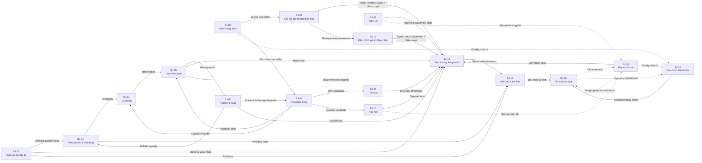
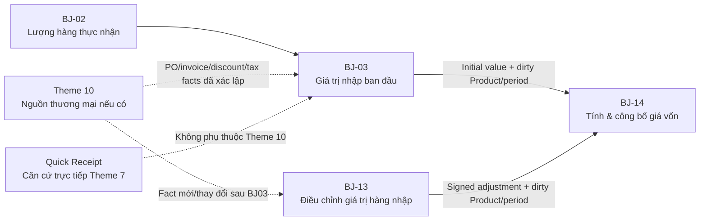
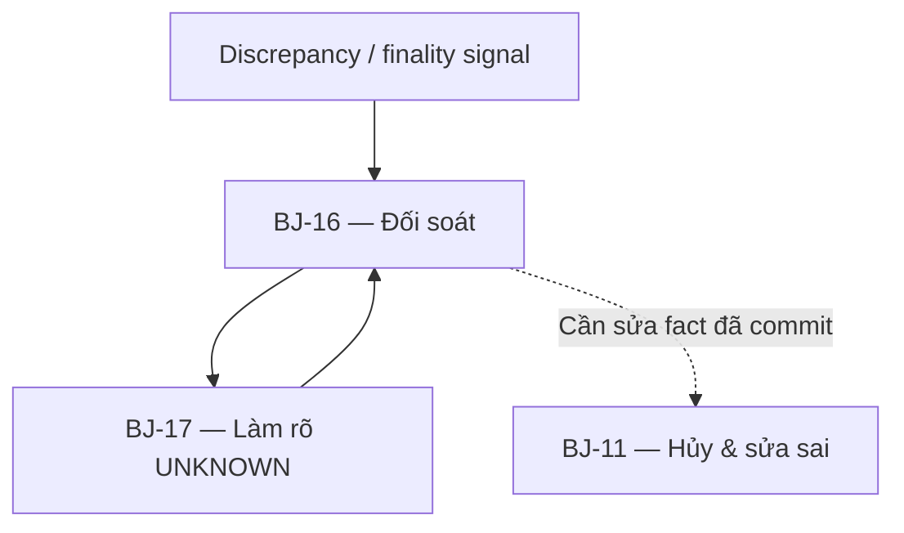

# Theme 7 — Bản đồ Business Journey

> Theme 7 có **17 Business Journey canonical**. v3.12.0 chuẩn hóa toàn bộ BJ/UC theo V5 và cập nhật cụm định giá `BJ03 → BJ13 → BJ14`; HTML hiện hành chưa phải nguồn semantic cho cụm này và sẽ được align ở v3.13.0.

## 1. Danh mục Business Journey

| STT | ID | Hành trình | Owner nghiệp vụ | Tài liệu |
|---:|---|---|---|---|
| 01 | `BJ-01` | Theo dõi tồn, khả dụng và chỉ báo vận hành | Inventory Operations / Monitoring | [Mở](BJ-01-theo-doi-ton-kha-dung-va-chi-bao-van-hanh.md) |
| 02 | `BJ-02` | Nhận hàng mua | Inventory Operations | [Mở](BJ-02-nhan-hang-mua.md) |
| 03 | `BJ-03` | Xác lập giá trị ban đầu của hàng nhận | Inventory Valuation | [Mở](BJ-03-xac-lap-gia-tri-ban-dau-cua-hang-nhan.md) |
| 04 | `BJ-04` | Quản lý vòng đời giữ hàng | Inventory Operations | [Mở](BJ-04-quan-ly-vong-oi-giu-hang.md) |
| 05 | `BJ-05` | Lấy hàng và bàn giao đơn | Inventory Operations | [Mở](BJ-05-lay-hang-va-ban-giao-on.md) |
| 06 | `BJ-06` | Tiếp nhận và phân loại hàng khách trả | Inventory Operations | [Mở](BJ-06-tiep-nhan-va-phan-loai-hang-khach-tra.md) |
| 07 | `BJ-07` | Thực hiện trả hàng cho nhà cung cấp | Inventory Operations | [Mở](BJ-07-thuc-hien-tra-hang-cho-nha-cung-cap.md) |
| 08 | `BJ-08` | Kiểm kê và điều chỉnh chênh lệch | Inventory Control | [Mở](BJ-08-kiem-ke-va-ieu-chinh-chenh-lech.md) |
| 09 | `BJ-09` | Quản lý trạng thái hàng | Inventory Control | [Mở](BJ-09-quan-ly-trang-thai-hang.md) |
| 10 | `BJ-10` | Tiêu hủy hàng | Inventory Control | [Mở](BJ-10-tieu-huy-hang.md) |
| 11 | `BJ-11` | Hủy và sửa sai nghiệp vụ kho | Inventory Control | [Mở](BJ-11-huy-va-sua-sai-nghiep-vu-kho.md) |
| 12 | `BJ-12` | Khởi tạo số dư tồn kho đầu kỳ | Inventory Control / Inventory Valuation | [Mở](BJ-12-khoi-tao-so-du-ton-kho-au-ky.md) |
| 13 | `BJ-13` | Điều chỉnh giá trị hàng nhập | Inventory Valuation | [Mở](BJ-13-dieu-chinh-gia-tri-hang-nhap.md) |
| 14 | `BJ-14` | Tính và công bố giá vốn | Inventory Valuation | [Mở](BJ-14-tinh-va-cong-bo-gia-von.md) |
| 15 | `BJ-15` | Tra cứu báo cáo tồn và thẻ kho | Inventory Reporting / Read layer | [Mở](BJ-15-tra-cuu-bao-cao-ton-va-the-kho.md) |
| 16 | `BJ-16` | Điều tra và đối soát sai lệch | Inventory Control | [Mở](BJ-16-ieu-tra-va-oi-soat-sai-lech.md) |
| 17 | `BJ-17` | Phục hồi nghiệp vụ có kết quả chưa xác định | Inventory Control + Operation Owner | [Mở](BJ-17-phuc-hoi-nghiep-vu-co-ket-qua-chua-xac-inh.md) |

## 2. Quan hệ đầu–cuối giữa các hành trình

Sơ đồ thể hiện **fact/handoff chính**, không có nghĩa mọi giao dịch phải đi qua tất cả BJ. Mỗi BJ chỉ chạy khi trigger của chính hành trình đó phát sinh.

## 3. Trục định giá đã khóa ở v3.12.0

- **BJ03** xác lập giá trị nhập ban đầu; không công bố `OfficialCostVersion`.
- **BJ13** ghi phần thay đổi giá trị có căn cứ xuất hiện/được xác lập sau BJ03; lỗi nhập liệu của BJ03 đi BJ11, không giả làm BJ13.
- **BJ14** là owner duy nhất của tính và công bố giá vốn chính thức. Phương pháp công bố lấy từ cấu hình tenant, không chọn lại theo từng lần tính.
- Nhập hàng nhanh phải hoàn tất BJ03 mà không cần Theme 10; Theme 10 chỉ là upstream của nguồn thương mại khi nguồn đó tồn tại.

## 4. Nhóm trách nhiệm chính

| Nhóm | BJ chính | Vai trò |
|---|---|---|
| Inventory Operations | BJ01, BJ02, BJ04, BJ05, BJ06, BJ07 | Sự thật vật lý, khả dụng, giữ/lấy/bàn giao và return/RTV | 
| Inventory Valuation | BJ03, BJ13, BJ14 | Giá trị nhập ban đầu, adjustment giá trị và giá vốn chính thức | 
| Inventory Audit & Control | BJ08, BJ09, BJ10, BJ11, BJ12, BJ16, BJ17 | Kiểm soát, sửa sai, mở số dư, đối soát và recovery | 
| Reporting | BJ15 | Đọc/trình bày authoritative facts, không tự tạo định nghĩa nghiệp vụ mới | 

## 5. Supporting artifacts và boundary ngoài Theme

- `CAP-01` — chính sách tồn/cận hạn; không phải Business Journey.
- `PROC-01` — dựng lại projection; là procedure kỹ thuật, không phải Journey.
- `INT-01` — hợp đồng bàn giao liên Theme; owner nguồn ngoài Theme vẫn giữ authority của dữ kiện đó.

## 6. Recovery

