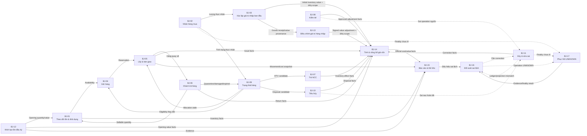
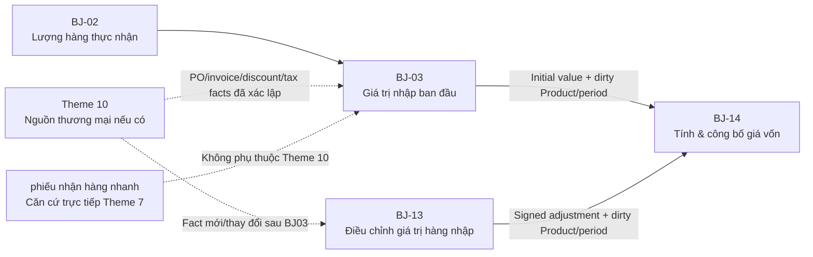
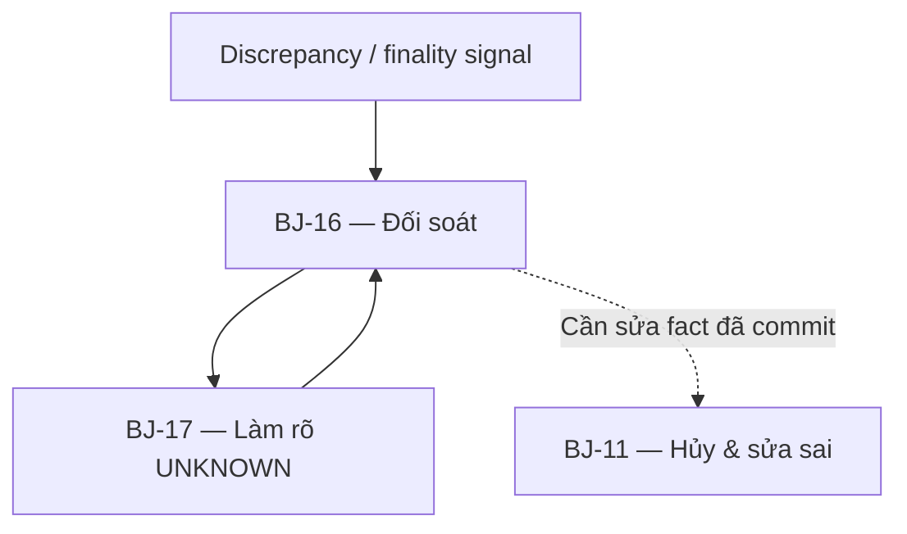

# Theme 7 — Bản đồ Business Journey

> Theme 7 có **17 Business Journey canonical** và **17 UI Flow canonical**. v4.1.0 giữ semantic BJ/UC v5, giữ trace `BJ ↔ UC ↔ UIF` của v4.0.0 và hợp nhất Design/HTML valuation đã sửa từ v3.13.0; prototype vẫn là downstream evidence, không phải nguồn semantic.

## 1. Danh mục Business Journey

| STT | ID | Hành trình | Owner nghiệp vụ | Journey | UI Flow |
|---:|---|---|---|---|---|
| 01 | `BJ-01` | Theo dõi tồn, khả dụng và chỉ báo vận hành | Inventory Operations / Monitoring | [BJ](BJ-01-theo-doi-ton-kha-dung-va-chi-bao-van-hanh.md) | [UIF-01](../../../03.design/flows/UIF-01-BJ-01.md) |
| 02 | `BJ-02` | Nhận hàng mua | Inventory Operations | [BJ](BJ-02-nhan-hang-mua.md) | [UIF-02](../../../03.design/flows/UIF-02-BJ-02.md) |
| 03 | `BJ-03` | Xác lập giá trị ban đầu của hàng nhận | Inventory Valuation | [BJ](BJ-03-xac-lap-gia-tri-ban-dau-cua-hang-nhan.md) | [UIF-03](../../../03.design/flows/UIF-03-BJ-03.md) |
| 04 | `BJ-04` | Quản lý vòng đời giữ hàng | Inventory Operations | [BJ](BJ-04-quan-ly-vong-oi-giu-hang.md) | [UIF-04](../../../03.design/flows/UIF-04-BJ-04.md) |
| 05 | `BJ-05` | Lấy hàng và bàn giao đơn | Inventory Operations | [BJ](BJ-05-lay-hang-va-ban-giao-on.md) | [UIF-05](../../../03.design/flows/UIF-05-BJ-05.md) |
| 06 | `BJ-06` | Tiếp nhận và phân loại hàng khách trả | Inventory Operations | [BJ](BJ-06-tiep-nhan-va-phan-loai-hang-khach-tra.md) | [UIF-06](../../../03.design/flows/UIF-06-BJ-06.md) |
| 07 | `BJ-07` | Thực hiện trả hàng cho nhà cung cấp | Inventory Operations | [BJ](BJ-07-thuc-hien-tra-hang-cho-nha-cung-cap.md) | [UIF-07](../../../03.design/flows/UIF-07-BJ-07.md) |
| 08 | `BJ-08` | Kiểm kê và điều chỉnh chênh lệch | Inventory Control | [BJ](BJ-08-kiem-ke-va-ieu-chinh-chenh-lech.md) | [UIF-08](../../../03.design/flows/UIF-08-BJ-08.md) |
| 09 | `BJ-09` | Quản lý trạng thái hàng | Inventory Control | [BJ](BJ-09-quan-ly-trang-thai-hang.md) | [UIF-09](../../../03.design/flows/UIF-09-BJ-09.md) |
| 10 | `BJ-10` | Tiêu hủy hàng | Inventory Control | [BJ](BJ-10-tieu-huy-hang.md) | [UIF-10](../../../03.design/flows/UIF-10-BJ-10.md) |
| 11 | `BJ-11` | Hủy và sửa sai nghiệp vụ kho | Inventory Control | [BJ](BJ-11-huy-va-sua-sai-nghiep-vu-kho.md) | [UIF-11](../../../03.design/flows/UIF-11-BJ-11.md) |
| 12 | `BJ-12` | Khởi tạo số dư tồn kho đầu kỳ | Inventory Control / Inventory Valuation | [BJ](BJ-12-khoi-tao-so-du-ton-kho-au-ky.md) | [UIF-12](../../../03.design/flows/UIF-12-BJ-12.md) |
| 13 | `BJ-13` | Điều chỉnh giá trị hàng nhập | Inventory Valuation | [BJ](BJ-13-dieu-chinh-gia-tri-hang-nhap.md) | [UIF-13](../../../03.design/flows/UIF-13-BJ-13.md) |
| 14 | `BJ-14` | Tính và công bố giá vốn | Inventory Valuation | [BJ](BJ-14-tinh-va-cong-bo-gia-von.md) | [UIF-14](../../../03.design/flows/UIF-14-BJ-14.md) |
| 15 | `BJ-15` | Tra cứu báo cáo tồn và thẻ kho | Inventory Reporting / Read layer | [BJ](BJ-15-tra-cuu-bao-cao-ton-va-the-kho.md) | [UIF-15](../../../03.design/flows/UIF-15-BJ-15.md) |
| 16 | `BJ-16` | Điều tra và đối soát sai lệch | Inventory Control | [BJ](BJ-16-ieu-tra-va-oi-soat-sai-lech.md) | [UIF-16](../../../03.design/flows/UIF-16-BJ-16.md) |
| 17 | `BJ-17` | Phục hồi nghiệp vụ có kết quả chưa xác định | Inventory Control + Operation Owner | [BJ](BJ-17-phuc-hoi-nghiep-vu-co-ket-qua-chua-xac-inh.md) | [UIF-17](../../../03.design/flows/UIF-17-BJ-17.md) |
## 2. Quan hệ đầu–cuối giữa các hành trình

Sơ đồ thể hiện **fact/handoff chính**, không có nghĩa mọi giao dịch phải đi qua tất cả BJ. Mỗi BJ chỉ chạy khi trigger của chính hành trình đó phát sinh.

## 3. Trục định giá canonical

- **BJ03** xác lập giá trị nhập ban đầu; không công bố `OfficialCostVersion`.
- **BJ13** ghi phần thay đổi giá trị có căn cứ xuất hiện/được xác lập sau BJ03; lỗi nhập liệu của BJ03 đi BJ11, không giả làm BJ13.
- **BJ14** là owner duy nhất của tính và công bố giá vốn chính thức. Phương pháp công bố lấy từ cấu hình tenant, không chọn lại theo từng lần tính.
- Nhập hàng nhanh phải hoàn tất BJ03 mà không cần Theme 10; Theme 10 chỉ là upstream của nguồn thương mại khi nguồn đó tồn tại.

## 4. Nhóm trách nhiệm chính

| Nhóm | BJ chính | Vai trò |
|---|---|---|
| Inventory Operations | BJ01, BJ02, BJ04, BJ05, BJ06, BJ07 | Sự thật vật lý, khả dụng, giữ/lấy/bàn giao và return/RTV | 
| Inventory Valuation | BJ03, BJ13, BJ14 | Giá trị nhập ban đầu, adjustment giá trị và giá vốn chính thức | 
| Inventory Audit & Control | BJ08, BJ09, BJ10, BJ11, BJ12, BJ16, BJ17 | Kiểm soát, sửa sai, mở số dư, đối soát và recovery | 
| Reporting | BJ15 | Đọc/trình bày authoritative facts, không tự tạo định nghĩa nghiệp vụ mới | 

## 5. Supporting artifacts và boundary ngoài Theme

- `CAP-01` — chính sách tồn/cận hạn; không phải Business Journey.
- `PROC-01` — dựng lại projection; là procedure kỹ thuật, không phải Journey.
- `INT-01` — hợp đồng bàn giao liên Theme; owner nguồn ngoài Theme vẫn giữ authority của dữ kiện đó.

## 6. Ma trận BJ ↔ UC ↔ UIF

| BJ | Use Case canonical | UI Flow canonical |
|---|---|---|
| [BJ-01](BJ-01-theo-doi-ton-kha-dung-va-chi-bao-van-hanh.md) | [UC-01-01](../use-cases/UC-01-01-xac-dinh-ngu-canh-va-san-pham.md); [UC-01-02](../use-cases/UC-01-02-xem-ton-va-kha-dung.md); [UC-01-03](../use-cases/UC-01-03-xem-trace-summary.md); [UC-01-04](../use-cases/UC-01-04-xem-ton-thap-va-luong-goi-y.md); [UC-01-05](../use-cases/UC-01-05-xem-hang-can-han-va-het-han.md) | [UIF-01](../../../03.design/flows/UIF-01-BJ-01.md) |
| [BJ-02](BJ-02-nhan-hang-mua.md) | [UC-02-01](../use-cases/UC-02-01-chuan-bi-nhan-theo-chung-tu.md); [UC-02-02](../use-cases/UC-02-02-chuan-bi-nhap-hang-nhanh.md); [UC-02-03](../use-cases/UC-02-03-phe-duyet-yeu-cau-nhan-hang.md); [UC-02-04](../use-cases/UC-02-04-ghi-nhan-hang-vao-ton-vat-ly.md); [UC-02-05](../use-cases/UC-02-05-truy-van-va-phuc-hoi-ngan-ket-qua-nhan-hang.md) | [UIF-02](../../../03.design/flows/UIF-02-BJ-02.md) |
| [BJ-03](BJ-03-xac-lap-gia-tri-ban-dau-cua-hang-nhan.md) | [UC-03-01](../use-cases/UC-03-01-xac-lap-gia-tri-nhap-ban-dau.md) | [UIF-03](../../../03.design/flows/UIF-03-BJ-03.md) |
| [BJ-04](BJ-04-quan-ly-vong-oi-giu-hang.md) | [UC-04-01](../use-cases/UC-04-01-tao-reservation.md); [UC-04-02](../use-cases/UC-04-02-dieu-chinh-reservation.md); [UC-04-03](../use-cases/UC-04-03-ket-thuc-va-giai-phong.md); [UC-04-04](../use-cases/UC-04-04-danh-gia-lai-va-xu-ly-thieu.md) | [UIF-04](../../../03.design/flows/UIF-04-BJ-04.md) |
| [BJ-05](BJ-05-lay-hang-va-ban-giao-on.md) | [UC-05-01](../use-cases/UC-05-01-lap-allocation.md); [UC-05-02](../use-cases/UC-05-02-xac-nhan-hang-da-lay.md); [UC-05-03](../use-cases/UC-05-03-ban-giao-hang.md); [UC-05-04](../use-cases/UC-05-04-phuc-hoi-allocation-stale.md); [UC-05-05](../use-cases/UC-05-05-ghi-xuat-kho-nguyen-tu.md) | [UIF-05](../../../03.design/flows/UIF-05-BJ-05.md) |
| [BJ-06](BJ-06-tiep-nhan-va-phan-loai-hang-khach-tra.md) | [UC-06-01](../use-cases/UC-06-01-xac-minh-hang-duoc-phep-nhan-tra.md); [UC-06-02](../use-cases/UC-06-02-xu-ly-ngoai-le-truy-vet.md); [UC-06-03](../use-cases/UC-06-03-ghi-nhan-hang-khach-tra.md); [UC-06-04](../use-cases/UC-06-04-phan-loai-hang-thuc-nhan.md) | [UIF-06](../../../03.design/flows/UIF-06-BJ-06.md) |
| [BJ-07](BJ-07-thuc-hien-tra-hang-cho-nha-cung-cap.md) | [UC-07-01](../use-cases/UC-07-01-xac-minh-pham-vi-tra.md); [UC-07-02](../use-cases/UC-07-02-dua-hang-vao-cho-tra.md); [UC-07-03](../use-cases/UC-07-03-dieu-chinh-hoac-huy-truoc-ban-giao.md); [UC-07-04](../use-cases/UC-07-04-ghi-nhan-ban-giao-tra-nha-cung-cap.md) | [UIF-07](../../../03.design/flows/UIF-07-BJ-07.md) |
| [BJ-08](BJ-08-kiem-ke-va-ieu-chinh-chenh-lech.md) | [UC-08-01](../use-cases/UC-08-01-mo-va-khoa-pham-vi.md); [UC-08-02](../use-cases/UC-08-02-ghi-nhan-lan-dem-mu.md); [UC-08-03](../use-cases/UC-08-03-dem-lai-va-hoan-thien-bang-chung.md); [UC-08-04](../use-cases/UC-08-04-duyet-va-dieu-chinh.md); [UC-08-05](../use-cases/UC-08-05-huy-phien-kiem-ke.md) | [UIF-08](../../../03.design/flows/UIF-08-BJ-08.md) |
| [BJ-09](BJ-09-quan-ly-trang-thai-hang.md) | [UC-09-01](../use-cases/UC-09-01-chuan-bi-thay-doi-trang-thai.md); [UC-09-02](../use-cases/UC-09-02-phe-duyet-thay-doi-trang-thai.md); [UC-09-03](../use-cases/UC-09-03-xac-dinh-hang-het-han.md); [UC-09-04](../use-cases/UC-09-04-ghi-state-movement.md) | [UIF-09](../../../03.design/flows/UIF-09-BJ-09.md) |
| [BJ-10](BJ-10-tieu-huy-hang.md) | [UC-10-01](../use-cases/UC-10-01-chuan-bi-yeu-cau-tieu-huy.md); [UC-10-02](../use-cases/UC-10-02-phe-duyet-tieu-huy.md); [UC-10-03](../use-cases/UC-10-03-xac-nhan-da-tieu-huy.md); [UC-10-04](../use-cases/UC-10-04-ghi-giam-hang-tieu-huy.md) | [UIF-10](../../../03.design/flows/UIF-10-BJ-10.md) |
| [BJ-11](BJ-11-huy-va-sua-sai-nghiep-vu-kho.md) | [UC-11-01](../use-cases/UC-11-01-xac-dinh-duong-xu-ly.md); [UC-11-02](../use-cases/UC-11-02-huy-operation-chua-thuc-thi.md); [UC-11-03](../use-cases/UC-11-03-chuan-bi-phuong-an-correction.md); [UC-11-04](../use-cases/UC-11-04-phe-duyet-correction.md); [UC-11-05](../use-cases/UC-11-05-ghi-correction-chain.md) | [UIF-11](../../../03.design/flows/UIF-11-BJ-11.md) |
| [BJ-12](BJ-12-khoi-tao-so-du-ton-kho-au-ky.md) | [UC-12-01](../use-cases/UC-12-01-nap-va-kiem-tra-batch-dau-ky.md); [UC-12-02](../use-cases/UC-12-02-ra-soat-va-duyet-batch.md); [UC-12-03](../use-cases/UC-12-03-commit-va-kich-hoat-ton-kho.md) | [UIF-12](../../../03.design/flows/UIF-12-BJ-12.md) |
| [BJ-13](BJ-13-dieu-chinh-gia-tri-hang-nhap.md) | [UC-13-01](../use-cases/UC-13-01-ghi-nhan-dieu-chinh-gia-tri-hang-nhap.md) | [UIF-13](../../../03.design/flows/UIF-13-BJ-13.md) |
| [BJ-14](BJ-14-tinh-va-cong-bo-gia-von.md) | [UC-14-01](../use-cases/UC-14-01-tinh-va-ra-soat-gia-von.md); [UC-14-04](../use-cases/UC-14-04-cong-bo-gia-von.md) | [UIF-14](../../../03.design/flows/UIF-14-BJ-14.md) |
| [BJ-15](BJ-15-tra-cuu-bao-cao-ton-va-the-kho.md) | [UC-15-01](../use-cases/UC-15-01-xac-dinh-bao-cao-va-pham-vi.md); [UC-15-02](../use-cases/UC-15-02-xem-bao-cao-ton-kho.md); [UC-15-03](../use-cases/UC-15-03-xem-the-kho-va-lich-su.md); [UC-15-04](../use-cases/UC-15-04-xuat-bao-cao.md) | [UIF-15](../../../03.design/flows/UIF-15-BJ-15.md) |
| [BJ-16](BJ-16-ieu-tra-va-oi-soat-sai-lech.md) | [UC-16-01](../use-cases/UC-16-01-mo-va-phan-loai-ho-so-doi-soat.md); [UC-16-02](../use-cases/UC-16-02-bao-ve-pham-vi-rui-ro.md); [UC-16-03](../use-cases/UC-16-03-dieu-tra-va-xac-dinh-nguyen-nhan.md); [UC-16-04](../use-cases/UC-16-04-xac-minh-va-cap-nhat-ket-qua-doi-soat.md) | [UIF-16](../../../03.design/flows/UIF-16-BJ-16.md) |
| [BJ-17](BJ-17-phuc-hoi-nghiep-vu-co-ket-qua-chua-xac-inh.md) | [UC-17-01](../use-cases/UC-17-01-thu-thap-va-danh-gia-bang-chung.md); [UC-17-02](../use-cases/UC-17-02-xac-lap-operation-da-hoan-tat.md); [UC-17-03](../use-cases/UC-17-03-tiep-tuc-cung-operation-identity.md); [UC-17-04](../use-cases/UC-17-04-giu-chua-xac-dinh-va-escalated.md) | [UIF-17](../../../03.design/flows/UIF-17-BJ-17.md) |

**Navigation rule:** BJ chỉ link tới UIF; không copy Screen Flow. UIF link ngược BJ/UC và sở hữu screen orchestration. UC giữ UI trace nhưng không sở hữu screen anatomy.

## 7. Ma trận BJ ↔ Know-how

Ma trận này là **điểm vào tri thức theo hành trình**, không thay thế Decision Register hoặc UC/BC.

- **Cốt lõi:** nên đọc để hiểu đúng mục tiêu, ranh giới và các khái niệm quyết định của Journey.
- **Hỗ trợ:** dùng khi cần đào sâu ngoại lệ, tính toàn vẹn, quyền, mở rộng hoặc tác động liên miền.
- Một bài có thể hỗ trợ nhiều BJ; bài `FUTURE_CONCEPT` chỉ giải thích hướng tiến hóa, không mở thêm phạm vi Phase 1.

| BJ | Know-how cốt lõi | Know-how hỗ trợ |
|---|---|---|
| [BJ-01](BJ-01-theo-doi-ton-kha-dung-va-chi-bao-van-hanh.md) | [KB-KGV-005 — Tồn vật lý, lượng đủ điều kiện bán, lượng giữ và tồn khả dụng](../../../01.knowledge/know-how/KB-KGV-005-ton-vat-ly-va-ton-kha-dung.md); [KB-KGV-033 — Thẻ kho, báo cáo lịch sử và đối soát nguồn](../../../01.knowledge/know-how/KB-KGV-033-the-kho-bao-cao-lich-su-va-doi-soat-nguon.md); [KB-KGV-036 — Nhận biết tồn thấp và gợi ý lượng bổ sung](../../../01.knowledge/know-how/KB-KGV-036-ton-du-kien-va-de-xuat-bo-sung-hang.md); [KB-KGV-038 — Chỉ báo dẫn xuất và hồ sơ cần xử lý](../../../01.knowledge/know-how/KB-KGV-038-canh-bao-ton-kho-va-vong-doi-xu-ly.md) | [KB-KGV-001 — Phạm vi quản lý tồn kho và giá vốn](../../../01.knowledge/know-how/KB-KGV-001-pham-vi-quan-ly-ton-kho-va-gia-von.md); [KB-KGV-003 — Cửa hàng, kho và khóa định danh số dư tồn kho](../../../01.knowledge/know-how/KB-KGV-003-kho-cua-hang-va-khoa-dinh-danh-so-du-ton-kho.md); [KB-KGV-006 — Tính chính thức của tồn kho và nguyên tắc chống xuất âm](../../../01.knowledge/know-how/KB-KGV-006-tinh-chinh-thuc-cua-ton-kho-va-nguyen-tac-chong-xuat-am.md); [KB-KGV-014 — Hàng cận hạn, hết hạn, hư hỏng và tiêu hủy](../../../01.knowledge/know-how/KB-KGV-014-hang-can-han-het-han-hu-hong-va-tieu-huy.md); [KB-KGV-037 — Ngừng kinh doanh sản phẩm và điều kiện quản trị kho](../../../01.knowledge/know-how/KB-KGV-037-ngung-kinh-doanh-san-pham-va-dong-kho.md); [KB-KGV-040 — Hiệu năng và năng lực xử lý của hệ thống tồn kho](../../../01.knowledge/know-how/KB-KGV-040-hieu-nang-va-nang-luc-xu-ly-cua-he-thong-ton-kho.md) |
| [BJ-02](BJ-02-nhan-hang-mua.md) | [KB-KGV-007 — Nhận hàng mua và xử lý chênh lệch giao nhận](../../../01.knowledge/know-how/KB-KGV-007-nhan-hang-mua-va-xu-ly-chenh-lech-giao-nhan.md); [KB-KGV-008 — Hàng đã nhận nhưng chưa chốt giá và điều kiện đưa vào bán](../../../01.knowledge/know-how/KB-KGV-008-hang-da-nhan-nhung-chua-chot-gia.md); [KB-KGV-024 — Chọn quản lý thông thường hay quản lý theo lô](../../../01.knowledge/know-how/KB-KGV-024-chinh-sach-quan-ly-hang-thong-thuong-theo-lo-hoac-theo-serial.md); [KB-KGV-025 — Danh tính và vòng đời của một lô hàng](../../../01.knowledge/know-how/KB-KGV-025-danh-tinh-va-vong-doi-cua-mot-lo-hang.md); [KB-KGV-031 — Phê duyệt Inventory Operation theo mức rủi ro](../../../01.knowledge/know-how/KB-KGV-031-phe-duyet-inventory-operation-theo-muc-rui-ro.md) | [KB-KGV-001 — Phạm vi quản lý tồn kho và giá vốn](../../../01.knowledge/know-how/KB-KGV-001-pham-vi-quan-ly-ton-kho-va-gia-von.md); [KB-KGV-002 — Ranh giới trách nhiệm giữa các hệ thống nghiệp vụ](../../../01.knowledge/know-how/KB-KGV-002-ranh-gioi-trach-nhiem-giua-cac-he-thong-nghiep-vu.md); [KB-KGV-004 — Đơn vị tính và cách quy đổi số lượng tồn kho](../../../01.knowledge/know-how/KB-KGV-004-don-vi-tinh-va-cach-quy-doi-so-luong-ton-kho.md); [KB-KGV-026 — Quản lý theo serial khác quản lý theo lô như thế nào?](../../../01.knowledge/know-how/KB-KGV-026-danh-tinh-va-vong-doi-cua-mot-serial.md); [KB-KGV-027 — Vòng đời của một Inventory Operation](../../../01.knowledge/know-how/KB-KGV-027-vong-doi-cua-mot-inventory-operation.md); [KB-KGV-028 — Idempotency, phiên bản nguồn và xử lý kết quả chưa xác định](../../../01.knowledge/know-how/KB-KGV-028-idempotency-phien-ban-nguon-va-xu-ly-ket-qua-chua-xac-dinh.md); [KB-KGV-029 — Tính nguyên tử khi ghi tồn kho và phát sự kiện](../../../01.knowledge/know-how/KB-KGV-029-tinh-nguyen-tu-khi-ghi-ton-kho-va-phat-su-kien.md) |
| [BJ-03](BJ-03-xac-lap-gia-tri-ban-dau-cua-hang-nhan.md) | [KB-KGV-008 — Hàng đã nhận nhưng chưa chốt giá và điều kiện đưa vào bán](../../../01.knowledge/know-how/KB-KGV-008-hang-da-nhan-nhung-chua-chot-gia.md); [KB-KGV-015 — Đơn giá tồn kho chính thức và tổng giá trị ghi sổ](../../../01.knowledge/know-how/KB-KGV-015-don-gia-ton-kho-chinh-thuc-va-tong-gia-tri-ghi-so.md); [KB-KGV-019 — Các thành phần hình thành giá trị hàng nhập](../../../01.knowledge/know-how/KB-KGV-019-cac-thanh-phan-hinh-thanh-gia-tri-hang-nhap.md) | [KB-KGV-002 — Ranh giới trách nhiệm giữa các hệ thống nghiệp vụ](../../../01.knowledge/know-how/KB-KGV-002-ranh-gioi-trach-nhiem-giua-cac-he-thong-nghiep-vu.md); [KB-KGV-017 — Công bố giá vốn chính thức và ghi nhận giá vốn hàng bán](../../../01.knowledge/know-how/KB-KGV-017-cong-bo-don-gia-ton-kho-va-ghi-nhan-gia-von-xuat-ban.md); [KB-KGV-043 — Kịch bản chiết khấu mua hàng theo kỳ](../../../01.knowledge/know-how/KB-KGV-043-kich-ban-chiet-khau-mua-hang-theo-ky.md); [KB-KGV-044 — Từ giá vốn tham chiếu định giá đến giá bán giao dịch](../../../01.knowledge/know-how/KB-KGV-044-tu-gia-von-tham-chieu-den-gia-ban-giao-dich.md) |
| [BJ-04](BJ-04-quan-ly-vong-oi-giu-hang.md) | [KB-KGV-005 — Tồn vật lý, lượng đủ điều kiện bán, lượng giữ và tồn khả dụng](../../../01.knowledge/know-how/KB-KGV-005-ton-vat-ly-va-ton-kha-dung.md); [KB-KGV-009 — Giữ hàng và xử lý đơn không đủ tồn khả dụng](../../../01.knowledge/know-how/KB-KGV-009-giu-hang-va-xu-ly-don-khong-du-ton-kha-dung.md); [KB-KGV-027 — Vòng đời của một Inventory Operation](../../../01.knowledge/know-how/KB-KGV-027-vong-doi-cua-mot-inventory-operation.md) | [KB-KGV-006 — Tính chính thức của tồn kho và nguyên tắc chống xuất âm](../../../01.knowledge/know-how/KB-KGV-006-tinh-chinh-thuc-cua-ton-kho-va-nguyen-tac-chong-xuat-am.md); [KB-KGV-028 — Idempotency, phiên bản nguồn và xử lý kết quả chưa xác định](../../../01.knowledge/know-how/KB-KGV-028-idempotency-phien-ban-nguon-va-xu-ly-ket-qua-chua-xac-dinh.md); [KB-KGV-030 — Quyền chức năng, phạm vi kho và bảo vệ dữ liệu tài chính](../../../01.knowledge/know-how/KB-KGV-030-quyen-chuc-nang-pham-vi-kho-va-bao-ve-du-lieu-tai-chinh.md) |
| [BJ-05](BJ-05-lay-hang-va-ban-giao-on.md) | [KB-KGV-009 — Giữ hàng và xử lý đơn không đủ tồn khả dụng](../../../01.knowledge/know-how/KB-KGV-009-giu-hang-va-xu-ly-don-khong-du-ton-kha-dung.md); [KB-KGV-010 — Chọn hàng để xuất và thời điểm hoàn tất xuất bán](../../../01.knowledge/know-how/KB-KGV-010-chon-hang-de-xuat-va-thoi-diem-hoan-tat-xuat-ban.md); [KB-KGV-025 — Danh tính và vòng đời của một lô hàng](../../../01.knowledge/know-how/KB-KGV-025-danh-tinh-va-vong-doi-cua-mot-lo-hang.md); [KB-KGV-029 — Tính nguyên tử khi ghi tồn kho và phát sự kiện](../../../01.knowledge/know-how/KB-KGV-029-tinh-nguyen-tu-khi-ghi-ton-kho-va-phat-su-kien.md) | [KB-KGV-006 — Tính chính thức của tồn kho và nguyên tắc chống xuất âm](../../../01.knowledge/know-how/KB-KGV-006-tinh-chinh-thuc-cua-ton-kho-va-nguyen-tac-chong-xuat-am.md); [KB-KGV-017 — Công bố giá vốn chính thức và ghi nhận giá vốn hàng bán](../../../01.knowledge/know-how/KB-KGV-017-cong-bo-don-gia-ton-kho-va-ghi-nhan-gia-von-xuat-ban.md); [KB-KGV-028 — Idempotency, phiên bản nguồn và xử lý kết quả chưa xác định](../../../01.knowledge/know-how/KB-KGV-028-idempotency-phien-ban-nguon-va-xu-ly-ket-qua-chua-xac-dinh.md); [KB-KGV-039 — Bán hàng khi mất kết nối: định hướng và điều kiện mở phạm vi](../../../01.knowledge/know-how/KB-KGV-039-ban-hang-pos-offline.md) |
| [BJ-06](BJ-06-tiep-nhan-va-phan-loai-hang-khach-tra.md) | [KB-KGV-012 — Hàng khách trả từ tiếp nhận đến phân loại](../../../01.knowledge/know-how/KB-KGV-012-hang-khach-tra-tu-tiep-nhan-den-phan-loai.md); [KB-KGV-020 — Định giá hàng trả, tiêu hủy và chênh lệch thừa thiếu](../../../01.knowledge/know-how/KB-KGV-020-dinh-gia-hang-tra-tieu-huy-va-chenh-lech-thua-thieu.md); [KB-KGV-025 — Danh tính và vòng đời của một lô hàng](../../../01.knowledge/know-how/KB-KGV-025-danh-tinh-va-vong-doi-cua-mot-lo-hang.md); [KB-KGV-035 — Combo bán hàng và tồn kho theo thành phần](../../../01.knowledge/know-how/KB-KGV-035-combo-ban-hang-va-ton-kho-theo-thanh-phan.md) | [KB-KGV-002 — Ranh giới trách nhiệm giữa các hệ thống nghiệp vụ](../../../01.knowledge/know-how/KB-KGV-002-ranh-gioi-trach-nhiem-giua-cac-he-thong-nghiep-vu.md); [KB-KGV-014 — Hàng cận hạn, hết hạn, hư hỏng và tiêu hủy](../../../01.knowledge/know-how/KB-KGV-014-hang-can-han-het-han-hu-hong-va-tieu-huy.md); [KB-KGV-027 — Vòng đời của một Inventory Operation](../../../01.knowledge/know-how/KB-KGV-027-vong-doi-cua-mot-inventory-operation.md); [KB-KGV-029 — Tính nguyên tử khi ghi tồn kho và phát sự kiện](../../../01.knowledge/know-how/KB-KGV-029-tinh-nguyen-tu-khi-ghi-ton-kho-va-phat-su-kien.md); [KB-KGV-034 — Quyền sở hữu hàng hóa, hàng ký gửi và hàng demo](../../../01.knowledge/know-how/KB-KGV-034-quyen-so-huu-hang-hoa-hang-ky-gui-va-hang-demo.md) |
| [BJ-07](BJ-07-thuc-hien-tra-hang-cho-nha-cung-cap.md) | [KB-KGV-010 — Chọn hàng để xuất và thời điểm hoàn tất xuất bán](../../../01.knowledge/know-how/KB-KGV-010-chon-hang-de-xuat-va-thoi-diem-hoan-tat-xuat-ban.md); [KB-KGV-013 — Trả hàng cho nhà cung cấp](../../../01.knowledge/know-how/KB-KGV-013-tra-hang-cho-nha-cung-cap.md); [KB-KGV-015 — Đơn giá tồn kho chính thức và tổng giá trị ghi sổ](../../../01.knowledge/know-how/KB-KGV-015-don-gia-ton-kho-chinh-thuc-va-tong-gia-tri-ghi-so.md); [KB-KGV-029 — Tính nguyên tử khi ghi tồn kho và phát sự kiện](../../../01.knowledge/know-how/KB-KGV-029-tinh-nguyen-tu-khi-ghi-ton-kho-va-phat-su-kien.md) | [KB-KGV-002 — Ranh giới trách nhiệm giữa các hệ thống nghiệp vụ](../../../01.knowledge/know-how/KB-KGV-002-ranh-gioi-trach-nhiem-giua-cac-he-thong-nghiep-vu.md); [KB-KGV-021 — Sửa sai tồn kho mà không sửa lịch sử](../../../01.knowledge/know-how/KB-KGV-021-sua-sai-ton-kho-khong-sua-lich-su.md); [KB-KGV-027 — Vòng đời của một Inventory Operation](../../../01.knowledge/know-how/KB-KGV-027-vong-doi-cua-mot-inventory-operation.md); [KB-KGV-028 — Idempotency, phiên bản nguồn và xử lý kết quả chưa xác định](../../../01.knowledge/know-how/KB-KGV-028-idempotency-phien-ban-nguon-va-xu-ly-ket-qua-chua-xac-dinh.md) |
| [BJ-08](BJ-08-kiem-ke-va-ieu-chinh-chenh-lech.md) | [KB-KGV-011 — Kiểm kê hàng tồn kho từ khóa phạm vi đến điều chỉnh chênh lệch](../../../01.knowledge/know-how/KB-KGV-011-kiem-ke-hang-ton-kho-tu-khoa-pham-vi-den-dieu-chinh-chenh-lech.md); [KB-KGV-020 — Định giá hàng trả, tiêu hủy và chênh lệch thừa thiếu](../../../01.knowledge/know-how/KB-KGV-020-dinh-gia-hang-tra-tieu-huy-va-chenh-lech-thua-thieu.md); [KB-KGV-021 — Sửa sai tồn kho mà không sửa lịch sử](../../../01.knowledge/know-how/KB-KGV-021-sua-sai-ton-kho-khong-sua-lich-su.md); [KB-KGV-029 — Tính nguyên tử khi ghi tồn kho và phát sự kiện](../../../01.knowledge/know-how/KB-KGV-029-tinh-nguyen-tu-khi-ghi-ton-kho-va-phat-su-kien.md); [KB-KGV-032 — Movement ledger, số dư dẫn xuất và phục hồi sau sự cố](../../../01.knowledge/know-how/KB-KGV-032-movement-ledger-so-du-dan-xuat-va-phuc-hoi-sau-su-co.md) | [KB-KGV-006 — Tính chính thức của tồn kho và nguyên tắc chống xuất âm](../../../01.knowledge/know-how/KB-KGV-006-tinh-chinh-thuc-cua-ton-kho-va-nguyen-tac-chong-xuat-am.md); [KB-KGV-030 — Quyền chức năng, phạm vi kho và bảo vệ dữ liệu tài chính](../../../01.knowledge/know-how/KB-KGV-030-quyen-chuc-nang-pham-vi-kho-va-bao-ve-du-lieu-tai-chinh.md); [KB-KGV-031 — Phê duyệt Inventory Operation theo mức rủi ro](../../../01.knowledge/know-how/KB-KGV-031-phe-duyet-inventory-operation-theo-muc-rui-ro.md); [KB-KGV-033 — Thẻ kho, báo cáo lịch sử và đối soát nguồn](../../../01.knowledge/know-how/KB-KGV-033-the-kho-bao-cao-lich-su-va-doi-soat-nguon.md) |
| [BJ-09](BJ-09-quan-ly-trang-thai-hang.md) | [KB-KGV-005 — Tồn vật lý, lượng đủ điều kiện bán, lượng giữ và tồn khả dụng](../../../01.knowledge/know-how/KB-KGV-005-ton-vat-ly-va-ton-kha-dung.md); [KB-KGV-014 — Hàng cận hạn, hết hạn, hư hỏng và tiêu hủy](../../../01.knowledge/know-how/KB-KGV-014-hang-can-han-het-han-hu-hong-va-tieu-huy.md); [KB-KGV-025 — Danh tính và vòng đời của một lô hàng](../../../01.knowledge/know-how/KB-KGV-025-danh-tinh-va-vong-doi-cua-mot-lo-hang.md); [KB-KGV-034 — Quyền sở hữu hàng hóa, hàng ký gửi và hàng demo](../../../01.knowledge/know-how/KB-KGV-034-quyen-so-huu-hang-hoa-hang-ky-gui-va-hang-demo.md) | [KB-KGV-006 — Tính chính thức của tồn kho và nguyên tắc chống xuất âm](../../../01.knowledge/know-how/KB-KGV-006-tinh-chinh-thuc-cua-ton-kho-va-nguyen-tac-chong-xuat-am.md); [KB-KGV-026 — Quản lý theo serial khác quản lý theo lô như thế nào?](../../../01.knowledge/know-how/KB-KGV-026-danh-tinh-va-vong-doi-cua-mot-serial.md); [KB-KGV-027 — Vòng đời của một Inventory Operation](../../../01.knowledge/know-how/KB-KGV-027-vong-doi-cua-mot-inventory-operation.md); [KB-KGV-030 — Quyền chức năng, phạm vi kho và bảo vệ dữ liệu tài chính](../../../01.knowledge/know-how/KB-KGV-030-quyen-chuc-nang-pham-vi-kho-va-bao-ve-du-lieu-tai-chinh.md); [KB-KGV-037 — Ngừng kinh doanh sản phẩm và điều kiện quản trị kho](../../../01.knowledge/know-how/KB-KGV-037-ngung-kinh-doanh-san-pham-va-dong-kho.md); [KB-KGV-038 — Chỉ báo dẫn xuất và hồ sơ cần xử lý](../../../01.knowledge/know-how/KB-KGV-038-canh-bao-ton-kho-va-vong-doi-xu-ly.md) |
| [BJ-10](BJ-10-tieu-huy-hang.md) | [KB-KGV-014 — Hàng cận hạn, hết hạn, hư hỏng và tiêu hủy](../../../01.knowledge/know-how/KB-KGV-014-hang-can-han-het-han-hu-hong-va-tieu-huy.md); [KB-KGV-020 — Định giá hàng trả, tiêu hủy và chênh lệch thừa thiếu](../../../01.knowledge/know-how/KB-KGV-020-dinh-gia-hang-tra-tieu-huy-va-chenh-lech-thua-thieu.md); [KB-KGV-029 — Tính nguyên tử khi ghi tồn kho và phát sự kiện](../../../01.knowledge/know-how/KB-KGV-029-tinh-nguyen-tu-khi-ghi-ton-kho-va-phat-su-kien.md); [KB-KGV-031 — Phê duyệt Inventory Operation theo mức rủi ro](../../../01.knowledge/know-how/KB-KGV-031-phe-duyet-inventory-operation-theo-muc-rui-ro.md) | [KB-KGV-006 — Tính chính thức của tồn kho và nguyên tắc chống xuất âm](../../../01.knowledge/know-how/KB-KGV-006-tinh-chinh-thuc-cua-ton-kho-va-nguyen-tac-chong-xuat-am.md); [KB-KGV-027 — Vòng đời của một Inventory Operation](../../../01.knowledge/know-how/KB-KGV-027-vong-doi-cua-mot-inventory-operation.md); [KB-KGV-028 — Idempotency, phiên bản nguồn và xử lý kết quả chưa xác định](../../../01.knowledge/know-how/KB-KGV-028-idempotency-phien-ban-nguon-va-xu-ly-ket-qua-chua-xac-dinh.md); [KB-KGV-030 — Quyền chức năng, phạm vi kho và bảo vệ dữ liệu tài chính](../../../01.knowledge/know-how/KB-KGV-030-quyen-chuc-nang-pham-vi-kho-va-bao-ve-du-lieu-tai-chinh.md) |
| [BJ-11](BJ-11-huy-va-sua-sai-nghiep-vu-kho.md) | [KB-KGV-021 — Sửa sai tồn kho mà không sửa lịch sử](../../../01.knowledge/know-how/KB-KGV-021-sua-sai-ton-kho-khong-sua-lich-su.md); [KB-KGV-027 — Vòng đời của một Inventory Operation](../../../01.knowledge/know-how/KB-KGV-027-vong-doi-cua-mot-inventory-operation.md); [KB-KGV-028 — Idempotency, phiên bản nguồn và xử lý kết quả chưa xác định](../../../01.knowledge/know-how/KB-KGV-028-idempotency-phien-ban-nguon-va-xu-ly-ket-qua-chua-xac-dinh.md); [KB-KGV-029 — Tính nguyên tử khi ghi tồn kho và phát sự kiện](../../../01.knowledge/know-how/KB-KGV-029-tinh-nguyen-tu-khi-ghi-ton-kho-va-phat-su-kien.md) | [KB-KGV-006 — Tính chính thức của tồn kho và nguyên tắc chống xuất âm](../../../01.knowledge/know-how/KB-KGV-006-tinh-chinh-thuc-cua-ton-kho-va-nguyen-tac-chong-xuat-am.md); [KB-KGV-030 — Quyền chức năng, phạm vi kho và bảo vệ dữ liệu tài chính](../../../01.knowledge/know-how/KB-KGV-030-quyen-chuc-nang-pham-vi-kho-va-bao-ve-du-lieu-tai-chinh.md); [KB-KGV-032 — Movement ledger, số dư dẫn xuất và phục hồi sau sự cố](../../../01.knowledge/know-how/KB-KGV-032-movement-ledger-so-du-dan-xuat-va-phuc-hoi-sau-su-co.md); [KB-KGV-041 — Cách kiểm soát thay đổi đối với quy tắc nghiệp vụ](../../../01.knowledge/know-how/KB-KGV-041-cach-kiem-soat-thay-doi-doi-voi-quy-tac-nghiep-vu.md) |
| [BJ-12](BJ-12-khoi-tao-so-du-ton-kho-au-ky.md) | [KB-KGV-003 — Cửa hàng, kho và khóa định danh số dư tồn kho](../../../01.knowledge/know-how/KB-KGV-003-kho-cua-hang-va-khoa-dinh-danh-so-du-ton-kho.md); [KB-KGV-004 — Đơn vị tính và cách quy đổi số lượng tồn kho](../../../01.knowledge/know-how/KB-KGV-004-don-vi-tinh-va-cach-quy-doi-so-luong-ton-kho.md); [KB-KGV-015 — Đơn giá tồn kho chính thức và tổng giá trị ghi sổ](../../../01.knowledge/know-how/KB-KGV-015-don-gia-ton-kho-chinh-thuc-va-tong-gia-tri-ghi-so.md); [KB-KGV-022 — Chuẩn bị dữ liệu số dư tồn kho đầu kỳ](../../../01.knowledge/know-how/KB-KGV-022-chuan-bi-du-lieu-so-du-ton-kho-dau-ky.md); [KB-KGV-023 — Xác nhận số dư đầu kỳ, Chuyển đổi chính thức và đối soát migration](../../../01.knowledge/know-how/KB-KGV-023-xac-nhan-so-du-dau-ky-chuyen-doi-chinh-thuc-va-doi-soat-migration.md) | [KB-KGV-001 — Phạm vi quản lý tồn kho và giá vốn](../../../01.knowledge/know-how/KB-KGV-001-pham-vi-quan-ly-ton-kho-va-gia-von.md); [KB-KGV-002 — Ranh giới trách nhiệm giữa các hệ thống nghiệp vụ](../../../01.knowledge/know-how/KB-KGV-002-ranh-gioi-trach-nhiem-giua-cac-he-thong-nghiep-vu.md); [KB-KGV-006 — Tính chính thức của tồn kho và nguyên tắc chống xuất âm](../../../01.knowledge/know-how/KB-KGV-006-tinh-chinh-thuc-cua-ton-kho-va-nguyen-tac-chong-xuat-am.md); [KB-KGV-029 — Tính nguyên tử khi ghi tồn kho và phát sự kiện](../../../01.knowledge/know-how/KB-KGV-029-tinh-nguyen-tu-khi-ghi-ton-kho-va-phat-su-kien.md); [KB-KGV-030 — Quyền chức năng, phạm vi kho và bảo vệ dữ liệu tài chính](../../../01.knowledge/know-how/KB-KGV-030-quyen-chuc-nang-pham-vi-kho-va-bao-ve-du-lieu-tai-chinh.md); [KB-KGV-032 — Movement ledger, số dư dẫn xuất và phục hồi sau sự cố](../../../01.knowledge/know-how/KB-KGV-032-movement-ledger-so-du-dan-xuat-va-phuc-hoi-sau-su-co.md); [KB-KGV-042 — Xây kiến trúc mở rộng mà không triển khai trước chức năng tương lai](../../../01.knowledge/know-how/KB-KGV-042-kien-truc-mo-rong-va-ranh-gioi-mvp.md) |
| [BJ-13](BJ-13-dieu-chinh-gia-tri-hang-nhap.md) | [KB-KGV-015 — Đơn giá tồn kho chính thức và tổng giá trị ghi sổ](../../../01.knowledge/know-how/KB-KGV-015-don-gia-ton-kho-chinh-thuc-va-tong-gia-tri-ghi-so.md); [KB-KGV-018 — Đối soát giá vốn cuối kỳ và cập nhật đột xuất giữa kỳ](../../../01.knowledge/know-how/KB-KGV-018-doi-soat-gia-von-cuoi-ky-va-cap-nhat-dot-xuat-giua-ky.md); [KB-KGV-019 — Các thành phần hình thành giá trị hàng nhập](../../../01.knowledge/know-how/KB-KGV-019-cac-thanh-phan-hinh-thanh-gia-tri-hang-nhap.md); [KB-KGV-043 — Kịch bản chiết khấu mua hàng theo kỳ](../../../01.knowledge/know-how/KB-KGV-043-kich-ban-chiet-khau-mua-hang-theo-ky.md) | [KB-KGV-002 — Ranh giới trách nhiệm giữa các hệ thống nghiệp vụ](../../../01.knowledge/know-how/KB-KGV-002-ranh-gioi-trach-nhiem-giua-cac-he-thong-nghiep-vu.md); [KB-KGV-017 — Công bố giá vốn chính thức và ghi nhận giá vốn hàng bán](../../../01.knowledge/know-how/KB-KGV-017-cong-bo-don-gia-ton-kho-va-ghi-nhan-gia-von-xuat-ban.md); [KB-KGV-020 — Định giá hàng trả, tiêu hủy và chênh lệch thừa thiếu](../../../01.knowledge/know-how/KB-KGV-020-dinh-gia-hang-tra-tieu-huy-va-chenh-lech-thua-thieu.md); [KB-KGV-028 — Idempotency, phiên bản nguồn và xử lý kết quả chưa xác định](../../../01.knowledge/know-how/KB-KGV-028-idempotency-phien-ban-nguon-va-xu-ly-ket-qua-chua-xac-dinh.md); [KB-KGV-029 — Tính nguyên tử khi ghi tồn kho và phát sự kiện](../../../01.knowledge/know-how/KB-KGV-029-tinh-nguyen-tu-khi-ghi-ton-kho-va-phat-su-kien.md); [KB-KGV-045 — Rà soát giá vốn tham chiếu định giá sau chốt kỳ](../../../01.knowledge/know-how/KB-KGV-045-ra-soat-gia-von-tham-chieu-sau-chot-ky.md) |
| [BJ-14](BJ-14-tinh-va-cong-bo-gia-von.md) | [KB-KGV-015 — Đơn giá tồn kho chính thức và tổng giá trị ghi sổ](../../../01.knowledge/know-how/KB-KGV-015-don-gia-ton-kho-chinh-thuc-va-tong-gia-tri-ghi-so.md); [KB-KGV-016 — Vì sao sử dụng song song hai phương pháp tính giá vốn?](../../../01.knowledge/know-how/KB-KGV-016-vi-sao-tinh-song-song-hai-phuong-phap-gia-von.md); [KB-KGV-017 — Công bố giá vốn chính thức và ghi nhận giá vốn hàng bán](../../../01.knowledge/know-how/KB-KGV-017-cong-bo-don-gia-ton-kho-va-ghi-nhan-gia-von-xuat-ban.md); [KB-KGV-018 — Đối soát giá vốn cuối kỳ và cập nhật đột xuất giữa kỳ](../../../01.knowledge/know-how/KB-KGV-018-doi-soat-gia-von-cuoi-ky-va-cap-nhat-dot-xuat-giua-ky.md); [KB-KGV-045 — Rà soát giá vốn tham chiếu định giá sau chốt kỳ](../../../01.knowledge/know-how/KB-KGV-045-ra-soat-gia-von-tham-chieu-sau-chot-ky.md) | [KB-KGV-002 — Ranh giới trách nhiệm giữa các hệ thống nghiệp vụ](../../../01.knowledge/know-how/KB-KGV-002-ranh-gioi-trach-nhiem-giua-cac-he-thong-nghiep-vu.md); [KB-KGV-019 — Các thành phần hình thành giá trị hàng nhập](../../../01.knowledge/know-how/KB-KGV-019-cac-thanh-phan-hinh-thanh-gia-tri-hang-nhap.md); [KB-KGV-028 — Idempotency, phiên bản nguồn và xử lý kết quả chưa xác định](../../../01.knowledge/know-how/KB-KGV-028-idempotency-phien-ban-nguon-va-xu-ly-ket-qua-chua-xac-dinh.md); [KB-KGV-029 — Tính nguyên tử khi ghi tồn kho và phát sự kiện](../../../01.knowledge/know-how/KB-KGV-029-tinh-nguyen-tu-khi-ghi-ton-kho-va-phat-su-kien.md); [KB-KGV-030 — Quyền chức năng, phạm vi kho và bảo vệ dữ liệu tài chính](../../../01.knowledge/know-how/KB-KGV-030-quyen-chuc-nang-pham-vi-kho-va-bao-ve-du-lieu-tai-chinh.md); [KB-KGV-041 — Cách kiểm soát thay đổi đối với quy tắc nghiệp vụ](../../../01.knowledge/know-how/KB-KGV-041-cach-kiem-soat-thay-doi-doi-voi-quy-tac-nghiep-vu.md); [KB-KGV-043 — Kịch bản chiết khấu mua hàng theo kỳ](../../../01.knowledge/know-how/KB-KGV-043-kich-ban-chiet-khau-mua-hang-theo-ky.md); [KB-KGV-044 — Từ giá vốn tham chiếu định giá đến giá bán giao dịch](../../../01.knowledge/know-how/KB-KGV-044-tu-gia-von-tham-chieu-den-gia-ban-giao-dich.md) |
| [BJ-15](BJ-15-tra-cuu-bao-cao-ton-va-the-kho.md) | [KB-KGV-006 — Tính chính thức của tồn kho và nguyên tắc chống xuất âm](../../../01.knowledge/know-how/KB-KGV-006-tinh-chinh-thuc-cua-ton-kho-va-nguyen-tac-chong-xuat-am.md); [KB-KGV-030 — Quyền chức năng, phạm vi kho và bảo vệ dữ liệu tài chính](../../../01.knowledge/know-how/KB-KGV-030-quyen-chuc-nang-pham-vi-kho-va-bao-ve-du-lieu-tai-chinh.md); [KB-KGV-032 — Movement ledger, số dư dẫn xuất và phục hồi sau sự cố](../../../01.knowledge/know-how/KB-KGV-032-movement-ledger-so-du-dan-xuat-va-phuc-hoi-sau-su-co.md); [KB-KGV-033 — Thẻ kho, báo cáo lịch sử và đối soát nguồn](../../../01.knowledge/know-how/KB-KGV-033-the-kho-bao-cao-lich-su-va-doi-soat-nguon.md) | [KB-KGV-001 — Phạm vi quản lý tồn kho và giá vốn](../../../01.knowledge/know-how/KB-KGV-001-pham-vi-quan-ly-ton-kho-va-gia-von.md); [KB-KGV-005 — Tồn vật lý, lượng đủ điều kiện bán, lượng giữ và tồn khả dụng](../../../01.knowledge/know-how/KB-KGV-005-ton-vat-ly-va-ton-kha-dung.md); [KB-KGV-015 — Đơn giá tồn kho chính thức và tổng giá trị ghi sổ](../../../01.knowledge/know-how/KB-KGV-015-don-gia-ton-kho-chinh-thuc-va-tong-gia-tri-ghi-so.md); [KB-KGV-018 — Đối soát giá vốn cuối kỳ và cập nhật đột xuất giữa kỳ](../../../01.knowledge/know-how/KB-KGV-018-doi-soat-gia-von-cuoi-ky-va-cap-nhat-dot-xuat-giua-ky.md); [KB-KGV-038 — Chỉ báo dẫn xuất và hồ sơ cần xử lý](../../../01.knowledge/know-how/KB-KGV-038-canh-bao-ton-kho-va-vong-doi-xu-ly.md); [KB-KGV-040 — Hiệu năng và năng lực xử lý của hệ thống tồn kho](../../../01.knowledge/know-how/KB-KGV-040-hieu-nang-va-nang-luc-xu-ly-cua-he-thong-ton-kho.md) |
| [BJ-16](BJ-16-ieu-tra-va-oi-soat-sai-lech.md) | [KB-KGV-021 — Sửa sai tồn kho mà không sửa lịch sử](../../../01.knowledge/know-how/KB-KGV-021-sua-sai-ton-kho-khong-sua-lich-su.md); [KB-KGV-028 — Idempotency, phiên bản nguồn và xử lý kết quả chưa xác định](../../../01.knowledge/know-how/KB-KGV-028-idempotency-phien-ban-nguon-va-xu-ly-ket-qua-chua-xac-dinh.md); [KB-KGV-032 — Movement ledger, số dư dẫn xuất và phục hồi sau sự cố](../../../01.knowledge/know-how/KB-KGV-032-movement-ledger-so-du-dan-xuat-va-phuc-hoi-sau-su-co.md); [KB-KGV-033 — Thẻ kho, báo cáo lịch sử và đối soát nguồn](../../../01.knowledge/know-how/KB-KGV-033-the-kho-bao-cao-lich-su-va-doi-soat-nguon.md) | [KB-KGV-006 — Tính chính thức của tồn kho và nguyên tắc chống xuất âm](../../../01.knowledge/know-how/KB-KGV-006-tinh-chinh-thuc-cua-ton-kho-va-nguyen-tac-chong-xuat-am.md); [KB-KGV-027 — Vòng đời của một Inventory Operation](../../../01.knowledge/know-how/KB-KGV-027-vong-doi-cua-mot-inventory-operation.md); [KB-KGV-029 — Tính nguyên tử khi ghi tồn kho và phát sự kiện](../../../01.knowledge/know-how/KB-KGV-029-tinh-nguyen-tu-khi-ghi-ton-kho-va-phat-su-kien.md); [KB-KGV-030 — Quyền chức năng, phạm vi kho và bảo vệ dữ liệu tài chính](../../../01.knowledge/know-how/KB-KGV-030-quyen-chuc-nang-pham-vi-kho-va-bao-ve-du-lieu-tai-chinh.md); [KB-KGV-031 — Phê duyệt Inventory Operation theo mức rủi ro](../../../01.knowledge/know-how/KB-KGV-031-phe-duyet-inventory-operation-theo-muc-rui-ro.md); [KB-KGV-040 — Hiệu năng và năng lực xử lý của hệ thống tồn kho](../../../01.knowledge/know-how/KB-KGV-040-hieu-nang-va-nang-luc-xu-ly-cua-he-thong-ton-kho.md) |
| [BJ-17](BJ-17-phuc-hoi-nghiep-vu-co-ket-qua-chua-xac-inh.md) | [KB-KGV-027 — Vòng đời của một Inventory Operation](../../../01.knowledge/know-how/KB-KGV-027-vong-doi-cua-mot-inventory-operation.md); [KB-KGV-028 — Idempotency, phiên bản nguồn và xử lý kết quả chưa xác định](../../../01.knowledge/know-how/KB-KGV-028-idempotency-phien-ban-nguon-va-xu-ly-ket-qua-chua-xac-dinh.md); [KB-KGV-029 — Tính nguyên tử khi ghi tồn kho và phát sự kiện](../../../01.knowledge/know-how/KB-KGV-029-tinh-nguyen-tu-khi-ghi-ton-kho-va-phat-su-kien.md); [KB-KGV-032 — Movement ledger, số dư dẫn xuất và phục hồi sau sự cố](../../../01.knowledge/know-how/KB-KGV-032-movement-ledger-so-du-dan-xuat-va-phuc-hoi-sau-su-co.md) | [KB-KGV-002 — Ranh giới trách nhiệm giữa các hệ thống nghiệp vụ](../../../01.knowledge/know-how/KB-KGV-002-ranh-gioi-trach-nhiem-giua-cac-he-thong-nghiep-vu.md); [KB-KGV-030 — Quyền chức năng, phạm vi kho và bảo vệ dữ liệu tài chính](../../../01.knowledge/know-how/KB-KGV-030-quyen-chuc-nang-pham-vi-kho-va-bao-ve-du-lieu-tai-chinh.md); [KB-KGV-033 — Thẻ kho, báo cáo lịch sử và đối soát nguồn](../../../01.knowledge/know-how/KB-KGV-033-the-kho-bao-cao-lich-su-va-doi-soat-nguon.md); [KB-KGV-041 — Cách kiểm soát thay đổi đối với quy tắc nghiệp vụ](../../../01.knowledge/know-how/KB-KGV-041-cach-kiem-soat-thay-doi-doi-voi-quy-tac-nghiep-vu.md); [KB-KGV-042 — Xây kiến trúc mở rộng mà không triển khai trước chức năng tương lai](../../../01.knowledge/know-how/KB-KGV-042-kien-truc-mo-rong-va-ranh-gioi-mvp.md) |

## 8. Recovery

