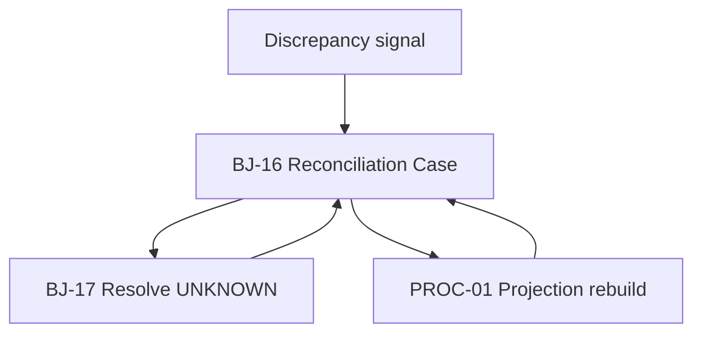

# Theme 7 — Business Journey map 4.1.0

> **Trạng thái:** Release đã đóng băng; baseline v4.0.0 không bị ghi đè  
> **Danh mục:** 17 BJ nội Theme, 5 XREF, 1 CAP, 1 PROC  
> **Owner BJ-09:** Inventory Control  
> **Bổ sung bản đồ quan hệ:** Prototype Harness v0.2.1; không thay đổi boundary hoặc business semantics của 17 BJ.

# 1. Danh mục Business Journey nội Theme

| STT | ID | Hành trình | Owner | Tài liệu |
|---:|---|---|---|---|
| 01 | BJ-01 | Theo dõi tồn, khả dụng và chỉ báo vận hành | Inventory Operations / Monitoring | [Mở](BJ-01-theo-doi-ton-kha-dung-va-chi-bao-van-hanh.md) |
| 02 | BJ-02 | Nhận hàng mua | Inventory Operations | [Mở](BJ-02-nhan-hang-mua.md) |
| 03 | BJ-03 | Xác nhận giá trị ban đầu của hàng nhận | Inventory Valuation | [Mở](BJ-03-xac-nhan-gia-tri-ban-au-cua-hang-nhan.md) |
| 04 | BJ-04 | Quản lý vòng đời giữ hàng | Inventory Operations | [Mở](BJ-04-quan-ly-vong-oi-giu-hang.md) |
| 05 | BJ-05 | Lấy hàng và bàn giao đơn | Inventory Operations | [Mở](BJ-05-lay-hang-va-ban-giao-on.md) |
| 06 | BJ-06 | Tiếp nhận và phân loại hàng khách trả | Inventory Operations | [Mở](BJ-06-tiep-nhan-va-phan-loai-hang-khach-tra.md) |
| 07 | BJ-07 | Thực hiện trả hàng cho nhà cung cấp | Inventory Operations | [Mở](BJ-07-thuc-hien-tra-hang-cho-nha-cung-cap.md) |
| 08 | BJ-08 | Kiểm kê và điều chỉnh chênh lệch | Inventory Control | [Mở](BJ-08-kiem-ke-va-ieu-chinh-chenh-lech.md) |
| 09 | BJ-09 | Quản lý trạng thái hàng | Inventory Control | [Mở](BJ-09-quan-ly-trang-thai-hang.md) |
| 10 | BJ-10 | Tiêu hủy hàng | Inventory Control | [Mở](BJ-10-tieu-huy-hang.md) |
| 11 | BJ-11 | Hủy và sửa sai nghiệp vụ kho | Inventory Control | [Mở](BJ-11-huy-va-sua-sai-nghiep-vu-kho.md) |
| 12 | BJ-12 | Khởi tạo số dư tồn kho đầu kỳ | Inventory Control / Inventory Valuation | [Mở](BJ-12-khoi-tao-so-du-ton-kho-au-ky.md) |
| 13 | BJ-13 | Ghi nhận chi phí mua đến muộn | Inventory Valuation | [Mở](BJ-13-ghi-nhan-chi-phi-mua-en-muon.md) |
| 14 | BJ-14 | Tính và công bố giá vốn | Inventory Valuation | [Mở](BJ-14-tinh-va-cong-bo-gia-von.md) |
| 15 | BJ-15 | Tra cứu báo cáo tồn và thẻ kho | Inventory Reporting / Read layer | [Mở](BJ-15-tra-cuu-bao-cao-ton-va-the-kho.md) |
| 16 | BJ-16 | Điều tra và đối soát sai lệch | Inventory Control | [Mở](BJ-16-ieu-tra-va-oi-soat-sai-lech.md) |
| 17 | BJ-17 | Phục hồi nghiệp vụ có kết quả chưa xác định | Inventory Control + Operation Owner | [Mở](BJ-17-phuc-hoi-nghiep-vu-co-ket-qua-chua-xac-inh.md) |

# 2. Bản đồ quan hệ 17 Business Journey

Sơ đồ dưới đây thể hiện **các handoff và dependency chính giữa 17 BJ**. Đây không phải sequence bắt buộc cho mọi giao dịch; một BJ chỉ chạy khi có trigger và điều kiện nghiệp vụ tương ứng.

- Mũi tên liền: handoff/fact flow bình thường giữa hai BJ.
- Mũi tên nét đứt: route ngoại lệ, correction, đối soát hoặc recovery.
- Các read/report flow chỉ đọc authoritative facts; không có quyền mutation ngược vào BJ nguồn.

```mermaid
flowchart LR
    B12["BJ-12<br/>Khởi tạo số dư đầu kỳ"]
    B01["BJ-01<br/>Theo dõi tồn & khả dụng"]
    B02["BJ-02<br/>Nhận hàng mua"]
    B03["BJ-03<br/>Xác nhận giá trị hàng nhận"]
    B04["BJ-04<br/>Giữ hàng"]
    B05["BJ-05<br/>Lấy & bàn giao hàng"]
    B06["BJ-06<br/>Nhận & phân loại hàng khách trả"]
    B07["BJ-07<br/>Trả hàng NCC"]
    B08["BJ-08<br/>Kiểm kê & điều chỉnh"]
    B09["BJ-09<br/>Quản lý trạng thái hàng"]
    B10["BJ-10<br/>Tiêu hủy hàng"]
    B11["BJ-11<br/>Hủy & sửa sai operation"]
    B13["BJ-13<br/>Chi phí mua đến muộn"]
    B14["BJ-14<br/>Tính & công bố giá vốn"]
    B15["BJ-15<br/>Báo cáo tồn & thẻ kho"]
    B16["BJ-16<br/>Điều tra & đối soát"]
    B17["BJ-17<br/>Phục hồi UNKNOWN"]

    B12 -->|Kích hoạt tồn| B01
    B12 -->|Opening value| B14
    B12 -->|Số dư / evidence| B15

    B02 -->|Receipt facts| B03
    B02 -->|Tình trạng thực nhận| B09
    B02 -. "UNKNOWN sau phục hồi ngắn" .-> B17

    B03 -->|Receipt value facts| B14
    B02 -->|Receipt/source facts| B13
    B03 -->|Receipt valuation facts| B13
    B13 -->|Scope cần tính lại| B14

    B01 -->|Availability| B04
    B04 -->|Reservation hiện hành| B05
    B05 -->|Hàng thực quay về| B06
    B06 -->|Sellable quantity| B01
    B06 -->|Quarantine / damaged / expired| B09

    B09 -->|Eligibility giảm| B04
    B09 -->|Allocation stale| B05
    B09 -->|RTV candidate| B07
    B09 -->|Disposal candidate| B10
    B06 -->|Có thể tiêu hủy| B10

    B05 -->|Issue quantity/value facts| B14
    B06 -->|Return quantity/value facts| B14
    B07 -->|Inventory-effect facts| B14
    B08 -->|Approved adjustment facts| B14
    B10 -->|Disposal quantity/value facts| B14
    B11 -->|Correction quantity/value facts| B14

    B01 -->|Full history handoff| B15
    B05 -->|Movement / cost snapshot| B15
    B14 -->|Official cost / value facts| B15

    B08 -. "Operation nguồn sai" .-> B11
    B10 -. "Sai sót sau hoàn tất" .-> B11
    B11 -. "Ledger / projection mismatch" .-> B16
    B11 -. "Finality chưa rõ" .-> B17
    B15 -->|Dấu hiệu sai lệch| B16
    B16 -. "Cần correction" .-> B11
    B16 -. "Operation UNKNOWN" .-> B17
    B17 -->|Evidence / finality result| B16
    B17 -. "Đã final nhưng cần sửa" .-> B11
```

## 2.1 Các trục handoff chính

1. **Inbound → valuation:** `BJ-02 → BJ-03 → BJ-14`; chi phí đến muộn đi `BJ-02/BJ-03 → BJ-13 → BJ-14`.
2. **Availability → fulfillment:** `BJ-01 → BJ-04 → BJ-05`.
3. **Return / disposition:** `BJ-05 → BJ-06 → BJ-09 → BJ-07/BJ-10`, tùy kết quả phân loại và quyết định xử lý.
4. **Opening balance:** `BJ-12` kích hoạt số dư cho `BJ-01`, cung cấp opening value cho `BJ-14` và evidence cho `BJ-15`.
5. **Reporting / audit:** `BJ-15` đọc facts từ các BJ có inventory effect và từ `BJ-14`; khi phát hiện lệch thì handoff `BJ-16`.
6. **Correction / recovery:** `BJ-11`, `BJ-16`, `BJ-17` tạo vòng kiểm soát riêng; không sửa trực tiếp movement/ledger đã commit.

# 3. Bản đồ tổng quan theo 3 nhóm

Sơ đồ này là **view tổng quan để định hướng đọc tài liệu**, không thay thế owner/domain boundary trong từng BJ. Mỗi BJ được đặt vào nhóm theo **trách nhiệm chính** của hành trình.

- `BJ-12` có owner `Inventory Control / Inventory Valuation`; trong sơ đồ tổng quan đặt ở **Audit & Control** vì governance/activation là trách nhiệm dẫn dắt, sau đó bàn giao opening value sang Valuation.
- `BJ-15` là read/reporting layer nhưng đặt ở **Audit & Control** vì vai trò chính trong view này là truy vết, bằng chứng và phát hiện sai lệch.

```mermaid
flowchart LR
    subgraph IO["Inventory Operations"]
        B01["BJ-01<br/>Theo dõi tồn & khả dụng"]
        B02["BJ-02<br/>Nhận hàng mua"]
        B04["BJ-04<br/>Giữ hàng"]
        B05["BJ-05<br/>Lấy & bàn giao hàng"]
        B06["BJ-06<br/>Nhận hàng khách trả"]
        B07["BJ-07<br/>Trả hàng NCC"]
    end

    subgraph IV["Valuation"]
        B03["BJ-03<br/>Giá trị ban đầu"]
        B13["BJ-13<br/>Chi phí mua đến muộn"]
        B14["BJ-14<br/>Giá vốn chính thức"]
    end

    subgraph AC["Audit & Control"]
        B08["BJ-08<br/>Kiểm kê & điều chỉnh"]
        B09["BJ-09<br/>Trạng thái hàng"]
        B10["BJ-10<br/>Tiêu hủy hàng"]
        B11["BJ-11<br/>Hủy & sửa sai"]
        B12["BJ-12<br/>Số dư đầu kỳ"]
        B15["BJ-15<br/>Báo cáo & thẻ kho"]
        B16["BJ-16<br/>Đối soát sai lệch"]
        B17["BJ-17<br/>Phục hồi UNKNOWN"]
    end

    IO -->|Receipt / issue / return facts| IV
    IO -->|Movement, condition, discrepancy evidence| AC
    AC -->|Approval, lock, correction & recovery route| IO
    AC -->|Opening balance & approved adjustment facts| IV
    IV -->|Official value / cost evidence| AC
```

## 3.1 Quan hệ giữa ba nhóm

| Từ nhóm | Sang nhóm | Handoff chính |
|---|---|---|
| Inventory Operations | Valuation | Receipt, issue, return và các quantity/value facts cần định giá |
| Inventory Operations | Audit & Control | Movement/evidence, trạng thái hàng, sai lệch và phạm vi cần kiểm soát |
| Audit & Control | Inventory Operations | Approval, lock, correction route, recovery decision; không sửa ledger trực tiếp |
| Audit & Control | Valuation | Opening balance, adjustment đã duyệt và blocker/control facts |
| Valuation | Audit & Control | Official cost, valuation evidence và blocker cần điều tra/đối soát |

# 4. Supporting artifacts

- [CAP-01 — Quản lý chính sách tồn và cận hạn](../behavioral-contracts/CAP-01.md)
- [PROC-01 — Dựng lại dữ liệu dẫn xuất từ sổ kho](../../../07.evidence/legacy-v3.10.1/implementation/legacy-harness/frozen-source/srs/07-technical-procedures/PROC-01-dung-lai-du-lieu-dan-xuat-tu-so-kho/00-procedure.md)

# 5. External references

[Mở khu vực outbound tạm thời](../../../04.architecture/integrations/INT-01-cross-theme-outbound.md).

# 6. Quan hệ recovery

# 7. Shared contracts

- [Finality contract](../behavioral-contracts/BC-COMMON-EXTENSIONS.md)
- [Ownership metadata contract](../behavioral-contracts/BC-COMMON-EXTENSIONS.md)
