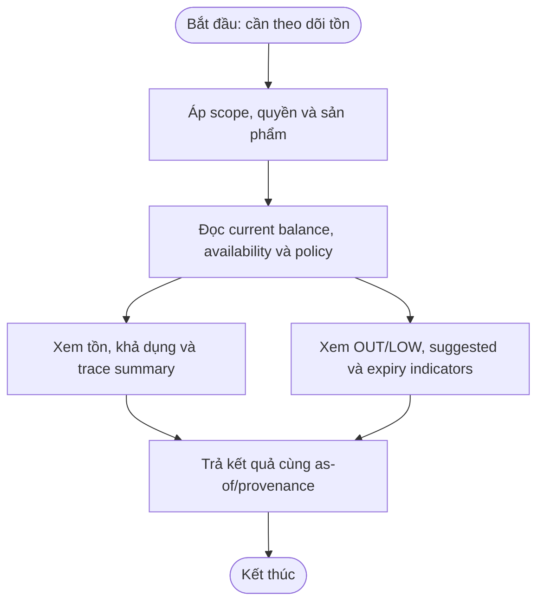
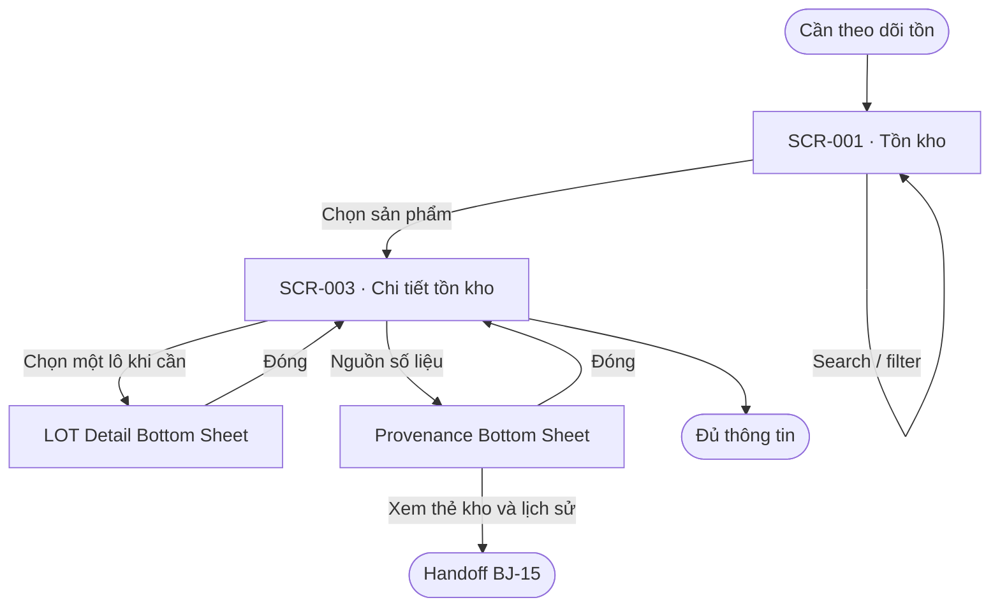

# BJ-01 — Theo dõi tồn, khả dụng và chỉ báo vận hành

## 1. Mục tiêu trải nghiệm

Cho phép người bán, thủ kho và chủ cửa hàng biết tồn vật lý, lượng đủ điều kiện bán, lượng đang giữ và tồn khả dụng; đồng thời nhận biết hết hàng, tồn thấp, lượng gợi ý bổ sung và hàng cận/hết hạn theo một as-of và policy version rõ ràng.

## 2. Phạm vi và ranh giới

### 2.1 Bắt đầu khi

| Thuộc tính | Nội dung |
|---|---|
| Bắt đầu | Người dùng cần kiểm tra một sản phẩm hoặc danh sách mặt hàng cần chú ý |
| Kết thúc | Current snapshot/indicator được hiển thị cùng scope, as-of và provenance; hoặc truy cập bị từ chối có lý do |
| Tác động chính | Query result/read model; không tạo identity nghiệp vụ mới |
| Không làm thay đổi | Quantity/value ledger, reservation, policy, trạng thái hàng, purchase proposal hoặc alert lifecycle |

### 2.2 Kết thúc khi

| Thuộc tính | Nội dung |
|---|---|
| Bắt đầu | Người dùng cần kiểm tra một sản phẩm hoặc danh sách mặt hàng cần chú ý |
| Kết thúc | Current snapshot/indicator được hiển thị cùng scope, as-of và provenance; hoặc truy cập bị từ chối có lý do |
| Tác động chính | Query result/read model; không tạo identity nghiệp vụ mới |
| Không làm thay đổi | Quantity/value ledger, reservation, policy, trạng thái hàng, purchase proposal hoặc alert lifecycle |

### 2.3 Không bao gồm

| Trong ranh giới | Ngoài ranh giới |
|---|---|
| Tìm/chọn sản phẩm; current quantity/availability; breakdown ngắn theo trạng thái/lô; OUT/LOW; suggested quantity; near/expired indicator; filter/sort; policy/as-of | Full stock-card/history/cut-off/export thuộc BJ-15; forecast, MOQ/pack/lead time; purchase proposal/PO; alert assignment/SLA/close; mọi mutation |

CAP-01 cung cấp threshold/target và near-expiry policy. Transactional balance vẫn là authority cho mutation; projection trễ chỉ phục vụ xem và phải hiển thị độ mới.

## 3. Actor

- Nhân viên bán hàng, thủ kho hoặc chủ cửa hàng
- Chủ cửa hàng, người mua hàng hoặc thủ kho

## 4. Luồng chính

## 5. Use Case map

## 6. Luồng thay thế và ngoại lệ

### 4. Logic nghiệp vụ cần giữ

| Điểm kiểm soát | Quy tắc |
|---|---|
| Khả dụng | Lượng vật lý đủ điều kiện bán − lượng đang giữ hợp lệ |
| Hết/tồn thấp | `OUT` khi available = 0; `LOW` khi `0 < available ≤ threshold` |
| Lượng gợi ý | `max(0, target_stock_level − available_quantity)` theo đơn vị cơ sở |
| Thiếu policy | Gắn `NOT_CONFIGURED`; không tự suy ra threshold/target |
| Cận/hết hạn | Product override ưu tiên tenant default; chỉ áp cho lượng có expiry |
| LOT/NONE | Chỉ hiển thị lô khi sản phẩm theo LOT; không tạo lô/expiry giả |
| Không proposal/alert | Chỉ báo tự xuất hiện/biến mất theo nguồn; không có proposal ID hoặc manual close |
| Thời điểm | Mọi kết quả mang as-of/sequence và policy version |
| Quyền tài chính | Quyền xem quantity không mặc nhiên cho phép xem unit cost/total value |

### 4.1 Khóa semantic sau Deep-Dive Review v3.9.1

| Chủ đề | Quy tắc đã khóa |
|---|---|
| Reservation và LOT | `Đã giữ`/`Khả dụng` là authoritative ở cấp **Product + Warehouse**. BJ-01 không phân bổ reservation xuống LOT. LOT chỉ hiển thị physical/eligible/expiry; allocation LOT thuộc BJ-05. |
| Freshness | Mọi quantity/indicator cùng response dùng `query_as_of` do server trả. UI dùng wording **Dữ liệu đến**; thời điểm click refresh không được dùng thay `query_as_of`. |
| Eligibility breakdown | Nếu `physical_quantity > eligible_quantity`, query phải trả breakdown lý do không đủ điều kiện (ví dụ cách ly/hết hạn/blocked). UI chỉ hiển thị breakdown khi có lượng > 0. |
| Multi-indicator | `stock_level_status` và `expiry_attention` là hai dimension độc lập; một sản phẩm có thể đồng thời tồn thấp và có LOT hết hạn/cận hạn. |
| Thiếu monitoring policy | `NOT_CONFIGURED` là trạng thái cấu hình riêng; không được diễn giải thành `NORMAL` và không tự sinh threshold/target. |
| Cận hạn | Derived expiry phải giữ `WARN` khác `BLOCK_SALE`; `BLOCK_SALE` loại lượng tương ứng khỏi eligible/available. |
| Precision HSD | UI giữ precision nguồn `DAY/MONTH/YEAR`; normalized date chỉ dùng nội bộ để tính eligibility, không tạo false precision trên UI. |
| UOM | Quantity của BJ-01 hiển thị theo stock/base UOM; transaction/sales UOM không thay semantic của snapshot tồn. |
| Provenance tối thiểu | Trace summary gồm `query_as_of`, physical movement/source gần nhất và reservation summary nếu có. Generic copy kiểu “Nguồn dữ liệu: VET45” không được coi là provenance. Full history thuộc BJ-15. |
| Presentation | Raw quantity như `Khả dụng 106 hộp` là metric, không phải status badge. Badge chỉ dùng cho status thật sự. |

### 5. Quan hệ và bàn giao

- Nhận policy từ CAP-01 và current balance từ authoritative inventory facts.
- Full stock card, lịch sử, cut-off và export thuộc BJ-15.
- `BLOCK_SALE`/expiry eligibility được thực thi bởi BJ-09 và các hợp đồng issue; danh sách theo dõi không mutation.
- Nhu cầu mua hàng được bàn giao sang Theme 10 — Mua hàng; BJ-01 không tạo PO/proposal.

## 7. UI Flow và chuyển màn hình

> **Current deep-review baseline:** `v3.9.1` · **Historical design calibration:** `v0.3.4` · **Owner:** Inventory Operations / Monitoring.
>
> Flow này chỉ thay presentation architecture của BJ-01. Không tạo mutation hoặc business state mới.

### 1. Scope

| Thuộc tính | Giá trị |
|---|---|
| Business Journey | [BJ-01](BJ-01-theo-doi-ton-kha-dung-va-chi-bao-van-hanh.md) |
| Bắt đầu | Người dùng cần kiểm tra tồn hoặc xem nhóm sản phẩm cần chú ý |
| Kết thúc | Người dùng hiểu đủ tình trạng tồn hiện tại; hoặc handoff sang BJ-15 khi cần lịch sử sâu |
| Entry Screen | `SCR-001` |
| Canonical full-screen surfaces | `SCR-001`, `SCR-003` |
| Contextual overlays | LOT Detail Bottom Sheet; Provenance Bottom Sheet từ `SCR-003` |
| Handoff | BJ-15 cho thẻ kho, lịch sử biến động và truy vết sâu |
| Mutation | Không |

### 2. Task architecture

### 2A. Entry & continuity v1.4.3

- `MODULE_ENTRY`: Inventory → `Tồn kho` mở `SCR-001`.
- `CONTEXTUAL_DEEP_LINK`: khi Product đã được xác định từ Product/inventory context, có thể mở thẳng `SCR-003`; không bắt người dùng quay qua danh sách chỉ để chọn lại Product.
- Khi vào bằng deep link, Back/exit quay về Product context nguồn; khi vào từ `SCR-001`, Back quay về `SCR-001`.
- LOT detail và provenance chỉ là overlay trong context `SCR-003`, không phải global navigation destination.

### 3. Transition contract

| ID | Từ | Trigger | Đến | Loại | Trace |
|---|---|---|---|---|---|
| `UIF-01-T01` | Bắt đầu | Mở Tồn kho | `SCR-001` | NAVIGATION | `UC-01-01`, `UC-01-04`, `UC-01-05` |
| `UIF-01-T02` | Bắt đầu | Deep link từ chỉ báo | `SCR-001` với filter tương ứng | NAVIGATION | `UC-01-04`, `UC-01-05` |
| `UIF-01-T03` | `SCR-001` | Tìm kiếm / chọn chip lọc | `SCR-001` | QUERY | `UC-01-01`, `UC-01-04`, `UC-01-05` |
| `UIF-01-T04` | `SCR-001` | Chọn product row | `SCR-003` | NAVIGATION | `UC-01-02` |
| `UIF-01-T05` | `SCR-003` | Product theo LOT; chọn một LOT | LOT Detail Bottom Sheet | OVERLAY | `UC-01-02`, `UC-01-05` |
| `UIF-01-T06` | LOT Detail Bottom Sheet | Đóng | `SCR-003` | OVERLAY_CLOSE | `UC-01-02` |
| `UIF-01-T07` | `SCR-003` | Mở Nguồn số liệu | Provenance Bottom Sheet | OVERLAY | `UC-01-03` |
| `UIF-01-T08` | Provenance Bottom Sheet | Đóng | `SCR-003` | OVERLAY_CLOSE | `UC-01-03` |
| `UIF-01-T09` | Provenance Bottom Sheet | Xem thẻ kho và lịch sử | BJ-15 entry | HANDOFF | `UC-01-03`, `BJ-15` |
| `UIF-01-T10` | `SCR-001/003` | Dữ liệu cũ; user Làm mới | cùng surface | QUERY | `BC-IO-01` |
| `UIF-01-T11` | `SCR-003` | Đủ thông tin | Kết thúc BJ-01 | TERMINAL | `UC-01-02..05` |

### 4. Structural disposition

| Baseline screen | v0.3.4 |
|---|---|
| `SCR-001` | KEEP + SIMPLIFY: một danh sách duy nhất; search + chips `Tất cả / Hết hàng / Tồn thấp / Cận hạn / Hết hạn` |
| `SCR-002` | MERGED vào `SCR-003`; không còn route active của BJ-01 |
| `SCR-003` | KEEP + SIMPLIFY: một detail surface, `Khả dụng` là hero duy nhất; breakdown compact không lặp hero metric |
| `SCR-004` | DOWNGRADE thành LOT Detail Bottom Sheet; giữ file/ID làm migration/history |
| `SCR-005` | DOWNGRADE thành Provenance Bottom Sheet; giữ file/ID làm migration/history |
| `SCR-060` | BJ-01 relation MERGED vào filter/chỉ báo của `SCR-001` |
| `SCR-061` | BJ-01 relation MERGED vào `SCR-003` |
| `SCR-054..057` | Không thuộc active BJ-01; truy vết sâu handoff BJ-15 |

### 5. Presentation-state contract

- `SCR-001`: `READY`, `LOADING`, `EMPTY`, `FILTER_EMPTY`, `STALE`, `PERMISSION_DENIED`.
- `SCR-003`: `READY`, `LOADING`, `STALE`, `PERMISSION_DENIED`.
- `OUT`, `LOW`, `cận hạn`, `hết hạn`, `chưa cấu hình threshold` là **business data scenarios**, không phải các screen state khác nhau.
- `STALE` giữ dữ liệu/context và chỉ cung cấp query refresh.
- `PERMISSION_DENIED` không render dữ liệu bị hạn chế vào DOM.

### 6. Information hierarchy

#### SCR-001
1. Warehouse + thời điểm cập nhật, dạng context ngắn.
2. Search.
3. Filter chips.
4. Product rows: title = `Tên · mã`; subtitle = `N stock UOM khả dụng` + attention phrase ngắn khi có, để phrase quyết định không bị che bởi identity metadata.
5. Product row hiển thị tối đa một attention phrase theo filter hiện hành; LOT indicator phải nói rõ `Có lô ...`. `NOT_CONFIGURED` không được giả thành NORMAL.

#### SCR-003
1. Product identity ngắn.
2. `Khả dụng` — primary number duy nhất bằng `Key-value Row / Emphasis`, không phải badge.
3. Supporting breakdown: `Tồn vật lý / Đủ điều kiện bán / Đã giữ`; nếu physical > eligible, thêm reason breakdown cho phần không đủ điều kiện.
4. Chỉ báo/ngưỡng/gợi ý chỉ khi đang có vấn đề cần chú ý.
5. LOT list compact nếu Product theo LOT; LOT chỉ show physical/eligible/expiry, không show reserved/available trước allocation.
6. Nguồn số liệu ở cuối: `Dữ liệu đến` + movement/source gần nhất + reservation summary; deeper trace handoff BJ-15.

### 7. Design acceptance

- Không tab/segmented control cho `Tra cứu / Cần chú ý`.
- Không card-per-product trong homogeneous list.
- Không lặp UOM hoặc metric `Khả dụng`.
- Không hiển thị `Theo lô / Không theo lô` như metadata thường trực.
- Không English/technical wording trong Product UI (`barcode`, `snapshot`, `projection`, `movement`, `cut-off`).
- Whole-row tap; không CTA `Mở` lặp nghĩa.
- Normal state yên tĩnh; semantic feedback chỉ khi có thông tin cần chú ý.
- LOT/provenance giữ Product context bằng Bottom Sheet.
- Viewport canonical `402 × 874`; workbench tooling tách khỏi Product UI.

### 8. Figma DS composition lock — v2.4.3

Authority: live Figma Design System v2.0.3 (`505:5889`, `505:5890`, `505:5891`) + `contracts/FIGMA-DS-LOCK.json`. Product documents own business behavior; Figma DS owns UI expression.

- Both active screens use the canonical mobile shell: `402×874`, `VAppBar centerTitle=false`, 16px mobile edge.
- `SCR-001`: `DS v2 / Search & Filter Header` + `VSearchBar` + `VChip`; homogeneous inventory results use canonical `DS v2 / List Row` directly because no live `VListRow` exists; no redundant Theme7 row component identity is created.
- `SCR-003`: `VAppBar`, `VBanner`, `VButton` and `VBottomSheet` are used directly when their responsibilities match. Primary `Khả dụng` uses existing `DS v2 / Key-value Row` (`525:358`, `State=Emphasis`); supporting quantities use the same `DS v2 / Key-value Row` in `State=Default` so comparable quantities share one aligned semantic axis. No Theme7 availability component is created. LOT/provenance entries use `DS v2 / List Row`.
- LOT/provenance overlays use canonical `VBottomSheet` (`4695:6353`) as the shell; only business content is Product composition. HTML follows the live master top radius 20px and records the current mismatch with Foundation `Radius/Sheet=16` instead of hiding it.
- Query/handoff controls use canonical `VButton`; no mutation action exists in BJ01.
- All icons go through the approved VET45 icon registry; HTML is implementation/verification only.

#### Component-selection priority v2.4.3

For every BJ01 element: **semantically valid V_component → existing canonical non-V component → existing Pattern/Template → layout composition of existing DS assets → new component only after a proven reusable gap**. A named Theme/Product component is not created just to group existing DS assets. Semantic fit outranks prefix; an unrelated V-component is never forced.

### 9. v0.3.4 end-user QA corrections

- Search contract và runtime cùng hỗ trợ **mã vạch**; không còn placeholder nói một đằng, query làm một nẻo.
- `Làm mới` ở STALE chỉ cập nhật visible `query_as_of` từ query response; không dùng client click time.
- Stock-level và expiry attention là hai dimension dữ liệu độc lập; filter đang chọn quyết định attention phrase trên list row.
- LOW/OUT banner dùng câu đầy đủ: giải thích ngưỡng và suggested quantity gắn với mức mục tiêu, tránh số `Gợi ý bổ sung` không có căn cứ nhìn thấy.
- Provenance entry không lặp lại timestamp đã có ở context line; subtitle chuyển sang mục đích `Xem nguồn số liệu và lịch sử`.
- **Superseded by v3.9.1:** provenance không dùng copy chung `Phạm vi số liệu`. Current contract hiển thị `Dữ liệu đến` + physical movement/source gần nhất + reservation summary; full history handoff BJ-15.

## 8. Handoff / phụ thuộc ngoài Journey

## 9. Outcome cuối

| Thuộc tính | Nội dung |
|---|---|
| Bắt đầu | Người dùng cần kiểm tra một sản phẩm hoặc danh sách mặt hàng cần chú ý |
| Kết thúc | Current snapshot/indicator được hiển thị cùng scope, as-of và provenance; hoặc truy cập bị từ chối có lý do |
| Tác động chính | Query result/read model; không tạo identity nghiệp vụ mới |
| Không làm thay đổi | Quantity/value ledger, reservation, policy, trạng thái hàng, purchase proposal hoặc alert lifecycle |

## 10. Truy vết

### Nguồn v3.10.1 — BJ-01 — Theo dõi tồn, khả dụng và chỉ báo vận hành

> **Trạng thái:** Release đã đóng băng `4.1.0` — hợp nhất từ BJ-01 và BJ-17 của v4.0.0  
> **Phạm vi:** Phase 1 — current inventory/availability và chỉ báo vận hành tại kho mặc định  
> **Chủ sở hữu nghiệp vụ:** Inventory Operations / Monitoring  
> **Finality contract:** `COMPLETED` hoặc `REJECTED`; Journey chỉ đọc, không có mutation
> **Quyết định nghiệp vụ:** `T7-BASELINE-FREEZE-v4.0.0` + `T7-DR-012`, `T7-DR-018`, `T7-DR-029`, `T7-DR-084#REQ-01`, `T7-DR-088`, `T7-DR-095`, `T7-DR-096`
### Nguồn v3.10.1 — 3. Trường hợp sử dụng

| UC | Tên | Kết quả |
|---|---|---|
| [UC-01-01](../use-cases/UC-01-01-xac-dinh-ngu-canh-va-san-pham.md) | Xác định ngữ cảnh và sản phẩm | Query/monitoring context hợp lệ hoặc truy cập bị từ chối |
| [UC-01-02](../use-cases/UC-01-02-xem-ton-va-kha-dung.md) | Xem tồn và khả dụng | Current snapshot có as-of |
| [UC-01-03](../use-cases/UC-01-03-xem-trace-summary.md) | Xem trace summary | Breakdown ngắn phục vụ quyết định tức thời; full history handoff BJ-15 |
| [UC-01-04](../use-cases/UC-01-04-xem-ton-thap-va-luong-goi-y.md) | Xem tồn thấp và lượng gợi ý | OUT/LOW và suggested quantity có policy version |
| [UC-01-05](../use-cases/UC-01-05-xem-hang-can-han-va-het-han.md) | Xem hàng cận hạn và hết hạn | Derived expiry indicator có as-of |
### Nguồn v3.10.1 — 6. Nguồn tri thức liên quan

- [Tồn vật lý và tồn khả dụng](../../../01.knowledge/know-how/KB-KGV-005-ton-vat-ly-va-ton-kha-dung.md)
- [Hàng cận hạn, hết hạn, hư hỏng và tiêu hủy](../../../01.knowledge/know-how/KB-KGV-014-hang-can-han-het-han-hu-hong-va-tieu-huy.md)
- [Thẻ kho, báo cáo lịch sử và đối soát nguồn](../../../01.knowledge/know-how/KB-KGV-033-the-kho-bao-cao-lich-su-va-doi-soat-nguon.md)
- [Tồn dự kiến và đề xuất bổ sung hàng](../../../01.knowledge/know-how/KB-KGV-036-ton-du-kien-va-de-xuat-bo-sung-hang.md)
