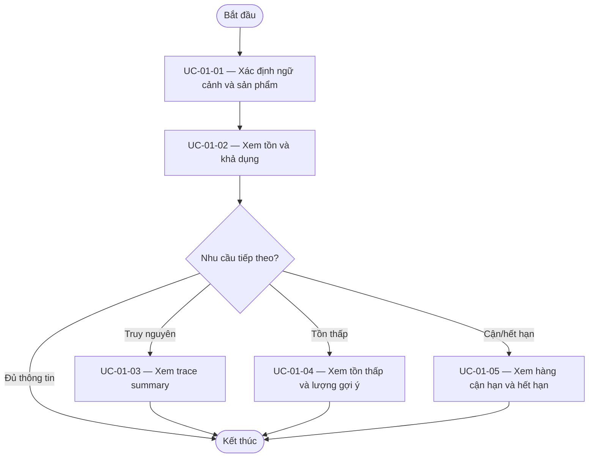

# BJ-01 — Theo dõi tồn, khả dụng và chỉ báo vận hành

## 1. Tổng quan nghiệp vụ & Bối cảnh

Cho phép người bán, thủ kho và chủ cửa hàng biết tồn vật lý, lượng đủ điều kiện bán, lượng đang giữ và tồn khả dụng; đồng thời nhận biết hết hàng, tồn thấp, lượng gợi ý bổ sung và hàng cận/hết hạn theo một as-of và policy version rõ ràng.

**Bắt đầu khi:** Người dùng cần kiểm tra một sản phẩm hoặc danh sách mặt hàng cần chú ý.

**Kết thúc khi:** Current snapshot/indicator được hiển thị cùng scope, as-of và provenance; hoặc truy cập bị từ chối có lý do.

**Không bao gồm:** Không sở hữu quyết định thuộc Theme/Domain khác.

## 2. Tác nhân và trách nhiệm

| Tác nhân | Trách nhiệm | Phạm vi thẩm quyền |
|---|---|---|
| Nhân viên bán hàng, thủ kho hoặc chủ cửa hàng | Chọn đúng ngữ cảnh và đọc tồn/khả dụng/trace để ra quyết định vận hành. | Chỉ đọc dữ liệu theo tenant/store/warehouse được cấp; không sửa ledger từ màn tra cứu. |
| Chủ cửa hàng, người mua hàng hoặc thủ kho | Theo dõi tồn thấp, hàng cận hạn/hết hạn và sử dụng chỉ báo để lập kế hoạch xử lý. | Chỉ dùng chỉ báo dẫn xuất; quyết định mua/giá/chính sách thuộc owner tương ứng. |

## 3. Sơ đồ hành trình nghiệp vụ

## 4. Bản đồ Use Case

| UC — Tên | Mục tiêu | Tác nhân | Đầu vào / Bắt đầu khi | Kết quả | Tiếp tục |
|---|---|---|---|---|---|
| [UC-01-01](../use-cases/UC-01-01-xac-dinh-ngu-canh-va-san-pham.md) — Xác định ngữ cảnh và sản phẩm | Sản phẩm và warehouse scope được xác định hoặc truy cập bị từ chối; Query context hợp lệ. | Nhân viên bán hàng, thủ kho hoặc chủ cửa hàng | Người dùng mở chức năng kiểm tra tồn | Sản phẩm và warehouse scope được xác định hoặc truy cập bị từ chối; Query context hợp lệ. | UC-01-02 |
| [UC-01-02](../use-cases/UC-01-02-xem-ton-va-kha-dung.md) — Xem tồn và khả dụng | Các lượng và thời điểm dữ liệu được hiển thị; Snapshot/read model có as-of. | Nhân viên bán hàng, thủ kho hoặc chủ cửa hàng | Có query context hợp lệ | Các lượng và thời điểm dữ liệu được hiển thị; Snapshot/read model có as-of. | UC-01-03 |
| [UC-01-03](../use-cases/UC-01-03-xem-trace-summary.md) — Xem trace summary | Hiển thị breakdown, movement và nguồn; Chuỗi truy nguyên đọc được. | Nhân viên bán hàng, thủ kho hoặc chủ cửa hàng | Người dùng yêu cầu giải thích số liệu | Hiển thị breakdown, movement và nguồn; Chuỗi truy nguyên đọc được. | UC-01-04 |
| [UC-01-04](../use-cases/UC-01-04-xem-ton-thap-va-luong-goi-y.md) — Xem tồn thấp và lượng gợi ý | Trạng thái OUT/LOW và lượng gợi ý được hiển thị; Derived replenishment indicator. | Chủ cửa hàng, người mua hàng hoặc thủ kho | Có availability và threshold/target | Trạng thái OUT/LOW và lượng gợi ý được hiển thị; Derived replenishment indicator. | UC-01-05 |
| [UC-01-05](../use-cases/UC-01-05-xem-hang-can-han-va-het-han.md) — Xem hàng cận hạn và hết hạn | Các lô cần chú ý được phân nhóm; Derived expiry indicator. | Chủ cửa hàng, người mua hàng hoặc thủ kho | Có lot expiry và policy cận hạn | Các lô cần chú ý được phân nhóm; Derived expiry indicator. | Kết thúc / theo nhánh trên sơ đồ |

## 5. Bàn giao và ranh giới liên quan

| Nơi nhận / Nơi cung cấp | Dữ kiện hoặc trách nhiệm bàn giao | Điều kiện bàn giao / tiếp tục |
|---|---|---|
| Theme 2 / Product | Product, UOM, tracking policy và chỉ báo cấu hình | Dùng read-only để diễn giải tồn/LOT |
| BJ04/BJ05/BJ09 | Reservation, allocation và trạng thái ảnh hưởng khả dụng | Read model phản ánh fact hiện hành |

## 6. Liên kết thiết kế

- **UI Flow canonical:** [UIF-01 — Theo dõi tồn, khả dụng và chỉ báo vận hành](../../../03.design/flows/UIF-01-BJ-01.md)
- BJ này chỉ sở hữu **business boundary, mục tiêu, UC/handoff và acceptance ở cấp hành trình**.
- Screen-to-screen routing, entry/terminal, actor handoff, state/recovery và transition nằm tại `UIF-01`; anatomy/action chi tiết nằm tại `03.design/screens/`.
- Không copy Screen Flow vào BJ để tránh trùng với UC/UIF và để redesign UI không làm thay đổi semantic của Journey.

## 7. Nghiệm thu hành trình (Journey Acceptance)

| ID | Điều kiện ở cấp hành trình | Kết quả cần bảo đảm | UC / BC liên quan |
|---|---|---|---|
| JA-01 | Journey bắt đầu từ đúng trigger và actor có quyền | Kết quả chỉ được ghi trong phạm vi authority của Theme 7; source ngoài Theme không bị sửa ngầm | UC-01-01 / BC liên quan |
| JA-02 | Một nhánh bị từ chối, blocked hoặc chưa xác định | Không được báo thành công hoặc tạo tác động bán phần; hướng xử lý/owner tiếp theo phải rõ | UC-01-01…UC-01-05 |
| JA-03 | Journey hoàn tất thành công | Kết quả cuối có provenance, thời điểm/phạm vi và đủ dữ kiện cho consumer tiếp theo | UC-01-05 / Domain ledger |

## 8. Truy vết

| Nguồn | Vai trò đối với hành trình |
|---|---|
| [KB-KGV-005 — Tồn vật lý, lượng đủ điều kiện bán, lượng giữ và tồn khả dụng](../../../01.knowledge/know-how/KB-KGV-005-ton-vat-ly-va-ton-kha-dung.md); [KB-KGV-033 — Thẻ kho, báo cáo lịch sử và đối soát nguồn](../../../01.knowledge/know-how/KB-KGV-033-the-kho-bao-cao-lich-su-va-doi-soat-nguon.md); [KB-KGV-036 — Nhận biết tồn thấp và gợi ý lượng bổ sung](../../../01.knowledge/know-how/KB-KGV-036-ton-du-kien-va-de-xuat-bo-sung-hang.md); [KB-KGV-038 — Chỉ báo dẫn xuất và hồ sơ cần xử lý](../../../01.knowledge/know-how/KB-KGV-038-canh-bao-ton-kho-va-vong-doi-xu-ly.md) | **Bài tri thức cốt lõi** giúp hiểu nền nghiệp vụ của Journey; rule triển khai vẫn theo Decision/BJ/UC/BC canonical |
| [Decision Register](../../../01.knowledge/decisions/decision-register.md) — Decision Register theo UC/BC | Nguồn quyết định nghiệp vụ và trạng thái hiệu lực |
| `DOM-IO` | Domain authority và invariants dùng cho Journey |
| [Use Case Map](../use-cases/00-use-case-map.md) | Danh mục UC canonical của Theme 7 |
