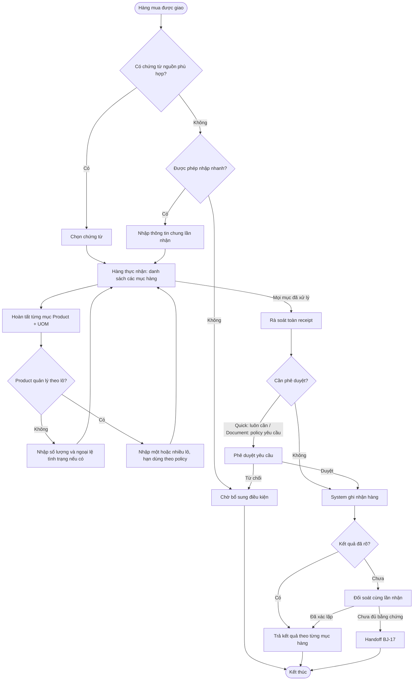
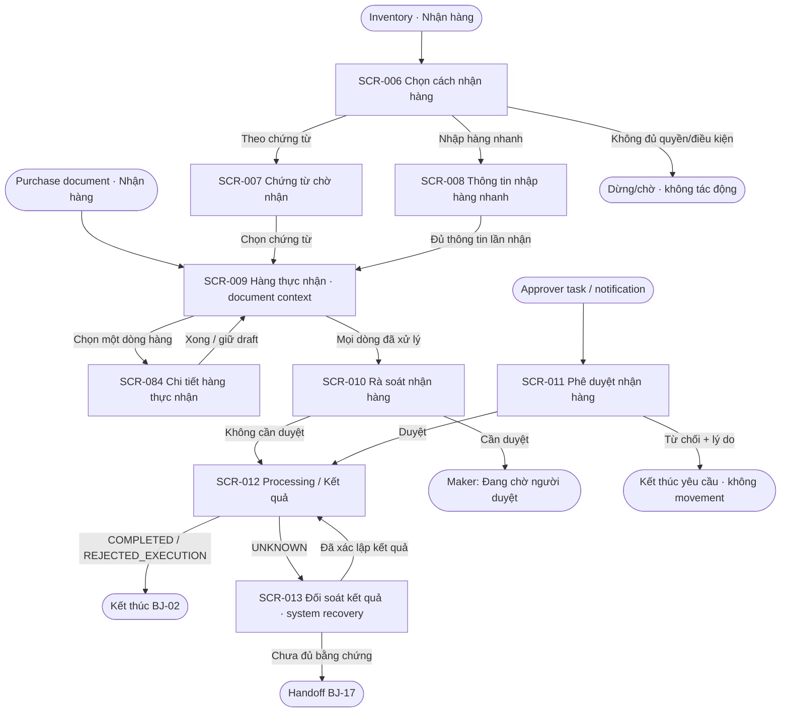

# BJ-02 — Nhận hàng mua

## 1. Mục tiêu trải nghiệm

Ghi đúng hàng mua thực tế đã đến và thuộc quyền sở hữu của đơn vị, theo **một nhà cung cấp cho mỗi receipt**, hỗ trợ nhiều sản phẩm, nhiều đơn vị giao dịch và nhiều lô khi áp dụng. Nhập hàng nhanh chỉ bỏ bước chọn chứng từ mua; không bỏ master-data, tracking, approval, ownership hoặc idempotency guard.

## 2. Phạm vi và ranh giới

### 2.1 Bắt đầu khi

| Thuộc tính | Nội dung |
|---|---|
| Bắt đầu | Hàng mua thực tế được giao đến |
| Kết thúc | Kết quả ghi nhận tồn vật lý đã rõ; hoặc hồ sơ dừng/chờ mà không tạo tác động bán phần |
| Tác động chính | Tăng tồn vật lý theo đúng product/UOM/lot/state thực nhận; tạo movement và bằng chứng nguồn |
| Không quyết định | Giá trị nhập chính thức, công nợ nhà cung cấp, payment hoặc quyền lợi thương mại |

### 2.2 Kết thúc khi

| Thuộc tính | Nội dung |
|---|---|
| Bắt đầu | Hàng mua thực tế được giao đến |
| Kết thúc | Kết quả ghi nhận tồn vật lý đã rõ; hoặc hồ sơ dừng/chờ mà không tạo tác động bán phần |
| Tác động chính | Tăng tồn vật lý theo đúng product/UOM/lot/state thực nhận; tạo movement và bằng chứng nguồn |
| Không quyết định | Giá trị nhập chính thức, công nợ nhà cung cấp, payment hoặc quyền lợi thương mại |

### 2.3 Không bao gồm

| Trong ranh giới | Ngoài ranh giới |
|---|---|
| Nhận theo nguồn; nhập nhanh; nhiều sản phẩm; nhiều receipt-item/UOM; nhận từng phần; `Chưa nhận lần này`; chênh lệch; LOT/expiry; sellable/quarantine/damaged; approval; recovery ngắn | Tạo Product master; tạo Supplier/Partner; sở hữu PO/Purchase Planning; invoice/AP; chuyển kho; hàng ký gửi |
| Chọn Product/Supplier đã tồn tại và còn hiệu lực | Quick-create Product/Supplier để hợp thức hóa receipt |

**Master-data boundary:** Product thuộc Theme 2; Supplier/Partner thuộc Theme 3. Nếu master chưa tồn tại, BJ-02 dừng tại no-result/validation và người dùng phải chuẩn bị master data ở domain sở hữu trước khi quay lại.

## 3. Actor

- Thủ kho; người duyệt khi có ngoại lệ
- Thủ kho hoặc người có quyền lập hồ sơ nhận hàng nhanh
- Người có quyền và cấp phê duyệt phù hợp, khác người lập
- Thủ kho; adapter nhận hàng

## 4. Luồng chính

| Điểm kiểm soát | Quy tắc |
|---|---|
| Supplier | Một receipt có đúng một Supplier. Một Supplier có thể có nhiều receipt. Không trộn nhiều Supplier trong một receipt. |
| Master data | Supplier và Product phải tồn tại trước. BJ-02 không tạo mới. |
| Multi-product | Một receipt có thể có nhiều mục hàng; document nạp tất cả source items, quick cho user thêm items. |
| Receipt item / UOM | Ở mức nghiệp vụ/UI, một mục hàng = một Product + một transaction UOM. Cùng Product + UOM khác là hai mục; Quick không tạo trùng Product + cùng UOM. |
| Data-line expansion | Một mục hàng có thể materialize thành nhiều `InventoryOperationLine` kỹ thuật theo lô/trạng thái; các line kỹ thuật phải giữ chung receipt-item reference để tái hiện grouping. |
| Document UOM | Source quyết định UOM; user không chọn lại. |
| Quick UOM | Nếu Product có một UOM nhập hợp lệ, dùng luôn; nếu có nhiều, user chọn một UOM cho item đó. |
| Product tracking | Product domain cung cấp `NONE`/`LOT` và `expiry_required`; user không cấu hình trong receipt. |
| LOT | `LOT` bắt buộc mã lô; expiry bắt buộc khi `expiry_required=true`, optional nếu false; ngày sản xuất optional; một mục có thể gồm nhiều lô. |
| Quantity classification | User nhập trực tiếp bốn phân loại `Đạt / Cách ly / Hỏng / Từ chối`; `Tổng kiểm nhận` được hệ thống tính bằng `Đạt + Cách ly + Hỏng + Từ chối`; `Vào tồn vật lý = Đạt + Cách ly + Hỏng`; `Từ chối` không vào tồn. Với LOT, áp dụng per-LOT rồi derive lên item. |
| Từ chối nhận | Không tăng tồn vật lý; vẫn giữ evidence/discrepancy. |
| Source item chưa giao | `Chưa nhận lần này` là xử lý hợp lệ với actual=0; không giảm phần còn lại của source. |
| Nhận vượt nguồn | So sánh `accepted_physical_base_qty` của lần nhận với `remaining_receivable_base_qty` authoritative do source line/version cung cấp. `accepted_physical = Đạt + Cách ly + Hỏng`; rejected không vào tồn. Theme 7 không tự suy ra source remainder. |
| Quick approval | Mọi Quick receipt đủ điều kiện gửi đều `DRAFT → PENDING_APPROVAL`; không bypass approval. |
| Nguyên tử | Khi execution xảy ra, toàn operation commit/rollback theo contract; UI hoàn tất từng item chỉ là draft, không movement. |

## 5. Use Case map

| UC | Tên | Bắt đầu | Kết thúc | Kết quả |
|---|---|---|---|---|
| [UC-02-01](../use-cases/UC-02-01-chuan-bi-nhan-theo-chung-tu.md) | Chuẩn bị nhận theo chứng từ | Chọn source hợp lệ | Mọi source item đã được xử lý và sẵn sàng review | Receipt draft gắn source/version; hỗ trợ multi-product/partial |
| [UC-02-02](../use-cases/UC-02-02-chuan-bi-nhap-hang-nhanh.md) | Chuẩn bị nhập hàng nhanh | Không có source mua phù hợp và Quick được phép | Receipt header + các item đã hoàn tất, sẵn sàng gửi approval | Quick receipt draft; không tạo Product/Supplier/PO giả |
| [UC-02-03](../use-cases/UC-02-03-phe-duyet-yeu-cau-nhan-hang.md) | Phê duyệt yêu cầu nhận hàng | Quick đã gửi hoặc Document có ngoại lệ | Duyệt hoặc từ chối | Chỉ nhánh Duyệt được phép thực thi |
| [UC-02-04](../use-cases/UC-02-04-ghi-nhan-hang-vao-ton-vat-ly.md) | Ghi nhận hàng vào tồn vật lý | Hồ sơ hợp lệ và đủ thẩm quyền | COMMITTED, REJECTED hoặc UNKNOWN | Movement/balance/lot/result |
| [UC-02-05](../use-cases/UC-02-05-truy-van-va-phuc-hoi-ngan-ket-qua-nhan-hang.md) | Truy vấn và phục hồi ngắn | Result UNKNOWN | Kết quả authoritative hoặc BJ-17 | Không tạo receipt identity mới |

## 6. Luồng thay thế và ngoại lệ

### 5. UX boundary phục vụ triển khai

- `SCR-008`: chỉ receipt header của Quick.
- `SCR-009`: overview mọi mục hàng, dùng chung Document/Quick.
- `SCR-084`: canonical editor của đúng một mục hàng để mobile không phải mở giant multi-product form.
- `SCR-010`: whole-receipt review; không cộng quantity giữa UOM khác nhau.
- Không dùng các thuật ngữ kỹ thuật/enum làm copy cho người dùng cuối.

## 7. UI Flow và chuyển màn hình

> **Behavioral baseline:** `BJ02-PILOT-v0.2.9` · **UX refinement:** `v0.3.4` · **Quantity correction:** `v1.3.4` · Figma DS v2.0.2 là UI authority; Flutter DS chỉ là historical renderer provenance. v1.3.4 chỉ sửa quantity-input semantics của `SCR-084`; business flow, approval, result và recovery giữ nguyên.

### 1. Scope

| Thuộc tính | Giá trị |
|---|---|
| Business Journey | [BJ-02](BJ-02-nhan-hang-mua.md) |
| Owner | Inventory Operations |
| Bắt đầu | Hàng mua thực tế được giao đến |
| Kết thúc | Kết quả ghi nhận tồn vật lý đã rõ; hoặc hồ sơ dừng/chờ mà không tạo tác động bán phần |
| Entry | Module `SCR-006`; contextual Purchase document `SCR-009`; approver task `SCR-011`; recovery-only `SCR-013` |
| Shared receipt overview | [`SCR-009`](../../../03.design/screens/SCR-009.md) |
| Canonical receipt-line editor | [`SCR-084`](../../../03.design/screens/SCR-084.md) |
| Terminal / recovery | [`SCR-012`](../../../03.design/screens/SCR-012.md), [`SCR-013`](../../../03.design/screens/SCR-013.md) |
| Prototype | `BJ02_CALIBRATION_RENDERER_v1.3.4` |

### 2. UX flow

### 3. Mental-task boundary

| Screen | Một câu hỏi người dùng cần giải quyết |
|---|---|
| SCR-006 | Tôi nhận theo chứng từ hay nhập nhanh? |
| SCR-007 | Tôi đang nhận theo chứng từ nào? |
| SCR-008 | Thông tin chung của lần nhập nhanh này là gì? |
| SCR-009 | Những dòng hàng nào đã/chưa được xử lý, và với Quick tôi cần thêm Product/UOM nào vào lần nhận? |
| SCR-084 | Dòng hàng này thực tế nhận bao nhiêu, tình trạng gì, lô nào? |
| SCR-010 | Toàn bộ lần nhận đã đúng để gửi chưa? |
| SCR-011 | Tôi có duyệt yêu cầu này không? |
| SCR-012 | Kết quả ghi nhận đã rõ chưa? |
| SCR-013 | Hệ thống đã xác minh được kết quả cuối của lần nhận chưa? |

**Nguyên tắc:** không giảm số màn hình một cách cơ học. Một màn mới chỉ tồn tại khi tách được mental task và làm multi-product mobile UX rõ hơn.

### 4. Transition Contract

| ID | Từ | Trigger/điều kiện | Đến | Loại | Trace |
|---|---|---|---|---|---|
| `UIF-02-T01` | Start | Hàng mua được giao đến | `SCR-006` | NAVIGATION | UC-02-01/02 |
| `UIF-02-T02` | `SCR-006` | Có chứng từ nguồn phù hợp | `SCR-007` | NAVIGATION | UC-02-01 |
| `UIF-02-T03` | `SCR-006` | Không có chứng từ phù hợp; đủ quyền/điều kiện Quick | `SCR-008` | NAVIGATION | UC-02-02 |
| `UIF-02-T04` | `SCR-006` | Không đủ quyền/điều kiện | Dừng/chờ | TERMINAL | UC-02-01/02 |
| `UIF-02-T05` | `SCR-007` | Chọn chứng từ | `SCR-009` | NAVIGATION | UC-02-01 |
| `UIF-02-T06` | `SCR-008` | Supplier master hợp lệ + ngày + căn cứ giao nhận | `SCR-009` | NAVIGATION | UC-02-02 |
| `UIF-02-T07` | `SCR-009` | Tap source/receipt line | `SCR-084` | NAVIGATION | UC-02-01/02 |
| `UIF-02-T08` | `SCR-009` | Quick: chọn Product master; nếu nhiều UOM thì chọn trực tiếp một UOM hợp lệ | `SCR-084` | MUTATION draft + NAVIGATION · tạo/mở item và vào one-item editor | UC-02-02 |
| `UIF-02-T09` | `SCR-084` | Xong; line hợp lệ | `SCR-009` | MUTATION draft | BC-IO-16 |
| `UIF-02-T10` | `SCR-084` | Back | `SCR-009` | NAVIGATION + keep draft | BC-IO-16 |
| `UIF-02-T11` | `SCR-084` | Document: Chưa nhận lần này | `SCR-009` | MUTATION draft, qty=0 | UC-02-01 |
| `UIF-02-T12` | `SCR-009` | Có ≥1 line và mọi line đã xử lý | `SCR-010` | NAVIGATION | UC-02-01/02 |
| `UIF-02-T13` | `SCR-010` | Submit; policy yêu cầu duyệt | Maker → `WAITING_APPROVAL`; tạo approver task cho `SCR-011` | MUTATION + ACTOR_HANDOFF | UC-02-03 |
| `UIF-02-T14` | `SCR-010` | Submit; không cần duyệt | `SCR-012` | MUTATION/system route | UC-02-04 |
| `UIF-02-T15` | `SCR-011` | Duyệt | `SCR-012` | MUTATION | UC-02-03 |
| `UIF-02-T16` | `SCR-011` | Từ chối; lý do bắt buộc | Kết thúc, không movement | MUTATION | UC-02-03 |
| `UIF-02-T17` | `SCR-012` | Auto execute | `SCR-012` | SYSTEM | UC-02-04 |
| `UIF-02-T18` | `SCR-012` | COMPLETED/REJECTED_EXECUTION | End | TERMINAL | UC-02-04 |
| `UIF-02-T19` | `SCR-012` | UNKNOWN/COMMIT_UNKNOWN | `SCR-013` | SYSTEM | UC-02-05 |
| `UIF-02-T20` | `SCR-013` | Đã xác lập kết quả | `SCR-012` | SYSTEM | UC-02-05 |
| `UIF-02-T21` | `SCR-013` | Chưa đủ bằng chứng trong recovery window | BJ-17 | HANDOFF | UC-02-05 |

### 4A. Entry architecture v1.4.3

| Context | Entry class | Surface | Continuity |
|---|---|---|---|
| Người Kho mở nghiệp vụ Nhận hàng | `MODULE_ENTRY` | `SCR-006` | Chọn Document/Quick |
| Đã đứng trên chứng từ mua cụ thể và chọn Nhận hàng | `CONTEXTUAL_DEEP_LINK` | `SCR-009` document mode | Không hỏi lại Document/Quick; giữ source context; Back về chứng từ nguồn |
| Người duyệt nhận việc được giao | `ACTOR_HANDOFF_TASK` | `SCR-011` | Session/actor riêng; maker không navigate sang màn người duyệt |
| Commit chưa xác định | `SYSTEM_RECOVERY` | `SCR-013` | Hệ thống tự mở với cùng receipt/operation identity; không có global menu entry |

**Actor continuity:** sau `UIF-02-T13`, maker thấy trạng thái `Đang chờ người duyệt` và có thể rời task. `SCR-011` chỉ mở từ worklist/deep-link của approver. Approve/reject cập nhật cùng submitted receipt; không giả lập việc đổi actor trong cùng một phiên.

### 5. Quyết định pilot đã khóa

1. Một Receipt có đúng **một Supplier**; cùng Supplier có thể có nhiều Receipt.
2. BJ-02 **không tạo mới Supplier hoặc Product**. Master chưa có → người dùng chuẩn bị ở Theme 3/Theme 2 trước rồi quay lại.
3. Document và Quick đều hỗ trợ nhiều sản phẩm; `SCR-009` là overview dùng chung.
4. Một receipt line = một Product + một UOM giao dịch.
5. Document UOM do source cung cấp; Quick cho chọn UOM hợp lệ nếu Product có nhiều UOM nhập.
6. Cùng Product + UOM khác → hai lines; cùng Product + cùng UOM trong Quick → không tạo line trùng.
7. `SCR-009` Quick có `VSearchBar` để tìm Product ngay trên overview; chọn đủ Product + UOM hợp lệ tạo/mở item và **đi ngay vào `SCR-084`**. `Xong` quay lại overview. Đây là behavior canonical theo `UIF-02-T08` và refinement v0.3.4; không giữ biến thể “thêm PENDING rồi tap lần nữa”.
8. `SCR-084` là one-line editor để mobile không phải render giant multi-product form. Bốn phân loại `Đạt / Cách ly / Hỏng / Từ chối` luôn hiển thị và là **bốn nguồn nhập authoritative**; không còn field nhập `Số lượng thực nhận`. `Tổng kiểm nhận` chỉ là giá trị derive bằng tổng bốn phân loại; `Vào tồn vật lý = Đạt + Cách ly + Hỏng`, nên không có nguồn nhập trùng.
9. Product `LOT`: total line derive từ các lot; không nhập total hai lần. Mã lô bắt buộc; expiry theo policy; ngày sản xuất optional; hỗ trợ nhiều lô.
10. Source line không giao trong lần này được đánh dấu `Chưa nhận lần này`, khác với `Chưa ghi nhận`.
11. Quick receipt luôn cần approval; document chỉ theo policy/exception.
12. `SCR-011` chỉ `Duyệt`/`Từ chối`; reject reason bắt buộc trong `VBottomSheet`.
13. `SCR-012` auto-execution, không mutation CTA; UNKNOWN giữ cùng lần nhận, không blind retry.
14. Product viewport chỉ dùng ngôn ngữ nghiệp vụ tiếng Việt; technical enum/phase/policy jargon chỉ ở contract/inspect metadata.

### 6. Coverage

| UC | Screen trực tiếp |
|---|---|
| `UC-02-01` | `SCR-006`, `SCR-007`, `SCR-009`, `SCR-084`, `SCR-010` |
| `UC-02-02` | `SCR-006`, `SCR-008`, `SCR-009`, `SCR-084`, `SCR-010` |
| `UC-02-03` | `SCR-010`, `SCR-011` |
| `UC-02-04` | `SCR-012` |
| `UC-02-05` | `SCR-012`, `SCR-013` |

### 7. Mandatory pilot fixtures

1. Document · 1 product · `NONE`.
2. Document · nhiều product.
3. Document · partial delivery / `Chưa nhận lần này`.
4. LOT · 1 lot.
5. LOT · nhiều lot.
6. Quick · nhiều product.
7. Quick · cùng Product, khác UOM → hai lines.
8. Quick · duplicate cùng Product + UOM → block + mở line hiện có.
9. LOT expiry conflict.
10. Supplier/Product không có trong master → no-create state.

#### v0.2.8 interaction refinements

- Document line giữ Product/UOM từ source; `SCR-084` không render UOM selector.
- Quick new item chỉ hỏi UOM khi Product có nhiều UOM nhập hợp lệ; sau chọn, UOM chỉ còn trong identity.
- Document actual thấp hơn source là partial hợp lệ và hiển thị phần còn lại bằng feedback info; actual vượt source dùng warning.
- LOT editor là accordion mở/đóng thủ công; thêm lô mở lô mới, lô phụ có thể xóa có xác nhận khi đã có dữ liệu; duplicate lot code bị chặn.
- Duplicate Quick Product+UOM chỉ hiển thị blocker + action mở item đã có, không render editor của item trùng.
- Quick item có thể xóa khỏi receipt; Document source item không bị xóa, dùng `Chưa nhận lần này` khi actual=0.

#### v0.2.9 end-user QA refinements

- SCR-007 có `VSearchBar` theo mã chứng từ/NCC; FILTER_EMPTY giữ query và dùng `VEmptyState`.
- SCR-009 tách item summary thành quantity/source relation + classification/LOT; READ_ONLY mở SCR-084 ở true read-only; EMPTY không render fixture cards.
- SCR-084 đặt `Còn chờ nhận` đúng decision context, có derived total multi-lot, exception đã có thì mở sẵn; `Xóa lô` nằm trong expanded content; `Chưa nhận lần này` vẫn dùng được sau khi nhập dữ liệu với confirm.
- SCR-010/011 review actual lot code/quantity/expiry và đầy đủ receipt context; Quick approval dùng info, không duplicate approval feedback.
- SCR-012 dùng `Kết quả theo dòng hàng`; valuation notice chỉ ở valuation-pending.
- SCR-013 giảm technical log, UNKNOWN dùng một loading state, EMPTY dùng `VEmptyState`.

#### v0.3.4 end-user UX refinements *(historical; quantity-input semantics superseded by v1.3.4)*

- Quick `SCR-009` bỏ CTA `Thêm sản phẩm`; thay bằng `VSearchBar` ngay trên màn Hàng thực nhận.
- Quick: chọn Product một-UOM → mở ngay `SCR-084`; Product nhiều-UOM → hiển thị toàn bộ UOM hợp lệ dạng lựa chọn trực tiếp trên `SCR-009`, bắt buộc chọn một rồi mở ngay `SCR-084`. `Xong` quay lại list.
- Duplicate Quick Product+UOM được chặn ngay trên `SCR-009` với action mở item hiện có.
- `SCR-084` không còn progressive toggle; bốn phân loại `Đạt / Cách ly / Hỏng / Từ chối` luôn nhìn thấy và đều là authoritative user inputs; `Tổng kiểm nhận` derive/read-only; `Vào tồn vật lý = Đạt + Cách ly + Hỏng` cũng derive/read-only.
- Không thay đổi rule một business fact chỉ có một input authoritative: Bốn phân loại là input authoritative; không có input tổng. `Tổng kiểm nhận` và `Vào tồn vật lý` đều derive.

#### v1.3.4 quantity model correction

> Phần này **supersede riêng quantity-input semantics của v0.3.4**; các refinement khác của v0.3.4 vẫn giữ nguyên.

- `SCR-084` bỏ field nhập `Số lượng thực nhận`.
- `Đạt / Cách ly / Hỏng / Từ chối` là bốn input authoritative.
- `Tổng kiểm nhận = Đạt + Cách ly + Hỏng + Từ chối`; `Vào tồn vật lý = Đạt + Cách ly + Hỏng` và chỉ hiển thị derived/read-only.
- Với LOT, áp dụng cùng nguyên tắc cho từng LOT rồi derive tổng line từ các LOT.
- Quy tắc “một business fact có một nguồn nhập authoritative” vẫn giữ: total không còn là input nên không trùng nguồn nhập với bốn phân loại.

- LOT collection dùng secondary action `Thêm lô khác`; `Xong` là completion CTA duy nhất của item.

### v3.9.2 — Deep-review semantic amendment
- Source route binds source line/version + remaining receivable + UOM conversion snapshot.
- Quick route is capability-aware, uses system-owned tenant business date, 1+ delivery evidence refs, structured ownership assertion, and cannot submit zero accepted physical.
- Over-source/approval quantity is accepted physical normalized to base UOM.
- LOT date capture preserves DAY/MONTH/YEAR precision.
- Approver sees immutable evidence, sender/submitted_at and aggregate risk total when authorized.

## 8. Handoff / phụ thuộc ngoài Journey

- BJ-03 xác nhận giá trị hàng nhận sau receipt physical.
- Hàng có physical quantity nhưng chưa đủ điều kiện valuation/sellability không tự trở thành available.
- Commercial purchase ownership/AP nằm ngoài Theme 7.
- UNKNOWN không tạo receipt mới; chỉ query/recovery bằng cùng identity, sau recovery window handoff BJ-17.

## 9. Outcome cuối

| Thuộc tính | Nội dung |
|---|---|
| Bắt đầu | Hàng mua thực tế được giao đến |
| Kết thúc | Kết quả ghi nhận tồn vật lý đã rõ; hoặc hồ sơ dừng/chờ mà không tạo tác động bán phần |
| Tác động chính | Tăng tồn vật lý theo đúng product/UOM/lot/state thực nhận; tạo movement và bằng chứng nguồn |
| Không quyết định | Giá trị nhập chính thức, công nợ nhà cung cấp, payment hoặc quyền lợi thương mại |

## 10. Truy vết

- [Nhận hàng mua và xử lý chênh lệch giao nhận](../../../01.knowledge/know-how/KB-KGV-007-nhan-hang-mua-va-xu-ly-chenh-lech-giao-nhan.md)
- [Hàng đã nhận nhưng chưa chốt giá](../../../01.knowledge/know-how/KB-KGV-008-hang-da-nhan-nhung-chua-chot-gia.md)
- [Chính sách NONE, LOT hoặc SERIAL](../../../01.knowledge/know-how/KB-KGV-024-chinh-sach-quan-ly-hang-thong-thuong-theo-lo-hoac-theo-serial.md)
- [Danh tính và vòng đời của một lô hàng](../../../01.knowledge/know-how/KB-KGV-025-danh-tinh-va-vong-doi-cua-mot-lo-hang.md)
- [Tính nguyên tử khi ghi tồn kho và phát sự kiện](../../../01.knowledge/know-how/KB-KGV-029-tinh-nguyen-tu-khi-ghi-ton-kho-va-phat-su-kien.md)
- [Phê duyệt inventory operation theo mức rủi ro](../../../01.knowledge/know-how/KB-KGV-031-phe-duyet-inventory-operation-theo-muc-rui-ro.md)

### Quick receipt header UX/validation v3.9.2 — Deep-review locked
- Kho nhận là **system-owned fact**; hiển thị read-only bằng tên kho thực tế, không selector affordance nếu user không thể đổi.
- `receipt_business_date` lấy từ **tenant business date** do server cung cấp, read-only ở Phase hiện tại; không dùng clock client và không date picker. `Ngày chứng từ` của source là semantic riêng.
- `Chứng từ giao nhận` là evidence nghiệp vụ bắt buộc của Quick: 1+ evidence refs thuộc loại phiếu giao hàng, biên bản bàn giao, vận đơn/chứng từ giao nhận hoặc bản scan/ảnh rõ nội dung. MIME/size/count tuân theo Shared Attachment Policy; BJ-02 không tự hard-code DOCX/10MB.
- Quick chỉ xuất hiện khi actor có capability. Quyền nhập nhanh không thay `ownership_assertion`: trước khi đi tiếp phải có assertion có actor/time/evidence refs/version; approval không thay ownership.
- Product nhiều UOM hiển thị toàn bộ UOM hợp lệ để chọn trực tiếp; chọn Product+UOM xong mở one-item editor.
- Quick không được submit nếu `accepted_physical_qty = 0`.

### Nguồn v3.10.1 — BJ-02 — Nhận hàng mua

> **Baseline SRS:** `4.1.0` · **BJ-02 pilot amendment:** `v0.2.8`  
> **Finality contract:** `COMPLETED`, `REJECTED/CANCELLED`, `SUSPENDED/BLOCKED`, `UNKNOWN/ESCALATED`  
> **Phạm vi:** nhận theo chứng từ nguồn hoặc nhập hàng nhanh được phép  
> **Chủ sở hữu nghiệp vụ:** Inventory Operations  
> **Quyết định:** `T7-DR-020`, `T7-DR-022`, `T7-DR-024`, `T7-DR-027`, `T7-DR-071`, `T7-DR-103`, `T7-DR-104`, `T7-DR-105`
### Nguồn v3.10.1 — 8. Deep-review semantic lock v3.9.2

| Chủ đề | Contract khóa |
|---|---|
| Source quantity | `source_line_id + source_line_version + remaining_receivable_qty + transaction_uom + conversion_snapshot`; source domain là authority của phần còn được nhận. |
| Quantity | `total_inspected = accepted + quarantine + damaged + rejected`; `accepted_physical = accepted + quarantine + damaged`; rejected không vào tồn. |
| Approval over-source | So sánh accepted physical sau quy đổi base UOM với remaining receivable của source line; không dùng riêng lượng Đạt. |
| Risk value | `accepted_physical_base_qty × authoritative_price_per_base_uom`; ưu tiên official cost, nếu chưa có dùng versioned source price + FX snapshot. Thiếu basis → DRAFT. |
| Delivery evidence | `Chứng từ giao nhận`, 1+ immutable refs sau submit; approver phải preview được. |
| Ownership | Quick bắt buộc structured `ownership_assertion`; chỉ capability hợp lệ được assert. |
| LOT dates | Giữ precision gốc DAY/MONTH/YEAR; precision cao hơn có thể enrich nếu không mâu thuẫn và có audit; conflict block. |
| Source/supplier change | Không silent reset; đổi source khi đã có dữ liệu phải confirm reset. Đổi Supplier làm các dependency liên quan evidence/ownership/price cần revalidate. |
| Zero-impact | Document flow được kết thúc với “Không có hàng vào tồn”; Quick không submit khi accepted physical = 0. |
| Recovery | Timeline chỉ render evidence authoritative đã chứng minh; `checked_at` là server fact, không narrative hard-code. |
